# 第 3 章 目标文件里有什么

## 3.1 目标文件的格式

现在PC 平台流行的可执行文件格式（Executable）主要是 Windows 下的 PE（Portable Executable）和 Linux 的 ELF （Executable Linkable Format），它们都是 COFF （Common file format）格式的变种。目标文件就是源代码编译后但未进行链接的那些中间文件（Windows的.obj 和 Linux 下的.o），它跟可执行文件的内容与结构很相似，所以一般跟可执行文件格式一起采用一种格式存储。从广义上看，目标文件与可执行文件的格式其实几乎是一样的，所以我们可以广义地将目标文件与可执行文件看成是一种类型的文件，在Windows 下，我们可以统称它们为 PE-COFF 文件格式。在 Linux 下，我们可以将它们统称为ELF 文件。其他不太常见的可执行文件格式还有 Intel/Microsoft 的 OMF（Object Module Format）、Unix a.out格式和 MS-DOS .COM 格式等。

不光是可执行文件（Windows 的.exe 和 Linux 下的 ELF 可执行文件）按照可执行文件格式存储。动态链接库（DLL,Dynamic Linking Library）（Windows 的.dll 和 Linux 的.so）及静态链接库（Static Linking Library）（Windows 的.lib 和 Linux 的.a）文件都按照可执行文件格式存储。它们在Windows 下都按照 PE-COFF 格式存储，Linux 下按照ELF格式存储。静态链接库稍有不同，它是把很多目标文件捆绑在一起形成一个文件，再加上一些索引，你可以简单地把它理解为一个包含有很多目标文件的文件包。ELF 文件标准里面把系统中采用ELF格式的文件归为如表3-1所列举的4类。

表 3-1

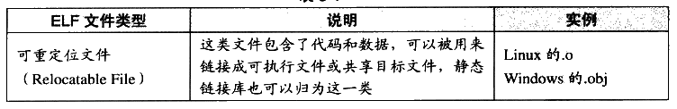

<details markdown="1"><summary>查看表格文字（已校对）</summary>

| ELF 文件类型 | 说明 | 实例 |
| --- | --- | --- |
| 可重定位文件（Relocatable File） | 这类文件包含了代码和数据，可以被用来链接成可执行文件或共享目标文件，静态链接库也可以归为这一类 | Linux 的 .o；Windows 的 .obj |

</details>

续表

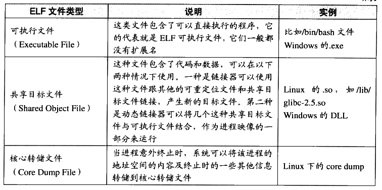

<details markdown="1"><summary>查看表格文字（已校对）</summary>

| ELF 文件类型 | 说明 | 实例 |
| --- | --- | --- |
| 可执行文件（Executable File） | 这类文件包含了可以直接执行的程序，它的代表就是 ELF 可执行文件，它们一般都没有扩展名 | 比如 /bin/bash 文件；Windows 的 .exe |
| 共享目标文件（Shared Object File） | 这种文件包含了代码和数据，可以在以下两种情况下使用。一种是链接器可以使用这种文件跟其他的可重定位文件和共享目标文件链接，产生新的目标文件。第二种是动态链接器可以将几个这种共享目标文件与可执行文件结合，作为进程映像的一部分来运行 | Linux 的 .so，如 /lib/glibc-2.5.so；Windows 的 DLL |
| 核心转储文件（Core Dump File） | 当进程意外终止时，系统可以将该进程的地址空间的内容及终止时的一些其他信息转储到核心转储文件 | Linux 下的 core dump |

</details>

我们可以在 Linux 下使用file 命令来查看相应的文件格式，上面几种文件在 file 命令下会显示出相应的类型：

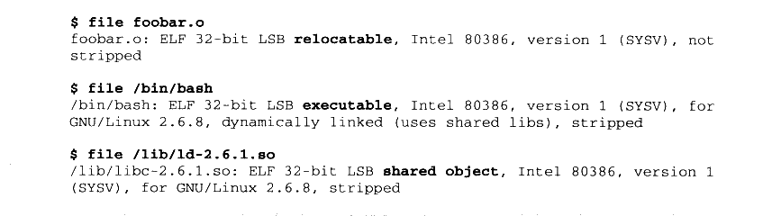

<details markdown="1"><summary>复制文字（已对照原图）</summary>

```text
$ file foobar.o
foobar.o: ELF 32-bit LSB relocatable, Intel 80386, version 1 (SYSV), not stripped

$ file /bin/bash
/bin/bash: ELF 32-bit LSB executable, Intel 80386, version 1 (SYSV), for GNU/Linux 2.6.8, dynamically linked (uses shared libs), stripped

$ file /lib/ld-2.6.1.so
/lib/libc-2.6.1.so: ELF 32-bit LSB shared object, Intel 80386, version 1 (SYSV), for GNU/Linux 2.6.8, stripped
```

</details>

目标文件与可执行文件格式的小历史

目标文件与可执行文件格式跟操作系统和编译器密切相关，所以不同的系统平台下会有不同的格式，但这些格式又大同小异，目标文件格式与可执行文件格式的历史几乎是操作系统的发展史。

COFF 是由 Unix System V Release 3 首先提出并且使用的格式规范，后来微软公司基于 COFF 格式，制定了 PE 格式标准，并将其用于当时的 Windows NT 系统。System VRelease 4在COFF 的基础上引入了ELF 格式，目前流行的 Linux 系统也以ELF 作为基本可执行文件格式。这也就是为什么目前PE 和ELF 如此相似的主要原因，因为它们都是源于同一种可执行文件格式 COFF。

Unix 最早的可执行文件格式为 a.out 格式，它的设计非常地简单，以至于后来共享库这个概念出现的时候，a.out 格式就变得捉襟见肘了。于是人们设计了 COFF 格式来解决这些问题，这个设计非常通用，以至于 COFF 的继承者到目前还在被广泛地使用。COFF 的主要贡献是在目标文件里面引入了“段”的机制，不同的目标文件可以拥有不同数量及不同类型的“段”。另外，它还定义了调试数据格式。

**注意：** 下文的剖析我们以ELF 结构为主。然后会专门分析 PE-COFF 文件结构，并对比其与 ELF 的异同。


## 3.2 目标文件是什么样的

我们大概能猜到，目标文件中的内容至少有编译后的机器指令代码、数据。没错，除了这些内容以外，目标文件中还包括了链接时所须要的一些信息，比如符号表、调试信息、字符串等。一般目标文件将这些信息按不同的属性，以“节”（Section）的形式存储，有时候也叫“段”（Segment），在一般情况下，它们都表示一个一定长度的区域，基本上不加以区别，唯一的区别是在 ELF 的链接视图和装载视图的时候，后面会专门提到。在本书中，默认情况下统一将它们称为“段”。

程序源代码编译后的机器指令经常被放在代码段（Code Section）里，代码段常见的名字有“.code”或“.text”；全局变量和局部静态变量数据经常放在数据段（Data Section），数据段的一般名字都叫 “.data”。让我们来看一个简单的程序被编译成目标文件后的结构，如图3-1所示。

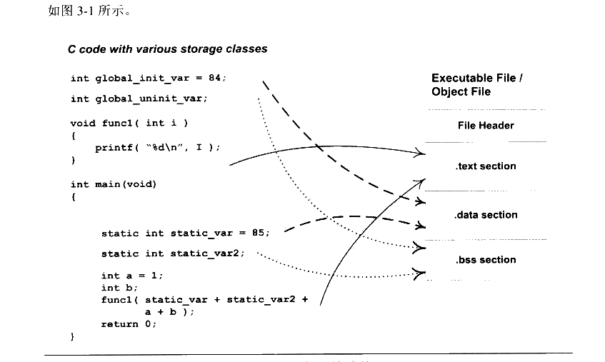

<p class="image-caption">图 3-1 程序与目标文件</p>

<details markdown="1"><summary>查看图中文字（已校对）</summary>

```text
C code with various storage classes
int global_init_var = 84;
int global_uninit_var;
void func1(int i)
{
    printf("%d\n", i);
}
int main(void)
{
    static int static_var = 85;
    static int static_var2;
    int a = 1;
    int b;
    func1(static_var + static_var2 + a + b);
    return 0;
}
Executable File / Object File
File Header; .text section; .data section; .bss section
```

</details>

假设图3-1的可执行文件（目标文件）的格式是ELF，从图中可以看到，ELF文件的开头是一个“文件头”，它描述了整个文件的文件属性，包括文件是否可执行、是静态链接还是动态链接及入口地址（如果是可执行文件）、目标硬件、目标操作系统等信息，文件头还包括一个段表（Section Table），段表其实是一个描述文件中各个段的数组。段表描述了文件中各个段在文件中的偏移位置及段的属性等，从段表里面可以得到每个段的所有信息。文件头后面就是各个段的内容，比如代码段保存的就是程序的指令，数据段保存的就是程序的静态变量等。

对照图3-1来看，一般C语言的编译后执行语句都编译成机器代码，保存在.text段：已初始化的全局变量和局部静态变量都保存在.data 段；未初始化的全局变量和局部静态变量一般放在一个叫“.bss”的段里。我们知道未初始化的全局变量和局部静态变量默认值都为0，本来它们也可以被放在.data 段的，但是因为它们都是0，所以为它们在.data 段分配空间并且存放数据0是没有必要的。程序运行的时候它们的确是要占内存空间的，并且可执行文件必须记录所有未初始化的全局变量和局部静态变量的大小总和，记为.bss段。所以.bss段只是为未初始化的全局变量和局部静态变量预留位置而已，它并没有内容，所以它在文件中也不占据空间。

BSS 历史

BSS （Block Started by Symbol）这个词最初是 UA-SAP 汇编器（ United Aircraft Symbolic Assembly Program）中的一个伪指令，用于为符号预留一块内存空间。该汇编器由美国联合航空公司于20世纪 50年代中期为IBM704大型机所开发。

后来BSS这个词被作为关键字引入到了IBM 709和7090/94机型上的标准汇编器FAP（Fortran Assembly Program），用于定义符号并且为该符号预留给定数量的未初始化空间。

Unix FAQ section 1.3（ http://www.faqs.org/faqs/unix-faq/faq/part1/section-3.html）里面有 Unix 和C语言之父 Dennis Rithcie 对BSS 这个词由来的解释。

总体来说，程序源代码被编译以后主要分成两种段：程序指令和程序数据。代码段属于程序指令，而数据段和.bss段属于程序数据。

很多人可能会有疑问：为什么要那么麻烦，把程序的指令和数据的存放分开？混杂地放在一个段里面不是更加简单？其实数据和指令分段的好处有很多。主要有如下几个方面。

- 一方面是当程序被装载后，数据和指令分别被映射到两个虚存区域。由于数据区域对于进程来说是可读写的，而指令区域对于进程来说是只读的，所以这两个虚存区域的权限可以被分别设置成可读写和只读。这样可以防止程序的指令被有意或无意地改写。

另外一方面是对于现代的CPU 来说，它们有着极为强大的缓存（Cache）体系。由于缓存在现代的计算机中地位非常重要，所以程序必须尽量提高缓存的命中率。指令区和数据区的分离有利于提高程序的局部性。现代CPU 的缓存一般都被设计成数据缓存和指令缓存分离，所以程序的指令和数据被分开存放对CPU 的缓存命中率提高有好处。

- 第三个原因，其实也是最重要的原因，就是当系统中运行着多个该程序的副本时，它们的指令都是一样的，所以内存中只须要保存一份该程序的指令部分。对于指令这种只读的区域来说是这样，对于其他的只读数据也一样，比如很多程序里面带有的图标、图片、文本等资源也是属于可以共享的。当然每个副本进程的数据区域是不一样的，它们是进程私有的。不要小看这个共享指令的概念，它在现代的操作系统里面占据了极为重要的地位，特别是在有动态链接的系统中，可以节省大量的内存。比如我们常用的 Windows Internet Explorer 7.0运行起来以后，它的总虚存空间为112844 KB，它的私有部分数据为15944 KB，即有96900 KB 的空间是共享部分（数据来源见图3-2）。

如果系统中运行了数百个进程，可以想象共享的方法来节省大量空间。关于内存共享的更为深入的内容我们将在装载这一章探讨。

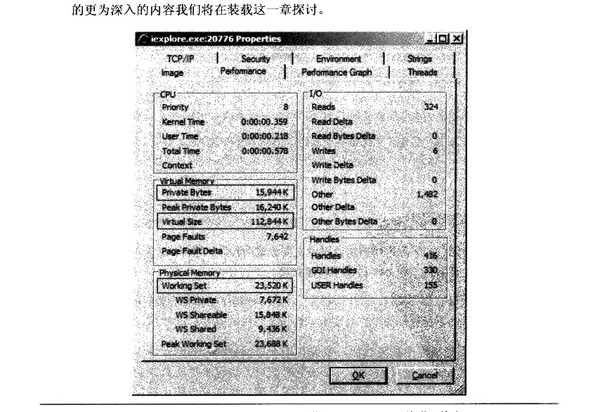

<p class="image-caption">图 3-2 Process Explorer 下查看进程IExplorer.exe 的进程信息</p>

<details markdown="1"><summary>查看图中文字（已校对）</summary>

```text
iexplore.exe:20776 Properties
TCP/IP; Security; Environment; Strings
Image; Performance; Performance Graph; Threads
CPU: Priority 8; Kernel Time 0:00:00.359; User Time 0:00:00.218; Total Time 0:00:00.578; Context
Virtual Memory:
Private Bytes 15,944 K; Peak Private Bytes 16,240 K; Virtual Size 112,844 K
Page Faults 7,642; Page Fault Delta
Physical Memory:
Working Set 23,520 K; WS Private 7,672 K; WS Shareable 15,848 K; WS Shared 9,436 K; Peak Working Set 23,688 K
I/O:
Reads 324; Read Delta; Read Bytes Delta 0
Writes 6; Write Delta; Write Bytes Delta 0
Other 1,482; Other Delta; Other Bytes Delta 0
Handles 416; GDI Handles 330; USER Handles 155
OK; Cancel
```

</details>


## 3.3 挖掘 SimpleSection.o

前面对于目标文件只是作了概念上的阐述，如果不彻底深入目标文件的具体细节，相信这样的分析也只是泛泛而谈，没有真正深入理解的效果。就像知道 TCP/IP 协议是基于包的结构，但是从来却没有看到过包的结构是怎样的，包的头部有哪些内容？目标地址和源地址是怎么存放的？如果不了解这些，那么对于 TCP/IP 的了解是粗略的，不够细致的。很多问题其实在表面上看似很简单，其实深入内部会发现很多鲜为人知的秘密，或者发现以前自己认为理所当然的东西居然是错误的，或者是有偏差的。对于系统软件也是如此，不了解 ELF文件的结构细节就像学习了 TCP/IP 网络没有了解IP 包头的结构一样。本节后面的内容就是以ELF 目标文件格式作为例子，彻底深入剖析目标文件，争取不放过任何一个字节。

真正了不起的程序员对自己的程序的每一个字节都了如指掌。

**—佚名**

我们就以前面提到过的SimpleSection.c编译出来的目标文件作为分析对象，这个程序是经过精心挑选的，具有一定的代表性而又不至于过于繁琐和复杂。在接下来所进行的一系列编译、链接和相关的实验过程中，我们将会用到第1章所提到过的工具套件，比如GCC编译器、binutils 等工具，如果你忘了这些工具怎么使用，那么在阅读过程中可以再回去参考本书第1部分的内容。图3-1中的程序代码如清单3-1所示。

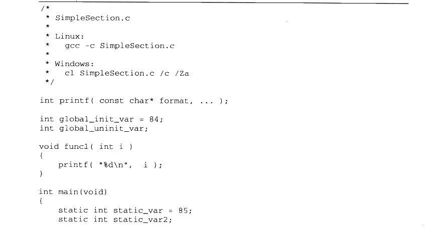

<details markdown="1"><summary>复制文字（已对照原图）</summary>

```text
/*
 * SimpleSection.c
 *
 * Linux:
 *   gcc -c SimpleSection.c
 *
 * Windows:
 *   cl SimpleSection.c /c /Za
 */
int printf(const char* format, ...);

int global_init_var = 84;
int global_uninit_var;

void func1(int i)
{
    printf("%d\n", i);
}

int main(void)
{
    static int static_var = 85;
    static int static_var2;
```

</details>

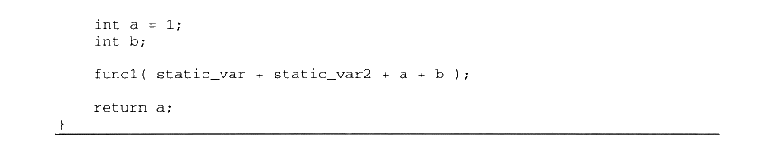

<details markdown="1"><summary>复制文字（已对照原图）</summary>

```text
    int a = 1;
    int b;

    func1(static_var + static_var2 + a + b);
    return a;
}
```

</details>

如不加说明，则以下所分析的都是32位 Intel x86 平台下的 ELF 文件格式。

我们使用GCC 来编译这个文件（参数-c 表示只编译不链接）：


<details markdown="1"><summary>复制文字（已对照原图）</summary>

```text
$ gcc -c SimpleSection.c
```

</details>

我们得到了一个1104字节（该文件大小可能会因为编译器版本以及机器平台不同而变化）的 SimpleSection.o 目标文件。我们可以使用 binutils 的工具 objdump 来查看 object 内部的结构，这个工具在第1部分已经介绍过了，它可以用来查看各种目标文件的结构和内容。运行以下命令：

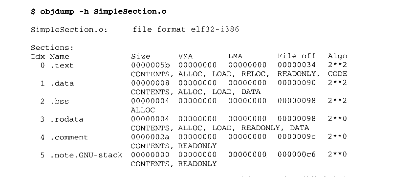

<details markdown="1"><summary>复制文字（已对照原图）</summary>

```text
$ objdump -h SimpleSection.o
SimpleSection.o: file format elf32-i386
Sections:
Idx Name             Size     VMA      LMA      File off Algn
 0 .text             0000005b 00000000 00000000 00000034 2**2
                     CONTENTS, ALLOC, LOAD, RELOC, READONLY, CODE
 1 .data             00000008 00000000 00000000 00000090 2**2
                     CONTENTS, ALLOC, LOAD, DATA
 2 .bss              00000004 00000000 00000000 00000098 2**2
                     ALLOC
 3 .rodata           00000004 00000000 00000000 00000098 2**0
                     CONTENTS, ALLOC, LOAD, READONLY, DATA
 4 .comment          0000002a 00000000 00000000 0000009c 2**0
                     CONTENTS, READONLY
 5 .note.GNU-stack   00000000 00000000 00000000 000000c6 2**0
                     CONTENTS, READONLY
```

</details>

GCC 和binutils 可被移植到各种平台上，所以它们支持多种目标文件格式。比如 Windows下的GCC 和 binutils 支持PE 文件格式、Linux版本支持 ELF 格式。Linux 还有一个很不错的工具叫 readelf，它是专门针对ELF文件格式的解析器，很多时候它对ELF 文件的分析可以跟 objdump 相互对照，所以我们下面会经常用到这个工具。

参数“-h”就是把 ELF文件的各个段的基本信息打印出来。我们也可以使用 “objdump -x”把更多的信息打印出来，但是“-x”输出的这些信息又多又复杂，对于不熟悉 ELF 和objdump 的读者来说可能会很陌生。我们还是先把 ELF 段的结构分析清楚。从上面的结果来看，SimpleSection.o 的段的数量比我们想象中的要多，除了最基本的代码段、数据段和BSS段以外，还有3个段分别是只读数据段（.rodata）、注释信息段（.comment） 和堆栈提示段（.note.GNU-stack），这3个额外的段的意义我们暂且不去细究。先来看看几个重要的段的属性，其中最容易理解的是段的长度（Size）和段所在的位置（File Offset），每个段的第2行中的“CONTENTS”、“ALLOC”等表示段的各种属性，“CONTENTS”表示该段在文件中存在。我们可以看到BSS段没有“CONTENTS”，表示它实际上在 ELF 文件中不存在内容。“.note.GNU-stack”段虽然有“CONTENTS”，但它的长度为0，这是个很古怪的段，我们暂且忽略它，认为它在ELF文件中也不存在。那么ELF 文件中实际存在的也就是“.text”、“.data”、 “.rodata” 和“.comment”这4个段了，它们的长度和在文件中的偏移位置我们已经用粗体表示出来了。它们在 ELF 中的结构如图3-3所示。

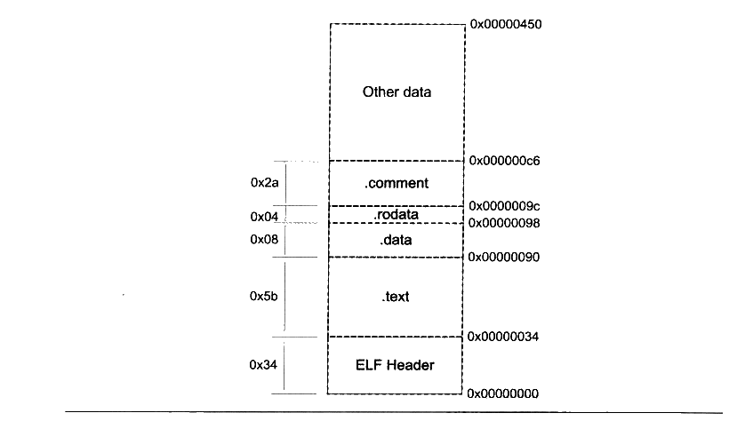

<p class="image-caption">图 3-3 SimpleSection.o</p>

<details markdown="1"><summary>查看图中文字（已校对）</summary>

```text
ELF Header: 0x00000000 — 0x00000034 (0x34)
.text: 0x00000034 — 0x00000090 (0x5b)
.data: 0x00000090 — 0x00000098 (0x08)
.rodata: 0x00000098 — 0x0000009c (0x04)
.comment: 0x0000009c — 0x000000c6 (0x2a)
Other data: 0x000000c6 — 0x00000450
```

</details>

了解了这几个段在 SimpleSection.o 的基本分布，接着将逐个来看这几个段，看看它们包含了什么内容。

有一个专门的命令叫做 “size”，它可以用来查看 ELF 文件的代码段、数据段和 BSS段的长度（dec 表示3个段长度的和的十进制，hex 表示长度和的十六进制）


<details markdown="1"><summary>复制文字（已对照原图）</summary>

```text
$ size SimpleSection.o
text data bss dec hex filename
95   8    4   107 6b  SimpleSection.o
```

</details>

#### 3.3.1 代码段

挖掘各个段的内容，我们还是离不开 objdump这个利器。objdump 的“-s”参数可以将所有段的内容以十六进制的方式打印出来，“-d”参数可以将所有包含指令的段反汇编。我们将 objdump 输出中关于代码段的内容提取出来，分析一下关于代码段的内容（省略号表示略去无关内容）：

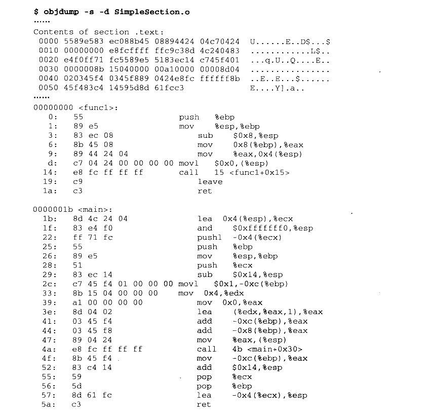

<details markdown="1"><summary>复制文字（已对照原图）</summary>

```text
$ objdump -s -d SimpleSection.o
......
Contents of section .text:
0000 5589e583 ec088b45 08894424 04c70424 U......E..D$...$
0010 00000000 e8fcffff ffc9c38d 4c240483 ............L$..
0020 e4f0ff71 fc5589e5 5183ec14 c745f401 ...q.U..Q....E..
0030 0000008b 15040000 00a10000 00008d04 ................
0040 020345f4 0345f889 0424e8fc ffffff8b ..E..E...$......
0050 45f483c4 14595d8d 61fcc3 E....Y].a..
......
00000000 <func1>:
   0: 55                   push %ebp
   1: 89 e5                mov %esp,%ebp
   3: 83 ec 08             sub $0x8,%esp
   6: 8b 45 08             mov 0x8(%ebp),%eax
   9: 89 44 24 04          mov %eax,0x4(%esp)
   d: c7 04 24 00 00 00 00 movl $0x0,(%esp)
  14: e8 fc ff ff ff       call 15 <func1+0x15>
  19: c9                   leave
  1a: c3                   ret
0000001b <main>:
  1b: 8d 4c 24 04          lea 0x4(%esp),%ecx
  1f: 83 e4 f0             and $0xfffffff0,%esp
  22: ff 71 fc             pushl -0x4(%ecx)
  25: 55                   push %ebp
  26: 89 e5                mov %esp,%ebp
  28: 51                   push %ecx
  29: 83 ec 14             sub $0x14,%esp
  2c: c7 45 f4 01 00 00 00 movl $0x1,-0xc(%ebp)
  33: 8b 15 04 00 00 00    mov 0x4,%edx
  39: a1 00 00 00 00       mov 0x0,%eax
  3e: 8d 04 02             lea (%edx,%eax,1),%eax
  41: 03 45 f4             add -0xc(%ebp),%eax
  44: 03 45 f8             add -0x8(%ebp),%eax
  47: 89 04 24             mov %eax,(%esp)
  4a: e8 fc ff ff ff       call 4b <main+0x30>
  4f: 8b 45 f4             mov -0xc(%ebp),%eax
  52: 83 c4 14             add $0x14,%esp
  55: 59                   pop %ecx
  56: 5d                   pop %ebp
  57: 8d 61 fc             lea -0x4(%ecx),%esp
  5a: c3                   ret
```

</details>

“Contents of section .text” 就是.text 的数据以十六进制方式打印出来的内容，总共0x5b字节，跟前面我们了解到的“.text”段长度相符合，最左面一列是偏移量，中间4列是十六进制内容，最右面一列是.text 段的 ASCII码形式。对照下面的反汇编结果，可以很明显地看到，text 段里所包含的正是 SimpleSection.c 里两个函数 func1()和 main（）的指令。text 段的第一个字节“0x55”就是“func1()”函数的第一条“push %ebp” 指令，而最后一个字节0xc3正是 main()函数的最后一条指令“ret”。

#### 3.3.2 数据段和只读数据段

.data 段保存的是那些已经初始化了的全局静态变量和局部静态变量。前面的SimpleSection.c代码里面一共有两个这样的变量，分别是 global\_init\_var 与 static\_var。这两个变量每个4个字节，一共刚好8个字节，所以“.data”这个段的大小为8个字节。

SimpleSection.c里面我们在调用“printf”的时候，用到了一个字符串常量`%d\n`，它是一种只读数据，所以它被放到了“.rodata”段，我们可以从输出结果看到 “.rodata”这个段的4个字节刚好是这个字符串常量的 ASCII 字节序，最后以0结尾。

“.rodata”段存放的是只读数据，一般是程序里面的只读变量（如 const 修饰的变量）和字符串常量。单独设立“.rodata”段有很多好处，不光是在语义上支持了 C++的 const 关键字，而且操作系统在加载的时候可以将“.rodata”段的属性映射成只读，这样对于这个段的任何修改操作都会作为非法操作处理，保证了程序的安全性。另外在某些嵌入式平台下，有些存储区域是采用只读存储器的，如 ROM，这样将“.rodata”段放在该存储区域中就可以保证程序访问存储器的正确性。

另外值得一提的是，有时候编译器会把字符串常量放到“.data”段，而不会单独放在“.rodata”段。有兴趣的读者可以试着把 SimpleSection.c 的文件名改成 SimpleSection.cpp，然后用各种 MSVC编译器编译一下看看字符串常量的存放情况。

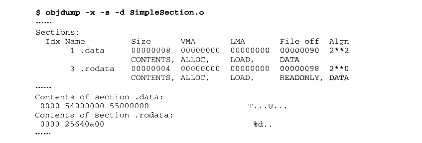

<details markdown="1"><summary>复制文字（已对照原图）</summary>

```text
$ objdump -x -s -d SimpleSection.o
......
Sections:
Idx Name Size     VMA      LMA      File off Algn
 1 .data 00000008 00000000 00000000 00000090 2**2
         CONTENTS, ALLOC, LOAD, DATA
 3 .rodata 00000004 00000000 00000000 00000098 2**0
           CONTENTS, ALLOC, LOAD, READONLY, DATA
......
Contents of section .data:
0000 54000000 55000000 T...U...
Contents of section .rodata:
0000 25640a00 %d..
......
```

</details>

我们看到“.data”段里的前4个字节，从低到高分别为0x54、0x00、0x00、0x00。这个值刚好是 global\_init\_var，即十进制的84。global\_init\_var 是个4 字节长度的 int类型，为什么存放的次序为0x54、0x00、0x00、0x00而不是0x00、0x00、0x00、0x54？这涉及 CPU 的字节序（Byte Order）的问题，也就是所谓的大端（Big-endian）和小端（Little-endian）的问题。关于字节序的问题本书的附录有详细的介绍。而最后4个字节刚好是 static\_var 的值，即85。

#### 3.3.3 BSS 段

.bss 段存放的是未初始化的全局变量和局部静态变量，如上述代码中 global\_uninit\_var和 static\_var2 就是被存放在.bss段，其实更准确的说法是.bss段为它们预留了空间。但是我们可以看到该段的大小只有4个字节，这与global\_uninit\_var 和static\_var2 的大小的8个字节不符。

其实我们可以通过符号表（Symbol Table）（后面章节介绍符号表）看到，只有 static\_var2被存放在了.bss段，而 global\_uninit\_var 却没有被存放在任何段，只是一个未定义的“COMMON 符号”。这其实是跟不同的语言与不同的编译器实现有关，有些编译器会将全局的未初始化变量存放在目标文件.bss 段，有些则不存放，只是预留一个未定义的全局变量符号，等到最终链接成可执行文件的时候再在.bss 段分配空间。我们将在“弱符号与强符号”和“COMMON块”这两个章节深入分析这个问题。原则上讲，我们可以简单地把它当作全局未初始化变量存放在.bss 段。值得一提的是编译单元内部可见的静态变量（比如给global\_uninit\_var 加上static 修饰）的确是存放在.bss段的，这一点很容易理解。

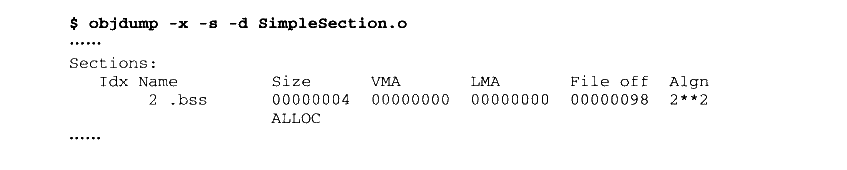

<details markdown="1"><summary>复制文字（已对照原图）</summary>

```text
$ objdump -x -s -d SimpleSection.o
......
Sections:
Idx Name Size     VMA      LMA      File off Algn
 2 .bss 00000004 00000000 00000000 00000098 2**2
        ALLOC
......
```

</details>

Quiz 变量存放位置

现在让我们来做一个小的测试，请看以下代码：


<details markdown="1"><summary>复制文字（已对照原图）</summary>

```text
static int x1 = 0;
static int x2 = 1;
```

</details>

x1 和x2 会被放在什么段中呢？

x1 会被放在.bss 中，x2会被放在.data 中。为什么一个在.bss段，一个在.data 段？因为x1为0，可以认为是未初始化的，因为未初始化的都是0，所以被优化掉了可以放在.bss，这样可以节省磁盘空间，因为.bss 不占磁盘空间。另外一个变量x2 初始化值1，是初始化的，所以放在.data段中。

这种类似的编译器的优化会对我们分析系统软件背后的机制带来很多障碍，使得很多问题不能一目了然，本书将尽量避开这些优化过程，还原机制和原理本身。

#### 3.3.4 其他段

除了.text、.data、.bss 这3个最常用的段之外，ELF 文件也有可能包含其他的段，用来保存与程序相关的其他信息。表3-2中列举了 ELF 的一些常见的段。

表3-2

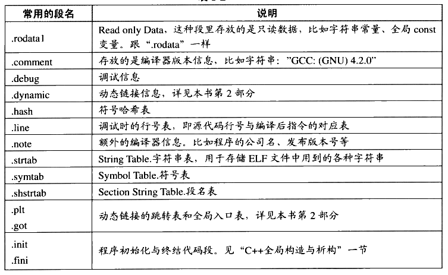

<details markdown="1"><summary>查看表格文字（已校对）</summary>

| 常用的段名 | 说明 |
| --- | --- |
| .rodata1 | Read only Data，这种段里存放的是只读数据，比如字符串常量、全局 const 变量。跟“.rodata”一样 |
| .comment | 存放的是编译器版本信息，比如字符串："GCC: (GNU) 4.2.0" |
| .debug | 调试信息 |
| .dynamic | 动态链接信息，详见本书第 2 部分 |
| .hash | 符号哈希表 |
| .line | 调试时的行号表，即源代码行号与编译后指令的对应表 |
| .note | 额外的编译器信息。比如程序的公司名、发布版本号等 |
| .strtab | String Table. 字符串表，用于存储 ELF 文件中用到的各种字符串 |
| .symtab | Symbol Table. 符号表 |
| .shstrtab | Section String Table. 段名表 |
| .plt、.got | 动态链接的跳转表和全局入口表，详见本书第 2 部分 |
| .init、.fini | 程序初始化与终结代码段。见“C++全局构造与析构”一节 |

</details>

这些段的名字都是由“.”作为前缀，表示这些表的名字是系统保留的，应用程序也可以使用一些非系统保留的名字作为段名。比如我们可以在ELF 文件中插入一个“music”的段，里面存放了一首 MP3音乐，当ELF 文件运行起来以后可以读取这个段播放这首MP3。但是应用程序自定义的段名不能使用“.”作为前缀，否则容易跟系统保留段名冲突。一个ELF 文件也可以拥有几个相同段名的段，比如一个 ELF 文件中可能有两个或两个以上叫做“.text”的段。还有一些保留的段名是因为 ELF 文件历史遗留问题造成的，以前用过的一些名字如.sdata、.idesc、.sbss、.lit4、.lit8、.reginfo、.gptab、.liblist、.conflict。可以不用理会这些段，它们已经被遗弃了。

**Q：** 如果我们要将一个二进制文件，比如图片、MP3 音乐、词典一类的东西作为目标文件

中的一个段，该怎么做？

A：可以使用 objcopy 工具，比如我们有一个图片文件 “image.jpg”，大小为0x82100字节：

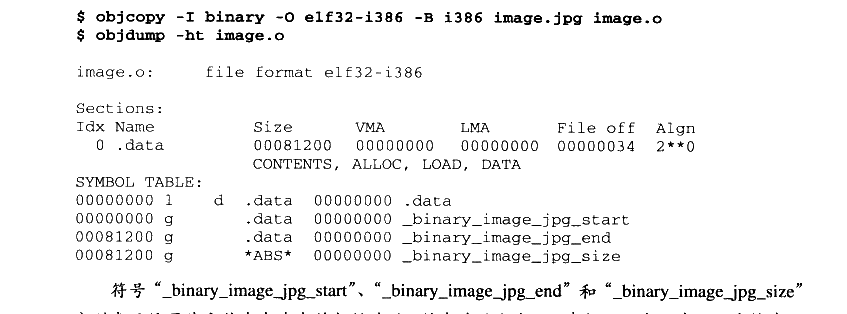

<details markdown="1"><summary>复制文字（已对照原图）</summary>

```text
$ objcopy -I binary -O elf32-i386 -B i386 image.jpg image.o
$ objdump -ht image.o
image.o: file format elf32-i386
Sections:
Idx Name Size     VMA      LMA      File off Algn
 0 .data 00081200 00000000 00000000 00000034 2**0
         CONTENTS, ALLOC, LOAD, DATA
SYMBOL TABLE:
00000000 l d .data 00000000 .data
00000000 g   .data 00000000 _binary_image_jpg_start
00081200 g   .data 00000000 _binary_image_jpg_end
00081200 g   *ABS* 00000000 _binary_image_jpg_size
```

</details>

符号“`_binary_image_jpg_start`”、“`_binary_image_jpg_end`”和“`_binary_image_jpg_size`”分别表示该图片文件在内存中的起始地址、结束地址和大小，我们可以在程序里面直接声明并使用它们。

自定义段

正常情况下，GCC 编译出来的目标文件中，代码会被放到 “.text”段，全局变量和静态变量会被放到“.data”和“.bss”段，正如我们前面所分析的。但是有时候你可能希望变量或某些部分代码能够放到你所指定的段中去，以实现某些特定的功能。比如为了满足某些硬件的内存和I/O 的地址布局，或者是像 Linux 操作系统内核中用来完成一些初始化和用户空间复制时出现页错误异常等。GCC 提供了一个扩展机制，使得程序员可以指定变量所处的段：

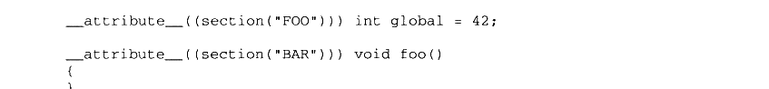

<details markdown="1"><summary>复制文字（已对照原图）</summary>

```text
__attribute__((section("FOO"))) int global = 42;
__attribute__((section("BAR"))) void foo()
{
}
```

</details>

我们在全局变量或函数之前加上 `__attribute__((section("name")))`属性就可以把相应的变量或函数放到以 “name” 作为段名的段中。


## 3.4 ELF 文件结构描述

我们已经通过 SimpleSection.o 的结构大致了解了 ELF 文件的轮廓，接着就来看看 ELF文件的结构格式。图3-4描述的是 ELF 目标文件的总体结构，我们省去了 ELF一些繁琐的结构，把最重要的结构提取出来，形成了如图 3-4所示的 ELF 文件基本结构图，随着我们讨论的展开，ELF 文件结构会在这个基本结构之上慢慢变得复杂起来。


<p class="image-caption">图 3-4 ELF 结构</p>

<details markdown="1"><summary>查看图中文字（已校对）</summary>

```text
ELF Header
.text
.data
.bss
...
other sections
Section header table
String Tables
Symbol Tables
...
```

</details>

ELF 目标文件格式的最前部是 ELF 文件头（ELF Header），它包含了描述整个文件的基本属性，比如ELF 文件版本、目标机器型号、程序入口地址等。紧接着是 ELF 文件各个段。其中 ELF 文件中与段有关的重要结构就是段表（Section Header Table），该表描述了ELF 文件包含的所有段的信息，比如每个段的段名、段的长度、在文件中的偏移、读写权限及段的其他属性。接着将详细分析 ELF 文件头、段表等 ELF 关键的结构。另外还会介绍一些ELF 中辅助的结构，比如字符串表、符号表等，这些结构我们在本节只是简单介绍一下，到相关章节中再详细展开。

#### 3.4.1 文件头

我们可以用readelf 命令来详细查看 ELF 文件，代码如清单3-2所示。

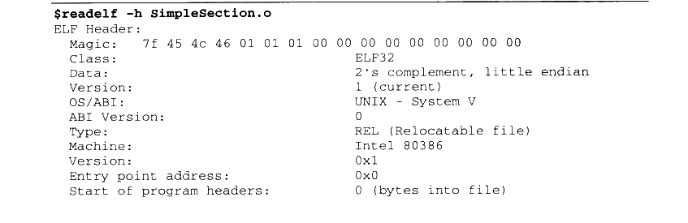

<details markdown="1"><summary>复制文字（已对照原图）</summary>

```text
$readelf -h SimpleSection.o
ELF Header:
  Magic: 7f 45 4c 46 01 01 01 00 00 00 00 00 00 00 00 00
  Class: ELF32
  Data: 2's complement, little endian
  Version: 1 (current)
  OS/ABI: UNIX - System V
  ABI Version: 0
  Type: REL (Relocatable file)
  Machine: Intel 80386
  Version: 0x1
  Entry point address: 0x0
  Start of program headers: 0 (bytes into file)
```

</details>

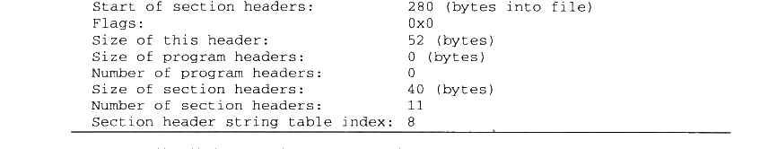

<details markdown="1"><summary>复制文字（已对照原图）</summary>

```text
  Start of section headers: 280 (bytes into file)
  Flags: 0x0
  Size of this header: 52 (bytes)
  Size of program headers: 0 (bytes)
  Number of program headers: 0
  Size of section headers: 40 (bytes)
  Number of section headers: 11
  Section header string table index: 8
```

</details>

从上面输出的结果可以看到，ELF 的文件头中定义了 ELF 魔数、文件机器字节长度、数据存储方式、版本、运行平台、ABI版本、ELF 重定位类型、硬件平台、硬件平台版本、入口地址、程序头入口和长度、段表的位置和长度及段的数量等。这些数值中有关描述 ELF目标平台的部分，与我们常见的32位Intel 的硬件平台基本上一样。

ELF 文件头结构及相关常数被定义在 “/usr/include/elf.h”里，因为 ELF 文件在各种平台下都通用，ELF 文件有32位版本和64位版本。它的文件头结构也有这两种版本，分别叫做“Elf32\_Ehdr”和“Elf64\_Ehdr”。32位版本与64位版本的ELF 文件的文件头内容是一样的，只不过有些成员的大小不一样。为了对每个成员的大小做出明确的规定以便于在不同的编译环境下都拥有相同的字段长度，“elf.h”使用 typedef 定义了一套自己的变量体系，如表3-3所示。

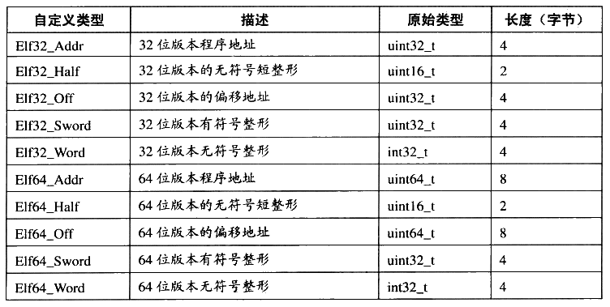

<details markdown="1"><summary>查看表格文字（已校对）</summary>

| 自定义类型 | 描述 | 原始类型 | 长度（字节） |
| --- | --- | --- | --- |
| Elf32_Addr | 32 位版本程序地址 | uint32_t | 4 |
| Elf32_Half | 32 位版本的无符号短整型 | uint16_t | 2 |
| Elf32_Off | 32 位版本的偏移地址 | uint32_t | 4 |
| Elf32_Sword | 32 位版本有符号整型 | uint32_t | 4 |
| Elf32_Word | 32 位版本无符号整型 | int32_t | 4 |
| Elf64_Addr | 64 位版本程序地址 | uint64_t | 8 |
| Elf64_Half | 64 位版本的无符号短整型 | uint16_t | 2 |
| Elf64_Off | 64 位版本的偏移地址 | uint64_t | 8 |
| Elf64_Sword | 64 位版本有符号整型 | uint32_t | 4 |
| Elf64_Word | 64 位版本无符号整型 | int32_t | 4 |

</details>

我们这里以32位版本的文件头结构 “Elf32\_Ehdr” 作为例子来描述，它的定义如下：

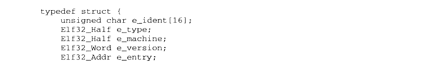

<details markdown="1"><summary>复制文字（已对照原图）</summary>

```text
typedef struct {
    unsigned char e_ident[16];
    Elf32_Half e_type;
    Elf32_Half e_machine;
    Elf32_Word e_version;
    Elf32_Addr e_entry;
```

</details>

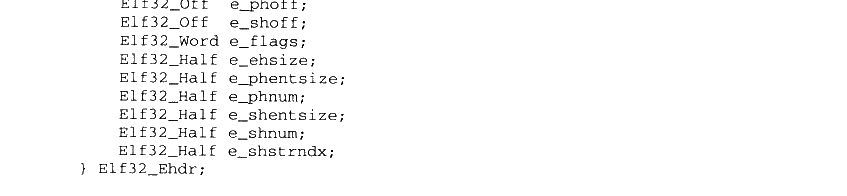

<details markdown="1"><summary>复制文字（已对照原图）</summary>

```text
    Elf32_Off e_phoff;
    Elf32_Off e_shoff;
    Elf32_Word e_flags;
    Elf32_Half e_ehsize;
    Elf32_Half e_phentsize;
    Elf32_Half e_phnum;
    Elf32_Half e_shentsize;
    Elf32_Half e_shnum;
    Elf32_Half e_shstrndx;
} Elf32_Ehdr;
```

</details>

让我们拿 ELF 文件头结构跟前面 readelf 输出的ELF 文件头信息相比照，可以看到输出的信息与 ELF 文件头中的结构很多都一一对应。有点例外的是 “Elf32\_Ehdr” 中的e\_ident这个成员对应了 readelf 输出结果中的“Class”、“Data”.“Version ”、 “OS/ABI”和“ABI Version ”这5个参数。剩下的参数与“Elf32\_Ehdr”中的成员都一一对应。我们在表3-4中简单地列举一下，让大家有个初步的印象，详细的定义可以在ELF 标准文档里面找到。表3-4是ELF文件头中各个成员的含义与readelf 输出结果的对照表。

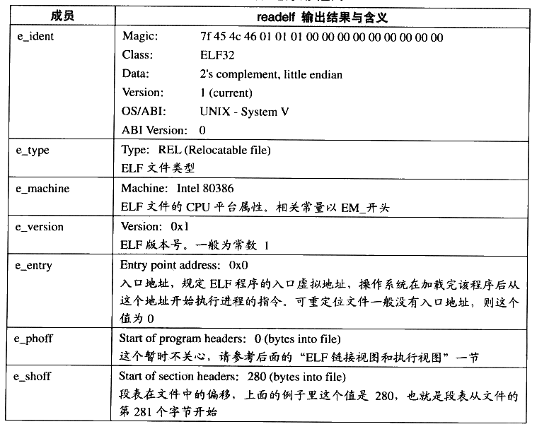

<details markdown="1"><summary>查看表格文字（已校对）</summary>

| 成员 | readelf 输出结果与含义 |
| --- | --- |
| e_ident | Magic: 7f 45 4c 46 01 01 01 00 00 00 00 00 00 00 00 00<br>Class: ELF32<br>Data: 2's complement, little endian<br>Version: 1 (current)<br>OS/ABI: UNIX - System V<br>ABI Version: 0 |
| e_type | Type: REL (Relocatable file)<br>ELF 文件类型 |
| e_machine | Machine: Intel 80386<br>ELF 文件的 CPU 平台属性。相关常量以 EM_ 开头 |
| e_version | Version: 0x1<br>ELF 版本号。一般为常数 1 |
| e_entry | Entry point address: 0x0<br>入口地址，规定 ELF 程序的入口虚拟地址，操作系统在加载完该程序后从这个地址开始执行进程的指令。可重定位文件一般没有入口地址，则这个值为 0 |
| e_phoff | Start of program headers: 0 (bytes into file)<br>这个暂时不关心，请参考后面的“ELF 链接视图和执行视图”一节 |
| e_shoff | Start of section headers: 280 (bytes into file)<br>段表在文件中的偏移，上面的例子里这个值是 280，也就是段表从文件的第 281 个字节开始 |

</details>

续表

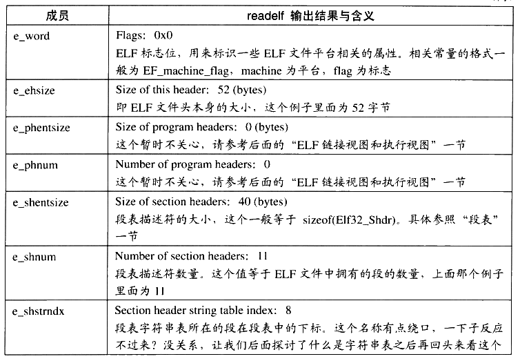

<details markdown="1"><summary>查看表格文字（已校对）</summary>

| 成员 | readelf 输出结果与含义 |
| --- | --- |
| e_flags | Flags: 0x0<br>ELF 标志位，用来标识一些 ELF 文件平台相关的属性。相关常量的格式一般为 EF_machine_flag，machine 为平台，flag 为标志 |
| e_ehsize | Size of this header: 52 (bytes)<br>即 ELF 文件头本身的大小，这个例子里面为 52 字节 |
| e_phentsize | Size of program headers: 0 (bytes)<br>这个暂时不关心，请参考后面的“ELF 链接视图和执行视图”一节 |
| e_phnum | Number of program headers: 0<br>这个暂时不关心，请参考后面的“ELF 链接视图和执行视图”一节 |
| e_shentsize | Size of section headers: 40 (bytes)<br>段表描述符的大小，这个一般等于 sizeof(Elf32_Shdr)。具体参照“段表”一节 |
| e_shnum | Number of section headers: 11<br>段表描述符数量。这个值等于 ELF 文件中拥有的段的数量，上面那个例子里面为 11 |
| e_shstrndx | Section header string table index: 8<br>段表字符串表所在的段在段表中的下标。这个名称有点绕口，一下子反应不过来？没关系，让我们后面探讨了什么是字符串表之后再回头来看这个 |

</details>

这些段的相关常量都定义在“elf.h”里面，我们在表3-5中会列举一些常见的常量，完整的常量定义请参考“elf.h”。

ELF 魔数 我们可以从前面 readelf 的输出看到，最前面的“Magic”的16 个字节刚好对应“Elf32\_Ehdr”的e\_ident这个成员。这16 个字节被 ELF 标准规定用来标识 ELF 文件的平台属性，比如这个 ELF字长（32位/64位）、字节序、ELF 文件版本，如图3-5所示。

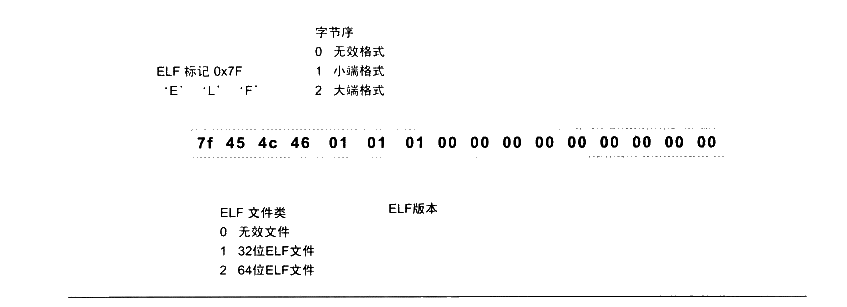

<p class="image-caption">图3-5 ELF 魔数</p>

<details markdown="1"><summary>查看图中文字（已校对）</summary>

```text
ELF 标记 0x7F；'E'；'L'；'F'
7f 45 4c 46 01 01 01 00 00 00 00 00 00 00 00 00
ELF 文件类：0 无效文件；1 32位ELF文件；2 64位ELF文件
字节序：0 无效格式；1 小端格式；2 大端格式
ELF版本
```

</details>

最开始的4个字节是所有 ELF 文件都必须相同的标识码，分别为0x7F、0x45、0x4C、0x46，第一个字节对应ASCII 字符里面的 DEL 控制符，后面3个字节刚好是 ELF这3个字母的 ASCII 码。这4个字节又被称为ELF 文件的魔数，几乎所有的可执行文件格式的最开始的几个字节都是魔数。比如 a.out 格式最开始两个字节为 0x01、0x07:PE/COFF 文件最开始两个字节为0x4d、0x5a，即 ASCII 字符 MZ。这种魔数用来确认文件的类型，操作系统在加载可执行文件的时候会确认魔数是否正确，如果不正确会拒绝加载。

接下来的一个字节是用来标识 ELF 的文件类的，0x01表示是32位的，0x02表示是64位的：第6个字节是字节序，规定该 ELF 文件是大端的还是小端的（见附录：字节序）。第7个字节规定 ELF 文件的主版本号，一般是1，因为 ELF 标准自1.2版以后就再也没有更新了。后面的9个字节 ELF 标准没有定义，一般填0，有些平台会使用这9个字节作为扩展标志。

各种魔数的由来a.out 格式的魔数为0x01、0x07，为什么会规定这个魔数呢？

UNIX早年是在PDP 小型机上诞生的，当时的系统在加载一个可执行文件后直接从文件的第一个字节开始执行，人们一般在文件的最开始放置一条跳转（jump）指令，这条指令负责跳过接下来的7个机器字的文件头到可执行文件的真正入口。而0x010x07这两个字节刚好是当时 PDP-11的机器的跳转7个机器字的指令。为了跟以前的系统保持兼容性，这条跳转指令被当作魔数一直被保留到了几十年后的今天。

计算机系统中有很多怪异的设计背后有着很有趣的历史和传统，了解它们的由来可以让我们了解到很多很有意思的事情。这让我想起了经济学里面所谓的“路径依赖”，其中一个很有意思的叫“马屁股决定航天飞机”的故事在网上流传很广泛，有兴趣的话你可以在 google 以“马屁股”和“航天飞机”作为关键字搜索一下。

ELF 文件标准历史

20世纪90年代，一些厂商联合成立了一个委员会，起草并发布了一个 ELF 文件格式标准供公开使用，并且希望所有人能够遵循这项标准并且从中获益。1993年，委员会发布了 ELF 文件标准。当时参与该委员会的有来自于编译器的厂商，如Watcom 和Borland：来自 CPU的厂商如IBM 和 Intel；来自操作系统的厂商如IBM 和 Microsoft。1995年，委员会发布了 ELF 1.2 标准，自此委员会完成了自己的使命，不久就解散了。所以ELF 文件格式标准的最新版本为1.2。

文件类型 e\_type 成员表示 ELF 文件类型，即前面提到过的3种 ELF 文件类型，每个文件类型对应一个常量。系统通过这个常量来判断 ELF 的真正文件类型，而不是通过文件的扩展名。相关常量以 “ET\_”开头，如表3-5所示。表3-5

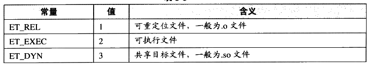

<details markdown="1"><summary>查看表格文字（已校对）</summary>

| 常量 | 值 | 含义 |
| --- | --- | --- |
| ET_REL | 1 | 可重定位文件，一般为 .o 文件 |
| ET_EXEC | 2 | 可执行文件 |
| ET_DYN | 3 | 共享目标文件，一般为 .so 文件 |

</details>

机器类型 ELF 文件格式被设计成可以在多个平台下使用。这并不表示同一个 ELF 文件可以在不同的平台下使用（就像java 的字节码文件那样），而是表示不同平台下的ELF 文件都遵循同一套 ELF 标准。e\_machine 成员就表示该 ELF 文件的平台属性，比如3表示该ELF 文件只能在Intel x86 机器下使用，这也是我们最常见的情况。相关的常量以“EM\_”开头，如表3-6所示。

表 3-6

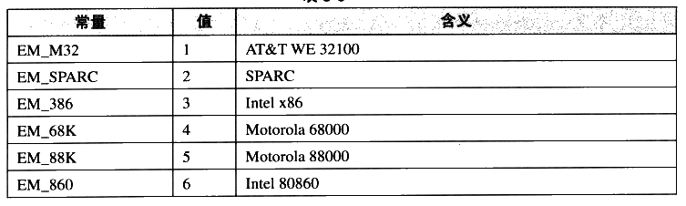

<details markdown="1"><summary>查看表格文字（已校对）</summary>

| 常量 | 值 | 含义 |
| --- | --- | --- |
| EM_M32 | 1 | AT&T WE 32100 |
| EM_SPARC | 2 | SPARC |
| EM_386 | 3 | Intel x86 |
| EM_68K | 4 | Motorola 68000 |
| EM_88K | 5 | Motorola 88000 |
| EM_860 | 6 | Intel 80860 |

</details>

#### 3.4.2 段表

我们知道 ELF 文件中有很多各种各样的段，这个段表（Section Header Table）就是保存这些段的基本属性的结构。段表是 ELF 文件中除了文件头以外最重要的结构，它描述了ELF 的各个段的信息，比如每个段的段名、段的长度、在文件中的偏移、读写权限及段的其他属性。也就是说，ELF 文件的段结构就是由段表决定的，编译器、链接器和装载器都是依靠段表来定位和访问各个段的属性的。段表在 ELF 文件中的位置由 ELF 文件头的“e\_shoff”成员决定，比如 SimpleSection.o 中，段表位于偏移 0x118。

前文中我们使用了 “objdump -h”来查看 ELF 文件中包含的段，结果是 SimpleSection里面看到了总共有6个段，分别是“.code”、“.data”、“.bss”、“.rodata”、“.comment” 和“.note.GNU-stack”。实际上的情况却有所不同，“objdump -h” 命令只是把ELF 文件中关键的段显示了出来，而省略了其他的辅助性的段，比如：符号表、字符串表、段名字符串表、重定位表等。我们可以使用 readelf 工具来查看 ELF 文件的段，它显示出来的结果才是真正的段表结构：

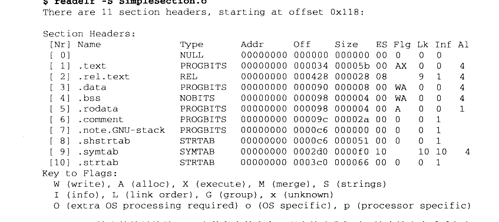

<details markdown="1"><summary>复制文字（已对照原图）</summary>

```text
$ readelf -S SimpleSection.o
There are 11 section headers, starting at offset 0x118:
Section Headers:
[Nr] Name            Type     Addr     Off    Size   ES Flg Lk Inf Al
[ 0]                 NULL     00000000 000000 000000 00      0  0  0
[ 1] .text           PROGBITS 00000000 000034 00005b 00 AX   0  0  4
[ 2] .rel.text       REL      00000000 000428 000028 08      9  1  4
[ 3] .data           PROGBITS 00000000 000090 000008 00 WA   0  0  4
[ 4] .bss            NOBITS   00000000 000098 000004 00 WA   0  0  4
[ 5] .rodata         PROGBITS 00000000 000098 000004 00 A    0  0  1
[ 6] .comment        PROGBITS 00000000 00009c 00002a 00      0  0  1
[ 7] .note.GNU-stack PROGBITS 00000000 0000c6 000000 00      0  0  1
[ 8] .shstrtab       STRTAB   00000000 0000c6 000051 00      0  0  1
[ 9] .symtab         SYMTAB   00000000 0002d0 0000f0 10     10 10  4
[10] .strtab         STRTAB   00000000 0003c0 000066 00      0  0  1
Key to Flags:
W (write), A (alloc), X (execute), M (merge), S (strings)
I (info), L (link order), G (group), x (unknown)
O (extra OS processing required) o (OS specific), p (processor specific)
```

</details>

readelf 输出的结果就是 ELF 文件段表的内容，那么就让我们对照这个输出来看看段表的结构。段表的结构比较简单，它是一个以“Elf32\_Shdr”结构体为元素的数组。数组元素的个数等于段的个数，每个“Elf32\_Shdr”结构体对应一个段。“Elf32\_Shdr”又被称为段描述符（Section Descriptor）。对于 SimpleSection.o来说，段表就是有11个元素的数组。ELF段表的这个数组的第一个元素是无效的段描述符，它的类型为“NULL”，除此之外每个段描述符都对应一个段。也就是说 SimpleSection.o 共有10个有效的段。

数组的存放方式ELF 文件里面很多地方采用了这种与段表类似的数组方式保存。一般定义一个固定长度的结构，然后依次存放。这样我们就可以使用下标来引用某个结构。

Elf32\_Shdr被定义在“/usr/include/elf.h”，代码如清单3-3所示。

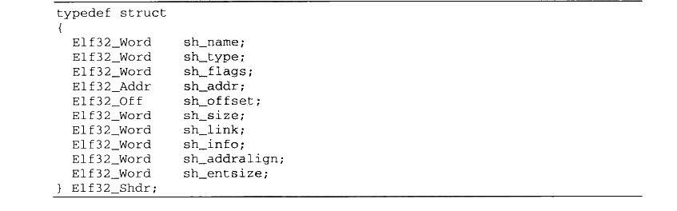

<details markdown="1"><summary>复制文字（已对照原图）</summary>

```text
typedef struct
{
    Elf32_Word sh_name;
    Elf32_Word sh_type;
    Elf32_Word sh_flags;
    Elf32_Addr sh_addr;
    Elf32_Off sh_offset;
    Elf32_Word sh_size;
    Elf32_Word sh_link;
    Elf32_Word sh_info;
    Elf32_Word sh_addralign;
    Elf32_Word sh_entsize;
} Elf32_Shdr;
```

</details>

Elf32\_Shdr 的各个成员的含义如表3-7所示。

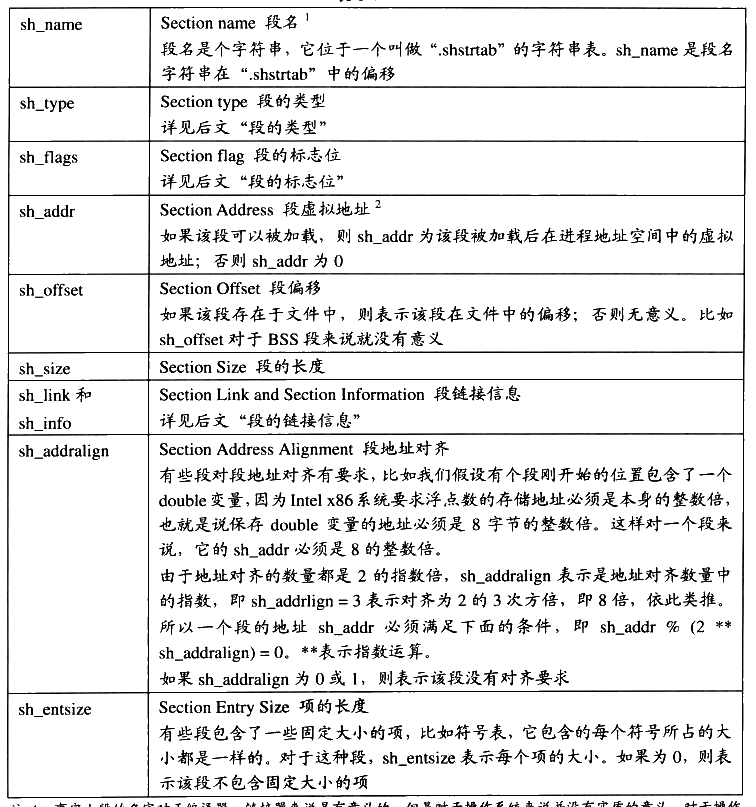

<details markdown="1"><summary>查看表格文字（已校对）</summary>

| 成员 | 含义 |
| --- | --- |
| sh_name | Section name 段名¹<br>段名是个字符串，它位于一个叫做“.shstrtab”的字符串表。sh_name 是段名字符串在“.shstrtab”中的偏移 |
| sh_type | Section type 段的类型<br>详见后文“段的类型” |
| sh_flags | Section flag 段的标志位<br>详见后文“段的标志位” |
| sh_addr | Section Address 段虚拟地址²<br>如果该段可以被加载，则 sh_addr 为该段被加载后在进程地址空间中的虚拟地址；否则 sh_addr 为 0 |
| sh_offset | Section Offset 段偏移<br>如果该段存在于文件中，则表示该段在文件中的偏移；否则无意义。比如 sh_offset 对于 BSS 段来说就没有意义 |
| sh_size | Section Size 段的长度 |
| sh_link 和 sh_info | Section Link and Section Information 段链接信息<br>详见后文“段的链接信息” |
| sh_addralign | Section Address Alignment 段地址对齐<br>有些段对段地址对齐有要求，比如我们假设有个段刚开始的位置包含了一个 double 变量，因为 Intel x86 系统要求浮点数的存储地址必须是本身的整数倍，也就是说保存 double 变量的地址必须是 8 字节的整数倍。这样对一个段来说，它的 sh_addr 必须是 8 的整数倍。<br>由于地址对齐的数量都是 2 的指数倍，sh_addralign 表示是地址对齐数量中的指数，即 sh_addralign = 3 表示对齐为 2 的 3 次方倍，即 8 倍，依此类推。所以一个段的地址 sh_addr 必须满足下面的条件，即 `sh_addr % (2 ** sh_addralign) = 0`。**表示指数运算。<br>如果 sh_addralign 为 0 或 1，则表示该段没有对齐要求 |
| sh_entsize | Section Entry Size 项的长度<br>有些段包含了一些固定大小的项，比如符号表，它包含的每个符号的大小都是一样的。对于这种段，sh_entsize 表示每个项的大小。如果为 0，则表示该段不包含固定大小的项 |

</details>

注1：事实上段的名字对于编译器、链接器来说是有意义的，但是对于操作系统来说并没有实质的意义，对于操作系统来说，一个段该如何处理取决于它的属性和权限，即由段的类型和段的标志位这两个成员决定，注 2：关于这些字段，涉及一些映像文件的加载的概念，我们将在本书的第 2部分详细介绍其相关内容，读者也可以先阅读第2部分的最前面一章“可执行文件的装载与进程”，了解一下加载的概念，然后再来阅读关于段的虚拟大小和虚拟地址的内容。当然，如果读者对映像文件加载过程比较熟悉，应该很容易理解这些内容，

让我们对照 Elf32\_Shdr 和“readelf -S”的输出结果，可以很明显看到，结构体的每一个成员对应于输出结果中从第二列 “Name” 开始的每一列。于是 SimpleSection 的段表的位置如图3-6所示。到了这一步，我们才彻彻底底把 SimpleSection 的所有段的位置和长度给分析清楚了。在图3-6中，SectionTable 长度 0x1b8，也就是440个字节，它包含了11个段描述符，每个段描述符为40个字节，这个长度刚好等于 sizeof（Elf32\_Shdr），符合段描述符的结构体长度：整个文件最后一个段“.rel.text” 结束后，长度为 0x450，即 1104字节，即刚好是SimpleSection.o 的文件长度。中间 Section Table 和“.rel.text” 都为对齐的原因，与前面的段之间分别有一个字节和两个字节的间隔。

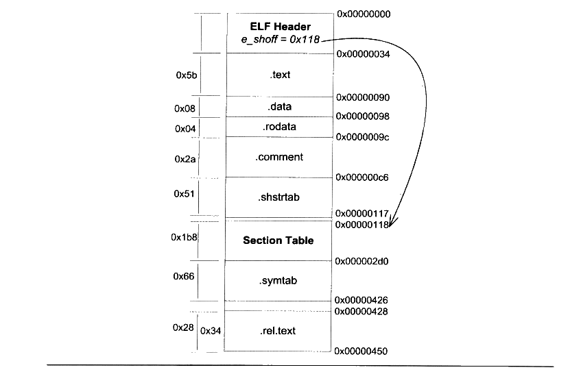

<p class="image-caption">图 3-6 SimpleSection.o 的 Section Table 及所有段的位置和长度</p>

<details markdown="1"><summary>查看图中文字（已校对）</summary>

```text
ELF Header: e_shoff = 0x118
.text; .data; .rodata; .comment; .shstrtab; Section Table; .symtab; .rel.text
地址（从上到下）：
0x00000000; 0x00000034; 0x00000090; 0x00000098; 0x0000009c
0x000000c6; 0x00000117; 0x00000118; 0x000002d0; 0x00000426; 0x00000428; 0x00000450
左侧大小标记：0x5b; 0x08; 0x04; 0x2a; 0x51; 0x1b8; 0x66; 0x28; 0x34
```

</details>

段的类型（sh\_type）正如前面所说的，段的名字只是在链接和编译过程中有意义，但它不能真正地表示段的类型。我们也可以将一个数据段命名为“text”，对于编译器和链接器来说，主要决定段的属性的是段的类型（sh\_type）和段的标志位（sh\_flags）。段的类型相关常量以 SHT\_开头，列举如表3-8所示。

表 3-8

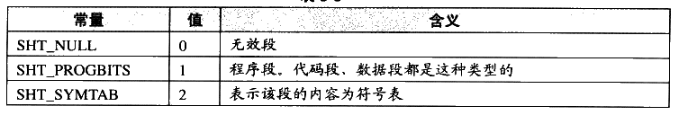

<details markdown="1"><summary>查看表格文字（已校对）</summary>

| 常量 | 值 | 含义 |
| --- | --- | --- |
| SHT_NULL | 0 | 无效段 |
| SHT_PROGBITS | 1 | 程序段、代码段、数据段都是这种类型的 |
| SHT_SYMTAB | 2 | 表示该段的内容为符号表 |

</details>

续表

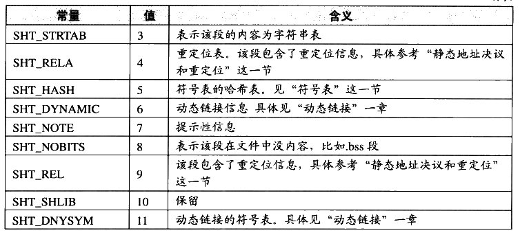

<details markdown="1"><summary>查看表格文字（已校对）</summary>

| 常量 | 值 | 含义 |
| --- | --- | --- |
| SHT_STRTAB | 3 | 表示该段的内容为字符串表 |
| SHT_RELA | 4 | 重定位表。该段包含了重定位信息，具体参考“静态地址决议和重定位”这一节 |
| SHT_HASH | 5 | 符号表的哈希表。见“符号表”这一节 |
| SHT_DYNAMIC | 6 | 动态链接信息。具体见“动态链接”一章 |
| SHT_NOTE | 7 | 提示性信息 |
| SHT_NOBITS | 8 | 表示该段在文件中没内容，比如 .bss 段 |
| SHT_REL | 9 | 该段包含了重定位信息，具体参考“静态地址决议和重定位”这一节 |
| SHT_SHLIB | 10 | 保留 |
| SHT_DYNSYM | 11 | 动态链接的符号表。具体见“动态链接”一章 |

</details>

段的标志位（sh\_flag）段的标志位表示该段在进程虚拟地址空间中的属性，比如是否可写，是否可执行等。相关常量以 SHF\_开头，如表3-9所示。

表3-9

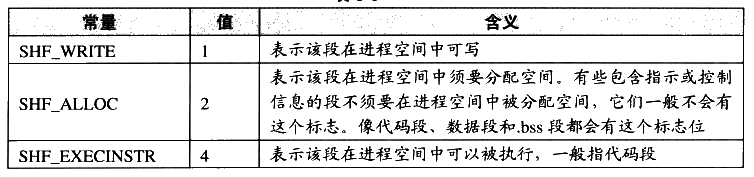

<details markdown="1"><summary>查看表格文字（已校对）</summary>

| 常量 | 值 | 含义 |
| --- | --- | --- |
| SHF_WRITE | 1 | 表示该段在进程空间中可写 |
| SHF_ALLOC | 2 | 表示该段在进程空间中须要分配空间。有些包含指示或控制信息的段不须要在进程空间中被分配空间，它们一般不会有这个标志。像代码段、数据段和 .bss 段都会有这个标志位 |
| SHF_EXECINSTR | 4 | 表示该段在进程空间中可以被执行，一般指代码段 |

</details>

对于系统保留段，表3-10列举了它们的属性。

表3-10

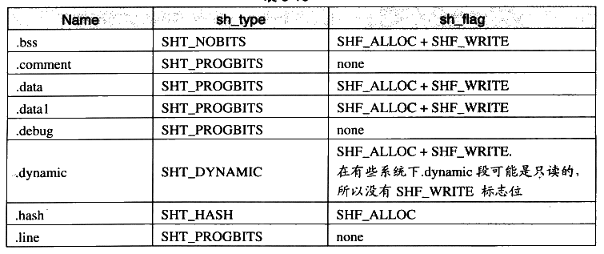

<details markdown="1"><summary>查看表格文字（已校对）</summary>

| Name | sh_type | sh_flag |
| --- | --- | --- |
| .bss | SHT_NOBITS | SHF_ALLOC + SHF_WRITE |
| .comment | SHT_PROGBITS | none |
| .data | SHT_PROGBITS | SHF_ALLOC + SHF_WRITE |
| .data1 | SHT_PROGBITS | SHF_ALLOC + SHF_WRITE |
| .debug | SHT_PROGBITS | none |
| .dynamic | SHT_DYNAMIC | SHF_ALLOC + SHF_WRITE<br>在有些系统下 .dynamic 段可能是只读的，所以没有 SHF_WRITE 标志位 |
| .hash | SHT_HASH | SHF_ALLOC |
| .line | SHT_PROGBITS | none |

</details>

续表

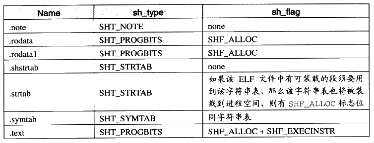

<details markdown="1"><summary>查看表格文字（已校对）</summary>

| Name | sh_type | sh_flag |
| --- | --- | --- |
| .note | SHT_NOTE | none |
| .rodata | SHT_PROGBITS | SHF_ALLOC |
| .rodata1 | SHT_PROGBITS | SHF_ALLOC |
| .shstrtab | SHT_STRTAB | none |
| .strtab | SHT_STRTAB | 如果该 ELF 文件中有可装载的段须要用到该字符串表，那么该字符串表也将被装载到进程空间，则有 SHF_ALLOC 标志位 |
| .symtab | SHT_SYMTAB | 同字符串表 |
| .text | SHT_PROGBITS | SHF_ALLOC + SHF_EXECINSTR |

</details>

段的链接信息（sh\_link、sh\_info） 如果段的类型是与链接相关的（不论是动态链接或静态链接），比如重定位表、符号表等，那么sh\_link 和 sh\_info这两个成员所包含的意义如表3-11所示。对于其他类型的段，这两个成员没有意义。

表3-11

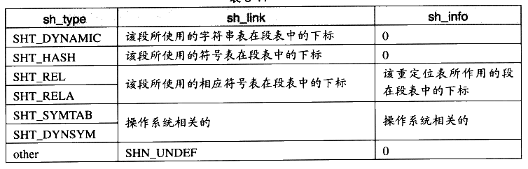

<details markdown="1"><summary>查看表格文字（已校对）</summary>

| sh_type | sh_link | sh_info |
| --- | --- | --- |
| SHT_DYNAMIC | 该段所使用的字符串表在段表中的下标 | 0 |
| SHT_HASH | 该段所使用的符号表在段表中的下标 | 0 |
| SHT_REL、SHT_RELA | 该段所使用的相应符号表在段表中的下标 | 该重定位表所作用的段在段表中的下标 |
| SHT_SYMTAB、SHT_DYNSYM | 操作系统相关的 | 操作系统相关的 |
| other | SHN_UNDEF | 0 |

</details>

#### 3.4.3 重定位表

我们注意到，SimpleSection.o 中有一个叫做 “.rel.text” 的段，它的类型（sh\_type）为“SHT\_REL”，也就是说它是一个重定位表（Relocation Table）。正如我们最开始所说的，链接器在处理目标文件时，须要对目标文件中某些部位进行重定位，即代码段和数据段中那些对绝对地址的引用的位置。这些重定位的信息都记录在ELF 文件的重定位表里面，对于每个须要重定位的代码段或数据段，都会有一个相应的重定位表。比如 SimpleSection.o 中的“.rel.text” 就是针对“text”段的重定位表，因为“text”段中至少有一个绝对地址的引用，那就是对 “printf”函数的调用：而“data” 段则没有对绝对地址的引用，它只包含了几个常量，所以 SimpleSection.o 中没有针对“.data” 段的重定位表“.rel.data”。

一个重定位表同时也是 ELF 的一个段，那么这个段的类型（sh\_type）就是“SHT\_REL”类型的，它的“sh\_link”表示符号表的下标，它的“sh\_info”表示它作用于哪个段。比如“.rel.text”作用于“text”段，而“text”段的下标为“1”，那么“.rel.text” 的“sh\_info” 为“1”。

关于重定位表的内部结构我们在这里先不展开了，在下一章分析静态链接过程的时候，我们还会详细地分析重定位表的结构。

#### 3.4.4 字符串表

ELF 文件中用到了很多字符串，比如段名、变量名等。因为字符串的长度往往是不定的，所以用固定的结构来表示它比较困难。一种很常见的做法是把字符串集中起来存放到一个表，然后使用字符串在表中的偏移来引用字符串。比如表3-12这个字符串表。

表3-12

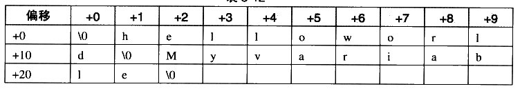

<details markdown="1"><summary>查看表格文字（已校对）</summary>

| 偏移 | +0 | +1 | +2 | +3 | +4 | +5 | +6 | +7 | +8 | +9 |
| --- | --- | --- | --- | --- | --- | --- | --- | --- | --- | --- |
| +0 | `\0` | h | e | l | l | o | w | o | r | l |
| +10 | d | `\0` | M | y | v | a | r | i | a | b |
| +20 | l | e | `\0` |  |  |  |  |  |  |  |

</details>

那么偏移与它们对应的字符串如表3-13所示。

表3-13

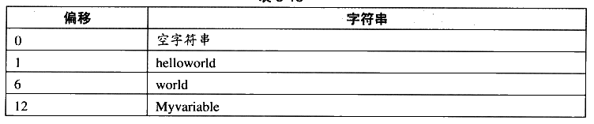

<details markdown="1"><summary>查看表格文字（已校对）</summary>

| 偏移 | 字符串 |
| --- | --- |
| 0 | 空字符串 |
| 1 | helloworld |
| 6 | world |
| 12 | Myvariable |

</details>

通过这种方法，在ELF 文件中引用字符串只须给出一个数字下标即可，不用考虑字符串长度的问题。一般字符串表在 ELF文件中也以段的形式保存，常见的段名为“.strtab” 或“.shstrtab”。这两个字符串表分别为字符串表（String Table）和段表字符串表 （Section Header String Table）。顾名思义，字符串表用来保存普通的字符串，比如符号的名字；段表字符串表用来保存段表中用到的字符串，最常见的就是段名（sh\_name）。

接着我们再回头看这个 ELF 文件头中的“e\_shstrndx”的含义，我们在前面提到过，“e\_shstrndx”是Elf32\_Ehdr 的最后一个成员，它是 “Section header string table index ”的缩写。我们知道段表字符串表本身也是ELF 文件中的一个普通的段，知道它的名字往往叫做“.shstrtab”。那么这个 “e\_shstrndx”就表示“.shstrtab”在段表中的下标，即段表字符串表在段表中的下标。前面的 SimpleSection.o 中，“e\_shstrndx ”的值为8，我们再对照“readelf -S”的输出结果，可以看到“.shstrtab”这个段刚好位于段表中的下标为8的位置上。由此，我们可以得出结论，只有分析 ELF 文件头，就可以得到段表和段表字符串表的位置，从而解析整个 ELF 文件。


## 3.5 链接的接口——符号

链接过程的本质就是要把多个不同的目标文件之间相互“粘”到一起，或者说像玩具积木一样，可以拼装形成一个整体。为了使不同目标文件之间能够相互粘合，这些目标文件之间必须有固定的规则才行，就像积木模块必须有凹凸部分才能够拼合。在链接中，目标文件之间相互拼合实际上是目标文件之间对地址的引用，即对函数和变量的地址的引用。比如目标文件B 要用到了目标文件 A中的函数“foo”，那么我们就称目标文件 A 定义（Define）了函数“foo”，称目标文件B 引用（Reference）了目标文件A 中的函数“foo”。这两个概念也同样适用于变量。每个函数或变量都有自己独特的名字，才能避免链接过程中不同变量和函数之间的混淆。在链接中，我们将函数和变量统称为符号（Symbol），函数名或变量名就是符号名（Symbol Name）。

我们可以将符号看作是链接中的粘合剂，整个链接过程正是基于符号才能够正确完成。链接过程中很关键的一部分就是符号的管理，每一个目标文件都会有一个相应的符号表（Symbol Table），这个表里面记录了目标文件中所用到的所有符号。每个定义的符号有一个对应的值，叫做符号值（Symbol Value），对于变量和函数来说，符号值就是它们的地址。除了函数和变量之外，还存在其他几种不常用到的符号。我们将符号表中所有的符号进行分类，它们有可能是下面这些类型中的一种：

- 定义在本目标文件的全局符号，可以被其他目标文件引用。比如 SimpleSection.o 里面的“func1”、“main” 和 “global\_init\_var”。

- 在本目标文件中引用的全局符号，却没有定义在本目标文件，这一般叫做外部符号（External Symbol），也就是我们前面所讲的符号引用。比如 SimpleSection.o 里面的“printf”。

- 段名，这种符号往往由编译器产生，它的值就是该段的起始地址。比如 SimpleSection.o里面的“text”、“.data”等。

- 局部符号，这类符号只在编译单元内部可见。比如 SimpleSection.o 里面的 “static\_var”和“static\_var2”。调试器可以使用这些符号来分析程序或崩溃时的核心转储文件。这些局部符号对于链接过程没有作用，链接器往往也忽略它们。

- 行号信息，即目标文件指令与源代码中代码行的对应关系，它也是可选的。

对于我们来说，最值得关注的就是全局符号，即上面分类中的第一类和第二类。因为链接过程只关心全局符号的相互“粘合”，局部符号、段名、行号等都是次要的，它们对于其他目标文件来说是“不可见”的，在链接过程中也是无关紧要的。我们可以使用很多工具来查看 ELF 文件的符号表，比如 readelf、objdump、nm 等，比如使用“nm”来查看“SimpleSection.o” 的符号结果如下：

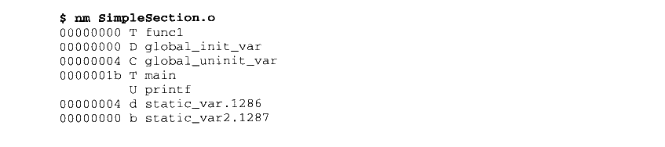

<details markdown="1"><summary>复制文字（已对照原图）</summary>

```text
$ nm SimpleSection.o
00000000 T func1
00000000 D global_init_var
00000004 C global_uninit_var
0000001b T main
         U printf
00000004 d static_var.1286
00000000 b static_var2.1287
```

</details>

#### 3.5.1 ELF 符号表结构

ELF 文件中的符号表往往是文件中的一个段，段名一般叫“.symtab”。符号表的结构很简单，它是一个 Elf32\_Sym 结构（32位ELF 文件）的数组，每个 Elf32\_Sym 结构对应一个符号。这个数组的第一个元素，也就是下标0的元素为无效的“未定义”符号。Elf32\_Sym的结构定义如下：

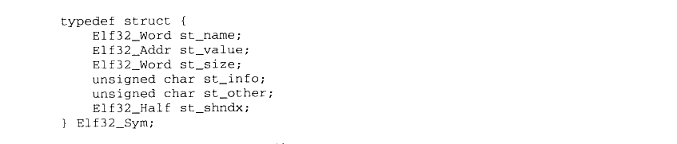

<details markdown="1"><summary>复制文字（已对照原图）</summary>

```text
typedef struct {
    Elf32_Word st_name;
    Elf32_Addr st_value;
    Elf32_Word st_size;
    unsigned char st_info;
    unsigned char st_other;
    Elf32_Half st_shndx;
} Elf32_Sym;
```

</details>

这几个成员的定义如表3-14所示。

表3-14

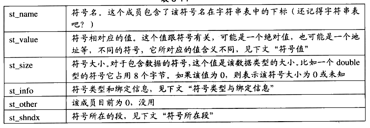

<details markdown="1"><summary>查看表格文字（已校对）</summary>

| 成员 | 含义 |
| --- | --- |
| st_name | 符号名。这个成员包含了该符号名在字符串表中的下标（还记得字符串表吧？） |
| st_value | 符号相对应的值。这个值跟符号有关，可能是一个绝对值，也可能是一个地址等。不同的符号，它所对应的值含义不同，见下文“符号值” |
| st_size | 符号大小。对于包含数据的符号，这个值是该数据类型的大小。比如一个 double 型的符号它占用 8 个字节。如果该值为 0，则表示该符号大小为 0 或未知 |
| st_info | 符号类型和绑定信息，见下文“符号类型与绑定信息” |
| st_other | 该成员目前为 0，没用 |
| st_shndx | 符号所在的段，见下文“符号所在段” |

</details>

符号类型和绑定信息（st\_info）该成员低4位表示符号的类型（Symbol Type），高28位表示符号绑定信息（Symbol Binding），如表3-15、表3-16所示。表3-15

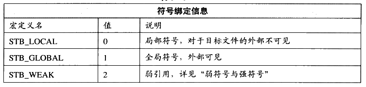

<details markdown="1"><summary>查看表格文字（已校对）</summary>

| 宏定义名 | 值 | 说明 |
| --- | --- | --- |
| STB_LOCAL | 0 | 局部符号，对于目标文件的外部不可见 |
| STB_GLOBAL | 1 | 全局符号，外部可见 |
| STB_WEAK | 2 | 弱引用，详见“弱符号与强符号” |

</details>

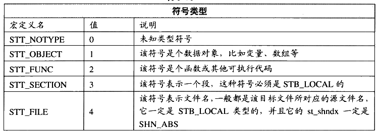

<details markdown="1"><summary>查看表格文字（已校对）</summary>

| 宏定义名 | 值 | 说明 |
| --- | --- | --- |
| STT_NOTYPE | 0 | 未知类型符号 |
| STT_OBJECT | 1 | 该符号是个数据对象，比如变量、数组等 |
| STT_FUNC | 2 | 该符号是个函数或其他可执行代码 |
| STT_SECTION | 3 | 该符号表示一个段，这种符号必须是 STB_LOCAL 的 |
| STT_FILE | 4 | 该符号表示文件名，一般都是该目标文件所对应的源文件名，它一定是 STB_LOCAL 类型的，并且它的 st_shndx 一定是 SHN_ABS |

</details>

符号所在段（st\_shndx）如果符号定义在本目标文件中，那么这个成员表示符号所在的段在段表中的下标；但是如果符号不是定义在本目标文件中，或者对于有些特殊符号，st\_shndx 的值有些特殊，如表3-17所示。

表3-17

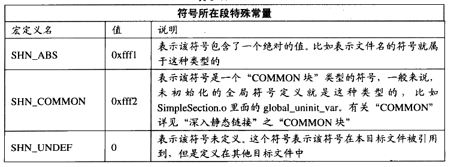

<details markdown="1"><summary>查看表格文字（已校对）</summary>

| 宏定义名 | 值 | 说明 |
| --- | --- | --- |
| SHN_ABS | 0xfff1 | 表示该符号包含了一个绝对的值。比如表示文件名的符号就属于这种类型的 |
| SHN_COMMON | 0xfff2 | 表示该符号是一个“COMMON 块”类型的符号，一般来说，未初始化的全局符号定义就是这种类型的，比如 SimpleSection.o 里面的 global_uninit_var。有关“COMMON”详见“深入静态链接”之“COMMON 块” |
| SHN_UNDEF | 0 | 表示该符号未定义。这个符号表项表示该符号在本目标文件被引用到，但是定义在其他目标文件中 |

</details>

符号值（st\_value）我们前面已经介绍过，每个符号都有一个对应的值，如果这个符号是一个函数或变量的定义，那么符号的值就是这个函数或变量的地址，更准确地讲应该按下面这几种情况区别对待。

- 在目标文件中，如果是符号的定义并且该符号不是“COMMON 块”类型的（即 st\_shndx不为 SHN\_COMMON，具体请参照“深入静态链接”一章中的“COMMON 块”），则st\_value 表示该符号在段中的偏移。即符号所对应的函数或变量位于由 st\_shndx 指定的段，偏移 st\_value 的位置。这也是目标文件中定义全局变量的符号的最常见情况，比如SimpleSection.o中的“func1”、“main” 和 “global\_init\_var”。

- 在目标文件中，如果符号是“COMMON 块”类型的（即 st\_shndx 为 SHN\_COMMON），则 st\_value 表示该符号的对齐属性。比如 SimpleSection.o 中的“global\_uninit\_var”。

- 在可执行文件中，st\_value 表示符号的虚拟地址。这个虚拟地址对于动态链接器来说十分有用。我们将在第3部分讲述动态链接器。

根据上面的介绍，我们对 ELF 文件的符号表有了大致的了解，接着将以 SimpleSection.o里面的符号为例子，分析各个符号在符号表中的状态。这里使用readelf 工具来查看ELF 文件的符号，虽然 objdump 工具也可以达到同样的目的，但是总体来看 readelf 的输出格式更为清晰：

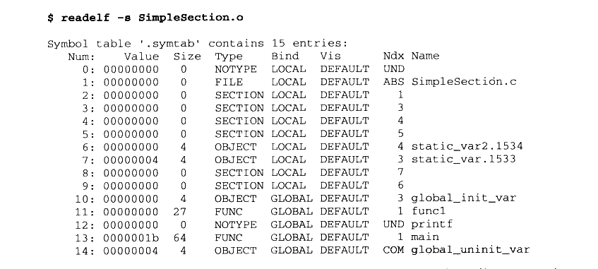

<details markdown="1"><summary>复制文字（已对照原图）</summary>

```text
$ readelf -s SimpleSection.o

Symbol table '.symtab' contains 15 entries:
 Num: Value    Size Type    Bind   Vis      Ndx Name
   0: 00000000    0 NOTYPE  LOCAL  DEFAULT  UND
   1: 00000000    0 FILE    LOCAL  DEFAULT  ABS SimpleSection.c
   2: 00000000    0 SECTION LOCAL  DEFAULT    1
   3: 00000000    0 SECTION LOCAL  DEFAULT    3
   4: 00000000    0 SECTION LOCAL  DEFAULT    4
   5: 00000000    0 SECTION LOCAL  DEFAULT    5
   6: 00000000    4 OBJECT  LOCAL  DEFAULT    4 static_var2.1534
   7: 00000004    4 OBJECT  LOCAL  DEFAULT    3 static_var.1533
   8: 00000000    0 SECTION LOCAL  DEFAULT    7
   9: 00000000    0 SECTION LOCAL  DEFAULT    6
  10: 00000000    4 OBJECT  GLOBAL DEFAULT    3 global_init_var
  11: 00000000   27 FUNC    GLOBAL DEFAULT    1 func1
  12: 00000000    0 NOTYPE  GLOBAL DEFAULT  UND printf
  13: 0000001b   64 FUNC    GLOBAL DEFAULT    1 main
  14: 00000004    4 OBJECT  GLOBAL DEFAULT  COM global_uninit_var
```

</details>

readelf 的输出格式与上面描述的 Elf32\_Sym 的各个成员几乎一一对应，第一列Num 表示符号表数组的下标，从0开始，共15个符号；第二列 Value 就是符号值，即 st\_value：第三列 Size 为符号大小，即 st\_size：第四列和第五列分别为符号类型和绑定信息，即对应 st\_info的低4位和高28位：第六列 Vis 目前在C/C++语言中未使用，我们可以暂时忽略它；第七列Ndx即 st\_shndx，表示该符号所属的段：当然最后一列也最明显，即符号名称。从上面的输出可以看到，第一个符号，即下标为0的符号，永远是一个未定义的符号。对于另外几个符号解释如下。

func1 和 main 函数都是定义在 SimpleSection.c里面的，它们所在的位置都为代码段，所以 Ndx 为1，即 SimpleSection.o里面，text 段的下标为1。这一点可以通过 readelf -a或 objdump-x得到验证。它们是函数，所以类型是 STT\_FUNC：它们是全局可见的，所以是STB\_GLOBAL:Size 表示函数指令所占的字节数：Value 表示函数相对于代码段起始位置的偏移量。

- 再来看 printf这个符号，该符号在 SimpleSection.c 里面被引用，但是没有被定义。所以它的 Ndx 是 SHN\_UNDEF。

- global\_init\_var 是已初始化的全局变量，它被定义在.bss 段，即下标为3。

- global\_uninit\_var 是未初始化的全局变量，它是一个 SHN\_COMMON 类型的符号，它本身并没有存在于 BSS段：关于未初始化的全局变量具体请参见“COMMON 块”。

- static\_var.1533 和 static\_var2.1534是两个静态变量，它们的绑定属性是 STB\_LOCAL，即只是编译单元内部可见。至于为什么它们的变量名从“static\_var”和“static\_var2”变成了现在这两个“static\_var.1533”和“static\_var2.1534”，我们在下面一节“符号修饰”中将会详细介绍。

- 对于那些 STT\_SECTION类型的符号，它们表示下标为 Ndx的段的段名。它们的符号名没有显示，其实它们的符号名即它们的段名。比如2号符号的 Ndx 为1，那么它即表示.text段的段名，该符号的符号名应该就是“.text”。如果我们使用“objdump -t”就可以清楚地看到这些段名符号。

- “SimpleSection.c”这个符号表示编译单元的源文件名。

#### 3.5.2 特殊符号

当我们使用ld作为链接器来链接生产可执行文件时，它会为我们定义很多特殊的符号，这些符号并没有在你的程序中定义，但是你可以直接声明并且引用它，我们称之为特殊符号。其实这些符号是被定义在ld链接器的链接脚本中的，我们在后面的“链接过程控制”这一节中会再来回顾这个问题。目前你只须认为这些符号是特殊的，你无须定义它们，但可以声明它们并且使用。链接器会在将程序最终链接成可执行文件的时候将其解析成正确的值，注意，只有使用ld 链接生产最终可执行文件的时候这些符号才会存在。几个很具有代表性的特殊符号如下。

- \_\_executable\_start，该符号为程序起始地址，注意，不是入口地址，是程序的最开始的地址。

- \_\_etext 或\_etext 或etext，该符号为代码段结束地址，即代码段最末尾的地址。

- \_edata 或edata，该符号为数据段结束地址，即数据段最末尾的地址。

- \_end或end，该符号为程序结束地址。

- 以上地址都为程序被装载时的虚拟地址，我们在装载这一章时再来回顾关于程序被装载后的虚拟地址。

我们可以在程序中直接使用这些符号：

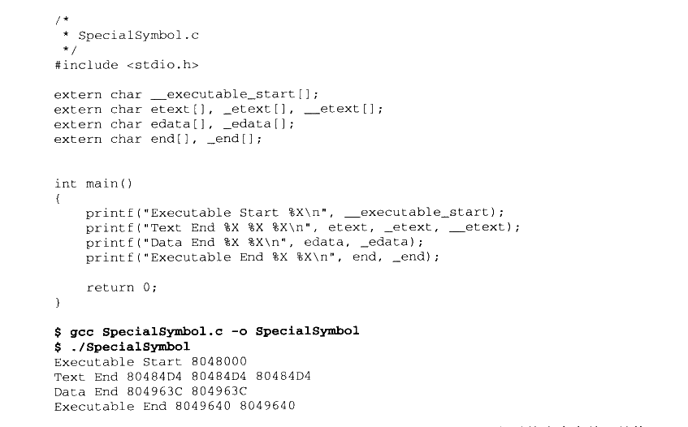

<details markdown="1"><summary>复制文字（已对照原图）</summary>

```text
/*
 * SpecialSymbol.c
 */
#include <stdio.h>

extern char __executable_start[];
extern char etext[], _etext[], __etext[];
extern char edata[], _edata[];
extern char end[], _end[];

int main()
{
    printf("Executable Start %X\n", __executable_start);
    printf("Text End %X %X %X\n", etext, _etext, __etext);
    printf("Data End %X %X\n", edata, _edata);
    printf("Executable End %X %X\n", end, _end);

    return 0;
}

$ gcc SpecialSymbol.c -o SpecialSymbol
$ ./SpecialSymbol
Executable Start 8048000
Text End 80484D4 80484D4 80484D4
Data End 804963C 804963C
Executable End 8049640 8049640
```

</details>

另外还有不少其他的特殊符号，在此不一一列举了，它们跟ld 的链接脚本有关。具体请参阅本书第7章的“链接过程控制”。

#### 3.5.3 符号修饰与函数签名

约在20世纪70年代以前，编译器编译源代码产生目标文件时，符号名与相应的变量和函数的名字是一样的。比如一个汇编源代码里面包含了一个函数foo，那么汇编器将它编译成目标文件以后，foo在目标文件中的相对应的符号名也是foo。当后来 UNIX平台和C语言发明时，已经存在了相当多的使用汇编编写的库和目标文件。这样就产生了一个问题，那就是如果一个C程序要使用这些库的话，C语言中不可以使用这些库中定义的函数和变量的名字作为符号名，否则将会跟现有的目标文件冲突。比如有个用汇编编写的库中定义了一个函数叫做 main，那么我们在C语言里面就不可以再定义一个 main 函数或变量了。同样的道理，如果一个C语言的目标文件要用到一个使用 Fortran 语言编写的目标文件，我们也必须防止它们的名称冲突。

为了防止类似的符号名冲突，UNIX 下的C语言就规定，C语言源代码文件中的所有全局的变量和函数经过编译以后，相对应的符号名前加上下划线“\_”。而 Fortran 语言的源代码经过编译以后，所有的符号名前加上“\_”，后面也加上“\_”。比如一个C语言函数“foo”，那么它编译后的符号名就是“\_foo”；如果是 Fortran 语言，就是“\_foo\_”。

这种简单而原始的方法的确能够暂时减少多种语言目标文件之间的符号冲突的概率，但还是没有从根本上解决符号冲突的问题。比如同一种语言编写的目标文件还有可能会产生符号冲突，当程序很大时，不同的模块由多个部门（个人）开发，它们之间的命名规范如果不严格，则有可能导致冲突。于是像C++这样的后来设计的语言开始考虑到了这个问题，增加了名称空间（Namespace）的方法来解决多模块的符号冲突问题。

但是随着时间的推移，很多操作系统和编译器被完全重写了好几遍，比如UNIX 也分化成了很多种，整个环境发生了很大的变化，上面所提到的跟 Fortran 和古老的汇编库的符号冲突问题已经不是那么明显了。在现在的Linux 下的GCC编译器中，默认情况下已经去掉了在C语言符号前加“\_”的这种方式：但是Windows 平台下的编译器还保持的这样的传统，比如 Visual C++编译器就会在C语言符号前加“\_”，GCC在 Windows 平台下的版本（cygwin、mingw）也会加“\_” 。GCC 编译器也可以通过参数选项“-fleading-underscore ”或“-fno-leading-underscore”来打开和关闭是否在C语言符号前加上下划线。

C++符号修饰

众所周知，强大而又复杂的C++拥有类、继承、虚机制、重载、名称空间等这些特性，它们使得符号管理更为复杂。最简单的例子，两个相同名字的函数 func（int）和 func（double），尽管函数名相同，但是参数列表不同，这是C++里面函数重载的最简单的一种情况，那么编译器和链接器在链接过程中如何区分这两个函数呢？为了支持C++这些复杂的特性，人们发明了符号修饰（Name Decoration）或符号改编（Name Mangling）的机制，下面我们来看看C++的符号修饰机制。

首先出现的一个问题是C++允许多个不同参数类型的函数拥有一样的名字，就是所谓的函数重载：另外 C++还在语言级别支持名称空间，即允许在不同的名称空间有多个同样名字的符号。比如清单 3-4这段代码。

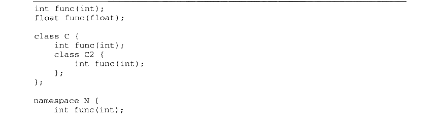

<details markdown="1"><summary>复制文字（已对照原图）</summary>

```text
int func(int);
float func(float);

class C {
    int func(int);
    class C2 {
        int func(int);
    };
};

namespace N {
    int func(int);
```

</details>

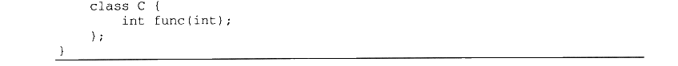

<details markdown="1"><summary>复制文字（已对照原图）</summary>

```text
    class C {
        int func(int);
    };
}
```

</details>

这段代码中有6个同名函数叫 func，只不过它们的返回类型和参数及所在的名称空间不同。我们引入一个术语叫做函数签名（Function Signature），函数签名包含了一个函数的信息，包括函数名、它的参数类型、它所在的类和名称空间及其他信息。函数签名用于识别不同的函数，就像签名用于识别不同的人一样，函数的名字只是函数签名的一部分。由于上面6个同名函数的参数类型及所处的类和名称空间不同，我们可以认为它们的函数签名不同。在编译器及链接器处理符号时，它们使用某种名称修饰的方法，使得每个函数签名对应一个修饰后名称（Decorated Name）。编译器在将C++源代码编译成目标文件时，会将函数和变量的名字进行修饰，形成符号名，也就是说，C++的源代码编译后的目标文件中所使用的符号名是相应的函数和变量的修饰后名称。C++编译器和链接器都使用符号来识别和处理函数和变量，所以对于不同函数签名的函数，即使函数名相同，编译器和链接器都认为它们是不同的函数。上面的6个函数签名在GCC编译器下，相对应的修饰后名称如表3-18所示。

表3-18

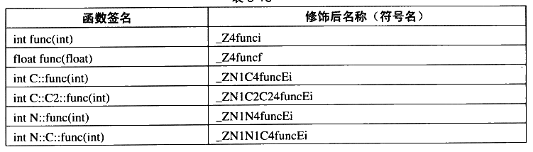

<details markdown="1"><summary>查看表格文字（已校对）</summary>

| 函数签名 | 修饰后名称（符号名） |
| --- | --- |
| int func(int) | _Z4funci |
| float func(float) | _Z4funcf |
| int C::func(int) | _ZN1C4funcEi |
| int C::C2::func(int) | _ZN1C2C24funcEi |
| int N::func(int) | _ZN1N4funcEi |
| int N::C::func(int) | _ZN1N1C4funcEi |

</details>

GCC 的基本C++名称修饰方法如下：所有的符号都以“\_Z”开头，对于嵌套的名字（在名称空间或在类里面的），后面紧跟“N”，然后是各个名称空间和类的名字，每个名字前是名字字符串长度，再以 “E”结尾。比如 N::C::func 经过名称修饰以后就是\_ZN1N1C4funcE。对于一个函数来说，它的参数列表紧跟在“E”后面，对于int 类型来说，就是字母“i”。所以整个 N::C::func（int）函数签名经过修饰为\_ZN1N1C4funcEi。更为具体的修饰方法我们在这里不详细介绍，有兴趣的读者可以参考GCC 的名称修饰标准。幸好这种名称修饰方法我们平时程序开发中也很少手工分析名称修饰问题，所以无须很详细地了解这个过程。binutils里面提供了一个叫 “c++filt”的工具可以用来解析被修饰过的名称，比如：


<details markdown="1"><summary>复制文字（已对照原图）</summary>

```text
$ c++filt _ZN1N1C4funcEi
N::C::func(int)
```

</details>

签名和名称修饰机制不光被使用到函数上，C++中的全局变量和静态变量也有同样的机制。对于全局变量来说，它跟函数一样都是一个全局可见的名称，它也遵循上面的名称修饰机制，比如一个名称空间 foo中的全局变量bar，它修饰后的名字为：\_ZN3foo3barE。值得注意的是，变量的类型并没有被加入到修饰后名称中，所以不论这个变量是整型还是浮点型甚至是一个全局对象，它的名称都是一样的。

名称修饰机制也被用来防止静态变量的名字冲突。比如 main()函数里面有一个静态变量叫 foo，而 func()函数里面也有一个静态变量叫 foo。为了区分这两个变量，GCC 会将它们的符号名分别修饰成两个不同的名字\_ZZ4mainE3foo和\_ZZ4funcvE3foo，这样就区分了这两个变量。

不同的编译器厂商的名称修饰方法可能不同，所以不同的编译器对于同一个函数签名可能对应不同的修饰后名称。比如上面的函数签名中在 Visual C++编译器下，它们的修饰后名称如表3-19所示。

表3-19

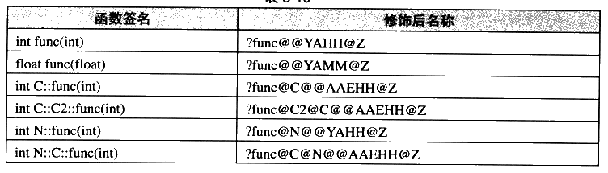

<details markdown="1"><summary>查看表格文字（已校对）</summary>

| 函数签名 | 修饰后名称 |
| --- | --- |
| int func(int) | ?func@@YAHH@Z |
| float func(float) | ?func@@YAMM@Z |
| int C::func(int) | ?func@C@@AAEHH@Z |
| int C::C2::func(int) | ?func@C2@C@@AAEHH@Z |
| int N::func(int) | ?func@N@@YAHH@Z |
| int N::C::func(int) | ?func@C@N@@AAEHH@Z |

</details>

我们以 int N::C::func(int)这个函数签名来猜测 Visual C++的名称修饰规则（当然，你只须大概了解这个修饰规则就可以了）。修饰后名字由“？”开头，接着是函数名由“@”符号结尾的函数名：后面跟着由“@”结尾的类名“C”和名称空间“N”，再一个“@”表示函数的名称空间结束：第一个“A”表示函数调用类型为“\_\_cdecl”（函数调用类型我们将在第4章详细介绍），接着是函数的参数类型及返回值，由“@”结束，最后由“Z”结尾。可以看到函数名、参数的类型和名称空间都被加入了修饰后名称，这样编译器和链接器就可以区别同名但不同参数类型或名字空间的函数，而不会导致 link 的时候函数多重定义。

Visual C++的名称修饰规则并没有对外公开，当然，一般情况下我们也无须了解这套规则，但是有时候可能须要将一个修饰后名字转换成函数签名，比如在链接、调试程序的时候可能会用到。Microsoft 提供了一个 UnDecorateSymbolName()的 API，可以将修饰后名称转换成函数签名。下面这段代码使用 UnDecorateSymbolName()将修饰后名称转换成函数签名：

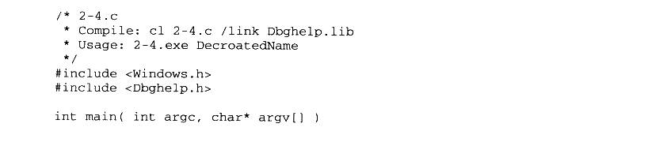

<details markdown="1"><summary>复制文字（已对照原图）</summary>

```text
/* 2-4.c
 * Compile: cl 2-4.c /link Dbghelp.lib
 * Usage: 2-4.exe DecoratedName
 */
#include <Windows.h>
#include <Dbghelp.h>

int main( int argc, char* argv[] )
```

</details>


<details markdown="1"><summary>复制文字（已对照原图）</summary>

```text
{
    char buffer[256];

    if(argc == 2)
    {
        UnDecorateSymbolName( argv[1], buffer, 256, 0 );
        printf( buffer );
    }
    else
    {
        printf( "Usage: 2-4.exe DecoratedName\n" );
    }

    return 0;
}
```

</details>

由于不同的编译器采用不同的名字修饰方法，必然会导致由不同编译器编译产生的目标文件无法正常相互链接，这是导致不同编译器之间不能互操作的主要原因之一。我们后面的关于 C++ ABI 和COM的这一节将会详细讨论这个问题。

#### 3.5.4 extern "C"

C++为了与C兼容，在符号的管理上，C++有一个用来声明或定义一个C的符号的“extern“C””关键字用法：


<details markdown="1"><summary>复制文字（已对照原图）</summary>

```text
extern "C" {
    int func(int);
    int var;
}
```

</details>

C++编译器会将在 extern “C”的大括号内部的代码当作C语言代码处理。所以很明显，上面的代码中，C++的名称修饰机制将不会起作用。它声明了一个C的函数 func，定义了一个整型全局变量var。从上文我们得知，在 Visual C++平台下会将C语言的符号进行修饰，所以上述代码中的 func 和 var的修饰后符号分别是\_func 和\_var：但是在 Linux 版本的GCC编译器下却没有这种修饰，extern “C”里面的符号都为修饰后符号，即前面不用加下划线。如果单独声明某个函数或变量为C语言的符号，那么也可以使用如下格式：


<details markdown="1"><summary>复制文字（已对照原图）</summary>

```text
extern "C" int func(int);
extern "C" int var;
```

</details>

上面的代码声明了一个C语言的函数 func 和变量var。我们可以使用上述的机制来做一个小实验：


<details markdown="1"><summary>复制文字（已对照原图）</summary>

```text
// ManualNameMangling.cpp
// g++ ManualNameMangling.cpp -o ManualNameMangling

#include <stdio.h>

namespace myname {
    int var = 42;
```

</details>


<details markdown="1"><summary>复制文字（已对照原图）</summary>

```text
}

extern "C" double _ZN6myname3varE;

int main()
{
    printf( "%d\n", _ZN6myname3varE );
    return 0;
}
```

</details>

上面的代码中，我们在 myname 的名称空间中定义了一个全局变量var。根据我们所掌握的 GCC 名称修饰规则，这个变量修饰后的名称为“\_ZN6myname3varE”，然后我们手工使用 extern “C”的方法声明一个外部符号\_ZN6myname3varE，并将其打印出来。我们使用GCC 来编译这个程序并且运行它，我们就可以得到程序输出为 42：


<details markdown="1"><summary>复制文字（已对照原图）</summary>

```text
$ g++ ManualNameMangling.cpp -o ManualNameMangling
$ ./ManualNameMangling
42
```

</details>

很多时候我们会碰到有些头文件声明了一些C 语言的函数和全局变量，但是这个头文件可能会被C语言代码或C++代码包含。比如很常见的，我们的C语言库函数中的 string.h中声明了 memset 这个函数，它的原型如下：

`void *memset(void *, int, size_t);`

如果不加任何处理，当我们的C语言程序包含 string.h 的时候，并且用到了 memset这个函数，编译器会将 memset 符号引用正确处理；但是在 C++语言中，编译器会认为这个memset 函数是一个 C++函数，将 memset 的符号修饰成\_Z6memsetPvi，这样链接器就无法与C语言库中的 memset 符号进行链接。所以对于 C++来说，必须使用 extern “C”来声明memset 这个函数。但是C语言又不支持 extern “C”语法，如果为了兼容C语言和C++语言定义两套头文件，未免过于麻烦。幸好我们有一种很好的方法可以解决上述问题，就是使用C++的宏“\_\_cplusplus”，C++编译器会在编译C++的程序时默认定义这个宏，我们可以使用条件宏来判断当前编译单元是不是C++代码。具体代码如下：


<details markdown="1"><summary>复制文字（已对照原图）</summary>

```text
#ifdef __cplusplus
extern "C" {
#endif

void *memset (void *, int, size_t);

#ifdef __cplusplus
}
#endif
```

</details>

如果当前编译单元是 C++代码，那么 memset 会在 extern “C”里面被声明；如果是C代码，就直接声明。上面这段代码中的技巧几乎在所有的系统头文件里面都被用到。

#### 3.5.5 弱符号与强符号

我们经常在编程中碰到一种情况叫符号重复定义。多个目标文件中含有相同名字全局符号的定义，那么这些目标文件链接的时候将会出现符号重复定义的错误。比如我们在目标文件A 和目标文件B都定义了一个全局整型变量global，并将它们都初始化，那么链接器将A和B进行链接时会报错：


<details markdown="1"><summary>复制文字（已对照原图）</summary>

```text
b.o:(.data+0x0): multiple definition of `global'
a.o:(.data+0x0): first defined here
```

</details>

这种符号的定义可以被称为强符号（Strong Symbol）。有些符号的定义可以被称为弱符号（Weak Symbol）。对于 C/C++语言来说，编译器默认函数和初始化了的全局变量为强符号，未初始化的全局变量为弱符号。我们也可以通过GCC 的 `__attribute__((weak))`来定义任何一个强符号为弱符号。注意，强符号和弱符号都是针对定义来说的，不是针对符号的引用。比如我们有下面这段程序：


<details markdown="1"><summary>复制文字（已对照原图）</summary>

```text
extern int ext;

int weak;
int strong = 1;
__attribute__((weak)) weak2 = 2;

int main()
{
    return 0;
}
```

</details>

上面这段程序中，“weak”和“weak2”是弱符号，“strong”和“main”是强符号，而“ext”既非强符号也非弱符号，因为它是一个外部变量的引用。针对强弱符号的概念，链接器就会按如下规则处理与选择被多次定义的全局符号：

- 规则1：不允许强符号被多次定义（即不同的目标文件中不能有同名的强符号）：如果有多个强符号定义，则链接器报符号重复定义错误。

- 规则2：如果一个符号在某个目标文件中是强符号，在其他文件中都是弱符号，那么选择强符号。

规则3：如果一个符号在所有目标文件中都是弱符号，那么选择其中占用空间最大的一个。比如目标文件 A定义全局变量global 为 int 型，占4个字节：目标文件B定义global为 double 型，占8个字节，那么目标文件 A 和B链接后，符号 global 占8个字节（尽量不要使用多个不同类型的弱符号，否则容易导致很难发现的程序错误）。

弱引用和强引用 目前我们所看到的对外部目标文件的符号引用在目标文件被最终链接成可执行文件时，它们须要被正确决议，如果没有找到该符号的定义，链接器就会报符号未定义错误，这种被称为强引用（Strong Reference）。与之相对应还有一种弱引用（Weak Reference），在处理弱引用时，如果该符号有定义，则链接器将该符号的引用决议：如果该符号未被定义，则链接器对于该引用不报错。链接器处理强引用和弱引用的过程几乎一样，只是对于未定义的弱引用，链接器不认为它是一个错误。一般对于未定义的弱引用，链接器默认其为0，或者是一个特殊的值，以便于程序代码能够识别。弱引用和弱符号主要用于库的链接过程，我们将在“库”这一章再来详细讲述。弱符号跟链接器的COMMON 块概念联系很紧密，我们在后面“深入静态链接”这一章中的“COMMON 块”一节还会回顾弱符号的概念。

在GCC 中，我们可以通过使用 `__attribute__((weakref))` 这个扩展关键字来声明对一个外部函数的引用为弱引用，比如下面这段代码：


<details markdown="1"><summary>复制文字（已对照原图）</summary>

```text
__attribute__ ((weakref)) void foo();

int main()
{
    foo();
}
```

</details>

我们可以将它编译成一个可执行文件，GCC 并不会报链接错误。但是当我们运行这个可执行文件时，会发生运行错误。因为当 main 函数试图调用 foo 函数时，foo函数的地址为0，于是发生了非法地址访问的错误。一个改进的例子是：


<details markdown="1"><summary>复制文字（已对照原图）</summary>

```text
__attribute__ ((weakref)) void foo();

int main()
{
    if(foo) foo();
}
```

</details>

这种弱符号和弱引用对于库来说十分有用，比如库中定义的弱符号可以被用户定义的强符号所覆盖，从而使得程序可以使用自定义版本的库函数：或者程序可以对某些扩展功能模块的引用定义为弱引用，当我们将扩展模块与程序链接在一起时，功能模块就可以正常使用；如果我们去掉了某些功能模块，那么程序也可以正常链接，只是缺少了相应的功能，这使得程序的功能更加容易裁剪和组合。

在 Linux 程序的设计中，如果一个程序被设计成可以支持单线程或多线程的模式，就可以通过弱引用的方法来判断当前的程序是链接到了单线程的 Glibc 库还是多线程的 Glibc 库（是否在编译时有-lpthread 选项），从而执行单线程版本的程序或多线程版本的程序。我们可以在程序中定义一个 pthread\_create 函数的弱引用，然后程序在运行时动态判断是否链接到 pthread 库从而决定执行多线程版本还是单线程版本：


<details markdown="1"><summary>复制文字（已对照原图）</summary>

```text
#include <stdio.h>
#include <pthread.h>
```

</details>


<details markdown="1"><summary>复制文字（已对照原图）</summary>

```text
int pthread_create(
pthread_t*,
    const pthread_attr_t*,
    void* (*)(void*),
    void*) __attribute__ ((weak));

int main()
{
    if(pthread_create) {
        printf("This is multi-thread version!\n");
        // run the multi-thread version
        // main_multi_thread()
    } else {
        printf("This is single-thread version!\n");
        // run the single-thread version
        // main_single_thread()
    }
}
```

</details>

编译运行结果如下：


<details markdown="1"><summary>复制文字（已对照原图）</summary>

```text
$ gcc pthread.c -o pt
$ ./pt
This is single-thread version!
$ gcc pthread.c -lpthread -o pt
$ ./pt
This is multi-thread version!
```

</details>


## 3.6 调试信息

目标文件里面还有可能保存的是调试信息。几乎所有现代的编译器都支持源代码级别的调试，比如我们可以在函数里面设置断点，可以监视变量变化，可以单步行进等，前提是编译器必须提前将源代码与目标代码之间的关系等，比如目标代码中的地址对应源代码中的哪一行、函数和变量的类型、结构体的定义、字符串保存到目标文件里面。甚至有些高级的编译器和调试器支持查看 STL 容器的内容，即程序员在调试过程中可以直接观察STL 容器中的成员的值。

如果我们在GCC编译时加上“-g”参数，编译器就会在产生的目标文件里面加上调试信息，我们通过 readelf 等工具可以看到，目标文件里多了很多“debug” 相关的段：


<details markdown="1"><summary>复制文字（已对照原图）</summary>

```text
[Nr] Name             Type     Addr     Off    Size   ES Flg Lk Inf Al
...
[ 4] .debug_abbrev    PROGBITS 00000000 000040 000034 00      0  0  1
[ 5] .debug_info      PROGBITS 00000000 000074 0000af 00      0  0  1
[ 6] .rel.debug_info  REL      00000000 000738 000038 08      9  5  4
[ 7] .debug_line      PROGBITS 00000000 000123 000037 00      0  0  1
[ 8] .rel.debug_line  REL      00000000 000770 000008 08     19  7  4
[ 9] .debug_frame     PROGBITS 00000000 00015c 000034 00      0  0  4
[10] .rel.debug_frame REL      00000000 000778 000010 08     19  9  4
[11] .debug_loc       PROGBITS 00000000 000190 00002c 00      0  0  1
```

</details>


<details markdown="1"><summary>复制文字（已对照原图）</summary>

```text
[12] .debug_pubnames     PROGBITS 00000000 0001bc 00001a 00    0  0 1
[13] .rel.debug_pubnames REL      00000000 000788 000008 08   19 12 4
[14] .debug_aranges      PROGBITS 00000000 0001d6 000020 00    0  0 1
[15] .rel.debug_arange   REL      00000000 000790 000010 08   19 14 4
...
```

</details>

这些段中保存的就是调试信息。现在的 ELF 文件采用一个叫 DWARF （Debug With Arbitrary Record Format）的标准的调试信息格式，现在该标准已经发展到了第三个版本，即 DWARF 3，由 DWARF 标准委员会由2006年颁布。Microsoft 也有自己相应的调试信息格式标准，叫 CodeView。关于调试信息的具体内容我们在这里不再详细展开了，它将是另外一个独立的并且很大的话题，对我们理解整个系统软件的意义不大，有兴趣的读者可以参照相应的格式标准。但是值得一提的是，调试信息在目标文件和可执行文件中占用很大的空间，往往比程序的代码和数据本身大好几倍，所以当我们开发完程序并要将它发布的时候，须要把这些对于用户没有用的调试信息去掉，以节省大量的空间。在Linux 下，我们可以使用“strip”命令来去掉 ELF 文件中的调试信息：

```sh
$ strip foo
```


## 3.7 本章小结

在这一章中我们深入分析了各种目标文件格式，主要介绍了 ELF 文件的代码段、数据段和BSS段等与程序运行密切相关的段结构。除此之外，我们还详细介绍了 ELF 文件的文件头、段表、重定位表、字符串表、符号表、调试表等相关结构。

从这一章中我们了解到，无论是可执行文件、目标文件或库，它们实际上都是一样基于段的文件或是这种文件的集合。程序的源代码经过编译以后，按照代码和数据分别存放到相应的段中，编译器（汇编器）还会将一些辅助性的信息，诸如符号、重定位信息等也按照表的方式存放到目标文件中，而通常情况下，一个表往往就是一个段。

有了这些目标文件之后，接下来的问题就是如何将它们组合起来，形成一个可以使用的程序或一个更大的模块，这就是静态链接所要解决的问题，我们将在下一章中详细介绍。
