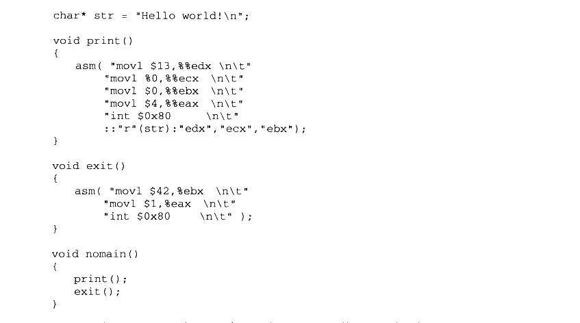
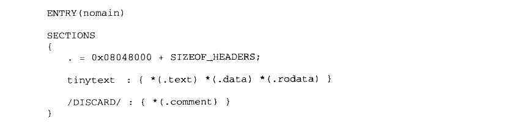
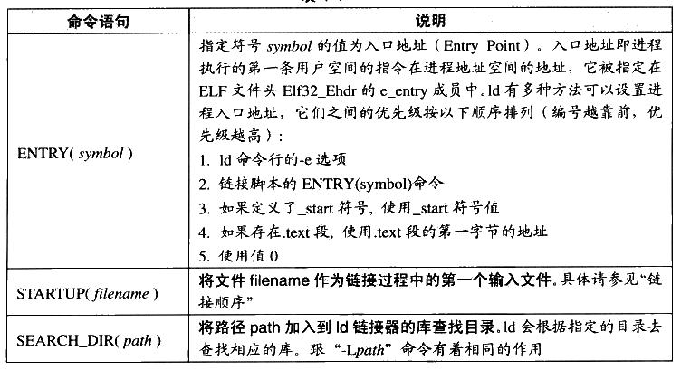
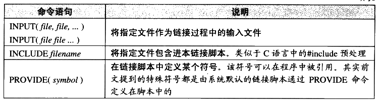

# 4.6 链接过程控制

绝大部分情况下，我们使用链接器提供的默认链接规则对目标文件进行链接。这在一般情况下是没有问题的，但对于一些特殊要求的程序，比如操作系统内核、BIOS （Basic Input Output System）或一些在没有操作系统的情况下运行的程序（如引导程序 Boot Loader 或者嵌入式系统的程序，或者有一些脱离操作系统的硬盘分区软件 PQMagic 等），以及另外的一些须要特殊的链接过程的程序，如一些内核驱动程序等，它们往往受限于一些特殊的条件，如须要指定输出文件的各个段虚拟地址、段的名称、段存放的顺序等，因为这些特殊的环境，特别是某些硬件条件的限制，往往对程序的各个段的地址有着特殊的要求。

由于整个链接过程有很多内容须要确定：使用哪些目标文件？使用哪些库文件？是否在终可执行文件中保留调试信息、输出文件格式（可执行文件还是动态链接库）？还要考虑是否要导出某些符号以供调试器或程序本身或其他程序使用等。

操作系统内核。从本质上来讲，它本身也是一个程序。比如Windows 的内核 ntoskrnl.exe就是一个我们平常看到的 PE文件，它的位置位于WINDOWSlsystem32itoskrnl.exe。很多人误以为Window 操作系统的内核很庞大，由很多文件组成。这是一个误解，其实真正的 Windows 内核就是这个文件。

链接控制脚本

### 4.6.1 链接控制脚本

链接器一般都提供多种控制檠个链接过程的方法，以用来产生用户所须要的文件。一般链接器有如下三种方法。

- 使用命令行来给链接器指定参数，我们前面所使用的ld 的-o、-e参数就属于这类。这种方法我们已经在前面使用很多次了。

- 将链接指令存放在目标文件里面，编译器经常会通过这种方法向链接器传递指令。方法也比较常见，只是我们平时很少关注，比如 VISUAL C++编译器会把链接参数放在PE 目标文件的.drectve 段以用来传递参数。具体可以参考 PE/COFF 一节中的.drectve 段介绍。

- 使用链接控制脚本，使用链接控制脚本方法就是本节要介绍的，也是最为灵活、最为强人的链接控制方法。

由于各个链接器平台的链接控制过程各不相同，我们只能侧重一个平台来介绍。ld链接器的链接脚本功能非常强大，我们接下来以 ld 作为主要介绍对象。VISUAL C++也允许使用脚本来控制整个链接过程，VISUAL C++把这种控制脚本叫做模块定义文件（Module-Definition File），它们的扩展名一般为.def。

前面我们在使用ld 链接器的时候，没有指定链接脚本，其实ld 在用户没有指定链接脚本的时候会使用默认链接脚本。我们可以使用下面的命令行来查看 ld 默认的链接脚本：


<details markdown="1"><summary>复制校对文字（未运行验证）</summary>

```text
$ ld -verbose
```

</details>

默认的 ld 链接脚本存放在/usr/lib/ldscripts/下，不同的机器平台、输出文件格式都有相应的链接脚本。比如 Intel IA32 下的普通可执行 ELF 文件链接脚本文件为 elf\_i386.x:IA32下共享库的链接脚本文件为 elf\_i386.xs 等。具体可以看每个文件的注释。ld会根据命令行要求使用相应的链接脚本文件来控制链接过程，当我们使用 ld 来链接生成一个可执行文件的时候，它就会使用 elf\_i386.x作为链接控制脚本；当我们使用ld来生成一个共享目标文件的时候，它就会使用 elf\_i386.xs 作为链接控制脚本。

当然，为了更加精确地控制链接过程，我们可以自己写一个脚本，然后指定该脚本为链接控制脚本。比如可以使用-T参数：


<details markdown="1"><summary>复制校对文字（未运行验证）</summary>

```text
$ ld -T link.script
```

</details>

### 4.6.2 最 "小" 的程序

为了演示链接的控制过程，我们接着要做一个最小的程序：这个程序的功能是在终端上输出“Hello world！”。可能很多人的第一反应就是我们学C语言时候的那个经典的使用printf的 helloworld，然后对着屏幕盲打一遍该程序源代码后编译链接一气呵成，连鼠标都没有移动一下，非常好，你的C语言基础很扎实©。但是我们这里要演示的程序稍微有所不同。

- 首先，经典的helloworld 使用了 printf函数，该函数是系统C语言库的一部分。为了使用该函数，我们必须在链接时将C语言库与程序的目标文件链接产生最终可执行文件。

我们希望“小程序”能够脱离C语言运行库，使得它成为一个独立于任何库的纯正的“程序”。

其次，经典的 helloworld 由于使用了库，所以必须有 main 函数。我们知道一般程序的入口在库的\_start，由库负责初始化后调用 main 函数来执行程序的主体部分。为了不使用 main 这个我们已经感到厌烦的函数名，“小程序”使用 nomain 作为整个程序的入口。

- 接着，经典的 helloworld 会产生多个段：main 程序的指令部分会产生.text段、字符串常量“Hello world！”会被放在数据段或只读数据段，还有C库所包含的各种段。为了演示 ld链接脚本的控制过程，我们将“小程序”的所有段都合并到一个叫 “tinytext”的段，注意：这个段是我们任意命名的，是由链接脚本控制链接过程生成的。

TinyHelloWorld.c 源代码如下：



<details markdown="1"><summary>复制校对文字（未运行验证）</summary>

```text
char* str = "Hello world!\n";

void print()
{
    asm("movl $13,%%edx \n\t"
        "movl %0,%%ecx \n\t"
        "movl $0,%%ebx \n\t"
        "movl $4,%%eax \n\t"
        "int $0x80     \n\t"
        ::"r"(str):"edx","ecx","ebx");
}

void exit()
{
    asm("movl $42,%ebx \n\t"
        "movl $1,%eax  \n\t"
        "int $0x80     \n\t");
}

void nomain()
{
    print();
    exit();
}
```

</details>

从源代码我们可以看到，程序入口为 nomain()函数，然后该函数调用 print（）函数，打印“Hello World”，接着调用exit()函数，结束进程。这里的 print 函数使用了 Linux 的 WRITE系统调用，exit()函数使用了 EXIT 系统调用。这里我们使用了 GCC 内嵌汇编，对这种内嵌汇编格式不熟悉的话，请参照GCC手册关于内嵌汇编的部分。这里简单介绍系统调用：系统调用通过0x80 中断实现，其中 eax 为调用号，ebx、ecx、edx 等通用寄存器用来传递参数，比如 WRITE 调用是往一个文件句柄写入数据，如果用C语言来描述它的原型就是：

int write（int filedesc, char\* buffer, int size）；

- WRITE 调用的调用号为4，则eax=0。

- filedesc表示被写入的文件句柄，使用ebx 寄存器传递，我们这里是要往默认终端（stdout）输出，它的文件句柄为0，即ebx=0。

- buffer 表示要写入的缓冲区地址，使用ecx 寄存器传递，我们这里要输出字符串str，所以ecx=str。

- size 表示要写入的字节数，使用edx 寄存器传递，字符串“Hello world!\n”长度为13字节，所以edx=13。

同理，EXIT 系统调用中，ebx 表示进程退出码（Exit Code），比如我们平时的 main 程序中的return 的数值会返回给系统库，由系统库将该数值传递给EXIT 系统调用。这样父进程就可以接收到子进程的退出码。EXIT 系统调用的调用号为1，即 eax = 1。你可以通过下面的方法得到上一条 bash 命令执行的程序的退出码）：


<details markdown="1"><summary>复制校对文字（未运行验证）</summary>

```text
$ ./TinyHelloWorld
$ echo $?
42
```

</details>

这里要调用 EXIT结束进程是因为如果是普通程序，main()函数结束后控制权返回给系统库，由系统库负责调用 EXIT，退出进程。我们这里的 nomain()结束后系统控制权不会返回，可能会执行到 nomain 后面不正常的指令，最后导致进程异常退出。

关于系统库以及系统调用的细节我们在这里不详细展开，将在第 12 章进行更为详细的介绍。

我们先不急于使用链接脚本，而先使用普通命令行的方式来编译和链接 TinyHelloWorld.c：


<details markdown="1"><summary>复制校对文字（未运行验证）</summary>

```text
$ gcc -c -fno-builtin TinyHelloWorld.c
$ ld -static -e nomain -o TinyHelloWorld TinyHelloWorld.o
```

</details>

第一步是使用 GCC 将 TinyHelloWorld.c 编译成 TinyHelloWorld.o，接着使用 ld 将TinyHelloWorld.o链接成可执行文件 TinyHelloWorld。这里GCC 和ld 的参数的意义如下。

-fno-builtin GCC编译器提供了很多内置函数（Built-in Function），它会把一些常用的C库函数替换成编译器的内置函数，以达到优化的功能。比如GCC 会将只有字符串参数的printf 函数替换成 puts，以节省格式解析的时间。exit()函数也是GCC的内置参数之一，所以我们要使用-fno-builtin 参数来关闭GCC 内置函数功能。

- -static 这个参数表示ld 将使用静态链接的方式来链接程序，而不是使用默认的动态链接的方式。

- -e nomain 表示该程序的入口函数为nomain，还记得ELF 文件头 Elf32\_Ehdr的 e\_entry成员吗？这个参数就是将 ELF 文件头的e\_entry 成员赋值成 nomain 函数的地址。

- -o TinyHelloWorld 表示指定输出可执行文件名为 TinyHelloWorld。

我们得到了一个 924 字节（依赖于系统环境）的 ELF 可执行文件，运行它以后能够正确打印“Hello world！” 并且正常退出。但是当我们用 objdump 或 readelf 查看 TinyHelloWorld这个文件时，会发现它有4个段：text、rodata、data 和.comment。通过前面的介绍我们可以猜到：

- ，text 肯定保存的是程序的指令，它是只读的。

- .rodata 保存的是字符串“Hello World!\n”，它也是只读的。

- .data 保存的是 str 全局变量，看上去它是可读写的，但我们并没有在程序中改写该变量，所以实际上它也是只读的。

.comment 保存的是编译器和系统版本信息，这些信息也是只读的。由于.comment 里面保存的数据并不关键，对于程序的运行没有作用，所以可以将其丢弃。

鉴于这些段的属性如此相似，原则上讲，我们可以把它们合并到一个段里面，该段的属性是可执行、可读的，包含程序的数据和指令。为了达到这个目的，我们必须使用ld 链接脚本来控制链接过程。

### 4.6.3 使用 ld 链接脚本

如果把整个链接过程比作一台计算机，那么 ld 链接器就是计算机的CPU，所有的目标文件、库文件就是输入，链接结果输出的可执行文件就是输出，而链接控制脚本正是这台计算机的“程序”，它控制CPU 的运行，以“程序”要求的方式将输入加工成所须要的输出结果。链接控制脚本“程序”使用一种特殊的语言写成，即ld 的链接脚本语言，这种语言并不复杂，只有为数不多的几种操作。

无论是输出文件还是输入文件，它们的主要的数据就是文件中的各种段，我们把输入文件中的段称为输入段（Input Sections），输出文件中的段称为输出段 （Output Sections）。简单来讲，控制链接过程无非是控制输入段如何变成输出段，比如哪些输入段要合并一个输出段，哪些输入段要丢弃；指定输出段的名字、装载地址、属性，等等。我们先来看看TinyHelloWorld 的链接脚本 TinyHelloWorld.lds（一般链接脚本名都以 lds 作为扩展名 ld script），有个感性的认识：



<details markdown="1"><summary>复制校对文字（未运行验证）</summary>

```text
ENTRY(nomain)

SECTIONS
{
    . = 0x08048000 + SIZEOF_HEADERS;
    tinytext : { *(.text) *(.data) *(.rodata) }
    /DISCARD/ : { *(.comment) }
}
```

</details>

这是一个非常简单的链接脚本，第一行的 ENTRY（nomain）指定了程序的入口为 nomain()函数：后面的SECTIONS命令一般是链接脚本的主体，这个命令指定了各种输入段到输出段的变换，SECTIONS后面紧跟着的一对大括号里面包含了SECTIONS变换规则，其中有三条语句，每条语句一行。第一条是赋值语句，后面两条是段转换规则，它们的含义分别如下：

- . = 0x08048000 +SIZEOF\_HEADERS 第一条赋值语句的意思是将当前虚拟地址设置成 0x08048000 + SIZEOF\_HEADERS,SIZEOF\_HEADERS 为输出文件的文件头大小。“.”表示当前虚拟地址，因为这条语句后面紧跟着输出段“tinytext”，所以 “tinytext”段的起始虚拟地址即为0x08048000+SIZEOF\_HEADERS。它将当前虚拟地址设置成一个比较巧妙的值，以便于装载时页映射更为方便。具体请参考本书第 2部分关于装载的章节。

- tinytext ：｛\*（.text）\*（.data）\*（.rodata）｝第二条是个段转换规则，它的意思即为所有输入文件中的名字为“.text”、“.data”或“rodata” 的段依次合并到输出文件的 “tinytext”。

- /DISCARD/：｛\*（.comment）｝第三条规则为：将所有输入文件中的名字为“.comment”的段丢弃，不保存到输出文件中。

通过上述两条转换规则，我们就达到了 TinyHelloWorld 程序的第三个要求：最终输出的可执行文件只有一个叫 “tinytext”的段。我们通过下面的命令行来编译 TinyHelloWorld，并且启用该链接控制脚本：


<details markdown="1"><summary>复制校对文字（未运行验证）</summary>

```text
$ gcc -c -fno-builtin TinyHelloWorld.c
$ ld -static -T TinyHelloWorld.lds -o TinyHelloWorld TinyHelloWorld.o
```

</details>

我们得到了一个588字节的ELF 可执行文件：TinyHelloWorld，并且执行这个程序能够在终端上正确显示“Hello World！”。如果你使用 objdump 查看 TinyHelloWorld 的段，你会很高兴地发现，我们达到了目的：整个程序只有一个段 “tinytext”。但是兴奋之余你可能又想用 readelf 工具查看一下，发现程序除了 tinytext 之外居然还有其他3个段：.shstrtab、.symtab和.strtab。这3个段我们在前面已经介绍过了，它们分别是段名字符串表、符号表和字符串表。在默认情况下，ld 链接器在产生可执行文件时会产生这3个段。对于可执行文件来说，符号表和字符串表是可选的，但是段名字符串表用于保存段名，所以它是必不可少的。

你可以通过ld 的-s参数禁止链接器产生符号表，或者使用 strip 命令来去除程序中的符号表，去掉符号表后的 TinyHelloWorld 只有340个字节，但它仍然是一个有效的ELF 可执行文件，能够正确执行并输出结果。

有人专门研究了如何得到一个最小的 ELF 可执行文件，最后成果是最小的ELF 可执行文件为45个字节。这个程序的功能是以42为进程退出码正常退出进程，没有任何输入和输出。上面的TinyHelloWorld 也是以这个特殊的值42作为退出码。

追溯“42”这个奇怪的数字来源，可能因为《银河系漫游指南》里面的终极电脑给出的关于生命、宇宙及万物的终极答案是 42。

### 4.6.4 ld 链接脚本语法简介

ld 链接器的链接脚本语法继承于 AT&amp;T链接器命令语言的语法，风格有点像C语言，它本身并不复杂。链接脚本由一系列语句组成，语句分两种，一种是命令语句，另外一种是赋值语句。我们前面的链接脚本里面的 ENTRY（nomain）就是命令语句；而.=0x08480000+SIZEOF\_HEADERS 则是一个经典的赋值语句。之所以说链接脚本语法像C语言，主要有如下几点相似之处。

- 语句之间使用分号“；”作为分割符 原则上讲语句之间都要以“；“作为分割符，但是对于命令语句来说也可以使用换行来结束该语句，对于赋值语句来说必须以“；”结束。

- 表达式与运算符 脚本语言的语句中可以使用C语言类似的表达式和运算操作符，比如 `+`、`-`、`*`、`/`、`+=`、`-=`、`*=` 等，甚至包括 `&`、`|`、`>>`、`<<` 等这些位操作符。

- 注释和字符引用 使用/\*\*/作为注释。脚本文件中使用到的文件名、格式名或段名等凡是包含“；”或其他的分隔符的，都要使用双引号将该名字全称引用起来，如果文件名包含引号，则很不幸，无法处理。

赋值语句比较简单，我们在这里就不详细介绍了。命令语句一般的格式是由一个关键字和紧跟其后的参数所组成。比如前面的TinyHelloWorld.lds 就是由两个命令语句组成：一个ENTRY 命令语句和一个 SECTIONS 语句，“ENTRY”和“SECTIONS”为这两个语句的关键字。其中 SECTIONS 语句比较复杂，它又包含了一个赋值语句及一些 SECTIONS 语句所特有的映射规则。其实除了 SECTIONS 命令语句之外，其他命令语句都比较简单，毕竟SECTIONS负责指定链接过程的段转换过程，这也是链接的最核心和最复杂的部分。我们先来看看一些常用的命令语句，如表4-4所示。

表4-4



<details markdown="1"><summary>查看校对表格</summary>

| 命令语句 | 说明 |
| --- | --- |
| `ENTRY(symbol)` | 指定符号 symbol 的值为入口地址（Entry Point）。入口地址即进程执行的第一条用户空间的指令在进程地址空间的地址，它被指定在 ELF 文件头 Elf32_Ehdr 的 e_entry 成员中。ld 有多种方法可以设置进程入口地址，它们之间的优先级按以下顺序排列（编号越靠前，优先级越高）：<br>1. ld 命令行的 -e 选项<br>2. 链接脚本的 ENTRY(symbol) 命令<br>3. 如果定义了 _start 符号，使用 _start 符号值<br>4. 如果存在 .text 段，使用 .text 段的第一个字节的地址<br>5. 使用值0 |
| `STARTUP(filename)` | 将文件 filename 作为链接过程中的第一个输入文件。具体请参见“链接顺序”。 |
| `SEARCH_DIR(path)` | 将路径 path 加入到 ld 链接器的库查找目录。ld 会根据指定的目录去查找相应的库。跟“-Lpath”命令有着相同的作用。 |

</details>

续表



<details markdown="1"><summary>查看校对表格</summary>

| 命令语句 | 说明 |
| --- | --- |
| `INPUT(file, file, ...)`<br>`INPUT(file file ...)` | 将指定文件作为链接过程中的输入文件。 |
| `INCLUDE filename` | 将指定文件包含进本链接脚本。类似于C语言中的 #include 预处理。 |
| `PROVIDE(symbol)` | 在链接脚本中定义某个符号。该符号可以在程序中被引用。其实前文提到的特殊符号都是由系统默认的链接脚本通过 PROVIDE 命令定义在脚本中的。 |

</details>

这里只是大概提及以下几个常用的命令语句格式，更多的命令语句的意义及它们的格式请参照ld的使用手册。除了这些简单的命令语句之外，剩下最重要、也是最复杂的就是SECTIONS 命令了。SECTIONS 命令语句最基本格式为：


<details markdown="1"><summary>复制校对文字（未运行验证）</summary>

```text
SECTIONS
{
    ...
    secname : { contents }
    ...
}
```

</details>

secname 表示输出段的段名，secname 后面必须有一个空格符，这样使得输出段名不会有歧义，后面紧跟着冒号和一对大括号。大括号里面的 contents 描述了一套规则和条件，它表示符合这种条件的输入段将合并到这个输出段中。输出段名的命名方法必须符合输出文件格式的要求，比如，如果使用ld 生产一个 a.out 格式的文件，那么输出段名就不可以使用除“text”、“.data”和“.bss”之外的任何名字，因为a.out 格式规定段名只允许这三个名字。

有一个特殊的段名叫 “/DISCARD/”，如果使用这个名字作为输出段名，那么所有符合后面 contents所规定的条件的段都将被丢弃，不输出到输出文件中。

接着，我们最应该关心的是 contents这个规则。contents 中可以包含若干个条件，每个条件之间以空格隔开，如果输入段符合这些条件中的任意一个即表示这个输入段符合contents 规则。条件的写法如下：

filename （sections）

filename 表示输入文件名，sections 表示输入段名。让我们举几个条件的例子来看看：

- file1.o（.data） 表示输入文件中名为file1.o的文件中名叫.data 的段符合条件。

file1.o（.data .rodata） 或 file1.o（.data, rodata）表示输入文件中名为file1.o的文件中的名叫.data 或.rodata 的段符合条件。

file1.o 如果直接指定文件名而省略后面的小括号和段名，则表示file1.o 的所有段都符合条件。

- \*（.data）所有输入文件中的名字为.data 的文件符合条件。\* 是通配符，类似于正则表达式中的\*，我们还可以使用正则表达式中的?、[]等规则。

- ［a-z］（.text［A-Z］）这个条件比较复杂，它表示所有输入文件中以小写字母a到z开头的文件中所有段名以.text开头，并且以大写字母A 到Z结尾的段。从这个规则中你也许可以看到一些链接脚本功能的强大。

很明显，当我们回头再看 TinyHelloWorld.lds 链接脚本，发现它的SECTIONS 命令中除了有一条赋值语句之外，还有两条段规则，相信你能够很快地根据上面给出的条件做出定义分析。
