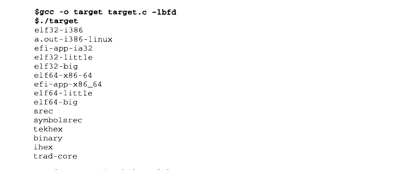

# 4.7 BFD 库

由于现代的硬件和软件平台种类非常繁多，它们之间千差万别，比如，硬件中 CPU 有8位的、16位的，一直到64位的：字节序有大端的也有小端的；有些有MMU 有些没有；有些对访问内存地址对齐有着特殊要求，比如 MIPS，而有些则没有，比如x86。软件平台有些支持动态链接，而有些不支持；有些支持调试，有些又不支持。这些五花八门的软硬件平台基础导致了每个平台都有它独特殊的目标文件格式，即使同一个格式比如 ELF 在不同的软硬件平台都有着不同的变种。种种差异导致编译器和链接器很难处理不同平台之间的目标文件，特别是对于像GCC和 binutils 这种跨平台的工具来说，最好有一种统一的接口来处理这些不同格式之间的差异。

BFD 库（Binary File Descriptor library）就是这样的一个 GNU 项目，它的目标就是希望通过一种统一的接口来处理不同的目标文件格式。BFD 这个项目本身是 binutils 项目的一个子项目。BFD 把目标文件抽象成一个统一的模型，比如在这个抽象的目标文件模型中，最开始有一个描述整个目标文件总体信息的“文件头”，就跟我们实际的ELF 文件一样，文件头后面是一系列的段，每个段都有名字、属性和段的内容，同时还抽象了符号表、重定位表、字符串表等类似的概念，使得 BFD库的程序只要通过操作这个抽象的目标文件模型就可以实现操作所有 BFD 支持的目标文件格式。

现在GCC（更具体地讲是GNU 汇编器 GAS, GNU Assembler）、链接器 ld、调试器GDB 及 binutils 的其他工具都通过BFD 库来处理目标文件，而不是直接操作目标文件。这样做最大的好处是将编译器和链接器本身同具体的目标文件格式隔离开来，一旦我们须要支持一种新的目标文件格式，只须要在 BFD 库里面添加一种格式就可以了，而不须要修改编译器和链接器。到目前为止，BFD 库支持大约25种处理器平台，将近50种目标文件格式。

当我们安装了 BFD 开发库以后（在我的 ubuntu 下，包含 BFD 开发库的软件包的名字叫 binutils-dev），我们就可以在程序中使用它。比如下面这段程序可以输出该 BFD 库所支持的所有的目标文件格式：


<details markdown="1"><summary>复制校对文字（未运行验证）</summary>

```text
/* target.c */
#include <stdio.h>
#include "bfd.h"

int main()
{
    const char** t = bfd_target_list();
    while (*t) {
        printf("%s\n", *t);
        t++;
    }
}
```

</details>

编译运行：



<details markdown="1"><summary>复制校对文字（未运行验证）</summary>

```text
$ gcc -o target target.c -lbfd
$ ./target
elf32-i386
a.out-i386-linux
efi-app-ia32
elf32-little
elf32-big
elf64-x86-64
efi-app-x86_64
elf64-little
elf64-big
srec
symbolsrec
tekhex
binary
ihex
trad-core
```

</details>

关于BFD的具体资料可以参考 binutils 网站的文档：http://sources.redhat.com/binutils/。
