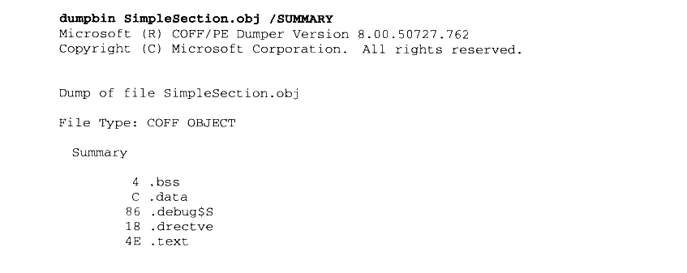
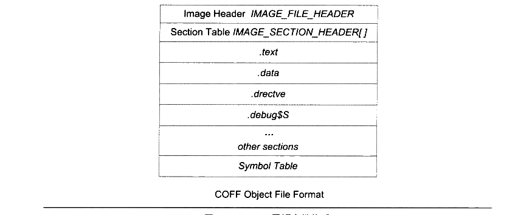
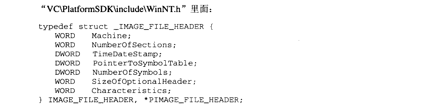
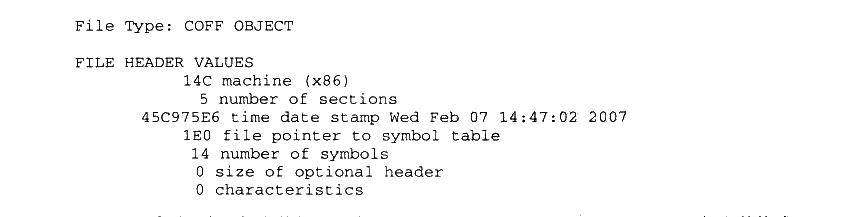
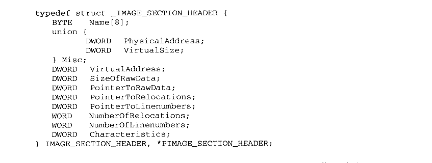
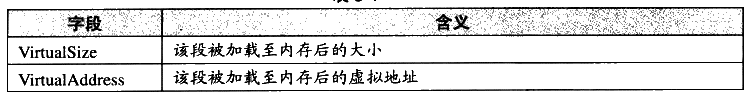
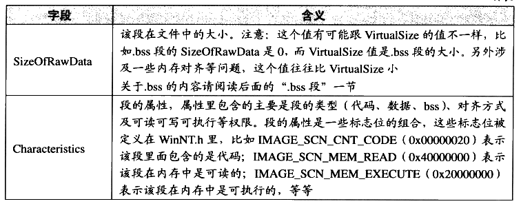

# 5.2 PE 的前身——COFF

还记得刚开始分析 ELF 文件格式时的那个 SimpleSection.c吗？我们接下来还是以它为例子，看看在 Windows 下，它被编译成 COFF 目标文件时，所有的变量和函数是怎么存储的。在这个过程中，我们将用到“Microsoft Visual C++”的编译环境。包括编译器“cl”，链接器“link”，可执行文件查看器“dumpbin”等，你可以通过 Microsoft 的官方网站下载免费的 Visual C++ Express 2005版，这已经足够用了。

要使用这些工具，我们要在 Windows 命令行下面运行它们，Visual C++在安装完成后就会有一个批处理文件用来建立运行这些工具所须要的环境。它位于开始/程序/Microsoft Visual Studio 2005/Visual Studio Tools/ Visual Studio 2005 Command Prompt，这样我们就可以通过命令行使用VC++的编译器了。然后使用“cd”命令进入到源代码所在目录后运行：

```bat
cl /c /Za SimpleSection.c
```

“cl”是 VISUAL C++的编译器，即 “Compiler” 的缩写。/c 参数表示只编译，不链接，即将.c文件编译成.obj文件，而不调用链接器生成.exe 文件。如果不加这个参数，cl 会在编译“SimpleSection.c”文件以后，再调用 link 链接器将该产生的 SimpleSection.obj 文件与默认的C运行库链接，产生可执行文件 SimpleSection.exe。

VISUAL C++有一些C和C++语言的专有扩展，这些扩展并没有定义在ANSI C 标准或ANSI C++标准，具体可以参阅 MSDN 的 Microsoft Extensions to C and C++这一节。“/Za”参数禁用这些扩展，使得我们的程序跟标准的C/C++兼容，这样可以尽量地看到问题的本质。另外值得一提的是，使用 /Za 参数时，编译器自动定义了\_\_STDC\_\_这个宏，我们可以在程序里通过判断这个宏是否被定义而确定编译器是否禁用了 Microsoft C/C++语法扩展。

编译完成以后我们得到了一个971 字节的 SimpleSection.obj目标文件，当然文件大小可能会因为编译器版本、选项及机器平台不同而不同。跟 GNU的工具链中的“objdump”一样，Visual C++也提供了一个用于查看目标文件和可执行文件的工具，就是“dumpbin”。下面这个命令可以查看 SimpleSection.obj 的结构：

```bat
dumpbin /ALL SimpleSection.obj > SimpleSection.txt
```

“/ALL”参数是将打印输出目标文件的所有相关信息，包括文件头、每个段的属性和段的原始数据及符号表。由于输出信息较多，如果直接打印到终端上，可能不太便于查看，所以我们将其导向到一个输出文件“SimpleSection.txt”中。因为在接下来的分析过程中，我们将会经常用到这个“dumpbin” 的输出结果，所以将它保存在 “SimpleSection.txt” 文件中，以便后面分析时逐一对照。我们也可以用“/SUMMARY”选项来查看整个文件的基本信息，它只输出所有段的段名和长度：



<details markdown="1"><summary>复制校对文字（未运行验证）</summary>

```text
dumpbin SimpleSection.obj /SUMMARY
Microsoft (R) COFF/PE Dumper Version 8.00.50727.762
Copyright (C) Microsoft Corporation. All rights reserved.

Dump of file SimpleSection.obj
File Type: COFF OBJECT

Summary
    4 .bss
    C .data
   86 .debug$S
   18 .drectve
   4E .text
```

</details>

COFF 文件结构

几乎跟 ELF 文件一样，COFF 也是由文件头及后面的若干个段组成，再加上文件末尾的符号表、调试信息的内容，就构成了 COFF 文件的基本结构，我们在COFF 文件中几乎都可以找到与 ELF 文件结构相对应的地方。COFF 文件的文件头部包括了两部分，一个是描述文件总体结构和属性的映像头（Image Header），另外一个是描述该文件中包含的段属性的段表（Section Table）。文件头后面紧跟着的就是文件的段，包括代码段、数据段等，最后还有符号表等。整体结构如图5-1所示。

映像（Image）：因为PE文件在装载时被直接映射到进程的虚拟空间中运行，它是进程的虚拟空间的映像。所以PE 可执行文件很多时候被叫做映像文件（Image File）。



<p class="image-caption">图 5-1 COFF 目标文件格式</p>

<details markdown="1"><summary>查看图中文字（按图分组）</summary>

COFF Object File Format

Image Header：IMAGE_FILE_HEADER

Section Table：IMAGE_SECTION_HEADER[]

.text / .data / .drectve / .debug$S / ... / other sections

Symbol Table

</details>

文件头里描述 COFF 文件总体属性的映像头是一个“IMAGE\_FILE\_HEADER”的结构，很明显，它跟 ELF 中的“Elf32\_Ehdr”结构的作用相同。这个结构及相关常数被定义在



<details markdown="1"><summary>复制校对文字（未运行验证）</summary>

```text
typedef struct _IMAGE_FILE_HEADER {
    WORD  Machine;
    WORD  NumberOfSections;
    DWORD TimeDateStamp;
    DWORD PointerToSymbolTable;
    DWORD NumberOfSymbols;
    WORD  SizeOfOptionalHeader;
    WORD  Characteristics;
} IMAGE_FILE_HEADER, *PIMAGE_FILE_HEADER;
```

</details>

再回头对照前面“SimpleSection.txt”中的输出信息，我们可以看到输出的信息里面最开始一段“FILE HEADER VALUES” 中的内容跟 COFF 映像头中的成员是一一对应的：



<details markdown="1"><summary>复制校对文字（未运行验证）</summary>

```text
File Type: COFF OBJECT

FILE HEADER VALUES
         14C machine (x86)
           5 number of sections
    45C975E6 time date stamp Wed Feb 07 14:47:02 2007
         1E0 file pointer to symbol table
          14 number of symbols
           0 size of optional header
           0 characteristics
```

</details>

可以看到这个目标文件的文件类型是“COFF OBJECT”，也就是 COFF 目标文件格式。文件头里面还包含了目标机器类型，例子里的类型是0x14C，微软定义该类型为x86 兼容CPU。按照微软的预想，PE/COFF 结构的可执行文件应该可以在不同类型的硬件平台上使用，所以预留了该字段。如果你安装了 VC或 Windows SDK（也叫 Platform SDK），就可以在 WinNT.h里面找到相应的以“IMAGE\_FILE\_MACHINE\_” 开头的目标机器类型的定义。VISUAL C++里面附带的Platform SDK定义了28种CPU 类型，从x86 到MIPS R 系列、ALPHA、ARM、PowerPC 等。但是由于目前 Windows 只能应用在为数不多的平台上（目前只有x86 平台），所以我们看到的这个类型值几乎都是0x14C。文件头里面的 “Number of Sections”是指该PE所包含的“段”的数量。“Time date stamp”是指PE 文件的创建时间。“File pointer to symbol table”是符号表在PE 中的位置。“Size of optional header”是指 Optional Header 的大小，这个结构只存在于 PE 可执行文件，COFF 目标文件中该结构不存在，所以为0，我们在后面介绍PE文件结构时还会提到这个成员。

映像头后面紧跟着的就是 COFF 文件的段表，它是一个类型为“IMAGE\_SECTION\_HEADER”结构的数组，数组里面每个元素代表一个段，这个结构跟 ELF 文件中的“Elf32\_Shdr”很相似。很明显，这个数组元素的个数刚好是该COFF 文件所包含的段的数量，也就是映像头里面的“NumberOfSections”。这个结构是用来描述每个段的属性的，它也被定义在 WinNT.h里面：



<details markdown="1"><summary>复制校对文字（未运行验证）</summary>

```text
typedef struct _IMAGE_SECTION_HEADER {
    BYTE Name[8];
    union {
        DWORD PhysicalAddress;
        DWORD VirtualSize;
    } Misc;
    DWORD VirtualAddress;
    DWORD SizeOfRawData;
    DWORD PointerToRawData;
    DWORD PointerToRelocations;
    DWORD PointerToLinenumbers;
    WORD  NumberOfRelocations;
    WORD  NumberOfLinenumbers;
    DWORD Characteristics;
} IMAGE_SECTION_HEADER, *PIMAGE_SECTION_HEADER;
```

</details>

可以看到每个段所拥有的属性包括段名（Section Name）、物理地址（Physical address）、虚拟地址 （Virtual address）、原始数据大小（Size of raw data）、段在文件中的位置 （File pointer to raw data）、该段的重定位表在文件中的位置（File pointer to relocation table）、该段的行号表在文件中的位置（File pointer to line numbers）、标志位（Characteristics）等。我们挑几个重要的字段来进行分析，主要有 VirtualSize、VirtualAddress、SizeOfRawData 和 Characteristics 这几个字段，如表5-1所示。

表5-1



<details markdown="1"><summary>查看校对表格</summary>

| 字段 | 含义 |
| --- | --- |
| VirtualSize | 该段被加载至内存后的大小 |
| VirtualAddress | 该段被加载至内存后的虚拟地址 |

</details>

续表



<details markdown="1"><summary>查看校对表格</summary>

| 字段 | 含义 |
| --- | --- |
| SizeOfRawData | 该段在文件中的大小。注意：这个值有可能跟 VirtualSize 的值不一样，比如 .bss 段的 SizeOfRawData 是0，而 VirtualSize 值是 .bss 段的大小。另外涉及一些内存对齐等问题，这个值往往比 VirtualSize 小。<br>关于 .bss 的内容请阅读后面的“.bss 段”一节。 |
| Characteristics | 段的属性，属性里包含的主要是段的类型（代码、数据、bss）、对齐方式及可读可写可执行等权限。段的属性是一些标志位的组合，这些标志位被定义在 WinNT.h 里，比如 IMAGE_SCN_CNT_CODE（0x00000020）表示该段里面包含的是代码；IMAGE_SCN_MEM_READ（0x40000000）表示该段在内存中是可读的；IMAGE_SCN_MEM_EXECUTE（0x20000000）表示该段在内存中是可执行的，等等。 |

</details>

段表以后就是一个个的段的实际内容了，我们在分析 ELF 文件的过程中已经分析过代码段、数据段和 BSS段的内容及它们的存储方式，COFF 中这几个段的内容与 ELF 中几乎一样，我们在这里也不详细介绍了。在这里我们准备介绍两个 ELF 文件中不存在的段，这两个段就是“.drectve” 段和 “.debug$s” 段。
