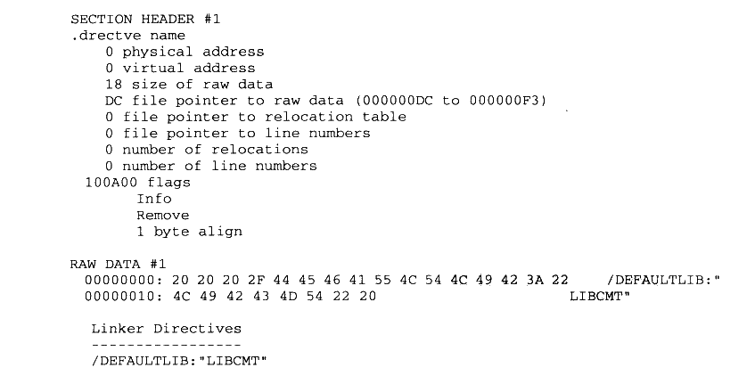
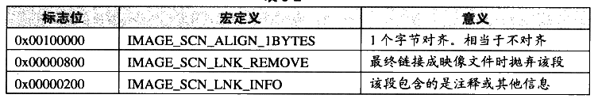

# 5.3 链接指示信息

我们将 “SimpleSection.txt”中关于 “.drectve” 段相关的内容摘录如下：



<details markdown="1"><summary>复制校对文字（未运行验证）</summary>

```text
SECTION HEADER #1
.drectve name
       0 physical address
       0 virtual address
      18 size of raw data
      DC file pointer to raw data (000000DC to 000000F3)
       0 file pointer to relocation table
       0 file pointer to line numbers
       0 number of relocations
       0 number of linenumbers
  100A00 flags
         Info
         Remove
         1 byte align

RAW DATA #1
  00000000: 20 20 20 2F 44 45 46 41 55 4C 54 4C 49 42 3A 22     /DEFAULTLIB:"
  00000010: 4C 49 42 43 4D 54 22 20                          LIBCMT"

  Linker Directives
  -----------------
  /DEFAULTLIB:"LIBCMT"
```

</details>

“.drectve 段”实际上是“Directive” 的缩写，它的内容是编译器传递给链接器的指令（Directive），即编译器希望告诉链接器应该怎样链接这个目标文件。段名后面就是段的属性，包括地址、长度、位置等我们这些在分析 ELF 时已经很熟知的属性，最后一个属性是标志位 “flags”，即 IMAGE\_SECTION\_HEADER 里面的 Characteristics 成员。“.drectve”段的标志位为“0x100A00”，它是表5-2中的标志位的组合。

表5-2



<details markdown="1"><summary>查看校对表格</summary>

| 标志位 | 宏定义 | 意义 |
| --- | --- | --- |
| 0x00100000 | `IMAGE_SCN_ALIGN_1BYTES` | 1个字节对齐。相当于不对齐 |
| 0x00000800 | `IMAGE_SCN_LNK_REMOVE` | 最终链接成映像文件时抛弃该段 |
| 0x00000200 | `IMAGE_SCN_LNK_INFO` | 该段包含的是注释或其他信息 |

</details>

“dumpbin”已经为我们打印出了标志位的三个组合属性：Info、Remove、1 byte align。即该段是信息段，并非程序数据：该段可以在最后链接成可执行文件的时候被抛弃；该段在文件中的对齐方式是1个字节对齐。

输出信息中紧随其后的是该段在文件中的原始数据（RAW DATA \#1，用十六进制显示的原始数据及相应的 ASCII字符）。“dumpbin” 知道该段是个“drectve”段，并且对段的内容进行了解析，解析结果为一个“/DEFAULTLIB：'LIBCMT’”的链接指令（Linker Directives），实际上它就是“cl”编译器希望传给“link”链接器的参数。这个参数表示编译器希望告诉链接器，该目标文件须要 LIBCMT这个默认库。LIBCMT 的全称是（Library C Multithreaded），它表示 VC的静态链接的多线程C库，对应的文件在 VC 安装目录下的 lib/libcmt.lib，我们在前面介绍静态库链接时已经简单介绍过了。所以当我们使用“link”命令链接“SimpleSection.obj”时，链接器看到输入文件中有这个段，就会将“/DEFAULTLIB:LIBCMT”参数添加到链接参数中，即将 libcmt.lib 加入链接输入文件中。

**注意：** 我们可以在 cl 编译器参数里面加入 /Zl来关闭默认C库的链接指令。

