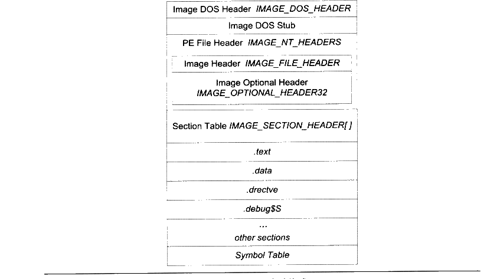
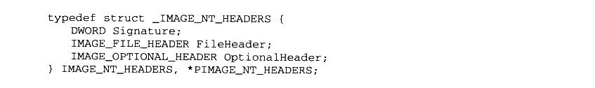
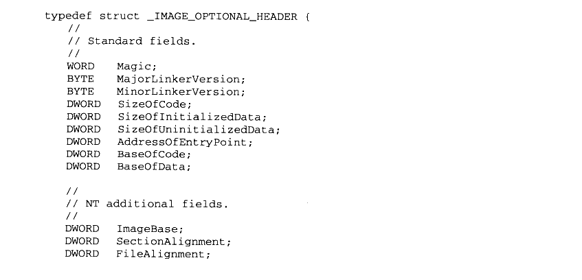
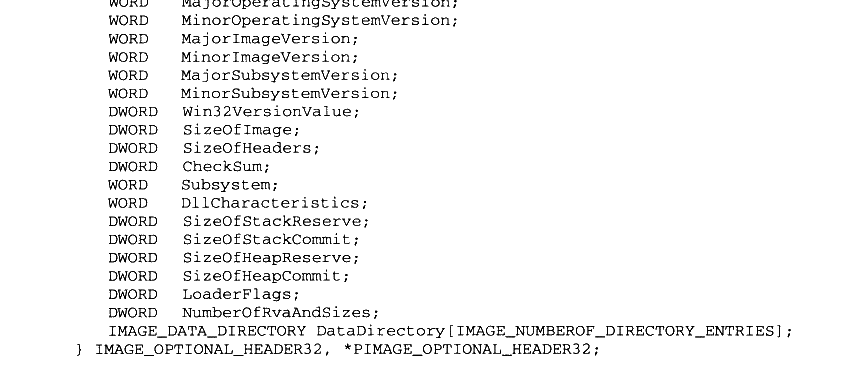
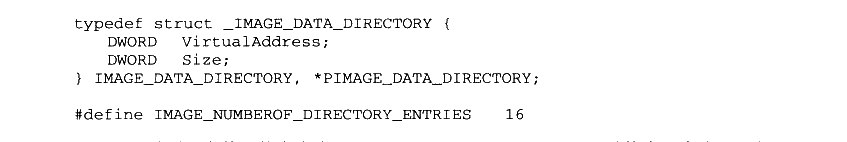

# 5.6 Windows 下的 ELF——PE

PE文件是基于 COFF 的扩展，它比 COFF 文件多了几个结构。最主要的变化有两个：第一个是文件最开始的部分不是COFF 文件头，而是 DOS MZ可执行文件格式的文件头和桩代码（DOS MZ File Header and Stub）；第二个变化是原来的 COFF 文件头中的“IMAGE\_FILE\_HEADER”部分扩展成了 PE文件文件头结构 “IMAGE\_NT\_HEADERS”，这个结构包括了原来的“Image Header” 及新增的PE 扩展头部结构（PE Optional Header）。PE 文件的结构如图5-2所示。



<p class="image-caption">图5-2 PE 文件格式</p>

<details markdown="1"><summary>查看图中文字（按图分组）</summary>

Image DOS Header：IMAGE_DOS_HEADER

Image DOS Stub

PE File Header：IMAGE_NT_HEADERS

Image Header：IMAGE_FILE_HEADER

Image Optional Header：IMAGE_OPTIONAL_HEADER32

Section Table：IMAGE_SECTION_HEADER[]

.text / .data / .drectve / .debug$S / ... / other sections

Symbol Table

</details>

DOS 下的可执行文件的扩展名与 Windows 下的可执行文件扩展名一样，都是“.exe”，但是 DOS 下的可执行文件格式是“MZ”格式（因为这个格式比较古老，我们在这里并不打算展开介绍这种格式），与 Windows 下的PE 格式完全不同，虽然它们使用相同的扩展名。在 Windows 发展的早期，那时候 DOS 系统还如日中天，而且早期的 Windows 版本还不能脱离 DOS 环境独立运行，所以为了照顾 DOS 系统，那些为 Windows 编写的程序必须尽量兼容原有的DOS 系统，所以PE文件在设计之初就背负着历史的累赘。PE 文件中“Image DOS Header”和“DOS Stub”这两个结构就是为了兼容 DOS 系统而设计的，其中“IMAGE\_DOS\_HEADER” 结构其实跟 DOS的“MZ” 可执行结构的头部完全一样，所以从某个角度看，PE文件其实也是一个“MZ”文件。“IMAGE\_DOS\_HEADER” 的结构中有的前两个字节是“e\_magic” 结构，它是里面包含了“MZ” 这两个字母的ASCII 码：“e\_cs”和“e\_ip”两个成员指向程序的入口地址。

当PE 可执行映像在DOS 下被加载的时候，DOS 系统检测该文件，发现最开始两个字节是“MZ”，于是认为它是一个“MZ”可执行文件。然后 DOS 系统就将 PE文件当作正常的“MZ”文件开始执行。DOS系统会读取 “e\_cs”和 “e\_ip”这两个成员的值，以跳转到程序的入口地址。然而 PE文件中，“e\_cs”和 “e\_ip” 这两个成员并不指向程序真正的入口地址，而是指向文件中的“DOS Stub”。“DOS Stub”是一段可以在DOS 下运行的一小段代码，这段代码的唯一作用是向终端输出一行字：“This program cannot be run in DOS”，然后退出程序，表示该程序不能在DOS 下运行。所以我们如果在DOS 系统下运行 Windows 的程序就可以看到上面这句话，这是因为PE文件结构兼容 DOS “MZ” 可执行文件结构的缘故。“IMAGE\_DOS\_HEADER”结构也被定义在WinNT.h里面，该结构的大多数成员我们都不关心，唯一值得关心的是“e\_lfanew”成员，这个成员表明了 PE 文件头（IMAGE\_NT\_HEADERS）在PE文件中的偏移，我们须要使用这个值来定位PE 文件头。这个成员在 DOS的“MZ” 文件格式中它的值永远为0，所以当 Windows 开始执行一个后缀名为“exe” 的文件时，它会判断“e\_lfanew”成员是否为0。如果为0，则该“.exe” 文件是一个 DOS “MZ” 可执行文件，Windows 会启动DOS 子系统来执行它；如果不为0，那么它就是一个 Windows 的PE 可执行文件，e\_lfanew” 的值表示“IMAGE\_NT\_HEADERS”在文件中的偏移。

“IMAGE\_NT\_HEADERS”是 PE 真正的文件头，它包含了一个标记（Signature）和两个结构体。标记是一个常量，对于一个合法的PE 文件来说，它的值为 0x00004550，按照小端字节序，它对应的是“P’、‘E’、“0’、“0”这4个字符的ASCII码。文件头包含的两个结构分别是映像头（Image Header）、PE 扩展头部结构（Image Optional Header）。这个结构定义如下：



<details markdown="1"><summary>复制校对文字（未运行验证）</summary>

```text
typedef struct _IMAGE_NT_HEADERS {
    DWORD Signature;
    IMAGE_FILE_HEADER FileHeader;
    IMAGE_OPTIONAL_HEADER OptionalHeader;
} IMAGE_NT_HEADERS, *PIMAGE_NT_HEADERS;
```

</details>

“Image Header”我们在介绍 COFF 目标文件结构时已经和“SectionTable” 一起介绍过了。这里新出现的是 PE 扩展头部结构，这个结构的字面意思是“可选”（Optional），也就是说不是必须的，但实际上对于PE 可执行文件（包括 DLL）来说，它是必需的。这里的可选可能是相对于COFF 目标文件来说的。该结构里面包含了很多重要的信息，同样，我们可以在“WinNT.h”里面找到该结构的定义：



<details markdown="1"><summary>复制校对文字（未运行验证）</summary>

```text
typedef struct _IMAGE_OPTIONAL_HEADER {
    //
    // Standard fields.
    //
    WORD  Magic;
    BYTE  MajorLinkerVersion;
    BYTE  MinorLinkerVersion;
    DWORD SizeOfCode;
    DWORD SizeOfInitializedData;
    DWORD SizeOfUninitializedData;
    DWORD AddressOfEntryPoint;
    DWORD BaseOfCode;
    DWORD BaseOfData;

    //
    // NT additional fields.
    //
    DWORD ImageBase;
    DWORD SectionAlignment;
    DWORD FileAlignment;
```

</details>



<details markdown="1"><summary>复制校对文字（未运行验证）</summary>

```text
WORD  MajorOperatingSystemVersion;
    WORD  MinorOperatingSystemVersion;
    WORD  MajorImageVersion;
    WORD  MinorImageVersion;
    WORD  MajorSubsystemVersion;
    WORD  MinorSubsystemVersion;
    DWORD Win32VersionValue;
    DWORD SizeOfImage;
    DWORD SizeOfHeaders;
    DWORD CheckSum;
    WORD  Subsystem;
    WORD  DllCharacteristics;
    DWORD SizeOfStackReserve;
    DWORD SizeOfStackCommit;
    DWORD SizeOfHeapReserve;
    DWORD SizeOfHeapCommit;
    DWORD LoaderFlags;
    DWORD NumberOfRvaAndSizes;
    IMAGE_DATA_DIRECTORY DataDirectory[IMAGE_NUMBEROF_DIRECTORY_ENTRIES];
} IMAGE_OPTIONAL_HEADER32, *PIMAGE_OPTIONAL_HEADER32;
```

</details>

我们这里所讨论的 “Optional Image Header” 是32位版本的“IMAGE\_OPTIONAL\_HEADER32”。因为64位的 Windows 也采用PE结构，所以也就有了64位的PE 可执行文件格式。为了区别这两种格式，Windows 中把32位的PE文件格式叫做PE32，把64位的PE 文件格式叫做PE32+。这两种格式就像 ELF32和 ELF64一样，都大同小异，只不过关于地址和长度的一些成员从32位扩展成了 64位，还增加了若干个额外的成员之外，没有其他区别。“WinNT.h” 里面定义了64位版本的“Optional Image Header”，叫做“IMAGE\_OPTIONAL\_HEADER64”。

我们平时可以使用“IMAGE\_OPTIONAL\_HEADER” 作为 “Optional Image Header” 的定义。它是一个宏，在64位的 Windows 下，Visual C++在编译时会定义“\_WIN64” 这个宏，那么“IMAGE\_OPTIONAL\_HEADER” 就被定义成 “IMAGE\_OPTIONAL\_HEADER64”；32 位Windows 下没有定义“\_WIN64”这个宏，那么它就是 IMAGE\_OPTIONAL\_HEADER32。跟 ELF 文件中一样，我们这里只介绍32位版本的格式，64位的格式与32位区别不大。

“Optional Header”里面有很多成员，有些部分跟 PE文件的装载与运行相关。我们不打算先在这里一一列举所有成员的具体含义，只是挑选一部分跟静态链接有关的加以介绍，其他的成员在本书的其他部分会再次回顾。这些成员很多都是跟 Windows 系统相关联的，很多关于 Windows 系统的编程书籍上也都会有介绍，也可以在 Microsoft 的MSDN 上找到关于它们的信息。

### 5.6.1 PE 数据目录

在 Windows 系统装载 PE 可执行文件时，往往须要很快地找到一些装载所须要的数据结构，比如导入表、导出表、资源、重定位表等。这些常用的数据的位置和长度都被保存在了一个叫数据目录（Data Directory）的结构里面，其实它就是前面 “IMAGE\_OPTIONAL\_HEADER”结构里面的“DataDirectory”成员。这个成员是一个“IMAGE\_DATA\_DIRECTORY”的结构数组，相关的定义如下：



<details markdown="1"><summary>复制校对文字（未运行验证）</summary>

```text
typedef struct _IMAGE_DATA_DIRECTORY {
    DWORD VirtualAddress;
    DWORD Size;
} IMAGE_DATA_DIRECTORY, *PIMAGE_DATA_DIRECTORY;

#define IMAGE_NUMBEROF_DIRECTORY_ENTRIES 16
```

</details>

可以看到这个数组的大小为 16,IMAGE\_DATA\_DIRECTORY 结构有两个成员，分别是虚拟地址以及长度。DataDirectory 数组里面每一个元素都对应一个包含一定含义的表。“WinNT.h”里面定义了一些以“IMAGE\_DIRECTORY\_ENTRY\_”开头的宏，数值从0到15，它们实际上就是相关的表的宏定义在数组中的下标。比如“IMAGE\_DIRECTORY\_ENTRY\_EXPORT”被定义为 0，所以这个数组的第一个元素所包含的地址和长度就是导出表（Export Table）所在的地址和长度。

这个数组中还包含其他的表，比如导入表、资源表、异常表、重定位表、调试信息表、线程私有存储（TLS）等的地址和长度。这些表多数跟装载和 DLL 动态链接有关，与静态链接没什么关系，所以我们在此不展开分析。在本书的第3部分我们会经常碰到这些表，在这里我们只要通过解析 DataDirectory 结构了解这些表的位置和长度就可以了。
