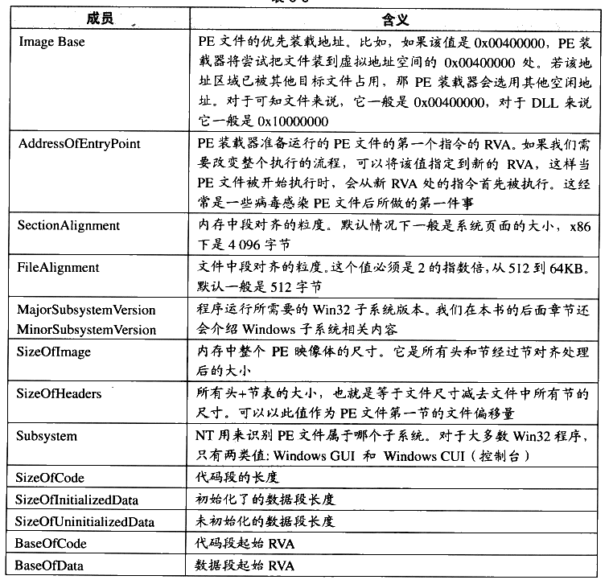

# 6.6 Windows PE 的装载

PE 文件的装载跟 ELF 有所不同，由于 PE 文件中，所有段的起始地址都是页的倍数，段的长度如果不是页的整数倍，那么在映射时向上补齐到页的整数倍，我们也可以简单地认为在32位的PE文件中，段的起始地址和长度都是4096字节的整数倍。由于这个特点，PE文件的映射过程会比 ELF 简单得多，因为它无须考虑如ELF 里面诸多段地址对齐之类的问题，虽然这样会浪费一些磁盘和内存空间。PE 可执行文件的段的数量一般很少，不像 ELF中经常有十多个“Section”，最后不得不使用“Segment”的概念把它们合并到一起装载，PE文件中，链接器在生产可执行文件时，往往将所有的段尽可能地合并，所以一般只有代码段、数据段、只读数据段和BSS 等为数不多的几个段。

在讨论结构的具体装载过程之前，我们要先引入一个 PE 里面很常见的术语叫做 RVA（Relative Virtual Address），它表示一个相对虚拟地址。这个术语看起来比较晦涩难懂，其实它的概念很简单，就是相当于文件中的偏移量的东西。它是相对于 PE 文件的装载基地址的一个偏移地址。比如，一个 PE 文件被装载到虚拟地址（VA）0x00400000，那么一个RVA 为 0x1000 的地址就是0x00401000。每个 PE 文件在装载时都会有一个装载目标地址（Target Address），这个地址就是所谓的基地址（Base Address）。由于 PE 文件被设计成可以装载到任何地址，所以这个基地址并不是固定的，每次装载时都可能会变化。如果 PE文件中的地址都使用绝对地址，它们都要随着基地址的变化而变化。但是，如果使用 RVA这样一种基于基地址的相对地址，那么无论基地址怎么变化，PE 文件中的各个 RVA 都保持一致。这里涉及 PE 可执行文件装载的一些内容，我们只是简单介绍一下，更加详细的内容将留到本书后面有关PE 文件的 Rebasing 机制时再进行分析。

装载一个 PE 可执行文件并且装载它，是个比 ELF 文件相对简单的过程：

- 先读取文件的第一个页，在这个页中，包含了 DOS头、PE文件头和段表。

- 检查进程地址空间中，目标地址是否可用，如果不可用，则另外选一个装载地址。这个问题对于可执行文件来说基本不存在，因为它往往是进程第一个装入的模块，所以目标地址不太可能被占用。主要是针对 DLL 文件的装载而言的，我们在后面的“Rebasing”这一节还会具体介绍这个问题。

- 使用段表中提供的信息，将PE 文件中所有的段一一映射到地址空间中相应的位置。

- 如果装载地址不是目标地址，则进行 Rebasing。

装载所有 PE 文件所需要的 DLL 文件。

- 对PE文件中的所有导入符号进行解析。

- 根据 PE 头中指定的参数，建立初始化栈和堆。

- 建立主线程并且启动进程。

PE 文件中，与装载相关的主要信息都包含在 PE 扩展头（PE Optional Header）和段表，我们在第2部分已经介绍过了PE扩展头部分结构，这里我们将选择几个跟装载相关的成员来分析它们的含义（见表6-6），当然还有一部分成员是跟进程初始化和运行库有关的，我们把它们留到本书的第4部分介绍。

表6-6

查看校对表格

| 成员 | 含义 |
| --- | --- |
| Image Base | PE 文件的优先装载地址。比如，如果该值是0x00400000，PE 装载器将尝试把文件装到虚拟地址空间的0x00400000处。若该地址区域已被其他目标文件占用，那 PE 装载器会选用其他空闲地址。对于可执行文件来说，它一般是0x00400000，对于 DLL 来说它一般是0x10000000。 |
| AddressOfEntryPoint | PE 装载器准备运行的 PE 文件的第一个指令的 RVA。如果我们需要改变整个执行的流程，可以将该值指定到新的 RVA，这样当 PE 文件被开始执行时，会从新 RVA 处的指令首先被执行。这经常是一些病毒感染 PE 文件后所做的第一件事。 |
| SectionAlignment | 内存中段对齐的粒度。默认情况下一般是系统页面的大小，x86 下是4096字节。 |
| FileAlignment | 文件中段对齐的粒度，这个值必须是2的指数倍，从512到64KB。默认一般是512字节。 |
| MajorSubsystemVersion MinorSubsystemVersion | 程序运行所需要的 Win32 子系统版本。我们在本书的后面章节还会介绍 Windows 子系统相关内容。 |
| SizeOfImage | 内存中整个 PE 映像体的尺寸。它是所有头和节经过节对齐处理后的大小。 |
| SizeOfHeaders | 所有头+节表的大小，也就是等于文件尺寸减去文件中所有节的尺寸，可以以此值作为 PE 文件第一节的文件偏移量。 |
| Subsystem | NT 用来识别 PE 文件属于哪个子系统。对于大多数 Win32 程序，只有两类值：Windows GUI 和 Windows CUI（控制台）。 |
| SizeOfCode | 代码段的长度 |
| SizeOfInitializedData | 初始化了的数据段长度 |
| SizeOfUninitializedData | 未初始化的数据段长度 |
| BaseOfCode | 代码段起始 RVA |
| BaseOfData | 数据段起始 RVA |

