# 第 7 章 动态链接

## 7.1 为什么要动态链接

静态链接使得不同的程序开发者和部门能够相对独立地开发和测试自己的程序模块，从某种意义上来讲大大促进了程序开发的效率，原先限制程序的规模也随之扩大。但是慢慢地静态链接的诸多缺点也逐步暴露出来，比如浪费内存和磁盘空间、模块更新困难等问题，使得人们不得不寻找一种更好的方式来组织程序的模块。

内存和磁盘空间

静态链接这种方法的确很简单，原理上很容易理解，实践上很难实现，在操作系统和硬件不发达的早期，绝大部分系统采用这种方案。随着计算机软件的发展，这种方法的缺点很快就暴露出来了，那就是静态连接的方式对于计算机内存和磁盘的空间浪费非常严重。特别是多进程操作系统情况下，静态链接极大地浪费了内存空间，想象一下每个程序内部除了都保留着 printf()函数、scanf（）函数、strlen()等这样的公用库函数，还有数量相当可观的其他库函数及它们所需要的辅助数据结构。在现在的 Linux 系统中，一个普通程序会使用到的C语言静态库至少在1MB 以上，那么，如果我们的机器中运行着100个这样的程序，就要浪费近100MB的内存：如果磁盘中有2000个这样的程序，就要浪费近2GB的磁盘空间，很多 Linux 的机器中，/usr/bin 下就有数千个可执行文件。

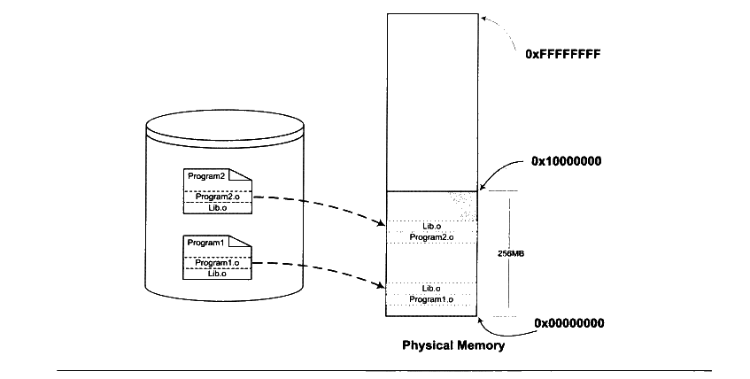

<p class="image-caption">图7-1 静态链接时文件在内存中的副本</p>

<details markdown="1"><summary>查看图中文字（按图分组）</summary>

Program1：Program1.o、Lib.o。

Program2：Program2.o、Lib.o。

Physical Memory：Lib.o、Program2.o；Lib.o、Program1.o。

256MB；0x00000000、0x10000000、0xFFFFFFFF。

</details>

比如图7-1所示的 Program1 和 Program2 分别包含 Program1.o 和 Program2.o 两个模块，并且它们还共用 Lib.o 这个模块。在静态连接的情况下，因为 Program1 和 Program2 都用到了 Lib.o 这个模块，所以它们同时在链接输出的可执行文件 Program1 和 Program2 有两个副本。当我们同时运行 Program1 和 Program2 时，Lib.o 在磁盘中和内存中都有两份副本。当系统中存在大量的类似于 Lib.o的被多个程序共享的目标文件时，其中很大一部分空间就被浪费了。在静态链接中，C语言静态库是很典型的浪费空间的例子，还有其他数以千计的库如果都需要静态链接，那么空间浪费无法想象。

程序开发和发布

空间浪费是静态链接的一个问题，另一个问题是静态链接对程序的更新、部署和发布也会带来很多麻烦。比如程序 Program1所使用的Lib.o 是由一个第三方厂商提供的，当该厂商更新了 Lib.o 的时候（比如修正了 lib.o 里面包含的一个 Bug），那么 Program1 的厂商就需要拿到最新版的Lib.o，然后将其与 Program1.o链接后，将新的 Program1 整个发布给用户。这样做的缺点很明显，即一旦程序中有任何模块更新，整个程序就要重新链接、发布给用户。比如一个程序有20个模块，每个模块1 MB，那么每次更新任何一个模块，用户就得重新获取这个20 MB 的程序。如果程序都使用静态链接，那么通过网络来更新程序将会非常不便，因为一旦程序任何位置的一个小改动，都会导致整个程序重新下载。

动态链接

要解决空间浪费和更新困难这两个问题最简单的办法就是把程序的模块相互分割开来，形成独立的文件，而不再将它们静态地链接在一起。简单地讲，就是不对那些组成程序的目标文件进行链接，等到程序要运行时才进行链接。也就是说，把链接这个过程推迟到了运行时再进行，这就是动态链接（Dynamic Linking）的基本思想。

还是以 Program1 和 Program2 为例，假设我们保留 Program1.o、Program2.o 和 Lib.o 三个目标文件。当我们要运行 Program1这个程序时，系统首先加载 Program1.o，当系统发现Program1.o 中用到了 Lib.o，即 Program1.o依赖于 Lib.o，那么系统接着加载 Lib.o，如果Program1.o或Lib.o还依赖于其他目标文件，系统会按照这种方法将它们全部加载至内存。所有需要的目标文件加载完毕之后，如果依赖关系满足，即所有依赖的目标文件都存在于磁盘，系统开始进行链接工作。这个链接工作的原理与静态链接非常相似，包括符号解析、地址重定位等，我们在前面已经很详细地介绍过了。完成这些步骤之后，系统开始把控制权交给 Program1.o的程序入口处，程序开始运行。这时如果我们需要运行 Program2，那么系统只需要加载 Program2.o，而不需要重新加载 Lib.o，因为内存中已经存在了一份 Lib.o的副本（见图 7-2），系统要做的只是将 Program2.o和Lib.o 链接起来。

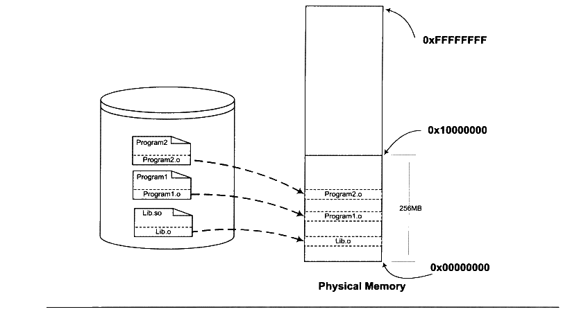

<p class="image-caption">图 7-2 动态链接时文件在内存中的副本</p>

<details markdown="1"><summary>查看图中文字（按图分组）</summary>

Program1：Program1.o。

Program2：Program2.o。

Lib.so：Lib.o。

Physical Memory：Program2.o、Program1.o、Lib.o。

256MB；0x00000000、0x10000000、0xFFFFFFFF。

</details>

很明显，上面的这种做法解决了共享的目标文件多个副本浪费磁盘和内存空间的问题，可以看到，磁盘和内存中只存在一份 Lib.o，而不是两份。另外在内存中共享一个目标文件模块的好处不仅仅是节省内存，它还可以减少物理页面的换入换出，也可以增加CPU 缓存的命中率，因为不同进程间的数据和指令访问都集中在了同一个共享模块上。

上面的动态链接方案也可以使程序的升级变得更加容易，当我们要升级程序库或程序共享的某个模块时，理论上只要简单地将旧的目标文件覆盖掉，而无须将所有的程序再重新链接一遍。当程序下一次运行的时候，新版本的目标文件会被自动装载到内存并且链接起来，程序就完成了升级的目标。

当一个程序产品的规模很大的时候，往往会分割成多个子系统及多个模块，每个模块都由独立的小组开发，甚至会使用不同的编程语言。动态链接的方式使得开发过程中各个模块更加独立，耦合度更小，便于不同的开发者和开发组织之间独立进行开发和测试。

程序可扩展性和兼容性

动态链接还有一个特点就是程序在运行时可以动态地选择加载各种程序模块，这个优点就是后来被人们用来制作程序的插件（Plug-in）。

比如某个公司开发完成了某个产品，它按照一定的规则制定好程序的接口，其他公司或开发者可以按照这种接口来编写符合要求的动态链接文件。该产品程序可以动态地载入各种由第三方开发的模块，在程序运行时动态地链接，实现程序功能的扩展。

动态链接还可以加强程序的兼容性。一个程序在不同的平台运行时可以动态地链接到由操作系统提供的动态链接库，这些动态链接库相当于在程序和操作系统之间增加了一个中间层，从而消除了程序对不同平台之间依赖的差异性。比如操作系统 A 和操作系统 B 对于printf()的实现机制不同，如果我们的程序是静态链接的，那么程序需要分别链接成能够在A运行和在B运行的两个版本并且分开发布：但是如果是动态链接，只要操作系统A 和操作系统B 都能提供一个动态链接库包含 printf()，并且这个 printf()使用相同的接口，那么程序只需要有一个版本，就可以在两个操作系统上运行，动态地选择相应的 printf()的实现版本。当然这只是理论上的可能性，实际上还存在不少问题，我们会在后面继续探讨关于动态链接模块之间兼容性的问题。

从上面的描述来看，动态链接是不是一种“万能膏药”，包治百病呢？很遗憾，动态链接也有诸多的问题及令人烦恼和费解的地方。很常见的一个问题是，当程序所依赖的某个模块更新后，由于新的模块与旧的模块之间接口不兼容，导致了原有的程序无法运行。这个问题在早期的 Windows 版本中尤为严重，因为它们缺少一种有效的共享库版本管理机制，使得用户经常出现新程序安装完之后，其他某个程序无法正常工作的现象，这个问题也经常被称为“DLL Hell”。

动态链接的基本实现

动态链接的基本思想是把程序按照模块拆分成各个相对独立部分，在程序运行时才将它们链接在一起形成一个完整的程序，而不是像静态链接一样把所有的程序模块都链接成一个个单独的可执行文件。那么我们能不能按照前面例子中所描述的那样，直接使用目标文件进行动态链接呢？这个问题的答案是：理论上是可行的，但实际上动态链接的实现方案与直接使用目标文件稍有差别。我们将在后面分析目标文件和动态链接文件的区别。

动态链接涉及运行时的链接及多个文件的装载，必需要有操作系统的支持，因为动态链接的情况下，进程的虚拟地址空间的分布会比静态链接情况下更为复杂，还有一些存储管理、内存共享、进程线程等机制在动态链接下也会有一些微妙的变化。目前主流的操作系统几乎都支持动态链接这种方式，在 Linux 系统中，ELF 动态链接文件被称为动态共享对象（DSO，Dynamic Shared Objects），简称共享对象，它们一般都是以“.so”为扩展名的一些文件：而在 Windows 系统中，动态链接文件被称为动态链接库（Dynamical Linking Library），它们通常就是我们平时很常见的以“.dll”为扩展名的文件。

从本质上讲，普通可执行程序和动态链接库中都包含指令和数据，这一点没有区别。在使用动态链接库的情况下，程序本身被分为了程序主要模块（Program1）和动态链接库（Lib.so），但实际上它们都可以看作是整个程序的一个模块，所以当我们提到程序模块时可以指程序主模块也可以指动态链接库。

在 Linux 中，常用的C语言库的运行库 glibc，它的动态链接形式的版本保存在“/lib”目录下，文件名叫做“libc.so”。整个系统只保留一份C语言库的动态链接文件 “libc.so”，而所有的C语言编写的、动态链接的程序都可以在运行时使用它。当程序被装载的时候，系统的动态链接器会将程序所需要的所有动态链接库（最基本的就是 libc.so）装载到进程的地址空间，并且将程序中所有未决议的符号绑定到相应的动态链接库中，并进行重定位工作。

程序与 libc.so 之间真正的链接工作是由动态链接器完成的，而不是由我们前面看到过的静态链接器ld完成的。也就是说，动态链接是把链接这个过程从本来的程序装载前被推迟到了装载的时候。可能有人会问，这样的做法的确很灵活，但是程序每次被装载时都要进行重新进行链接，是不是很慢？的确，动态链接会导致程序在性能的一些损失，但是对动态链接的链接过程可以进行优化，比如我们后面要介绍的延迟绑定 （Lazy Binding）等方法，可以使得动态链接的性能损失尽可能地减小。据估算，动态链接与静态链接相比，性能损失大约在5%以下。当然经过实践的证明，这点性能损失用来换取程序在空间上的节省和程序构建和升级时的灵活性，是相当值得的。


## 7.2 简单的动态链接例子

Windows 平台下的PE动态链接机制与 Linux 下的 ELF 动态链接稍有不同，ELF 比 PE从结构上来看更加简单，我们先以 ELF 作为例子来描述动态链接的过程，接着我们将会单独描述 Windows平台下 PE 动态链接机制的差异。

首先通过一个简单的例子来大致地感受一下动态链接，我们还是以图7-2中的 Program1 和 Program2来做演示。我们分别需要如下几个源文件：“Program1.c”、“Program2.c”、“Lib.c”和“Lib.h”。它们的源代码如清单7-1所示。

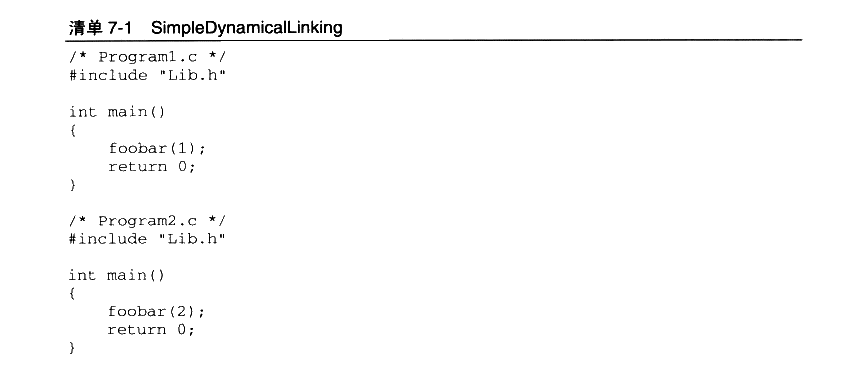

<details markdown="1"><summary>复制校对文字（未运行验证）</summary>

```text
/* Program1.c */
#include "Lib.h"
int main()
{
    foobar(1);
    return 0;
}

/* Program2.c */
#include "Lib.h"
int main()
{
    foobar(2);
    return 0;
}
```

</details>

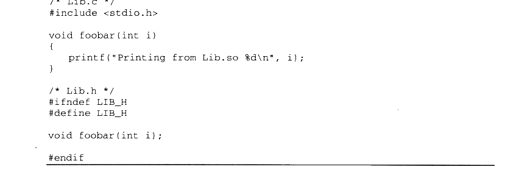

<details markdown="1"><summary>复制校对文字（未运行验证）</summary>

```text
/* Lib.c */
#include <stdio.h>
void foobar(int i)
{
    printf("Printing from Lib.so %d\n", i);
}

/* Lib.h */
#ifndef LIB_H
#define LIB_H
void foobar(int i);
#endif
```

</details>

程序很简单，两个程序的主要模块 Program1.c和 Program2.c分别调用了 Lib.c 里面的foobar()函数，传进去一个数字，foobar()函数的作用就是打印这个数字。然后我们使用GCC将Lib.c编译成一个共享对象文件：

gcc -fPIC -shared -o Lib.so Lib.c

上面 GCC 命令中的参数“-shared”表示产生共享对象，“-fPIC” 我们稍后还会详细解释，这里暂且略过。

这时候我们得到了一个 Lib.so 文件，这就是包含了 Lib.c 的 foobar()函数的共享对象文件。然后我们分别编译链接 Program1.c 和 Program2.c：


<details markdown="1"><summary>复制校对文字（未运行验证）</summary>

```text
gcc -o Program1 Program1.c ./Lib.so
gcc -o Program2 Program2.c ./Lib.so
```

</details>

这样我们得到了两个程序 Program1 和 Program2，这两个程序都使用了 Lib.so 里面的foobar()函数。从 Program1 的角度看，整个编译和链接过程如图7-3所示。

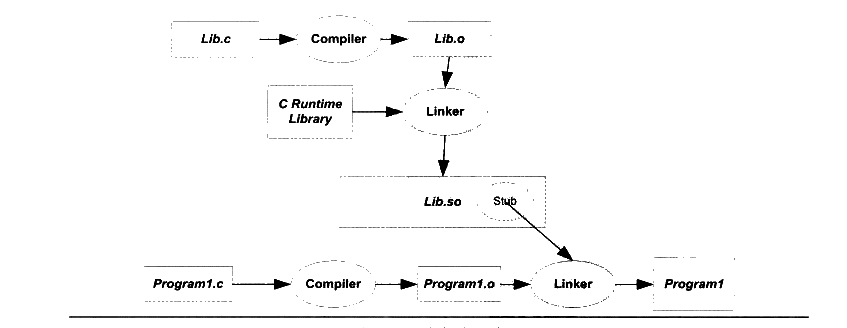

<p class="image-caption">图7-3 动态链接过程</p>

<details markdown="1"><summary>查看图中文字（按图分组）</summary>

Lib.c → Compiler → Lib.o → Linker → Lib.so（Stub）。

C Runtime Library → Linker。

Program1.c → Compiler → Program1.o → Linker → Program1。

</details>

Lib.c被编译成 Lib.so 共享对象文件，Program1.c 被编译成 Program1.o之后，链接成为可执行程序 Program1。图7-3中有一个步骤与静态链接不一样，那就是 Program1.o被连接成可执行文件的这一步。在静态链接中，这一步链接过程会把 Program1.o 和 Lib.o 链接到一起，并且产生输出可执行文件Program1。但是在这里，Lib.o 没有被链接进来，链接的输入目标文件只有 Program1.o（当然还有C语言运行库，我们这里暂时忽略）。但是从前面的命令行中我们看到，Lib.so 也参与了链接过程。这是怎么回事呢？

关于模块（Module）在静态链接时，整个程序最终只有一个可执行文件，它是一个不可以分割的整体；但是在动态链接下，一个程序被分成了若干个文件，有程序的主要部分，即可执行文件（ Program1）和程序所依赖的共享对象（Lib.so），很多时候我们也把这些部分称为模块，即动态链接下的可执行文件和共享对象都可以看作是程序的一个模块。

让我们再回到动态链接的机制上来，当程序模块 Program1.c 被编译成为 Program1.o时，编译器还不知道 foobar()函数的地址，这个内容我们已在静态链接中解释过了。当链接器将 Program1.o链接成可执行文件时，这时候链接器必须确定 Program1.o 中所引用的 foobar()函数的性质。如果 foobar()是一个定义于其他静态目标模块中的函数，那么链接器将会按照静态链接的规则，将 Program1.o中的 foobar 地址引用重定位：如果 foobar()是一个定义在某个动态共享对象中的函数，那么链接器就会将这个符号的引用标记为一个动态链接的符号，不对它进行地址重定位，把这个过程留到装载时再进行。

那么这里就有个问题，链接器如何知道 foobar 的引用是一个静态符号还是一个动态符号？这实际上就是我们要用到 Lib.so 的原因。Lib.so中保存了完整的符号信息（因为运行时进行动态链接还须使用符号信息），把Lib.so 也作为链接的输入文件之一，链接器在解析符号时就可以知道：foobar 是一个定义在 Lib.so 的动态符号。这样链接器就可以对 foobar 的引用做特殊的处理，使它成为一个对动态符号的引用。

动态链接程序运行时地址空间分布

对于静态链接的可执行文件来说，整个进程只有一个文件要被映射，那就是可执行文件本身，我们在前面的章节已经介绍了静态链接下的进程虚拟地址空间的分布。但是对于动态链接来说，除了可执行文件本身之外，还有它所依赖的共享目标文件。那么这种情况下，进程的地址空间分布又会怎样呢？

我们还是以上面的 Program1为例，但是当我们试图运行 Program1并且查看它的进程空间分布时，程序一运行就结束了。所以我们得对程序做适当的修改，在 Lib.c 中的foobar()函数里面加入 sleep 函数：

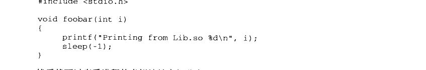

<details markdown="1"><summary>复制校对文字（未运行验证）</summary>

```text
#include <stdio.h>
void foobar(int i)
{
    printf("Printing from Lib.so %d\n", i);
    sleep(-1);
}
```

</details>

然后就可以查看进程的虚拟地址空间分布：

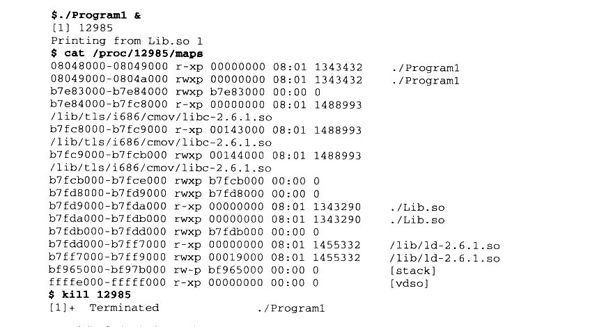

<details markdown="1"><summary>复制校对文字（未运行验证）</summary>

```text
$ ./Program1 &
[1] 12985
Printing from Lib.so 1
$ cat /proc/12985/maps
08048000-08049000 r-xp 00000000 08:01 1343432 ./Program1
08049000-0804a000 rwxp 00000000 08:01 1343432 ./Program1
b7e83000-b7e84000 rwxp b7e83000 00:00 0
b7e84000-b7fc8000 r-xp 00000000 08:01 1488993
/lib/tls/i686/cmov/libc-2.6.1.so
b7fc8000-b7fc9000 r-xp 00143000 08:01 1488993
/lib/tls/i686/cmov/libc-2.6.1.so
b7fc9000-b7fcb000 rwxp 00144000 08:01 1488993
/lib/tls/i686/cmov/libc-2.6.1.so
b7fcb000-b7fce000 rwxp b7fcb000 00:00 0
b7fd8000-b7fd9000 rwxp b7fd8000 00:00 0
b7fd9000-b7fda000 r-xp 00000000 08:01 1343290 ./Lib.so
b7fda000-b7fdb000 rwxp 00000000 08:01 1343290 ./Lib.so
b7fdb000-b7fdd000 rwxp b7fdb000 00:00 0
b7fdd000-b7ff7000 r-xp 00000000 08:01 1455332 /lib/ld-2.6.1.so
b7ff7000-b7ff9000 rwxp 00019000 08:01 1455332 /lib/ld-2.6.1.so
bf965000-bf97b000 rw-p bf965000 00:00 0       [stack]
ffffe000-fffff000 r-xp 00000000 00:00 0       [vdso]
$ kill 12985
[1]+ Terminated ./Program1
```

</details>

我们看到，整个进程虚拟地址空间中，多出了几个文件的映射。Lib.so 与 Program1 一样，它们都是被操作系统用同样的方法映射至进程的虚拟地址空间，只是它们占据的虚拟地址和长度不同。Program1除了使用 Lib.so 以外，它还用到了动态链接形式的C语言运行库libc-2.6.1.so。另外还有一个很值得关注的共享对象就是ld-2.6.1.so，它实际上是Linux 下的动态链接器。动态链接器与普通共享对象一样被映射到了进程的地址空间，在系统开始运行Program1之前，首先会把控制权交给动态链接器，由它完成所有的动态链接工作以后再把控制权交给 Program1，然后开始执行。

我们通过readelf 工具来查看 Lib.so 的装载属性，就如我们在前面查看普通程序一样：

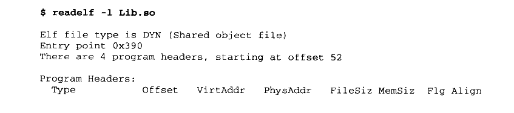

<details markdown="1"><summary>复制校对文字（未运行验证）</summary>

```text
$ readelf -l Lib.so
Elf file type is DYN (Shared object file)
Entry point 0x390
There are 4 program headers, starting at offset 52

Program Headers:
  Type        Offset   VirtAddr   PhysAddr   FileSiz MemSiz Flg Align
```

</details>

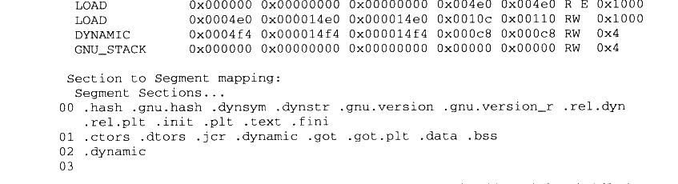

<details markdown="1"><summary>复制校对文字（未运行验证）</summary>

```text
LOAD        0x000000 0x00000000 0x00000000 0x004e0 0x004e0 R E 0x1000
  LOAD        0x0004e0 0x000014e0 0x000014e0 0x0010c 0x00110 RW  0x1000
  DYNAMIC     0x0004f4 0x000014f4 0x000014f4 0x000c8 0x000c8 RW  0x4
  GNU_STACK   0x000000 0x00000000 0x00000000 0x00000 0x00000 RW  0x4

Section to Segment mapping:
 Segment Sections...
 00 .hash .gnu.hash .dynsym .dynstr .gnu.version .gnu.version_r .rel.dyn
    .rel.plt .init .plt .text .fini
 01 .ctors .dtors .jcr .dynamic .got .got.plt .data .bss
 02 .dynamic
 03
```

</details>

除了文件的类型与普通程序不同以外，其他几乎与普通程序一样。还有一点比较不同的是，动态链接模块的装载地址是从地址0x00000000 开始的。我们知道这个地址是无效地址，并且从上面的进程虚拟空间分布看到，Lib.so 的最终装载地址并不是 0x00000000，而是0xb7efc000。从这点我们可以推断，共享对象的最终装载地址在编译时是不确定的，而是在装载时，装载器根据当前地址空间的空闲情况，动态分配一块足够大小的虚拟地址空间给相应的共享对象。

当然，这仅仅是一个推断，至于为什么要这样做，为什么不将每个共享对象在进程中的地址固定，或者在真正的系统中是怎么运作的，我们将在下一节进行解释。


## 7.3 地址无关代码

#### 7.3.1 固定装载地址的困扰

通过上一节的介绍我们已经基本了解了动态链接的概念，同时，我们也得到了一个问题，那就是：共享对象在被装载时，如何确定它在进程虚拟地址空间中的位置？

为了实现动态链接，我们首先会遇到的问题就是共享对象地址的冲突问题。让我们先来回顾一下第2章提到的，程序模块的指令和数据中可能会包含一些绝对地址的引用，我们在链接产生输出文件的时候，就要假设模块被装载的目标地址。

很明显，在动态链接的情况下，如果不同的模块目标装载地址都一样是不行的。而对于单个程序来讲，我们可以手工指定各个模块的地址，比如把 0x1000 到0x2000分配给模块 A，把地址0x2000 到0x3000分配给模块B。但是，如果某个模块被多个程序使用，甚至多个模块被多个程序使用，那么管理这些模块的地址将是一件无比繁琐的事情。比如一个很简单的情况，一个人制作了一个程序，该程序需要用到模块B，但是不需要用到模块A，所以他以为地址0x1000到0x2000是空闲的，于是分配给了另外一个模块C。这样C和原先的模块A的目标地址就冲突了，任何人以后将不能在同一个程序里面使用模块A 和C。想象一个有着成千上万个并且由不同公司和个人开发的共享对象的系统中，采用这种手工分配的方式几乎是不可行的。

不幸的是，早期的确有些系统采用了这样的做法，这种做法叫做静态共享库（Static Shared Library），请注意，它跟静态库（Static Library）有很明显的区别。静态共享库的做法就是将程序的各种模块统一交给操作系统来管理，操作系统在某个特定的地址划分出一些地址块，为那些已知的模块预留足够的空间。

静态共享库的目标地址导致了很多问题，除了上面提到的地址冲突的问题，静态共享库的升级也很成问题，因为升级后的共享库必须保持共享库中全局函数和变量地址的不变，如果应用程序在链接时已经绑定了这些地址，一旦更改，就必须重新链接应用程序，否则会引起应用程序的崩溃。即使升级静态共享库后保持原来的函数和变量地址不变，只是增加了一些全局函数或变量，也会受到限制，因为静态共享库被分配到的虚拟地址空间有限，不能增长太多，否则可能会超出被分配的空间。种种限制和弊端导致了静态共享库的方式在现在的支持动态链接的系统中已经很少见，而彻底被动态链接取代。我们只有在一些不支持动态链接的旧系统中还能看到静态共享库的踪影。目前知道的使用静态共享库的旧系统有：

- UNIX System V Release 3.2（COFF format）。
- 旧的 Linux systems（a.out format）。
- BSD/OS derivative of 4.4BSD（a.out and ELF formats）。

为了解决这个模块装载地址固定的问题，我们设想是否可以让共享对象在任意地址加载？这个问题另一种表述方法就是：共享对象在编译时不能假设自己在进程虚拟地址空间中的位置。与此不同的是，可执行文件基本可以确定自己在进程虚拟空间中的起始位置，因为可执行文件往往是第一个被加载的文件，它可以选择一个固定空闲的地址，比如 Linux 下一般都是 0x08040000，Windows 下一般都是0x0040000。

#### 7.3.2 装载时重定位

为了能够使共享对象在任意地址装载，我们首先能想到的方法就是静态链接中的重定位。这个想法的基本思路就是，在链接时，对所有绝对地址的引用不作重定位，而把这一步推迟到装载时再完成。一旦模块装载地址确定，即目标地址确定，那么系统就对程序中所有的绝对地址引用进行重定位。假设函数 foobar 相对于代码段的起始地址是0x100，当模块被装载到 0x10000000 时，我们假设代码段位于模块的最开始，即代码段的装载地址也是0x10000000，那么我们就可以确定 foobar 的地址为0x10000100。这时候，系统遍历模块中的重定位表，把所有对 foobar 的地址引用都重定位至0x10000100。

事实上，类似的方法在很早以前就存在。早在没有虚拟存储概念的情况下，程序是直接被装载进物理内存的。当同时有多个程序运行的时候，操作系统根据当时内存空闲情况，动态分配一块大小合适的物理内存给程序，所以程序被装载的地址是不确定的。系统在装载程序的时候需要对程序的指令和数据中对绝对地址的引用进行重定位。但这种重定位比前面提到过的静态链接中的重定位要简单得多，因为整个程序是按照一个整体被加载的，程序中指令和数据的相对位置是不会改变的。比如一个程序在编译时假设被装载的目标地址为0x1000，但是在装载时操作系统发现0x1000 这个地址已经被别的程序使用了，从0x4000开始有一块足够大的空间可以容纳该程序，那么该程序就可以被装载至 0x4000，程序指令或数据中的所有绝对引用只要都加上0x3000的偏移量就可以了。

我们前面在静态链接时提到过重定位，那时的重定位叫做链接时重定位（Link Time Relocation），而现在这种情况经常被称为装载时重定位（Load Time Relocation），在Windows 中，这种装载时重定位又被叫做基址重置（Rebasing），我们在后面将会有专门章节分析基址重置。

这种情况与我们碰到的问题很相似，都是程序模块在编译时目标地址不确定而需要在装载时将模块重定位。但是装载时重定位的方法并不适合用来解决上面的共享对象中所存在的问题。可以想象，动态链接模块被装载映射至虚拟空间后，指令部分是在多个进程之间共享的，由于装载时重定位的方法需要修改指令，所以没有办法做到同一份指令被多个进程共享，因为指令被重定位后对于每个进程来讲是不同的。当然，动态连接库中的可修改数据部分对于不同的进程来说有多个副本，所以它们可以采用装载时重定位的方法来解决。

Linux 和GCC 支持这种装载时重定位的方法，我们前面在产生共享对象时，使用了两个GCC 参数“-shared”和“-fPIC”，如果只使用“-shared”，那么输出的共享对象就是使用装载时重定位的方法。

#### 7.3.3 地址无关代码

那么什么是“-fPIC”呢？使用这个参数会有什么效果呢？

装载时重定位是解决动态模块中有绝对地址引用的办法之一，但是它有一个很大的缺点是指令部分无法在多个进程之间共享，这样就失去了动态链接节省内存的一大优势。我们还需要有一种更好的方法解决共享对象指令中对绝对地址的重定位问题。其实我们的目的很简单，希望程序模块中共享的指令部分在装载时不需要因为装载地址的改变而改变，所以实现的基本想法就是把指令中那些需要被修改的部分分离出来，跟数据部分放在一起，这样指令部分就可以保持不变，而数据部分可以在每个进程中拥有一个副本。这种方案就是目前被称为地址无关代码（PIC, Position-independent Code）的技术。

对于现代的机器来说，产生地址无关的代码并不麻烦。我们先来分析模块中各种类型的地址引用方式。这里我们把共享对象模块中的地址引用按照是否为跨模块分成两类：模块内部引用和模块外部引用：按照不同的引用方式又可以分为指令引用和数据访问，这样我们就得到了如图7-4中的4 种情况。

- 第一种是模块内部的函数调用、跳转等。

- 第二种是模块内部的数据访问，比如模块中定义的全局变量、静态变量。

- 第三种是模块外部的函数调用、跳转等。

- 第四种是模块外部的数据访问，比如其他模块中定义的全局变量。

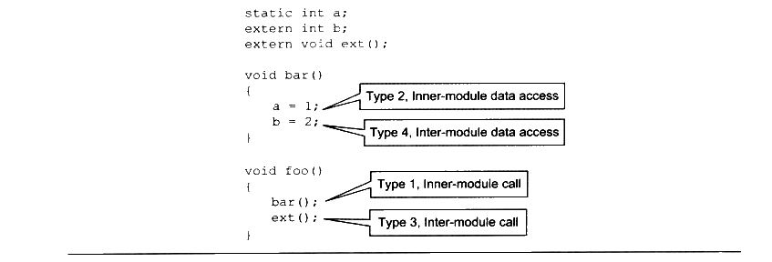

<p class="image-caption">图7-4 4 种寻址模式</p>

<details markdown="1"><summary>查看图中文字（按图分组）</summary>

```c
static int a;
extern int b;
extern void ext();

void bar()
{
    a = 1; // Type 2, Inner-module data access
    b = 2; // Type 4, Inter-module data access
}

void foo()
{
    bar(); // Type 1, Inner-module call
    ext(); // Type 3, Inter-module call
}
```

</details>

关于模块内部和模块外部当编译器在编译 pic.c时，它实际上并不能确定变量b和函数 ext()是模块外部的还是模块内部的，因为它们有可能被定义在同一个共享对象的其他目标文件中。由于没法确定，编译器只能把它们都当作模块外部的函数和变量来处理。MSVC 编译器提供了`__declspec(dllimport)`编译器扩展来表示一个符号是模块内部的还是模块外部的。

类型一 模块内部调用或跳转

这4种情况中，第一种类型应该是最简单的，那就是模块内部调用。因为被调用的函数与调用者都处于同一个模块，它们之间的相对位置是固定的，所以这种情况比较简单。对于现代的系统来讲，模块内部的跳转、函数调用都可以是相对地址调用，或者是基于寄存器的相对调用，所以对于这种指令是不需要重定位的。比如上面例子中foo 对bar 的调用可能产生如下代码：


<details markdown="1"><summary>复制校对文字（未运行验证）</summary>

```text
8048344 <bar>:
8048344: 55      push %ebp
8048345: 89 e5   mov  %esp,%ebp
8048347: 5d      pop  %ebp
8048348: c3      ret
```

</details>


<details markdown="1"><summary>复制校对文字（未运行验证）</summary>

```text
8048349 <foo>:
...
8048357: e8 e8 ff ff ff   call 8048344 <bar>
804835c: b8 00 00 00 00   mov  $0x0,%eax
...
```

</details>

foo 中对 bar 的调用的那条指令实际上是一条相对地址调用指令，我们在第2部分已经介绍过相对位移调用指令的指令格式，相对偏移调用指令如图7-5所示。


<p class="image-caption">图7-5 相对偏移调用指令</p>

<details markdown="1"><summary>查看图中文字（按图分组）</summary>

相对偏移调用指令 call 的指令码：E8

目的地址相对于下一条指令的偏移：E8 FF FF FF

</details>

这条指令中的后4个字节是目的地址相对于当前指令的下一条指令的偏移，即0xFFFFFFE8 （Little-endian）。0xFFFFFFE8 是-24的补码形式，即bar 的地址为 0x804835c+（-24）= 0x8048344。那么只要bar 和 foo 的相对位置不变，这条指令是地址无关的。即无论模块被装载到哪个位置，这条指令都是有效的。这种相对地址的方式对于jmp 指令也有效。

这样看起来第一个模块内部调用或跳转很容易解决，但实际上这种方式还有一定的问题，这里存在一个叫做共享对象全局符号介入（Global Symbol Interposition）问题，这个问题在后面关于“动态链接的实现”中还会详细介绍。但在这里，可以简单地把它当作相对地址调用/跳转。

类型二 模块内部数据访问

接着来看看第二种类型，模块内部的数据访问。很明显，指令中不能直接包含数据的绝对地址，那么唯一的办法就是相对寻址。我们知道，一个模块前面一般是若干个页的代码，后面紧跟着若干个页的数据，这些页之间的相对位置是固定的，也就是说，任何一条指令与它需要访问的模块内部数据之间的相对位置是固定的，那么只需要相对于当前指令加上固定的偏移量就可以访问模块内部数据了。现代的体系结构中，数据的相对寻址往往没有相对于当前指令地址（PC）的寻址方式，所以 ELF 用了一个很巧妙的办法来得到当前的PC 值，然后再加上一个偏移量就可以达到访问相应变量的目的了。得到PC值的方法很多，我们来看看最常用的一种，也是现在 ELF 的共享对象里面用的一种方法：

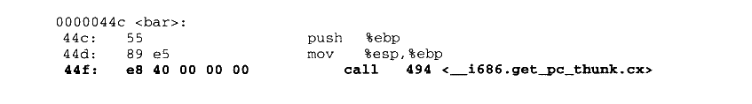

<details markdown="1"><summary>复制校对文字（未运行验证）</summary>

```text
0000044c <bar>:
44c: 55               push %ebp
44d: 89 e5            mov  %esp,%ebp
44f: e8 40 00 00 00   call 494 <__i686.get_pc_thunk.cx>
```

</details>

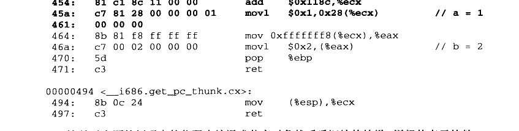

<details markdown="1"><summary>复制校对文字（未运行验证）</summary>

```text
454: 81 c1 8c 11 00 00       add  $0x118c,%ecx
45a: c7 81 28 00 00 00 01    movl $0x1,0x28(%ecx)   // a = 1
461: 00 00 00
464: 8b 81 f8 ff ff ff       mov  0xfffffff8(%ecx),%eax
46a: c7 00 02 00 00 00       movl $0x2,(%eax)        // b = 2
470: 5d                     pop  %ebp
471: c3                     ret

00000494 <__i686.get_pc_thunk.cx>:
494: 8b 0c 24               mov  (%esp),%ecx
497: c3                     ret
```

</details>

这是对上面的例子中的代码先编译成共享对象然后反汇编的结果。用粗体表示的是 bar()函数中访问模块内部变量a的相应代码。从上面的指令中可以看到，它先调用了一个叫“\_\_i686.get\_pc\_thunk.cx”的函数，这个函数的作用就是把返回地址的值放到ecx 寄存器，即把 call 的下一条指令的地址放到 ecx 寄存器。

我们知道当处理器执行call 指令以后，下一条指令的地址会被压到栈顶，而esp 寄存器就是始终指向栈顶的，那么当“\_\_i686.get\_pc\_thunk.cx” 执行`mov (%esp), %ecx`的时候，返回地址就被赋值到 ecx 寄存器了。

接着执行一条 add 指令和一条 mov 指令，可以看到变量a 的地址是 add 指令地址（保存在ecx 寄存器）加上两个偏移量0x118c和 0x28，即如果模块被装载到 0x10000000这个地址的话，那么变量a的实际地址将是0x10000000+ 0x454+0x118c+0x28=0x10001608，这个计算过程我们可以从图7-6中看到。

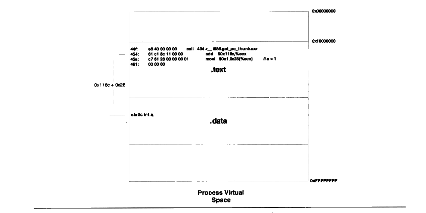

<p class="image-caption">图7-6 模块内部数据访问示意</p>

<details markdown="1"><summary>查看图中文字（按图分组）</summary>

Process Virtual Space：0x00000000、0x10000000、0xFFFFFFFF。

.text：

```text
44f: e8 40 00 00 00       call 494 <__i686.get_pc_thunk.cx>
454: 81 c1 8c 11 00 00    add  $0x118c,%ecx
45a: c7 81 28 00 00 00 01 movl $0x1,0x28(%ecx) // a = 1
461: 00 00 00
```

偏移：0x118c + 0x28。

.data：static int a;

</details>

类型三 模块间数据访问

模块间的数据访问比模块内部稍微麻烦一点，因为模块间的数据访问目标地址要等到装载时才决定，比如上面例子中的变量b，它被定义在其他模块中，并且该地址在装载时才能确定。我们前面提到要使得代码地址无关，基本的思想就是把跟地址相关的部分放到数据段里面，很明显，这些其他模块的全局变量的地址是跟模块装载地址有关的。ELF 的做法是在数据段里面建立一个指向这些变量的指针数组，也被称为全局偏移表（Global Offset Table，GOT），当代码需要引用该全局变量时，可以通过GOT 中相对应的项间接引用，它的基本机制如图7-7所示。

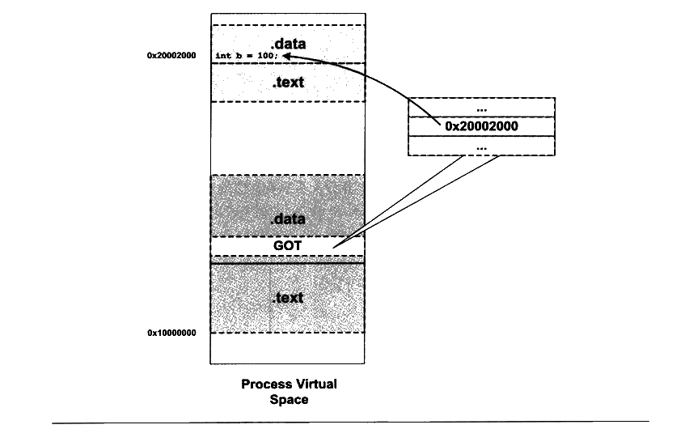

<p class="image-caption">图7-7 模块间数据访问</p>

<details markdown="1"><summary>查看图中文字（按图分组）</summary>

Process Virtual Space：0x10000000。

模块内部：.text、.data、GOT。

外部模块：.text、.data；int b = 100;，地址0x20002000。

GOT 中保存变量地址0x20002000。

</details>

当指令中需要访问变量b时，程序会先找到GOT，然后根据GOT 中变量所对应的项找到变量的目标地址。每个变量都对应一个4个字节的地址，链接器在装载模块的时候会查找每个变量所在的地址，然后填充GOT 中的各个项，以确保每个指针所指向的地址正确。由于GOT 本身是放在数据段的，所以它可以在模块装载时被修改，并且每个进程都可以有独立的副本，相互不受影响。

我们来看看GOT 如何做到指令的地址无关性。从第二种类型的数据访问我们了解到，模块在编译时可以确定模块内部变量相对于当前指令的偏移，那么我们也可以在编译时确定GOT 相对于当前指令的偏移。确定GOT 的位置跟上面的访问变量a的方法基本一样，通过得到PC值然后加上一个偏移量，就可以得到GOT 的位置。然后我们根据变量地址在GOT中的偏移就可以得到变量的地址，当然GOT 中每个地址对应于哪个变量是由编译器决定的，比如第一个地址对应变量b，第二个对应变量c等。

让我们再回顾刚才函数 bar()的反汇编代码。访问变量b，我们的程序首先计算出变量b 的地址在GOT 中的位置，即 0x10000000+ 0x454+ 0x118c+（-8）=0x100015d8 （0xfffffff8为-8的补码表示），然后使用寄存器间接寻址方式给变量b赋值2。

我们也可以使用 objdump 来查看 GOT 的位置：


<details markdown="1"><summary>复制校对文字（未运行验证）</summary>

```text
$ objdump -h pic.so
...
17 .got  00000010  000015d0  000015d0  000005d0  2**2
         CONTENTS, ALLOC, LOAD, DATA
...
```

</details>

可以看到 GOT 在文件中的偏移是0x15d0，我们再来看看 pic.so的需要在动态链接时重定位项：

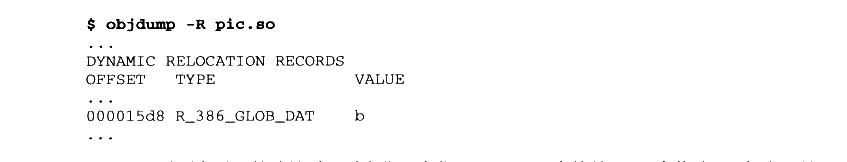

<details markdown="1"><summary>复制校对文字（未运行验证）</summary>

```text
$ objdump -R pic.so
...
DYNAMIC RELOCATION RECORDS
OFFSET   TYPE              VALUE
...
000015d8 R_386_GLOB_DAT     b
...
```

</details>

可以看到变量b的地址需要重定位，它位于 0x15d8，也就是 GOT 中偏移8，相当于是GOT中的第三项（每四个字节一项）。从上面重定位项中看到，变量b的地址的偏移为0x15d8，正好对应了我们前面通过指令计算出来的偏移值，即 0x100015d8-0x10000000 =0x15d8。

类型四 模块间调用、跳转

对于模块间调用和跳转，我们也可以采用上面类型四的方法来解决。与上面的类型有所不同的是，GOT 中相应的项保存的是目标函数的地址，当模块需要调用目标函数时，可以通过GOT 中的项进行间接跳转，基本的原理如图7-8所示。

调用ext（）函数的方法与上面访问变量b的方法基本类似，先得到当前指令地址PC，然后加上一个偏移得到函数地址在GOT 中的偏移，然后一个间接调用：


<details markdown="1"><summary>复制校对文字（未运行验证）</summary>

```text
call 494 <__i686.get_pc_thunk.cx>
add  $0x118c,%ecx
mov  0xfffffffc(%ecx),%eax
call *(%eax)
```

</details>

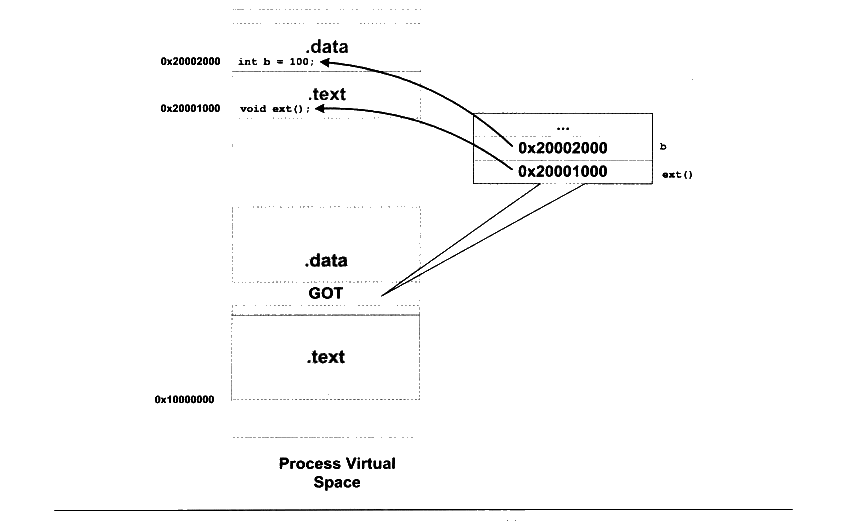

<p class="image-caption">图7-8 模块间调用、跳转</p>

<details markdown="1"><summary>查看图中文字（按图分组）</summary>

Process Virtual Space：0x10000000。

模块内部：.text、.data、GOT。

外部模块：.data 中 int b = 100;，地址0x20002000；.text 中 void ext();，地址0x20001000。

GOT：b → 0x20002000；ext() → 0x20001000。

</details>

这种方法很简单，但是存在一些性能问题，实际上ELF 采用了一种更加复杂和精巧的方法，我们将在后面关于动态链接优化的章节中进行更为具体的介绍。

地址无关代码小结

历经磨难，终于功德圆满。4种地址引用方式在理论上都实现了地址无关性，我们将它们总结一下，如表7-1所示。

表7-1


<details markdown="1"><summary>查看校对表格</summary>

|  | 指令跳转、调用 | 数据访问 |
| --- | --- | --- |
| 模块内部 | （1）相对跳转和调用 | （2）相对地址访问 |
| 模块外部 | （3）间接跳转和调用（GOT） | （4）间接访问（GOT） |

</details>

-fpic 和-fPIC

使用GCC产生地址无关代码很简单，我们只需要使用“-fPIC”参数即可。实际上GCC还提供了另外一个类似的参数叫做 “-fpic”，即 “PIC”3个字母小写，这两个参数从功能上来讲完全一样，都是指示GCC产生地址无关代码。唯一的区别是，“-fPIC”产生的代码要大，而“-fpic”产生的代码相对较小，而且较快。那么我们为什么不使用“-fpic”而要使用“-fPIC”呢？原因是，由于地址无关代码都是跟硬件平台相关的，不同的平台有着不同的实现，“-fpic”在某些平台上会有一些限制，比如全局符号的数量或者代码的长度等，而“-fPIC”则没有这样的限制。所以为了方便起见，绝大部分情况下我们都使用“-fPIC”参数来产生地址无关代码。

如何区分一个 DSO 是否为 PIC

```sh
readelf -d foo.so | grep TEXTREL
```

如果上面的命令有任何输出，那么 foo.so就不是PIC 的，否则就是PIC的。PIC的 DSO是不会包含任何代码段重定位表的，TEXTREL 表示代码段重定位表地址。

PIC 与 PIE

地址无关代码技术除了可以用在共享对象上面，它也可以用于可执行文件，一个以地址无关方式编译的可执行文件被称作地址无关可执行文件（PIE,Position-Independent Executable）。与GCC 的“-fPIC”和“-fpic”参数类似，产生PIE 的参数为“-fPIE”或“-fpie”。

#### 7.3.4 共享模块的全局变量问题

地址无关性问题就这么解决了吗？看起来好像是的。如果你还没看出来一个小问题的话，最好回头再仔细看看前面的4种地址引用方式的分类。发现了吗？我们上面的情况中没有包含定义在模块内部的全局变量的情况。可能你的第一反应就是，这不是很简单吗？跟模块内部的静态变量一样处理不就可以了吗？的确，粗略一看模块内部的全局变量和静态变量的地址都可以通过上面所列出的类型二的方法来解决。但是有一种情况很特，我们来看看会产生什么问题。

有一种很特殊的情况是，当一个模块引用了一个定义在共享对象的全局变量的时候，比如一个共享对象定义了一个全局变量 global，而模块 module.c 中是这么引用的：

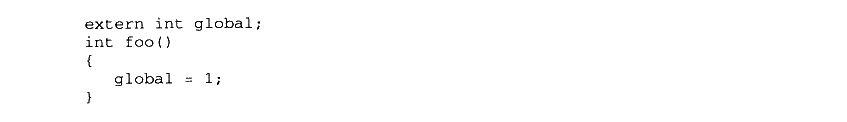

<details markdown="1"><summary>复制校对文字（未运行验证）</summary>

```text
extern int global;
int foo()
{
    global = 1;
}
```

</details>

当编译器编译 module.c 时，它无法根据这个上下文判断global 是定义在同一个模块的其他目标文件还是定义在另外一个共享对象之中，即无法判断是否为跨模块间的调用。

假设 module.c 是程序可执行文件的一部分，那么在这种情况下，由于程序主模块的代码并不是地址无关代码，也就是说代码不会使用这种类似于 PIC 的机制，它引用这个全局变量的方式跟普通数据访问方式一样，编译器会产生这样的代码：

```asm
movl $0x1, XXXXXXXX
```

XXXXXXXX 就是global的地址。由于可执行文件在运行时并不进行代码重定位，所以变量的地址必须在链接过程中确定下来。为了能够使得链接过程正常进行，链接器会在创建可执行文件时，在它的“.bss”段创建一个global 变量的副本。那么问题就很明显了，现在global 变量定义在原先的共享对象中，而在可执行文件的“.bss” 段还有一个副本。如果同一个变量同时存在于多个位置中，这在程序实际运行过程中肯定是不可行的。

于是解决的办法只有一个，那就是所有的使用这个变量的指令都指向位于可执行文件中的那个副本。ELF 共享库在编译时，默认都把定义在模块内部的全局变量当作定义在其他模块的全局变量，也就是说当作前面的类型四，通过GOT来实现变量的访问。当共享模块被装载时，如果某个全局变量在可执行文件中拥有副本，那么动态链接器就会把GOT 中的相应地址指向该副本，这样该变量在运行时实际上最终就只有一个实例。如果变量在共享模块中被初始化，那么动态链接器还需要将该初始化值复制到程序主模块中的变量副本；如果该全局变量在程序主模块中没有副本，那么 GOT 中的相应地址就指向模块内部的该变量副本。

假设 module.c 是一个共享对象的一部分，那么 GCC 编译器在-fPIC 的情况下，就会把对 global 的调用按照跨模块模式产生代码。原因也很简单：编译器无法确定对 global 的引用是跨模块的还是模块内部的。即使是模块内部的，即模块内部的全局变量的引用，按照上面的结论，还是会产生跨模块代码，因为 global 可能被可执行文件引用，从而使得共享模块中对 global 的引用要执行可执行文件中的global副本。

Q&amp;A

Q：如果一个共享对象lib.so 中定义了一个全局变量G，而进程A 和进程B 都使用了 lib.so，

那么当进程A改变这个全局变量G的值时，进程B中的G 会受到影响吗？

A：不会。因为当lib.so被两个进程加载时，它的数据段部分在每个进程中都有独立的副本，

从这个角度看，共享对象中的全局变量实际上和定义在程序内部的全局变量没什么区别。任何一个进程访问的只是自己的那个副本，而不会影响其他进程。那么，如果我们把这个问题的条件改成同一个进程中的线程 A 和线程 B，它们是否看得到对方对lib.so 中的全局变量G的修改呢？对于同一个进程的两个线程来说，它们访问的是同一个进程地址空间，也就是同一个 lib.so的副本，所以它们对G 的修改，对方都是看得到的。

那么我们可不可以做到跟前面答案相反的情况呢？比如要求两个进程共享一个共享对象的副本或要求两个线程访问全局变量的不同副本，这两种需求都是存在的，比如多个进程可以共享同一个全局变量就可以用来实现进程间通信；而多个线程访问全局变量的不同副本可以防止不同线程之间对全局变量的干扰，比如C语言运行库的 errno全局变量。实际上这两种需求都是有相应的解决方法的，多进程共享全局变量又被叫做“共享数据段”，在介绍 Windows DLL 的时候会碰到它。而多个线程访问不同的全局变量副本又被叫做“线程私有存储”（Thread Local Storage），我们在后面还会详细介绍。

#### 7.3.5 数据段地址无关性

通过上面的方法，我们能够保证共享对象中的代码部分地址无关，但是数据部分是不是也有绝对地址引用的问题呢？让我们来看看这样一段代码：


<details markdown="1"><summary>复制校对文字（未运行验证）</summary>

```text
static int a;
static int* p = &a;
```

</details>

如果某个共享对象里面有这样一段代码的话，那么指针p 的地址就是一个绝对地址，它指向变量a，而变量a 的地址会随着共享对象的装载地址改变而改变。那么有什么办法解决这个问题呢？

对于数据段来说，它在每个进程都有一份独立的副本，所以并不担心被进程改变。从这点来看，我们可以选择装载时重定位的方法来解决数据段中绝对地址引用问题。对于共享对象来说，如果数据段中有绝对地址引用，那么编译器和链接器就会产生一个重定位表，这个重定位表里面包含了“R\_386\_RELATIVE”类型的重定位入口，用于解决上述问题。当动态链接器装载共享对象时，如果发现该共享对象有这样的重定位入口，那么动态链接器就会对该共享对象进行重定位。

实际上，我们甚至可以让代码段也使用这种装载时重定位的方法，而不使用地址无关代码。从前面的例子中我们看到，我们在编译共享对象时使用了“-fPIC”参数，这个参数表示产生地址无关的代码段。如果我们不使用这个参数来产生共享对象又会怎么样呢？

```sh
$ gcc -shared pic.c -o pic.so
```

上面这个命令就会产生一个不使用地址无关代码而使用装载时重定位的共享对象。但正如我们前面分析过的一样，如果代码不是地址无关的，它就不能被多个进程之间共享，于是也就失去了节省内存的优点。但是装载时重定位的共享对象的运行速度要比使用地址无关代码的共享对象快，因为它省去了地址无关代码中每次访问全局数据和函数时需要做一次计算当前地址以及间接地址寻址的过程。

对于可执行文件来说，默认情况下，如果可执行文件是动态链接的，那么GCC会使用PIC 的方法来产生可执行文件的代码段部分，以便于不同的进程能够共享代码段，节省内存。所以我们可以看到，动态链接的可执行文件中存在“.got”这样的段。


## 7.4 延迟绑定（PLT）

动态链接的确有很多优势，比静态链接要灵活得多，但它是以牺牲一部分性能为代价的。据统计 ELF 程序在静态链接下要比动态库稍微快点，大约为1%~5%，当然这取决于程序本身的特性及运行环境等。我们知道动态链接比静态链接慢的主要原因是动态链接下对于全局和静态的数据访问都要进行复杂的GOT定位，然后间接寻址：对于模块间的调用也要先定位GOT，然后再进行间接跳转，如此一来，程序的运行速度必定会减慢。另外一个减慢运行速度的原因是动态链接的链接工作在运行时完成，即程序开始执行时，动态链接器都要进行一次链接工作，正如我们上面提到的，动态链接器会寻找并装载所需要的共享对象，然后进行符号查找地址重定位等工作，这些工作势必减慢程序的启动速度。这是影响动态链接性能的两个主要问题，我们将在这一节介绍优化动态链接性能的一些方法。

延迟绑定实现

在动态链接下，程序模块之间包含了大量的函数引用（全局变量往往比较少，因为大量的全局变量会导致模块之间耦合度变大），所以在程序开始执行前，动态链接会耗费不少时间用于解决模块之间的函数引用的符号查找以及重定位，这也是我们上面提到的减慢动态链接性能的第二个原因。不过可以想象，在一个程序运行过程中，可能很多函数在程序执行完时都不会被用到，比如一些错误处理函数或者是一些用户很少用到的功能模块等，如果一开始就把所有函数都链接好实际上是一种浪费。所以 ELF 采用了一种叫做延迟绑定（Lazy Binding）的做法，基本的思想就是当函数第一次被用到时才进行绑定（符号查找、重定位等），如果没有用到则不进行绑定。所以程序开始执行时，模块间的函数调用都没有进行绑定，而是需要用到时才由动态链接器来负责绑定。这样的做法可以大大加快程序的启动速度，特别有利于一些有大量函数引用和大量模块的程序。

ELF 使用 PLT （Procedure Linkage Table）的方法来实现，这种方法使用了一些很精巧的指令序列来完成。在开始详细介绍PLT 之前，我们先从动态链接器的角度设想一下：假设 liba.so 需要调用libc.so中的bar()函数，那么当 liba.so中第一次调用bar()时，这时候就需要调用动态链接器中的某个函数来完成地址绑定工作，我们假设这个函数叫做lookup()，那么 lookup()需要知道哪些必要的信息才能完成这个函数地址绑定工作呢？我想答案很明显，lookup()至少需要知道这个地址绑定发生在哪个模块，哪个函数？那么我们可以假设lookup 的原型为lookup（module, function），这两个参数的值在我们这个例子中分别为liba.so和 bar()。在Glibc 中，我们这里的lookup()函数真正的名字叫\_dl\_runtime\_resolve（）。

当我们调用某个外部模块的函数时，如果按照通常的做法应该是通过GOT 中相应的项进行间接跳转。PLT为了实现延迟绑定，在这个过程中间又增加了一层间接跳转。调用函数并不直接通过GOT 跳转，而是通过一个叫作 PLT 项的结构来进行跳转。每个外部函数在PLT中都有一个相应的项，比如bar()函数在 PLT 中的项的地址我们称之为bar@plt。让我们来看看bar@plt的实现：

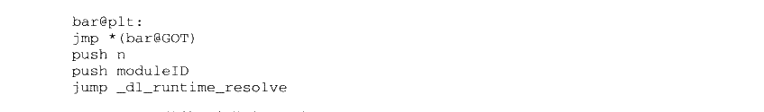

<details markdown="1"><summary>复制校对文字（未运行验证）</summary>

```text
bar@plt:
jmp *(bar@GOT)
push n
push moduleID
jump _dl_runtime_resolve
```

</details>

bar@plt 的第一条指令是一条通过 GOT 间接跳转的指令。bar@GOT 表示 GOT 中保存bar()这个函数相应的项。如果链接器在初始化阶段已经初始化该项，并且将bar()的地址填入该项，那么这个跳转指令的结果就是我们所期望的，跳转到 bar()，实现函数正确调用。但是为了实现延迟绑定，链接器在初始化阶段并没有将 bar()的地址填入到该项，而是将上面代码中第二条指令“push n”的地址填入到 bar@GOT 中，这个步骤不需要查找任何符号，所以代价很低。很明显，第一条指令的效果是跳转到第二条指令，相当于没有进行任何操作。第二条指令将一个数字n压入堆栈中，这个数字是bar这个符号引用在重定位表 “.rel.plt”中的下标。接着又是一条 push 指令将模块的ID 压入到堆栈，然后跳转到\_dl\_runtime\_resolve。这实际上就是在实现我们前面提到的lookup（module, function）这个函数的调用：先将所需要决议符号的下标压入堆栈，再将模块 ID 压入堆栈，然后调用动态链接器的\_dl\_runtime\_resolve（）函数来完成符号解析和重定位工作。\_dl\_runtime\_resolve（）在进行一系列工作以后将 bar()的真正地址填入到 bar@GOT 中。

一旦bar()这个函数被解析完毕，当我们再次调用bar@plt 时，第一条jmp 指令就能够跳转到真正的 bar()函数中，bar()函数返回的时候会根据堆栈里面保存的 EIP 直接返回到调用者，而不会再继续执行 bar@plt 中第二条指令开始的那段代码，那段代码只会在符号未被解析时执行一次。

上面我们描述的是 PLT 的基本原理，PLT 真正的实现要比它的结构稍微复杂一些（见图7-9）。ELF将GOT 拆分成了两个表叫做“.got”和 “.got.plt”。其中“.got”用来保存全局变量引用的地址，“.got.plt”用来保存函数引用的地址，也就是说，所有对于外部函数的引用全部被分离出来放到了“.got.plt”中。另外“.got.plt”还有一个特殊的地方是它的前三项是有特意义的，分别含义如下：

- 第一项保存的是“.dynamic”段的地址，这个段描述了本模块动态链接相关的信息，我们在后面还会介绍“.dynamic”段。

- 第二项保存的是本模块的ID。

- 第三项保存的是\_dl\_runtime\_resolve（）的地址。

其中第二项和第三项由动态链接器在装载共享模块的时候负责将它们初始化。“.got.plt” 的其余项分别对应每个外部函数的引用。PLT 的结构也与我们示例中的 PLT 稍有不同，为了减少代码的重复，ELF 把上面例子中的最后两条指令放到PLT 中的第一项。并且规定每一项的长度是16 个字节，刚好用来存放3条指令，实际的PLT 基本结构如图7-9所示。

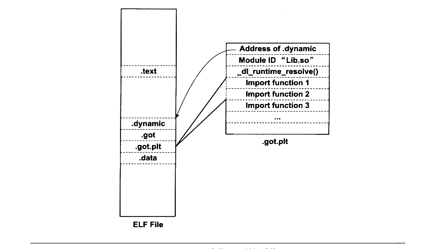

<p class="image-caption">图7-9 GOT 中的PLT 数据结构</p>

<details markdown="1"><summary>查看图中文字（按图分组）</summary>

ELF File：.text、.dynamic、.got、.got.plt、.data。

.got.plt（从上到下）：Address of .dynamic；Module ID “Lib.so”；_dl_runtime_resolve()；Import function 1；Import function 2；Import function 3；...。

</details>

实际的PLT 基本结构代码如下：

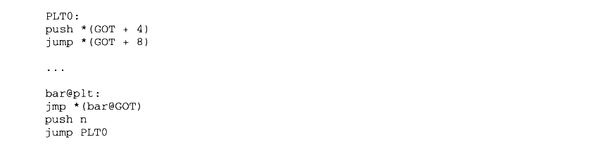

<details markdown="1"><summary>复制校对文字（未运行验证）</summary>

```text
PLT0:
push *(GOT + 4)
jump *(GOT + 8)

...

bar@plt:
jmp *(bar@GOT)
push n
jump PLT0
```

</details>

PLT 在ELF文件中以独立的段存放，段名通常叫做“.plt”，因为它本身是一些地址无关的代码，所以可以跟代码段等一起合并成同一个可读可执行的“Segment”被装载入内存。


## 7.5 动态链接相关结构

在了解了共享对象的绝对地址引用问题以后，我们基本上对动态链接的原理有了初步的了解，接下来的问题就是整个动态链接具体的实现过程了。动态链接在不同的系统上有不同的实现方式，ELF 的动态链接实现方式比 PE 稍微简单一点，在这里我们还是先介绍 ELF的动态链接机制在 Linux 下的实现，最后我们会在专门的章节中介绍 PE在 Windows 下的动态链接机制和它们的区别。

我们在前面的章节已经看到，动态链接情况下，可执行文件的装载与静态链接情况基本一样。首先操作系统会读取可执行文件的头部，检查文件的合法性，然后从头部中的“Program Header”中读取每个 “Segment”的虚拟地址、文件地址和属性，并将它们映射到进程虚拟空间的相应位置，这些步骤跟前面的静态链接情况下的装载基本无异。在静态链接情况下，操作系统接着就可以把控制权转交给可执行文件的入口地址，然后程序开始执行，一切看起来非常直观。

但是在动态链接情况下，操作系统还不能在装载完可执行文件之后就把控制权交给可执行文件，因为我们知道可执行文件依赖于很多共享对象。这时候，可执行文件里对于很多外部符号的引用还处于无效地址的状态，即还没有跟相应的共享对象中的实际位置链接起来。所以在映射完可执行文件之后，操作系统会先启动一个动态链接器（Dynamic Linker）。

在 Linux 下，动态链接器ld.so 实际上是一个共享对象，操作系统同样通过映射的方式将它加载到进程的地址空间中。操作系统在加载完动态链接器之后，就将控制权交给动态链接器的入口地址（与可执行文件一样，共享对象也有入口地址）。当动态链接器得到控制权之后，它开始执行一系列自身的初始化操作，然后根据当前的环境参数，开始对可执行文件进行动态链接工作。当所有动态链接工作完成以后，动态链接器会将控制权转交到可执行文件的入口地址，程序开始正式执行。

#### 7.5.1 ".interp" 段

那么系统中哪个才是动态链接器呢，它的位置由谁决定？是不是所有的\*NIX 系统的动态链接器都位于/lib/ld.so呢？实际上，动态链接器的位置既不是由系统配置指定，也不是由环境参数决定，而是由 ELF 可执行文件决定。在动态链接的 ELF 可执行文件中，有一个专门的段叫做“.interp”段（“interp”是“interpreter”（解释器）的缩写）。如果我们使用 objdump 工具来查看，可以看到 “.interp”内容：


<details markdown="1"><summary>复制校对文字（未运行验证）</summary>

```text
$ objdump -s a.out
a.out: file format elf32-i386
Contents of section .interp:
 8048114 2f6c6962 2f6c642d 6c696e75 782e736f  /lib/ld-linux.so
 8048124 2e3200                             .2.
```

</details>

“.interp”的内容很简单，里面保存的就是一个字符串，这个字符串就是可执行文件所需要的动态链接器的路径，在 Linux 下，可执行文件所需要的动态链接器的路径几乎都是“/lib/ld-linux.so.2”，其他的\*nix 操作系统可能会有不同的路径，我们在后面还会再介绍到各种环境下的动态链接器的路径。在 Linux 的系统中，/lib/ld-linux.so.2通常是一个软链接，比如在我的机器上，它指向/lib/ld-2.6.1.so，这个才是真正的动态链接器。在Linux 中，操作系统在对可执行文件的进行加载的时候，它会去寻找装载该可执行文件所需要相应的动态链接器，即“interp”段指定的路径的共享对象。

动态链接器在 Linux 下是Glibc 的一部分，也就是属于系统库级别的，它的版本号往往跟系统中的 Glibc 库版本号是一样的，比如我的系统中安装的是 Glibc 2.6.1，那么相应的动态链接器也就是/lib/ld-2.6.1.so。当系统中的 Glibc 库更新或者安装其他版本的时候，/lib/ld-linux.so.2 这个软链接就会指向到新的动态链接器，而可执行文件本身不需要修改“.interp”中的动态链接器路径来适应系统的升级。

我们也可以用这个命令来查看一个可执行文件所需要的动态链接器的路径，在 Linux下，往往是如下结果：


<details markdown="1"><summary>复制校对文字（未运行验证）</summary>

```text
$ readelf -l a.out | grep interpreter
    [Requesting program interpreter: /lib/ld-linux.so.2]
```

</details>

而当我们在 FreeBSD 4.6.2 下执行这个命令时，结果是：


<details markdown="1"><summary>复制校对文字（未运行验证）</summary>

```text
$ readelf -l a.out | grep interpreter
    [Requesting program interpreter: /usr/libexec/ld-elf.so.1]
```

</details>

64 位的 Linux 下的可执行文件是：


<details markdown="1"><summary>复制校对文字（未运行验证）</summary>

```text
$ readelf -l a.out | grep interpreter
    [Requesting program interpreter: /lib64/ld-linux-x86-64.so.2]
```

</details>

#### 7.5.2 ".dynamic" 段

类似于“interp”这样的段，ELF 中还有几个段也是专门用于动态链接的，比如“.dynamic”段和“.dynsym”段等。要了解动态链接器如何完成链接过程，跟前面一样，从了解 ELF 文件中跟动态链接相关的结构入手将会是一个很好的途径。ELF 文件中跟动态链接相关的段有好几个，相互之间的关系也比较复杂，我们先从 “.dynamic”段入手。

动态链接 ELF 中最重要的结构应该是“.dynamic”段，这个段里面保存了动态链接器所需要的基本信息，比如依赖于哪些共享对象、动态链接符号表的位置、动态链接重定位表的位置、共享对象初始化代码的地址等。“.dynamic”段的结构很经典，就是我们已经碰到过的ELF 中眼熟的结构数组，结构定义在 “elf.h” 中：


<details markdown="1"><summary>复制校对文字（未运行验证）</summary>

```text
typedef struct {
    Elf32_Sword d_tag;
    union {
```

</details>


<details markdown="1"><summary>复制校对文字（未运行验证）</summary>

```text
Elf32_Word d_val;
        Elf32_Addr d_ptr;
    } d_un;
} Elf32_Dyn;
```

</details>

Elf32\_Dyn 结构由一个类型值加上一个附加的数值或指针，对于不同的类型，后面附加的数值或者指针有着不同的含义。我们这里列举几个比较常见的类型值（这些值都是定义在“elf.h”里面的宏），如表7-2所示。

表7-2


<details markdown="1"><summary>查看校对表格</summary>

| d_tag 类型 | d_un 的含义 |
| --- | --- |
| `DT_SYMTAB` | 动态链接符号表的地址，d_ptr 表示“.dynsym”的地址 |
| `DT_STRTAB` | 动态链接字符串表地址，d_ptr 表示“.dynstr”的地址 |
| `DT_STRSZ` | 动态链接字符串表大小，d_val 表示大小 |
| `DT_HASH` | 动态链接哈希表地址，d_ptr 表示“.hash”的地址 |
| `DT_SONAME` | 本共享对象的“SO-NAME”，我们在后面会介绍“SO-NAME” |
| `DT_RPATH` | 动态链接共享对象搜索路径 |
| `DT_INIT` | 初始化代码地址 |
| `DT_FINI` | 结束代码地址 |
| `DT_NEEDED` | 依赖的共享对象文件，d_ptr 表示所依赖的共享对象文件名 |
| `DT_REL`<br>`DT_RELA` | 动态链接重定位表地址 |
| `DT_RELENT`<br>`DT_RELAENT` | 动态重定位表入口数量 |

</details>

表7-2中只列出了一部分定义，还有一些不太常用的定义我们就暂且忽略，具体可以参考LSB 手册和 elf.h 的定义。从上面给出的这些定义来看，“.dynamic”段里面保存的信息有点像 ELF 文件头，只是我们前面看到的ELF文件头中保存的是静态链接时相关的内容，比如静态链接时用到的符号表、重定位表等，这里换成了动态链接下所使用的相应信息了。所以，“.dynamic”段可以看成是动态链接下 ELF 文件的“文件头”。使用 readelf 工具可以查看“.dynamic”段的内容：


<details markdown="1"><summary>复制校对文字（未运行验证）</summary>

```text
$ readelf -d Lib.so
Dynamic section at offset 0x4f4 contains 21 entries:
  Tag        Type                Name/Value
  0x00000001 (NEEDED)            Shared library: [libc.so.6]
  0x0000000c (INIT)              0x310
  0x0000000d (FINI)              0x4a4
  0x00000004 (HASH)              0xb4
  0x6ffffef5 (GNU_HASH)          0xf8
  0x00000005 (STRTAB)            0x1f4
  0x00000006 (SYMTAB)            0x134
  0x0000000a (STRSZ)             139 (bytes)
  0x0000000b (SYMENT)            16 (bytes)
```

</details>


<details markdown="1"><summary>复制校对文字（未运行验证）</summary>

```text
0x00000003 (PLTGOT)            0x15c8
  0x00000002 (PLTRELSZ)          32 (bytes)
  0x00000014 (PLTREL)            REL
  0x00000017 (JMPREL)            0x2f0
  0x00000011 (REL)               0x2c8
  0x00000012 (RELSZ)             40 (bytes)
  0x00000013 (RELENT)            8 (bytes)
  0x6ffffffe (VERNEED)           0x298
  0x6fffffff (VERNEEDNUM)        1
  0x6ffffff0 (VERSYM)            0x280
  0x6ffffffa (RELCOUNT)          2
  0x00000000 (NULL)              0x0
```

</details>

另外 Linux 还提供了一个命令用来查看一个程序主模块或一个共享库依赖于哪些共享库：


<details markdown="1"><summary>复制校对文字（未运行验证）</summary>

```text
$ ldd Program1
    linux-gate.so.1 => (0xffffe000)
    ./Lib.so (0xb7f62000)
    libc.so.6 => /lib/tls/i686/cmov/libc.so.6 (0xb7e0d000)
    /lib/ld-linux.so.2 (0xb7f66000)
```

</details>

**注意：** 这里可以看到有个 linux-gate.so.1 的共享对象很特殊，它的装载地址很奇怪，是 0xffffe000，这个地址是32位地址空间的末尾4 096 字节，属于 Linux 内核地址空间。你在整个文件系统中都搜索不到这个文件，因为它根本不存在于文件系统中。它实际上是一个内核虚拟共享对象（Kernel Virtual DSO），这涉及到 Linux 的系统调用和内核，我们将在第4 部分介绍 linux-gate.so.1 相关内容。

#### 7.5.3 动态符号表

为了完成动态链接，最关键的还是所依赖的符号和相关文件的信息。我们知道在静态链接中，有一个专门的段叫做符号表“.symtab”（Symbol Table），里面保存了所有关于该目标文件的符号的定义和引用。动态链接的符号表实际上它跟静态链接十分相似，比如前面例子中的 Program1 程序依赖于 Lib.so，引用到了里面的 foobar()函数。那么对于 Program1 来说，我们往往称 Program1 导入（Import）了 foobar 函数，foobar 是 Program1 的导入函数（Import Function）：而站在 Lib.so 的角度来看，它实际上定义了 foobar()函数，并且提供给其他模块使用，我们往往称 Lib.so 导出（Export）了 foobar()函数，foobar 是 Lib.so 的导出函数（Export Function）。把这种导入导出关系放到静态链接的情形下，我们可以把它们看作普通的函数定义和引用。

为了表示动态链接这些模块之间的符号导入导出关系，ELF 专门有一个叫做动态符号表（Dynamic Symbol Table）的段用来保存这些信息，这个段的段名通常叫做“.dynsym”（Dynamic Symbol）。与“.symtab”不同的是，“.dynsym”只保存了与动态链接相关的符号，对于那些模块内部的符号，比如模块私有变量则不保存。很多时候动态链接的模块同时拥有“.dynsym”和“.symtab”两个表，“.symtab”中往往保存了所有符号，包括“.dynsym”中的符号。

与“.symtab”类似，动态符号表也需要一些辅助的表，比如用于保存符号名的字符串表。静态链接时叫做符号字符串表“.strtab”（String Table），在这里就是动态符号字符串表“.dynstr”（Dynamic String Table）：由于动态链接下，我们需要在程序运行时查找符号，为了加快符号的查找过程，往往还有辅助的符号哈希表（“.hash”）。我们可以用 readelf 工具来查看 ELF 文件的动态符号表及它的哈希表：


<details markdown="1"><summary>复制校对文字（未运行验证）</summary>

```text
$ readelf -sD Lib.so
Symbol table for image:
 Num Buc: Value    Size Type   Bind   Vis     Ndx Name
   9   0: 00000310    0 FUNC   GLOBAL DEFAULT   9 _init
   7   0: 000015ec    0 NOTYPE GLOBAL DEFAULT ABS _edata
   4   0: 00000000  685 FUNC   GLOBAL DEFAULT UND sleep
   2   0: 00000000    0 NOTYPE WEAK   DEFAULT UND _Jv_RegisterClasses
   1   0: 00000000    0 NOTYPE WEAK   DEFAULT UND __gmon_start__
  10   0: 0000042c   57 FUNC   GLOBAL DEFAULT  11 foobar
   6   1: 000015f0    0 NOTYPE GLOBAL DEFAULT ABS _end
  11   1: 000004a4    0 FUNC   GLOBAL DEFAULT  12 _fini
   5   2: 00000000  245 FUNC   WEAK   DEFAULT UND __cxa_finalize
   8   2: 000015ec    0 NOTYPE GLOBAL DEFAULT ABS __bss_start
   3   2: 00000000   57 FUNC   GLOBAL DEFAULT UND printf

Symbol table of `.gnu.hash' for image:
 Num Buc: Value    Size Type   Bind   Vis     Ndx Name
   6   0: 000015f0    0 NOTYPE GLOBAL DEFAULT ABS _end
   7   0: 000015ec    0 NOTYPE GLOBAL DEFAULT ABS _edata
   8   0: 000015ec    0 NOTYPE GLOBAL DEFAULT ABS __bss_start
   9   1: 00000310    0 FUNC   GLOBAL DEFAULT   9 _init
  10   2: 0000042c   57 FUNC   GLOBAL DEFAULT  11 foobar
  11   2: 000004a4    0 FUNC   GLOBAL DEFAULT  12 _fini
```

</details>

动态链接符号表的结构与静态链接的符号表几乎一样，我们可以简单地将导入函数看作是对其他目标文件中函数的引用：把导出函数看作是在本目标文件定义的函数就可以了。

#### 7.5.4 动态链接重定位表

共享对象要重定位的主要原因是导入符号的存在。动态链接下，无论是可执行文件或共享对象，一旦它依赖于其他共享对象，也就是说有导入的符号时，那么它的代码或数据中就会有对于导入符号的引用。在编译时这些导入符号的地址未知，在静态链接中，这些未知的地址引用在最终链接时被修正。但是在动态链接中，导入符号的地址在运行时才确定，所以需要在运行时将这些导入符号的引用修正，即需要重定位。

我们在前面的地址无关章节中也提到过，动态链接的可执行文件使用的是PIC 方法，但这不能改变它需要重定位的本质。对于动态链接来说，如果一个共享对象不是以PIC 模式编译的，那么毫无疑问，它是需要在装载时被重定位的：如果一个共享对象是PIC 模式编译的，那么它还需要在装载时进行重定位吗？是的，PIC模式的共享对象也需要重定位。

对于使用 PIC 技术的可执行文件或共享对象来说，虽然它们的代码段不需要重定位（因为地址无关），但是数据段还包含了绝对地址的引用，因为代码段中绝对地址相关的部分被分离了出来，变成了 GOT，而GOT 实际上是数据段的一部分。除了 GOT 以外，数据段还可能包含绝对地址引用，我们在前面的章节中已经举例过了。

动态链接重定位相关结构

共享对象的重定位与我们在前面“静态链接”中分析过的目标文件的重定位十分类似，唯一有区别的是目标文件的重定位是在静态链接时完成的，而共享对象的重定位是在装载时完成的。在静态链接中，目标文件里面包含有专门用于表示重定位信息的重定位表，比如“.rel.text”表示是代码段的重定位表，“.rel.data”是数据段的重定位表。

动态链接的文件中，也有类似的重定位表分别叫做“.rel.dyn”和“.rel.plt”，它们分别相当于 “.rel.text” 和“.rel.data”。“.rel.dyn”实际上是对数据引用的修正，它所修正的位置位于“.got”以及数据段：而“.rel.plt” 是对函数引用的修正，它所修正的位置位于“got.plt"。我们可以使用 readelf来查看一个动态链接的文件的重定位表：


<details markdown="1"><summary>复制校对文字（未运行验证）</summary>

```text
$ readelf -r Lib.so
Relocation section '.rel.dyn' at offset 0x2c8 contains 5 entries:
 Offset   Info     Type              Sym.Value Sym. Name
000015e4 00000008 R_386_RELATIVE
000015e8 00000008 R_386_RELATIVE
000015bc 00000106 R_386_GLOB_DAT     00000000 __gmon_start__
000015c0 00000206 R_386_GLOB_DAT     00000000 _Jv_RegisterClasses
000015c4 00000506 R_386_GLOB_DAT     00000000 __cxa_finalize

Relocation section '.rel.plt' at offset 0x2f0 contains 4 entries:
 Offset   Info     Type              Sym.Value Sym. Name
000015d4 00000107 R_386_JUMP_SLOT    00000000 __gmon_start__
000015d8 00000307 R_386_JUMP_SLOT    00000000 printf
000015dc 00000407 R_386_JUMP_SLOT    00000000 sleep
000015e0 00000507 R_386_JUMP_SLOT    00000000 __cxa_finalize
$ readelf -S Lib.so
...
[19] .got     PROGBITS 000015bc 0005bc 00000c 04 WA 0 0 4
[20] .got.plt PROGBITS 000015c8 0005c8 00001c 04 WA 0 0 4
[21] .data    PROGBITS 000015e4 0005e4 000008 00 WA 0 0 4
...
```

</details>

在静态链接中我们已经碰到过两种类型的重定位入口 R\_386\_32 和 R\_386\_PC32，这里可以看到几种新的重定位入口类型：R\_386\_RELATIVE、R\_386\_GLOB\_DAT 和R\_386\_JUMP\_SLOT。实际上这些不同的重定位类型表示重定位时有不同的地址计算方法，在前面的静态链接中已经介绍过了 R\_386\_32和 R\_386\_PC32 的地址计算方法，实际上它们已经是比较复杂的重定位类型了。这里的 R\_386\_RELATIVE、R\_386\_GLOB\_DAT 和R\_386\_JUMP\_SLOT 都是很简单的重定位类型。我们先来看看 R\_386\_GLOB\_DAT 和R\_386\_JUMP\_SLOT，这两个类型的重定位入口表示，被修正的位置只需要直接填入符号的地址即可。比如我们看 printf这个重定位入口，它的类型为 R\_386\_JUMP\_SLOT，它的偏移为 0x000015d8，它实际上位于“.got.plt”中。我们知道，“.got.plt” 的前三项是被系统占据的，从第四项开始才是真正存放导入函数地址的地方。而第四项刚好是 0x000015c8+4\*3=0x000015d4，即“\_\_gmon\_start\_\_”，第五项是“printf”，第六项是“sleep”，第七项是“\_\_cxa\_finalize”。所以 Lib.so 的“.got.plt”的结构如图7-10所示。


<p class="image-caption">图 7-10 Lib.so 的.got.plt 结构</p>

<details markdown="1"><summary>查看图中文字（按图分组）</summary>

Lib.so：.text、.dynamic、.got、.got.plt、.data。

.got.plt：

| 地址 | 内容 |
| --- | --- |
| 0x000015c8 | Address of .dynamic |
| 0x000015cc | Module ID “Lib.so” |
| 0x000015d0 | `_dl_runtime_resolve()` |
| 0x000015d4 | `__gmon_start__` |
| 0x000015d8 | printf |
| 0x000015dc | sleep |
| 0x000015e0 | `__cxa_finalize` |

</details>

当动态链接器需要进行重定位时，它先查找“printf” 的地址，“printf”位于 libc-2.6.1.so。假设链接器在全局符号表里面找到 “printf”的地址为0x08801234，那么链接器就会将这个地址填入到 “.got.plt” 中的偏移为 0x000015d8 的位置中去，从而实现了地址的重定位，即实现了动态链接最关键的一个步骤。

类似于 R\_386\_JUMP\_SLOT 是对“.got.plt” 的重定位，R\_386\_GLOB\_DAT是对 “.got”的重定位，它跟R\_386\_JUMP\_SLOT 一模一样，在这里不再详细介绍了，有兴趣的读者可以自己分析“.rel.dyn”中3个R\_386\_GLOB\_DAT 与“.got” 的关系，就能很快理解了。

稍微麻烦一点的是 R\_386\_RELATIVE 类型的重定位入口，这种类型的重定位实际上就是基址重置（Rebasing）。我们在前面已经分析过，共享对象的数据段是没有办法做到地址无关的，它可能会包含绝对地址的引用，对于这种绝对地址的引用，我们必须在装载时将其重定位。比如前面例子中，有一个全局指针变量被初始化为一个静态变量的地址：


<details markdown="1"><summary>复制校对文字（未运行验证）</summary>

```text
static int a;
static int* p = &a;
```

</details>

在编译时，共享对象的地址是从0开始的，我们假设该静态变量a相对于起始地址0的偏移为B，即p 的值为B。一旦共享对象被装载到地址 A，那么实际上该变量a 的地址为A+B，即p 的值需要加上一个装载地址 A。R\_386\_RELATIVE 类型的重定位入口就是专门用来重定位指针变量p这种类型的，变量p在装载时需要加上一个装载地址值 A，才是正确的结果。

那么导入函数的重定位入口是不是只会出现在“.rel.plt”，而不会出现在“.rel.dyn”呢？答案为否。如果某个 ELF 文件是以PIC 模式编译的（动态链接的可执行文件一般是PIC的），并调用了一个外部函数bar，则bar 会出现在“.rel.plt ”中：而如果不是以PIC 模式编译，则bar 将出现在：“.rel.dyn”中。让我们来看看不使用PIC 的方法来编译，重定位表的结果又会有什么不一样呢？


<details markdown="1"><summary>复制校对文字（未运行验证）</summary>

```text
$ gcc -shared Lib.c -o Lib.so
$ readelf -r Lib.so
Relocation section '.rel.dyn' at offset 0x2c8 contains 8 entries:
 Offset   Info     Type              Sym.Value Sym. Name
0000042c 00000008 R_386_RELATIVE
000015c4 00000008 R_386_RELATIVE
000015c8 00000008 R_386_RELATIVE
00000431 00000302 R_386_PC32         00000000 printf
0000043d 00000402 R_386_PC32         00000000 sleep
000015a4 00000106 R_386_GLOB_DAT     00000000 __gmon_start__
000015a8 00000206 R_386_GLOB_DAT     00000000 _Jv_RegisterClasses
000015ac 00000506 R_386_GLOB_DAT     00000000 __cxa_finalize

Relocation section '.rel.plt' at offset 0x308 contains 2 entries:
 Offset   Info     Type              Sym.Value Sym. Name
000015bc 00000107 R_386_JUMP_SLOT    00000000 __gmon_start__
000015c0 00000507 R_386_JUMP_SLOT    00000000 __cxa_finalize
```

</details>

可以看到Lib.c中的两个导入函数 “printf”和“sleep”从“.rel.plt” 到了“.rel.dyn”，并且类型也从 R\_386\_JUMP\_SLOT 变成了 R\_386\_PC32。

而 R\_386\_RELATIVE 类型多出了一个偏移为 0x0000042c的入口，这个入口是什么呢？通过对Lib.so 的反汇编可以知道，这个入口是用来修正传给 printf 的第一个参数，即我们的字符串常量 “Printing from Lib.so %d\n”的地址。为什么这个字符串常量的地址在PIC 时不需要重定位而在非PIC 时需要重定位呢？很明显，PIC 时，这个字符串可以看作是普通的全局变量，它的地址是可以通过PIC 中的相对当前指令的位置加上一个固定偏移计算出来的：而在非PIC中，代码段不再使用这种相对于当前指令的PIC方法，而是采用绝对地址寻址，所以它需要重定位。

#### 7.5.5 动态链接时进程堆栈初始化信息

站在动态链接器的角度看，当操作系统把控制权交给它的时候，它将开始做链接工作，那么至少它需要知道关于可执行文件和本进程的一些信息，比如可执行文件有几个段（“Segment”）、每个段的属性、程序的入口地址（因为动态链接器到时候需要把控制权交给可执行文件）等。这些信息往往由操作系统传递给动态链接器，保存在进程的堆栈里面。我们在前面提到过，进程初始化的时候，堆栈里面保存了关于进程执行环境和命令行参数等信息。事实上，堆栈里面还保存了动态链接器所需要的一些辅助信息数组（Auxiliary Vector）。辅助信息的格式也是一个结构数组，它的结构被定义在 “elf.h”：


<details markdown="1"><summary>复制校对文字（未运行验证）</summary>

```text
typedef struct
{
    uint32_t a_type;
    union
    {
        uint32_t a_val;
    } a_un;
} Elf32_auxv_t;
```

</details>

是不是已经对这种结构很熟悉了？没错，跟前面的“.dynamic”段里面的结构如出一辙。先是一个32位的类型值，后面是一个32位的数值部分。你可能会很奇怪为什么要用一个union 把后面的32位数值包装起来，事实上这个 union没什么用，只是历史遗留而已，可以当作不存在。我们摘录几个比较重要的类型值，这几个类型值是比较常见的，而且是动态链接器在启动时所需要的，如表7-3所示。

表7-3


<details markdown="1"><summary>查看校对表格</summary>

| a_type 定义 | a_type 值 | a_val 的含义 |
| --- | --- | --- |
| `AT_NULL` | 0 | 表示辅助信息数组结束 |
| `AT_EXECFD` | 2 | 表示可执行文件的文件句柄。正如前面提到的，动态链接器需要知道一些关于可执行文件的信息。当进程开始执行可执行文件时，操作系统会先将文件打开，这时候就会产生文件句柄。那么操作系统可以将文件句柄传递给动态链接器，动态链接器可以通过操作系统的文件读写操作来访问可执行文件。 |
| `AT_PHDR` | 3 | 可执行文件中程序头表（Program Header）在进程中的地址。（还记得 ELF 程序视图和链接视图吧？） |

</details>

续表


<details markdown="1"><summary>查看校对表格</summary>

| a_type 定义 | a_type 值 | a_val 的含义 |
| --- | --- | --- |
| `AT_PHDR` | 3 | 正如前面 AT_EXECFD 所提到的，动态链接器可以通过操作系统的文件读写功能来访问可执行文件。但事实上，很多操作系统会把可执行文件映射到进程的虚拟空间里面，从而动态链接器不需要通过读写文件，而是可以直接访问内存中的文件映像。所以操作系统要么选择前面的文件句柄方式，要么选择这种映像的方式。当选择映像的方式时，操作系统必须提供后面的 AT_PHENT、AT_PHNUM 和 AT_ENTRY 这几个类型。 |
| `AT_PHENT` | 4 | 可执行文件头中程序头表中每一个入口（Entry）的大小 |
| `AT_PHNUM` | 5 | 可执行文件头中程序头表中入口（Entry）的数量 |
| `AT_BASE` | 7 | 表示动态链接器本身的装载地址 |
| `AT_ENTRY` | 9 | 可执行文件入口地址，即启动地址 |

</details>

介绍了这么多关于辅助信息数组的结构，我们还没看到它到底位于进程堆栈的哪个位置呢。事实上，它位于环境变量指针的后面。比如我们假设操作系统传给动态链接器的辅助信息有4个，分别是：

- AT\_PHDR，值为 0x08048034，程序表头位于0x08048034。

- AT\_PHENT，值为20，程序表头中每个项的大小为20字节。

- AT\_PHNUM，值为7，程序表头共有7个项。

- AT\_ENTRY,0x08048320，程序入口地址为 0x08048320。

那么进程的初始化堆栈就如图7-11所示。

我们可以写一个小程序来把堆栈中初始化的信息全部打印出来，程序源代码如下：


<details markdown="1"><summary>复制校对文字（未运行验证）</summary>

```text
#include <stdio.h>
#include <elf.h>

int main(int argc, char* argv[])
{
    int* p = (int*)argv;
    int i;
    Elf32_auxv_t* aux;

    printf("Argument count: %d\n", *(p-1));
    for (i = 0; i < *(p-1); ++i) {
        printf("Argument %d : %s\n", i, *(p + i));
    }
    p += i;
    p++; // skip 0

    printf("Environment:\n");
    while (*p) {
        printf("%s\n", *p);
        p++;
    }
    p++; // skip 0

    printf("Auxiliary Vectors:\n");
    aux = (Elf32_auxv_t*)p;
    while (aux->a_type != AT_NULL) {
        printf("Type: %02d Value: %x\n", aux->a_type, aux->a_un.a_val);
        aux++;
    }
    return 0;
}
```

</details>


<p class="image-caption">图7-11 进程初始化堆栈</p>

<details markdown="1"><summary>查看图中文字（按图分组）</summary>

Process Stack：High Address → Low Address。

字符串：PATH=/usr/bin\0；HOME=/home/user\0；123\0；prog\0。

图中地址：0xBF802000、0xBF801FFC、0xBF801FF0、0xBF801FE0、0xBF801FDC、0xBF801FD8。

辅助信息：AT_NULL = 0；AT_ENTRY = 9，值0x08048320；AT_PHNUM = 5，值7；AT_PHENT = 4，值20；AT_PHDR = 3，图中值4。

Environment Pointers：0xBF801FF1、0xBF801FE1，后接0。

Argument Pointers：0xBF801FDE、0xBF801FD8，后接0。

Argument Count：2；esp → 0xBF801F94。

</details>

上面的程序中，为什么使用 argv 作为基准来定位各个结构的地址，而不是采用argc？提示：传值和传址。


## 7.6 动态链接的步骤和实现

有了前面诸多的铺垫，我们终于要开始分析动态链接的实际链接步骤了。动态链接的步骤基本上分为3步：先是启动动态链接器本身，然后装载所有需要的共享对象，最后是重定位和初始化。

#### 7.6.1 动态链接器自举

我们知道动态链接器本身也是一个共享对象，但是事实上它有一些特殊性。对于普通共享对象文件来说，它的重定位工作由动态链接器来完成：它也可以依赖于其他共享对象，其中的被依赖的共享对象由动态链接器负责链接和装载。可是对于动态链接器本身来说，它的重定位工作由谁来完成？它是否可以依赖于其他的共享对象？

这是一个“鸡生蛋，蛋生鸡”的问题，为了解决这种无休止的循环，动态链接器这个“鸡”必须有些特殊性。首先是，动态链接器本身不可以依赖于其他任何共享对象：其次是动态链接器本身所需要的全局和静态变量的重定位工作由它本身完成。对于第一个条件我们可以人为地控制，在编写动态链接器时保证不使用任何系统库、运行库：对于第二个条件，动态链接器必须在启动时有一段非常精巧的代码可以完成这项艰巨的工作而同时又不能用到全局和静态变量。这种具有一定限制条件的启动代码往往被称为自举 （Bootstrap）。

动态链接器入口地址即是自举代码的入口，当操作系统将进程控制权交给动态链接器时，动态链接器的自举代码即开始执行。自举代码首先会找到它自己的GOT。而GOT 的第一个入口保存的即是“.dynamic”段的偏移地址，由此找到了动态链接器本身的“.dynamic”段。通过“.dynamic”中的信息，自举代码便可以获得动态链接器本身的重定位表和符号表等，从而得到动态链接器本身的重定位入口，先将它们全部重定位。从这一步开始，动态链接器代码中才可以开始使用自己的全局变量和静态变量。

实际上在动态链接器的自举代码中，除了不可以使用全局变量和静态变量之外，甚至不能调用函数，即动态链接器本身的函数也不能调用。这是为什么呢？其实我们在前面分析地址无关代码时已经提到过，实际上使用 PIC模式编译的共享对象，对于模块内部的函数调用也是采用跟模块外部函数调用一样的方式，即使用GOT/PLT 的方式，所以在GOT/PLT没有被重定位之前，自举代码不可以使用任何全局变量，也不可以调用函数。下面这段注释来自于 Glibc 2.6.1 源代码中的 elf/rtld.c：

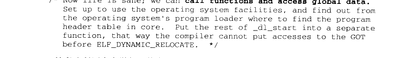

<details markdown="1"><summary>复制校对文字（未运行验证）</summary>

```text
/* Now life is sane; we can call functions and access global data.
   Set up to use the operating system facilities, and find out from
   the operating system's program loader where to find the program
   header table in core. Put the rest of _dl_start into a separate
   function, that way the compiler cannot put accesses to the GOT
   before ELF_DYNAMIC_RELOCATE. */
```

</details>

这段注释写在自举代码的末尾，表示自举代码已经执行结束。“Now life is sane”，可以想象动态链接器的作者在此时大舒一口气，终于完成自举了，可以自由地调用各种函数并且随意访问全局变量了。

#### 7.6.2 装载共享对象

完成基本自举以后，动态链接器将可执行文件和链接器本身的符号表都合并到一个符号表当中，我们可以称它为全局符号表（Global Symbol Table）。然后链接器开始寻找可执行文件所依赖的共享对象，我们前面提到过“.dynamic”段中，有一种类型的入口是DT\_NEEDED，它所指出的是该可执行文件（或共享对象）所依赖的共享对象。由此，链接器可以列出可执行文件所需要的所有共享对象，并将这些共享对象的名字放入到一个装载集合中。然后链接器开始从集合里取一个所需要的共享对象的名字，找到相应的文件后打开该文件，读取相应的ELF文件头和“ .dynamic”段，然后将它相应的代码段和数据段映射到进程空间中。如果这个 ELF 共享对象还依赖于其他共享对象，那么将所依赖的共享对象的名字放到装载集合中。如此循环直到所有依赖的共享对象都被装载进来为止，当然链接器可以有不同的装载顺序，如果我们把依赖关系看作一个图的话，那么这个装载过程就是一个图的遍历过程，链接器可能会使用深度优先或者广度优先或者其他的顺序来遍历整个图，这取决于链接器，比较常见的算法一般都是广度优先的。

当一个新的共享对象被装载进来的时候，它的符号表会被合并到全局符号表中，所以当所有的共享对象都被装载进来的时候，全局符号表里面将包含进程中所有的动态链接所需要的符号。

符号的优先级

在动态链接器按照各个模块之间的依赖关系，对它们进行装载并且将它们的符号并入到全局符号表时，会不会有这么一种情况发生，那就是有可能两个不同的模块定义了同一个符号？让我们来看看这样一个例子：共有4个共享对象 a1.so、a2.so、b1.so 和 b2.so，它们的源代码文件分别为 a1.c、a2.c、b1.c 和b2.c：

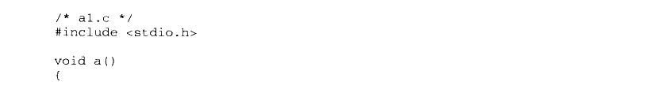

<details markdown="1"><summary>复制校对文字（未运行验证）</summary>

```text
/* a1.c */
#include <stdio.h>

void a()
{
```

</details>

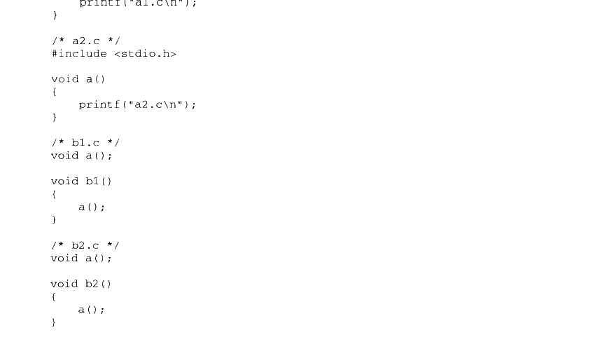

<details markdown="1"><summary>复制校对文字（未运行验证）</summary>

```text
printf("a1.c\n");
}

/* a2.c */
#include <stdio.h>
void a()
{
    printf("a2.c\n");
}

/* b1.c */
void a();
void b1()
{
    a();
}

/* b2.c */
void a();
void b2()
{
    a();
}
```

</details>

可以看到 a1.c 和 a2.c 中都定义了名字为“a” 的函数。那么由于b1.c和b2.c 都用到了外部函数“a”，但由于源代码中没有指定依赖于哪个共享对象中的函数“a”，所以我们在编译时指定依赖关系。我们假设 b1.so 依赖于 a1.so，b2.so依赖于 a2.so，将b1.so 与 a1.so进行链接，b2.so 与 a2.so 进行链接：

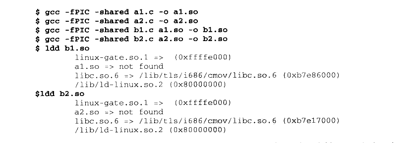

<details markdown="1"><summary>复制校对文字（未运行验证）</summary>

```text
$ gcc -fPIC -shared a1.c -o a1.so
$ gcc -fPIC -shared a2.c -o a2.so
$ gcc -fPIC -shared b1.c a1.so -o b1.so
$ gcc -fPIC -shared b2.c a2.so -o b2.so
$ ldd b1.so
    linux-gate.so.1 => (0xffffe000)
    a1.so => not found
    libc.so.6 => /lib/tls/i686/cmov/libc.so.6 (0xb7e86000)
    /lib/ld-linux.so.2 (0x80000000)
$ ldd b2.so
    linux-gate.so.1 => (0xffffe000)
    a2.so => not found
    libc.so.6 => /lib/tls/i686/cmov/libc.so.6 (0xb7e17000)
    /lib/ld-linux.so.2 (0x80000000)
```

</details>

那么当有程序同时使用b1.c中的函数b1 和b2.c中的函数b2 会怎么样呢？比如有程序

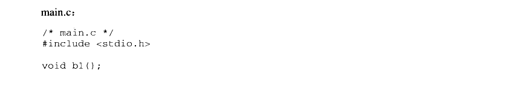

<details markdown="1"><summary>复制校对文字（未运行验证）</summary>

```text
/* main.c */
#include <stdio.h>

void b1();
```

</details>

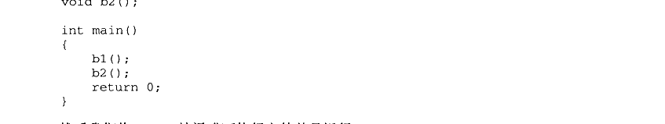

<details markdown="1"><summary>复制校对文字（未运行验证）</summary>

```text
void b2();

int main()
{
    b1();
    b2();
    return 0;
}
```

</details>

然后我们将 main.c 编译成可执行文件并且运行：


<details markdown="1"><summary>复制校对文字（未运行验证）</summary>

```text
$ gcc main.c b1.so b2.so -o main -Xlinker -rpath ./
./main
a1.c
a1.c
```

</details>

“-Xlinker -rpath ./”表示链接器在当前路径寻找共享对象，否则链接器会报无法找到 a1.so 和 a2.so 错误

很明显，main 依赖于 b1.so 和 b2.so:b1.so依赖于 a1.so:b2.so 依赖于 a2.so，所以当动态链接器对 main 程序进行动态链接时，b1.so、b2.so、a1.so 和a2.so 都会被装载到进程的地址空间，并且它们中的符号都会被并入到全局符号表，通过查看进程的地址空间信息可看到：

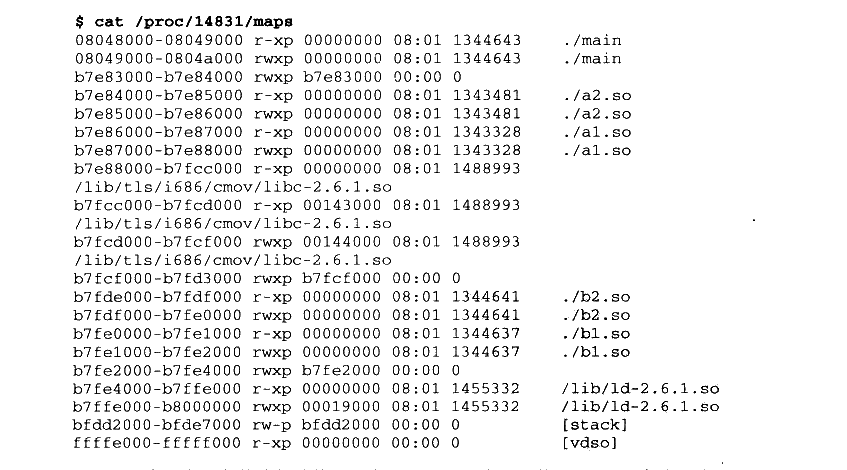

<details markdown="1"><summary>复制校对文字（未运行验证）</summary>

```text
$ cat /proc/14831/maps
08048000-08049000 r-xp 00000000 08:01 1344643 ./main
08049000-0804a000 rwxp 00000000 08:01 1344643 ./main
b7e83000-b7e84000 rwxp b7e83000 00:00 0
b7e84000-b7e85000 r-xp 00000000 08:01 1343481 ./a2.so
b7e85000-b7e86000 rwxp 00000000 08:01 1343481 ./a2.so
b7e86000-b7e87000 r-xp 00000000 08:01 1343328 ./a1.so
b7e87000-b7e88000 rwxp 00000000 08:01 1343328 ./a1.so
b7e88000-b7fcc000 r-xp 00000000 08:01 1488993
/lib/tls/i686/cmov/libc-2.6.1.so
b7fcc000-b7fcd000 r-xp 00143000 08:01 1488993
/lib/tls/i686/cmov/libc-2.6.1.so
b7fcd000-b7fcf000 rwxp 00144000 08:01 1488993
/lib/tls/i686/cmov/libc-2.6.1.so
b7fcf000-b7fd3000 rwxp b7fcf000 00:00 0
b7fdd000-b7fde000 r-xp 00000000 08:01 1344641 ./b2.so
b7fde000-b7fe0000 rwxp 00000000 08:01 1344641 ./b2.so
b7fe0000-b7fe1000 r-xp 00000000 08:01 1344637 ./b1.so
b7fe1000-b7fe2000 rwxp 00000000 08:01 1344637 ./b1.so
b7fe2000-b7fe4000 rwxp b7fe2000 00:00 0
b7fe4000-b7ffe000 r-xp 00000000 08:01 1455332 /lib/ld-2.6.1.so
b7ffe000-b8000000 rwxp 00019000 08:01 1455332 /lib/ld-2.6.1.so
bfdd2000-bfde7000 rw-p bfdd2000 00:00 0       [stack]
ffffe000-fffff000 r-xp 00000000 00:00 0       [vdso]
```

</details>

这4个共享对象的确都被装载进来了，那 a1.so 中的函数a 和a2.so中的函数a是不是冲突了呢？为什么 main 的输出结果是两个 “a1.c”呢？也就是说 a2.so中的函数a似乎被忽略了。这种一个共享对象里面的全局符号被另一个共享对象的同名全局符号覆盖的现象又被称为共享对象全局符号介入（Global Symbol Interpose）。

关于全局符号介入这个问题，实际上 Linux 下的动态链接器是这样处理的：它定义了一个规则，那就是当一个符号需要被加入全局符号表时，如果相同的符号名已经存在，则后加入的符号被忽略。从动态链接器的装载顺序可以看到，它是按照广度优先的顺序进行装载的，首先是 main，然后是b1.so、b2.so、a1.so，最后是 a2.so。当a2.so中的函数a要被加入全局符号表时，先前装载a1.so时，a1.so中的函数a已经存在于全局符号表，那么 a2.so中的函数a只能被忽略。所以整个进程中，所有对于符号“a” 的引用都会被解析到 a1.so 中的函数a，这也是为什么 main 打印出的结果是两个 “a1.c”而不是理想中的“a1.c” 和“a2.c”。

由于存在这种重名符号被直接忽略的问题，当程序使用大量共享对象时应该非常小心符号的重名问题，如果两个符号重名又执行不同的功能，那么程序运行时可能会将所有该符号名的引用解析到第一个被加入全局符号表的使用该符号名的符号，从而导致程序莫名其妙的错误。

全局符号介入与地址无关代码

前面介绍地址无关代码时，对于第一类模块内部调用或跳转的处理时，我们简单地将其当作是相对地址调用/跳转。但实际上这个问题比想象中要复杂，结合全局符号介入，关于调用方式的分类的解释会更加清楚。还是拿前面 “pic.c”的例子来看，由于可能存在全局符号介入的问题，foo函数对于 bar 的调用不能够采用第一类模块内部调用的方法，因为一旦bar 函数由于全局符号介入被其他模块中的同名函数覆盖，那么 foo如果采用相对地址调用的话，那个相对地址部分就需要重定位，这又与共享对象的地址无关性矛盾。所以对于 bar()函数的调用，编译器只能采用第三种，即当作模块外部符号处理，bar()函数被覆盖，动态链接器只需要重定位“ got.plt”，不影响共享对象的代码段。

为了提高模块内部函数调用的效率，有一个办法是把bar()函数变成编译单元私有函数，即使用“static”关键字定义bar()函数，这种情况下，编译器要确定 bar()函数不被其他模块覆盖，就可以使用第一类的方法，即模块内部调用指令，可以加快函数的调用速度。

#### 7.6.3 重定位和初始化

当上面的步骤完成之后，链接器开始重新遍历可执行文件和每个共享对象的重定位表，将它们的 GOT/PLT 中的每个需要重定位的位置进行修正。因为此时动态链接器已经拥有了进程的全局符号表，所以这个修正过程也显得比较容易，跟我们前面提到的地址重定位的原理基本相同。在前面介绍动态链接下的重定位表时，我们已经碰到过几种重定位类型，每种重定位入口地址的计算方式我们在这里就不再重复介绍了。

重定位完成之后，如果某个共享对象有“.init”段，那么动态链接器会执行“.init”段中的代码，用以实现共享对象特有的初始化过程，比如最常见的，共享对象中的C++的全局/静态对象的构造就需要通过“.init”来初始化。相应地，共享对象中还可能有“.fini” 段，当进程退出时会执行“.fini”段中的代码，可以用来实现类似C++全局对象析构之类的操作。

如果进程的可执行文件也有“.init”段，那么动态链接器不会执行它，因为可执行文件中的“.init”段和“.fini”段由程序初始化部分代码负责执行，我们将在后面的“库”这一部分详细介绍程序初始化部分。

当完成了重定位和初始化之后，所有的准备工作就宣告完成了，所需要的共享对象也都已经装载并且链接完成了，这时候动态链接器就如释重负，将进程的控制权转交给程序的入口并且开始执行。

#### 7.6.4 Linux 动态链接器实现

在前面分析 Linux 下程序的装载时，已经介绍了一个通过 execve()系统调用被装载到进程的地址空间的程序，以及内核如何处理可执行文件。内核在装载完 ELF 可执行文件以后就返回到用户空间，将控制权交给程序的入口。对于不同链接形式的 ELF 可执行文件，这个程序的入口是有区别的。对于静态链接的可执行文件来说，程序的入口就是 ELF 文件头里面的e\_entry 指定的入口；对于动态链接的可执行文件来说，如果这时候把控制权交给e\_entry 指定的入口地址，那么肯定是不行的，因为可执行文件所依赖的共享库还没有被装载，也没有进行动态链接。所以对于动态链接的可执行文件，内核会分析它的动态链接器地址（在“.interp”段），将动态链接器映射至进程地址空间，然后把控制权交给动态链接器。

Linux 动态链接器是个很有意思的东西，它本身是一个共享对象，它的路径是/lib/ld-linux.so.2，这实际上是个软链接，它指向/lib/ld-x.y.z.so，这个才是真正的动态连接器文件。共享对象其实也是 ELF 文件，它也有跟可执行文件一样的 ELF 文件头（包括 e\_entry、段表等）。动态链接器是个非常特殊的共享对象，它不仅是个共享对象，还是个可执行的程序，可以直接在命令行下面运行：

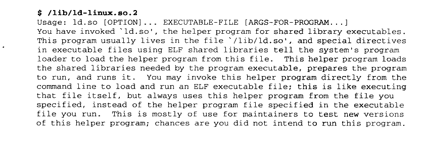

<details markdown="1"><summary>复制校对文字（未运行验证）</summary>

```text
$ /lib/ld-linux.so.2
Usage: ld.so [OPTION]... EXECUTABLE-FILE [ARGS-FOR-PROGRAM...]
You have invoked `ld.so', the helper program for shared library executables.
This program usually lives in the file `/lib/ld.so', and special directives
in executable files using ELF shared libraries tell the system's program
loader to load the helper program from this file. This helper program loads
the shared libraries needed by the program executable, prepares the program
to run, and runs it. You may invoke this helper program directly from the
command line to load and run an ELF executable file; this is like executing
that file itself, but always uses this helper program from the file you
specified, instead of the helper program file specified in the executable
file you run. This is mostly of use for maintainers to test new versions
of this helper program; chances are you did not intend to run this program.
```

</details>

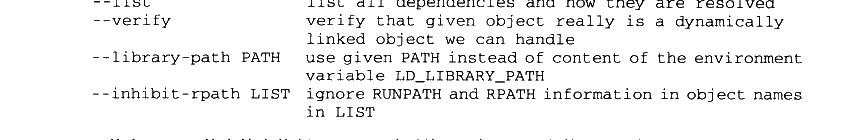

<details markdown="1"><summary>复制校对文字（未运行验证）</summary>

```text
--list                list all dependencies and how they are resolved
--verify              verify that given object really is a dynamically
                      linked object we can handle
--library-path PATH   use given PATH instead of content of the environment
                      variable LD_LIBRARY_PATH
--inhibit-rpath LIST  ignore RUNPATH and RPATH information in object names
                      in LIST
```

</details>

其实 Linux 的内核在执行 execve()时不关心目标 ELF 文件是否可执行（文件头e\_type是 ET\_EXEC 还是 ET\_DYN），它只是简单按照程序头表里面的描述对文件进行装载然后把控制权转交给 ELF 入口地址（没有“.interp” 就是ELF 文件的e\_entry：如果有“interp” 的话就是动态链接器的e\_entry）。这样我们就很好理解为什么动态链接器本身可以作为可执行程序运行，这也从一个侧面证明了共享库和可执行文件实际上没什么区别，除了文件头的标志位和扩展名有所不同之外，其他都是一样的。Windows 系统中的 EXE 和 DLL 也是类似的区别，DLL 也可以被当作程序来运行，Windows 提供了一个叫做rundll32.exe 的工具可以把一个 DLL 当作可执行文件运行。

Linux 的ELF 动态链接器是 Glibc 的一部分，它的源代码位于 Glibc 的源代码的elf 目录下面，它的实际入口地址位于 sysdeps/i386/dl-machine.h 中的\_start（普通程序的入口地址\_start()在 sysdeps/i386/elf/start.S，本书的第4部分还会详细分析）。

\_start 调用位于 elf/rtld.c 的\_dl\_start()函数。\_dl\_start()函数首先对 ld.so（以下简称ld-x.y.z.so为ld.so）进行重定位，因为ld.so自己就是动态链接器，没有人帮它做重定位工作，所以它只好自己来，美其名曰“自举”。自举的过程需要十分的小心谨慎，因为有很多限制，这个我们在前面已经介绍过了。完成自举之后就可以调用其他函数并访问全局变量了。调用\_dl\_start\_final，收集一些基本的运行数值，进入\_dl\_sysdep\_start，这个函数进行一些平台相关的处理之后就进入了\_dl\_main，这就是真正意义上的动态链接器的主函数了。\_dl\_main 在一开始会进行一个判断：

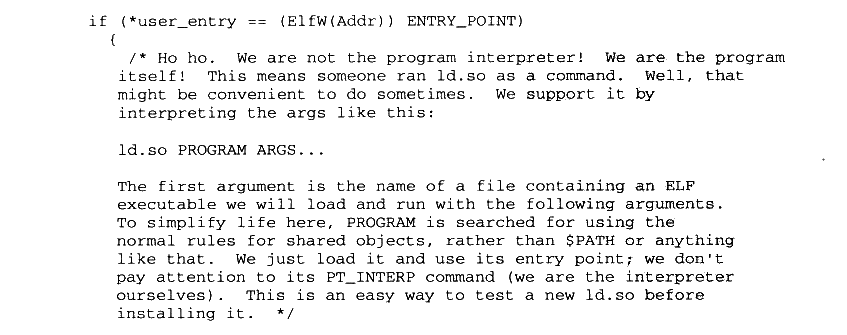

<details markdown="1"><summary>复制校对文字（未运行验证）</summary>

```text
if (*user_entry == (ElfW(Addr)) ENTRY_POINT)
  {
    /* Ho ho. We are not the program interpreter! We are the program
       itself! This means someone ran ld.so as a command. Well, that
       might be convenient to do sometimes. We support it by
       interpreting the args like this:

       ld.so PROGRAM ARGS...

       The first argument is the name of a file containing an ELF
       executable we will load and run with the following arguments.
       To simplify life here, PROGRAM is searched for using the
       normal rules for shared objects, rather than $PATH or anything
       like that. We just load it and use its entry point; we don't
       pay attention to its PT_INTERP command (we are the interpreter
       ourselves). This is an easy way to test a new ld.so before
       installing it. */
```

</details>

很明显，如果指定的用户入口地址是动态链接器本身，那么说明动态链接器是被当作可执行文件在执行。在这种情况下，动态链接器就会解析运行时的参数，并且进行相应的处理。dl\_main 本身非常的长，主要的工作就是前面提到的对程序所依赖的共享对象进行装载、符号解析和重定位，我们在这里就不再详细展开了，因为它的实现细节又是一个非常大的话题。

关于动态链接器本身的细节实现虽然不再展开，但是作为一个非常有特点的，也很特殊的共享对象，关于动态链接器的实现的几个问题还是很值得思考的：

1. 动态链接器本身是动态链接的还是静态链接的？

动态链接器本身应该是静态链接的，它不能依赖于其他共享对象，动态链接器本身是用来帮助其他 ELF 文件解决共享对象依赖问题的，如果它也依赖于其他共享对象，那么谁来帮它解决依赖问题？所以它本身必须不依赖于其他共享对象。这一点可以使用ldd来判断：


<details markdown="1"><summary>复制校对文字（未运行验证）</summary>

```text
$ ldd /lib/ld-linux.so.2
    statically linked
```

</details>

2. 动态链接器本身必须是 PIC 的吗？

是不是PIC 对于动态链接器来说并不关键，动态链接器可以是PIC 的也可以不是，但往往使用 PIC 会更加简单一些。一方面，如果不是PIC的话，会使得代码段无法共享，浪费内存：另一方面也会使ld.so 本身初始化更加复杂，因为自举时还需要对代码段进行重定位。实际上的ld-linux.so.2是PIC 的。

3. 动态链接器可以被当作可执行文件运行，那么它的装载地址应该是多少？

ld.so 的装载地址跟一般的共享对象没区别，即为0x00000000。这个装载地址是一个无效的装载地址，作为一个共享库，内核在装载它时会为其选择一个合适的装载地址。


## 7.7 显式运行时链接

支持动态链接的系统往往都支持一种更加灵活的模块加载方式，叫做显式运行时链接（Explicit Run-time Linking），有时候也叫做运行时加载。也就是让程序自己在运行时控制加载指定的模块，并且可以在不需要该模块时将其卸载。从前面我们了解到的来看，如果动态链接器可以在运行时将共享模块装载进内存并且可以进行重定位等操作，那么这种运行时加载在理论上也是很容易实现的。而且一般的共享对象不需要进行任何修改就可以进行运行时装载，这种共享对象往往被叫做动态装载库（Dynamic Loading Library），其实本质上它跟一般的共享对象没什么区别，只是程序开发者使用它的角度不同。

这种运行时加载使得程序的模块组织变得很灵活，可以用来实现一些诸如插件、驱动等功能。当程序需要用到某个插件或者驱动的时候，才将相应的模块装载进来，而不需要从一开始就将他们全部装载进来，从而减少了程序启动时间和内存使用。并且程序可以在运行的时候重新加载某个模块，这样使得程序本身不必重新启动而实现模块的增加、删除、更新等，这对于很多需要长期运行的程序来说是很大的优势。最常见的例子是 Web 服务器程序，对于Web 服务器程序来说，它需要根据配置来选择不同的脚本解释器、数据库连接驱动等，对于不同的脚本解释器分别做成一个独立的模块，当Web 服务器需要某种脚本解释器的时候可以将其加载进来：这对于数据库连接的驱动程序也是一样的原理。另外对于一个可靠的Web 服务器来说，长期的运行是必要的保证，如果我们需要增加某种脚本解释器，或者某个脚本解释器模块需要升级，则可以通知 Web 服务器程序重新装载该共享模块以实现相应的目的。

在 Linux 中，从文件本身的格式上来看，动态库实际上跟一般的共享对象没有区别，正如我们前面讨论过的。主要的区别是共享对象是由动态链接器在程序启动之前负责装载和链接的，这一系列步骤都由动态连接器自动完成，对于程序本身是透明的；而动态库的装载则是通过一系列由动态链接器提供的 API，具体地讲共有 4个函数：打开动态库（dlopen）、查找符号（dlsym）、错误处理（dlerror）以及关闭动态库（dlclose），程序可以通过这几个API 对动态库进行操作。这几个 API 的实现是在/lib/libdl.so.2里面，它们的声明和相关常量被定义在系统标准头文件&lt;dlfcn.h&gt;。我们先来看看这几个函数的具体意义，然后再演示一个很有意思的小程序。

#### 7.7.1 dlopen()

dlopen()函数用来打开一个动态库，并将其加载到进程的地址空间，完成初始化过程，它的C原型定义为：

```c
void *dlopen(const char *filename, int flag);
```

第一个参数是被加载动态库的路径，如果这个路径是绝对路径（以“/”开始的路径），则该函数将会尝试直接打开该动态库：如果是相对路径，那么 dlopen()会尝试在以一定的顺序去查找该动态库文件：

（1）查找由环境变量 LD\_LIBRARY\_PATH 指定的一系列目录（我们在后面会详细介绍LD\_LIBRARY\_PATH 环境变量）。

（2） 查找由/etc/ld.so.cache 里面所指定的共享库路径。

（3） /lib、/usr/lib 注意：这个查找顺序与旧的 a.out 装载器的顺序刚好相反，旧的a.out的装载器在装载共享库的时候会先查找/usr/lib，然后是/lib。

当然，这在理论上不应该成为一个问题，因为所有的库都应该只存在于某个目录中，而不应该在多个目录有不同的副本，这将会导致系统变得极为不可靠。

很有意思的是，如果我们将 filename 这个参数设置为0，那么 dlopen 返回的将是全局符号表的句柄，也就是说我们可以在运行时找到全局符号表里面的任何一个符号，并且可以执行它们，这有些类似高级语言反射（Reflection）的特性。全局符号表包括了程序的可执行文件本身、被动态链接器加载到进程中的所有共享模块以及在运行时通过dlopen 打开并且使用了 RTLD\_GLOBAL 方式的模块中的符号。

第二个参数 flag 表示函数符号的解析方式，常量 RTLD\_LAZY 表示使用延迟绑定，当函数第一次被用到时才进行绑定，即 PLT 机制：而 RTLD\_NOW 表示当模块被加载时即完成所有的函数绑定工作，如果有任何未定义的符号引用的绑定工作没法完成，那么 dlopen()就返回错误。上面的两种绑定方式必须选其一。另外还有一个常量 RTLD\_GLOBAL 可以跟上面的两者中任意一个一起使用（通过常量的“或”操作），它表示将被加载的模块的全局符号合并到进程的全局符号表中，使得以后加载的模块可以使用这些符号。在调试程序的时候我们可以使用 RTLD\_NOW 作为加载参数，因为如果模块加载时有任何符号未被绑定的话，我们可以使用 dlerror()立即捕获到相应的错误信息：而如果使用RTLD\_LAZY 的话，这种符号未绑定的错误会在加载后发生，则难以捕获。当然，使用 RTLD\_NOW 会导致加载动态库的速度变慢。

dlopen 的返回值是被加载的模块的句柄，这个句柄在后面使用 dlsym 或者 dlclose 时需要用到。如果加载模块失败，则返回 NULL。如果模块已经通过 dlopen 被加载过了，那么返回的是同一个句柄。另外如果被加载的模块之间有依赖关系，比如模块 A 依赖于模块 B，那么程序员需要手工加载被依赖的模块，比如先加载B，再加载A。

事实上 dlopen 还会在加载模块时执行模块中初始化部分的代码，我们前面提到过，动态链接器在加载模块时，会执行“.init”段的代码，用以完成模块的初始化工作，dlopen 的加载过程基本跟动态链接器一致，在完成装载、映射和重定位以后，就会执行“init” 段的代码然后返回。

#### 7.7.2 dlsym()

dlsym 函数基本上是运行时装载的核心部分，我们可以通过这个函数找到所需要的符号。它的定义如下：

```c
void *dlsym(void *handle, char *symbol);
```

定义非常简洁，两个参数，第一个参数是由 dlopen()返回的动态库的句柄；第二个参数即所要查找的符号的名字，一个以 `\0`结尾的C字符串。如果 dlsym()找到了相应的符号，则返回该符号的值：没有找到相应的符号，则返回 NULL。dlsym()返回的值对于不同类型的符号，意义是不同的。如果查找的符号是个函数，那么它返回函数的地址：如果是个变量，它返回变量的地址：如果这个符号是个常量，那么它返回的是该常量的值。这里有一个问题是：如果常量的值刚好是 NULL 或者0呢，我们如何判断 dlsym()是否找到了该符号呢？这就要用到我们下面介绍的 dlerror()函数了。如果符号找到了，那么 dlerror()返回 NULL，如果没找到，dlerror()就会返回相应的错误信息。

符号不仅仅是函数和变量，有时还是常量，比如表示编译单元文件名的符号等，这一般由编译器和链接器产生，而且对外不可见，但它们的确存在于模块的符号表中。dlsym()是可以查找到这些符号的，我们也可以通过“objdump -t”来查看符号表，常量在符号表里面的类型是“\*ABS\*"。

符号优先级

前面在介绍动态链接实现时，我们已经碰到过许多共享模块中符号名冲突的问题，结论是当多个同名符号冲突时，先装入的符号优先，我们把这种优先级方式称为装载序列（Load Ordering）。那么当我们的进程中有模块是通过dlopen()装入的共享对象时，这些后装入的模块中的符号可能会跟先前已经装入了的模块之间的符号重复。那么这时候模块之间的符号冲突该怎么解决呢？实际上不管是之前由动态链接器装入的还是之后由 dlopen 装入的共享对象，动态链接器在进行符号的解析以及重定位时，都是采用装载序列。

那么当我们使用 dlsym()进行符号的地址查找工作时，这个函数是不是也是按照装载序列的优先级进行符号的查找呢？实际的情况是，dlsym()对符号的查找优先级分两种类型。第一种情况是，如果我们是在全局符号表中进行符号查找，即 dlopen()时，参数 filename为 NULL，那么由于全局符号表使用的装载序列，所以dlsym()使用的也是装载序列。第二种情况是如果我们是对某个通过 dlopen()打开的共享对象进行符号查找的话，那么采用的是一种叫做依赖序列（Dependency Ordering）的优先级。什么叫依赖序列呢？它是以被 dlopen()打开的那个共享对象为根节点，对它所有依赖的共享对象进行广度优先遍历，直到找到符号为止。

#### 7.7.3 dlerror()

每次我们调用 dlopen()、dlsym()或 dlclose()以后，我们都可以调用dlerror()函数来判断上一次调用是否成功。dlerror()的返回值类型是 char\*，如果返回 NULL，则表示上一次调用成功；如果不是，则返回相应的错误消息。

#### 7.7.4 dlclose()

dlclose()的作用跟 dlopen()刚好相反，它的作用是将一个已经加载的模块卸载。系统会维持一个加载引用计数器，每次使用 dlopen()加载某模块时，相应的计数器加一；每次使用dlclose()卸载某模块时，相应计数器减一。只有当计数器值减到0时，模块才被真正地卸载掉。卸载的过程跟加载刚好相反，先执行“.fini”段的代码，然后将相应的符号从符号表中去除，取消进程空间跟模块的映射关系，然后关闭模块文件。下面是一个简单的例子，这段程序将数学库模块用运行时加载的方法加载到进程中，然后获取 sin()函数符号地址，调用 sin()并且返回结果：

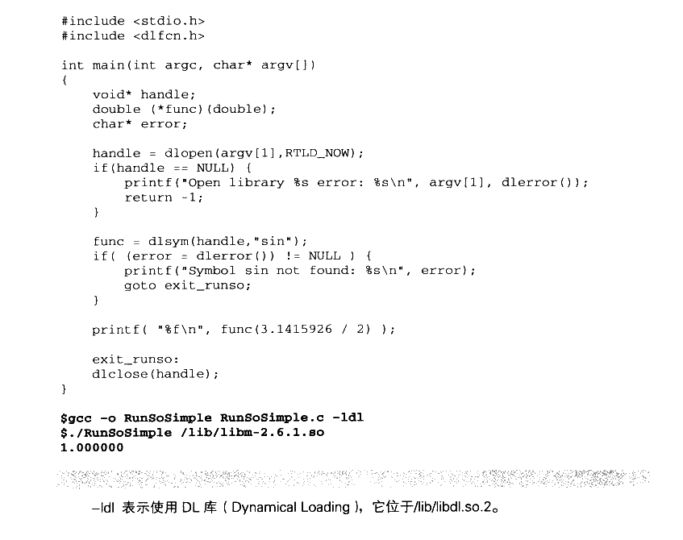

<details markdown="1"><summary>复制校对文字（未运行验证）</summary>

```text
#include <stdio.h>
#include <dlfcn.h>

int main(int argc, char* argv[])
{
    void* handle;
    double (*func)(double);
    char* error;

    handle = dlopen(argv[1], RTLD_NOW);
    if (handle == NULL) {
        printf("Open library %s error: %s\n", argv[1], dlerror());
        return -1;
    }

    func = dlsym(handle, "sin");
    if ((error = dlerror()) != NULL) {
        printf("Symbol sin not found: %s\n", error);
        goto exit_runso;
    }
    printf("%f\n", func(3.1415926 / 2));

exit_runso:
    dlclose(handle);
}

$ gcc -o RunSoSimple RunSoSimple.c -ldl
$ ./RunSoSimple /lib/libm-2.6.1.so
1.000000
```

</details>

`-ldl` 表示使用 DL 库（Dynamical Loading），它位于 `/lib/libdl.so.2`。

#### 7.7.5 运行时装载的演示程序

或许我们都听说过 Windows 下有个程序叫做rundll，这个程序可以把 Windows 的DLL当作程序来运行。我们知道DLL 是Windows 的动态链接库，原理上跟 Linux 下的共享对象是一种类型的文件（我们将在后面的章节中详细介绍 Windows DLL）。rundll 其实就是利用了运行时加载的原理，将指定的共享对象在运行时加载进来，然后找到某个函数（DLL 中是 DllMain）开始执行。我们这个例子中将实现一个更为灵活的叫做 runso 的程序，这个程序可以通过命令行来执行共享对象里面的任意一个函数。它在理论上很简单，基本的步骤就是：由命令行给出共享对象路径、函数名和相关参数，然后程序通过运行时加载将该模块加载到进程中，查找相应的函数，并且执行它，然后将执行结果打印出来。但是这里有一个很大的问题是：不同的函数有不同的参数和返回值类型，即有不同的函数签名。当我们需要运行某个指定的函数时，仅仅知道它的地址是不够的，还必须知道它的函数签名。这些信息是无法通过运行时加载获得的（很多高级语言（平台）如Java、.NET 里面的反射功能可以实现运行时获得函数的额外信息，包括参数、返回值类型等），因为C/C++编译器在编译时并没有把这些信息也保存到目标文件、可执行文件或者共享对象等，我们仅仅能获得的是函数的地址。从这一点来看，C/C++的确不能被称为“高级”语言。

对于上面无法得知函数类型的问题，我们只能通过调用者指定函数的参数和返回值类型来实现。比如我们规定 RunSo 的使用方式如下：

```sh
$ RunSo /lib/foobar.so function arg1 arg2 ... return_type
```

为了表示参数和返回值类型，我们假设字母d表示 double、i表示 int、s表示char\*、v表示 void。然后我们在参数之前加一个字母表示参数的类型：

```sh
$ ./RunSo /lib/libm-2.6.1.so sin d2.0 d
```

这就表示我们希望调用/lib/libm-2.6.1.so 里面的 sin 函数，其中第一个参数是 double 类型的，参数值是2.0：最后一个字母d表示 sin 函数的返回值是 double 类型的。那么如果要调用/lib/libfoo.so 里面一个 void bar（char\* str, int i）的函数可以使用如下命令行：

```sh
$ ./RunSo /lib/libfoo.so bar sHello i10 v
```

上面的命令相当于调用 bar()“Hello”，10）。函数的类型我们已经通过手工指定可以得知了，但在 RunSo 的实现上还有一个问题存在。

我们上面的例子中，sin 函数的类型是程序员手工指定的，也就是我们知道数学库里面有这样一个sin函数，它的类型是 double sin（double），于是我们定义了一个指向这种类型的函数指针 double （\*func）（double）。但是如果要做到调用任意一个函数，我们不可能为每种函数都定义相同类型的函数指针，然后去调用它，因为函数参数的组合有无数种。为了解决这个问题，我们必须了解函数调用的约定（具体参照后面的函数调用约定），然后在调用函数之前伪造好相应的堆栈，造成正常函数调用的假象。为了能够直接操作堆栈，我们不得不使用嵌入汇编代码来完成相应的操作。下面这个例子就是 RunSo的源代码，其中用到了一些嵌入汇编代码和一些函数调用约定的知识，稍微有点复杂，如果你一时没有看明白可以等看完“函数调用约定”再回来仔细研究这段代码，就会豁然开朗了。如果对嵌入汇编代码不是很熟悉，可以再回顾一下最开始我们介绍过的嵌入汇编代码的内容，如下：

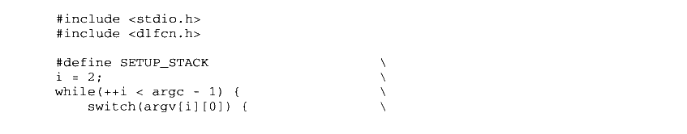

<details markdown="1"><summary>复制校对文字（未运行验证）</summary>

```text
#include <stdio.h>
#include <dlfcn.h>

#define SETUP_STACK                       \
i = 2;                                    \
while (++i < argc - 1) {                   \
    switch (argv[i][0]) {                  \
```

</details>

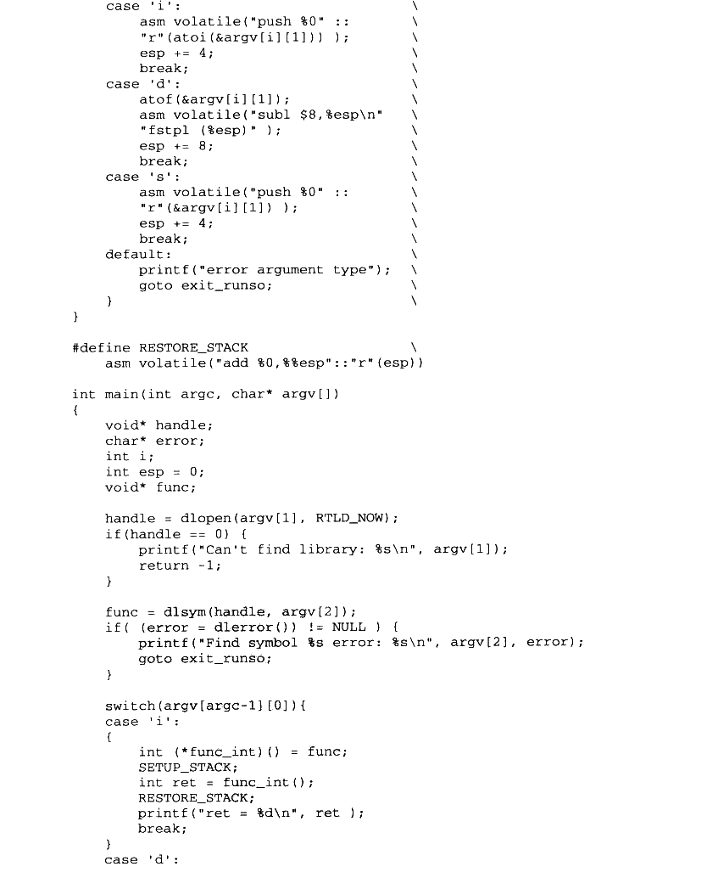

<details markdown="1"><summary>复制校对文字（未运行验证）</summary>

```text
case 'i':                                      \
        asm volatile("push %0" ::                  \
            "r"(atoi(&argv[i][1])));                \
        esp += 4;                                  \
        break;                                     \
    case 'd':                                      \
        atof(&argv[i][1]);                          \
        asm volatile("subl $8,%esp\n"              \
            "fstpl (%esp)");                       \
        esp += 8;                                  \
        break;                                     \
    case 's':                                      \
        asm volatile("push %0" ::                  \
            "r"(&argv[i][1]));                     \
        esp += 4;                                  \
        break;                                     \
    default:                                       \
        printf("error argument type");             \
        goto exit_runso;                           \
    }                                              \
}

#define RESTORE_STACK \
    asm volatile("add %0,%%esp"::"r"(esp))

int main(int argc, char* argv[])
{
    void* handle;
    char* error;
    int i;
    int esp = 0;
    void* func;

    handle = dlopen(argv[1], RTLD_NOW);
    if (handle == 0) {
        printf("Can't find library: %s\n", argv[1]);
        return -1;
    }

    func = dlsym(handle, argv[2]);
    if ((error = dlerror()) != NULL) {
        printf("Find symbol %s error: %s\n", argv[2], error);
        goto exit_runso;
    }

    switch (argv[argc-1][0]) {
    case 'i':
    {
        int (*func_int)() = func;
        SETUP_STACK;
        int ret = func_int();
        RESTORE_STACK;
        printf("ret = %d\n", ret);
        break;
    }
    case 'd':
```

</details>

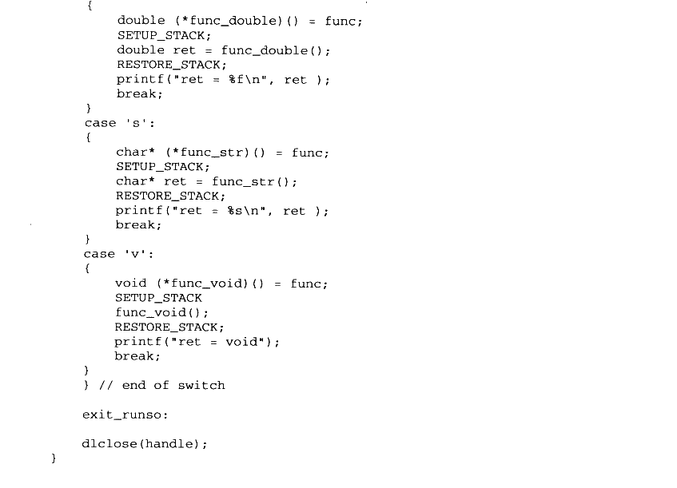

<details markdown="1"><summary>复制校对文字（未运行验证）</summary>

```text
{
        double (*func_double)() = func;
        SETUP_STACK;
        double ret = func_double();
        RESTORE_STACK;
        printf("ret = %f\n", ret);
        break;
    }
    case 's':
    {
        char* (*func_str)() = func;
        SETUP_STACK;
        char* ret = func_str();
        RESTORE_STACK;
        printf("ret = %s\n", ret);
        break;
    }
    case 'v':
    {
        void (*func_void)() = func;
        SETUP_STACK
        func_void();
        RESTORE_STACK;
        printf("ret = void");
        break;
    }
    } // end of switch

exit_runso:
    dlclose(handle);
}
```

</details>


## 7.8 本章小结

本章我们首先分析了使用动态链接技术的原因，即使用动态链接可以更加有效地利用内存和磁盘资源，可以更加方便地维护升级程序，可以让程序的重用变得更加可行和有效。接着我们介绍了动态链接的基本例子，分析了动态链接中装载地址不确定时如何解决绝对地址引用的问题。

装载时重定位和地址无关代码是解决绝对地址引用问题的两个方法，装载时重定位的缺点是无法共享代码段，但是它的运行速度较快：而地址无关代码的缺点是运行速度稍慢，但它可以实现代码段在各个进程之间的共享。我们还介绍了 ELF 的延迟绑定 PLT技术。

接着我们介绍了 ELF 文件中的 “.interp”、“.dynamic”、动态符号表、重定位表等结构，它们是实现 ELF 动态链接的关键结构。我们还分析了动态链接器如何实现自举、装载共享对象、实现重定位和初始化过程，实现动态链接。最后我们还介绍了显式动态链接的概念，并且举例展示了如何使用显式运行时链接编写一个程序运行 ELF 共享库中的函数。
