# 7.5 动态链接相关结构

在了解了共享对象的绝对地址引用问题以后，我们基本上对动态链接的原理有了初步的了解，接下来的问题就是整个动态链接具体的实现过程了。动态链接在不同的系统上有不同的实现方式，ELF 的动态链接实现方式比 PE 稍微简单一点，在这里我们还是先介绍 ELF的动态链接机制在 Linux 下的实现，最后我们会在专门的章节中介绍 PE在 Windows 下的动态链接机制和它们的区别。

我们在前面的章节已经看到，动态链接情况下，可执行文件的装载与静态链接情况基本一样。首先操作系统会读取可执行文件的头部，检查文件的合法性，然后从头部中的“Program Header”中读取每个 “Segment”的虚拟地址、文件地址和属性，并将它们映射到进程虚拟空间的相应位置，这些步骤跟前面的静态链接情况下的装载基本无异。在静态链接情况下，操作系统接着就可以把控制权转交给可执行文件的入口地址，然后程序开始执行，一切看起来非常直观。

但是在动态链接情况下，操作系统还不能在装载完可执行文件之后就把控制权交给可执行文件，因为我们知道可执行文件依赖于很多共享对象。这时候，可执行文件里对于很多外部符号的引用还处于无效地址的状态，即还没有跟相应的共享对象中的实际位置链接起来。所以在映射完可执行文件之后，操作系统会先启动一个动态链接器（Dynamic Linker）。

在 Linux 下，动态链接器ld.so 实际上是一个共享对象，操作系统同样通过映射的方式将它加载到进程的地址空间中。操作系统在加载完动态链接器之后，就将控制权交给动态链接器的入口地址（与可执行文件一样，共享对象也有入口地址）。当动态链接器得到控制权之后，它开始执行一系列自身的初始化操作，然后根据当前的环境参数，开始对可执行文件进行动态链接工作。当所有动态链接工作完成以后，动态链接器会将控制权转交到可执行文件的入口地址，程序开始正式执行。

### 7.5.1 ".interp" 段

那么系统中哪个才是动态链接器呢，它的位置由谁决定？是不是所有的\*NIX 系统的动态链接器都位于/lib/ld.so呢？实际上，动态链接器的位置既不是由系统配置指定，也不是由环境参数决定，而是由 ELF 可执行文件决定。在动态链接的 ELF 可执行文件中，有一个专门的段叫做“.interp”段（“interp”是“interpreter”（解释器）的缩写）。如果我们使用 objdump 工具来查看，可以看到 “.interp”内容：

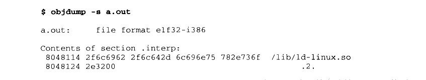

<details markdown="1"><summary>复制校对文字（未运行验证）</summary>

```text
$ objdump -s a.out
a.out: file format elf32-i386
Contents of section .interp:
 8048114 2f6c6962 2f6c642d 6c696e75 782e736f  /lib/ld-linux.so
 8048124 2e3200                             .2.
```

</details>

“.interp”的内容很简单，里面保存的就是一个字符串，这个字符串就是可执行文件所需要的动态链接器的路径，在 Linux 下，可执行文件所需要的动态链接器的路径几乎都是“/lib/ld-linux.so.2”，其他的\*nix 操作系统可能会有不同的路径，我们在后面还会再介绍到各种环境下的动态链接器的路径。在 Linux 的系统中，/lib/ld-linux.so.2通常是一个软链接，比如在我的机器上，它指向/lib/ld-2.6.1.so，这个才是真正的动态链接器。在Linux 中，操作系统在对可执行文件的进行加载的时候，它会去寻找装载该可执行文件所需要相应的动态链接器，即“interp”段指定的路径的共享对象。

动态链接器在 Linux 下是Glibc 的一部分，也就是属于系统库级别的，它的版本号往往跟系统中的 Glibc 库版本号是一样的，比如我的系统中安装的是 Glibc 2.6.1，那么相应的动态链接器也就是/lib/ld-2.6.1.so。当系统中的 Glibc 库更新或者安装其他版本的时候，/lib/ld-linux.so.2 这个软链接就会指向到新的动态链接器，而可执行文件本身不需要修改“.interp”中的动态链接器路径来适应系统的升级。

我们也可以用这个命令来查看一个可执行文件所需要的动态链接器的路径，在 Linux下，往往是如下结果：


<details markdown="1"><summary>复制校对文字（未运行验证）</summary>

```text
$ readelf -l a.out | grep interpreter
    [Requesting program interpreter: /lib/ld-linux.so.2]
```

</details>

而当我们在 FreeBSD 4.6.2 下执行这个命令时，结果是：


<details markdown="1"><summary>复制校对文字（未运行验证）</summary>

```text
$ readelf -l a.out | grep interpreter
    [Requesting program interpreter: /usr/libexec/ld-elf.so.1]
```

</details>

64 位的 Linux 下的可执行文件是：

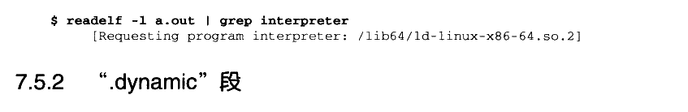

<details markdown="1"><summary>复制校对文字（未运行验证）</summary>

```text
$ readelf -l a.out | grep interpreter
    [Requesting program interpreter: /lib64/ld-linux-x86-64.so.2]
```

</details>

### 7.5.2 ".dynamic" 段

类似于“interp”这样的段，ELF 中还有几个段也是专门用于动态链接的，比如“.dynamic”段和“.dynsym”段等。要了解动态链接器如何完成链接过程，跟前面一样，从了解 ELF 文件中跟动态链接相关的结构入手将会是一个很好的途径。ELF 文件中跟动态链接相关的段有好几个，相互之间的关系也比较复杂，我们先从 “.dynamic”段入手。

动态链接 ELF 中最重要的结构应该是“.dynamic”段，这个段里面保存了动态链接器所需要的基本信息，比如依赖于哪些共享对象、动态链接符号表的位置、动态链接重定位表的位置、共享对象初始化代码的地址等。“.dynamic”段的结构很经典，就是我们已经碰到过的ELF 中眼熟的结构数组，结构定义在 “elf.h” 中：


<details markdown="1"><summary>复制校对文字（未运行验证）</summary>

```text
typedef struct {
    Elf32_Sword d_tag;
    union {
```

</details>


<details markdown="1"><summary>复制校对文字（未运行验证）</summary>

```text
Elf32_Word d_val;
        Elf32_Addr d_ptr;
    } d_un;
} Elf32_Dyn;
```

</details>

Elf32\_Dyn 结构由一个类型值加上一个附加的数值或指针，对于不同的类型，后面附加的数值或者指针有着不同的含义。我们这里列举几个比较常见的类型值（这些值都是定义在“elf.h”里面的宏），如表7-2所示。

表7-2

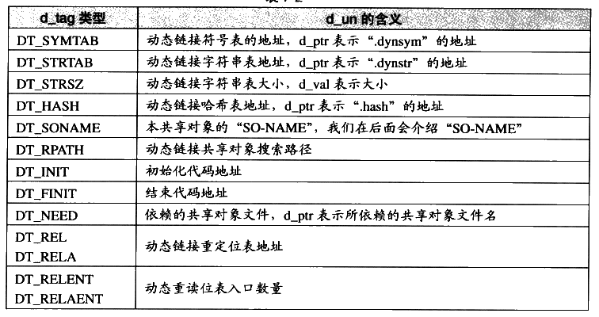

<details markdown="1"><summary>查看校对表格</summary>

| d_tag 类型 | d_un 的含义 |
| --- | --- |
| `DT_SYMTAB` | 动态链接符号表的地址，d_ptr 表示“.dynsym”的地址 |
| `DT_STRTAB` | 动态链接字符串表地址，d_ptr 表示“.dynstr”的地址 |
| `DT_STRSZ` | 动态链接字符串表大小，d_val 表示大小 |
| `DT_HASH` | 动态链接哈希表地址，d_ptr 表示“.hash”的地址 |
| `DT_SONAME` | 本共享对象的“SO-NAME”，我们在后面会介绍“SO-NAME” |
| `DT_RPATH` | 动态链接共享对象搜索路径 |
| `DT_INIT` | 初始化代码地址 |
| `DT_FINI` | 结束代码地址 |
| `DT_NEEDED` | 依赖的共享对象文件，d_ptr 表示所依赖的共享对象文件名 |
| `DT_REL`<br>`DT_RELA` | 动态链接重定位表地址 |
| `DT_RELENT`<br>`DT_RELAENT` | 动态重定位表入口数量 |

</details>

表7-2中只列出了一部分定义，还有一些不太常用的定义我们就暂且忽略，具体可以参考LSB 手册和 elf.h 的定义。从上面给出的这些定义来看，“.dynamic”段里面保存的信息有点像 ELF 文件头，只是我们前面看到的ELF文件头中保存的是静态链接时相关的内容，比如静态链接时用到的符号表、重定位表等，这里换成了动态链接下所使用的相应信息了。所以，“.dynamic”段可以看成是动态链接下 ELF 文件的“文件头”。使用 readelf 工具可以查看“.dynamic”段的内容：

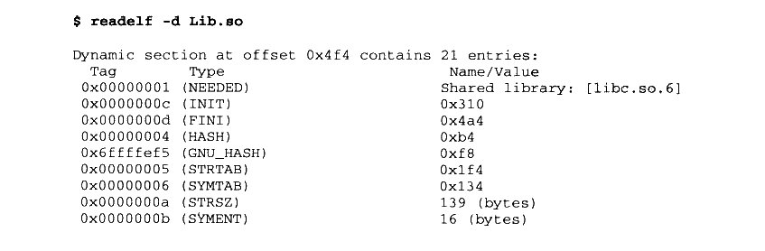

<details markdown="1"><summary>复制校对文字（未运行验证）</summary>

```text
$ readelf -d Lib.so
Dynamic section at offset 0x4f4 contains 21 entries:
  Tag        Type                Name/Value
  0x00000001 (NEEDED)            Shared library: [libc.so.6]
  0x0000000c (INIT)              0x310
  0x0000000d (FINI)              0x4a4
  0x00000004 (HASH)              0xb4
  0x6ffffef5 (GNU_HASH)          0xf8
  0x00000005 (STRTAB)            0x1f4
  0x00000006 (SYMTAB)            0x134
  0x0000000a (STRSZ)             139 (bytes)
  0x0000000b (SYMENT)            16 (bytes)
```

</details>

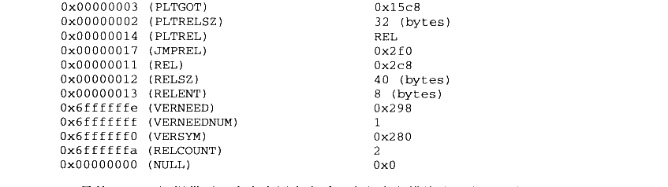

<details markdown="1"><summary>复制校对文字（未运行验证）</summary>

```text
0x00000003 (PLTGOT)            0x15c8
  0x00000002 (PLTRELSZ)          32 (bytes)
  0x00000014 (PLTREL)            REL
  0x00000017 (JMPREL)            0x2f0
  0x00000011 (REL)               0x2c8
  0x00000012 (RELSZ)             40 (bytes)
  0x00000013 (RELENT)            8 (bytes)
  0x6ffffffe (VERNEED)           0x298
  0x6fffffff (VERNEEDNUM)        1
  0x6ffffff0 (VERSYM)            0x280
  0x6ffffffa (RELCOUNT)          2
  0x00000000 (NULL)              0x0
```

</details>

另外 Linux 还提供了一个命令用来查看一个程序主模块或一个共享库依赖于哪些共享库：


<details markdown="1"><summary>复制校对文字（未运行验证）</summary>

```text
$ ldd Program1
    linux-gate.so.1 => (0xffffe000)
    ./Lib.so (0xb7f62000)
    libc.so.6 => /lib/tls/i686/cmov/libc.so.6 (0xb7e0d000)
    /lib/ld-linux.so.2 (0xb7f66000)
```

</details>

**注意：** 这里可以看到有个 linux-gate.so.1 的共享对象很特殊，它的装载地址很奇怪，是 0xffffe000，这个地址是32位地址空间的末尾4 096 字节，属于 Linux 内核地址空间。你在整个文件系统中都搜索不到这个文件，因为它根本不存在于文件系统中。它实际上是一个内核虚拟共享对象（Kernel Virtual DSO），这涉及到 Linux 的系统调用和内核，我们将在第4 部分介绍 linux-gate.so.1 相关内容。

### 7.5.3 动态符号表

为了完成动态链接，最关键的还是所依赖的符号和相关文件的信息。我们知道在静态链接中，有一个专门的段叫做符号表“.symtab”（Symbol Table），里面保存了所有关于该目标文件的符号的定义和引用。动态链接的符号表实际上它跟静态链接十分相似，比如前面例子中的 Program1 程序依赖于 Lib.so，引用到了里面的 foobar()函数。那么对于 Program1 来说，我们往往称 Program1 导入（Import）了 foobar 函数，foobar 是 Program1 的导入函数（Import Function）：而站在 Lib.so 的角度来看，它实际上定义了 foobar()函数，并且提供给其他模块使用，我们往往称 Lib.so 导出（Export）了 foobar()函数，foobar 是 Lib.so 的导出函数（Export Function）。把这种导入导出关系放到静态链接的情形下，我们可以把它们看作普通的函数定义和引用。

为了表示动态链接这些模块之间的符号导入导出关系，ELF 专门有一个叫做动态符号表（Dynamic Symbol Table）的段用来保存这些信息，这个段的段名通常叫做“.dynsym”（Dynamic Symbol）。与“.symtab”不同的是，“.dynsym”只保存了与动态链接相关的符号，对于那些模块内部的符号，比如模块私有变量则不保存。很多时候动态链接的模块同时拥有“.dynsym”和“.symtab”两个表，“.symtab”中往往保存了所有符号，包括“.dynsym”中的符号。

与“.symtab”类似，动态符号表也需要一些辅助的表，比如用于保存符号名的字符串表。静态链接时叫做符号字符串表“.strtab”（String Table），在这里就是动态符号字符串表“.dynstr”（Dynamic String Table）：由于动态链接下，我们需要在程序运行时查找符号，为了加快符号的查找过程，往往还有辅助的符号哈希表（“.hash”）。我们可以用 readelf 工具来查看 ELF 文件的动态符号表及它的哈希表：

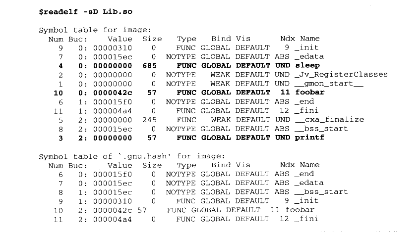

<details markdown="1"><summary>复制校对文字（未运行验证）</summary>

```text
$ readelf -sD Lib.so
Symbol table for image:
 Num Buc: Value    Size Type   Bind   Vis     Ndx Name
   9   0: 00000310    0 FUNC   GLOBAL DEFAULT   9 _init
   7   0: 000015ec    0 NOTYPE GLOBAL DEFAULT ABS _edata
   4   0: 00000000  685 FUNC   GLOBAL DEFAULT UND sleep
   2   0: 00000000    0 NOTYPE WEAK   DEFAULT UND _Jv_RegisterClasses
   1   0: 00000000    0 NOTYPE WEAK   DEFAULT UND __gmon_start__
  10   0: 0000042c   57 FUNC   GLOBAL DEFAULT  11 foobar
   6   1: 000015f0    0 NOTYPE GLOBAL DEFAULT ABS _end
  11   1: 000004a4    0 FUNC   GLOBAL DEFAULT  12 _fini
   5   2: 00000000  245 FUNC   WEAK   DEFAULT UND __cxa_finalize
   8   2: 000015ec    0 NOTYPE GLOBAL DEFAULT ABS __bss_start
   3   2: 00000000   57 FUNC   GLOBAL DEFAULT UND printf

Symbol table of `.gnu.hash' for image:
 Num Buc: Value    Size Type   Bind   Vis     Ndx Name
   6   0: 000015f0    0 NOTYPE GLOBAL DEFAULT ABS _end
   7   0: 000015ec    0 NOTYPE GLOBAL DEFAULT ABS _edata
   8   0: 000015ec    0 NOTYPE GLOBAL DEFAULT ABS __bss_start
   9   1: 00000310    0 FUNC   GLOBAL DEFAULT   9 _init
  10   2: 0000042c   57 FUNC   GLOBAL DEFAULT  11 foobar
  11   2: 000004a4    0 FUNC   GLOBAL DEFAULT  12 _fini
```

</details>

动态链接符号表的结构与静态链接的符号表几乎一样，我们可以简单地将导入函数看作是对其他目标文件中函数的引用：把导出函数看作是在本目标文件定义的函数就可以了。

### 7.5.4 动态链接重定位表

共享对象要重定位的主要原因是导入符号的存在。动态链接下，无论是可执行文件或共享对象，一旦它依赖于其他共享对象，也就是说有导入的符号时，那么它的代码或数据中就会有对于导入符号的引用。在编译时这些导入符号的地址未知，在静态链接中，这些未知的地址引用在最终链接时被修正。但是在动态链接中，导入符号的地址在运行时才确定，所以需要在运行时将这些导入符号的引用修正，即需要重定位。

我们在前面的地址无关章节中也提到过，动态链接的可执行文件使用的是PIC 方法，但这不能改变它需要重定位的本质。对于动态链接来说，如果一个共享对象不是以PIC 模式编译的，那么毫无疑问，它是需要在装载时被重定位的：如果一个共享对象是PIC 模式编译的，那么它还需要在装载时进行重定位吗？是的，PIC模式的共享对象也需要重定位。

对于使用 PIC 技术的可执行文件或共享对象来说，虽然它们的代码段不需要重定位（因为地址无关），但是数据段还包含了绝对地址的引用，因为代码段中绝对地址相关的部分被分离了出来，变成了 GOT，而GOT 实际上是数据段的一部分。除了 GOT 以外，数据段还可能包含绝对地址引用，我们在前面的章节中已经举例过了。

动态链接重定位相关结构

共享对象的重定位与我们在前面“静态链接”中分析过的目标文件的重定位十分类似，唯一有区别的是目标文件的重定位是在静态链接时完成的，而共享对象的重定位是在装载时完成的。在静态链接中，目标文件里面包含有专门用于表示重定位信息的重定位表，比如“.rel.text”表示是代码段的重定位表，“.rel.data”是数据段的重定位表。

动态链接的文件中，也有类似的重定位表分别叫做“.rel.dyn”和“.rel.plt”，它们分别相当于 “.rel.text” 和“.rel.data”。“.rel.dyn”实际上是对数据引用的修正，它所修正的位置位于“.got”以及数据段：而“.rel.plt” 是对函数引用的修正，它所修正的位置位于“got.plt"。我们可以使用 readelf来查看一个动态链接的文件的重定位表：

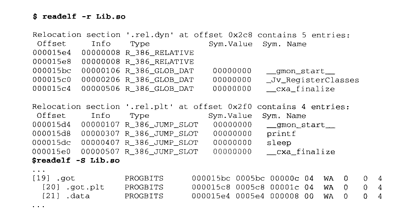

<details markdown="1"><summary>复制校对文字（未运行验证）</summary>

```text
$ readelf -r Lib.so
Relocation section '.rel.dyn' at offset 0x2c8 contains 5 entries:
 Offset   Info     Type              Sym.Value Sym. Name
000015e4 00000008 R_386_RELATIVE
000015e8 00000008 R_386_RELATIVE
000015bc 00000106 R_386_GLOB_DAT     00000000 __gmon_start__
000015c0 00000206 R_386_GLOB_DAT     00000000 _Jv_RegisterClasses
000015c4 00000506 R_386_GLOB_DAT     00000000 __cxa_finalize

Relocation section '.rel.plt' at offset 0x2f0 contains 4 entries:
 Offset   Info     Type              Sym.Value Sym. Name
000015d4 00000107 R_386_JUMP_SLOT    00000000 __gmon_start__
000015d8 00000307 R_386_JUMP_SLOT    00000000 printf
000015dc 00000407 R_386_JUMP_SLOT    00000000 sleep
000015e0 00000507 R_386_JUMP_SLOT    00000000 __cxa_finalize
$ readelf -S Lib.so
...
[19] .got     PROGBITS 000015bc 0005bc 00000c 04 WA 0 0 4
[20] .got.plt PROGBITS 000015c8 0005c8 00001c 04 WA 0 0 4
[21] .data    PROGBITS 000015e4 0005e4 000008 00 WA 0 0 4
...
```

</details>

在静态链接中我们已经碰到过两种类型的重定位入口 R\_386\_32 和 R\_386\_PC32，这里可以看到几种新的重定位入口类型：R\_386\_RELATIVE、R\_386\_GLOB\_DAT 和R\_386\_JUMP\_SLOT。实际上这些不同的重定位类型表示重定位时有不同的地址计算方法，在前面的静态链接中已经介绍过了 R\_386\_32和 R\_386\_PC32 的地址计算方法，实际上它们已经是比较复杂的重定位类型了。这里的 R\_386\_RELATIVE、R\_386\_GLOB\_DAT 和R\_386\_JUMP\_SLOT 都是很简单的重定位类型。我们先来看看 R\_386\_GLOB\_DAT 和R\_386\_JUMP\_SLOT，这两个类型的重定位入口表示，被修正的位置只需要直接填入符号的地址即可。比如我们看 printf这个重定位入口，它的类型为 R\_386\_JUMP\_SLOT，它的偏移为 0x000015d8，它实际上位于“.got.plt”中。我们知道，“.got.plt” 的前三项是被系统占据的，从第四项开始才是真正存放导入函数地址的地方。而第四项刚好是 0x000015c8+4\*3=0x000015d4，即“\_\_gmon\_start\_\_”，第五项是“printf”，第六项是“sleep”，第七项是“\_\_cxa\_finalize”。所以 Lib.so 的“.got.plt”的结构如图7-10所示。

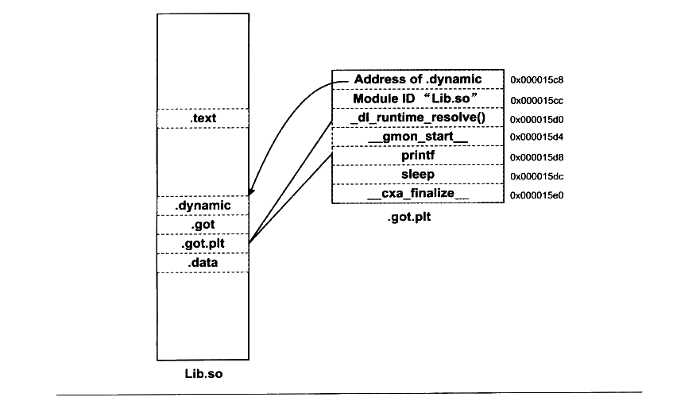

<p class="image-caption">图 7-10 Lib.so 的.got.plt 结构</p>

<details markdown="1"><summary>查看图中文字（按图分组）</summary>

Lib.so：.text、.dynamic、.got、.got.plt、.data。

.got.plt：

| 地址 | 内容 |
| --- | --- |
| 0x000015c8 | Address of .dynamic |
| 0x000015cc | Module ID “Lib.so” |
| 0x000015d0 | `_dl_runtime_resolve()` |
| 0x000015d4 | `__gmon_start__` |
| 0x000015d8 | printf |
| 0x000015dc | sleep |
| 0x000015e0 | `__cxa_finalize` |

</details>

当动态链接器需要进行重定位时，它先查找“printf” 的地址，“printf”位于 libc-2.6.1.so。假设链接器在全局符号表里面找到 “printf”的地址为0x08801234，那么链接器就会将这个地址填入到 “.got.plt” 中的偏移为 0x000015d8 的位置中去，从而实现了地址的重定位，即实现了动态链接最关键的一个步骤。

类似于 R\_386\_JUMP\_SLOT 是对“.got.plt” 的重定位，R\_386\_GLOB\_DAT是对 “.got”的重定位，它跟R\_386\_JUMP\_SLOT 一模一样，在这里不再详细介绍了，有兴趣的读者可以自己分析“.rel.dyn”中3个R\_386\_GLOB\_DAT 与“.got” 的关系，就能很快理解了。

稍微麻烦一点的是 R\_386\_RELATIVE 类型的重定位入口，这种类型的重定位实际上就是基址重置（Rebasing）。我们在前面已经分析过，共享对象的数据段是没有办法做到地址无关的，它可能会包含绝对地址的引用，对于这种绝对地址的引用，我们必须在装载时将其重定位。比如前面例子中，有一个全局指针变量被初始化为一个静态变量的地址：


<details markdown="1"><summary>复制校对文字（未运行验证）</summary>

```text
static int a;
static int* p = &a;
```

</details>

在编译时，共享对象的地址是从0开始的，我们假设该静态变量a相对于起始地址0的偏移为B，即p 的值为B。一旦共享对象被装载到地址 A，那么实际上该变量a 的地址为A+B，即p 的值需要加上一个装载地址 A。R\_386\_RELATIVE 类型的重定位入口就是专门用来重定位指针变量p这种类型的，变量p在装载时需要加上一个装载地址值 A，才是正确的结果。

那么导入函数的重定位入口是不是只会出现在“.rel.plt”，而不会出现在“.rel.dyn”呢？答案为否。如果某个 ELF 文件是以PIC 模式编译的（动态链接的可执行文件一般是PIC的），并调用了一个外部函数bar，则bar 会出现在“.rel.plt ”中：而如果不是以PIC 模式编译，则bar 将出现在：“.rel.dyn”中。让我们来看看不使用PIC 的方法来编译，重定位表的结果又会有什么不一样呢？

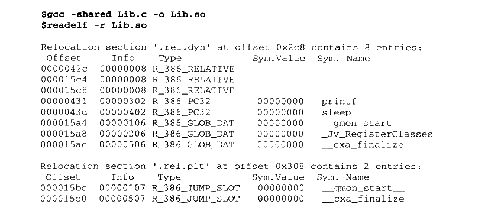

<details markdown="1"><summary>复制校对文字（未运行验证）</summary>

```text
$ gcc -shared Lib.c -o Lib.so
$ readelf -r Lib.so
Relocation section '.rel.dyn' at offset 0x2c8 contains 8 entries:
 Offset   Info     Type              Sym.Value Sym. Name
0000042c 00000008 R_386_RELATIVE
000015c4 00000008 R_386_RELATIVE
000015c8 00000008 R_386_RELATIVE
00000431 00000302 R_386_PC32         00000000 printf
0000043d 00000402 R_386_PC32         00000000 sleep
000015a4 00000106 R_386_GLOB_DAT     00000000 __gmon_start__
000015a8 00000206 R_386_GLOB_DAT     00000000 _Jv_RegisterClasses
000015ac 00000506 R_386_GLOB_DAT     00000000 __cxa_finalize

Relocation section '.rel.plt' at offset 0x308 contains 2 entries:
 Offset   Info     Type              Sym.Value Sym. Name
000015bc 00000107 R_386_JUMP_SLOT    00000000 __gmon_start__
000015c0 00000507 R_386_JUMP_SLOT    00000000 __cxa_finalize
```

</details>

可以看到Lib.c中的两个导入函数 “printf”和“sleep”从“.rel.plt” 到了“.rel.dyn”，并且类型也从 R\_386\_JUMP\_SLOT 变成了 R\_386\_PC32。

而 R\_386\_RELATIVE 类型多出了一个偏移为 0x0000042c的入口，这个入口是什么呢？通过对Lib.so 的反汇编可以知道，这个入口是用来修正传给 printf 的第一个参数，即我们的字符串常量 “Printing from Lib.so %d\n”的地址。为什么这个字符串常量的地址在PIC 时不需要重定位而在非PIC 时需要重定位呢？很明显，PIC 时，这个字符串可以看作是普通的全局变量，它的地址是可以通过PIC 中的相对当前指令的位置加上一个固定偏移计算出来的：而在非PIC中，代码段不再使用这种相对于当前指令的PIC方法，而是采用绝对地址寻址，所以它需要重定位。

### 7.5.5 动态链接时进程堆栈初始化信息

站在动态链接器的角度看，当操作系统把控制权交给它的时候，它将开始做链接工作，那么至少它需要知道关于可执行文件和本进程的一些信息，比如可执行文件有几个段（“Segment”）、每个段的属性、程序的入口地址（因为动态链接器到时候需要把控制权交给可执行文件）等。这些信息往往由操作系统传递给动态链接器，保存在进程的堆栈里面。我们在前面提到过，进程初始化的时候，堆栈里面保存了关于进程执行环境和命令行参数等信息。事实上，堆栈里面还保存了动态链接器所需要的一些辅助信息数组（Auxiliary Vector）。辅助信息的格式也是一个结构数组，它的结构被定义在 “elf.h”：

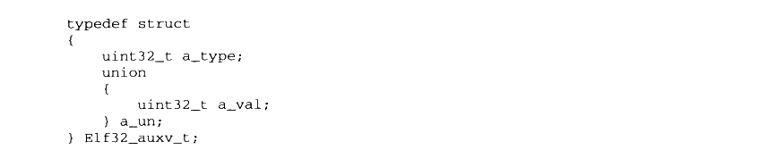

<details markdown="1"><summary>复制校对文字（未运行验证）</summary>

```text
typedef struct
{
    uint32_t a_type;
    union
    {
        uint32_t a_val;
    } a_un;
} Elf32_auxv_t;
```

</details>

是不是已经对这种结构很熟悉了？没错，跟前面的“.dynamic”段里面的结构如出一辙。先是一个32位的类型值，后面是一个32位的数值部分。你可能会很奇怪为什么要用一个union 把后面的32位数值包装起来，事实上这个 union没什么用，只是历史遗留而已，可以当作不存在。我们摘录几个比较重要的类型值，这几个类型值是比较常见的，而且是动态链接器在启动时所需要的，如表7-3所示。

表7-3

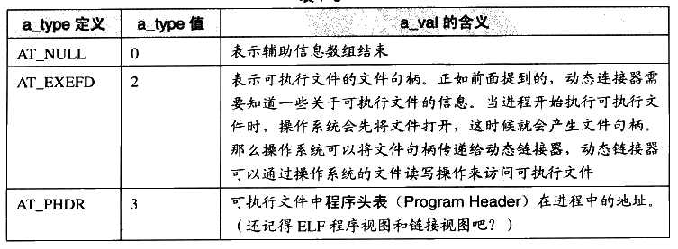

<details markdown="1"><summary>查看校对表格</summary>

| a_type 定义 | a_type 值 | a_val 的含义 |
| --- | --- | --- |
| `AT_NULL` | 0 | 表示辅助信息数组结束 |
| `AT_EXECFD` | 2 | 表示可执行文件的文件句柄。正如前面提到的，动态链接器需要知道一些关于可执行文件的信息。当进程开始执行可执行文件时，操作系统会先将文件打开，这时候就会产生文件句柄。那么操作系统可以将文件句柄传递给动态链接器，动态链接器可以通过操作系统的文件读写操作来访问可执行文件。 |
| `AT_PHDR` | 3 | 可执行文件中程序头表（Program Header）在进程中的地址。（还记得 ELF 程序视图和链接视图吧？） |

</details>

续表

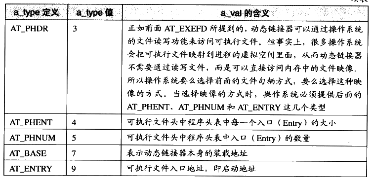

<details markdown="1"><summary>查看校对表格</summary>

| a_type 定义 | a_type 值 | a_val 的含义 |
| --- | --- | --- |
| `AT_PHDR` | 3 | 正如前面 AT_EXECFD 所提到的，动态链接器可以通过操作系统的文件读写功能来访问可执行文件。但事实上，很多操作系统会把可执行文件映射到进程的虚拟空间里面，从而动态链接器不需要通过读写文件，而是可以直接访问内存中的文件映像。所以操作系统要么选择前面的文件句柄方式，要么选择这种映像的方式。当选择映像的方式时，操作系统必须提供后面的 AT_PHENT、AT_PHNUM 和 AT_ENTRY 这几个类型。 |
| `AT_PHENT` | 4 | 可执行文件头中程序头表中每一个入口（Entry）的大小 |
| `AT_PHNUM` | 5 | 可执行文件头中程序头表中入口（Entry）的数量 |
| `AT_BASE` | 7 | 表示动态链接器本身的装载地址 |
| `AT_ENTRY` | 9 | 可执行文件入口地址，即启动地址 |

</details>

介绍了这么多关于辅助信息数组的结构，我们还没看到它到底位于进程堆栈的哪个位置呢。事实上，它位于环境变量指针的后面。比如我们假设操作系统传给动态链接器的辅助信息有4个，分别是：

- AT\_PHDR，值为 0x08048034，程序表头位于0x08048034。

- AT\_PHENT，值为20，程序表头中每个项的大小为20字节。

- AT\_PHNUM，值为7，程序表头共有7个项。

- AT\_ENTRY,0x08048320，程序入口地址为 0x08048320。

那么进程的初始化堆栈就如图7-11所示。

我们可以写一个小程序来把堆栈中初始化的信息全部打印出来，程序源代码如下：

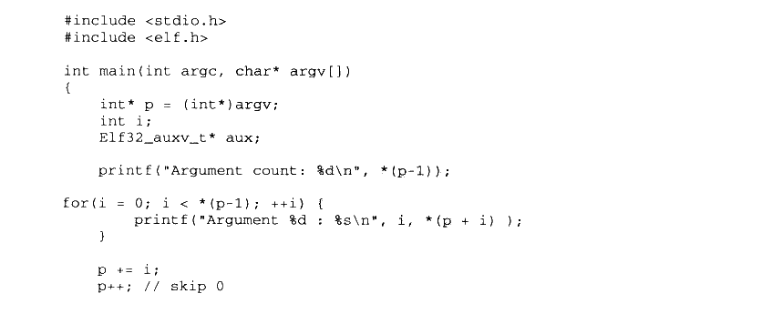

<details markdown="1"><summary>复制校对文字（未运行验证）</summary>

```text
#include <stdio.h>
#include <elf.h>

int main(int argc, char* argv[])
{
    int* p = (int*)argv;
    int i;
    Elf32_auxv_t* aux;

    printf("Argument count: %d\n", *(p-1));
    for (i = 0; i < *(p-1); ++i) {
        printf("Argument %d : %s\n", i, *(p + i));
    }
    p += i;
    p++; // skip 0

    printf("Environment:\n");
    while (*p) {
        printf("%s\n", *p);
        p++;
    }
    p++; // skip 0

    printf("Auxiliary Vectors:\n");
    aux = (Elf32_auxv_t*)p;
    while (aux->a_type != AT_NULL) {
        printf("Type: %02d Value: %x\n", aux->a_type, aux->a_un.a_val);
        aux++;
    }
    return 0;
}
```

</details>

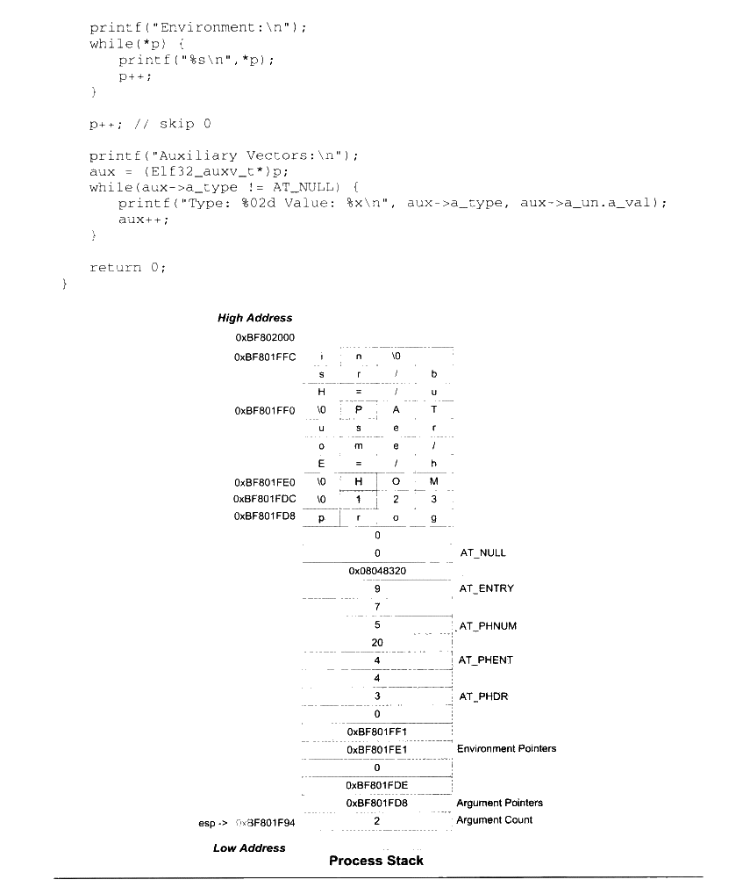

<p class="image-caption">图7-11 进程初始化堆栈</p>

<details markdown="1"><summary>查看图中文字（按图分组）</summary>

Process Stack：High Address → Low Address。

字符串：PATH=/usr/bin\0；HOME=/home/user\0；123\0；prog\0。

图中地址：0xBF802000、0xBF801FFC、0xBF801FF0、0xBF801FE0、0xBF801FDC、0xBF801FD8。

辅助信息：AT_NULL = 0；AT_ENTRY = 9，值0x08048320；AT_PHNUM = 5，值7；AT_PHENT = 4，值20；AT_PHDR = 3，图中值4。

Environment Pointers：0xBF801FF1、0xBF801FE1，后接0。

Argument Pointers：0xBF801FDE、0xBF801FD8，后接0。

Argument Count：2；esp → 0xBF801F94。

</details>

上面的程序中，为什么使用 argv 作为基准来定位各个结构的地址，而不是采用argc？提示：传值和传址。
