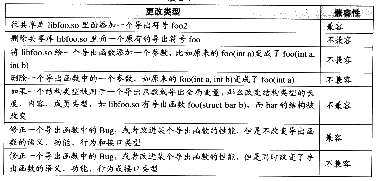
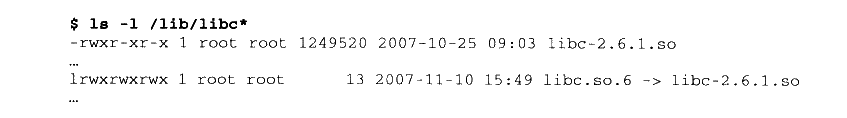
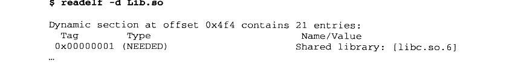
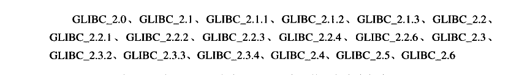
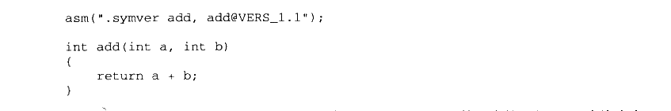
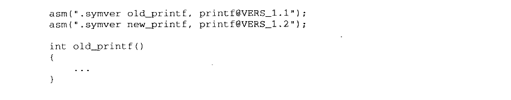

# 第 8 章 Linux 共享库的组织

## 8.1 共享库版本

#### 8.1.1 共享库兼容性

共享库的开发者会不停地更新共享库的版本，以修正原有的Bug、增加新的功能或改进性能等。由于动态链接的灵活性，使得程序本身和程序所依赖的共享库可以分别独立开发和更新，比如当有程序A 依赖于 libfoo.so，当libfoo.so 的开发者宣布新版本开发完成之后，理论上我们只需要用新的 libfoo.so 将旧版本的替换掉即可享用新版 libfoo.so提供的一切好处。但是共享库版本的更新可能会导致接口的更改或删除，这可能导致依赖于该共享库的程序无法正常运行。最简单的情况下，共享库的更新可以被分为两类。

- 兼容更新。所有的更新只是在原有的共享库基础上添加一些内容，所有原有的接口都保持不变。

- 不兼容更新。共享库更新改变了原有的接口，使用该共享库原有接口的程序可能不能运行或运行不正常。

接口这个词有着很广泛的含义，在软件的很多层次上都有所谓的“接口”。但是这里讨论的接口是二进制接口，即 ABI（Application Binary Interface）。共享库的 ABI 跟程序语言有着很大的关系，不同的语言对于接口的兼容性要求不同。ABI 对于不同的语言来说，主要包括一些诸如函数调用的堆栈结构、符号命名、参数规则、数据结构的内存分布等方面的规则。那么对于一个C语言编写的共享库来说，什么样的更改会导致ABI 变化呢？表8-1 列举了几种常见的更改方式。表8-1



<details markdown="1"><summary>查看校对表格</summary>

| 更改类型 | 兼容性 |
| --- | --- |
| 往共享库 libfoo.so 里面添加一个导出符号 foo2 | 兼容 |
| 删除共享库 libfoo.so 里面一个原有的导出符号 foo | 不兼容 |
| 将 libfoo.so 给一个导出函数添加一个参数，比如原来的 foo(int a) 变成了 foo(int a, int b) | 不兼容 |
| 删除一个导出函数中的一个参数，如原来的 foo(int a, int b) 变成了 foo(int a) | 不兼容 |
| 如果一个结构类型被用于一个导出函数或导出全局变量，那么改变结构类型的长度、内容、成员类型，如 libfoo.so 有导出函数 foo(struct bar b)，而 bar 的结构被改变 | 不兼容 |
| 修正一个导出函数中的 Bug，或者改进某个导出函数的性能，但是不改变导出函数的语义、功能、行为和接口类型 | 兼容 |
| 修正一个导出函数中的 Bug，或者改进某个导出函数的性能，但是同时改变了导出函数的语义、功能、行为或接口类型 | 不兼容 |

</details>

导致C语言的共享库 ABI 改变的行为主要有如下4个：

- 导出函数的行为发生改变，也就是说调用这个函数以后产生的结果与以前不一样，不再满足旧版本规定的函数行为准则。

- 导出函数被删除。

- 导出数据的结构发生变化，比如共享库定义的结构体变量的结构发生改变：结构成员删除、顺序改变或其他引起结构体内存布局变化的行为（不过通常来讲，往结构体的尾部添加成员不会导致不兼容，当然这个结构体必须是共享库内部分配的，如果是外部分配的，在分配该结构体时必须考虑成员添加的情况）。

- 导出函数的接口发生变化，如函数返回值、参数被更改。

如果能够保证上述4 种情况不发生，那么绝大部分情况下，C语言的共享库将会保持ABI 兼容。注意，仅仅是绝大部分情况，要破坏一个共享库的 ABI十分容易，要保持ABI的兼容却十分困难。很多因素会导致ABI 的不兼容，比如不同版本的编译器、操作系统和硬件平台等，使得 ABI 兼容尤为困难。使用不同版本的编译器或系统库可能会导致结构体的成员对齐方式不一致，从而导致了ABI 的变化。这种 ABI 不兼容导致的问题可能非常微妙，表面上看可能无关紧要，但是一旦发生故障，相关的 Bug 非常难以定位，这也是共享库很大的一个问题。

对于C++来说，ABI 问题就更为严重了。由于C++非常复杂，它支持诸如模板等一些高级特性，这些特性对于 ABI 兼容来说简直就是灾难。因为C++标准对于C++的ABI没有做出规定，所以不同的编译器甚至同一个编译器的不同版本对于C++的一些特性的实现都有着各自的方案，而且相互不兼容，比如虚函数表、模板实例化、多重继承等。对于 Linux 来说，如果你要开发一个导出接口为 C++的共享库（当然我十分不推荐这么做，使用C的接口会让事情变得简单得多），需要注意以下事项，以防止 ABI 不兼容（完全遵循以下准则还是不能保证ABI完全兼容）：

- 不要在接口类中使用虚函数，万不得已要使用虚函数时，不要随意删除、添加或在子类中添加新的实现函数，这样会导致类的虚函数表结构发生变化。

- 不要改变类中任何成员变量的位置和类型。

- 不要删除非内嵌的 public 或 protected 成员函数。

- 不要将非内嵌的成员函数改变成内嵌成员函数。

- 不要改变成员函数的访问权限。

- 不要在接口中使用模板。

- 最重要的是，不要改变接口的任何部分或干脆不要使用C++作为共享库接口！

#### 8.1.2 共享库版本命名

既然共享库存在这样那样的兼容性问题，那么保持共享库在系统中的兼容性，保证依赖于它们的应用程序能够正常运行是必须要解决的问题。有几种办法可用于解决共享库的兼容性问题，有效办法之一就是使用共享库版本的方法。Linux 有一套规则来命名系统中的每一个共享库，它规定共享库的文件名规则必须如下：

`libname.so.x.y.z`

最前面使用前缀“lib”、中间是库的名字和后缀“so”，最后面跟着的是三个数字组成的版本号。“x”表示主版本号（Major Version Number）， “y”表示次版本号（Minor Version Number），“z”表示发布版本号（Release Version Number）。三个版本号的含义不一样。

主版本号表示库的重大升级，不同主版本号的库之间是不兼容的，依赖于旧的主版本号的程序需要改动相应的部分，并且重新编译，才可以在新版的共享库中运行；或者，系统必须保留旧版的共享库，使得那些依赖于旧版共享库的程序能够正常运行。

次版本号表示库的增量升级，即增加一些新的接口符号，且保持原来的符号不变。在主版本号相同的情况下，高的次版本号的库向后兼容低的次版本号的库。一个依赖于旧的次版本号共享库的程序，可以在新的次版本号共享库中运行，因为新版中保留了原来所有的接口，并且不改变它们的定义和含义。比如系统中有个共享库为 libfoo.so.1.2.x，后来在升级过程中添加了一个函数，版本号变成了1.3.x。因为1.2.x 的所有接口都被保留到1.3.x 中了，所以那些依赖于1.1.x或1.2.x的程序都可以在1.3.x中正常运行。

发布版本号表示库的一些错误的修正、性能的改进等，并不添加任何新的接口，也不对接口进行更改。相同主版本号、次版本号的共享库，不同的发布版本号之间完全兼容，依赖于某个发布版本号的程序可以在任何一个其他发布版本号中正常运行，而无须做任何修改。

当然现在 Linux 中也存在不少不遵守上述规定的“顽固分子”，比如最基本的C语言库Glibc 就不使用这种规则，它的基本C语言库使用libc-x.y.z.so这种命名方式。Glibc有许多组件，C语言库只是其中一个，动态链接器也是 Glibc 的一部分，它使用ld-x.y.z.so这样的命名方式，还有 Glibc 的其他部分，比如数学库libm、运行时装载库libdl等。

Reference: Library Interface Versioning in Solaris and Linux

<http://www.usenix.org/publications/library/proceedings/als00/2000papers/papers/full_papers/browndavid/browndavid_html/>

这篇论文对 Solaris 和 Linux 的共享库版本机制和符号版本机制做了非常详细的介绍。

#### 8.1.3 SO-NAME

程序需要记录什么

可以这么说，共享库的主版本号和次版本号决定了一个共享库的接口。那么从一个可执行程序的角度看，如何表示它依赖于哪些版本的哪些共享库？或者说在运行时，动态链接器怎样知道程序依赖于哪些共享库，它们的版本号又是什么？

我们假设程序中有一个它所依赖的共享库的列表，其中每一项对应于它所依赖的一个共享库。可以肯定的是，程序中必须包含被依赖的共享库的名字和主版本号。因为我们知道不同主版本号之间的共享库是完全不兼容的，所以程序中保存一个诸如 libfoo.so.2的记录，以防止动态链接器在运行时意外地将程序与 libfoo.so.1 或libfoo.so.3链接到一起。通过这个可以发现，如果在系统中运行旧的应用程序，就需要在系统中保留旧应用程序所需要的旧的主版本号的共享库。

SO-NAME

对于新的系统来说，包括 Solaris 和 Linux，普遍采用一种叫做 SO-NAME 的命名机制来记录共享库的依赖关系。每个共享库都有一个对应的“SO-NAME”，这个SO-NAME 即共享库的文件名去掉次版本号和发布版本号，保留主版本号。比如一个共享库叫做libfoo.so.2.6.1，那么它的 SO-NAME 即 libfoo.so.2。很明显，“SO-NAME”规定了共享库的接口，“SO-NAME”的两个相同共享库，次版本号大的兼容次版本号小的。在Linux 系统中，系统会为每个共享库在它所在的目录创建一个跟“SO-NAME”相同的并且指向它的软链接（Symbol Link）。比如系统中有存在一个共享库 “/lib/libfoo.so.2.6.1”，那么 Linux 中的共享库管理程序就会为它产生一个软链接“/lib/libfoo.so.2” 指向它。比如 Linux 系统的 Glibc 共享库：



<details markdown="1"><summary>复制校对文字（未运行验证）</summary>

```text
$ ls -l /lib/libc*
-rwxr-xr-x 1 root root 1249520 2007-10-25 09:03 libc-2.6.1.so
...
lrwxrwxrwx 1 root root      13 2007-11-10 15:49 libc.so.6 -> libc-2.6.1.so
...
```

</details>

由于历史原因，动态链接器和C语言库的共享对象文件名规则不按 Linux标准的共享库命名方法，但是C语言的 SO-NAME 还是按照正常的规则：Glibc 的C语言库libc-2.6.1.so，它的SO-NAME 是 libc.so.6；为了“彰显”动态连接器的与众不同，它的 SO-NAME 命名也不按照普通的规则，比如动态链接器的文件名是ld-2.6.1.so，它的SO-NAME是ld-linux.so。

那么以“SO-NAME”为名字建立软链接有什么用处呢？实际上这个软链接会指向目录中主版本号相同、次版本号和发布版本号最新的共享库。也就是说，比如目录中有两个共享库版本分别为：/lib/libfoo.so.2.6.1 和/lib/libfoo.so.2.5.3，那么软链接/lib/libfoo.so.2 会指向/lib/libfoo.so.2.6.1。这样保证了所有的以 SO-NAME 为名的软链接都指向系统中最新版的共享库。

建立以 SO-NAME为名字的软链接目的是，使得所有依赖某个共享库的模块，在编译、链接和运行时，都使用共享库的SO-NAME，而不使用详细的版本号。我们在前面介绍动态链接文件中的“.dynamic”段时已经提到过，如果某文件 A 依赖于某文件 B，那么A的“.dynamic”段中会有 DT\_NEEDED类型的字段，字段的值就是B。现在有一个问题是，这个字段值该如何表示B 这个文件呢？如果保存的是B 的文件名，即包含次版本号和发布版本号，那么会有什么问题呢？很直接的问题是，这个文件 A 只能依赖于某个特定版本的B。比如程序 A依赖于C语言库，它在编译时，系统中存在的C语言库版本是/lib/libc-2.6.1.so，那么编译完成后，它的“.dynamic”中的 DT\_NEEDED 类型如果保存了/lib/libc-2.6.1.so。当系统将C语言库版本升级至2.6.2或2.7.1时，系统必须保留原来的2.6.1 的共享库，否则这个程序A 就无法正常运行。

但是我们知道，因为根据 Linux 的共享库版本规定，实际上2.6.2或2.7.1版本的共享库是兼容 2.6.1的，我们不需要继续保留原来的2.6.1，否则系统中将遗留大量的各种版本的共享库，大大浪费了磁盘和内存空间。所以一个可行的方法就是编译输出 ELF 文件时，将被依赖的共享库的 SO-NAME保存到 “.dynamic”中，这样当动态链接器进行共享库依赖文件查找时，就会根据系统中各种共享库目录中的SO-NAME 软链接自动定向到最新版本的共享库。比如之前 Lib.so的依赖文件：



<details markdown="1"><summary>复制校对文字（未运行验证）</summary>

```text
$ readelf -d Lib.so
Dynamic section at offset 0x4f4 contains 21 entries:
  Tag        Type                Name/Value
  0x00000001 (NEEDED)            Shared library: [libc.so.6]
...
```

</details>

当共享库进行升级的时候，如果只是进行增量升级，即保持主版本号不变，只改变次版本号或发布版本号，那么我们可以直接将新版的共享库替换掉旧版，并且修改 SO-NAME的软链接指向新版本共享库，即可实现升级：当共享库的主版本号升级时，系统中就会存在多个 SO-NAME，由于这些 SO-NAME 并不相同，所以已有的程序并不会受影响。

总之，SO-NAME 表示一个库的接口，接口不向后兼容，SO-NAME 就发生变化，这是基本的原则。

Linux 中提供了一个工具叫做 “ldconfig”，当系统中安装或更新一个共享库时，就需要运行这个工具，它会遍历所有的默认共享库目录，比如/lib、/usr/lib 等，然后更新所有的软链接，使它们指向最新版的共享库：如果安装了新的共享库，那么 ldconfig 会为其创建相应的软链接。

链接名

当我们在编译器里面使用共享库的时候（比如使用GCC 的“-l”参数链接某个共享库），我们使用了更为简洁的方式，比如需要链接一个 libXXX.so.2.6.1 的共享库，只需要在编译器命令行里面指定-lXXX即可，可省略所有其他部分。编译器会根据当前环境，在系统中的相关路径（往往由-L参数指定）查找最新版本的“XXX”库。

这个“XXX”又被称为共享库的链接名（Link Name）。不同类型的库可能会有同样的链接名，比如C语言运行库有静态版本（libc.a）和动态版本 （libc.so.x.y.z）的区别，如果在链接时使用参数“-lc”，那么链接器会根据输出文件的情况（动态/静态）来选择适合版本的库。比如ld 使用“-static”参数时，“-lc” 会查找 libc.a：如果使用“-Bdynamic”（这也是默认情况），它会查找最新版本的 libc.so.x.y.z。


## 8.2 符号版本

历史回顾

在一些早期的系统中，应用程序在被构建时，静态链接器会把程序所依赖的所有共享库的名字、主版本号和次版本号都记录到最终的应用程序二进制输出文件中。在运行时，由于动态链接器知道应用程序所依赖的共享库的确切版本号，所以兼容性问题比较容易处理。比如在 SunOS 4.x中，动态链接器会根据程序的共享库依赖列表中的记录，在系统中查找相同共享库名和主版本号的共享库：如果某个共享库在系统中存在相同主版本号不同次版本号的多个副本，那么动态链接器会使用那个最高次版本号的副本。

动态链接器在查找共享库过程中，如果找到的共享库的次版本号高于或等于依赖列表中的版本，那么链接器就默认共享库满足要求，因为更高次版本号的共享库肯定包含所有需要的符号；如果找到的共享库次版本号低于所需要的版本，SunOS 4.x 系统的策略是向用户发出一个警告信息，表示系统中仅有低次版本号的共享库，但运行程序还是继续运行。程序很有可能能够正常运行，比如该程序只用了低次版本号中的接口，而没有用到高次版本号中新添加的那些接口。当然，程序如果用到了高次版本号中新添加的接口而目前系统中的低次版本号的共享库中不存在，那么就会发生重定位错误。有些采取更加保守策略的系统中，对于这种系统中没有足够高的次版本号满足依赖关系的情况，程序将会被禁止运行，以防止出现意外情况。

这两种策略或可能导致程序运行错误（第一种只通过警告的策略），或者会阻止那些实际上能够运行的程序（第二种保守策略）。实际上很多应用程序在高次版本的系统中都有构建，但实际上它只用到了低次版本的那部分接口，在采取第二种策略的系统中，如果系统中只有低次版本号的共享库，那么这些程序就不能运行。我们可以把这个问题叫做次版本号交会问题（Minor-revision Rendezvous Problem）。

次版本号交会问题并没有因为 SO-NAME 而解决

动态链接器在进行动态链接时，只进行主版本号的判断，即只判断 SO-NAME，如果某个被依赖的共享库 SO-NAME 与系统中存在的实际共享库 SO-NAME一致，那么系统就认为接口兼容，而不再进行兼容性检查。这样就会出现一个问题，当某个程序依赖于较高的次版本号的共享库，而运行于较低次版本号的共享库系统时，就可能产生缺少某些符号的错误。因为次版本号只保证向后兼容，并不保证向前兼容，新版的次版本号的共享库可能添加了一些旧版没有的符号。这种次版本号交会问题并没有因为SO-NAME的存在而得到任何改善。对于这个问题，现代的系统通过一种更加精巧的方式来解决，那就是符号版本机制。

#### 8.2.1 基于符号的版本控制

正常情况下，为了表示某个共享库中增加了一些接口，我们就把这个共享库的次版本号升高（表示里面添加了一些东西）。但是我们需要一种更为巧妙的方法，来解决次版本号交会问题。Linux 下的 Glibc 从版本2.1 之后开始支持一种叫做基于符号的版本机制（Symbol Versioning）的方案。这个方案的基本思路是让每个导出和导入的符号都有一个相关联的版本号，它的实际做法类似于名称修饰的方法。与以往简单地将某个共享库的版本号重新命名不同（比如将 libfoo.so.1.2升级到libfoo.so.1.3），当我们将 libfoo.so.1.2升级至1.3时，仍然保持 libfoo.so.1 这个 SO-NAME，但是给在1.3这个新版中添加的那些全局符号打上一个标记，比如“VERS\_1.3”。那么，如果一个共享库每一次次版本号升级，我们都能给那些在新的次版本号中添加的全局符号打上相应的标记，就可以清楚地看到共享库中的每个符号都拥有相应的标签，比如“VERS\_1.1”、“VERS\_1.2”、“VERS\_1.3”、“VERS\_1.4"。

#### 8.2.2 Solaris 中的符号版本控制

这个基于符号版本的方案最早是 Sun 在1995年的 Solaris 2.5中实现的，在这个新的机制中，Solaris 的ld 链接器为共享库新增了版本机制（Versioning）和范围机制（Scoping）。

版本机制的想法很简单，也就是定义一些符号的集合，这些集合本身都有名字，比如叫“VERS\_1.1”、“VERS\_1.2”等，每个集合都包含一些指定的符号，除了可以拥有符号以外，一个集合还可以包含另外一个集合，比如“VERS\_1.2” 可以包含集合“VERS\_1.1”。就概念而言与其说是“包含”，不如说是“继承”，比如 “VERS\_1.2”的符号集合包含（继承）了所有“VERS\_1.1” 的符号，并且包含所有“VERS\_1.2” 的符号。

那么，这些集合的定义及它们包含哪些符号是怎样指定的呢？在 Solaris 中，程序员可以在链接共享库时编写一种叫做符号版本脚本的文件，在这个文件中指定这些符号与集合之间及集合与集合之间的继承依赖关系。链接器在链接时根据符号版本脚本中指定的关系来产生共享库，并且设置符号的集合与它们之间的关系。

举个简单的例子，假设有个名为 libstack.so.1 的共享库编写的符号版本脚本文件如下；


<details markdown="1"><summary>复制校对文字（未运行验证）</summary>

```text
SUNW_1.1 {
    global:
    pop;
    push;
}

SUNWprivate {
    global:
    __pop;
    __push;
    local:
    *;
}
```

</details>

在这个脚本文件中，我们可以看到它定义了两个符号集合，分别为“SUNW\_1.1” 和“SUNWprivate”（在Solaris 系统中，符号的集合名通常由“SUNW”开头）。第一个包含了两个全局符号 pop 和 push：在第二个集合中，包含了两个全局符号“\_\_pop” 和“\_\_push”。第二个集合中最后的“local：\*：”表示：除了上述被标识为全局的“pop”、“push”、“\_\_pop”和“\_\_push”这4个符号以外，共享库中其他的本来是全局的符号都将成为共享库局部符号，也就是说链接器会把原先是全局的符号全部变成局部的，这样一来，共享库外部的应用程序或其他的共享库将无法访问这些符号。这种方式可以用于保护那些共享库内部的公用实用函数，但是共享库的作者又不希望共享库的使用者能够有意或无意地访问这些函数。这种方法又被称为范围机制（Scoping），它实际上是对C语言没有很好的符号可见范围的控制机制的一种补充，或者说是一种补救性质的措施。

假设现在这个共享库升级了，在原有的基础上添加了一个全局函数“swap”，那么新的符号版本脚本文件可以在原有的基础上添加如下内容：


<details markdown="1"><summary>复制校对文字（未运行验证）</summary>

```text
SUNW_1.2 {
    global:
    swap;
} SUNW_1.1;
```

</details>

上面的脚本就表示了一个典型的向上兼容的接口：1.2版的共享库增加了一个 swap 接口，并且它继承了1.1 的所有接口。那么我们可以按照这种方式，共享库中的版本序号SUNW\_1.1、SUNW\_1.2、SUNW\_1.3……分别表示每次共享库添加接口以后的更新，它们依次向后继承，向后兼容。这里值得一提的是，跟在“SUNW\_” 前缀后面的版本号由主版本号与一个次版本号构成，这里的主版本号对应于共享库实际的 SO-NAME 中的主版本号。

当共享库的符号都有了版本集合之后，一个最明显的效果就是，当我们在构建（编译和链接）应用程序的时候，链接器可以在程序的最终输出文件中记录下它所用到的版本符号集合。值得注意的是，程序里面记录的不是构建时共享库中版本最新的符号集合，而是程序所依赖的集合中版本号最小的那个（或者那些）。比如，一个共享库 libfoo.so.1 中有6个符号版本，从SUNW\_1.1 到SUNW\_1.6，某个应用程序 app\_foo 在编译时，系统中的 libfoo.so.1的符号版本为 SUNW\_1.6，但实际上app\_foo 只用到了最高到SUNW\_1.3集合的符号，那么应用程序实际上依赖于 SUNW\_1.3，而不是SUNW\_1.6。链接器会计算出 app\_foo 所用到的最高版本的符号，然后把SUNW\_1.3记录到 app\_foo的可执行文件内。

在程序运行时，动态链接器会通过程序内记录的它所依赖的所有共享库的符号集合版本信息，然后判定当前系统共享库中的符号集合版本是否满足这些被依赖的符号集合。通过这样的机制，就可以保证那些在高次版本共享库的系统中编译的程序在低次版本共享库中运行。如果该低次版本的共享库满足符号集合的要求，比如 app\_foo 在 libfoo.so.1 次版本号大于等于3的系统中运行，就没有任何问题；如果低次版本共享库不满足要求，如 app\_foo 在libfoo.so.1次版本号小于3的系统中运行，动态链接器就会意识到当前系统的共享库次版本号不满足要求，从而阻止程序运行，以防止造成进一步的损失。

这种符号版本的方法是对 SO-NAME 机制保证共享库主版本号一致的一种非常好的补充。

#### 8.2.3 Linux 中的符号版本

Linux 系统下共享库的符号版本机制并没有被广泛应用，主要使用共享库符号版本机制的是 Glibc 软件包中所提供的20多个共享库。这些共享库比较有效地利用了符号版本机制来表示符号的版本演化及利用范围机制来屏蔽一些不希望暴露给共享库使用者的符号。对于目前2.6.1的Glibc 中的C语言运行库 libc-2.6.1.so 来说，它的符号版本演化如下：



<details markdown="1"><summary>复制校对文字（未运行验证）</summary>

```text
GLIBC_2.0、GLIBC_2.1、GLIBC_2.1.1、GLIBC_2.1.2、GLIBC_2.1.3、GLIBC_2.2、
GLIBC_2.2.1、GLIBC_2.2.2、GLIBC_2.2.3、GLIBC_2.2.4、GLIBC_2.2.6、GLIBC_2.3、
GLIBC_2.3.2、GLIBC_2.3.3、GLIBC_2.3.4、GLIBC_2.4、GLIBC_2.5、GLIBC_2.6
```

</details>

对于有些像 Glibc 中的加密解密库 libcrypt，它目前的共享库版本是 libcrypt-2.6.1.so，但是它内部的符号版本只有GLIBC\_2.0，因为它的接口十分稳定，从2.0版本之后就没有改动过。另外我们在Glibc 的库中还可以看到类似于“GCC\_”为前缀及 “GLIBC\_PRIVATE” 这样的符号版本，这样的符号版本标记分别用于GCC编译器和 GLIBC 内部，它提醒共享库的使用者：最好不要使用这些符号，因它并不是对外公开的，有可能随着共享库的版本演化而被删除或改变，总之一句话，后果自负。

GCC 对 Solaris 符号版本机制的扩展

GCC 在 Solaris 系统中的符号版本机制的基础上还提供了两个扩展。第一个扩展是，除了可以在符号版本脚本中指定符号的版本之外，GCC 还允许使用一个叫做 “.symver”的汇编宏指令来指定符号的版本，这个汇编宏指令可以被用在GAS 汇编中，也可以在GCC的C/C++源代码中以嵌入汇编指令的模式使用。它的用法如下：



<details markdown="1"><summary>复制校对文字（未运行验证）</summary>

```text
asm(".symver add, add@VERS_1.1");
int add(int a, int b)
{
    return a + b;
}
```

</details>

这样就可以把符号“add”指定为符号标签“VERS\_1.1”。第二个扩展是GCC 允许多个版本的同一个符号存在于一个共享库中，也就是说，在链接层面提供了某种形式的符号重载机制，比如：



<details markdown="1"><summary>复制校对文字（未运行验证）</summary>

```text
asm(".symver old_printf, printf@VERS_1.1");
asm(".symver new_printf, printf@VERS_1.2");
int old_printf()
{
    ...
}
```

</details>


<details markdown="1"><summary>复制校对文字（未运行验证）</summary>

```text
int new_printf()
{
    ...
}
```

</details>

为什么要提供这种符号多版本重载机制呢？有时候当我们对共享库进行升级的时候，可能仅仅更改了一个符号的接口或含义，那么，如果仅仅为了这个符号的更改而升级主版本号，那么将会对系统带来很大的影响。理想的情况是，当共享库发生比较小的变化时，新版的共享库能够在原来的基础上做些补充，而并不影响旧版的功能，即能完全保持向后兼容性，争取做到不更改共享库的SO-NAME，即不更改主版本号。

Solaris 2.5系统的符号版本方案有一个不足，那就是同一个共享库中，每个函数只能有一个版本号，也就是说不允许多个版本的同一个函数名存在，只允许该函数的某个版本存在。比如符号foo 要么是 VERS\_1.0，要么是 VERS\_1.1，不允许这两个版本同时存在。Linux 下的符号版本机制比 Solaris2.5 的要先进一些，它允许同一个名称的符号存在多个版本。当某个符号在新的共享库版本中接口被更改或符号的含义被改变，那么共享库可以保留原来的版本符号，比如前面例子中导出的 printf 1.1版实际上即为 old\_printf；而将新版的 new\_printf导出成 printf版本1.2。这样，链接器可以挑选符合某个程序版本号的符号来进行链接，使用1.1版 printf 的程序会被链接到 old\_printf，而使用1.2版的程序会被链接到 new\_printf，所有的程序都可以正确运行，更改函数的接口和含义并不影响旧版程序的运行。

Linux 系统中符号版本机制实践

在Linux 下，当我们使用ld 链接一个共享库时，可以使用“--version-script”参数：如果使用GCC，则可以使用“-Xlinker” 参数加 “--version-script”，相当于把“--version-script”传递给ld链接器。如编译源代码为 “lib.c”，符号版本脚本文件为 “lib.ver”：

```sh
gcc -shared -fPIC lib.c -Xlinker --version-script lib.ver -o lib.so
```

假设 lib.c 里面定义了一个 foo 的函数，而 main.c 调用了这个函数，如我们使用下面的符号版本脚本编译一个 lib.so：


<details markdown="1"><summary>复制校对文字（未运行验证）</summary>

```text
VERS_1.2 {
    global:
        foo;
    local:
        *;
};
```

</details>

那么很明显，这个版本的 lib.so里面 foo 的符号版本是 VERS\_1.2。然后将 main.c编译并且链接到当前版本的 lib.so：

```sh
gcc main.c ./lib.so -o main
```

于是 main 程序里面所引用的foo也是 VERS\_1.2 的。如果把这个 main 程序拿到一台只包含低于 VERS\_1.2的foo 的lib.so 系统中运行，那么动态链接器就会报运行错误并且退出程序，防止了符号版本不符所造成额外的损失：

```text
./main: ./lib.so: version `VERS_1.2' not found (required by ./main)
```


## 8.3 共享库系统路径

目前大多数包括 Linux 在内的开源操作系统都遵守一个叫做 FHS （File Hierarchy Standard）的标准，这个标准规定了一个系统中的系统文件应该如何存放，包括各个目录的结构、组织和作用，这有利于促进各个开源操作系统之间的兼容性。共享库作为系统中重要的文件，它们的存放方式也被 FHS列入了规定范围。FHS 规定，一个系统中主要有两个存放共享库的位置，它们分别如下：

- /lib，这个位置主要存放系统最关键和基础的共享库，比如动态链接器、C语言运行库、数学库等，这些库主要是那些/bin和/sbin 下的程序所需要用到的库，还有系统启动时需要的库。

- /usr/lib，这个目录下主要保存的是一些非系统运行时所需要的关键性的共享库，主要是一些开发时用到的共享库，这些共享库一般不会被用户的程序或 shell 脚本直接用到。这个目录下面还包含了开发时可能会用到的静态库、目标文件等。

- /usr/local/lib，这个目录用来放置一些跟操作系统本身并不十分相关的库，主要是一些第三方的应用程序的库。比如我们在系统中安装了 python 语言的解释器，那么与它相关的共享库可能会被放到/usr/local/lib/python，而它的可执行文件可能被放到/usr/local/bin 下。GNU的标准推荐第三方的程序应该默认将库安装到/usr/local/lib 下。

所以总体来看，/lib 和/usr/lib 是一些很常用的、成熟的，一般是系统本身所需要的库：而/usr/local/lib 是非系统所需的第三方程序的共享库。


## 8.4 共享库查找过程

在开源系统中，包括所有的 Linux系统在内的很多都是基于Glibc 的。我们知道在这些系统里面，动态链接的 ELF 可执行文件在启动时同时会启动动态链接器。在Linux 系统中，动态链接器是/lib/ld-linux.so.X（X是版本号），程序所依赖的共享对象全部由动态链接器负责装载和初始化。我们知道任何一个动态链接的模块所依赖的模块路径保存在“.dynamic”段里面，由DT\_NEEDED 类型的项表示。动态链接器对于模块的查找有一定的规则：如果DT\_NEEDED 里面保存的是绝对路径，那么动态链接器就按照这个路径去查找：如果 DT\_NEEDED里面保存的是相对路径，那么动态链接器会在/lib、/usr/lib 和由/etc/ld.so.conf 配置文件指定的目录中查找共享库。为了程序的可移植性和兼容性，共享库的路径往往是相对的。

ld.so.conf 是一个文本配置文件，它可能包含其他的配置文件，这些配置文件中存放着目录信息。在我的机器中，由ld.so.conf 指定的目录是：

- /usr/local/lib
- /lib/i486-linux-gnu
- /usr/lib/i486-linux-gnu

如果动态链接器在每次查找共享库时都去遍历这些目录，那将会非常耗费时间。所以Linux 系统中都有一个叫做ldconfig 的程序，这个程序的作用是为共享库目录下的各个共享库创建、删除或更新相应的SO-NAME（即相应的符号链接），这样每个共享库的 SO-NAME就能够指向正确的共享库文件；并且这个程序还会将这些 SO-NAME 收集起来，集中存放到/etc/ld.so.cache 文件里面，并建立一个SO-NAME 的缓存。当动态链接器要查找共享库时，它可以直接从/etc/ld.so.cache 里面查找。而/etc/ld.so.cache 的结构是经过特殊设计的，非常适合查找，所以这个设计大大加快了共享库的查找过程。

如果动态链接器在/etc/ld.so.cache 里面没有找到所需要的共享库，那么它还会遍历/lib和/usr/lib 这两个目录，如果还是没找到，就宣告失败。

所以理论上讲，如果我们在系统指定的共享库目录下添加、删除或更新任何一个共享库，或者我们更改了/etc/ld.so.conf 的配置，都应该运行 ldconfig 这个程序，以便调整SO-NAME和/etc/ld.so.cache。很多软件包的安装程序在往系统里面安装共享库以后都会调用 ldconfig。

不同的系统中，上面的各个文件的名字或路径可能有所不同，比如 FreeBSD 的SO-NAME 缓存文件是/var/run/ld-elf.so.hints，我们可以通过查看 ldconfig 的man手册来得知这些信息。


## 8.5 环境变量

LD\_LIBRARY\_PATH

Linux 系统提供了很多方法来改变动态链接器装载共享库路径的方法，通过使用这些方法，我们可以满足一些特殊的需求，比如共享库的调试和测试、应用程序级别的虚拟等。改变共享库查找路径最简单的方法是使用 LD\_LIBRARY\_PATH 环境变量，这个方法可以临时改变某个应用程序的共享库查找路径，而不会影响系统中的其他程序。在 Linux 系统中，LD\_LIBRARY\_PATH 是一个由若干个路径组成的环境变量，每个路径之间由冒号隔开。默认情况下，LD\_LIBRARY\_PATH 为空。如果我们为某个进程设置了LD\_LIBRARY\_PATH，那么进程在启动时，动态链接器在查找共享库时，会首先查找由LD\_LIBRARY\_PATH 指定的目录。这个环境变量可以很方便地让我们测试新的共享库或使用非标准的共享库。比如我们希望使用修改过的libc.so.6，可以将这个新版的libc 放到我们的目录/home/user 中，然后指定 LD\_LIBRARY\_PATH：


<details markdown="1"><summary>复制校对文字（未运行验证）</summary>

```text
$ LD_LIBRARY_PATH=/home/user /bin/ls
```

</details>

Linux 中还有一种方法可以实现与 LD\_LIBRARY\_PATH类似的功能，那就是直接运行动态链接器来启动程序，比如：

```sh
$ /lib/ld-linux.so.2 --library-path /home/user /bin/ls
```

就可以达到跟前面一样的效果。有了 LD\_LIBRARY\_PATH 之后，再来总结动态链接器查找共享库的顺序。动态链接器会按照下列顺序依次装载或查找共享对象（目标文件）：

- 由环境变量LD\_LIBRARY\_PATH 指定的路径。

- 由路径缓存文件/etc/ld.so.cache 指定的路径。

- 默认共享库目录，先/usr/lib，然后/lib。

LD\_LIBRARY\_PATH 对于共享库的开发和测试来说十分方便，但是它不应该被滥用。也就是说，普通用户在正常情况下不应该随意设置LD\_LIBRARY\_PATH 来调整共享库搜索目录。随意修改LD\_LIBRARY\_PATH并且将其导出至全局范围，将可能引起其他应用程序运行出现的问题；LD\_LIBRARY\_PATH也会影响GCC编译时查找库的路径，它里面包含的目录相当于链接时 GCC 的“-L”参数。

有一篇文章“Why LD\_LIBRARY\_PATH is bad”专门讨论为什么不要随意使用该环境变量：<http://xahlee.org/UnixResource_dir/_/ldpath.html>

##### LD_PRELOAD

系统中另外还有一个环境变量叫做LD\_PRELOAD，这个文件中我们可以指定预先装载的一些共享库甚或是目标文件。在LD\_PRELOAD 里面指定的文件会在动态链接器按照固定规则搜索共享库之前装载，它比 LD\_LIBRARY\_PATH里面所指定的目录中的共享库还要优先。无论程序是否依赖于它们，LD\_PRELOAD 里面指定的共享库或目标文件都会被装载。

由于全局符号介入这个机制的存在，LD\_PRELOAD里面指定的共享库或目标文件中的全局符号就会覆盖后面加载的同名全局符号，这使得我们可以很方便地做到改写标准C库中的某个或某几个函数而不影响其他函数，对于程序的调试或测试非常有用。与 LD\_LIBRARY\_PATH一样，正常情况下应该尽量避免使用 LD\_PRELOAD，比如一个发布版本的程序运行不应该依赖于 LD\_PRELOAD。

系统配置文件中有一个文件是/etc/ld.so.preload，它的作用与LD\_PRELOAD一样。这个文件里面记录的共享库或目标文件的效果跟 LD\_PRELOAD 里面指定的一样，也会被提前装载。

LD\_DEBUG

另外还有个非常有用的环境变量LD\_DEBUG，这个变量可以打开动态链接器的调试功能，当我们设置这个变量时，动态链接器会在运行时打印出各种有用的信息，对于我们开发和调试共享库有很大的帮助。比如我们可以将 LD\_DEBUG 设置成 “files”，并且运行一个简单动态链接的 HelloWorld：


<details markdown="1"><summary>复制校对文字（未运行验证）</summary>

```text
$ LD_DEBUG=files ./HelloWorld.out
     12118:
     12118: file=libc.so.6 [0]; needed by ./HelloWorld.out [0]
     12118: file=libc.so.6 [0]; generating link map
     12118:   dynamic: 0xb7f16d9c base: 0xb7dd1000 size: 0x00149610
     12118:     entry: 0xb7de71b0 phdr: 0xb7dd1034 phnum: 10
     12118:
     12118:
     12118: calling init: /lib/tls/i686/cmov/libc.so.6
     12118:
     12118:
     12118: initialize program: ./HelloWorld.out
     12118:
     12118:
     12118: transferring control: ./HelloWorld.out
     12118:
Hello world
     12118:
     12118: calling fini: ./HelloWorld.out [0]
     12118:
     12118:
     12118: calling fini: /lib/tls/i686/cmov/libc.so.6 [0]
     12118:
```

</details>

动态链接器打印出了整个装载过程，显示程序依赖于哪个共享库并且按照什么步骤装载和初始化，共享库装载时的地址等。LD\_DEBUG 还可以设置成其他值，比如：

- “bindings”显示动态链接的符号绑定过程。

- “libs”显示共享库的查找过程。

- “versions”显示符号的版本依赖关系。

- “reloc”显示重定位过程。

- “symbols”显示符号表查找过程。

- “statistics”显示动态链接过程中的各种统计信息。

- “all”显示以上所有信息。

- “help”显示上面的各种可选值的帮助信息。


## 8.6 共享库的创建和安装

#### 8.6.1 共享库的创建

创建共享库非常简单，我们在前面已经演示了如何创建一个 “.so”共享对象。创建共享库的过程跟创建一般的共享对象的过程基本一致，最关键的是使用GCC 的两个参数，即“-shared”和“-fPIC”。“-shared”表示输出结果是共享库类型的：“-fPIC”表示使用地址无关代码（Position Independent Code）技术来产生输出文件。另外还有一个参数是“-Wl” 参数，这个参数可以将指定的参数传递给链接器，比如当我们使用`-Wl,-soname,my_soname`时，GCC 会将“-soname my\_soname”传递给链接器，用来指定输出共享库的 SO-NAME。所以我们可以使用如下命令行来生成一个共享库：


<details markdown="1"><summary>复制校对文字（未运行验证）</summary>

```text
$ gcc -shared -Wl,-soname,my_soname -o library_name source_files library_files
```

</details>

**注意：** 如果我们不使用-soname 来指定共享库的SO-NAME，那么该共享库默认就没有 SO-NAME，即使用ldconfig更新 SO-NAME 的软链接时，对该共享库也没有效果。

比如我们有 libfoo1.c 和 libfoo2.c 两个源代码文件，希望产生一个 libfoo.so.1.0.0的共享库，这个共享库依赖于 libbar1.so 和 libbar2.so这两个共享库，我们可以使用如下命令行：


<details markdown="1"><summary>复制校对文字（未运行验证）</summary>

```text
$ gcc -shared -fPIC -Wl,-soname,libfoo.so.1 -o libfoo.so.1.0.0 \
libfoo1.c libfoo2.c \
-lbar1 -lbar2
```

</details>

当然我们也可以把编译和链接的步骤分开，分多步进行：


<details markdown="1"><summary>复制校对文字（未运行验证）</summary>

```text
$ gcc -c -g -Wall -o libfoo1.o libfoo1.c
$ gcc -c -g -Wall -o libfoo2.o libfoo2.c
$ ld -shared -soname libfoo.so.1 -o libfoo.so.1.0.0 \
libfoo1.o libfoo2.o -lbar1 -lbar2
```

</details>

几个值得注意的事项：

- 不要把输出共享库中的符号和调试信息去掉，也不要使用GCC 的“-fomit-frame-pointer”选项，这样做虽然不会导致共享库停止运行，但是会影响调试共享库，给后面的工作带来很多麻烦。关于 “-fomit-frame-pointer”请参照后面的“函数调用和堆栈”这一节。

- 在开发过程中，你可能要测试新的共享库，但是你又不希望影响现有的程序正常运行。

我们前面提到的LD\_LIBRARY\_PATH是一个很好的方法，用它可以指定共享库的查找路径。还有一种方法是使用链接器的“-rpath”选项（或者GCC的-Wl,-rpath），这种方法可以指定链接产生的目标程序的共享库查找路径。比如我们用如下命令行产生一个可执行文件：

```sh
$ ld -rpath /home/mylib -o program.out program.o -lsomelib
```

这样产生的输出可执行文件 program.out 在被动态链接器装载时，动态链接器会首先在“/home/mylib”查找共享库。

- 默认情况下，链接器在产生可执行文件时，只会将那些链接时被其他共享模块引用到的符号放到动态符号表，这样可以减少动态符号表的大小。也就是说，在共享模块中反向引用主模块中的符号时，只有那些在链接时被共享模块引用到的符号才会被导出。

有一种情况是，当程序使用 dlopen()动态加载某个共享模块，而该共享模块须反向引用主模块的符号时，有可能主模块的某些符号因为在链接时没有被其他共享模块引用而没有被放到动态符号表里面，导致了反向引用失败。ld 链接器提供了一个“--export-dynamic”的参数，这个参数表示链接器在产生可执行文件时，将所有全局符号导出到动态符号表，以防止出现上述问题。我们也可以在GCC 中使用“-Wl,--export-dynamic”将该参数传递给链接器。

#### 8.6.2 清除符号信息

正常情况下编译出来的共享库或可执行文件里面带有符号信息和调试信息，这些信息在调试时非常有用，但是对于最终发布的版本来说，这些符号信息用处并不大，并且使得文件尺寸变大。我们可以使用一个叫 “strip”的工具清除掉共享库或可执行文件的所有符号和调试信息 （“strip”是binutils 的一部分）：

```sh
$ strip libfoo.so
```

去除符号和调试信息以后的文件往往比之前要小很多，一般只有原来的一半大小，甚至不到一半。除了使用“strip”工具，我们还可以使用 ld 的“-s”和“-S”参数，使得链接器生成输出文件时就不产生符号信息。“-s”和“-S”的区别是：“-S”消除调试符号信息，而“-s”消除所有符号信息。我们也可以在 gcc 中通过“-Wl,-s”和“-Wl,-S”给ld 传递这两个参数。

#### 8.6.3 共享库的安装

创建共享库以后我们须将它安装在系统中，以便于各种程序都可以共享它。最简单的办法就是将共享库复制到某个标准的共享库目录，如/lib、/usr/lib 等，然后运行ldconfig 即可。不过上述方法往往需要系统的 root 权限，如果没有，则无法往/lib、/usr/lib 等目录添加文件，也无法运行ldconfig 程序。当然我们也有其他办法安装共享库，只不过步骤稍微麻烦一些，尤其是建立相应的SO-NAME 软链接，并告诉编译器和程序如何查找该共享库等，以便于编译器和程序都能够正常运行。建立 SO-NAME 的办法也是使用 ldconfig，只不过需要指定共享库所在的目录：

```sh
$ ldconfig -n shared_library_directory
```

在编译程序时，也需要指定共享库的位置，GCC 提供了两个参数“-L”和“-l”，分别用于指定共享库搜索目录和共享库的路径。当然也可以使用前面提到过的 “-rpath”参数，这几个参数之间有些细微的区别，我们这里不详细解释了，它们的作用都是用来指定共享库的位置，具体可以参照GCC 的手册。前面提到过的LD\_LIBRARY\_PATH 的方法也可以用来指定某个共享库的位置。

#### 8.6.4 共享库构造和析构函数

很多时候你希望共享库在被装载时能够进行一些初始化工作，比如打开文件、网络连接等，使得共享库里面的函数接口能够正常工作。GCC 提供了一种共享库的构造函数，只要在函数声明时加上`__attribute__((constructor))`的属性，即指定该函数为共享库构造函数，拥有这种属性的函数会在共享库加载时被执行，即在程序的 main 函数之前执行。如果我们使用 dlopen()打开共享库，共享库构造函数会在 dlopen()返回之前被执行。

与共享库构造函数相对应的是析构函数，我们可以使用在函数声明时加上`__attribute__((destructor))`的属性，这种函数会在 main()函数执行完毕之后执行（或者是程序调用exit()时执行）。如果共享库是运行时加载的，那么我们使用 dlclose()来卸载共享库时，析构函数将会在 dlclose()返回之前执行。声明构造和析构函数的格式如下：


<details markdown="1"><summary>复制校对文字（未运行验证）</summary>

```text
void __attribute__((constructor)) init_function(void);
void __attribute__((destructor)) fini_function(void);
```

</details>

当然，这种`__attribute__`的语法是GCC 对C和C++语言的扩展，在其他编译器上这种语法并不通用。

值得注意的是，如果我们使用了这种析构或构造函数，那么必须使用系统默认的标准运行库和启动文件，即不可以使用GCC的“-nostartfiles”或“-nostdlib”这两个参数。因为这些构造和析构函数是在系统默认的标准运行库或启动文件里面被运行的，如果没有这些辅助结构，它们可能不会被运行。我们将在后面的关于系统库和启动文件的章节更加详细介绍相关的机制。另外还有一个问题是，如果我们有多个构造函数，那么默认情况下，它们被执行的顺序是没有规定的。如果我们希望构造和析构函数能够按照一定的顺序执行，GCC 为我们提供了一个参数叫做优先级，我们可以指定某个构造或析构函数的优先级：


<details markdown="1"><summary>复制校对文字（未运行验证）</summary>

```text
void __attribute__((constructor(5))) init_function1(void);
void __attribute__((constructor(10))) init_function2(void);
```

</details>

对于构造函数来说，属性中优先级数字越小的函数将会在优先级大的函数之前运行；而对于析构函数来讲，则刚好相反。这种安排有利于构造函数和析构函数能够匹配，比如某一对构造函数和析构函数分别用来申请和释放某个资源，那么它们可以拥有一样的优先级。这样做的结果往往是先申请的资源后释放，符合资源释放的一般规则。

#### 8.6.5 共享库脚本

我们前面所提到的共享库都是动态链接的 ELF 共享对象文件（.so），事实上，共享库还可以是符合一定格式的链接脚本文件。通过这种脚本文件，我们可以把几个现有的共享库通过一定的方式组合起来，从用户的角度看就是一个新的共享库。比如我们可以把C运行库和数学库组合成一个新的库 libfoo.so，那么 libfoo.so 的内容可以如下：

```ld
GROUP ( /lib/libc.so.6 /lib/libm.so.2 )
```

我们在前面也介绍过LD 的链接脚本，这里的脚本与LD 的脚本从语法和命令上来讲没什么区别，它们的作用也相似，即将一个或多个输入文件以一定的格式经过变换以后形成一个输出文件。我们也可以将这种共享库脚本叫做动态链接脚本，因为这个链接过程是动态完成的，也就是运行时完成的。


## 8.7 本章小结

由于系统中存在大量的共享库，并且每个共享库都会随着更新和升级形成不同的相互兼容或不兼容的版本。如何管理和维护这些共享库，让它们的不同版本之间不会相互冲突是使用共享库的一个重要问题。在本章中，我们介绍了 Linux/ELF 共享库的版本命名方式、共享库符号版本机制、共享库路径、查找过程、环境变量、共享库创建与安装等这些与共享库组织相关的内容。
