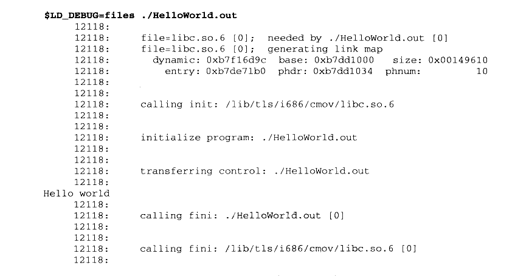

# 8.5 环境变量

LD\_LIBRARY\_PATH

Linux 系统提供了很多方法来改变动态链接器装载共享库路径的方法，通过使用这些方法，我们可以满足一些特殊的需求，比如共享库的调试和测试、应用程序级别的虚拟等。改变共享库查找路径最简单的方法是使用 LD\_LIBRARY\_PATH 环境变量，这个方法可以临时改变某个应用程序的共享库查找路径，而不会影响系统中的其他程序。在 Linux 系统中，LD\_LIBRARY\_PATH 是一个由若干个路径组成的环境变量，每个路径之间由冒号隔开。默认情况下，LD\_LIBRARY\_PATH 为空。如果我们为某个进程设置了LD\_LIBRARY\_PATH，那么进程在启动时，动态链接器在查找共享库时，会首先查找由LD\_LIBRARY\_PATH 指定的目录。这个环境变量可以很方便地让我们测试新的共享库或使用非标准的共享库。比如我们希望使用修改过的libc.so.6，可以将这个新版的libc 放到我们的目录/home/user 中，然后指定 LD\_LIBRARY\_PATH：


<details markdown="1"><summary>复制校对文字（未运行验证）</summary>

```text
$ LD_LIBRARY_PATH=/home/user /bin/ls
```

</details>

Linux 中还有一种方法可以实现与 LD\_LIBRARY\_PATH类似的功能，那就是直接运行动态链接器来启动程序，比如：

```sh
$ /lib/ld-linux.so.2 --library-path /home/user /bin/ls
```

就可以达到跟前面一样的效果。有了 LD\_LIBRARY\_PATH 之后，再来总结动态链接器查找共享库的顺序。动态链接器会按照下列顺序依次装载或查找共享对象（目标文件）：

- 由环境变量LD\_LIBRARY\_PATH 指定的路径。

- 由路径缓存文件/etc/ld.so.cache 指定的路径。

- 默认共享库目录，先/usr/lib，然后/lib。

LD\_LIBRARY\_PATH 对于共享库的开发和测试来说十分方便，但是它不应该被滥用。也就是说，普通用户在正常情况下不应该随意设置LD\_LIBRARY\_PATH 来调整共享库搜索目录。随意修改LD\_LIBRARY\_PATH并且将其导出至全局范围，将可能引起其他应用程序运行出现的问题；LD\_LIBRARY\_PATH也会影响GCC编译时查找库的路径，它里面包含的目录相当于链接时 GCC 的“-L”参数。

有一篇文章“Why LD\_LIBRARY\_PATH is bad”专门讨论为什么不要随意使用该环境变量：<http://xahlee.org/UnixResource_dir/_/ldpath.html>

#### LD_PRELOAD

系统中另外还有一个环境变量叫做LD\_PRELOAD，这个文件中我们可以指定预先装载的一些共享库甚或是目标文件。在LD\_PRELOAD 里面指定的文件会在动态链接器按照固定规则搜索共享库之前装载，它比 LD\_LIBRARY\_PATH里面所指定的目录中的共享库还要优先。无论程序是否依赖于它们，LD\_PRELOAD 里面指定的共享库或目标文件都会被装载。

由于全局符号介入这个机制的存在，LD\_PRELOAD里面指定的共享库或目标文件中的全局符号就会覆盖后面加载的同名全局符号，这使得我们可以很方便地做到改写标准C库中的某个或某几个函数而不影响其他函数，对于程序的调试或测试非常有用。与 LD\_LIBRARY\_PATH一样，正常情况下应该尽量避免使用 LD\_PRELOAD，比如一个发布版本的程序运行不应该依赖于 LD\_PRELOAD。

系统配置文件中有一个文件是/etc/ld.so.preload，它的作用与LD\_PRELOAD一样。这个文件里面记录的共享库或目标文件的效果跟 LD\_PRELOAD 里面指定的一样，也会被提前装载。

LD\_DEBUG

另外还有个非常有用的环境变量LD\_DEBUG，这个变量可以打开动态链接器的调试功能，当我们设置这个变量时，动态链接器会在运行时打印出各种有用的信息，对于我们开发和调试共享库有很大的帮助。比如我们可以将 LD\_DEBUG 设置成 “files”，并且运行一个简单动态链接的 HelloWorld：



<details markdown="1"><summary>复制校对文字（未运行验证）</summary>

```text
$ LD_DEBUG=files ./HelloWorld.out
     12118:
     12118: file=libc.so.6 [0]; needed by ./HelloWorld.out [0]
     12118: file=libc.so.6 [0]; generating link map
     12118:   dynamic: 0xb7f16d9c base: 0xb7dd1000 size: 0x00149610
     12118:     entry: 0xb7de71b0 phdr: 0xb7dd1034 phnum: 10
     12118:
     12118:
     12118: calling init: /lib/tls/i686/cmov/libc.so.6
     12118:
     12118:
     12118: initialize program: ./HelloWorld.out
     12118:
     12118:
     12118: transferring control: ./HelloWorld.out
     12118:
Hello world
     12118:
     12118: calling fini: ./HelloWorld.out [0]
     12118:
     12118:
     12118: calling fini: /lib/tls/i686/cmov/libc.so.6 [0]
     12118:
```

</details>

动态链接器打印出了整个装载过程，显示程序依赖于哪个共享库并且按照什么步骤装载和初始化，共享库装载时的地址等。LD\_DEBUG 还可以设置成其他值，比如：

- “bindings”显示动态链接的符号绑定过程。

- “libs”显示共享库的查找过程。

- “versions”显示符号的版本依赖关系。

- “reloc”显示重定位过程。

- “symbols”显示符号表查找过程。

- “statistics”显示动态链接过程中的各种统计信息。

- “all”显示以上所有信息。

- “help”显示上面的各种可选值的帮助信息。
