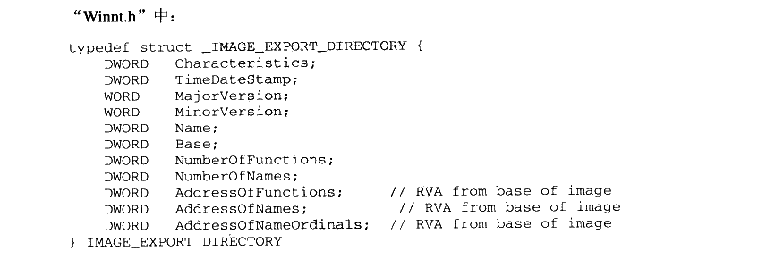
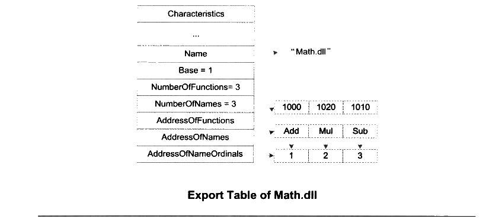
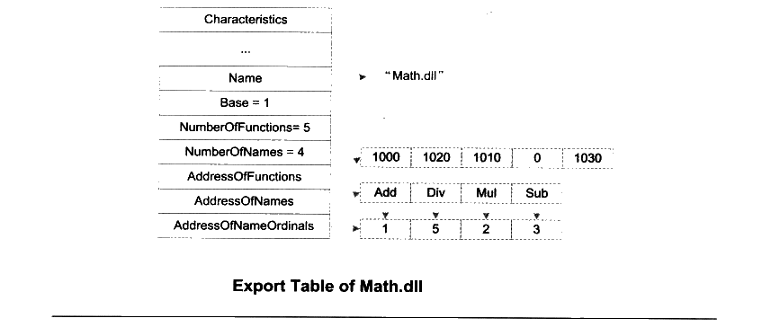
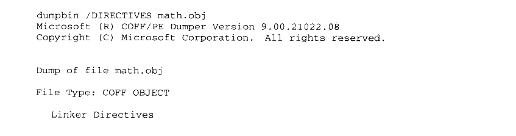
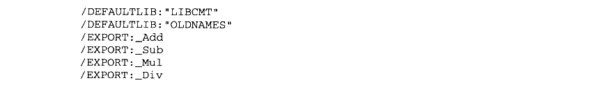
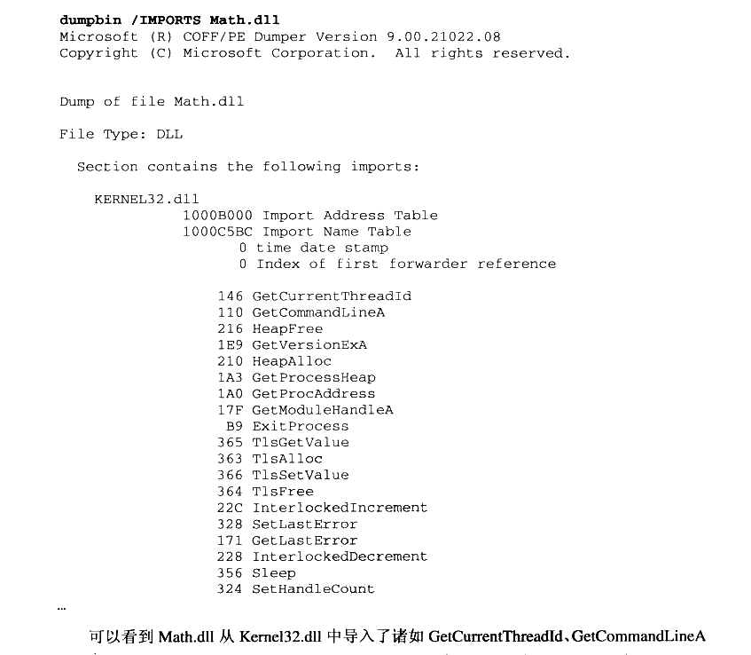
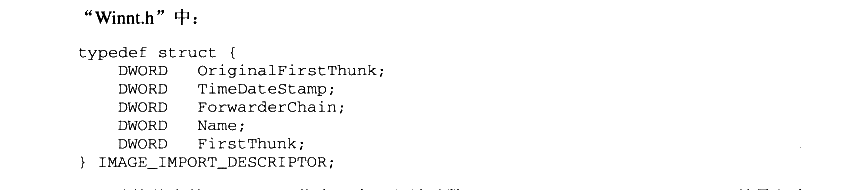
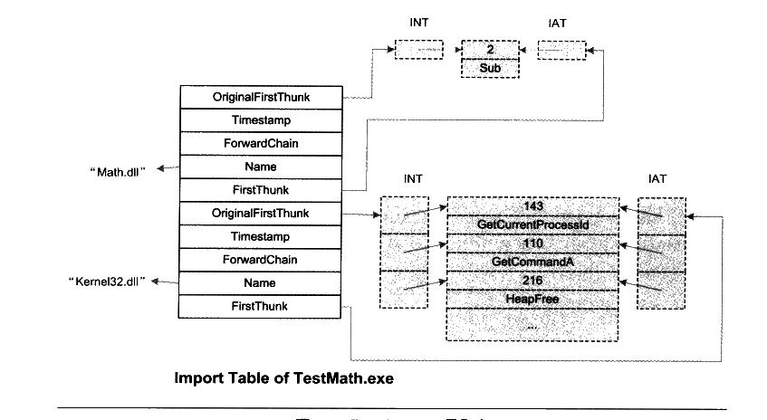
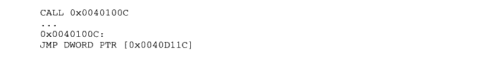

# 第 9 章 Windows 下的动态链接

## 9.1 DLL 简介

DLL 即动态链接库（Dynamic-Link Library）的缩写，它相当于 Linux 下的共享对象。Windows 系统中大量采用了这种 DLL 机制，甚至包括 Windows 的内核的结构都很大程度依赖于 DLL 机制。Windows 下的 DLL 文件和 EXE 文件实际上是一个概念，它们都是有 PE格式的二进制文件，稍微有些不同的是 PE 文件头部中有个符号位表示该文件是 EXE 或是DLL，而DLL 文件的扩展名不一定是.dll，也有可能是别的比如.ocx（OCX 控件）或是.CPL（控制面板程序）。

DLL 的设计目的与共享对象有些出入，DLL 更加强调模块化，即微软希望通过 DLL 机制加强软件的模块化设计，使得各种模块之间能够松散地组合、重用和升级。所以我们在Windows 平台上看到大量的大型软件都通过升级 DLL 的形式进行自我完善，微软经常将这些升级补丁积累到一定程度以后形成一个软件更新包（Service Packs）。比如我们常见的微软 Office 系列、Visual Studio 系列、Internet Explorer 甚至 Windows 本身也通过这种方式升级。

另外，我们知道 ELF 的动态链接可以实现运行时加载，使得各种功能模块能以插件的形式存在。在 Windows 下，也有类似 ELF 的运行时加载，这种技术在 Windows 下被应用得更加广泛，比如著名的 ActiveX 技术就是基于这种运行时加载机制实现的。

#### 9.1.1 进程地址空间和内存管理

在早期版本的 Windows 中（比如 Windows 1.X、2.x、3.x），也就是 16-bit 的 Windows系统中，所有的应用程序都共享一个地址空间，即进程不拥有自己独立的地址空间（或者在那个时候，这些程序的运行方式还不能被称作为进程）。如果某个 DLL 被加载到这个地址空间中，那么所有的程序都可以共享这个 DLL 并且随意访问。该 DLL 中的数据也是共享的，所以程序以此实现进程间通信。但是由于这种没有任何限制的访问权限，各个程序之间随意的访问很容易导致 DLL 中数据被损坏。

后来的Windows 改进了这个设计，也就是所谓的32位版本的 Windows 开始支持进程拥有独立的地址空间，一个 DLL 在不同的进程中拥有不同的私有数据副本，就像我们前面提到过的ELF共享对象一样。在 ELF 中，由于代码段是地址无关的，所以它可以实现多个进程之间共享一份代码，但是 DLL 的代码却并不是地址无关的，所以它只是在某些情况下可以被多个进程间共享。我们将在后面详细探讨 DLL 代码段的地址相关问题。

#### 9.1.2 基地址和 RVA

PE 里面有两个很常用的概念就是基地址（Base Address）和相对地址（RVA,Relative Virtual Address）。当一个 PE 文件被装载时，其进程地址空间中的起始地址就是基地址。对于任何一个 PE 文件来说，它都有一个优先装载的基地址，这个值就是PE 文件头中的 Image Base。

对于一个可执行EXE 文件来说，Image Base一般值是0x400000，对于DLL 文件来说，这个值一般是0x10000000。Windows 在装载 DLL 时，会先尝试把它装载到由 Image Base指定的虚拟地址：若该地址区域已被其他模块占用，那PE 装载器会选用其他空闲地址。而相对地址就是一个地址相对于基地址的偏移，比如一个 PE 文件被装载到 0x10000000，即基地址为0x10000000，那么 RVA 为0x1000 的地址为0x10001000。

#### 9.1.3 DLL 共享数据段

在Win32下，如果要实现进程间通信，当然有很多方法，Windows 系统提供了一系列 API可以实现进程间的通信。其中有一种方法是使用 DLL 来实现进程间通信，这个原理与16位Windows 中的 DLL实现进程间通信十分类似。正常情况下，每个 DLL 的数据段在各个进程中都是独立的，每个进程都拥有自己的副本。但是 Windows 允许将 DLL 的数据段设置成共享的，即任何进程都可以共享该DLL 的同一份数据段。当然很多时候比较常见的做法是将一些需要进程间共享的变量分离出来，放到另外一个数据段中，然后将这个数据段设置成进程间可共享的。也就是说一个 DLL 中有两个数据段，一个进程间共享，另外一个私有。

当然这种进程间共享方式也产生了一定的安全漏洞，因为任意一个进程都可以访问这个共享的数据段，那么只要破坏了该数据段的数据就会导致所有使用该数据段的进程出现问题。甚至恶意攻击者可以在GUEST 的权限下运行某个进程破坏该共享的数据，从而影响那些系统管理员权限的用户使用同一个 DLL 的进程。所以从这个角度讲，这种 DLL 共享数据段来实现进程间通信应该尽量避免。

#### 9.1.4 DLL 的简单例子

我们通过简单的例子来了解最简单的 DLL 的创建和使用，最基本的概念是导出（Export）的概念。在ELF 中，共享库中所有的全局函数和变量在默认情况下都可以被其他模块使用，也就是说ELF 默认导出所有的全局符号。但是在 DLL 中情况有所不同，我们需要显式地“告诉”编译器我们需要导出某个符号，否则编译器默认所有符号都不导出。当我们在程序中使用 DLL 导出的符号时，这个过程被称为导入（Import）。

Microsoft Visual C++（MSVC）编译器提供了一系列 C/C++的扩展来指定符号的导入导出，对于一些支持 Windows 平台的编译器比如 Intel C++、GCC Windows 版（mingw GCC，cygwin GCC）等都支持这种扩展。我们可以通过“\_\_declspec”属性关键字来修饰某个函数或者变量，当我们使用“\_\_declspec（dllexport）”时表示该符号是从本 DLL 导出的符号，“__declspec(dllimport)”表示该符号是从别的 DLL 导入的符号。在C++中，如果你希望导入或者导出的符号符合C语言的符号修饰规范，那么必须在这个符号的定义之前加上extern "C"，以防止C++编译器进行符号修饰。

除了使用“\_\_declspec”扩展关键字指定导入导出符号之外，我们也可以使用“def”文件来声明导入导出符号。“def”扩展名的文件是类似于ld 链接器的链接脚本文件，可以被当作 link 链接器的输入文件，用于控制链接过程。“def” 文件中的 IMPORTS 或者 EXPORTS段可以用来声明导入导出符号，这个方法不仅对C/C++有效，对其他语言也有效。

#### 9.1.5 创建 DLL

假设我们的一个 DLL 提供3个数学运算的函数，分别是加（Add）、减（Sub）、乘（Mul），它的源代码如下（Math.c）：


<details markdown="1"><summary>复制校对文字（未运行验证）</summary>

```text
__declspec(dllexport) double Add(double a, double b)
{
    return a + b;
}
__declspec(dllexport) double Sub(double a, double b)
{
    return a - b;
}
__declspec(dllexport) double Mul(double a, double b)
{
    return a * b;
}
```

</details>

代码很简单，就是传入两个双精度的值然后返回相应的计算结果（有人能告诉我为什么没有除法吗？不要着急，我们留着除法到后面用）。然后我们使用 MSVC的编译器 cl 进行编译：

```bat
cl /LDd Math.c
```

参数 /LDd 表示生成 Debug 版的DLL，不加任何参数则表示生产 EXE 可执行文件；我们可以使用 /LD 来编译生成 Release 版的 DLL。上面的编译结果生成了“Math.dll”、“Math.obj”、“Math.exp”和“Math.lib” 这4个文件。很明显“Math.dll”就是我们需要的 DLL文件，“Math.obj”是编译的目标文件，“Math.exp”和“Math.lib”将在后面作介绍。我们可以通过 dumpbin 工具看到 DLL 的导出符号：


<details markdown="1"><summary>复制校对文字（未运行验证）</summary>

```text
dumpbin /EXPORTS Math.dll
...
    ordinal hint RVA      name
          1    0 00001000 Add
          2    1 00001020 Mul
          3    2 00001010 Sub
...
```

</details>

很明显，我们可以看到DLL 有3个导出函数以及它们的相对地址。

#### 9.1.6 使用 DLL

程序使用 DLL 的过程其实是引用 DLL 中的导出函数和符号的过程，即导入过程。对于从其他 DLL 导入的符号，我们需要使用 “\_\_declspec（dllimport）”显式地声明某个符号为导入符号。这与 ELF 中的情况不一样，在ELF 中，当我们使用一个外部模块的符号的时候，我们不需要额外声明该变量是从其他共享对象导入的。

我们来看一个使用 Math.dll 的例子：


<details markdown="1"><summary>复制校对文字（未运行验证）</summary>

```text
/* TestMath.c */
#include <stdio.h>
__declspec(dllimport) double Sub(double a, double b);
int main(int argc, char **argv)
{
    double result = Sub(3.0, 2.0);
    printf("Result = %f\n", result);
    return 0;
}
```

</details>

在编译时，我们通过下面的命令行：


<details markdown="1"><summary>复制校对文字（未运行验证）</summary>

```text
cl /c TestMath.c
link TestMath.obj Math.lib
```

</details>

第一行使用编译器将 TestMath.c 编译成 TestMath.obj，然后使用链接器将 TestMath.obj和 Math.lib 链接在一起产生一个可执行文件 TestMath.exe。整个过程如图9-1所示。

在最终链接时，我们必须把与DLL一起产生的“Math.lib” 与“TestMath.obj” 链接起来，形成最终的可执行文件。在静态链接的时候，我们介绍过“lib”文件是一组目标文件的集合，在动态链接里面这一点仍然没有错，但是“Math.lib” 里面的目标文件是什么呢？“Math.lib”中并不真正包含“Math.c”的代码和数据，它用来描述“Math.dll” 的导出符号，它包含了 TestMath.obj 链接Math.dll 时所需要的导入符号以及一部分“桩”代码，又被称作“胶水”代码，以便于将程序与 DLL粘在一起。像“Math.lib”这样的文件又被称为导入库（Import Library），我们在后面介绍导入导出表的时候还会再详细分析。


<p class="image-caption">图9-1 MSVC静态库链接</p>

<details markdown="1"><summary>查看图中文字（按图分组）</summary>

Math.c → Math.dll、Math.exp、Math.lib；TestMath.c → TestMath.obj；Math.lib 与 TestMath.obj 链接形成 TestMath.exe。

</details>

#### 9.1.7 使用模块定义文件

声明 DLL 中的某个函数为导出函数的办法有两种，一种就是前面我们演示过的使用“\_\_declspec（dllexport）” 扩展：另外一种就是采用模块定义（.def）文件声明。实际上.def文件在MSVC链接过程中的作用与链接脚本文件（Link Script）文件在ld 链接过程中的作用类似，它是用于控制链接过程，为链接器提供有关链接程序的导出符号、属性以及其他信息。不过相比于ld的链接脚本文件，def 文件的语法要简单的多，而且功能也更少。

假设我们在前面例子的 Math.c 中将所有的“\_\_declspec（dllexport）” 去掉，然后创建一个Math.def 文件，以下面作为内容：


<details markdown="1"><summary>复制校对文字（未运行验证）</summary>

```text
LIBRARY Math
EXPORTS
Add
Sub
Mul
Div
```

</details>

然后使用下面的命令行来编译 Math.c：

```bat
cl Math.c /LD /DEF Math.def
```

这样编译器（更准确地讲是 link 链接器）就会使用 Math.def 文件中的描述产生最终输出文件。那么使用.def 文件来描述 DLL 文件的导出属性有什么好处呢？

首先，我们可以控制导出符号的符号名。很多时候，编译器会对源程序里面的符号进行修饰，比如 C++ 程序里面的符号经过编译器的修饰以后，都变得面目全非，这一点我们在本书的前面已经领教过了。除了 C++ 程序以外，C 语言的符号也有可能被修饰，比如 MSVC 支持几种函数的调用规范“__cdecl”、“__stdcall”、“__fastcall”（我们在本书的第 4 章还会详细介绍各种函数调用规范之间的区别），默认情况下 MSVC 把 C 语言的函数当作“__cdecl”类型，这种情况下它对该函数不进行任何符号修饰。但是一旦我们使用其他的函数调用规范时，MSVC 编译器就会对符号名进行修饰，比如使用“__stdcall”调用规范的函数 Add 就会被修饰成“_Add@16”，前面以“_”开头，后面以“@n”结尾，n 表示函数调用时参数所占堆栈空间的大小。使用 .def 文件可以将导出函数重新命名，比如当 Add 函数采用“__stdcall”时，我们可以使用如下的 .def 文件：


<details markdown="1"><summary>复制校对文字（未运行验证）</summary>

```text
LIBRARY Math
EXPORTS
Add=_Add@16
Sub
Mul
Div
```

</details>

当我们使用这个.def 文件来生成 Math.dll 时，可以看到：


<details markdown="1"><summary>复制校对文字（未运行验证）</summary>

```text
cl /LD /DEF Math.def Math.c
dumpbin /EXPORTS Math.dll
...
    ordinal hint RVA      name
          1    0 00001000 Add
          3    1 00001030 Div
          4    2 00001020 Mul
          5    3 00001010 Sub
          2    4 00001000 _Add@16
...
```

</details>

Add 作为一个与 _Add@16 等价的导出函数被放到了 Math.dll 的导出函数列表中，实际上有些类似于“别名”。当一个 DLL 被多个语言编写的模块使用时，采用这种方法导出一个函数往往会很有用。比如微软的 Visual Basic 采用的是“__stdcall”的函数调用规范，实际上“__stdcall”调用规范也是大多数 Windows 下的编程语言所支持的通用调用规范，那么作为一个能够被广泛使用的 DLL 最好采用“__stdcall”的函数调用规范。而 MSVC 默认采用的是“__cdecl”调用规范，否则它就会使用符号修饰，经过修饰的符号不便于维护和使用，于是采用 .def 文件对导出符号进行重命名就是一个很好的方案。我们经常看到 Windows 的 API 都采用“WINAPI”这种方式声明，而“WINAPI”实际上是一个被定义为“__stdcall”的宏。微软以 DLL 的形式提供 Windows 的 API，而每个 DLL 中的导出函数又以这种“__stdcall”的方式被声明。但是我们可以看到，Windows 的 API 中从来没有 _Add@16 这种古怪的命名方式，可见它也是采用了这种导出函数重命名的方法。

与 ld 的链接控制脚本类似，使用.def 文件的另外一个优势是它可以控制一些链接的过程。在微软提供的文档中，除了前面例子中用到的“LIBRARY”、“EXPORTS” 等关键字以外，还可以发现.def 支持一些诸如“HEAPSIZE”、“NAME”、“SECTIONS”、“STACKSIZE”、“VERSION”等关键字，通过这些关键字可以控制输出文件的默认堆大小、输出文件名、各个段的属性、默认堆栈大小、版本号等。具体请参照 MSDN 中关于.def 文件的介绍，我们这里就不详细展开了。

#### 9.1.8 DLL 显式运行时链接

与ELF 类似，DLL 也支持运行时链接，即运行时加载。Windows 提供了3个 API为：

LoadLibrary（或者 LoadLibraryEx），这个函数用来装载一个 DLL 到进程的地址空间，它的功能跟 dlopen 类似。

GetProcAddress，用来查找某个符号的地址，与dlsym 类似。

- FreeLibrary，用来卸载某个已加载的模块，与dlclose 类似。

我们来看看 Windows 下的显式运行时链接的例子：


<details markdown="1"><summary>复制校对文字（未运行验证）</summary>

```text
#include <windows.h>
#include <stdio.h>
typedef double (*Func)(double, double);
int main(int argc, char **argv)
{
    Func function;
    double result;
    // Load DLL
    HINSTANCE hinstLib = LoadLibrary("Math.dll");
    if (hinstLib == NULL) {
        printf("ERROR: unable to load DLL\n");
        return 1;
    }
    // Get function address
    function = (Func)GetProcAddress(hinstLib, "Add");
    if (function == NULL) {
        printf("ERROR: unable to find DLL function\n");
        FreeLibrary(hinstLib);
        return 1;
    }
    // Call function.
    result = function(1.0, 2.0);
```

</details>


<details markdown="1"><summary>复制校对文字（未运行验证）</summary>

```text
// Unload DLL file
    FreeLibrary(hinstLib);
    // Display result
    printf("Result = %f\n", result);
    return 0;
}
```

</details>


## 9.2 符号导出导入表

#### 9.2.1 导出表

当一个 PE 需要将一些函数或变量提供给其他PE 文件使用时，我们把这种行为叫做符号导出（Symbol Exporting），最典型的情况就是一个 DLL 将符号导出给 EXE 文件使用。在前面介绍 ELF 动态连接时，我们已经接触过了符号导出的概念，ELF 将导出的符号保存在“.dynsym”段中，供动态链接器查找和使用。在Windows PE 中，符号导出的概念也是类似，所有导出的符号被集中存放在了被称作导出表（Export Table）的结构中。事实上导出表从最简单的结构上来看，它提供了一个符号名与符号地址的映射关系，即可以通过某个符号查找相应的地址。基本上这些每个符号都是个 ASCII 字符串，我们知道符号名可能跟相应的函数名或者变量名相同，也可能不同，因为有符号修饰这个机制存在。

很多时候，在讨论到PE 的导入导出时，经常把函数和符号混淆在一起，因为PE 在绝大部分时候只导入导出函数，而很少导入导出变量，所以类似于导出符号和导出函数这种叫法很多时候可以相互替换使用。

我们在前面介绍过，PE 文件头中有一个叫做 DataDirectory 的结构数组，这个数组共有16 个元素，每个元素中保存的是一个地址和一个长度。其中第一个元素就是导出表的结构的地址和长度。导出表是一个 IMAGE\_EXPORT\_DIRECTORY 的结构体，它被定义在 Winnt.h 中：



<details markdown="1"><summary>复制校对文字（未运行验证）</summary>

```text
typedef struct _IMAGE_EXPORT_DIRECTORY {
    DWORD Characteristics;
    DWORD TimeDateStamp;
    WORD MajorVersion;
    WORD MinorVersion;
    DWORD Name;
    DWORD Base;
    DWORD NumberOfFunctions;
    DWORD NumberOfNames;
    DWORD AddressOfFunctions;     // RVA from base of image
    DWORD AddressOfNames;         // RVA from base of image
    DWORD AddressOfNameOrdinals;  // RVA from base of image
} IMAGE_EXPORT_DIRECTORY
```

</details>

导出表结构中，最后的3个成员指向的是3个数组，这3个数组是导出表中最重要的结构，它们是导出地址表（EAT, Export Address Table）、符号名表（Name Table）和名字序号对应表（Name-Ordinal Table）。对于“Math.dll ”来说，这个导出表的结构将会如图9-2所示。



<p class="image-caption">图 9-2 Math.dll 导出表结构</p>

<details markdown="1"><summary>查看图中文字（按图分组）</summary>

Export Table of Math.dll：Name → "Math.dll"；Base = 1；NumberOfFunctions = 3；NumberOfNames = 3。AddressOfFunctions → 1000、1020、1010；AddressOfNames → Add、Mul、Sub；AddressOfNameOrdinals → 1、2、3。

</details>

这3个数组中，前两个比较好理解。第一个叫做导出地址表EAT，它存放的是各个导出函数的 RVA，比如第一项是0x1000，它是 Add函数的RVA：第二个表是函数名表，它保存的是导出函数的名字，这个表中，所有的函数名是按照 ASCII 顺序排序的，以便于动态链接器在查找函数名字时可以速度更快（可以使用二分法查找），那么函数名表和EAT之间有什么关系呢？是不是一一对应呢？在上面的例子中似乎是这样的，比如 Add 对应0x1000，Mul 对应0x1020，Sub 对应0x1010，这样看起来很简单，但实际上并非如此，因为还有一个叫做序号的概念夹在这两个表之间；第三个名字序号对应表就有点另类了，导出一个函数除了函数名和函数地址不就够了吗？为什么要有序号？什么是序号？

序号（Ordinals）

这还得从很早以前说起，早期的 Windows 是16位的，当时的16位 Windows 没有很好的虚拟内存机制，而且当时的硬件条件也不好，内存一般只有几个MB。而函数名表对于当时的 Windows 来说，其实是很奢侈的。比如一个 user.dll 有600多个导出函数，如果把这些函数的函数名表全部放在内存中的话，将会消耗几十 KB 的空间。除了 user.dll 之外，程序还会用到其他 DLL，对于内存空间以 KB 计的年代来说，这是不可以容忍的。于是当时 DLL的函数导出的主要方式是序号（Ordinals）。其实序号的概念很简单，一个导出函数的序号就是函数在 EAT 中的地址下标加上一个 Base 值（也就是 IMAGE\_EXPORT\_DIRECTORY 中的Base，默认情况下它的值是1）。比如上面的例子中，Mul 的RVA 为0x1020，它在 EAT中的下标是1，加上一个 Base 值1，Mul 的导出序号为2。如果一个模块A 导入了Math.dll中的Add，那么它在导入表中将不保存“Add”这个函数名，而是保存Add函数的序号，即1。当动态链接器进行链接时，它只需要根据模块 A 的导入表中保存的序号1，减去 Math.dll的Base 值，得到下标0，然后就可以直接在 Math.dll 的EAT 中找到 Add 函数的 RVA。

使用序号导入导出的好处是明显的，那就是省去了函数名查找过程，函数名表也不需要保存在内存中了。那么使用序号导入导出的问题是什么？最大的问题是，一个函数的序号可能会变化。假设某一次更新中，Math.dll 里面添加了一个函数或者删除了一个函数，那么原先函数的序号可能会因此发生变化，从而导致已有的应用程序运行出现问题。一种解决的方案是，由程序员手工指定每个导出函数的序号，比如我们指定 Add 的导出序号为1，Mul为2，Sub 为3，以后加入函数则指定一个与其他函数不同的唯一的序号，如果删除一个函数，那么保持现有函数的序号不变。这种手工指定函数导出序号的方法可以通过链接器的.def文件实现，我们在后面关于 DLL 优化的章节中还会再详细介绍。

由程序员手工维护导出序号的方法在实际操作中颇为麻烦，为了节省那么一点点内存空间和并不明显的查找速度的提升（相对于现在的硬件条件），实在得不偿失。于是现在的DLL基本都不采用序号作为导入导出的手段，而是直接使用符号名。这种手段就显得直观多了，更加便于理解和程序调试（试想在调试 DLL 时看到一个导入函数是序号1 或者是 Add 哪个更容易理解？），而且它不需要额外的手工维护，省去了很多繁琐的工作。

虽然现在的DLL 导出方式基本都是使用符号名，但是实际上序号的导出方式仍然没有被抛弃。为了保持向后兼容性，序号导出方式仍然被保留，相反，符号名作为导出方式是可选的。一个 DLL 中的每一个导出函数都有一个对应唯一的序号值，而导出函数名却是可选的，也就是说一个导出函数肯定有一个序号值（序号值是肯定有的，因为函数在 EAT 的下标加上Base 就是序号值），但是可以没有函数名。

了解了序号的概念之后，我们又回到了原来的那个问题，函数名和函数地址之间的关系是怎样的呢？符号名表和 EAT 的元素之间的映射关系又是怎样的？

上面问题的答案必须通过第三个表，即名字序号对应表。这个表拥有与函数名表一样多数目的元素，每个元素就是对应的函数名表中的函数名所对应的序号值，比如 Add 的序号值是1，Mul 的序号值是2等。实际上它就是一个函数名与序号的对应关系表。

那么使用函数名作为导入导出方式，动态链接器如何查找函数的RVA呢？假设模块A导入了 Math.dll 中的Add函数，那么A 的导入表中就保存了“Add”这个函数名。当进行动态链接时，动态链接器在 Math.dll 的函数名表中进行二分查找，找到“Add”函数，然后在名字序号对应表中找到“Add”所对应的序号，即1，减去 Math.dll 的Base 值1，结果为0，然后在 EAT 中找到下标0的元素，即“Add”的RVA为0x1000。从上面的Math.dll 来看，3个表的结构都非常规则，元素数目相等，而且是一一对应的。但实际上这3个表的内容有可能变得不是很规则：假设我们在 Math.dll 中添加了一个函数叫做 Div，它的RVA 为0x1030，并且将它的序号值指定为5。为了保持原来的几个导出函数的序号值不变，我们手工指定原来的3个导出函数的序号值分别为 Add = 1,Mul=2,Sub =3。那么Math.dll 的3个表的内容将如图9-3所示。



<p class="image-caption">图9-3 Math.dl 导出表结构（带序号）</p>

<details markdown="1"><summary>查看图中文字（按图分组）</summary>

Export Table of Math.dll：Name → "Math.dll"；Base = 1；NumberOfFunctions = 5；NumberOfNames = 4。AddressOfFunctions → 1000、1020、1010、0、1030；AddressOfNames → Add、Div、Mul、Sub；AddressOfNameOrdinals → 1、5、2、3。

</details>

对于链接器来说，它在链接输出 DLL 时需要知道哪些函数和变量是要被导出的，因为对于 PE 来说，默认情况下，全局函数和变量是不导出的。link 链接器提供了一个“/EXPORT”的参数可以指定导出符号，比如：

link math.obj /DLL /EXPORT:\_Add

就表示在产生 math.dll 时导出符号\_Add。另外一种导出符号的方法是使用MSVC 的\_\_declspec（dllexport）扩展，它实际上是通过目标文件的编译器指示来实现的（还记得前面关于 PE/COFF 目标文件的“.drectve”段的描述吗？）。对于前面例子中的 math.obj 来说，它实际上在“.drectve”段中保存了 4个“/EXPORT”参数，用于传递给链接器，告知链接器导出相应的函数：



<details markdown="1"><summary>复制校对文字（未运行验证）</summary>

```text
dumpbin /DIRECTIVES math.obj
Microsoft (R) COFF/PE Dumper Version 9.00.21022.08
Copyright (C) Microsoft Corporation. All rights reserved.

Dump of file math.obj
File Type: COFF OBJECT

   Linker Directives
```

</details>



<details markdown="1"><summary>复制校对文字（未运行验证）</summary>

```text
/DEFAULTLIB:"LIBCMT"
/DEFAULTLIB:"OLDNAMES"
/EXPORT:_Add
/EXPORT:_Sub
/EXPORT:_Mul
/EXPORT:_Div
```

</details>

#### 9.2.2 EXP 文件

在创建 DLL 的同时也会得到一个 EXP 文件，这个文件实际上是链接器在创建 DLL 时的临时文件。链接器在创建 DLL 时与静态链接时一样采用两遍扫描过程，DLL 一般都有导出符号，链接器在第一遍时会遍历所有的目标文件并且收集所有导出符号信息并且创建DLL 的导出表。为了方便起见，链接器把这个导出表放到一个临时的目标文件叫做“edata”的段中，这个目标文件就是EXP 文件，EXP文件实际上是一个标准的PE/COFF 目标文件，只不过它的扩展名不是.obj 而是.exp。在第二遍时，链接器就把这个 EXP 文件当作普通目标文件一样，与其他输入的目标文件链接在一起并且输出 DLL。这时候EXP 文件中的“.edata”段也就会被输出到 DLL 文件中并且成为导出表。不过一般现在链接器很少会在 DLL 中单独保留“edata” 段，而是把它合并到只读数据段“rdata” 中。

#### 9.2.3 导出重定向

DLL 有一个很有意思的机制叫做导出重定向（Export Forwarding），顾名思义就是将某个导出符号重定向到另外一个 DLL。比如在 Windows XP 系统中，KERNEL32.DLL 中的HeapAlloc 函数被重新定向到了 NTDLL.DLL 中的 RtlAllocHeap 函数，调用 HeapAlloc 函数相当于调用 RtlAllocHeap 函数。如果我们要重新定向某个函数，可以使用模块定义文件，比如 HeapAlloc 的重定向可以定义下面这样一个“.DEF”文件：


<details markdown="1"><summary>复制校对文字（未运行验证）</summary>

```text
EXPORTS

HeapAlloc = NTDLL.RtlAllocHeap
```

</details>

导出重定向的实现机制也很简单，正常情况下，导出表的地址数组中包含的是函数的RVA，但是如果这个 RVA 指向的位置位于导出表中（我们可以得到导出表的起始 RVA 和大小），那么表示这个符号被重定向了。被重定向了的符号的 RVA 并不代表该函数的地址，而是指向一个 ASCII 的字符串，这个字符串在导出表中，它是符号重定向后的 DLL 文件名和符号名。比如在这个例子中，这个字符串就是“NTDLL.RtlAllocHeap”。

#### 9.2.4 导入表

如果我们在某个程序中使用到了来自 DLL 的函数或者变量，那么我们就把这种行为叫做符号导入（Symbol Importing）。在ELF 中，“.rel.dyn”和“.rel.plt” 两个段中分别保存了该模块所需要导入的变量和函数的符号以及所在的模块等信息，而“.got”和“.got.plt”则保存着这些变量和函数的真正地址。Windows 中也有类似的机制，它的名称更为直接，叫做导入表（Import Table）。当某个 PE 文件被加载时，Windows 加载器的其中一个任务就是将所有需要导入的函数地址确定并且将导入表中的元素调整到正确的地址，以实现动态链接的过程。

我们可以使用 dumpbin 来查看一个模块依赖于哪些 DLL，又导入了哪些函数：



<details markdown="1"><summary>复制校对文字（未运行验证）</summary>

```text
dumpbin /IMPORTS Math.dll
Microsoft (R) COFF/PE Dumper Version 9.00.21022.08
Copyright (C) Microsoft Corporation. All rights reserved.

Dump of file Math.dll
File Type: DLL
  Section contains the following imports:
    KERNEL32.dll
              1000B000 Import Address Table
              1000C5BC Import Name Table
                     0 time date stamp
                     0 Index of first forwarder reference

                   146 GetCurrentThreadId
                   110 GetCommandLineA
                   216 HeapFree
                   1E9 GetVersionExA
                   210 HeapAlloc
                   1A3 GetProcessHeap
                   1A0 GetProcAddress
                   17F GetModuleHandleA
                    B9 ExitProcess
                   365 TlsGetValue
                   363 TlsAlloc
                   366 TlsSetValue
                   364 TlsFree
                   22C InterlockedIncrement
                   328 SetLastError
                   171 GetLastError
                   228 InterlockedDecrement
                   356 Sleep
                   324 SetHandleCount
...
```

</details>

可以看到 Math.dll 从 Kernel32.dll 中导入了诸如 GetCurrentThreadId、GetCommandLineA 等函数（大约有数十个，这里省略了一部分）。可能你会觉得很奇怪，明明我们在Math.c 里面没有用到这些函数，怎么会出现在导入列表之中？这是由于我们在构建 Windows DLL 时，还链接了支持 DLL运行的基本运行库，这个基本运行库需要用到 Kernel32.dll，所以就有了这些导入函数。

在 Windows 中，系统的装载器会确保任何一个模块的依赖条件都得到满足，即每个 PE文件所依赖的文件都将被装载。比如一般 Windows 程序都会依赖于 KERNEL32.DLL，而KERNEL32.DLL 又会导入 NTDLL.DLL，即依赖于 NTDLL.DLL，那么 Windows 在加载该程序时确保这两个 DLL 都被加载。如果程序用到了 Windows GDI，那么就会需要从GDI32.DLL 中导入函数，而 GDI32.DLL 又依赖于 USER32.DLL、ADVAPI32.DLL、NTDLL.DLL 和 KERNEL32.DLL,Windows 将会保证这些依赖关系的正确，并且保证所有的导入符号都被正确地解析。在这个动态链接过程中，如果某个被依赖的模块无法正确加载，那么系统将会提示错误（我们经常会看到那种“缺少某个 DLL”之类的错误），并且终止运行该进程。

在PE 文件中，导入表是一个 IMAGE\_IMPORT\_DESCRIPTOR 的结构体数组，每一个IMAGE\_IMPORT\_DESCRIPTOR 结构对应一个被导入的 DLL。这个结构体被定义在 Winnt.h 中：



<details markdown="1"><summary>复制校对文字（未运行验证）</summary>

```text
typedef struct {
    DWORD OriginalFirstThunk;
    DWORD TimeDateStamp;
    DWORD ForwarderChain;
    DWORD Name;
    DWORD FirstThunk;
} IMAGE_IMPORT_DESCRIPTOR;
```

</details>

结构体中的 FirstThunk 指向一个导入地址数组 （Import Address Table），IAT 是导入表中最重要的结构，IAT 中每个元素对应一个被导入的符号，元素的值在不同的情况下有不同的含义。在动态链接器刚完成映射还没有开始重定位和符号解析时，IAT 中的元素值表示相对应的导入符号的序号或者是符号名；当Windows 的动态链接器在完成该模块的链接时，元素值会被动态链接器改写成该符号的真正地址，从这一点看，导入地址数组与 ELF 中的GOT非常类似。

那么我们如何判断导入地址数组的元素中包含的是导入符号的序号还是符号的名字？事实上我们可以看这个元素的最高位，对于32位的PE 来说，如果最高位被置1，那么低31 位值就是导入符号的序号值；如果没有，那么元素的值是指向一个叫做IMAGE\_IMPORT\_BY\_NAME 结构的 RVA。IMAGE\_IMPORT\_BY\_NAME 是由一个 WORD和一个字符串组成，那个WORD 值表示“Hint”值，即导入符号最有可能的序号值，后面的字符串是符号名。当使用符号名导入时，动态链接器会先使用“Hint” 值的提示去定位该符号在目标导出表中的位置，如果刚好是所需要的符号，那么就命中；如果没有命中，那么就按照正常的二分查找方式进行符号查找。

在 IMAGE\_IMPORT\_DESCRIPTOR 结构中，还有一个指针 OriginalFirstThunk 指向一个数组叫做导入名称表（Import Name Table），简称INT。这个数组跟IAT一模一样，里面的数值也一样。那么为什么要多保存一份IAT的副本呢？答案我们将在后面的 DLL 绑定中揭晓（见图9-4）。



<p class="image-caption">图 9-4 TestMath.exe 导入表</p>

<details markdown="1"><summary>查看图中文字（按图分组）</summary>

Import Table of TestMath.exe：Math.dll 与 Kernel32.dll 分别对应一个导入描述符，包含 OriginalFirstThunk、Timestamp、ForwardChain、Name、FirstThunk。OriginalFirstThunk 指向 INT，FirstThunk 指向 IAT。Math.dll 的导入项为 Sub（2）；Kernel32.dll 中列出 GetCurrentProcessId（143）、GetCommandA（110）、HeapFree（216）等。

</details>

Windows 的动态链接器会在装载一个模块的时候，改写导入表中的IAT，这一点很像ELF 中的.got。其区别是，PE 的导入表一般是只读的，它往往位于“.rdata”这样的段中。这样就产生了一个问题，对于一个只读的段，动态链接器是怎么改写它的呢？解决方法是这样的，对于 Windows 来说，由于它的动态链接器其实是 Windows 内核的一部分，所以它可以随心所欲地修改PE装载以后的任意一部分内容，包括内容和它的页面属性。Windows 的做法是，在装载时，将导入表所在的位置的页面改成可读写的，一旦导入表的IAT 被改写完毕，再将这些页面设回至只读属性。从某些角度来看，PE 的做法比ELF 要更加安全一些，因为 ELF 允许程序随意修改.got，而 PE 则不允许。

延迟载入（Delayed Load）

Visual C++ 6.0开始引入了一个叫做延迟载入的新功能，这个功能有点类似于隐式装载和显式装载的混合体。当你链接一个支持延迟载入的 DLL 时，链接器会产生与普通 DLL 导入非常类似的数据。但是操作系统会忽略这些数据。当延迟载入的 API 第一次被调用时，由链接器添加的特殊的桩代码就会启动，这个桩代码负责对 DLL 的装载工作。然后这个桩代码通过调用 GetProcAddress 来找到被调用 API 的地址。另外 MSVC 还做了一些额外的优化，使得接下来的对该 DLL 的调用速度与普通方式载入的DLL 的速度相差无异。

#### 9.2.5 导入函数的调用

接下来我们来看看 Windows PE 对于导入函数是怎么调用的？\_\_declspec(dllimport)又有什么作用？

如果在 PE 的模块中需要调用一个导入函数，仿照 ELF GOT 机制的一个办法就是使用一个间接调用指令，比如：

`CALL DWORD PTR [0x0040D11C]`

我们在Windows 下也入乡随俗，使用微软汇编器语法。如果你不熟悉微软汇编器语法也没多大关系，上面这条指令的意思是间接调用 0x0040D11C这个地址中保存的地址，即从地址0x0040D11C 开始取4个字节作为目标地址（DWORD PTR 表示4个字节的操作前缀），然后调用该目标地址。而0x0040D11C这个地址刚好是IAT 中的某一项，即我们需要调用的外部函数在 IAT 中所对应的元素，比如 TestMath.exe 中，我们需要调用Math.dll 中的Sub 函数，那么 0x0040D11C 正好对应 Sub 导入函数在 TestMath.exe 的IAT 中的位置。这个过程跟ELF通过GOT 间接跳转十分类似，IAT 相当于 GOT（不考虑 PLT 的情况下）。

PE DLL 的地址无关性

如果 ELF 调用者本身所在的模块是地址无关的，那么通过 GOT 跳转之前，需要计算目标函数地址在GOT 中的位置，然后再间接跳转，以实现地址无关，这个原理我们在前面已经很详细地分析过了。但是在这个实现方法中，我们可以看到，这个0x0040D11C 是作为常量被写入在指令中。而且事实上，PE对导入函数调用的真正实现中，它的确是这么做的，由此我们可以得出结论，PE DLL 的代码段并不是地址无关的。

那么 PE 是如何解决装载时模块在进程空间中地址冲突的问题的呢？事实上它使用了一种叫做重定基地址的方法，我们在后面将会详细介绍。

PE 采用上面的这个方法实现导入函数的调用，但是与 ELF一样存在一个问题：对于编译器来说，它无法判断一个函数是本模块内部的，还是从外部导入的。因为对于普通的模块内部函数调用来说，编译器产生的指令是这样的：

CALL XXXXXXXX

因为PE 没有类似 ELF 的共享对象有全局符号介入的问题，所以对于模块内部的全局函数调用，编译器产生的都是直接调用指令。

其中XXXXXXXX是模块内部的函数地址。这是一个直接调用指令，与上面的间接调用指令形式不同。所以为了使得编译器能够区分函数是从外部导入的还是模块内部定义的，MSVC 引入了我们前面用过的扩展属性“\_\_declspec（dllimport）”，一旦一个函数被声明为“\_\_declspec（dllimport）”，那么编译器就知道它是外部导入的，以便于产生相应的指令形式。

在“__declspec”关键字引入之前，微软还提供了另外一个方法来解决这个问题。在这种情况下，对于导入函数的调用，编译器并不区分导入函数和导出函数，它统一地产生直接调用的指令。但是链接器在链接时会将导入函数的目标地址导向一小段桩代码（Stub），由这个桩代码再将控制权交给IAT 中的真正目标地址，实现如下：



<details markdown="1"><summary>复制校对文字（未运行验证）</summary>

```text
CALL 0x0040100C
...
0x0040100C:
JMP DWORD PTR [0x0040D11C]
```

</details>

即对于调用函数来说，它只是产生一般形式的指令“CALL XXXXXXXX”，然后在链接时，链接器把这个 XXXXXXXX地址重定位到一段桩代码，即那条JMP 指令处，然后这条JMP 指令才通过IAT 间接跳转到导入函数。我们知道，链接器一般情况下是不会产生指令的，那么这段包含JMP 指令的桩代码来自何处呢？答案是来自产生DLL 文件时伴随的那个 LIB 文件，即导入库。

编译器在产生导入库时，同一个导出函数会产生两个符号的定义，比如对于函数 foo来说，它在导入库中有两个符号，一个是foo，另外一个是\_imp\_foo。这两个符号的区别是，foo 这个符号指向 foo 函数的桩代码，而\_imp\_foo 指向foo 函数在IAT 中的位置。所以当我们通过“\_\_declspec（dllimport）”来声明foo导入函数时，编译器在编译时会在该导入函数前加上前缀“\_imp\_\_”，以确保跟导入库中的“\_imp\_\_foo”能够正确链接：如果不使用“\_\_declspec（dllimport）”，那么编译器将产生一个正常的foo符号引用，以便于跟导入库中的foo符号定义相链接。

现在的 MSVC 编译器对于以上两种导入方式都支持，即程序员可以通过“\_\_declspec（dllimport）”来声明导入函数，也可以不使用。但我们还是推荐使用\_\_declspec（dllimport）”，毕竟从性能上来讲，它比不使用该声明少了一条跳转指令。当然它还有其他的好处，我们到后面用到时还会提起。


## 9.3 DLL 优化

我们在前面经过对 DLL 的分析得知，DLL 的代码段和数据段本身并不是地址无关的，也就是说它默认需要被装载到由 ImageBase 指定的目标地址中。如果目标地址被占用，那么就需要装载到其他地址，便会引起整个 DLL 的 Rebase。这对于拥有大量 DLL 的程序来说，频繁的 Rebase也会造成程序启动速度减慢。这是影响 DLL 性能的另外一个原因。

我们知道动态链接过程中，导入函数的符号在运行时需要被逐个解析。在这个解析过程中，免不了会涉及到符号字符串的比较和查找过程，这个查找过程中，动态链接器会在目标DLL 的导出表中进行符号字符串的二分查找。即使是使用了二分查找法，对于拥有DLL 数量很多，并且有大量导入导出符号的程序来说，这个过程仍然是非常耗时的。这是影响 DLL性能的一个原因之一。

这两个原因可能会导致应用程序的速度非常慢，因为系统需要在启动程序时进行大量的符号解析和 Rebase 工作。

#### 9.3.1 重定基地址

从前面 DLL 的导入函数的实现，我们得出结论：PE的 DLL 中的代码段并不是地址无关的，也就是说它在被装载时有一个固定的目标地址，这个地址也就是PE 里面所谓的基地址（Base Address）。默认情况下，PE 文件将被装载到这个基地址。一般来说，EXE 文件的基地址默认为 0x00400000，而DLL 文件基地址默认为0x10000000。

我们前面花了很多篇幅讨论了为什么对于一个 ELF 共享对象，它的代码段要做到地址无关，并且讨论了地址无关的实现。这一点对于 DLL 来说也一样，一个进程中，多个 DLL不可以被装载到同一个虚拟地址，每个 DLL 所占用的虚拟地址区域之间都不可以重叠。

在讨论共享对象的地址冲突问题时，我们已经介绍过了，有3种方案可供选择。一个办法是像静态共享对象那样，为每个 DLL 指定一个基地址，并且人为保证同一个进程中这些DLL 的地址区域都不相互重叠，但是这样做会有很多问题，在前面介绍静态共享对象的时候已经讨论过，这种将模块目标地址固定的做法有很多弊端。另外一个办法就是 ELF 所采用的办法，那就是代码段地址无关。

Windows PE 采用了一种与 ELF 不同的办法，它采用的是装载时重定位的方法。在DLL模块装载时，如果目标地址被占用，那么操作系统就会为它分配一块新的空间，并且将 DLL装载到该地址。这时候问题来了，因为 DLL 的代码段不是地址无关的，DLL 中所有涉及到绝对地址的引用该怎么办呢？答案是对于每个绝对地址引用都进行重定位。

当然，这个重定位过程有些特殊，因为所有这些需要重定位的地方只需要加上一个固定的差值，也就是说加上一个目标装载地址与实际装载地址的差值。我们来看一个例子，比如有一个DLL 的基地址是0x10000000，那么如果它的代码中有这样一条指令：

`MOV DWORD PTR [0x10001000], 0x100`

我们假设0x10001000 是该模块中一个变量foo 的地址，即该变量的 RVA 是0x1000。如果 DLL 在装载时，0x10000000 这个地址被其他 DLL 占用了，Windows 就会将它加载到一个新的地址，假设是 0x20000000。因为0x10001000 是个绝对地址，所以我们需要对这条指令进行重定位。这时候新的基地址是0x20000000，而RVA 是不变的，所以 foo 的地址实际上已经变成了0x20001000，也就是指令的地址部分要加上0x20000000-0x10000000 的这个差值。经过调整后的指令应该是：

`MOV DWORD PTR [0x20001000], 0x100`

事实上，由于 DLL 内部的地址都是基于基地址的，或者是相对于基地址的RVA。那么所有需要重定位的地方都只需要加上一个固定差值，在这个例子里面是 0x10000000。所以这个重定位的过程相对简单一点，速度也要比一般的重定位要快。PE 里面把这种特殊的重定位过程又被叫做重定基地址（Rebasing）。

PE 文件的重定位信息都放在了“.reloc”段，我们可以从PE 文件头中的 DataDirectory 里面得到重定位段的信息。重定位段的结构跟 ELF 中的重定位段结构十分类似，在这里就不再详细介绍了。对于EXE文件来说，MSVC编译器默认不会产生重定位段，也就是默认情况下，EXE 是不可以重定位的，不过这也没有问题，因为EXE 文件是进程运行时第一个装入到虚拟空间的，所以它的地址不会被人抢占。而 DLL 则没那么幸运了，它们被装载的时间是不确定的，所以一般情况下，编译器都会给 DLL 文件产生重定位信息。当然你也可以使用“/FIXED”参数来禁止 DLL 产生重定位信息，不过那样可能会造成 DLL 的装载失败。

这种重定基地址的方法导致的一个问题是，如果一个 DLL 被多个进程共享，且该DLL被这些进程装载到不同的位置，那么每个进程都需要有一份单独的 DLL 代码段的副本。很明显，这种方案相对于 ELF 的共享对象代码段地址无关的方案来说，它更加浪费内存，而且当被重定基址的代码段需要被换出时，它需要被写到交换空间中，而不像没有重定基址的DLL 代码段，只需要释放物理页面，再次用到时可以直接从 DLL 文件里面重新读取代码段即可。但是有一个好处是，它比ELF 的PIC 机制有着更快的运行速度。因为PE 的DLL对数据段的访问不需要通过类似于 GOT 的机制，对于外部数据和函数的引用不需要每次都计算GOT 的位置，所以理论上会比 ELF的PIC 的方案快一些。这又是一个空间换时间的案例。

改变默认基地址

前面的重定基地址过程实际上是在 DLL 文件装载时进行的，所以又叫做装载时重定位。对于一个程序来说，它所用到的 DLL 基本是固定的（除了通过 LoadLibrary()装载的以外）。程序每次运行时，这些 DLL 的装载顺序和地址也是一样的。比如一个程序由程序主模块main.exe、foo.dll 和bar.dll 3个模块组成，它们的大小都是64 KB。于是当程序运行起来以后进程虚拟地址空间的布局应该如表9-1所示。表9-1


<details markdown="1"><summary>查看校对表格</summary>

| 模块 | 起始地址 | 结束地址 |
| --- | --- | --- |
| main.exe | 0x00400000 | 0x00410000 |
| foo.dll | 0x10000000 | 0x10010000 |
| bar.dll | 0x10010000 | 0x10020000 |

</details>

可以看到 bar.dll 原先默认的基地址是 0x10000000，但是它被重定基址到了 0x10010000，因为0x10000000 到 0x10010000 这块地址被先前加载的 foo.dll 占用了（假设 foo.dll 比 bar.dll先装载）。那么既然bar.dll 每次运行的时候基地址都是 0x10010000，为什么不把它的基地址就设成0x10010000呢？这样就省掉了bar.dll 每次装载时重定基址的过程，不是可以让程序运行得更快吗？

MSVC 的链接器提供了指定输出文件的基地址的功能。那么可以在链接时使用 link 命令中的“/BASE”参数为 bar.dll 指定基地址：

```bat
link /BASE:0x10010000,0x10000 /DLL bar.obj
```

注意：这个基地址必须是64 K 的倍数，如果不是64K的倍数，链接器将发出错误。这里还有一个参数 0x10000 是指DLL 占用空间允许的最大的长度，如果超出这个长度，那么编译器会给出警告。这个看似没用的选项实际上非常有用，比如我们的程序中用到了10个DLL，那么我们就可以为每个 DLL 手工指定一块区域，以防止它们在地址空间中相互冲突。假设我们为bar.dll指定的空间是0x10010000 到0x10020000 这块空间，那么在使用“/BASE”参数时，我们不光指定bar.dll 的起始地址，还指定它的最长的长度。如果超出这个长度，它就会占用其他 DLL的地址块，如果链接器能够给出警告的话，我们就很快能发现问题并且进行调整。

除了在链接时可以指定 DLL 的基地址以外，MSVC还提供了一个叫做editbin 的工具（早期版本的 MSVC 提供一个叫 rebase.exe 的工具），这个工具可以用来改变已有的 DLL 的基地址。比如：

```bat
editbin /REBASE:BASE=0x10020000 bar.dll
```

系统 DLL

由于 Windows 系统本身自带了很多系统的 DLL，比如 kernel32.dll、ntdll.dll、shell32.dll、user32.dll、msvcrt.dll 等，这些 DLL 基本上是 Windows 的应用程序运行时都要用到的。Windows 系统就在进程空间中专门划出一块 0x70000000~0x80000000 区域，用于映射这些常用的系统 DLL。Windows 在安装时就把这块地址分配给这些 DLL，调整这些 DLL 的基地址使得它们相互之间不冲突，从而在装载时就不需要进行重定基址了。比如在我的机器中，这些 DLL 的基地址如表9-2所示。


<details markdown="1"><summary>查看校对表格</summary>

| DLL | 默认基地址 |
| --- | --- |
| Kernel32.dll | 7C800000 image base (7C800000 to 7C8F5FFF) |
| Ntdll.dll | 7C900000 image base (7C900000 to 7C9AEFFF) |
| Shell32.dll | 7C9C0000 image base (7C9C0000 to 7D1D6FFF) |
| User32.dll | 7E410000 image base (7E410000 to 7E4A0FFF) |
| Msvcrt.dll | 77C10000 image base (77C10000 to 77C67FFF) |

</details>

#### 9.3.2 序号

一个 DLL 中每一个导出的函数都有一个对应的序号（Ordinal Number）。 一个导出函数甚至可以没有函数名，但它必须有一个唯一的序号。另一方面，当我们从一个 DLL 导入一个函数时，可以使用函数名，也可以使用序号。序号标示被导出函数地址在 DLL 导出表中的位置。

一般来说，那些仅供内部使用的导出函数，它只有序号没有函数名，这样外部使用者就无法推测它的含义和使用方法，以防止误用。对于大多数 Windows API 函数来说，它们的函数名在各个 Windows 版本之间是保持不变的，但是它们的序号是在不停地变化的。所以，如果我们导入 Windows API 的话，绝对不能使用序号作为导入方法。

在产生一个 DLL 文件时，我们可以在链接器的.def 文件中定义导出函数的序号。比如对于前面的 Math.dll 的例子，假设有如下.def 文件：


<details markdown="1"><summary>复制校对文字（未运行验证）</summary>

```text
LIBRARY Math
EXPORTS
Add @1
Sub @2
Mul @3
Div @4 NONAME
```

</details>

上面的.def文件可以用于指定Math.dll的导出函数的序号，@后面所跟的值就是每个符号的序号值。对于 Div 函数，序号值后面还有一个 NONAME，表示该符号仅以序号的形式导出，即 Math.dll 的使用者看不到Div 这个符号名，只能看到序号为4的一个导出函数：


<details markdown="1"><summary>复制校对文字（未运行验证）</summary>

```text
cl /c Math.c
link /DLL /DEF:Math.def Math.obj
dumpbin /EXPORTS Math.dll
...
    ordinal hint RVA      name
          1    0 00001000 Add
          3    1 00001020 Mul
          2    2 00001010 Sub
          4      00001030 [NONAME]
```

</details>

使用序号作为导入方法比函数名导入方法稍微快一点点，特别在现在的硬件条件下，这种性能的提高极为有限，而且 DLL 的导入函数的查找并不是性能瓶颈。因为在现在的DLL中，导出函数表中的函数名是经过排序的，查找的时候可以使用二分查找法。最初在16位的Windows 下，DLL 的导出函数名不是排序的，所以查找过程会比较慢。所以综合来看，一般情况下并不推荐使用序号作为导入导出的手段。

#### 9.3.3 导入函数绑定

试想一下，每一次当一个程序运行时，所有被依赖的 DLL 都会被装载，并且一系列的导入导出符号依赖关系都会被重新解析。在大多数情况下，这些 DLL 都会以同样的顺序被装载到同样的内存地址，所以它们的导出符号的地址都是不变的。既然它们的地址都不变，每次程序运行时都要重新进行符号的查找、解析和重定位，是不是有些浪费呢？如果把这些导出函数的地址保存到模块的导入表中，不就可以省去每次启动时符号解析的过程吗？这个思路是合理的，这种 DLL 性能优化方式被叫做 DLL 绑定（DLL Binding）。DLL绑定方法很简单，我们可以使用 editbin（之前的MSVC 提供一个额外的 bind.exe 用于 DLL绑定）这个工具对 EXE 或DLL 进行绑定：


<details markdown="1"><summary>复制校对文字（未运行验证）</summary>

```text
editbin /BIND TestMath.exe
dumpbin /IMPORTS TestMath.exe
Microsoft (R) COFF/PE Dumper Version 9.00.21022.08
Copyright (C) Microsoft Corporation. All rights reserved.

Dump of file TestMath.exe
File Type: EXECUTABLE IMAGE
  Section contains the following imports:
    Math.dll
                40D11C Import Address Table
                40E944 Import Name Table
              FFFFFFFF time date stamp
              FFFFFFFF Index of first forwarder reference
      10001010      2 Sub
    KERNEL32.dll
                40D000 Import Address Table
                40E828 Import Name Table
              FFFFFFFF time date stamp
              FFFFFFFF Index of first forwarder reference
      7C8099B0    143 GetCurrentProcessId
...
  Header contains the following bound import information:
    Bound to Math.dll [483A6707] Mon May 26 15:30:15 2008
```

</details>


<details markdown="1"><summary>复制校对文字（未运行验证）</summary>

```text
Bound to KERNEL32.dll [4802A12C] Mon Apr 14 08:11:24 2008
      Contained forwarders bound to NTDLL.DLL [4802A12C] Mon Apr 14 08:11:24 2008
...
```

</details>

DLL 的绑定实现也比较简单，editbin 对被绑定的程序的导入符号进行遍历查找，找到以后就把符号的运行时的目标地址写入到被绑定程序的导入表内。还记得前面介绍PE 的导入表中有个与IAT一样的数组叫做 INT，这个数组就是用来保存绑定符号的地址的。

那么什么情况会导致 DLL 绑定的那些地址失效呢？一种情况是，被依赖的 DLL 更新导致DLL 的导出函数地址发生变化；另外一种情况是，被依赖的 DLL 在装载时发生重定基址，导致 DLL 的装载地址与被绑定时不一致。那么如果地址失效，而被绑定的 EXE 或者 DLL还使用失效了的地址的话，必然会导致程序运行错误。Windows 必须提供相应的机制来保证绑定地址失效时，程序还能够正确运行。

对于第一种情况的失效，PE 的做法是这样的，当对程序进行绑定时，对于每个导入的DLL，链接器把 DLL 的时间戳 （Timestamp）和校验和（Checksum，比如 MD5）保存到被绑定的PE文件的导入表中。在运行时，Windows 会核对将要被装载的 DLL 与绑定时的DLL版本是否相同，并且确认该 DLL 没有发生重定基址，如果一切正常，那么 Windows 就不需要再进行符号解析过程了，因为被装载的 DLL与绑定时一样，没有发生变化：否则 Windows就忽略绑定的符号地址，按照正常的符号解析过程对 DLL 的符号进行解析。

绑定过的可执行文件如果在执行时的环境与它在绑定时的环境一样，那么它的装载速度将会比正常情况下快：如果是在不同的运行环境，那么它的启动速度跟没绑定的情况下没什么两样。所以总的来说，DLL 绑定至少不会有坏处。

事实上，Windows系统所附带的程序都是与它所在的Windows版本的系统DLL绑定的。除了在编译时可以绑定程序，另外一个绑定程序的很好的机会是在程序安装的时候，这样至少在 DLL 升级之前，这些“绑定”都是有效的。当然，绑定过程会改变可执行文件本身，从而导致了可执行文件的校验和变化，这对于一些经过加密的，或者是经过数字签名的程序来说可能会有问题。比如我们查看 Windows 所附带的 Notepad.exe：


<details markdown="1"><summary>复制校对文字（未运行验证）</summary>

```text
dumpbin /IMPORTS C:\WINDOWS\notepad.exe
...
Header contains the following bound import information:
    Bound to comdlg32.dll [4802A0C9] Mon Apr 14 08:09:45 2008
    Bound to SHELL32.dll [4802A111] Mon Apr 14 08:10:57 2008
    Bound to WINSPOOL.DRV [4802A127] Mon Apr 14 08:11:19 2008
    Bound to COMCTL32.dll [4802A094] Mon Apr 14 08:08:52 2008
    Bound to msvcrt.dll [4802A094] Mon Apr 14 08:08:52 2008
    Bound to ADVAPI32.dll [4802A0B2] Mon Apr 14 08:09:22 2008
    Bound to KERNEL32.dll [4802A12C] Mon Apr 14 08:11:24 2008
      Contained forwarders bound to NTDLL.DLL [4802A12C] Mon Apr 14 08:11:24 2008
    Bound to GDI32.dll [4802A0BE] Mon Apr 14 08:09:34 2008
    Bound to USER32.dll [4802A11B] Mon Apr 14 08:11:07 2008
```

</details>


## 9.4 C++ 与动态链接

Linux 下的绝大部分共享库都是用C语言编写的，这一方面是由于历史的原因，Linux下的程序主要都是使用C语言：另一方面是由于使用C++语言编写共享库比使用C语言要复杂得多。在本书的第2部分，我们已经讨论了C++的 ABI 以及C和C++之间如何互操作的问题（用 extern “C”）。除了上面这些问题之外，使用 C++编写共享库还存在一个更大的问题是：共享库会更新。共享库可以单独更新是它的一大优势，但如果这是一个C++编写的共享库，那又是另外一回事了，它有可能是一场噩梦。这一切噩梦的根源还是由于C++的标准只规定了语言层面的规则，而对二进制级别却没有任何规定。

《COM 本质论》里面举了一个很生动的例子。假设有个程序员实现了一个复杂度为O（1）的字符串查找算法，这个算法非常有用，于是该程序员打算把这个算法做成 DLL 并且卖给各大计算机软件厂商和软件开发者，每份 DLL 的价格是100元。程序员是这样定义他的排序算法头文件：


<details markdown="1"><summary>复制校对文字（未运行验证）</summary>

```text
class __declspec(dllexport) StringFind {
    char* p; // 字符串
public:
    StringFind(char* p);
    ~StringFind();
    int Find(char* p); // 查找字符串并返回找到的位置
    int Length(); // 返回字符串长度
};
```

</details>

Find()成员函数的作用是查找字符串并返回查找结果。当然Find 算法的具体实现非常复杂，运行时占用数十M 内存，程序员把实现代码编译成 StringFind.DLL，然后对该DLL 的代码进行加密后与头文件一起出售，防止用户通过反向工程对该排序算法进行破解。很快，这个算法受到了各大厂商的好评，大家普遍认为这个100元的StringFind.DLL 非常物美价廉。程序员也很受鼓舞，决定再接再厉，对算法进行改进：第一个是 Length() 函数之前是调用strlen（this-&gt;p）实现的，时间复杂度为 O（n），改进后的类里面增加了 int length 成员变量用于保存字符串长度，时间复杂度变成了 O（1）：第二个改进是应一些用户的要求，增加了一个叫做 SubString的函数，用于取得字符串的子串；第三个是对Find()算法实现进行了改进，使得原先要占有数十M 内存降低到只占用数M内存。改进后的头文件源代码如下：


<details markdown="1"><summary>复制校对文字（未运行验证）</summary>

```text
class __declspec(dllexport) StringFind {
    char* p;
    int length;
public:
    StringFind(char* p);
    ~StringFind();
    int Find(char* p);
    int Length();
```

</details>


<details markdown="1"><summary>复制校对文字（未运行验证）</summary>

```text
char* SubString(int pos, int len);
};
```

</details>

按照程序员最初的设想，类只增加了一个私有成员变量和公有成员函数，并不会对现有的程序有任何影响，他用一些测试的代码进行了测试，发现没有任何编译错误和运行错误。于是他就把新版的 StringFind.DLL 以200元的价格卖出，而那些原先购买了旧版StringFind.DLL 的用户只需要加100元的差价就可以购买新版的DLL。由于新版的 DLL 诸多性能改进和功能增加，各大厂商和用户立即购买了新版的 DLL，并且他们得到程序员的保证：新版的 DLL 与旧版的 DLL完全兼容。拿到该排序算法的 DLL后，厂商们将它广泛地用于各种产品，并且随着他们的产品光盘、互联网下载各种手段发布给最终用户；已经发布出去的使用旧版 StringFind.DLL 的程序也都收到了一个补丁升级包，号称只要安装该补丁，原先的程序就会运行得更快更有效，于是大多数的用户不假思索地就点击了“升级”按钮。

很快厂商们接到用户铺天盖地的抱怨，说他们的程序经常莫名其妙地错误或者运行时间一长就会占用大量的内存最终导致程序崩溃，甚至影响其他程序的运行。于是这些厂商的技术工程师们连夜对他们的程序进行排查，最终发现这些问题全都来自于 StringFind.DLL。主要发现了下面几个问题：

- 按照接口的设计，SubString 返回指向字符串子串的指针，但 StringFind.DLL 并不负责该返回指针的内存释放工作，用户在用完该指针之后需要调用 delete 对它进行释放。这在有些时候是没有问题的，但是如果 StringFind.DLL 所使用的CRT 版本与用户主程序或者其他 DLL 所使用的 CRT版本不一样，程序就会发生内存释放错误。由于每个 CRT都会有自己独立的堆，在一个 CRT 中申请内存而在另外一个 CRT 中释放内存将会导致释放出错。

各个厂商对 DLL 文件升级的做法往往就是简单地用新版的 DLL 覆盖旧版的DLL，这也是基于程序员保证新版完全兼容旧版 DLL 的基础上。但是当 StringFind 类在增加了一个 length 成员变量之后，新版的 StringFind 对象所占用的空间是8个字节，而原先只有一个成员变量时只占用4个字节。那么原先程序主模块在对 StringFind 进行实例化时，实际上是相当于实例化了旧版的 StringFind。比如旧版中有 new StringFind（）这样的语句，实际上它的作用相当于申请4 个字节的内存，然后调用 StringFind（）初始化函数。但是在新版的 StringFind 中，StringFind.DLL 里面的 StringFind 构造函数和Length（）都认为 StringFind 对象有8个字节，当任何一个函数访问 length 变量的时候实际上这块区域并不属于 StringFind 对象，很容易出现错误的数据访问，导致程序莫名其妙地崩溃。

- 很多程序在安装时就把 StringFind.DLL 放到系统的 DLL 目录 `\WINDOWS\System32` 下，而在升级或者重新安装时采用简单覆盖的方法。于是当一个安装程序将新版的StringFind.DLL覆盖旧版的 DLL 时，所有使用旧版 DLL 的程序都会发生程序运行错误。

在发生这一大堆问题之后，程序员受不了厂商的抱怨只好彻夜工作，并提出了一些改进的方法，比如增加一个 ReleaseString（）的成员函数来释放 SubString()所返回的字符串；将新版的 StringFind.DLL 命名为 StringFind2.DLL 以区别旧版等。一个简单的改进都成了程序员的噩梦，他都不敢再做任何深入的改进了，更别说在DLL中使用C++的其他特性诸如虚函数、多继承、异常、重载、模板等，谁知道又会发生什么样的情况。

这只是程序员在使用 C++编写 DLL 时遇到的问题中的冰山一角，为了解决类似的兼容性问题，更大程度上使得程序能够有更好的重用性，微软公司很早就开始了组件对象模型（COM,Component object model）的开发工作，它的主要目的之一就是为了解决这些在程序开发中遇到的兼容性问题。

推荐阅读：《COM本质论》

《COM 本质论》是一本很好的描述COM 实现机制的一本书，作者 Don Box 通过生动的例子，深入浅出地将COM这个晦涩的技术剖析地非常浅显易懂。本文中的例子也是来源于这本书中的一个例子并加以改进。

COM的实现机制对于普通开发者来说显得复杂了一些，并且COM 的学习曲线也比较陡，不太容易入门。但是我们可以把COM 的一些精神提取出来，用于指导我们使用C++编写动态链接库。在 Windows 平台下（有些意见对 Linux/ELF 也有效），要尽量遵循以下几个指导意见：

- 所有的接口函数都应该是抽象的。所有的方法都应该是纯虚的。（或者 inline 的方法也可以）。

- 所有的全局函数都应该使用extern "C"来防止名字修饰的不兼容。并且导出函数的都应该是\_\_stdcall 调用规范的（COM 的DLL 都使用这样的规范）。这样即使用户本身的程序是默认以\_\_cdecl方式编译的，对于 DLL 的调用也能够正确。

- 不要使用 C++标准库 STL。

- 不要使用异常。

- 不要使用虚析构函数。可以创建一个 destroy（）方法并且重载 delete 操作符并且调用destroy（）。

- 不要在 DLL 里面申请内存，而且在 DLL 外释放（或者相反）。不同的DLL 和可执行文件可能使用不同的堆，在一个堆里面申请内存而在另外一个堆里面释放会导致错误。

比如，对于内存分配相关的函数不应该是inline 的，以防止它在编译时被展开到不同的DLL 和可执行文件。

- 不要在接口中使用重载方法（Overloaded Methods， 一个方法多重参数）。因为不同的编译器对于 vtable 的安排可能不同。


## 9.5 DLL HELL

DLL 跟ELF类似也有版本更新时发生不兼容的问题，我们在前面的关于C++和 DLL 的小节中也领教了 DLL 不兼容问题的严重性。由于 Windows 中使用 DLL 比 Linux 中使用共享库范围更大，更新也更频繁，并且早期的Windows 缺乏一种很有效的 DLL 版本控制机制，从而导致这个问题在 Windows 下非常严重，以至于被人戏称为 DLL 噩梦（DLL hell）。

很多 Windows 的应用程序在发布时会将它们所有需要用到的 DLL 都一起打包发布，很多应用程序的安装程序并不是很成熟，经常在安装时将一个旧版的 DLL 覆盖掉一个更新版本的 DLL，从而导致其他的应用程序运行失败。有些安装程序比较友好，如果碰到需要覆盖新版的DLL 时，它会弹出一个对话框提醒用户是否要覆盖，但是即使这样，有些应用程序只能运行在旧版的 DLL 下，如果不覆盖，那么它可能无法在新版的 DLL 中运行。总的说来，三种可能的原因导致了 DLL Hell 的发生：

- 一是由使用旧版本的DLL替代原来一个新版本的 DLL 而引起。这个原因最普遍，是Windows 9x用户通常遇到的问题 DLL错误之一。

- 二是由新版 DLL中的函数无意发生改变而引起。尽管在设计DLL 时候应该“向下”兼容，然而要保证 DLL 完全“向下”兼容却是不可能的。

- 三是由新版 DLL 的安装引入一个新 BUG。这个原因发生的概率最小，但是它仍然会发生。

解决 DLL Hell 的方法

DLL 的作用已经在前面介绍过，下面我们介绍几种预防 DLL Hell 的方法。

- 静态链接（Static linking）对付 DLL Hell 的最简单方法，或者说终极方法就是，在编译产生应用程序时使用静态链接的方法链接它所需要的运行库，从而避免使用动态链接。这样，在运行应用程序时候就不需要依赖 DLL 了。然而，它会丧失使用动态链接带来的好处。

防止 DLL 覆盖（DLL Stomping）

在 Windows 中，DLL 的覆盖问题可以使用 Windows 文件保护（Windows File Protection简称 WFP）技术来缓解。该技术从 Windows 2000 版本开始被使用。它能阻止未经授权的应用程序覆盖系统的DLL。第三方应用程序不能覆盖操作系统DLL 文件，除非它们的安装程序捆绑了 Windows 更新包，或者在它们的安装程序运行时禁止了 WFP 服务（当然这是一件非常危险的事情）。避免 DLL 冲突（Conflicting DLLs）

解决不同应用程序依赖相同 DLL 不同版本的问题一个方案就是，让每个应用程序拥有一份自己依赖的DLL，并且把问题 DLL 的不同版本放到该应用程序的文件夹中，而不是系统文件夹中。当应用程序需要装载 DLL 时候，首先从自己的文件夹下寻找所需要的 DLL，然后再到系统文件中寻找。

- .NET 下 DLL Hell 的解决方案在.NET 框架中，一个程序集（Assembly）有两种类型：应用程序程序（也就是exe 可执行文件）集以及库程序（也就是DLL 动态链接库）集。一个程序集包括一个或多个文件，所以需要一个清单文件来描述程序集。这个清单文件叫做 Manifest 文件。Manifest 文件描述了程序集的名字，版本号以及程序集的各种资源，同时也描述了该程序集的运行所依赖的资源，包括 DLL 以及其他资源文件等。Manifest 是一个 XML 的描述文件。每个 DLL 有自己的 manifest 文件，每个应用程序也有自己的Manifest。对于应用程序而言，manifest 文件可以和可执行文件在同一目录下，也可以是作为一个资源嵌入到可执行文件的内部（Embed Manifest）。

XP 以前的windows 版本，在执行可执行文件时不会考虑 manifest 文件的。它会直接到system32 的目录下查找该可执行文件所依赖的 DLL。在这种情况 下，Manifest 只是个多余的文件。而 XP 以后的操作系统，在执行可执行文件时则会首先读取程序集的 manifest 文件，获得该可执行文件需要调用的 DLL 列表，操作系统再根据 DLL 的 manifest 文件去寻找对应的 DLL 并调用。一个典型的 manifest 文件的例子如下：


<details markdown="1"><summary>复制校对文字（未运行验证）</summary>

```text
<?xml version="1.0" encoding="UTF-8" standalone="yes"?>
<assembly xmlns="urn:schemas-microsoft-com:asm.v1" manifestVersion="1.0">
  <trustInfo xmlns="urn:schemas-microsoft-com:asm.v3">
    <security>
      <requestedPrivileges>
        <requestedExecutionLevel level="asInvoker" uiAccess="false"></requestedExecutionLevel>
      </requestedPrivileges>
    </security>
  </trustInfo>
  <dependency>
    <dependentAssembly>
      <assemblyIdentity type="win32" name="Microsoft.VC90.DebugCRT" version="9.0.21022.8" processorArchitecture="x86" publicKeyToken="1fc8b3b9a1e18e3b"></assemblyIdentity>
    </dependentAssembly>
  </dependency>
</assembly>
```

</details>

在这个例子中，&lt;dependency&gt;这一部分指明了其依赖于一个名字叫做 Microsoft.VC90.CRT 的库。但是我们发现，&lt;assemblyIdentity&gt;属性里面还有其他的信息，分别是 type 系统类型，version版本号，processorArchitecture 平台环境，publicKeyToken 公钥。所有这些加在一起就成了“强文件名”。有了这种“强文件名”，我们就可以根据其区分不同的版本、不同的平台。有了这种强文件名，系统中可以有多个不同版本的相同的库共存而不会发生冲突。

从 Windows XP 开始，可供应用程序并发使用的并行配件组越来越多。加载程序通过清单和配件的版本号为应用程序确定准确的绑定版本。下图是并行程序集，它的 manifest 文件及应用程序之间一起协同工作的实例如图9-5所示。


<p class="image-caption">图9-5 Manifest 与 DLL 装载</p>

<details markdown="1"><summary>查看图中文字（按图分组）</summary>

Application → DLL Loader；SxS Manager 查询 Manifest，选择 MSVCR90D.dll V9.0.21022.8 或 MSVCR90D.dll V9.0.68812.7。

</details>

图9-5中的SxS Manager 就是 Side-by-side Manager，它利用程序集 manifest 文件的描述，实现对相应版本的 DLL 的加载。在这个例子中，我们假设系统中存在两个版本的MSVCR90D.DLL： 版本 9.0.21022.8 和版本 9.0.68812.7，都是在并行程序集 cache 中。当应用程序需要装载 DLL 时候，并行管理器根据该应用程序的 manifest 文件中关于所需要的MSVCR90D 的版本信息来装载相应的 DLL。Windows XP 以后的操作系统在 `\WINDOWS` 目录下面有个叫做 WinSxS（Windows Side-By-Side）目录，这个目录下我们可以看到上面例子中的 MSVCR90D.DLL 位于这个位置：


<details markdown="1"><summary>复制校对文字（未运行验证）</summary>

```text
\WINDOWS\WinSxS\x86_Microsoft.VC90.DebugCRT_1fc8b3b9a1e18e3b_9.0.21022.8_x-ww_597c3456\MSVCR90D.dll
```

</details>

除此之外，我们还能够在 WinSxS 目录下看到其他的不同版本的C/C++/MFC/ATL运行库：


<details markdown="1"><summary>复制校对文字（未运行验证）</summary>

```text
amd64_Microsoft.VC90.MFCLOC_1fc8b3b9a1e18e3b_9.0.21022.8_x-ww_43fdd01a
amd64_Microsoft.VC90.MFC_1fc8b3b9a1e18e3b_9.0.21022.8_x-ww_d37d5c5a
ia64_Microsoft.VC90.MFCLOC_1fc8b3b9a1e18e3b_9.0.21022.8_x-ww_414ed0da
ia64_Microsoft.VC90.MFC_1fc8b3b9a1e18e3b_9.0.21022.8_x-ww_d0ce5d1a
x86_Microsoft.VC80.ATL_1fc8b3b9a1e18e3b_8.0.50727.42_x-ww_6e805841
x86_Microsoft.VC80.CRT_1fc8b3b9a1e18e3b_8.0.50727.1433_x-ww_5cf844d2
x86_Microsoft.VC80.CRT_1fc8b3b9a1e18e3b_8.0.50727.163_x-ww_681e29fb
```

</details>


<details markdown="1"><summary>复制校对文字（未运行验证）</summary>

```text
x86_Microsoft.VC80.CRT_1fc8b3b9a1e18e3b_8.0.50727.42_x-ww_0de06acd
x86_Microsoft.VC80.MFCLOC_1fc8b3b9a1e18e3b_8.0.50727.42_x-ww_3415f6d0
x86_Microsoft.VC80.MFC_1fc8b3b9a1e18e3b_8.0.50727.42_x-ww_dec6ddd2
x86_Microsoft.VC90.ATL_1fc8b3b9a1e18e3b_9.0.21022.8_x-ww_312cf0e9
x86_Microsoft.VC90.CRT_1fc8b3b9a1e18e3b_9.0.21022.8_x-ww_d08d0375
x86_Microsoft.VC90.CRT_1fc8b3b9a1e18e3b_9.0.30729.1_x-ww_6f74963e
x86_Microsoft.VC90.DebugCRT_1fc8b3b9a1e18e3b_9.0.21022.8_x-ww_597c3456
x86_Microsoft.VC90.DebugMFC_1fc8b3b9a1e18e3b_9.0.21022.8_x-ww_2a62a75b
x86_Microsoft.VC90.DebugOpenMP_1fc8b3b9a1e18e3b_9.0.21022.8_x-ww_72b673b0
x86_Microsoft.VC90.MFCLOC_1fc8b3b9a1e18e3b_9.0.21022.8_x-ww_11f3ea3a
x86_Microsoft.VC90.MFCLOC_1fc8b3b9a1e18e3b_9.0.30729.1_x-ww_b0db7d03
x86_Microsoft.VC90.MFC_1fc8b3b9a1e18e3b_9.0.21022.8_x-ww_a173767a
x86_Microsoft.VC90.MFC_1fc8b3b9a1e18e3b_9.0.30729.1_x-ww_405b0943
```

</details>

对于每个版本DLL，它在 WinSxS 目录下都有一个独立的目录，这个目录的命名中包含了机器类型、名字、公钥和版本号，这样如果多个不同版本的 MSVCR90D.DLL 都可以共存在系统中而不会相互冲突。当然有了 Manifest 这种机制之后，动态链接的C/C++程序在运行时必须在系统中有与它在 Manifest 里面所指定的完全相同的 DLL，否则系统就会提示运行出错，这也是为什么很多时候使用 Visual C++2005或2008编译的程序无法在其他机器上运行的原因，因为它们需要与编译环境完全相同的运行库的支持，所以这些程序发布的时候往往都要带上相应的运行库，比如 Visual C++ 2008的运行库就位于“Program Files\Microsoft Visual Studio 9.0\VC\redist\x86”，比如C 语言运行库就位于该目录下的 “Microsoft.VC90.CRT”；MFC 运行库位于“Microsoft.VC90.MFC”。我们在后面还会详细介绍运行库相关的内容。


## 9.6 本章小结

动态链接机制对于 Windows 操作系统来说极其重要，整个 Windows 系统本身即基于动态链接机制，Windows 的API 也以 DLL 的形式提供给程序开发者，而不像 Linux 等系统是以系统调用作为操作系统的最终入口。DLL 比 Linux 下的 ELF 共享库更加复杂，提供的功能也更为完善。

我们在这一章中介绍了 DLL 在进程地址空间中的分布、基地址和 RVA、共享数据段、如何创建和使用 DLL、如何使用模块文件控制 DLL 的产生。接着我们还详细分析了 DLL 的符号导入导出机制以及 DLL 的重定基地址、序号和导入函数绑定、DLL与C++等问题。

最后我们探讨了 DLL HELL 问题，并且介绍了解决 DLL HELL 问题的方法、manifest及相关问题。
