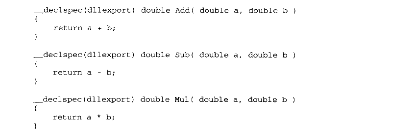
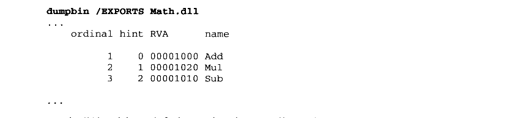
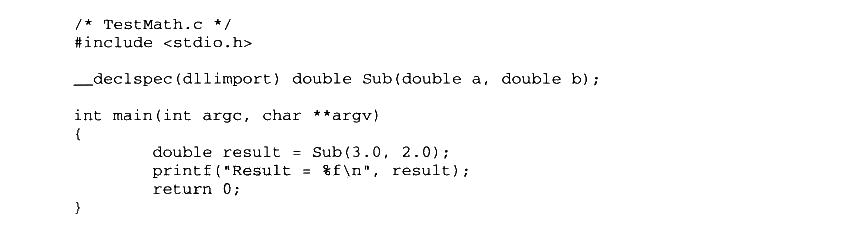
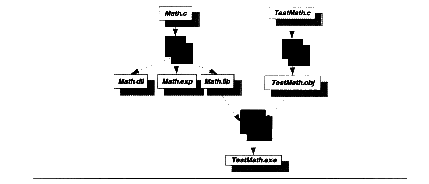
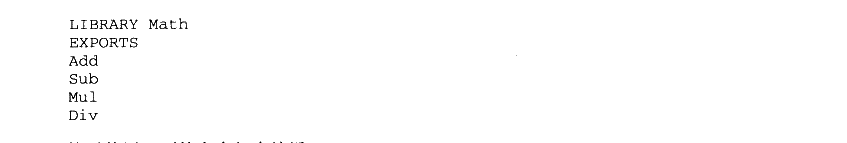
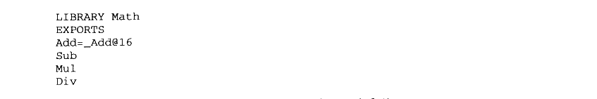
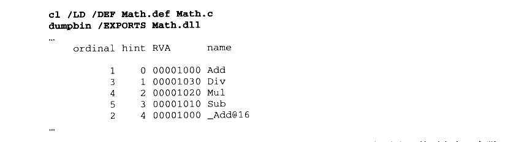
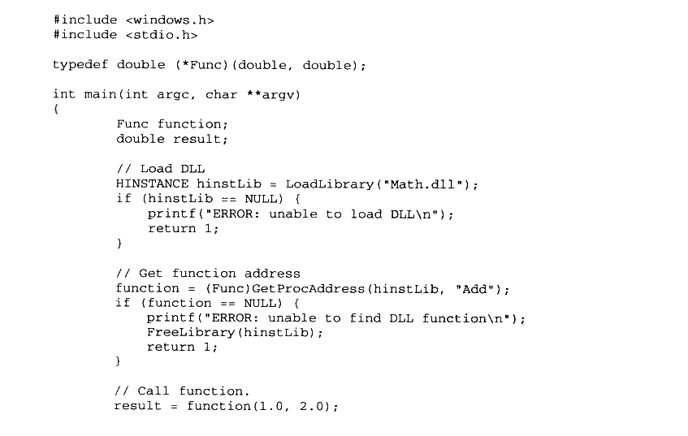
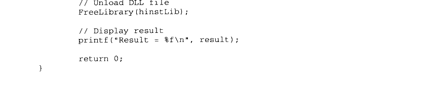

# 9.1 DLL 简介

DLL 即动态链接库（Dynamic-Link Library）的缩写，它相当于 Linux 下的共享对象。Windows 系统中大量采用了这种 DLL 机制，甚至包括 Windows 的内核的结构都很大程度依赖于 DLL 机制。Windows 下的 DLL 文件和 EXE 文件实际上是一个概念，它们都是有 PE格式的二进制文件，稍微有些不同的是 PE 文件头部中有个符号位表示该文件是 EXE 或是DLL，而DLL 文件的扩展名不一定是.dll，也有可能是别的比如.ocx（OCX 控件）或是.CPL（控制面板程序）。

DLL 的设计目的与共享对象有些出入，DLL 更加强调模块化，即微软希望通过 DLL 机制加强软件的模块化设计，使得各种模块之间能够松散地组合、重用和升级。所以我们在Windows 平台上看到大量的大型软件都通过升级 DLL 的形式进行自我完善，微软经常将这些升级补丁积累到一定程度以后形成一个软件更新包（Service Packs）。比如我们常见的微软 Office 系列、Visual Studio 系列、Internet Explorer 甚至 Windows 本身也通过这种方式升级。

另外，我们知道 ELF 的动态链接可以实现运行时加载，使得各种功能模块能以插件的形式存在。在 Windows 下，也有类似 ELF 的运行时加载，这种技术在 Windows 下被应用得更加广泛，比如著名的 ActiveX 技术就是基于这种运行时加载机制实现的。

### 9.1.1 进程地址空间和内存管理

在早期版本的 Windows 中（比如 Windows 1.X、2.x、3.x），也就是 16-bit 的 Windows系统中，所有的应用程序都共享一个地址空间，即进程不拥有自己独立的地址空间（或者在那个时候，这些程序的运行方式还不能被称作为进程）。如果某个 DLL 被加载到这个地址空间中，那么所有的程序都可以共享这个 DLL 并且随意访问。该 DLL 中的数据也是共享的，所以程序以此实现进程间通信。但是由于这种没有任何限制的访问权限，各个程序之间随意的访问很容易导致 DLL 中数据被损坏。

后来的Windows 改进了这个设计，也就是所谓的32位版本的 Windows 开始支持进程拥有独立的地址空间，一个 DLL 在不同的进程中拥有不同的私有数据副本，就像我们前面提到过的ELF共享对象一样。在 ELF 中，由于代码段是地址无关的，所以它可以实现多个进程之间共享一份代码，但是 DLL 的代码却并不是地址无关的，所以它只是在某些情况下可以被多个进程间共享。我们将在后面详细探讨 DLL 代码段的地址相关问题。

### 9.1.2 基地址和 RVA

PE 里面有两个很常用的概念就是基地址（Base Address）和相对地址（RVA,Relative Virtual Address）。当一个 PE 文件被装载时，其进程地址空间中的起始地址就是基地址。对于任何一个 PE 文件来说，它都有一个优先装载的基地址，这个值就是PE 文件头中的 Image Base。

对于一个可执行EXE 文件来说，Image Base一般值是0x400000，对于DLL 文件来说，这个值一般是0x10000000。Windows 在装载 DLL 时，会先尝试把它装载到由 Image Base指定的虚拟地址：若该地址区域已被其他模块占用，那PE 装载器会选用其他空闲地址。而相对地址就是一个地址相对于基地址的偏移，比如一个 PE 文件被装载到 0x10000000，即基地址为0x10000000，那么 RVA 为0x1000 的地址为0x10001000。

### 9.1.3 DLL 共享数据段

在Win32下，如果要实现进程间通信，当然有很多方法，Windows 系统提供了一系列 API可以实现进程间的通信。其中有一种方法是使用 DLL 来实现进程间通信，这个原理与16位Windows 中的 DLL实现进程间通信十分类似。正常情况下，每个 DLL 的数据段在各个进程中都是独立的，每个进程都拥有自己的副本。但是 Windows 允许将 DLL 的数据段设置成共享的，即任何进程都可以共享该DLL 的同一份数据段。当然很多时候比较常见的做法是将一些需要进程间共享的变量分离出来，放到另外一个数据段中，然后将这个数据段设置成进程间可共享的。也就是说一个 DLL 中有两个数据段，一个进程间共享，另外一个私有。

当然这种进程间共享方式也产生了一定的安全漏洞，因为任意一个进程都可以访问这个共享的数据段，那么只要破坏了该数据段的数据就会导致所有使用该数据段的进程出现问题。甚至恶意攻击者可以在GUEST 的权限下运行某个进程破坏该共享的数据，从而影响那些系统管理员权限的用户使用同一个 DLL 的进程。所以从这个角度讲，这种 DLL 共享数据段来实现进程间通信应该尽量避免。

### 9.1.4 DLL 的简单例子

我们通过简单的例子来了解最简单的 DLL 的创建和使用，最基本的概念是导出（Export）的概念。在ELF 中，共享库中所有的全局函数和变量在默认情况下都可以被其他模块使用，也就是说ELF 默认导出所有的全局符号。但是在 DLL 中情况有所不同，我们需要显式地“告诉”编译器我们需要导出某个符号，否则编译器默认所有符号都不导出。当我们在程序中使用 DLL 导出的符号时，这个过程被称为导入（Import）。

Microsoft Visual C++（MSVC）编译器提供了一系列 C/C++的扩展来指定符号的导入导出，对于一些支持 Windows 平台的编译器比如 Intel C++、GCC Windows 版（mingw GCC，cygwin GCC）等都支持这种扩展。我们可以通过“\_\_declspec”属性关键字来修饰某个函数或者变量，当我们使用“\_\_declspec（dllexport）”时表示该符号是从本 DLL 导出的符号，“__declspec(dllimport)”表示该符号是从别的 DLL 导入的符号。在C++中，如果你希望导入或者导出的符号符合C语言的符号修饰规范，那么必须在这个符号的定义之前加上extern "C"，以防止C++编译器进行符号修饰。

除了使用“\_\_declspec”扩展关键字指定导入导出符号之外，我们也可以使用“def”文件来声明导入导出符号。“def”扩展名的文件是类似于ld 链接器的链接脚本文件，可以被当作 link 链接器的输入文件，用于控制链接过程。“def” 文件中的 IMPORTS 或者 EXPORTS段可以用来声明导入导出符号，这个方法不仅对C/C++有效，对其他语言也有效。

### 9.1.5 创建 DLL

假设我们的一个 DLL 提供3个数学运算的函数，分别是加（Add）、减（Sub）、乘（Mul），它的源代码如下（Math.c）：



<details markdown="1"><summary>复制校对文字（未运行验证）</summary>

```text
__declspec(dllexport) double Add(double a, double b)
{
    return a + b;
}
__declspec(dllexport) double Sub(double a, double b)
{
    return a - b;
}
__declspec(dllexport) double Mul(double a, double b)
{
    return a * b;
}
```

</details>

代码很简单，就是传入两个双精度的值然后返回相应的计算结果（有人能告诉我为什么没有除法吗？不要着急，我们留着除法到后面用）。然后我们使用 MSVC的编译器 cl 进行编译：

```bat
cl /LDd Math.c
```

参数 /LDd 表示生成 Debug 版的DLL，不加任何参数则表示生产 EXE 可执行文件；我们可以使用 /LD 来编译生成 Release 版的 DLL。上面的编译结果生成了“Math.dll”、“Math.obj”、“Math.exp”和“Math.lib” 这4个文件。很明显“Math.dll”就是我们需要的 DLL文件，“Math.obj”是编译的目标文件，“Math.exp”和“Math.lib”将在后面作介绍。我们可以通过 dumpbin 工具看到 DLL 的导出符号：



<details markdown="1"><summary>复制校对文字（未运行验证）</summary>

```text
dumpbin /EXPORTS Math.dll
...
    ordinal hint RVA      name
          1    0 00001000 Add
          2    1 00001020 Mul
          3    2 00001010 Sub
...
```

</details>

很明显，我们可以看到DLL 有3个导出函数以及它们的相对地址。

### 9.1.6 使用 DLL

程序使用 DLL 的过程其实是引用 DLL 中的导出函数和符号的过程，即导入过程。对于从其他 DLL 导入的符号，我们需要使用 “\_\_declspec（dllimport）”显式地声明某个符号为导入符号。这与 ELF 中的情况不一样，在ELF 中，当我们使用一个外部模块的符号的时候，我们不需要额外声明该变量是从其他共享对象导入的。

我们来看一个使用 Math.dll 的例子：



<details markdown="1"><summary>复制校对文字（未运行验证）</summary>

```text
/* TestMath.c */
#include <stdio.h>
__declspec(dllimport) double Sub(double a, double b);
int main(int argc, char **argv)
{
    double result = Sub(3.0, 2.0);
    printf("Result = %f\n", result);
    return 0;
}
```

</details>

在编译时，我们通过下面的命令行：


<details markdown="1"><summary>复制校对文字（未运行验证）</summary>

```text
cl /c TestMath.c
link TestMath.obj Math.lib
```

</details>

第一行使用编译器将 TestMath.c 编译成 TestMath.obj，然后使用链接器将 TestMath.obj和 Math.lib 链接在一起产生一个可执行文件 TestMath.exe。整个过程如图9-1所示。

在最终链接时，我们必须把与DLL一起产生的“Math.lib” 与“TestMath.obj” 链接起来，形成最终的可执行文件。在静态链接的时候，我们介绍过“lib”文件是一组目标文件的集合，在动态链接里面这一点仍然没有错，但是“Math.lib” 里面的目标文件是什么呢？“Math.lib”中并不真正包含“Math.c”的代码和数据，它用来描述“Math.dll” 的导出符号，它包含了 TestMath.obj 链接Math.dll 时所需要的导入符号以及一部分“桩”代码，又被称作“胶水”代码，以便于将程序与 DLL粘在一起。像“Math.lib”这样的文件又被称为导入库（Import Library），我们在后面介绍导入导出表的时候还会再详细分析。



<p class="image-caption">图9-1 MSVC静态库链接</p>

<details markdown="1"><summary>查看图中文字（按图分组）</summary>

Math.c → Math.dll、Math.exp、Math.lib；TestMath.c → TestMath.obj；Math.lib 与 TestMath.obj 链接形成 TestMath.exe。

</details>

### 9.1.7 使用模块定义文件

声明 DLL 中的某个函数为导出函数的办法有两种，一种就是前面我们演示过的使用“\_\_declspec（dllexport）” 扩展：另外一种就是采用模块定义（.def）文件声明。实际上.def文件在MSVC链接过程中的作用与链接脚本文件（Link Script）文件在ld 链接过程中的作用类似，它是用于控制链接过程，为链接器提供有关链接程序的导出符号、属性以及其他信息。不过相比于ld的链接脚本文件，def 文件的语法要简单的多，而且功能也更少。

假设我们在前面例子的 Math.c 中将所有的“\_\_declspec（dllexport）” 去掉，然后创建一个Math.def 文件，以下面作为内容：



<details markdown="1"><summary>复制校对文字（未运行验证）</summary>

```text
LIBRARY Math
EXPORTS
Add
Sub
Mul
Div
```

</details>

然后使用下面的命令行来编译 Math.c：

```bat
cl Math.c /LD /DEF Math.def
```

这样编译器（更准确地讲是 link 链接器）就会使用 Math.def 文件中的描述产生最终输出文件。那么使用.def 文件来描述 DLL 文件的导出属性有什么好处呢？

首先，我们可以控制导出符号的符号名。很多时候，编译器会对源程序里面的符号进行修饰，比如 C++ 程序里面的符号经过编译器的修饰以后，都变得面目全非，这一点我们在本书的前面已经领教过了。除了 C++ 程序以外，C 语言的符号也有可能被修饰，比如 MSVC 支持几种函数的调用规范“__cdecl”、“__stdcall”、“__fastcall”（我们在本书的第 4 章还会详细介绍各种函数调用规范之间的区别），默认情况下 MSVC 把 C 语言的函数当作“__cdecl”类型，这种情况下它对该函数不进行任何符号修饰。但是一旦我们使用其他的函数调用规范时，MSVC 编译器就会对符号名进行修饰，比如使用“__stdcall”调用规范的函数 Add 就会被修饰成“_Add@16”，前面以“_”开头，后面以“@n”结尾，n 表示函数调用时参数所占堆栈空间的大小。使用 .def 文件可以将导出函数重新命名，比如当 Add 函数采用“__stdcall”时，我们可以使用如下的 .def 文件：



<details markdown="1"><summary>复制校对文字（未运行验证）</summary>

```text
LIBRARY Math
EXPORTS
Add=_Add@16
Sub
Mul
Div
```

</details>

当我们使用这个.def 文件来生成 Math.dll 时，可以看到：



<details markdown="1"><summary>复制校对文字（未运行验证）</summary>

```text
cl /LD /DEF Math.def Math.c
dumpbin /EXPORTS Math.dll
...
    ordinal hint RVA      name
          1    0 00001000 Add
          3    1 00001030 Div
          4    2 00001020 Mul
          5    3 00001010 Sub
          2    4 00001000 _Add@16
...
```

</details>

Add 作为一个与 _Add@16 等价的导出函数被放到了 Math.dll 的导出函数列表中，实际上有些类似于“别名”。当一个 DLL 被多个语言编写的模块使用时，采用这种方法导出一个函数往往会很有用。比如微软的 Visual Basic 采用的是“__stdcall”的函数调用规范，实际上“__stdcall”调用规范也是大多数 Windows 下的编程语言所支持的通用调用规范，那么作为一个能够被广泛使用的 DLL 最好采用“__stdcall”的函数调用规范。而 MSVC 默认采用的是“__cdecl”调用规范，否则它就会使用符号修饰，经过修饰的符号不便于维护和使用，于是采用 .def 文件对导出符号进行重命名就是一个很好的方案。我们经常看到 Windows 的 API 都采用“WINAPI”这种方式声明，而“WINAPI”实际上是一个被定义为“__stdcall”的宏。微软以 DLL 的形式提供 Windows 的 API，而每个 DLL 中的导出函数又以这种“__stdcall”的方式被声明。但是我们可以看到，Windows 的 API 中从来没有 _Add@16 这种古怪的命名方式，可见它也是采用了这种导出函数重命名的方法。

与 ld 的链接控制脚本类似，使用.def 文件的另外一个优势是它可以控制一些链接的过程。在微软提供的文档中，除了前面例子中用到的“LIBRARY”、“EXPORTS” 等关键字以外，还可以发现.def 支持一些诸如“HEAPSIZE”、“NAME”、“SECTIONS”、“STACKSIZE”、“VERSION”等关键字，通过这些关键字可以控制输出文件的默认堆大小、输出文件名、各个段的属性、默认堆栈大小、版本号等。具体请参照 MSDN 中关于.def 文件的介绍，我们这里就不详细展开了。

### 9.1.8 DLL 显式运行时链接

与ELF 类似，DLL 也支持运行时链接，即运行时加载。Windows 提供了3个 API为：

LoadLibrary（或者 LoadLibraryEx），这个函数用来装载一个 DLL 到进程的地址空间，它的功能跟 dlopen 类似。

GetProcAddress，用来查找某个符号的地址，与dlsym 类似。

- FreeLibrary，用来卸载某个已加载的模块，与dlclose 类似。

我们来看看 Windows 下的显式运行时链接的例子：



<details markdown="1"><summary>复制校对文字（未运行验证）</summary>

```text
#include <windows.h>
#include <stdio.h>
typedef double (*Func)(double, double);
int main(int argc, char **argv)
{
    Func function;
    double result;
    // Load DLL
    HINSTANCE hinstLib = LoadLibrary("Math.dll");
    if (hinstLib == NULL) {
        printf("ERROR: unable to load DLL\n");
        return 1;
    }
    // Get function address
    function = (Func)GetProcAddress(hinstLib, "Add");
    if (function == NULL) {
        printf("ERROR: unable to find DLL function\n");
        FreeLibrary(hinstLib);
        return 1;
    }
    // Call function.
    result = function(1.0, 2.0);
```

</details>



<details markdown="1"><summary>复制校对文字（未运行验证）</summary>

```text
// Unload DLL file
    FreeLibrary(hinstLib);
    // Display result
    printf("Result = %f\n", result);
    return 0;
}
```

</details>
