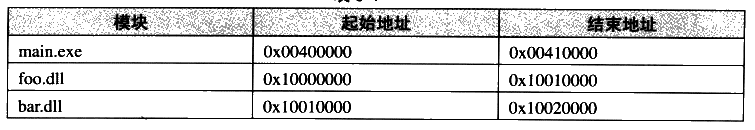
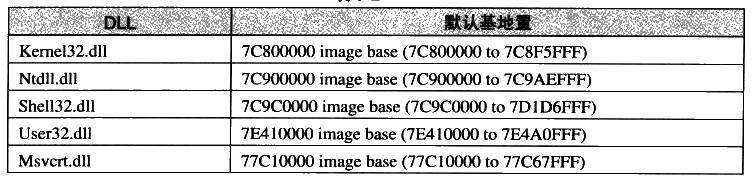
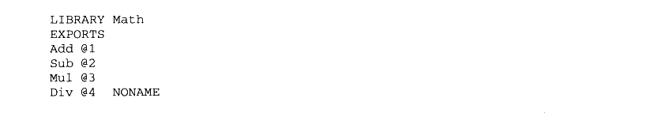
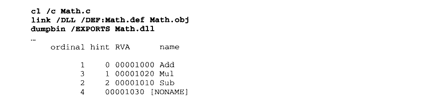
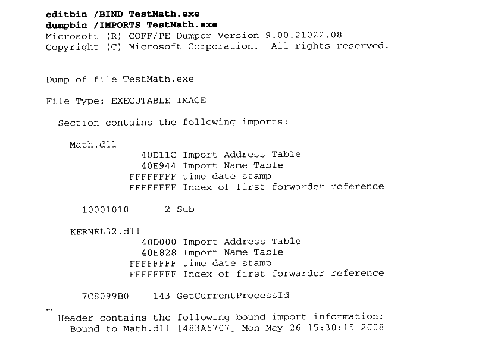
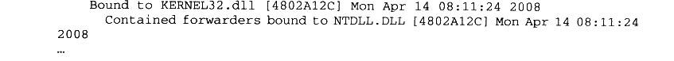
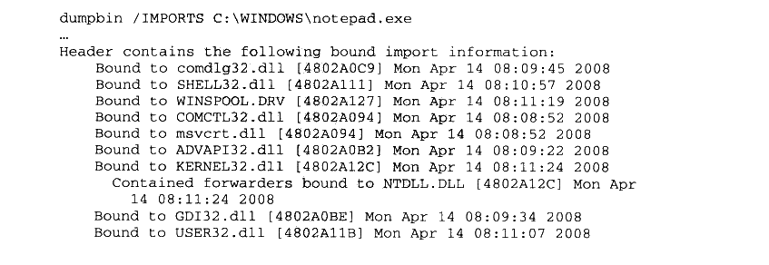

# 9.3 DLL 优化

我们在前面经过对 DLL 的分析得知，DLL 的代码段和数据段本身并不是地址无关的，也就是说它默认需要被装载到由 ImageBase 指定的目标地址中。如果目标地址被占用，那么就需要装载到其他地址，便会引起整个 DLL 的 Rebase。这对于拥有大量 DLL 的程序来说，频繁的 Rebase也会造成程序启动速度减慢。这是影响 DLL 性能的另外一个原因。

我们知道动态链接过程中，导入函数的符号在运行时需要被逐个解析。在这个解析过程中，免不了会涉及到符号字符串的比较和查找过程，这个查找过程中，动态链接器会在目标DLL 的导出表中进行符号字符串的二分查找。即使是使用了二分查找法，对于拥有DLL 数量很多，并且有大量导入导出符号的程序来说，这个过程仍然是非常耗时的。这是影响 DLL性能的一个原因之一。

这两个原因可能会导致应用程序的速度非常慢，因为系统需要在启动程序时进行大量的符号解析和 Rebase 工作。

### 9.3.1 重定基地址

从前面 DLL 的导入函数的实现，我们得出结论：PE的 DLL 中的代码段并不是地址无关的，也就是说它在被装载时有一个固定的目标地址，这个地址也就是PE 里面所谓的基地址（Base Address）。默认情况下，PE 文件将被装载到这个基地址。一般来说，EXE 文件的基地址默认为 0x00400000，而DLL 文件基地址默认为0x10000000。

我们前面花了很多篇幅讨论了为什么对于一个 ELF 共享对象，它的代码段要做到地址无关，并且讨论了地址无关的实现。这一点对于 DLL 来说也一样，一个进程中，多个 DLL不可以被装载到同一个虚拟地址，每个 DLL 所占用的虚拟地址区域之间都不可以重叠。

在讨论共享对象的地址冲突问题时，我们已经介绍过了，有3种方案可供选择。一个办法是像静态共享对象那样，为每个 DLL 指定一个基地址，并且人为保证同一个进程中这些DLL 的地址区域都不相互重叠，但是这样做会有很多问题，在前面介绍静态共享对象的时候已经讨论过，这种将模块目标地址固定的做法有很多弊端。另外一个办法就是 ELF 所采用的办法，那就是代码段地址无关。

Windows PE 采用了一种与 ELF 不同的办法，它采用的是装载时重定位的方法。在DLL模块装载时，如果目标地址被占用，那么操作系统就会为它分配一块新的空间，并且将 DLL装载到该地址。这时候问题来了，因为 DLL 的代码段不是地址无关的，DLL 中所有涉及到绝对地址的引用该怎么办呢？答案是对于每个绝对地址引用都进行重定位。

当然，这个重定位过程有些特殊，因为所有这些需要重定位的地方只需要加上一个固定的差值，也就是说加上一个目标装载地址与实际装载地址的差值。我们来看一个例子，比如有一个DLL 的基地址是0x10000000，那么如果它的代码中有这样一条指令：

`MOV DWORD PTR [0x10001000], 0x100`

我们假设0x10001000 是该模块中一个变量foo 的地址，即该变量的 RVA 是0x1000。如果 DLL 在装载时，0x10000000 这个地址被其他 DLL 占用了，Windows 就会将它加载到一个新的地址，假设是 0x20000000。因为0x10001000 是个绝对地址，所以我们需要对这条指令进行重定位。这时候新的基地址是0x20000000，而RVA 是不变的，所以 foo 的地址实际上已经变成了0x20001000，也就是指令的地址部分要加上0x20000000-0x10000000 的这个差值。经过调整后的指令应该是：

`MOV DWORD PTR [0x20001000], 0x100`

事实上，由于 DLL 内部的地址都是基于基地址的，或者是相对于基地址的RVA。那么所有需要重定位的地方都只需要加上一个固定差值，在这个例子里面是 0x10000000。所以这个重定位的过程相对简单一点，速度也要比一般的重定位要快。PE 里面把这种特殊的重定位过程又被叫做重定基地址（Rebasing）。

PE 文件的重定位信息都放在了“.reloc”段，我们可以从PE 文件头中的 DataDirectory 里面得到重定位段的信息。重定位段的结构跟 ELF 中的重定位段结构十分类似，在这里就不再详细介绍了。对于EXE文件来说，MSVC编译器默认不会产生重定位段，也就是默认情况下，EXE 是不可以重定位的，不过这也没有问题，因为EXE 文件是进程运行时第一个装入到虚拟空间的，所以它的地址不会被人抢占。而 DLL 则没那么幸运了，它们被装载的时间是不确定的，所以一般情况下，编译器都会给 DLL 文件产生重定位信息。当然你也可以使用“/FIXED”参数来禁止 DLL 产生重定位信息，不过那样可能会造成 DLL 的装载失败。

这种重定基地址的方法导致的一个问题是，如果一个 DLL 被多个进程共享，且该DLL被这些进程装载到不同的位置，那么每个进程都需要有一份单独的 DLL 代码段的副本。很明显，这种方案相对于 ELF 的共享对象代码段地址无关的方案来说，它更加浪费内存，而且当被重定基址的代码段需要被换出时，它需要被写到交换空间中，而不像没有重定基址的DLL 代码段，只需要释放物理页面，再次用到时可以直接从 DLL 文件里面重新读取代码段即可。但是有一个好处是，它比ELF 的PIC 机制有着更快的运行速度。因为PE 的DLL对数据段的访问不需要通过类似于 GOT 的机制，对于外部数据和函数的引用不需要每次都计算GOT 的位置，所以理论上会比 ELF的PIC 的方案快一些。这又是一个空间换时间的案例。

改变默认基地址

前面的重定基地址过程实际上是在 DLL 文件装载时进行的，所以又叫做装载时重定位。对于一个程序来说，它所用到的 DLL 基本是固定的（除了通过 LoadLibrary()装载的以外）。程序每次运行时，这些 DLL 的装载顺序和地址也是一样的。比如一个程序由程序主模块main.exe、foo.dll 和bar.dll 3个模块组成，它们的大小都是64 KB。于是当程序运行起来以后进程虚拟地址空间的布局应该如表9-1所示。表9-1



<details markdown="1"><summary>查看校对表格</summary>

| 模块 | 起始地址 | 结束地址 |
| --- | --- | --- |
| main.exe | 0x00400000 | 0x00410000 |
| foo.dll | 0x10000000 | 0x10010000 |
| bar.dll | 0x10010000 | 0x10020000 |

</details>

可以看到 bar.dll 原先默认的基地址是 0x10000000，但是它被重定基址到了 0x10010000，因为0x10000000 到 0x10010000 这块地址被先前加载的 foo.dll 占用了（假设 foo.dll 比 bar.dll先装载）。那么既然bar.dll 每次运行的时候基地址都是 0x10010000，为什么不把它的基地址就设成0x10010000呢？这样就省掉了bar.dll 每次装载时重定基址的过程，不是可以让程序运行得更快吗？

MSVC 的链接器提供了指定输出文件的基地址的功能。那么可以在链接时使用 link 命令中的“/BASE”参数为 bar.dll 指定基地址：

```bat
link /BASE:0x10010000,0x10000 /DLL bar.obj
```

注意：这个基地址必须是64 K 的倍数，如果不是64K的倍数，链接器将发出错误。这里还有一个参数 0x10000 是指DLL 占用空间允许的最大的长度，如果超出这个长度，那么编译器会给出警告。这个看似没用的选项实际上非常有用，比如我们的程序中用到了10个DLL，那么我们就可以为每个 DLL 手工指定一块区域，以防止它们在地址空间中相互冲突。假设我们为bar.dll指定的空间是0x10010000 到0x10020000 这块空间，那么在使用“/BASE”参数时，我们不光指定bar.dll 的起始地址，还指定它的最长的长度。如果超出这个长度，它就会占用其他 DLL的地址块，如果链接器能够给出警告的话，我们就很快能发现问题并且进行调整。

除了在链接时可以指定 DLL 的基地址以外，MSVC还提供了一个叫做editbin 的工具（早期版本的 MSVC 提供一个叫 rebase.exe 的工具），这个工具可以用来改变已有的 DLL 的基地址。比如：

```bat
editbin /REBASE:BASE=0x10020000 bar.dll
```

系统 DLL

由于 Windows 系统本身自带了很多系统的 DLL，比如 kernel32.dll、ntdll.dll、shell32.dll、user32.dll、msvcrt.dll 等，这些 DLL 基本上是 Windows 的应用程序运行时都要用到的。Windows 系统就在进程空间中专门划出一块 0x70000000~0x80000000 区域，用于映射这些常用的系统 DLL。Windows 在安装时就把这块地址分配给这些 DLL，调整这些 DLL 的基地址使得它们相互之间不冲突，从而在装载时就不需要进行重定基址了。比如在我的机器中，这些 DLL 的基地址如表9-2所示。



<details markdown="1"><summary>查看校对表格</summary>

| DLL | 默认基地址 |
| --- | --- |
| Kernel32.dll | 7C800000 image base (7C800000 to 7C8F5FFF) |
| Ntdll.dll | 7C900000 image base (7C900000 to 7C9AEFFF) |
| Shell32.dll | 7C9C0000 image base (7C9C0000 to 7D1D6FFF) |
| User32.dll | 7E410000 image base (7E410000 to 7E4A0FFF) |
| Msvcrt.dll | 77C10000 image base (77C10000 to 77C67FFF) |

</details>

### 9.3.2 序号

一个 DLL 中每一个导出的函数都有一个对应的序号（Ordinal Number）。 一个导出函数甚至可以没有函数名，但它必须有一个唯一的序号。另一方面，当我们从一个 DLL 导入一个函数时，可以使用函数名，也可以使用序号。序号标示被导出函数地址在 DLL 导出表中的位置。

一般来说，那些仅供内部使用的导出函数，它只有序号没有函数名，这样外部使用者就无法推测它的含义和使用方法，以防止误用。对于大多数 Windows API 函数来说，它们的函数名在各个 Windows 版本之间是保持不变的，但是它们的序号是在不停地变化的。所以，如果我们导入 Windows API 的话，绝对不能使用序号作为导入方法。

在产生一个 DLL 文件时，我们可以在链接器的.def 文件中定义导出函数的序号。比如对于前面的 Math.dll 的例子，假设有如下.def 文件：



<details markdown="1"><summary>复制校对文字（未运行验证）</summary>

```text
LIBRARY Math
EXPORTS
Add @1
Sub @2
Mul @3
Div @4 NONAME
```

</details>

上面的.def文件可以用于指定Math.dll的导出函数的序号，@后面所跟的值就是每个符号的序号值。对于 Div 函数，序号值后面还有一个 NONAME，表示该符号仅以序号的形式导出，即 Math.dll 的使用者看不到Div 这个符号名，只能看到序号为4的一个导出函数：



<details markdown="1"><summary>复制校对文字（未运行验证）</summary>

```text
cl /c Math.c
link /DLL /DEF:Math.def Math.obj
dumpbin /EXPORTS Math.dll
...
    ordinal hint RVA      name
          1    0 00001000 Add
          3    1 00001020 Mul
          2    2 00001010 Sub
          4      00001030 [NONAME]
```

</details>

使用序号作为导入方法比函数名导入方法稍微快一点点，特别在现在的硬件条件下，这种性能的提高极为有限，而且 DLL 的导入函数的查找并不是性能瓶颈。因为在现在的DLL中，导出函数表中的函数名是经过排序的，查找的时候可以使用二分查找法。最初在16位的Windows 下，DLL 的导出函数名不是排序的，所以查找过程会比较慢。所以综合来看，一般情况下并不推荐使用序号作为导入导出的手段。

### 9.3.3 导入函数绑定

试想一下，每一次当一个程序运行时，所有被依赖的 DLL 都会被装载，并且一系列的导入导出符号依赖关系都会被重新解析。在大多数情况下，这些 DLL 都会以同样的顺序被装载到同样的内存地址，所以它们的导出符号的地址都是不变的。既然它们的地址都不变，每次程序运行时都要重新进行符号的查找、解析和重定位，是不是有些浪费呢？如果把这些导出函数的地址保存到模块的导入表中，不就可以省去每次启动时符号解析的过程吗？这个思路是合理的，这种 DLL 性能优化方式被叫做 DLL 绑定（DLL Binding）。DLL绑定方法很简单，我们可以使用 editbin（之前的MSVC 提供一个额外的 bind.exe 用于 DLL绑定）这个工具对 EXE 或DLL 进行绑定：



<details markdown="1"><summary>复制校对文字（未运行验证）</summary>

```text
editbin /BIND TestMath.exe
dumpbin /IMPORTS TestMath.exe
Microsoft (R) COFF/PE Dumper Version 9.00.21022.08
Copyright (C) Microsoft Corporation. All rights reserved.

Dump of file TestMath.exe
File Type: EXECUTABLE IMAGE
  Section contains the following imports:
    Math.dll
                40D11C Import Address Table
                40E944 Import Name Table
              FFFFFFFF time date stamp
              FFFFFFFF Index of first forwarder reference
      10001010      2 Sub
    KERNEL32.dll
                40D000 Import Address Table
                40E828 Import Name Table
              FFFFFFFF time date stamp
              FFFFFFFF Index of first forwarder reference
      7C8099B0    143 GetCurrentProcessId
...
  Header contains the following bound import information:
    Bound to Math.dll [483A6707] Mon May 26 15:30:15 2008
```

</details>



<details markdown="1"><summary>复制校对文字（未运行验证）</summary>

```text
Bound to KERNEL32.dll [4802A12C] Mon Apr 14 08:11:24 2008
      Contained forwarders bound to NTDLL.DLL [4802A12C] Mon Apr 14 08:11:24 2008
...
```

</details>

DLL 的绑定实现也比较简单，editbin 对被绑定的程序的导入符号进行遍历查找，找到以后就把符号的运行时的目标地址写入到被绑定程序的导入表内。还记得前面介绍PE 的导入表中有个与IAT一样的数组叫做 INT，这个数组就是用来保存绑定符号的地址的。

那么什么情况会导致 DLL 绑定的那些地址失效呢？一种情况是，被依赖的 DLL 更新导致DLL 的导出函数地址发生变化；另外一种情况是，被依赖的 DLL 在装载时发生重定基址，导致 DLL 的装载地址与被绑定时不一致。那么如果地址失效，而被绑定的 EXE 或者 DLL还使用失效了的地址的话，必然会导致程序运行错误。Windows 必须提供相应的机制来保证绑定地址失效时，程序还能够正确运行。

对于第一种情况的失效，PE 的做法是这样的，当对程序进行绑定时，对于每个导入的DLL，链接器把 DLL 的时间戳 （Timestamp）和校验和（Checksum，比如 MD5）保存到被绑定的PE文件的导入表中。在运行时，Windows 会核对将要被装载的 DLL 与绑定时的DLL版本是否相同，并且确认该 DLL 没有发生重定基址，如果一切正常，那么 Windows 就不需要再进行符号解析过程了，因为被装载的 DLL与绑定时一样，没有发生变化：否则 Windows就忽略绑定的符号地址，按照正常的符号解析过程对 DLL 的符号进行解析。

绑定过的可执行文件如果在执行时的环境与它在绑定时的环境一样，那么它的装载速度将会比正常情况下快：如果是在不同的运行环境，那么它的启动速度跟没绑定的情况下没什么两样。所以总的来说，DLL 绑定至少不会有坏处。

事实上，Windows系统所附带的程序都是与它所在的Windows版本的系统DLL绑定的。除了在编译时可以绑定程序，另外一个绑定程序的很好的机会是在程序安装的时候，这样至少在 DLL 升级之前，这些“绑定”都是有效的。当然，绑定过程会改变可执行文件本身，从而导致了可执行文件的校验和变化，这对于一些经过加密的，或者是经过数字签名的程序来说可能会有问题。比如我们查看 Windows 所附带的 Notepad.exe：



<details markdown="1"><summary>复制校对文字（未运行验证）</summary>

```text
dumpbin /IMPORTS C:\WINDOWS\notepad.exe
...
Header contains the following bound import information:
    Bound to comdlg32.dll [4802A0C9] Mon Apr 14 08:09:45 2008
    Bound to SHELL32.dll [4802A111] Mon Apr 14 08:10:57 2008
    Bound to WINSPOOL.DRV [4802A127] Mon Apr 14 08:11:19 2008
    Bound to COMCTL32.dll [4802A094] Mon Apr 14 08:08:52 2008
    Bound to msvcrt.dll [4802A094] Mon Apr 14 08:08:52 2008
    Bound to ADVAPI32.dll [4802A0B2] Mon Apr 14 08:09:22 2008
    Bound to KERNEL32.dll [4802A12C] Mon Apr 14 08:11:24 2008
      Contained forwarders bound to NTDLL.DLL [4802A12C] Mon Apr 14 08:11:24 2008
    Bound to GDI32.dll [4802A0BE] Mon Apr 14 08:09:34 2008
    Bound to USER32.dll [4802A11B] Mon Apr 14 08:11:07 2008
```

</details>
