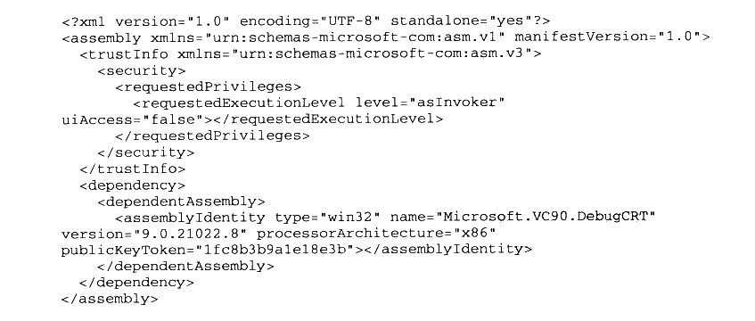
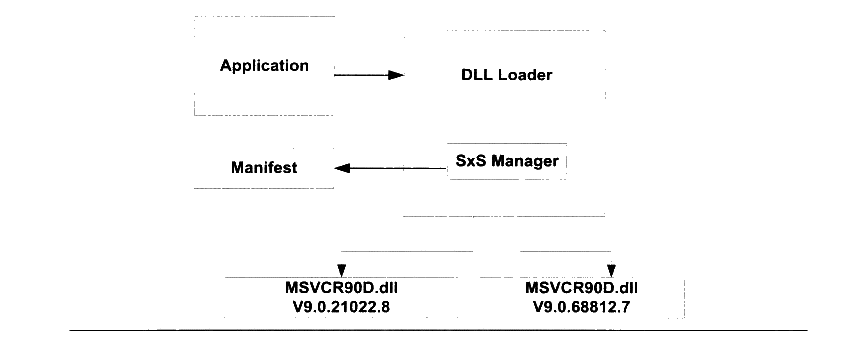
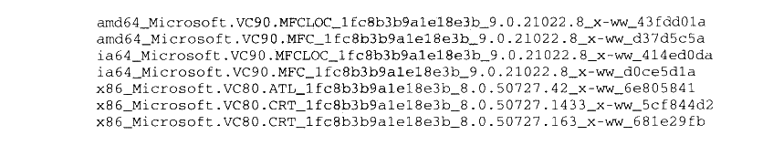
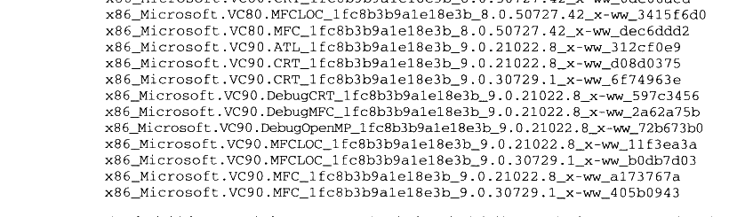

# 9.5 DLL HELL

DLL 跟ELF类似也有版本更新时发生不兼容的问题，我们在前面的关于C++和 DLL 的小节中也领教了 DLL 不兼容问题的严重性。由于 Windows 中使用 DLL 比 Linux 中使用共享库范围更大，更新也更频繁，并且早期的Windows 缺乏一种很有效的 DLL 版本控制机制，从而导致这个问题在 Windows 下非常严重，以至于被人戏称为 DLL 噩梦（DLL hell）。

很多 Windows 的应用程序在发布时会将它们所有需要用到的 DLL 都一起打包发布，很多应用程序的安装程序并不是很成熟，经常在安装时将一个旧版的 DLL 覆盖掉一个更新版本的 DLL，从而导致其他的应用程序运行失败。有些安装程序比较友好，如果碰到需要覆盖新版的DLL 时，它会弹出一个对话框提醒用户是否要覆盖，但是即使这样，有些应用程序只能运行在旧版的 DLL 下，如果不覆盖，那么它可能无法在新版的 DLL 中运行。总的说来，三种可能的原因导致了 DLL Hell 的发生：

- 一是由使用旧版本的DLL替代原来一个新版本的 DLL 而引起。这个原因最普遍，是Windows 9x用户通常遇到的问题 DLL错误之一。

- 二是由新版 DLL中的函数无意发生改变而引起。尽管在设计DLL 时候应该“向下”兼容，然而要保证 DLL 完全“向下”兼容却是不可能的。

- 三是由新版 DLL 的安装引入一个新 BUG。这个原因发生的概率最小，但是它仍然会发生。

解决 DLL Hell 的方法

DLL 的作用已经在前面介绍过，下面我们介绍几种预防 DLL Hell 的方法。

- 静态链接（Static linking）对付 DLL Hell 的最简单方法，或者说终极方法就是，在编译产生应用程序时使用静态链接的方法链接它所需要的运行库，从而避免使用动态链接。这样，在运行应用程序时候就不需要依赖 DLL 了。然而，它会丧失使用动态链接带来的好处。

防止 DLL 覆盖（DLL Stomping）

在 Windows 中，DLL 的覆盖问题可以使用 Windows 文件保护（Windows File Protection简称 WFP）技术来缓解。该技术从 Windows 2000 版本开始被使用。它能阻止未经授权的应用程序覆盖系统的DLL。第三方应用程序不能覆盖操作系统DLL 文件，除非它们的安装程序捆绑了 Windows 更新包，或者在它们的安装程序运行时禁止了 WFP 服务（当然这是一件非常危险的事情）。避免 DLL 冲突（Conflicting DLLs）

解决不同应用程序依赖相同 DLL 不同版本的问题一个方案就是，让每个应用程序拥有一份自己依赖的DLL，并且把问题 DLL 的不同版本放到该应用程序的文件夹中，而不是系统文件夹中。当应用程序需要装载 DLL 时候，首先从自己的文件夹下寻找所需要的 DLL，然后再到系统文件中寻找。

- .NET 下 DLL Hell 的解决方案在.NET 框架中，一个程序集（Assembly）有两种类型：应用程序程序（也就是exe 可执行文件）集以及库程序（也就是DLL 动态链接库）集。一个程序集包括一个或多个文件，所以需要一个清单文件来描述程序集。这个清单文件叫做 Manifest 文件。Manifest 文件描述了程序集的名字，版本号以及程序集的各种资源，同时也描述了该程序集的运行所依赖的资源，包括 DLL 以及其他资源文件等。Manifest 是一个 XML 的描述文件。每个 DLL 有自己的 manifest 文件，每个应用程序也有自己的Manifest。对于应用程序而言，manifest 文件可以和可执行文件在同一目录下，也可以是作为一个资源嵌入到可执行文件的内部（Embed Manifest）。

XP 以前的windows 版本，在执行可执行文件时不会考虑 manifest 文件的。它会直接到system32 的目录下查找该可执行文件所依赖的 DLL。在这种情况 下，Manifest 只是个多余的文件。而 XP 以后的操作系统，在执行可执行文件时则会首先读取程序集的 manifest 文件，获得该可执行文件需要调用的 DLL 列表，操作系统再根据 DLL 的 manifest 文件去寻找对应的 DLL 并调用。一个典型的 manifest 文件的例子如下：



<details markdown="1"><summary>复制校对文字（未运行验证）</summary>

```text
<?xml version="1.0" encoding="UTF-8" standalone="yes"?>
<assembly xmlns="urn:schemas-microsoft-com:asm.v1" manifestVersion="1.0">
  <trustInfo xmlns="urn:schemas-microsoft-com:asm.v3">
    <security>
      <requestedPrivileges>
        <requestedExecutionLevel level="asInvoker" uiAccess="false"></requestedExecutionLevel>
      </requestedPrivileges>
    </security>
  </trustInfo>
  <dependency>
    <dependentAssembly>
      <assemblyIdentity type="win32" name="Microsoft.VC90.DebugCRT" version="9.0.21022.8" processorArchitecture="x86" publicKeyToken="1fc8b3b9a1e18e3b"></assemblyIdentity>
    </dependentAssembly>
  </dependency>
</assembly>
```

</details>

在这个例子中，&lt;dependency&gt;这一部分指明了其依赖于一个名字叫做 Microsoft.VC90.CRT 的库。但是我们发现，&lt;assemblyIdentity&gt;属性里面还有其他的信息，分别是 type 系统类型，version版本号，processorArchitecture 平台环境，publicKeyToken 公钥。所有这些加在一起就成了“强文件名”。有了这种“强文件名”，我们就可以根据其区分不同的版本、不同的平台。有了这种强文件名，系统中可以有多个不同版本的相同的库共存而不会发生冲突。

从 Windows XP 开始，可供应用程序并发使用的并行配件组越来越多。加载程序通过清单和配件的版本号为应用程序确定准确的绑定版本。下图是并行程序集，它的 manifest 文件及应用程序之间一起协同工作的实例如图9-5所示。



<p class="image-caption">图9-5 Manifest 与 DLL 装载</p>

<details markdown="1"><summary>查看图中文字（按图分组）</summary>

Application → DLL Loader；SxS Manager 查询 Manifest，选择 MSVCR90D.dll V9.0.21022.8 或 MSVCR90D.dll V9.0.68812.7。

</details>

图9-5中的SxS Manager 就是 Side-by-side Manager，它利用程序集 manifest 文件的描述，实现对相应版本的 DLL 的加载。在这个例子中，我们假设系统中存在两个版本的MSVCR90D.DLL： 版本 9.0.21022.8 和版本 9.0.68812.7，都是在并行程序集 cache 中。当应用程序需要装载 DLL 时候，并行管理器根据该应用程序的 manifest 文件中关于所需要的MSVCR90D 的版本信息来装载相应的 DLL。Windows XP 以后的操作系统在 `\WINDOWS` 目录下面有个叫做 WinSxS（Windows Side-By-Side）目录，这个目录下我们可以看到上面例子中的 MSVCR90D.DLL 位于这个位置：


<details markdown="1"><summary>复制校对文字（未运行验证）</summary>

```text
\WINDOWS\WinSxS\x86_Microsoft.VC90.DebugCRT_1fc8b3b9a1e18e3b_9.0.21022.8_x-ww_597c3456\MSVCR90D.dll
```

</details>

除此之外，我们还能够在 WinSxS 目录下看到其他的不同版本的C/C++/MFC/ATL运行库：



<details markdown="1"><summary>复制校对文字（未运行验证）</summary>

```text
amd64_Microsoft.VC90.MFCLOC_1fc8b3b9a1e18e3b_9.0.21022.8_x-ww_43fdd01a
amd64_Microsoft.VC90.MFC_1fc8b3b9a1e18e3b_9.0.21022.8_x-ww_d37d5c5a
ia64_Microsoft.VC90.MFCLOC_1fc8b3b9a1e18e3b_9.0.21022.8_x-ww_414ed0da
ia64_Microsoft.VC90.MFC_1fc8b3b9a1e18e3b_9.0.21022.8_x-ww_d0ce5d1a
x86_Microsoft.VC80.ATL_1fc8b3b9a1e18e3b_8.0.50727.42_x-ww_6e805841
x86_Microsoft.VC80.CRT_1fc8b3b9a1e18e3b_8.0.50727.1433_x-ww_5cf844d2
x86_Microsoft.VC80.CRT_1fc8b3b9a1e18e3b_8.0.50727.163_x-ww_681e29fb
```

</details>



<details markdown="1"><summary>复制校对文字（未运行验证）</summary>

```text
x86_Microsoft.VC80.CRT_1fc8b3b9a1e18e3b_8.0.50727.42_x-ww_0de06acd
x86_Microsoft.VC80.MFCLOC_1fc8b3b9a1e18e3b_8.0.50727.42_x-ww_3415f6d0
x86_Microsoft.VC80.MFC_1fc8b3b9a1e18e3b_8.0.50727.42_x-ww_dec6ddd2
x86_Microsoft.VC90.ATL_1fc8b3b9a1e18e3b_9.0.21022.8_x-ww_312cf0e9
x86_Microsoft.VC90.CRT_1fc8b3b9a1e18e3b_9.0.21022.8_x-ww_d08d0375
x86_Microsoft.VC90.CRT_1fc8b3b9a1e18e3b_9.0.30729.1_x-ww_6f74963e
x86_Microsoft.VC90.DebugCRT_1fc8b3b9a1e18e3b_9.0.21022.8_x-ww_597c3456
x86_Microsoft.VC90.DebugMFC_1fc8b3b9a1e18e3b_9.0.21022.8_x-ww_2a62a75b
x86_Microsoft.VC90.DebugOpenMP_1fc8b3b9a1e18e3b_9.0.21022.8_x-ww_72b673b0
x86_Microsoft.VC90.MFCLOC_1fc8b3b9a1e18e3b_9.0.21022.8_x-ww_11f3ea3a
x86_Microsoft.VC90.MFCLOC_1fc8b3b9a1e18e3b_9.0.30729.1_x-ww_b0db7d03
x86_Microsoft.VC90.MFC_1fc8b3b9a1e18e3b_9.0.21022.8_x-ww_a173767a
x86_Microsoft.VC90.MFC_1fc8b3b9a1e18e3b_9.0.30729.1_x-ww_405b0943
```

</details>

对于每个版本DLL，它在 WinSxS 目录下都有一个独立的目录，这个目录的命名中包含了机器类型、名字、公钥和版本号，这样如果多个不同版本的 MSVCR90D.DLL 都可以共存在系统中而不会相互冲突。当然有了 Manifest 这种机制之后，动态链接的C/C++程序在运行时必须在系统中有与它在 Manifest 里面所指定的完全相同的 DLL，否则系统就会提示运行出错，这也是为什么很多时候使用 Visual C++2005或2008编译的程序无法在其他机器上运行的原因，因为它们需要与编译环境完全相同的运行库的支持，所以这些程序发布的时候往往都要带上相应的运行库，比如 Visual C++ 2008的运行库就位于“Program Files\Microsoft Visual Studio 9.0\VC\redist\x86”，比如C 语言运行库就位于该目录下的 “Microsoft.VC90.CRT”；MFC 运行库位于“Microsoft.VC90.MFC”。我们在后面还会详细介绍运行库相关的内容。
