# 第 10 章 内存

## 10.1 程序的内存布局

在前面的章节中，我们已经了解到可执行文件是如何映射到计算机内存里的，本节将再深化一下对这方面的理解，顺便结合上一章中关于动态链接的内容，看看加上动态链接之后进程的地址空间是如何分布的。

现代的应用程序都运行在一个内存空间里，在32位的系统里，这个内存空间拥有4GB（2的32次方）的寻址能力。相对于16位时代i386 的段地址加段内偏移的寻址模式，如今的应用程序可以直接使用32位的地址进行寻址，这被称为平坦（flat）的内存模型。在平坦的内存模型中，整个内存是一个统一的地址空间，用户可以使用一个32位的指针访问任意内存位置。例如：

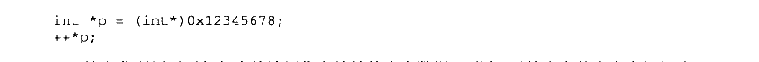

<details markdown="1"><summary>复制校对文字（未运行验证）</summary>

```text
int *p = (int*)0x12345678;
++*p;
```

</details>

这段代码展示了如何直接读写指定地址的内存数据。不过，尽管当今的内存空间号称是平坦的，但实际上内存仍然在不同的地址区间上有着不同的地位，例如，大多数操作系统都会将 4GB 的内存空间中的一部分挪给内核使用，应用程序无法直接访问这一段内存，这一部分内存地址被称为内核空间。Windows 在默认情况下会将高地址的2GB 空间分配给内核（也可配置为1GB），而Linux 默认情况下将高地址的1GB 空间分配给内核，这些在前文中都已经介绍过了。

用户使用的剩下2GB或3GB 的内存空间称为用户空间。在用户空间里，也有许多地址区间有特殊的地位，一般来讲，应用程序使用的内存空间里有如下“默认”的区域。

- 栈：栈用于维护函数调用的上下文，离开了栈函数调用就没法实现。在10.2 节中将对栈作详细的介绍。栈通常在用户空间的最高地址处分配，通常有数兆字节的大小。

- 堆：堆是用来容纳应用程序动态分配的内存区域，当程序使用 malloc 或new 分配内存时，得到的内存来自堆里。堆会在10.3节详细介绍。堆通常存在于栈的下方（低地址方向），在某些时候，堆也可能没有固定统一的存储区域。堆一般比栈大很多，可以有几十至数百兆字节的容量。

- 可执行文件映像：这里存储着可执行文件在内存里的映像，在第6章已经提到过，由装载器在装载时将可执行文件的内存读取或映射到这里。在此不再详细说明。

- 保留区：保留区并不是一个单一的内存区域，而是对内存中受到保护而禁止访问的内存区域的总称，例如，大多数操作系统里，极小的地址通常都是不允许访问的，如 NULL。

通常C语言将无效指针赋值为0也是出于这个考虑，因为0地址上正常情况下不可能有有效的可访问数据。

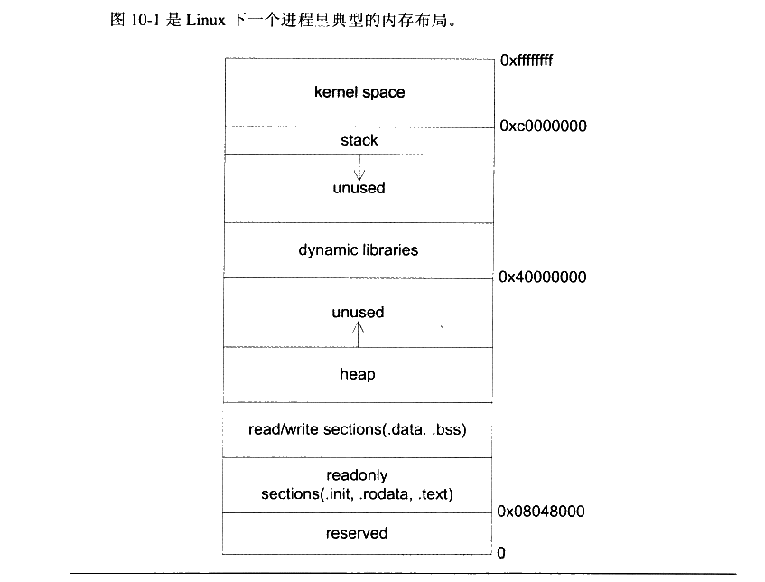

<p class="image-caption">图 10-1 Linux 进程地址空间布局（内核版本2.4.x）</p>

<details markdown="1"><summary>查看图中文字（按图分组）</summary>

从高地址到低地址：内核空间（0xc0000000～0xffffffff）、栈（向低地址增长）、未分配空间、动态链接库（0x40000000 附近）、未分配空间、堆（向高地址增长）、读写段（.data、.bss）、只读段（.init、.rodata、.text，从 0x08048000 开始）、保留区。

</details>

在图10-1 中，有一个没有介绍的区域：“动态链接库映射区”，这个区域用于映射装载的动态链接库。在 Linux 下，如果可执行文件依赖其他共享库，那么系统就会为它在从0x40000000 开始的地址分配相应的空间，并将共享库载入到该空间。

图中的箭头标明了几个大小可变的区的尺寸增长方向，在这里可以清晰地看出栈向低地址增长，堆向高地址增长。当栈或堆现有的大小不够用时，它将按照图中的增长方向扩大自身的尺寸，直到预留的空间被用完为止。

在接下来的两节中，会详细介绍上述几个区域中的栈和堆，让读者对应用程序执行时内存的状况有一个更加深入的理解。

#### Q&A

Q：我写的程序常常出现“段错误（segment fault）”或者“非法操作，该内存地址不能 read/write”的错误信息，这是怎么回事？

A：这是典型的非法指针解引用造成的错误。当指针指向一个不允许读或写的内存地址，而程序却试图利用指针来读或写该地址的时候，就会出现这个错误。在 Linux 或Windows 的内存布局中，有些地址是始终不能读写的，例如0地址。还有些地址是一开始不允许读写，应用程序必须事先请求获取这些地址的读写权，或者某些地址一开始并没有映射到实际的物理内存，应用程序必须事先请求将这些地址映射到实际的物理地址（commit），之后才能够自由地读写这片内存。当一个指针指向这些区域的时候，对它指向的内存进行读写就会引发错误。造成这样的最普遍原因有两种：

1. 程序员将指针初始化为 NULL，之后却没有给它一个合理的值就开始使用指针。

2. 程序员没有初始化栈上的指针，指针的值一般会是随机数，之后就直接开始使用指针。

因此，如果你的程序出现了这样的错误，请着重检查指针的使用情况。


## 10.2 栈与调用惯例

#### 10.2.1 什么是栈

栈（stack）是现代计算机程序里最为重要的概念之一，几乎每一个程序都使用了栈，没有栈就没有函数，没有局部变量，也就没有我们如今能够看见的所有的计算机语言。在解释为什么栈会如此重要之前，让我们来先了解一下传统的栈的定义：

在经典的计算机科学中，栈被定义为一个特殊的容器，用户可以将数据压入栈中（入栈，push），也可以将已经压入栈中的数据弹出（出栈，pop），但栈这个容器必须遵守一条规则：先入栈的数据后出栈（First In Last Out, FILO），多多少少像叠成一叠的书（如图10-2所示）：先叠上去的书在最下面，因此要最后才能取出。

在计算机系统中，栈则是一个具有以上属性的动态内存区域。程序可以将数据压入栈中，也可以将数据从栈顶弹出。压栈操作使得栈增大，而弹出操作使栈减小。

在经典的操作系统里，栈总是向下增长的。在i386 下，栈顶由称为 esp 的寄存器进行定位。压栈的操作使栈顶的地址减小，弹出的操作使栈顶地址增大。

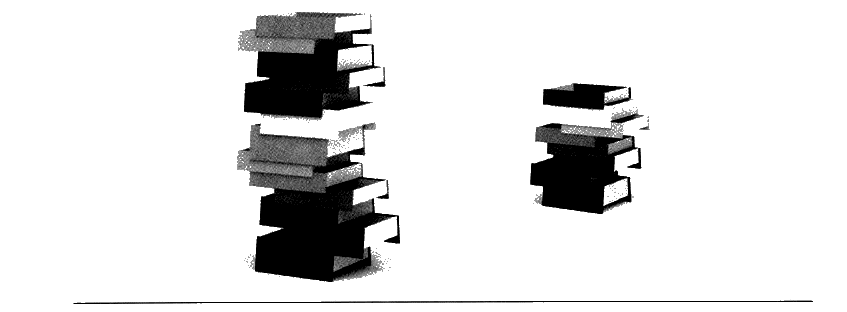

<p class="image-caption">图 10-2 现实生活中的栈：叠起来的书</p>

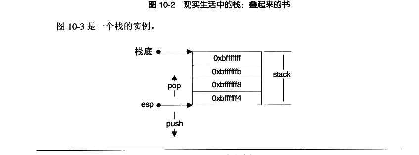

<p class="image-caption">图 10-3 程序栈实例</p>

<details markdown="1"><summary>查看图中文字（按图分组）</summary>

栈底在高地址，esp 指向栈顶。push 使 esp 减小，pop 使 esp 增大。图中依次标出 0xbfffffff、0xbffffffb、0xbffffff8、0xbffffff4。

</details>

这里栈底的地址是 0xbfffffff，而 esp 寄存器标明了栈顶，地址为0xbffffff4。在栈上压入数据会导致 esp 减小，弹出数据使得 esp 增大。相反，直接减小 esp 的值也等效于在栈上开辟空间，直接增大 esp 的值等效于在栈上回收空间。

栈在程序运行中具有举足轻重的地位。最重要的，栈保存了一个函数调用所需要的维护信息，这常常被称为堆栈帧（Stack Frame）或活动记录（Activation Record）。堆栈帧一般包括如下几方面内容：

- 函数的返回地址和参数。

临时变量：包括函数的非静态局部变量以及编译器自动生成的其他临时变量。

- 保存的上下文：包括在函数调用前后需要保持不变的寄存器。

在i386中，一个函数的活动记录用 ebp 和 esp这两个寄存器划定范围。esp 寄存器始终指向栈的顶部，同时也就指向了当前函数的活动记录的顶部。而相对的，ebp 寄存器指向了函数活动记录的一个固定位置，ebp 寄存器又被称为帧指针（Frame Pointer）。 一个很常见的活动记录示例如图10-4所示。

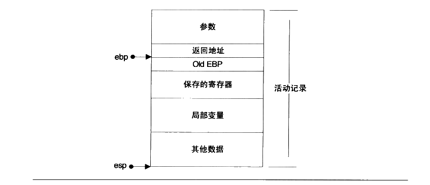

<p class="image-caption">图10-4 活动记录</p>

<details markdown="1"><summary>查看图中文字（按图分组）</summary>

从高地址到低地址：参数、返回地址、Old EBP（ebp 指向这里）、保存的寄存器、局部变量、其他数据（esp 指向栈顶）。括号标出活动记录。

</details>

在参数之后的数据（包括参数）即是当前函数的活动记录，ebp 固定在图中所示的位置，不随这个函数的执行而变化，相反地，esp 始终指向栈顶，因此随着函数的执行，esp会不断变化。固定不变的ebp 可以用来定位函数活动记录中的各个数据。在 ebp 之前首先是这个函数的返回地址，它的地址是ebp-4，再往前是压入栈中的参数，它们的地址分别是 ebp-8、ebp-12 等，视参数数量和大小而定。ebp 所直接指向的数据是调用该函数前ebp 的值，这样在函数返回的时候，ebp 可以通过读取这个值恢复到调用前的值。之所以函数的活动记录会形成这样的结构，是因为函数调用本身是如此书写的：一个i386 下的函数总是这样调用的：

- 把所有或一部分参数压入栈中，如果有其他参数没有入栈，那么使用某些特定的寄存器传递。

- 把当前指令的下一条指令的地址压入栈中。

- 跳转到函数体执行。

其中第2步和第3步由指令call一起执行。跳转到函数体之后即开始执行函数，而i386函数体的“标准”开头是这样的（但也可以不一样）：

push ebp：把 ebp 压入栈中（称为 old ebp）。

mov ebp, esp: ebp = esp（这时 ebp 指向栈顶，而此时栈顶就是 old ebp）。

- 【可选】sub esp,XXX：在栈上分配XXX 字节的临时空间。

- 【可选】push XXX：如有必要，保存名为 XXX 寄存器（可重复多个）。

把ebp 压入栈中，是为了在函数返回的时候便于恢复以前的 ebp 值。而之所以可能要保存一些寄存器，在于编译器可能要求某些寄存器在调用前后保持不变，那么函数就可以在调用开始时将这些寄存器的值压入栈中，在结束后再取出。不难想象，在函数返回时，所进行的“标准”结尾与“标准”开头正好相反：

- 【可选】pop XXX：如有必要，恢复保存过的寄存器（可重复多个）。

- mov esp, ebp： 恢复 ESP 同时回收局部变量空间。

- pop ebp：从栈中恢复保存的ebp 的值。

- ret：从栈中取得返回地址，并跳转到该位置。

提示：GCC 编译器有一个参数叫做-fomit-frame-pointer 可以取消帧指针，即不使用任何帧指针，而是通过 esp 直接计算帧上变量的位置。这么做的好处是可以多出一个 ebp 寄存器供使用，但是坏处却很多，比如帧上寻址速度会变慢，而且没有帧指针之后，无法准确定位函数的调用轨迹（Stack Trace ）。所以除非你很清楚你在做什么，否则请尽量不使用这个参数。

为了加深印象，下面我们反汇编一个函数看看：

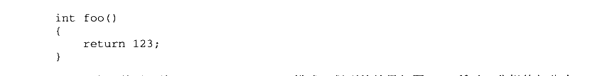

<details markdown="1"><summary>复制校对文字（未运行验证）</summary>

```text
int foo()
{
    return 123;
}
```

</details>

这个函数反汇编（VC9,i386,Debug 模式）得到的结果如图10-5所示（非粗体部分为调试用的代码）。

我们可以看到头两行保存了旧的ebp，并让ebp 指向当前的栈顶。接下来的一行指令

004113A3 sub esp,0C0h

将栈扩大了0xC0个字节，其中多出来的空间的值并不确定。这么一大段多出来的空间可以存储局部变量、某些临时数据以及调试信息。在第3步里，函数将3个寄存器保存在了栈上。这3个寄存器在函数随后的执行中可能被修改，所以要先保存一下这些寄存器原本的值，以便在退出函数时恢复。第4步的代码用于调试。这段汇编大致等价于如下伪代码：

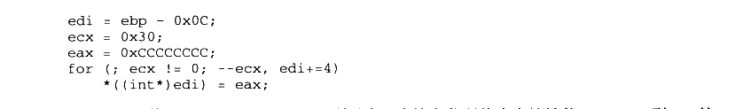

<details markdown="1"><summary>复制校对文字（未运行验证）</summary>

```text
edi = ebp - 0x0C;
ecx = 0x30;
eax = 0xCCCCCCCC;
for (; ecx != 0; --ecx, edi+=4)
    *((int*)edi) = eax;
```

</details>

可以计算出，0x30\*4= 0xC0。所以实际上这段代码将内存地址从 ebp-0xC0 到 ebp这一段全部初始化为0xCC。恰好就是第2步在栈上分配出来的空间。

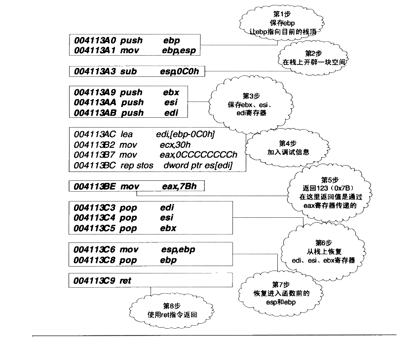

<p class="image-caption">图 10-5 foo 函数汇编代码分析</p>

<details markdown="1"><summary>查看图中文字（按图分组）</summary>

```asm
004113A0 push ebp
004113A1 mov ebp,esp
004113A3 sub esp,0C0h
004113A9 push ebx
004113AA push esi
004113AB push edi
004113AC lea edi,[ebp-0C0h]
004113B2 mov ecx,30h
004113B7 mov eax,0CCCCCCCCh
004113BC rep stos dword ptr es:[edi]
004113BE mov eax,7Bh
004113C3 pop edi
004113C4 pop esi
004113C5 pop ebx
004113C6 mov esp,ebp
004113C8 pop ebp
004113C9 ret
```

步骤：保存 ebp 并建立帧指针 → 分配栈空间 → 保存 ebx、esi、edi → 填入调试信息 → 用 eax 返回 123 → 恢复寄存器 → 恢复 esp、ebp → ret 返回。

</details>

【小知识】

我们在 VC 下调试程序的时候，常常看到一些没有初始化的变量或内存区域的值是“烫”。例如下列代码：

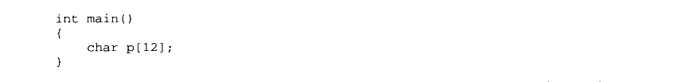

<details markdown="1"><summary>复制校对文字（未运行验证）</summary>

```text
int main()
{
    char p[12];
}
```

</details>

此代码中的数组p没有初始化，当我们在 Debug 模式下运行这个程序，在main 中设下断点并监视（watch）数组p时，就能看见如图10-6的情形。

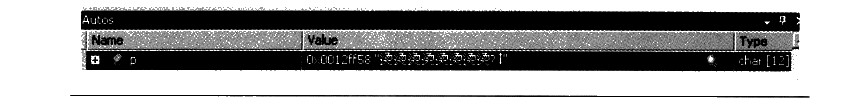

<p class="image-caption">图 10-6 未初始化的局部变量</p>

<details markdown="1"><summary>查看图中文字（按图分组）</summary>

调试器监视未初始化的 char p[12]，值一栏显示连续的“烫”字。

</details>

之所以会出现“烫”这么一个奇怪的字，就是因为 Debug 模式在第4 步里，将所有的分配出来的栈空间的每一个字节都初始化为 0xCC.0xCCCC（即两个连续排列的0xCC）的汉字编码就是烫，所以 0xCCCC 如果被当作文本就是“烫”.

将未初始化数据设置为 0xCC的理由是这样可以有助于判断一个变量是否没有初始化。如果一个指针变量的值是 0xCCCCCCCC，那么我们就可以基本相信这个指针没有经过初始化。当然这个信息仅供参考，编译器检查未初始化变量的方法并不能以此为证据。有时编译器还会使用 0xCDCDCDCD 作为未初始化标记，此时我们就会看到汉字“屯屯”。

在第5步，函数将0x7B（即 123）赋值给eax，作为返回值传出。在函数返回之后，调用方可以通过读取 eax 寄存器来获取返回值。接下来的几步是函数的资源清理阶段，从栈中恢复保存的寄存器、ebp 等。最后使用 ret 指令从函数返回。

以上介绍的是i386标准函数进入和退出指令序列，它们基本的形式为：

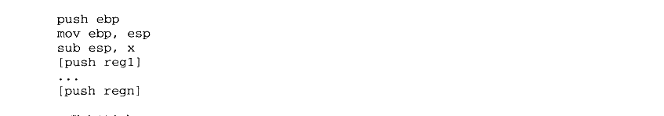

<details markdown="1"><summary>复制校对文字（未运行验证）</summary>

```text
push ebp
mov ebp, esp
sub esp, x
[push reg1]
...
[push regn]
```

</details>

函数实际内容

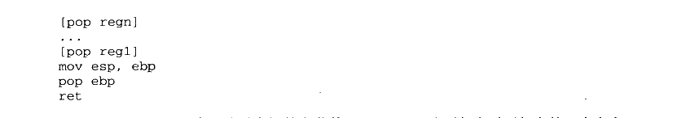

<details markdown="1"><summary>复制校对文字（未运行验证）</summary>

```text
[pop regn]
...
[pop reg1]
mov esp, ebp
pop ebp
ret
```

</details>

其中 x 为栈上开辟出来的临时空间的字节数，reg1...regn 分别代表需要保存的n 个寄存器。方括号部分为可选项。不过在有些场合下，编译器生成函数的进入和退出指令序列时并不按照标准的方式进行。例如一个满足如下要求的C函数：

- 函数被声明为 static（不可在此编译单元之外访问）。

- 函数在本编译单元仅被直接调用，没有显式或隐式取地址（即没有任何函数指针指向过这个函数）。

编译器可以确信满足这两条的函数不会在其他编译单元内被调用，因此可以随意地修改这个函数的各个方面- 包括进入和退出指令序列——来达到优化的目的。

【小知识】Hot Patch Prologue

在 Windows 的函数里，有些函数尽管使用了标准的进入指令序列，但在这些指令之前却插入了一些特殊的内容：

mov edi,edi

我们知道这条指令没有任何用处，事实上也确实如此。这条指令在汇编之后会成为一个占用2个字节的机器码，纯粹作为占位符而存在。使用这条指令开头的函数整体上看起来是这样的：

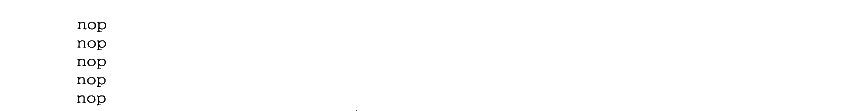

<details markdown="1"><summary>复制校对文字（未运行验证）</summary>

```text
nop
nop
nop
nop
nop
FUNCTION: ; 函数的实际入口
mov edi, edi ; 2 字节的占位符
push ebp ; 标准的进入序列
mov ebp, esp
```

</details>

其中 nop 指令占1字节，本身不做任何操作，也是以占位符的形式存在，FUNCTION 为一个标号，表明函数的入口，本身不占据任何空间。

被设计成这样的函数在运行的时候可以很容易被其他函数“替换”掉。在上面的指令序列中调用的函数是 FUNCTION，但是我们可以做一些改动，就可以在运行时刻修改成调用函数 REPLACEMENT\_FUNCTION.首先我们需要在进程的内存空间里的任意某处写入 REPLACEMENT_FUNCTION 的定义：

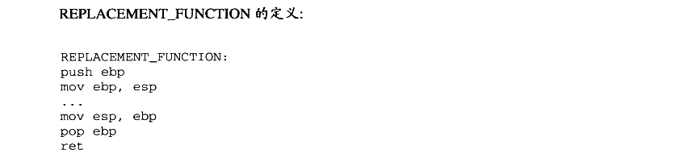

<details markdown="1"><summary>复制校对文字（未运行验证）</summary>

```text
REPLACEMENT_FUNCTION:
push ebp
mov ebp, esp
...
mov esp, ebp
pop ebp
ret
```

</details>

然后将原函数的内容稍作修改即可：


<details markdown="1"><summary>复制校对文字（未运行验证）</summary>

```text
LABEL:
jmp REPLACEMENT_FUNCTION
FUNCTION: ; 函数的实际入口
jmp LABEL
push ebp ; 标准的进入序列
mov ebp, esp
```

</details>

在这里，我们首先将占用5个字节的5个 nop 指令覆盖为一个jmp 指令（恰好5字节），然后将占用两个字节的 mov edi, edi 指令替换为另一个jmp 指令。为什么第二个jmp 指令只占用2个字节呢？因为这个 jmp的目标距离这个 jmp 指令本身非常近，因此这个 jmp 指令就被汇编器翻译成了一个“近跳” 指令，这种指令只占用2个字节，但只能跳跃至当前地址前后127字节范围的目标位置。在经过这样的替换之后，原函数的调用就被转换为新函数的调用。

这里替换的机制往往可以用来实现一种叫做钩子（Hook）的技术，允许用户在某些时刻截获特定函数的调用，如图10-7所示。

#### 10.2.2 调用惯例

经过前面的分析和讨论，我们大致知道了函数调用时实际发生的事件。从这样的信息里能够发现一个现象，那就是函数的调用方和被调用方对函数如何调用有着统一的理解，例如它们双方都一致地认同函数的参数是按照某个固定的方式压入栈内。如果不这样的话，函数将无法正确运行。这就好比我们说话时需要双方对同一个声音（语音）有着一致的理解一样，否则就会产生误解，如图10-7所示。


<p class="image-caption">图 10-7 函数调用惯例犹如语言</p>

<details markdown="1"><summary>查看图中文字（按图分组）</summary>

一方说“Hello, John!”，另一方听成“黑龙江？”。

</details>

假设有一个 foo 函数：

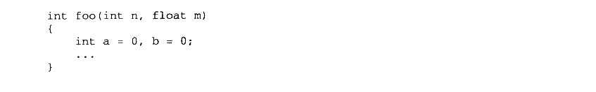

<details markdown="1"><summary>复制校对文字（未运行验证）</summary>

```text
int foo(int n, float m)
{
    int a = 0, b = 0;
    ...
}
```

</details>

如果函数的调用方在传递参数时先压入参数n，再压入参数m，而foo函数却认为其调用方应该先压入参数 m，后压入参数n，那么不难想象foo 内部的m 和n 的值将会被交换。如图10-8所示。


<p class="image-caption">图 10-8 错误的调用惯例</p>

<details markdown="1"><summary>查看图中文字（按图分组）</summary>

栈中依次为 n、m、返回地址；foo 却把 n 的位置当成 m、把 m 的位置当成 n。

</details>

再者如果函数的调用方决定利用寄存器传递参数，而函数本身却仍然以为参数通过栈传递，那么显然函数无法获取正确的参数。因此，毫无疑问函数的调用方和被调用方对于函数如何调用须要有一个明确的约定，只有双方都遵守同样的约定，函数才能被正确地调用，这样的约定就称为调用惯例（Calling Convention）。一个调用惯例一般会规定如下几个方面的内容。

- 函数参数的传递顺序和方式函数参数的传递有很多种方式，最常见的一种是通过栈传递。函数的调用方将参数压入栈中，函数自己再从栈中将参数取出。对于有多个参数的函数，调用惯例要规定函数调用方将参数压栈的顺序：是从左至右，还是从右至左。有些调用惯例还允许使用寄存器传递参数，以提高性能。

- 栈的维护方式在函数将参数压栈之后，函数体会被调用，此后需要将被压入栈中的参数全部弹出，以使得栈在函数调用前后保持一致。这个弹出的工作可以由函数的调用方来完成，也可以由函数本身来完成。

- 名字修饰（Name-mangling）的策略为了链接的时候对调用惯例进行区分，调用惯例要对函数本身的名字进行修饰。不同的调用惯例有不同的名字修饰策略。

事实上，在C语言里，存在着多个调用惯例，而默认的调用惯例是 cdecl。任何一个没有显式指定调用惯例的函数都默认是 cdecl 惯例。对于函数foo的声明，它的完整形式是：

```c
int __cdecl foo(int n, float m);
```

\_\_cdecl是非标准关键字，在不同的编译器里可能有不同的写法，例如在 gcc里就不存在\_\_cdecl 这样的关键字，而是使用`__attribute__((cdecl))`。

cdecl 这个调用惯例是C语言默认的调用惯例，它的内容如表10-1所示。

表10-1

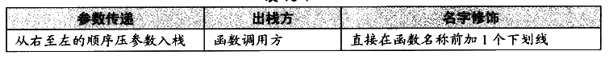

<details markdown="1"><summary>查看校对表格</summary>

| 参数传递 | 出栈方 | 名字修饰 |
| --- | --- | --- |
| 从右至左顺序压参数入栈 | 函数调用方 | 直接在函数名称前加 1 个下划线 |

</details>

因此 foo被修饰之后就变为\_foo。在调用foo 的时候，按照 cdecl 的参数传递方式，具体的堆栈操作如下。

- 将m压入栈。

- 将n压入栈。

- 调用\_foo，此步又分为两个步骤：a） 将返回地址（即调用\_foo 之后的下一条指令的地址）压入栈：b） 跳转到\_foo执行。

当函数返回之后：esp = esp + 8（参数出栈，由于不需要得到出栈的数据，所以直接调整栈顶位置就可以了）。因此进入foo 函数之后，栈上大致是如图10-9所示。


<p class="image-caption">图 10-9 foo 函数栈布局</p>

<details markdown="1"><summary>查看图中文字（按图分组）</summary>

栈中从高地址到低地址依次为 m、n、返回地址。

</details>

然后在foo 里面要保存一系列的寄存器，包括函数调用方的ebp 寄存器，以及要为a和b两个局部变量分配空间（参见本节开头）。最终的栈的构成会如图10-10所示。

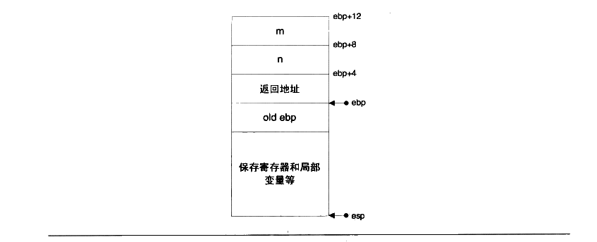

<p class="image-caption">图 10-10 foo 函数栈布局（2）</p>

<details markdown="1"><summary>查看图中文字（按图分组）</summary>

m 位于 ebp+12，n 位于 ebp+8，返回地址位于 ebp+4，old ebp 位于 ebp；再向下是保存的寄存器和局部变量，esp 指向栈顶。

</details>

对于不同的编译器，由于分配局部变量和保存寄存器的策略不同，这个结果可能有出入。在以上布局中，如果想访问变量n，实际的地址是使用 ebp+8。当foo 返回的时候，程序首先会使用pop 恢复保存在栈里的寄存器，然后从栈里取得返回地址，返回到调用方。调用方再调整ESP 将堆栈恢复。因此有如下代码：

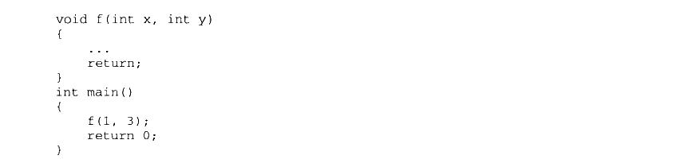

<details markdown="1"><summary>复制校对文字（未运行验证）</summary>

```text
void f(int x, int y)
{
    ...
    return;
}
int main()
{
    f(1, 3);
    return 0;
}
```

</details>

实际执行的操作如图 10-11 所示。

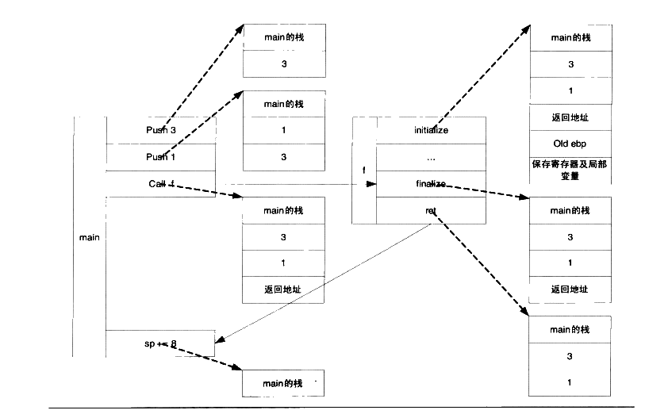

<p class="image-caption">图 10-11 main 函数的执行流程</p>

<details markdown="1"><summary>查看图中文字（按图分组）</summary>

main 依次 push 3、push 1，再 call f；f 建立栈帧、执行函数体、恢复栈帧并 ret；main 最后用 sp += 8 回收参数空间。

</details>

其中虚线指向该指令执行后的栈状态，实线表示程序的跳转状况。同样，对于多级调用，如果我们有如下代码：

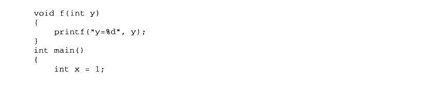

<details markdown="1"><summary>复制校对文字（未运行验证）</summary>

```text
void f(int y)
{
    printf("y=%d", y);
}
int main()
{
    int x = 1;
```

</details>


<details markdown="1"><summary>复制校对文字（未运行验证）</summary>

```text
f(x);
    return 0;
}
```

</details>

这些代码形成的堆栈格局如图10-12所示。

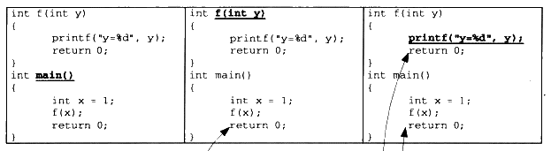

<details markdown="1"><summary>查看图中文字（按图分组）</summary>

图 10-12 的前三个阶段：main 中建立局部变量 x；调用 f(x)，建立 f 的栈帧；f 调用 printf，再建立 printf 的栈帧。

</details>

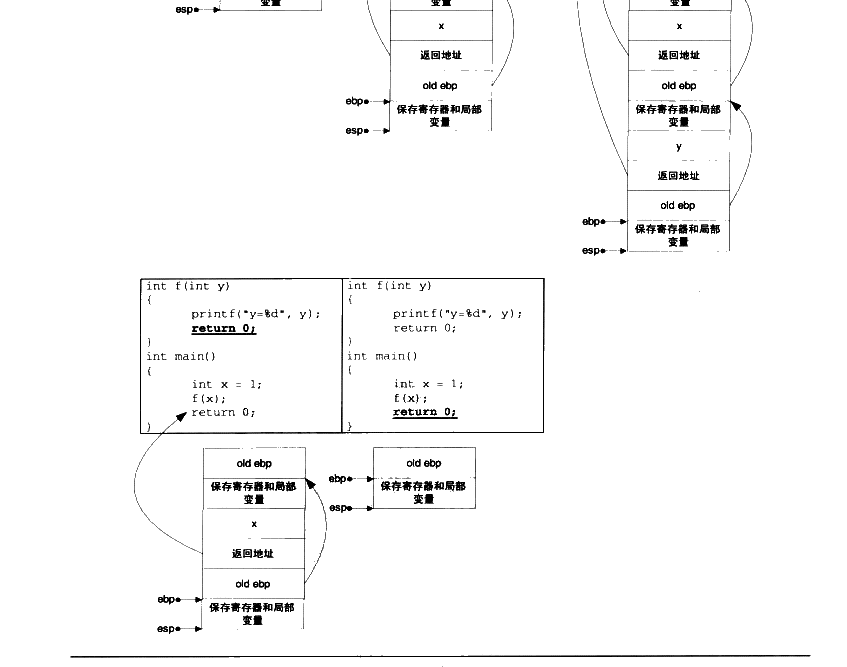

<p class="image-caption">图 10-12 多级调用栈布局</p>

<details markdown="1"><summary>查看图中文字（按图分组）</summary>

图 10-12：每次调用保存返回地址和 old ebp，并为寄存器、局部变量分配空间。printf 返回后回到 f，f 返回后恢复 main 的栈帧。

</details>

图10-12 的箭头表示地址的指向关系，而带下划线的代码表示当前执行的代码。除了cdecl 调用惯例之外，还存在很多别的调用惯例，例如 stdcall、fastcall 等。表10-2介绍了几项主要的调用惯例的内容。

表 10-2

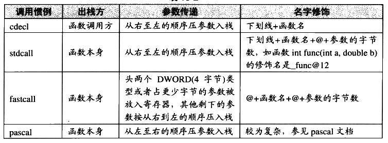

<details markdown="1"><summary>查看校对表格</summary>

| 调用惯例 | 出栈方 | 参数传递 | 名字修饰 |
| --- | --- | --- | --- |
| cdecl | 函数调用方 | 从右至左压参数入栈 | 下划线 + 函数名 |
| stdcall | 函数本身 | 从右至左压参数入栈 | 下划线 + 函数名 + @ + 参数的字节数，如 `_func@12` |
| fastcall | 函数本身 | 头两个 DWORD（4 字节）类型或占更少字节的参数放入寄存器，其余从右至左压栈 | @ + 函数名 + @ + 参数的字节数 |
| pascal | 函数本身 | 从左至右压参数入栈 | 较为复杂，参见 pascal 文档 |

</details>

此外，不少编译器还提供一种称为 naked call 的调用惯例，这种调用惯例用在特殊的场合，其特点是编译器不产生任何保护寄存器的代码，故称为 naked call。对于C++语言，以上几种调用惯例的名字修饰策略都有所改变，因为C++支持函数重载以及命名空间和成员函数等等，因此实际上一个函数名可以对应多个函数定义，那么上面提到的名字修饰策略显然是无法区分各个不同同名函数定义的。所以 C++自己有更加复杂的名字修饰策略，我们在前面的章节也已经遇到过了。最后，C++自己还有一种特殊的调用惯例，称为 thiscall，专用于类成员函数的调用。其特点随编译器不同而不同，在VC 里是 this 指针存放于 ecx 寄存器，参数从右到左压栈，而对于 gcc、thiscall 和 cdecl 完全一样，只是将 this 看作是函数的第一个参数。

【小实验】

我们可以让函数的调用方使用错误的调用惯例，看看能发生什么事情：

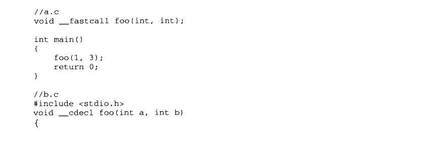

<details markdown="1"><summary>复制校对文字（未运行验证）</summary>

```text
// a.c
void __fastcall foo(int, int);
int main()
{
    foo(1, 3);
    return 0;
}

// b.c
#include <stdio.h>
void __cdecl foo(int a, int b)
{
```

</details>


<details markdown="1"><summary>复制校对文字（未运行验证）</summary>

```text
printf("a=%d,b=%d", a, b);
}
```

</details>

这里有2个.c文件，分别定义和调用了函数foo，但在a.c 中，调用foo所使用的调用惯例是错误的fastcall。编译并链接这两个.c文件会发现链接失败，因为在 a.c 中，foo函数被修饰为@foo@8，而在b.c中，foo函数被修饰为\_foo。为了使得程序能够运行，我们可以把b.c 单独编译为 DLL（或so），并导出符号 foo，而main 则加载b.c导出的DLL（或sO），并导入符号 foo.（具体步骤在动态链接部分已经有详细的说明，这里就不再细说。）如此处理之后程序就可以运行了，运行的结果（可能）是：

a=8458637,b=1

可见参数没有正确的传入。

#### 10.2.3 函数返回值传递

除了参数的传递之外，函数与调用方的交互还有一个渠道就是返回值。在第287页的例子中，我们发现eax 是传递返回值的通道。函数将返回值存储在eax 中，返回后函数的调用方再读取eax。但是eax 本身只有4个字节，那么大于4字节的返回值是如何传递的呢？

对于返回5～8字节对象的情况，几乎所有的调用惯例都是采用eax 和 edx联合返回的方式进行的。其中 eax 存储返回值的低4字节，而edx存储返回值的高1～4字节。而对于超过8字节的返回类型，我们可以用下列代码来研究：

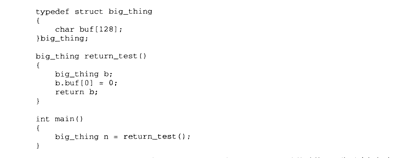

<details markdown="1"><summary>复制校对文字（未运行验证）</summary>

```text
typedef struct big_thing
{
    char buf[128];
} big_thing;

big_thing return_test()
{
    big_thing b;
    b.buf[0] = 0;
    return b;
}

int main()
{
    big_thing n = return_test();
}
```

</details>

这段代码里的 return\_test 的返回值类型是一个长度为128字节的结构，因此无论如何也不可能直接通过 eax传递。让我们首先来反汇编（MSVC9）一下 main 函数，结果如下：

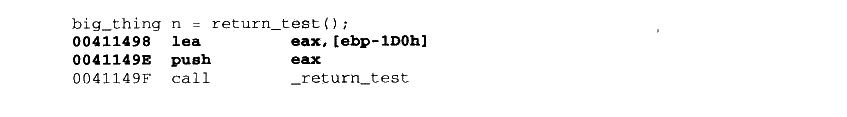

<details markdown="1"><summary>复制校对文字（未运行验证）</summary>

```text
big_thing n = return_test();
00411498 lea eax,[ebp-1D0h]
0041149E push eax
0041149F call _return_test
```

</details>

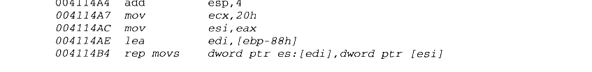

<details markdown="1"><summary>复制校对文字（未运行验证）</summary>

```text
004114A4 add esp,4
004114A7 mov ecx,20h
004114AC mov esi,eax
004114AE lea edi,[ebp-88h]
004114B4 rep movs dword ptr es:[edi],dword ptr [esi]
```

</details>

其中第二行：

00411498 lea eax，［ebp-1D0h］

将栈上的一个地址（ebp-1D0h）存储在 eax 里，接着下一行：

push eax

将这个地址压入栈中然后就紧接着调用 return\_test 函数。这从形式上无疑是将数据 ebp-1D0h 作为参数传入 return\_test 函数，然而 return\_test 是没有参数的，因此我们可以将这个数据称为是“隐含参数”。换句话说，return\_test 的原型实际是：

big\_thing return\_test （void\* addr）；

这段汇编最后4行（斜体部分）是一个整体，我们可以想象在函数返回之后，函数的调用方需要获取函数的返回对象并对n赋值。rep movs 是一个复合指令，它的大致意义是重复movs 指令直到ecx 寄存器为0。于是“rep movs a, b” 的意思就是将b 指向位置上的若干个双字（4字节）拷贝到由a指向的位置上，拷贝双字的个数由ecx 指定，实际上这句复合指令的含义相当于 memcpy （a, b,ecx \*4）。所以说，最后4行的含义相当于：

memcpy （ebp-88h,eax,0x20 \* 4）

即将 eax指向位置上的0x20个双字拷贝到ebp-88h 的位置上。毫无疑问，ebp-88h 这个地址就是变量n 的地址，如果有所怀疑，可以比较一下 n 的地址和 ebp-88h 的值即可确信这一点。而0x20个双字就是128 个字节，正是big\_thing的大小。现在我们可以将这段汇编略微还原了：


<details markdown="1"><summary>复制校对文字（未运行验证）</summary>

```text
return_test(ebp-1D0h)
memcpy(&n, (void*)eax, sizeof(n));
```

</details>

可见，return\_test 返回的结构体仍然是由 eax 传出的，只不过这次 eax 存储的是结构体的指针。那么 return\_test 具体是如何返回一个结构体的呢？让我们来看看 return\_test 的实现：

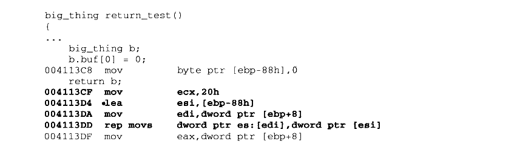

<details markdown="1"><summary>复制校对文字（未运行验证）</summary>

```text
big_thing return_test()
{
...
    big_thing b;
    b.buf[0] = 0;
004113C8 mov byte ptr [ebp-88h],0
    return b;
004113CF mov ecx,20h
004113D4 lea esi,[ebp-88h]
004113DA mov edi,dword ptr [ebp+8]
004113DD rep movs dword ptr es:[edi],dword ptr [esi]
004113DF mov eax,dword ptr [ebp+8]
```

</details>

在这里，ebp-88h 存储的是 return\_test 的局部变量b。根据 rep movs 的功能，加粗的4条指令可以翻译成如下的代码：

memcpy （［ebp+8］，&amp;b, 128）；

在这里，［ebp+8］指的是\*（void\*\*）（ebp+8），即将地址 ebp+8上存储的值作为地址，由于ebp 实际指向栈上保存的旧的 ebp，因此 ebp+4 指向压入栈中的返回地址，ebp+8则指向函数的参数。而我们知道，return\_test 是没有真正的参数的，只有一个“伪参数”由函数的调用方悄悄地传入，那就是 ebp-1D0h（这里的 ebp 是 return\_test 调用前的ebp）这个值。换句话说，[ebp+8]=old\_ebp-1D0h。

那么到底 main 函数里的 ebp-1D0h 是什么内容呢？我们来看看 main 函数一开始初始化的汇编代码：

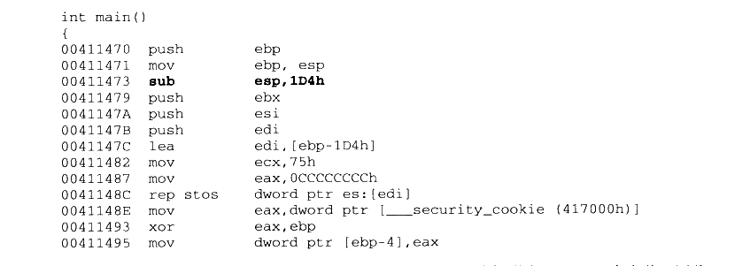

<details markdown="1"><summary>复制校对文字（未运行验证）</summary>

```text
int main()
{
00411470 push ebp
00411471 mov ebp,esp
00411473 sub esp,1D4h
00411479 push ebx
0041147A push esi
0041147B push edi
0041147C lea edi,[ebp-1D4h]
00411482 mov ecx,75h
00411487 mov eax,0CCCCCCCCh
0041148C rep stos dword ptr es:[edi]
0041148E mov eax,dword ptr [__security_cookie (417000h)]
00411493 xor eax,ebp
00411495 mov dword ptr [ebp-4],eax
```

</details>

我们可以看到 main 函数在保存了ebp 之后，就直接将栈增大了 1D4h 个字节，因此ebp-1D0h 就正好落在这个扩大区域的末尾，而区间［ebp-1D0h, ebp-1D0h+128）也正好处于这个扩大区域的内部。至于这块区域剩下的内容，则留作它用。下面我们就可以把思路理清了：

- 首先 main 函数在栈上额外开辟了一片空间，并将这块空间的一部分作为传递返回值的临时对象，这里称为 temp。

- 将temp 对象的地址作为隐藏参数传递给 return\_test 函数。

- return\_test 函数将数据拷贝给 temp 对象，并将temp 对象的地址用 eax 传出。

- return\_test 返回之后，main 函数将 eax 指向的 temp 对象的内容拷贝给n。

整个流程如图10-13所示。

也可以用伪代码表示如下：

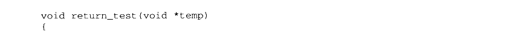

<details markdown="1"><summary>复制校对文字（未运行验证）</summary>

```text
void return_test(void *temp)
{
```

</details>

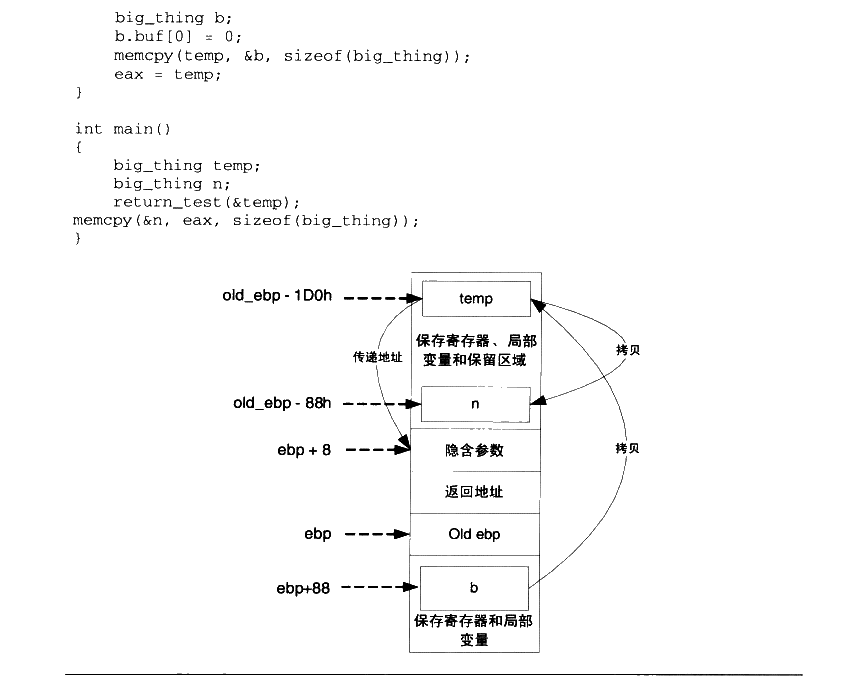

<p class="image-caption">图 10-13 返回值传递流程</p>

<details markdown="1"><summary>查看图中文字（按图分组）</summary>

```c
    big_thing b;
    b.buf[0] = 0;
    memcpy(temp, &b, sizeof(big_thing));
    eax = temp;
}
int main()
{
    big_thing temp;
    big_thing n;
    return_test(&temp);
    memcpy(&n, eax, sizeof(big_thing));
}
```

图中 temp 位于 old_ebp-1D0h，n 位于 old_ebp-88h；ebp+8 处的隐含参数传递 temp 的地址。b 先拷贝到 temp，再由 temp 拷贝到 n。

</details>

毋庸置疑，如果返回值类型的尺寸太大，C语言在函数返回时会使用一个临时的栈上内存区域作为中转，结果返回值对象会被拷贝两次。因而不到万不得已，不要轻易返回大尺寸的对象。为了不失一般性，我们再来看看在Linux 下使用gcc 4.03编译出来的代码返回大尺寸对象的情况。测试的代码仍然使用以下代码：

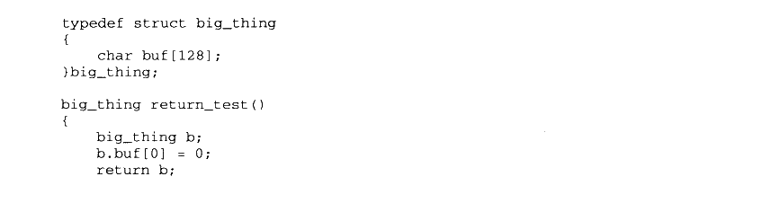

<details markdown="1"><summary>复制校对文字（未运行验证）</summary>

```text
typedef struct big_thing
{
    char buf[128];
} big_thing;
big_thing return_test()
{
    big_thing b;
    b.buf[0] = 0;
    return b;
```

</details>

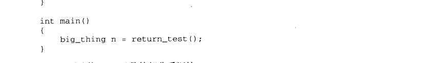

<details markdown="1"><summary>复制校对文字（未运行验证）</summary>

```text
}
int main()
{
    big_thing n = return_test();
}
```

</details>

下面是其 main 函数的部分反汇编：

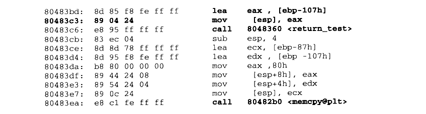

<details markdown="1"><summary>复制校对文字（未运行验证）</summary>

```text
80483bd: 8d 85 f8 fe ff ff  lea eax,[ebp-107h]
80483c3: 89 04 24           mov [esp],eax
80483c6: e8 95 ff ff ff     call 8048360 <return_test>
80483cb: 83 ec 04           sub esp,4
80483ce: 8d 8d 78 ff ff ff  lea ecx,[ebp-87h]
80483d4: 8d 95 f8 fe ff ff  lea edx,[ebp-107h]
80483da: b8 80 00 00 00     mov eax,80h
80483df: 89 44 24 08        mov [esp+8h],eax
80483e3: 89 54 24 04        mov [esp+4h],edx
80483e7: 89 0c 24           mov [esp],ecx
80483ea: e8 c1 fe ff ff     call 80482b0 <memcpy@plt>
```

</details>

与 MSVC9的反汇编对比，可以发现，ebp-0x107 的位置上是临时对象 temp 的地址，而ebp-0x87 则是n的地址。这样，这段代码和用 MSVC9反汇编得到的代码是一样的，都是通过栈上的隐藏参数传递临时对象的地址，只不过在将临时对象写回到实际的目标对象n的时候，MSVC9 使用了 rep movs 指令，而 gcc 调用了 memcpy 函数。可见在这里 VC和 gcc 的思路大同小异。最后来看看如果函数返回一个C++对象会如何：

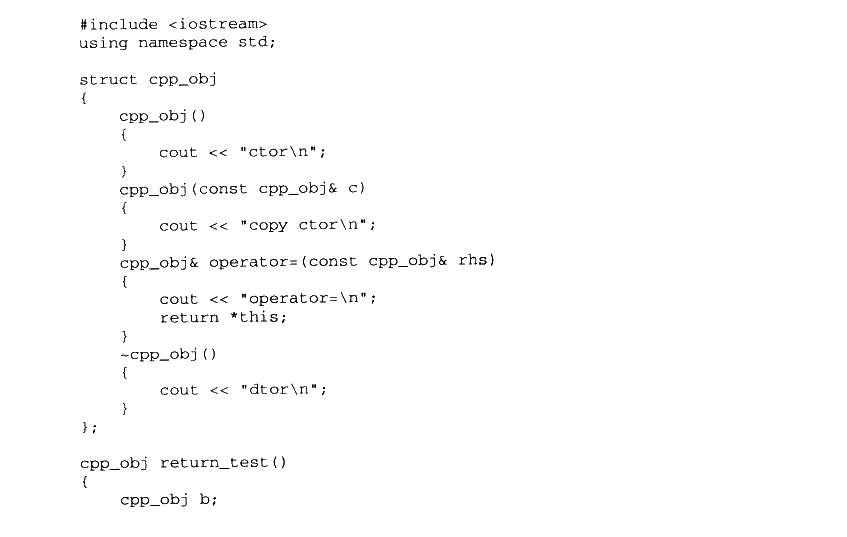

<details markdown="1"><summary>复制校对文字（未运行验证）</summary>

```text
#include <iostream>
using namespace std;
struct cpp_obj
{
    cpp_obj() { cout << "ctor\n"; }
    cpp_obj(const cpp_obj& c) { cout << "copy ctor\n"; }
    cpp_obj& operator=(const cpp_obj& rhs)
    {
        cout << "operator=\n";
        return *this;
    }
    ~cpp_obj() { cout << "dtor\n"; }
};
cpp_obj return_test()
{
    cpp_obj b;
```

</details>

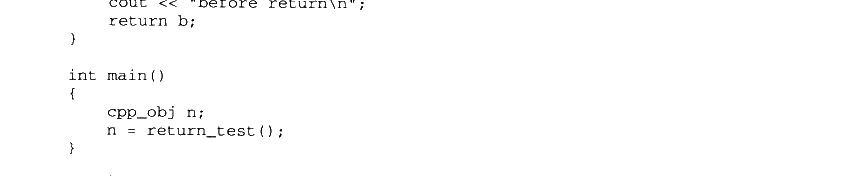

<details markdown="1"><summary>复制校对文字（未运行验证）</summary>

```text
cout << "before return\n";
    return b;
}
int main()
{
    cpp_obj n;
    n = return_test();
}
```

</details>

在没有开启任何优化的情况下，直接运行一下，可以发现程序输出为：

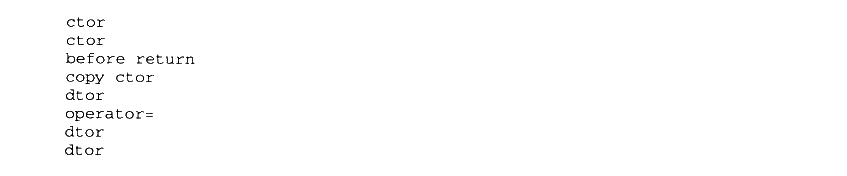

<details markdown="1"><summary>复制校对文字（未运行验证）</summary>

```text
ctor
ctor
before return
copy ctor
dtor
operator=
dtor
dtor
```

</details>

我们可以看到在函数返回之后，进行了一个拷贝构造函数的调用，以及一次 operator=的调用，也就是说，仍然产生了两次拷贝。因此C++的对象同样会产生临时对象。

返回对象的拷贝情况完全不具备可移植性，不同的编译器产生的结果可能不同。

我们可以反汇编 main 函数来确认这一点：

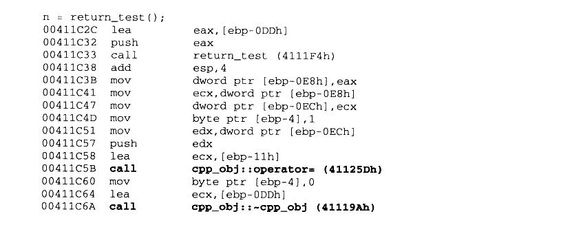

<details markdown="1"><summary>复制校对文字（未运行验证）</summary>

```text
n = return_test();
00411C2C lea eax,[ebp-0DDh]
00411C32 push eax
00411C33 call return_test (4111F4h)
00411C38 add esp,4
00411C3B mov dword ptr [ebp-0E8h],eax
00411C41 mov ecx,dword ptr [ebp-0E8h]
00411C47 mov dword ptr [ebp-0ECh],ecx
00411C4D mov byte ptr [ebp-4],1
00411C51 mov edx,dword ptr [ebp-0ECh]
00411C57 push edx
00411C58 lea ecx,[ebp-11h]
00411C5B call cpp_obj::operator= (41125Dh)
00411C60 mov byte ptr [ebp-4],0
00411C64 lea ecx,[ebp-0DDh]
00411C6A call cpp_obj::~cpp_obj (41119Ah)
```

</details>

可以看出，这段汇编与之前的版本结构是一致的，临时对象的地址仍然通过隐藏参数传递给函数，只不过最后没有使用 rep movs 来拷贝数据，而是调用了函数的 operator=来进行。同时，这里还对临时对象调用了一次析构函数。

函数传递大尺寸的返回值所使用的方法并不是可移植的，不同的编译器、不同的平台、不同的调用惯例甚至不同的编译参数都有权力采用不同的实现方法。因此尽管我们实验得到的结论在 MSVC 和gcc 下惊人地相似，读者也不要认为大对象传递只有这一种情况。

【小知识】

声名狼藉的 C++返回对象

正如我们看到的，在C++里返回一个对象的时候，对象要经过2次拷贝构造函数的调用才能够完成返回对象的传递。1次拷贝到栈上的临时对象里，另一次把临时对象拷贝到存储返回值的对象里。在某些编译器里，返回一个对象甚至要经过更多的步骤。

这样带来的恶果就是返回一个较大对象会有非常多的额外开销。因此C++程序中都尽量避免返回对象。此外，为了减小返回对象的开销，C++提出了返回值优化（Return Value Optimization, RVO）这样的技术，可以将某些场合下的对象拷贝减少1次，例如：

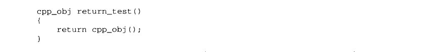

<details markdown="1"><summary>复制校对文字（未运行验证）</summary>

```text
cpp_obj return_test()
{
    return cpp_obj();
}
```

</details>

在这个例子中，构造一个 cpp\_obj 对象会调用一次 cpp\_obj的构造函数，在返回这个对象时，还会调用cpp\_obj的拷贝构造函数。C++的返回值优化可以将这两步合并，直接将对象构造在传出时使用的临时对象上，因此可以减少一次复制过程。


## 10.3 堆与内存管理

相对于栈而言，堆这片内存面临一个稍微复杂的行为模式：在任意时刻，程序可能发出请求，要么申请一段内存，要么释放一段已申请过的内存，而且申请的大小从几个字节到数GB 都是有可能的，我们不能假设程序会一次申请多少堆空间，因此，堆的管理显得较为复杂。下面让我们来了解一下堆的工作原理。

#### 10.3.1 什么是堆

光有栈对于面向过程的程序设计还远远不够，因为栈上的数据在函数返回的时候就会被释放掉，所以无法将数据传递至函数外部。而全局变量没有办法动态地产生，只能在编译的时候定义，有很多情况下缺乏表现力。在这种情况下，堆（Heap）是唯一的选择。

堆是一块巨大的内存空间，常常占据整个虚拟空间的绝大部分。在这片空间里，程序可以请求一块连续内存，并自由地使用，这块内存在程序主动放弃之前都会一直保持有效。下面是一个申请堆空间最简单的例子。

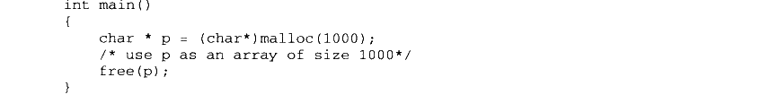

<details markdown="1"><summary>复制校对文字（未运行验证）</summary>

```text
int main()
{
    char *p = (char*)malloc(1000);
    /* use p as an array of size 1000 */
    free(p);
}
```

</details>

在第3行用 malloc 申请了1000个字节的空间之后，程序可以自由地使用这1000个字节，直到程序用 free 函数释放它。

那么 malloc 到底是怎么实现的呢？有一种做法是，把进程的内存管理交给操作系统内核去做，既然内核管理着进程的地址空间，那么如果它提供一个系统调用，可以让程序使用这个系统调用申请内存，不就可以了吗？当然这是一种理论上可行的做法，但实际上这样做的性能比较差，因为每次程序申请或者释放堆空间都需要进行系统调用。我们知道系统调用的性能开销是很大的，当程序对堆的操作比较频繁时，这样做的结果是会严重影响程序的性能的。比较好的做法就是程序向操作系统申请一块适当大小的堆空间，然后由程序自己管理这块空间，而具体来讲，管理着堆空间分配的往往是程序的运行库。

运行库相当于是向操作系统“批发”了一块较大的堆空间，然后“零售”给程序用。当全部“售完”或程序有大量的内存需求时，再根据实际需求向操作系统“进货”。当然运行库在向程序零售堆空间时，必须管理它批发来的堆空间，不能把同一块地址出售两次，导致地址的冲突。于是运行库需要一个算法来管理堆空间，这个算法就是堆的分配算法。不过在了解具体的分配算法之前，我们先来看看运行库是怎么向操作系统批发内存的。

#### 10.3.2 Linux 进程堆管理

从本章的第一节可知，进程的地址空间中，除了可执行文件、共享库和栈之外，剩余的未分配的空间都可以被用来作为堆空间。Linux 下的进程堆管理稍微有些复杂，因为它提供了两种堆空间分配的方式，即两个系统调用：一个是 brk（）系统调用，另外一个是 mmap（）。brk() 的 C语言形式声明如下：

```c
int brk(void* end_data_segment);
```

brk（）的作用实际上就是设置进程数据段的结束地址，即它可以扩大或者缩小数据段（Linux 下数据段和BSS 合并在一起统称数据段）。如果我们将数据段的结束地址向高地址移动，那么扩大的那部分空间就可以被我们使用，把这块空间拿来作为堆空间是最常见的做法之一（我们还将在第12章详细介绍brk 的实现）。Glibc 中还有一个函数叫 sbrk，它的功能与brk 类似，只不过参数和返回值略有不同。sbrk 以一个增量 （Increment）作为参数，即需要增加（负数为减少）的空间大小，返回值是增加（或减少）后数据段结束地址，这个函数实际上是对 brk 系统调用的包装，它是通过brk（）实现的。

mmap（）的作用和 Windows 系统下的 VirtualAlloc 很相似，它的作用就是向操作系统申请一段虚拟地址空间，当然这块虚拟地址空间可以映射到某个文件（这也是这个系统调用的最初的作用），当它不将地址空间映射到某个文件时，我们又称这块空间为匿名（Anonymous）空间，匿名空间就可以拿来作为堆空间。它的声明如下：

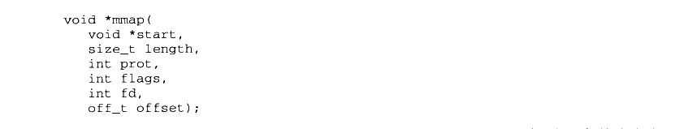

<details markdown="1"><summary>复制校对文字（未运行验证）</summary>

```text
void *mmap(
    void *start,
    size_t length,
    int prot,
    int flags,
    int fd,
    off_t offset);
```

</details>

mmap 的前两个参数分别用于指定需要申请的空间的起始地址和长度，如果起始地址设置为0，那么 Linux 系统会自动挑选合适的起始地址。prot/flags 这两个参数用于设置申请的空间的权限（可读、可写、可执行）以及映射类型（文件映射、匿名空间等），最后两个参数是用于文件映射时指定文件描述符和文件偏移的，我们在这里并不关心它们。

glibc 的 malloc函数是这样处理用户的空间请求的：对于小于128KB 的请求来说，它会在现有的堆空间里面，按照堆分配算法为它分配一块空间并返回：对于大于 128KB 的请求来说，它会使用 mmap() 函数为它分配一块匿名空间，然后在这个匿名空间中为用户分配空间。当然我们直接使用 mmap 也可以轻而易举地实现 malloc 函数：

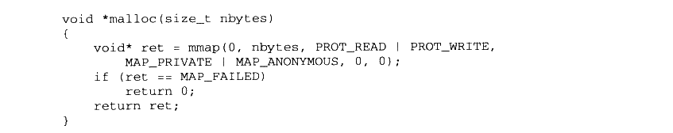

<details markdown="1"><summary>复制校对文字（未运行验证）</summary>

```text
void *malloc(size_t nbytes)
{
    void* ret = mmap(0, nbytes, PROT_READ | PROT_WRITE,
        MAP_PRIVATE | MAP_ANONYMOUS, 0, 0);
    if (ret == MAP_FAILED)
        return 0;
    return ret;
}
```

</details>

mmap 的详细使用说明请查阅 Linux 的 manpage

由于 mmap() 函数与 VirtualAlloc()类似，它们都是系统虚拟空间申请函数，它们申请的空间的起始地址和大小都必须是系统页的大小的整数倍，对于字节数很小的请求如果也使用mmap 的话，无疑是会浪费大量的空间的，所以上述的做法仅仅是演示而已，不具有实用性。

了解了 Linux 系统对于堆的管理之后，可以再来详细分析一下第6章里面的一个问题，那就是 malloc 到底一次能够申请的最大空间是多少？为了回答这个问题，就不得不再回头仔细研究一下图9-1了。我们可以看到在有共享库的情况下，留给堆可以用的空间还有两处。第一处就是从 BSS 段结束到0x40000000，即大约1GB 不到的空间：第二处是从共享库到栈的这块空间，大约是2GB 不到。这两块空间大小都取决于栈、共享库的大小和数量。于是可以估算到 malloc 最大的申请空间大约是2GB 不到，这似乎与在第6 章中得到的2.9GB的实验结论并不一致。

那么事实是怎么样的呢？实际上2.9GB 的结论是对的，2GB 的推论也并没有错。造成这种差异的是因为不同的Linux 内核版本造成的。因为在图9-1里面所看到的共享库的装载地址为0x40000000，这实际上已经是过时了的，在Linux 内核2.6版本里面，共享库的装载地址已经被挪到了靠近栈的位置，即位于 0xbfxxxxxx 附近（这一点从前面的章节中察看/proc/xxx/maps 也可以验证），所以从0xbfxxxxxx 到进程用brk（）设置的边界末尾简直是一马平川，中间没有任何空间占用的情况（如果使用静态链接来产生可执行文件，这样就更没有共享库的干扰了）。所以从理论可以推论，2.6版的 Linux 的 malloc 的最大空间申请数应该在2.9GB 左右（其中可执行文件占去一部分、0x08040000之前的地址占去一部分、栈占去一部分、共享库占去一部分）。

还有其他诸多因素会影响 malloc 的最大空间大小，比如系统的资源限制（ulimit）、物理内存和交换空间的总和等。我曾经在一台只有512MB 内存和1.5GB 交换空间的机器上测试 malloc 的最大空间申请数，无论怎样结果都不会超过1.9GB 左右，让我十分困惑。后来发现原来是内存+交换空间的大小太小，导致 mmap 申请空间失败。因为 mmap 申请匿名空间时，系统会为它在内存或交换空间中预留地址，但是申请的空间大小不能超出空闲内存＋空闲交换空间的总和。

#### 10.3.3 Windows 进程堆管理

为了了解 Windows 操作系统是如何“批发”堆空间给应用程序的，还是得先来回顾一下 Windows 系统中进程的地址空间的分布。一个普通的 Windows 进程的地址空间分布可以如图10-14所示。

可以看到，Windows 的进程将地址空间分配给了各种 EXE、DLL 文件、堆、栈。其中EXE 文件一般位于0x00400000 起始的地址：而一部分 DLL 位于0x10000000 起始的地址，如运行库 DLL：还有一部分 DLL 位于接近 0x80000000的位置，如系统 DLL, NTDLL.DLL、Kernel32.DLL。

栈的位置则在0x00030000和EXE 文件后面都有分布，可能有读者奇怪为什么 Windows需要这么多栈呢？我们知道，每个线程的栈都是独立的，所以一个进程中有多少个线程，就应该有多少个对应的栈，对于 Windows 来说，每个线程默认的栈大小是 1MB，在线程启动时，系统会为它在进程地址空间中分配相应的空间作为栈，线程栈的大小可以由创建线程时CreateThread 的参数指定。

在分配完上面这些地址以后，Windows 的进程地址空间已经是支离破碎了。当程序向系统申请堆空间时，只好从这些剩下的还没有被占用的地址上分配。Windows 系统提供了一个API 叫做 VirtualAlloc（），用来向系统申请空间，它与 Linux 下的 mmap 非常相似。实际上VirtualAlloc() 申请的空间不一定只用于堆，它仅仅是向系统预留了一块虚拟地址，应用程序可以按照需要随意使用。

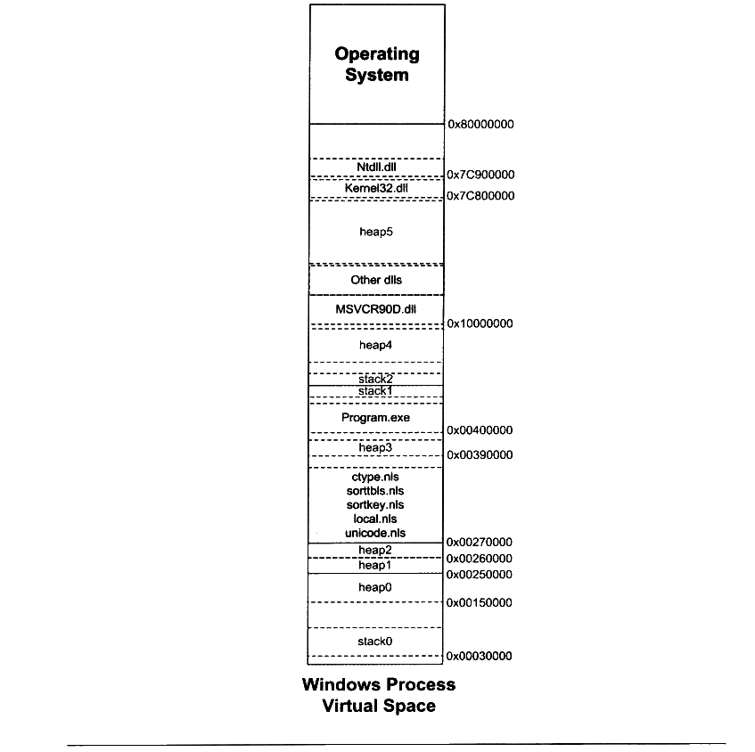

<p class="image-caption">图 10-14 Windows 进程地址空间分布</p>

<details markdown="1"><summary>查看图中文字（按图分组）</summary>

Windows 进程虚拟空间：高地址的操作系统区域从 0x80000000 开始；用户区域中包含 Ntdll.dll（0x7C900000）、Kernel32.dll（0x7C800000）、其他 DLL、MSVCR90D.dll（0x10000000）、Program.exe（0x00400000），以及多个 heap、stack 和 NLS 文件映射。

</details>

在使用 VirtualAlloc()函数申请空间时，系统要求空间大小必须为页的整数倍，即对于x86 系统来说，必须是4096 字节的整数倍。很明显，这就是操作系统的“批发”内存的接口函数了，4096字节起批，而且只能是4096字节的整数倍，多了少了都不行。那么应用程序作为最终的“消费者”，如果它直接向操作系统申请内存的话，难免会造成大量的浪费，比如程序只需要4097个字节的空间，它也必须申请8192字节。

当然，在 Windows 下我们也可以自己实现一个分配的算法，首先通过 VirtualAlloc 向操作系统一次性批发大量空间，比如10MB，然后再根据需要分配给程序。不过这么常用的分配算法已经被各种系统、库实现了无数遍，一般情况下我们没有必要再重复发明轮子，自己再实现一个，用现成的就可以了。在 Windows 中，这个算法的实现位于堆管理器（Heap Manager）。堆管理器提供了一套与堆相关的 API 可以用来创建、分配、释放和销毁堆空间：

HeapCreate：创建一个堆。

- HeapAlloc： 在一个堆里分配内存。

- HeapFree：释放已经分配的内存。

- HeapDestroy：摧毁一个堆。

这四个 API 的作用很明显，HeapCreate 就是创建一个堆空间，它会向操作系统批发一块内存空间（它也是通过VirtualAlloc()实现的），而 HeapAlloc 就是在堆空间里面分配一块小的空间并返回给用户，如果堆空间不足的话，它还会通过 VirtualAlloc 向操作系统批发更多的内存直到操作系统也没有空间可以分配为止。HeapFree 和 HeapDestroy 的作用就更不言而喻了。

Windows 堆管理器的位置

上面四个函数 HeapCreate、HeapAlloc、HeapFree 和 HeapDestroy 其实就是堆管理器的核心接口，堆管理器实际上存在于 Windows 的两个位置。一份是位于 NTDLL.DLL中，这个 DLL是 Windows 操作系统用户层的最底层 DLL，它负责 Windows 子系统DLL 与 Windows 内核之间的接口（我们在后面还会介绍 Windows 子系统），所有用户程序、运行时库和子系统的堆分配都是使用这部分的代码：而在 Windows 内核Ntoskrnl.exe 中，还存在一份类似的堆管理器，它负责 Windows 内核中的堆空间分配（内核堆和用户的堆不是同一个，Windows 内核、内核组件、驱动程序使用堆时用到的都是这份堆分配代码），内核堆管理器的接口都由 RtlHeap 开头。

每个进程在创建时都会有一个默认堆，这个堆在进程启动时创建，并且直到进程结束都一直存在。默认堆的大小为1MB，不过我们可以通过链接器的/HEAP 参数指定可执行文件的默认堆大小，这样系统在创建进程时就会按照可执行文件所指定的大小创建默认堆。当然1MB 的堆空间对很多程序来说是不够用的，如果用户申请的空间超过1MB，堆管理器就会扩展堆的大小，它会通过 VirtualAlloc 向系统申请更多的空间。

通过前面介绍的 Windows 进程地址空间分布我们知道，一个进程中能够分配给堆用的空间不是连续的。所以当一个堆的空间已经无法再扩展时，我们必须创建一个新的堆。但是这一切都不需要用户操作，因为运行库的 malloc 函数已经解决了这一切，它实际上是对Heapxxxx 系列函数的包装，当一个堆空间不够时，它会在进程中创建额外的堆。所以进程中可能存在多个堆，但是一个进程中一次性能够分配的最大的堆空间取决于最大的那个堆。从上面的图中我们可以看到，Heap5应该是最大的一个堆，它的大小大约是1.5GB~1.7GB，这取决于进程所加载的 DLL 数量和大小。我们在前面的章节中说过的Windows 下能够通过 malloc 申请的最大的一块堆空间大约是 1.5GB 就很好解释了。

Q&amp;A

Q：我可以重复释放两次堆里的同一片内存吗？

A：不能。几乎所有的堆实现里，都会在重复释放同一片堆里的内存时产生错误。glibc 甚至能检测出这样的错误，并给出确切的错误信息。

Q：我在有些书里看到说堆总是向上增长，是这样的吗？

A：不是，有些较老的书籍针对当时的系统曾做出过这样的断言，这在当时可能是正确的。

因为当时的系统多是类unix 系统，它们使用类似于brk 的方法来分配堆空间，而brk 的增长方向是向上的。但随着 Windows 的出现，这个规律被打破了。在 Windows 里，大部分堆使用 HeapCreate 产生，而HeapCreate 系列函数却完全不遵照向上增长这个规律。

Q：调用malloc 会不会最后调用到系统调用或者 API？

A：这个取决于当前进程向操作系统批发的那些空间还够不够用，如果够用了，那么它可以直接在仓库里取出来卖给用户；如果不够用了，它就只能通过系统调用或者API向操作系统再进一批货了。

Q:malloc 申请的内存，进程结束以后还会不会存在？

A：这是一个很常见的问题，答案是很明确的：不会存在。因为当进程结束以后，所有与进程相关的资源，包括进程的地址空间、物理内存、打开的文件、网络链接等都被操作系统关闭或者收回，所以无论malloc 申请了多少内存，进程结束以后都不存在了。

Q:malloc 申请的空间是不是连续的？

A：在分析这个问题之前，我们首先要分清楚 “空间”这个词所指的意思。如果“空间”是指虚拟空间的话，那么答案是连续的，即每一次 malloc 分配后返回的空间都可以看做是一块连续的地址；如果空间是指“物理空间”的话，則答案是不一定连续，因为一块连续的虚拟地址空间有可能是若干个不连续的物理页拼凑而成的。

#### 10.3.4 堆分配算法

我们在前面的章节中已经详细介绍了堆在进程中的地址空间是如何分布的，对于程序来说，堆空间只是程序向操作系统申请划出来的一大块地址空间。而程序在通过 malloc 申请内存空间时的大小却是不一定的，从数个字节到数个GB 都是有可能的。于是我们必须将堆空间管理起来，将它分块地按照用户需求出售给最终的程序，并且还可以按照一定的方式收回内存。其实这个问题可以归结为：如何管理一大块连续的内存空间，能够按照需求分配、释放其中的空间，这就是堆分配的算法。堆的分配算法有很多种，有很简单的（比如这里要介绍的几种方法），也有些很复杂、适用于某些高性能或者有其他特殊要求的场合。

1.空闲链表

空闲链表（Free List）的方法实际上就是把堆中各个空闲的块按照链表的方式连接起来，当用户请求一块空间时，可以遍历整个列表，直到找到合适大小的块并且将它拆分；当用户释放空间时将它合并到空闲链表中。

我们首先需要一个数据结构来登记堆空间里所有的空闲空间，这样才能知道程序请求空间的时候该分配给它哪一块内存。这样的结构有很多种，这里介绍最简单的一种—空闲链表。

空闲链表是这样一种结构，在堆里的每一个空闲空间的开头（或结尾）有一个头（header），头结构里记录了上一个（prev）和下一个（next）空闲块的地址，也就是说，所有的空闲块形成了一个链表。如图10-15所示。

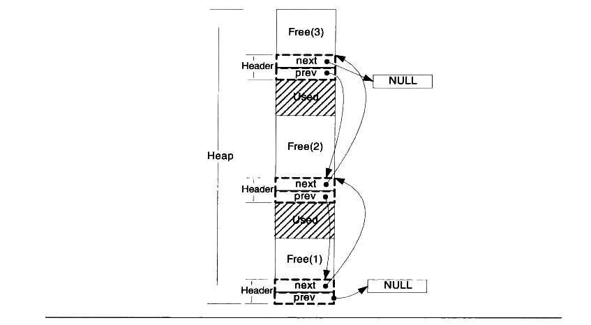

<p class="image-caption">图 10-15 空闲链表分配</p>

<details markdown="1"><summary>查看图中文字（按图分组）</summary>

堆中 Free(1)、Free(2)、Free(3) 三个空闲块通过 Header 中的 next、prev 构成双向链表，两端指向 NULL；阴影为 Used 区域。

</details>

在这样的结构下如何分配空间呢？

首先在空闲链表里查找足够容纳请求大小的一个空闲块，然后将这个块分为两部分，一部分为程序请求的空间，另一部分为剩余下来的空闲空间。下面将链表里对应原来空闲块的结构更新为新的剩下的空闲块，如果剩下的空闲块大小为0，则直接将这个结构从链表里删除。图10-16演示了用户请求一块和空闲块2恰好相等的内存空间后堆的状态。

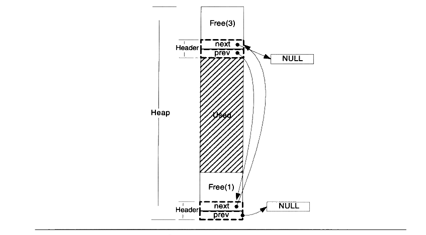

<p class="image-caption">图 10-16 空闲链表分配（2）</p>

<details markdown="1"><summary>查看图中文字（按图分组）</summary>

Free(2) 分配后成为 Used，空闲链表只连接 Free(1) 和 Free(3)。

</details>

这样的空闲链表实现尽管简单，但在释放空间的时候，给定一个已分配块的指针，堆无法确定这个块的大小。一个简单的解决方法是当用户请求k个字节空间的时候，我们实际分配k+4个字节，这4个字节用于存储该分配的大小，即k+4。这样释放该内存的时候只要看看这4个字节的值，就能知道该内存块的大小，然后将其插入到空闲链表里就可以了。

当然这仅仅是最简单的一种分配策略，这样的思路存在很多问题。例如，一旦链表被破坏，或者记录长度的那4字节被破坏，整个堆就无法正常工作，而这些数据恰恰很容易被越界读写所接触到。

2. 位图

针对空闲链表的弊端，另一种分配方式显得更加稳健。这种方式称为位图（Bitmap），其核心思想是将整个堆划分为大量的块（block），每个块的大小相同。当用户请求内存的时候，总是分配整数个块的空间给用户，第一个块我们称为已分配区域的头（Head），其余的称为已分配区域的主体（Body）。而我们可以使用一个整数数组来记录块的使用情况，由于每个块只有头/主体/空闲三种状态，因此仅仅需要两位即可表示一个块，因此称为位图。

假设堆的大小为 1MB，那么我们让一个块大小为 128字节，那么总共就有1M/128=8k个块，可以用8k/（32/2）=512个int 来存储。这个有512个 int 的数组就是一个位图，其中每两位代表一个块。当用户请求300字节的内存时，堆分配给用户3个块，并将位图的相应位置标记为头或躯体。

图10-17为一个这样的堆的实例。

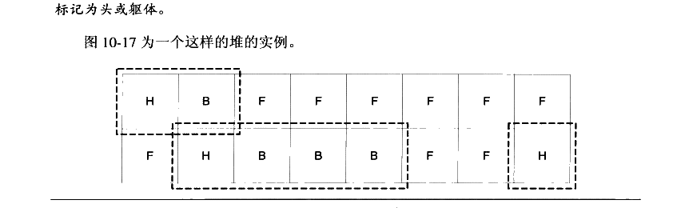

<p class="image-caption">图 10-17 位图分配方式</p>

<details markdown="1"><summary>查看图中文字（按图分组）</summary>

位图堆实例：H 表示头，B 表示主体，F 表示空闲。第一行为 H B F F F F F F；第二行为 F H B B B F F H。虚线框圈出已分配的块。

</details>

这个堆分配了3片内存，分别有2/4/1个块，用虚线框标出。其对应的位图将是：

（HIGH） 11 00 00 10 10 10 11 00 00 00 00 00 00 00 10 11 （LOW）

其中11表示H（Head），10表示主体（Body），00表示空闲（Free）。

这样的实现方式有几个优点：

- 速度快：由于整个堆的空闲信息存储在一个数组内，因此访问该数组时 cache 容易命中。

- 稳定性好：为了避免用户越界读写破坏数据，我们只须简单地备份一下位图即可。而且即使部分数据被破坏，也不会导致整个堆无法工作。

- 块不需要额外信息，易于管理。

当然缺点也是显而易见的：

- 分配内存的时候容易产生碎片。例如分配300字节时，实际分配了3个块即384个字节，浪费了84个字节。

- 如果堆很大，或者设定的一个块很小（这样可以减少碎片），那么位图将会很大，可能失去 cache 命中率高的优势，而且也会浪费一定的空间。针对这种情况，我们可以使用多级的位图。

3. 对象池

以上介绍的堆管理方法是最为基本的两种，实际上在一些场合，被分配对象的大小是较为固定的几个值，这时候我们可以针对这样的特征设计一个更为高效的堆算法，称为对象池。

对象池的思路很简单，如果每一次分配的空间大小都一样，那么就可以按照这个每次请求分配的大小作为一个单位，把整个堆空间划分为大量的小块，每次请求的时候只需要找到一个小块就可以了。

对象池的管理方法可以采用空闲链表，也可以采用位图，与它们的区别仅仅在于它假定了每次请求的都是一个固定的大小，因此实现起来很容易。由于每次总是只请求一个单位的内存，因此请求得到满足的速度非常快，无须查找一个足够大的空间。

实际上很多现实应用中，堆的分配算法往往是采取多种算法复合而成的。比如对于 glibc 来说，它对于小于64 字节的空间申请是采用类似于对象池的方法；而对于大于512字节的空间申请采用的是最佳适配算法：对于大于64 字节而小于512字节的，它会根据情况采取上述方法中的最佳折中策略：对于大于 128KB 的申请，它会使用 mmap 机制直接向操作系统申请空间。


## 10.4 本章小结

在这一章中，我们首先回顾了i386 体系结构下程序的基本内存布局，并且对程序内存结构中非常重要的两部分栈与堆进行了详细的介绍。

在介绍栈的过程中，我们学习了栈在函数调用中所发挥的重要作用，以及与之伴生的调用惯例的各方面的知识。最后，还了解了函数传递返回值的各种技术细节。

在介绍堆的过程中，首先了解了构造堆的主要算法：空闲链表和位图。此外，还介绍了Windows 和 Linux 的系统堆的管理内幕。
