# 第 11 章 运行库

## 11.1 入口函数和程序初始化

#### 11.1.1 程序从 main 开始吗

正如基督徒认为世界的诞生起于7天创世一样，任何一个合格的C/C++程序员都应该知道一个事实：程序从 main 函数开始。但是事情的真相真是如此吗？如果你善于观察，就会发现当程序执行到 main 函数的第一行时，很多事情都已经完成了：

【铁证1】下面是一段C语言代码：


<details markdown="1"><summary>复制校对文字（未运行验证）</summary>

```text
#include <stdio.h>
#include <stdlib.h>
int a = 3;
int main(int argc, char* argv[])
{
    int *p = (int*)malloc(sizeof(int));
    scanf("%d", p);
    printf("%d", a + *p);
    free(p);
}
```

</details>

从代码中我们可以看到，在程序刚刚执行到 main 的时候，全局变量的初始化过程已经结束了（a的值已经确定），main 函数的两个参数（argc 和 argv）也被正确传了进来。此外，在你不知道的时候，堆和栈的初始化悄悄地完成了，一些系统I/O 也被初始化了，因此可以放心地使用 printf 和 malloc。

【铁证2】而在C++里，main 之前能够执行的代码还会更多，例如如下代码：


<details markdown="1"><summary>复制校对文字（未运行验证）</summary>

```text
#include <string>
using namespace std;
string v;
double foo()
{
    return 1.0;
}
double g = foo();
int main() {}
```

</details>

在这里，对象v的构造函数，以及用于初始化全局变量g的函数foo都会在 main 之前调用。

【铁证3】 atexit 也是一个特殊的函数。atexit 接受一个函数指针作为参数，并保证在程序正常退出（指从main里返回或调用exit函数）时，这个函数指针指向的函数会被调用。例如：


<details markdown="1"><summary>复制校对文字（未运行验证）</summary>

```text
void foo(void)
{
    printf("bye!\n");
}
int main()
{
    atexit(&foo);
    printf("endof main\n");
}
```

</details>

用atexit 函数注册的函数的调用时机是在 main结束之后，因此这段代码的输出是：


<details markdown="1"><summary>复制校对文字（未运行验证）</summary>

```text
endof main
bye!
```

</details>

所有这些事实都在为“main 创论”提供不利的证据：操作系统装载程序之后，首先运行的代码并不是 main 的第一行，而是某些别的代码，这些代码负责准备好 main 函数执行所需要的环境，并且负责调用 main函数，这时候你才可以在 main 函数里放心大胆地写各种代码：申请内存、使用系统调用、触发异常、访问I/O。在main 返回之后，它会记录 main函数的返回值，调用atexit 注册的函数，然后结束进程。

运行这些代码的函数称为入口函数或入口点（Entry Point），视平台的不同而有不同的名字。程序的入口点实际上是一个程序的初始化和结束部分，它往往是运行库的一部分。一个典型的程序运行步骤大致如下：

- 操作系统在创建进程后，把控制权交到了程序的入口，这个入口往往是运行库中的某个入口函数。

- 入口函数对运行库和程序运行环境进行初始化，包括堆、I/O、线程、全局变量构造，等等。

- 入口函数在完成初始化之后，调用 main 函数，正式开始执行程序主体部分。

- main 函数执行完毕以后，返回到入口函数，入口函数进行清理工作，包括全局变量析构、堆销毁、关闭 I/O等，然后进行系统调用结束进程。

#### 11.1.2 入口函数如何实现

大部分程序员在平时都接触不到入口函数，为了对入口函数进行详细的了解，本节我们将深入剖析 glibc 和 MSVC的入口函数实现。GLIBC 入口函数

glibc 的启动过程在不同的情况下差别很大，比如静态的 glibc 和动态的 glibc 的差别，glibc 用于可执行文件和用于共享库的差别，这样的差别可以组合出4种情况，这里只选取最简单的静态 glibc 用于可执行文件的时候作为例子，其他情况诸如共享库的全局对象构造和析构跟例子中稍有出入，我们在本书中不一一详述了，有兴趣的读者可以根据这里的介绍自己阅读 glibc 和 gcc 的源代码，相信能起到举一反三的效果。下面所有关于 Glibc 和 MSVC CRT 的相关代码分析在不额外说明的情况下，都默认为静态/可执行文件链接的情况。

读者可以免费下载到Linux 下 glibc 的源代码，在其中的子目录libc/csu 里，有关于程序启动的代码。glibc 的程序入口为\_start（这个入口是由ld 链接器默认的链接脚本所指定的，我们也可以通过相关参数设定自己的入口）。\_start 由汇编实现，并且和平台相关，下面可以单独看i386 的\_start 实现：


<details markdown="1"><summary>复制校对文字（未运行验证）</summary>

```text
libc\sysdeps\i386\elf\Start.S:
_start:
    xorl %ebp, %ebp
    popl %esi
    movl %esp, %ecx
    pushl %ebp
    pushl %edx
    pushl $__libc_csu_fini
    pushl $__libc_csu_init
    pushl %ecx
    pushl %esi
    pushl main
    call __libc_start_main
    hlt
```

</details>

这里省略了一些不重要的代码，可以看到\_start 函数最终调用了名为\_\_libc\_start\_main 的函数。加粗部分的代码是对该函数的完整调用过程，其中开始的7个压栈指令用于给函数传递参数。在最开始的地方还有3条指令，它们的作用分别为：

- xor %ebp， %ebp：这其实是让ebp 寄存器清零。xor 的用处是把后面的两个操作数异或，结果存储在第一个操作数里。这样做的目的表明当前是程序的最外层函数。

ebp 设为0正好可以体现出这个最外层函数的尊贵地位⑧。

- Pop %esi 及 mov %esp， %ecx：在调用\_start 前，装载器会把用户的参数和环境变量压入栈中，按照其压栈的方法，实际上栈顶的元素是 argc，而接着其下就是 argv 和环境变量的数组。图11-1 为此时的栈布局，其中虚线箭头是执行 pop %esi 之前的栈顶（%esp），而实线箭头是执行之后的栈顶（%esp）。


<p class="image-caption">图 11-1 环境变量和参数数组</p>

<details markdown="1"><summary>查看图中文字（按图分组）</summary>

初始栈由 argc、argv（arg 0 … arg n）、0、env（env 0 … env n）、0 等组成。old esp 原先指向 argc，弹出 argc 后 esp 指向 arg 0；图中的栈向右增长。

</details>

pop %esi 将 argc 存入了 esi，而 mov %esp、%ecx 将栈顶地址（此时就是 argv 和环境变量（env）数组的起始地址）传给%ecx。现在%esi 指向 argc，%ecx 指向 argv 及环境变量数组。

综合以上分析，我们可以把\_start 改写为一段更具有可读性的伪代码：


<details markdown="1"><summary>复制校对文字（未运行验证）</summary>

```text
void _start()
{
    %ebp = 0;
    int argc = pop from stack;
    char** argv = top of stack;
    __libc_start_main(main, argc, argv, __libc_csu_init, __libc_csu_fini,
                      edx, top of stack);
}
```

</details>

其中 argv 除了指向参数表外，还隐含紧接着环境变量表。这个环境变量表要在\_\_libc\_start\_main 里从 argv 内提取出来。

环境变量

环境变量是存在于系统中的一些公用数据，任何程序都可以访问。通常来说，环境变量存储的都是一些系统的公共信息，例如系统搜索路径，当前OS版本等。环境变量的格式为key=value 的字符串，C语言里可以使用getenv这个函数来获取环境变量信息。

在 Windows 里，可以直接在控制面板一系统一高级一环境变量查阅当前的环境变量，而在 Linux 下，直接在命令行里输入 export 即可。

实际执行代码的函数是\_\_libc\_start\_main，由于代码很长，下面我们一段一段地看：


<details markdown="1"><summary>复制校对文字（未运行验证）</summary>

```text
// _start -> __libc_start_main
int __libc_start_main(
    int (*main) (int, char **, char **),
    int argc,
    char *__unbounded *__unbounded ubp_av,
    __typeof (main) init,
    void (*fini) (void),
    void (*rtld_fini) (void),
    void *__unbounded stack_end)
```

</details>


<details markdown="1"><summary>复制校对文字（未运行验证）</summary>

```text
{
#if __BOUNDED_POINTERS__
    char **argv;
#else
## define argv ubp_av
#endif
    int result;
```

</details>

这是\_\_libc\_start\_main 的函数头部，可见和\_start 函数里的调用一致，一共有7个参数，其中 main 由第一个参数传入，紧接着是 argc 和 argv（这里称为ubp\_av，因为其中还包含了环境变量表）。除了 main 的函数指针之外，外部还要传入3个函数指针，分别是：

- init: main 调用前的初始化工作。

- fini: main 结束后的收尾工作。

rtld\_fini： 和动态加载有关的收尾工作，rtld 是 runtime loader 的缩写。

最后的 stack\_end 标明了栈底的地址，即最高的栈地址。

bounded pointer GCC 支持 bounded 类型指针（bounded 指针用\_\_bounded 关键字标出，若默认为bounded 指针，则普通指针用\_\_unbounded 标出），这种指针占用3个指针的空间，在第一个空间里存储原指针的值，第二个空间里存储下限值，第三个空间里存储上限值。\_\_ptrvalue、\_\_ptrlow、\_\_ptrhigh 分别返回这3个值，有了3个值以后，内存越界错误便很容易查出来了。并且要定义\_\_BOUNDED\_POINTERS\_\_这个宏才有作用，否则这3个宏定义是空的。

不过，尽管 bounded 指针看上去似乎很有用，但是这个功能却在2003年被去掉了。因此现在所有关于 bounded 指针的关键字其实都是一个空的宏。鉴于此，我们接下来在讨论 libc代码时都默认不使用bounded 指针即不定义\_BOUNDED\_POINTERS\_。

接下来的代码如下：


<details markdown="1"><summary>复制校对文字（未运行验证）</summary>

```text
char** ubp_ev = &ubp_av[argc + 1];
INIT_ARGV_and_ENVIRON;
__libc_stack_end = stack_end;
```

</details>

INIT_ARGV_and_ENVIRON 这个宏定义于 libc/sysdeps/generic/bp-start.h，展开后本段代码变为：


<p class="image-caption">图 11-2 实际上就是我们根据从_start 源代码分析得到的栈布局，让_environ 指针指向</p>

<details markdown="1"><summary>复制校对文字（未运行验证）</summary>

```text
char** ubp_ev = &ubp_av[argc + 1];
__environ = ubp_ev;
__libc_stack_end = stack_end;
```

</details>

图11-2实际上就是我们根据从 _start 源代码分析得到的栈布局，让 __environ 指针指向原来紧跟在 argv 数组之后的环境变量数组。


<p class="image-caption">图 11-2 环境变量和参数数组（2）</p>

<details markdown="1"><summary>查看图中文字（按图分组）</summary>

ubp_av 指向 arg 0，__environ 指向 env 0；argv 和 env 数组各自以 0 结束，栈增长方向向右。

</details>

图11-2中实线箭头代表 ubp\_av，而虚线箭头代表\_environ。另外这段代码还将栈底地址存储在一个全局变量里，以留作它用。

为什么要分两步赋值给\_environ 呢？这又是为了兼容 bounded 惹的祸。实际上，INIT\_ARGV\_and\_ENVIRON 根据 bounded 支持的情况有多个版本，以上仅仅是假定不支持bounded 的版本。

接下来有另一个宏：

DL\_SYSDEP\_OSCHECK（\_1ibc\_fatal）：

这是用来检查操作系统的版本，宏的具体内容就不列出了。接下来的代码颇为繁杂，我们过滤掉大量信息之后，将一些关键的函数调用列出：


<details markdown="1"><summary>复制校对文字（未运行验证）</summary>

```text
__pthread_initialize_minimal();
__cxa_atexit(rtld_fini, NULL, NULL);
__libc_init_first(argc, argv, __environ);
__cxa_atexit(fini, NULL, NULL);
(*init)(argc, argv, __environ);
```

</details>

这一部分进行了一连串的函数调用，注意到\_\_cxa\_atexit 函数是 glibc 的内部函数，等同于 atexit，用于将参数指定的函数在 main 结束之后调用。所以以参数传入的 fini和rtld\_fini均是用于 main结束之后调用的。在\_\_libc\_start\_main 的末尾，关键的是这两行代码：


<details markdown="1"><summary>复制校对文字（未运行验证）</summary>

```text
result = main(argc, argv, __environ);
    exit(result);
}
```

</details>

在最后，main 函数终于被调用，并退出。然后我们来看看 exit 的实现：


<details markdown="1"><summary>复制校对文字（未运行验证）</summary>

```text
// _start -> __libc_start_main -> exit
void exit(int status)
{
    while (__exit_funcs != NULL)
    {
        ...
        __exit_funcs = __exit_funcs->next;
    }
    ...
```

</details>


<details markdown="1"><summary>复制校对文字（未运行验证）</summary>

```text
_exit(status);
}
```

</details>

其中\_\_exit\_funcs 是存储由\_\_cxa\_atexit 和 atexit 注册的函数的链表，而这里的这个 while 循环则遍历该链表并逐个调用这些注册的函数，由于其中琐碎代码过多，这里就不具体列出了。最后的\_exit 函数由汇编实现，且与平台相关，下面列出i386 的实现：


<details markdown="1"><summary>复制校对文字（未运行验证）</summary>

```text
// _start -> __libc_start_main -> exit -> _exit
_exit:
    movl 4(%esp), %ebx
    movl $__NR_exit, %eax
    int $0x80
    hlt
```

</details>

可见\_exit的作用仅仅是调用了 exit 这个系统调用。也就是说，\_exit 调用后，进程就会直接结束。程序正常结束有两种情况，一种是 main 函数的正常返回，一种是程序中用 exit 退出。在libc\_start\_main 里我们可以看到，即使 main返回了，exit 也会被调用。exit 是进程正常退出的必经之路，因此把调用用 atexit 注册的函数的任务交给 exit 来完成可以说万无一失。

我们看到在\_start 和\_exit 的末尾都有一个 hlt指令，这是作什么用的呢？在Linux里，进程必须使用 exit 系统调用结束。一旦 exit 被调用，程序的运行就会终止，因此实际上\_exit末尾的 hlt 不会执行，从而\_\_libc\_start\_main 永远不会返回，以至\_start 末尾的 hlt 指令也不会执行。\_exit 里的 hlt 指令是为了检测exit 系统调用是否成功。如果失败，程序就不会终止，hlt指令就可以发挥作用强行把程序给停下来。而\_start 里的 hlt 的用处也是如此，但是为了预防某种没有调用exit（这里指的不是 exit 系统调用）就回到\_start 的情况（例如有人误删了\_\_libc\_start\_main 末尾的 exit ）。

MSVC CRT 入口函数

相信读者对 glibc 的入口函数已经有了一些了解。但可惜的是 glibc 的入口函数书写得不是非常直观。事实上，我们也没从 glibc 的入口函数了解到多少内容。为了从另一面看世界，我们再来看看 Windows 下的运行库的实现细节。下面是 Microsoft Visual Studio 2003 里 crt0.c（位于 VC 安装目录的 crt/src）的一部分。这里也删除了一些条件编译的代码，留下了比较重要的部分。MSVC 的 CRT 默认的入口函数名为 mainCRTStartup：


<details markdown="1"><summary>复制校对文字（未运行验证）</summary>

```text
int mainCRTStartup(void)
{
    ...
```

</details>

这是入口函数的头部。下面的代码出现于该函数的开头，显得杂乱无章。不过其中关键的内容是给一系列变量赋值：


<details markdown="1"><summary>复制校对文字（未运行验证）</summary>

```text
posvi = (OSVERSIONINFOA *)_alloca(sizeof(OSVERSIONINFOA));
posvi->dwOSVersionInfoSize = sizeof(OSVERSIONINFOA);
GetVersionExA(posvi);
```

</details>


<details markdown="1"><summary>复制校对文字（未运行验证）</summary>

```text
_osplatform = posvi->dwPlatformId;
_winmajor = posvi->dwMajorVersion;
_winminor = posvi->dwMinorVersion;
_osver = (posvi->dwBuildNumber) & 0x07fff;
if (_osplatform != VER_PLATFORM_WIN32_NT)
    _osver |= 0x08000;
_winver = (_winmajor << 8) + _winminor;
```

</details>

被赋值的这些变量，是VC7里面预定义的一些全局变量，其中\_osver 和\_winver 表示操作系统的版本，\_winmajor 是主版本号，更具体的可以查阅 MSDN。这段代码通过调用GetVersionExA（这是一个 Windows API）来获得当前的操作系统版本信息，并且赋值给各个全局变量。

为什么这里为 posvi分配内存不使用malloc而使用alloca呢？是因为在程序的一开始堆还没有被初始化，而 alloca 是唯一可以不使用堆的动态分配机制。alloca 可以在栈上分配任意大小的空间（只要栈的大小允许），并且在函数返回的时候会自动释放，就好像局部变量一样。

由于没有初始化堆，所以很多事情没法做，当务之急是赶紧把堆先初始化了：


<details markdown="1"><summary>复制校对文字（未运行验证）</summary>

```text
if (!_heap_init(0))
    fast_error_exit(_RT_HEAPINIT);
```

</details>

这里使用\_heap\_init函数对堆（heap）进行了初始化，如果堆初始化失败，那么程序就直接退出了。


<details markdown="1"><summary>复制校对文字（未运行验证）</summary>

```text
__try {
    if (_ioinit() < 0)
        _amsg_exit(_RT_LOWIOINIT);
    _acmdln = (char*)GetCommandLineA();
    _aenvptr = (char*)__crtGetEnvironmentStringsA();
    if (_setargv() < 0)
        _amsg_exit(_RT_SPACEARG);
    if (_setenvp() < 0)
        _amsg_exit(_RT_SPACEENV);
    initret = _cinit(TRUE);
    if (initret != 0)
        _amsg_exit(initret);
    __initenv = _environ;
    mainret = main(__argc, __argv, _environ);
    _cexit();
}
```

</details>


<details markdown="1"><summary>复制校对文字（未运行验证）</summary>

```text
__except (_XcptFilter(GetExceptionCode(), GetExceptionInformation()))
    {
        mainret = GetExceptionCode();
        _c_exit();
    } /* end of try - except */
    return mainret;
}
```

</details>

这里是一个 Windows 的SEH 的 try-except 块，里面做了什么呢？首先使用\_ioinit 函数初始化了 I/O，接下来这段代码调用了一系列函数进行各种初始化，包括：

- \_setargv：初始化 main 函数的 argv 参数。

- _setenvp：设置环境变量。

- _cinit：其他的C库设置。

在最后，可以看到函数调用了 main 函数并获得了其返回值。try-except 块的 except 部分是最后的清理阶段，如果 try 块里的代码发生异常，则在这里进行错误处理。最后退出并返回 main 的返回值。

try-except 块

try-except 块是 Windows 结构化异常处理机制 SEH的一部分。try-except 块的使用方法如下：


<details markdown="1"><summary>复制校对文字（未运行验证）</summary>

```text
__try {
    code 1
}
__except (...) {
    code 2
}
```

</details>

当 code 1 出现异常（段错误等）的时候，except 部分的code 2会执行以异常处理。更为详细的信息请查阅 MSDN.

总结一下，这个 mainCRTStartup 的总体流程就是：

（1）初始化和 OS版本有关的全局变量。

（2） 初始化堆。

（3）初始化I/O。

（4）获取命令行参数和环境变量。

（5）初始化C库的一些数据。

（6）调用main 并记录返回值。

（7） 检查错误并将 main 的返回值返回。事实上还是 MSVC 的入口函数的思路较为清晰。在第13 章里，我们将仿照 VC入口函数的思路实现一个 Linux 下的简易入口函数。

Q&amp;A

Q:msvc 的入口函数使用了alloca，它是如何实现的。

A:alloca函数的特点是它能够动态地在栈上分配内存，在函数退出时如同局部变量一样自动释放。结合之前我们介绍的函数标准进入和退出指令序列就知道，函数退出时的退栈操作是直接将ESP 的值赋为EBP 的值。因此不管在函数的执行过程中ESP 减少了多少，最后也能够成功地将函数执行时分配的所有栈空间回收。在这个基础上，alloca的实现就非常简单，仅仅是将ESP 减少一定数值而已。

Q：为什么MSVC 的 Win32 程序的入口使用的是 WinMain？

A:WinMain 和main一样，都不是程序的实际入口。MSVC 的程序入口是同一段代码，但根据不同的编译参数被编译成了不同的版本。不同版本的入口函数在其中会调用不同名字的函数，包括 main/wmain/WinMain/wWinMain 等。

#### 11.1.3 运行库与 I/O

在了解了 glibc 和 MSVC的入口函数的基本思路之后，让我们来深入了解各个初始化部分的具体实现。但在具体了解初始化之前，我们要先了解一个重要的概念：I/O。

IO（或 I/O）的全称是Input/Output，即输入和输出。对于计算机来说，IO 代表了计算机与外界的交互，交互的对象可以是人或其他设备（如图11-3所示）。


<p class="image-caption">图11-3 计算机的 I/O设备</p>

而对于程序来说，I/O 涵盖的范围还要宽广一些。一个程序的 I/O 指代了程序与外界的交互，包括文件、管道、网络、命令行、信号等。更广义地讲，I/O指代任何操作系统理解为“文件”的事务。许多操作系统，包括Linux 和Windows，都将各种具有输入和输出概念的实体——包括设备、磁盘文件、命令行等—统称为文件，因此这里所说的文件是一个广义的概念。

对于一个任意类型的文件，操作系统会提供一组操作函数，这包括打开文件、读文件、写文件、移动文件指针等，相信有编程经验的读者对此都不会陌生。有过C编程经验的读者应该知道，C语言文件操作是通过一个 FILE 结构的指针来进行的。fopen 函数返回一个FILE 结构的指针，而其他的函数如fwrite 使用这个指针操作文件。使用文件的最简单代码如下：


<details markdown="1"><summary>复制校对文字（未运行验证）</summary>

```text
#include <stdio.h>
int main(int argc, char** argv)
{
    FILE* f = fopen("test.dat", "wb");
    if (f == NULL)
        return -1;
    fwrite("123", 3, 1, f);
    fclose(f);
    return 0;
}
```

</details>

在操作系统层面上，文件操作也有类似于 FILE 的一个概念，在 Linux 里，这叫做文件描述符（File Descriptor），而在 Windows 里，叫做句柄（Handle）（以下在没有歧义的时候统称为句柄）。用户通过某个函数打开文件以获得句柄，此后用户操纵文件皆通过该句柄进行。

设计这么一个句柄的原因在于句柄可以防止用户随意读写操作系统内核的文件对象。无论是 Linux 还是 Windows，文件句柄总是和内核的文件对象相关联的，但如何关联细节用户并不可见。内核可以通过句柄来计算出内核里文件对象的地址，但此能力并不对用户开放。

下面举一个实际的例子，在 Linux 中，值为0、1、2的fd 分别代表标准输入、标准输出和标准错误输出。在程序中打开文件得到的fd 从3开始增长。fd 具体是什么呢？在内核中，每一个进程都有一个私有的“打开文件表”，这个表是一个指针数组，每一个元素都指向一个内核的打开文件对象。而 fd，就是这个表的下标。当用户打开一个文件时，内核会在内部生成一个打开文件对象，并在这个表里找到一个空项，让这一项指向生成的打开文件对象，并返回这一项的下标作为 fd。由于这个表处于内核，并且用户无法访问到，因此用户即使拥有 fd，也无法得到打开文件对象的地址，只能够通过系统提供的函数来操作。

在C语言里，操纵文件的渠道则是 FILE 结构，不难想象，C语言中的 FILE 结构必定和 fd 有一对一的关系，每个 FILE 结构都会记录自己唯一对应的 fd。

FILE、fd、打开文件表和打开文件对象的关系如图11-4所示。


<p class="image-caption">图 11-4 FILE 结构、fd 和内核对象</p>

<details markdown="1"><summary>查看图中文字（按图分组）</summary>

用户空间的 stdin、stdout、stderr 分别使用 FILE 中的 fd=0、fd=1、fd=2。文件描述符索引内核中的打开文件表，表项指向内核对象；另有 fd=3 的 FILE 实例。

</details>

图11-4中，内核指针P指向该进程的打开文件表，所以只要有 fd，就可以用fd+p 来得到打开文件表的某一项地址。stdin、stdout、stderr 均是 FILE 结构的指针。

对于 Windows 中的句柄，与 Linux 中的fd 大同小异，不过 Windows 的句柄并不是打开文件表的下标，而是其下标经过某种线性变换之后的结果。

在大致了解了I/O 为何物之后，我们就能知道I/O 初始化的职责是什么了。首先I/O初始化函数需要在用户空间中建立stdin、stdout、stderr 及其对应的FILE 结构，使得程序进入main 之后可以直接使用printf、scanf 等函数。

#### 11.1.4 MSVC CRT 的入口函数初始化

系统堆初始化

MSVC 的入口函数初始化主要包含两个部分，堆初始化和I/O 初始化。MSVC的堆初始化由函数\_heap\_init完成，这个函数的定义位于 heapinit.c，大致的代码如下（删去了64位系统的条件编译部分）：


<details markdown="1"><summary>复制校对文字（未运行验证）</summary>

```text
// mainCRTStartup -> _heap_init()
HANDLE _crtheap = NULL;
int _heap_init(int mtflag)
{
    if ((_crtheap = HeapCreate(mtflag ? 0 : HEAP_NO_SERIALIZE,
            BYTES_PER_PAGE, 0)) == NULL)
        return 0;
    return 1;
}
```

</details>

在32位的编译环境下，MSVC 的堆初始化过程出奇地简单，它仅仅调用了 HeapCreate这个 API 创建了一个系统堆。因此不难想象，MSVC 的 malloc 函数必然是调用了 HeapAlloc这个 API，将堆管理的过程直接交给了操作系统。

I/O 初始化

I/O 初始化相对于堆的初始化则要复杂很多。首先让我们来看看 MSVC 中，FILE 结构的定义（FILE结构实际定义在C语言标准中并未指出，因此不同的版本可能有不同的实现）：


<details markdown="1"><summary>复制校对文字（未运行验证）</summary>

```text
struct _iobuf {
    char *_ptr;
    int _cnt;
    char *_base;
    int _flag;
    int _file;
    int _charbuf;
    int _bufsiz;
    char *_tmpfname;
};
typedef struct _iobuf FILE;
```

</details>

这个 FILE 结构中最重要的一个字段是\_file，\_file 是一个整数，通过\_file 可以访问到内部文件句柄表中的某一项。在Windows 中，用户态使用句柄（Handle）来访问内核文件对象，句柄本身是一个32位的数据类型，在有些场合使用int 来储存，有些场合使用指针来表示。

在MSVC 的CRT 中，已经打开的文件句柄的信息使用数据结构 ioinfo 来表示：


<details markdown="1"><summary>复制校对文字（未运行验证）</summary>

```text
typedef struct {
    intptr_t osfhnd;
    char osfile;
    char pipech;
} ioinfo;
```

</details>

在这个结构中，osfhnd 字段即为打开文件的句柄，这里使用8字节整数类型 intptr\_t 来存储。另外 osfile 的意义为文件的打开属性。而 pipech 字段则为用于管道的单字符缓冲，这里可以先忽略。osfile 的值可由一系列值用按位或的方式得出：

- FOPEN（0x01）句柄被打开。

- FEOFLAG（0x02）已到达文件末尾。

- FCRLF（0x04）在文本模式中，行缓冲已遇到回车符（见第11.2.2节）。

- FPIPE（0x08）管道文件。

- FNOINHERIT（0x10）句柄打开时具有属性\_O\_NOINHERIT（不遗传给子进程）。

- FAPPEND（0x20）句柄打开时具有属性O\_APPEND（在文件末尾追加数据）。

- FDEV（0x40）设备文件。

- FTEXT（0x80）文件以文本模式打开。

在 crt/src/ioinit.c 中，有一个数组：


<details markdown="1"><summary>复制校对文字（未运行验证）</summary>

```text
int _nhandle;
ioinfo *__pioinfo[64]; // 等效于 ioinfo __pioinfo[64][32];
```

</details>

这就是用户态的打开文件表。这个表实际是一个二维数组，第二维的大小为32个 ioinfo结构，因此该表总共可以容纳的元素总量为64\*32=2048个句柄。此外\_nhandle 记录该表的实际元素个数。之所以使用指针数组而不是一维数组的原因是使用指针数组更加节省空间，而如果使用二维数组，则不论程序里打开了几个文件都必须始终消耗 2048 个 ioinfo 的空间。

FILE 结构中的\_file 的值，和此表的两个下标直接相关联。当我们要访问文件时，必须从 FILE 结构转换到操作系统的句柄。从一个 FILE\*结构得到文件句柄可以通过一个叫做 _osfhnd 的宏，当然这个宏是CRT 内部使用的，并不推荐用户使用。\_osfhnd 的定义为：

```c
#define _osfhnd(i) (_pioinfo(i)->osfhnd)
```

其中宏函数\_pioinfo 的定义是：

```c
#define _pioinfo(i) (__pioinfo[(i) >> 5] + ((i) & ((1 << 5) - 1)))
```

FILE 结构的\_file 字段的意义可以从\_pioinfo 的定义里看出，通过\_file 得到打开文件表的下标变换为：

FILE：\_file 的第5位到第10位是第一维坐标（共6位），\_file 的第0位到第4位是第二维坐标（共5位）。

这样就可以通过简单的位运算来从 FILE 结构得到内部句柄。通过这我们可以看出，MSVC 的I/O 内部结构和之前介绍的Linux 的结构有些不同，如图11-5所示。


<details markdown="1"><summary>查看图中文字（按图分组）</summary>

图 11-4 上半部分：用户空间的 FILE 通过 _file 索引运行库的打开文件表，再关联到内核对象。

</details>

空 FILE 内核空间 


<p class="image-caption">图 11-5 Windows 的FILE、句柄和内核对象</p>

<details markdown="1"><summary>查看图中文字（按图分组）</summary>

图 11-4 下半部分：stdin、stdout、stderr 对应 _file=0、1、2；图中还举出 _file=34。运行库表项连接内核打开文件表中的相应项。

</details>

MSVC的I/O 初始化就是要构造这个二维的打开文件表。MSVC的I/O初始化函数\_ioinit定义于 crt/src/ioinit.c 中。首先，\_ioinit 函数初始化了\_\_pioinfo 数组的第一个二级数组：


<details markdown="1"><summary>复制校对文字（未运行验证）</summary>

```text
// mainCRTStartup -> _ioinit()
if ((pio = _malloc_crt(32 * sizeof(ioinfo))) == NULL)
{
    return -1;
}
__pioinfo[0] = pio;
_nhandle = 32;
for (; pio < __pioinfo[0] + 32; pio++) {
    pio->osfile = 0;
    pio->osfhnd = (intptr_t)INVALID_HANDLE_VALUE;
    pio->pipech = 10;
}
```

</details>

在这里\_ioinit 初始化了的\_\_pioinfo[0] 里的每一个元素为无效值，其中 INVALID\_HANDLE\_VALUE 是Windows 句柄的无效值，值为-1。接下来，\_ioinit 的工作是将一些预定义的打开文件给初始化，这包括两部分：

（1）从父进程继承的打开文件句柄，当一个进程调用 API 创建新进程的时候，可以选择继承自己的打开文件句柄，如果继承，子进程可以直接使用父进程的打开文件句柄。

（2） 操作系统提供的标准输入输出。

应用程序可以使用 API GetStartupInfo 来获取继承的打开文件，GetStartupInfo 的参数如下：

void GetStartupInfo（STARTUPINFO\* lpStartupInfo）；

STARTUPINFO 是一个结构，调用 GetStartupInfo 之后，该结构就会被写入各种进程启动相关的数据。在该结构中，有两个保留字段为：


<details markdown="1"><summary>复制校对文字（未运行验证）</summary>

```text
typedef struct _STARTUPINFO {
    ...
    WORD cbReserved2;
    LPBYTE lpReserved2;
    ...
} STARTUPINFO;
```

</details>

这两个字段的用途没有正式的文档说明，但实际是用来传递继承的打开文件句柄。当这两个字段的值都不为0时，说明父进程遗传了一些打开文件句柄。操作系统是如何使用这两个字段传递句柄的呢？首先 lpReserved2 字段实际是一个指针，指向一块内存，这块内存的结构如下：

- 字节［0.3］：传递句柄的数量n。

- 字节［4，3+m］：每一个句柄的属性（各1字节，表明句柄的属性，同 ioinfo 结构的\_osfile字段）。

- 字节［4+n之后）：每一个句柄的值（n 个 intptr\_t 类型数据，同 ioinfo 结构的\_osfhnd 字段）。

\_ioinit 函数使用如下代码获取各个句柄的数据：


<details markdown="1"><summary>复制校对文字（未运行验证）</summary>

```text
cfi_len = *(__unaligned int *)(StartupInfo.lpReserved2);
posfile = (char *)(StartupInfo.lpReserved2) + sizeof(int);
posfhnd = (__unaligned intptr_t *)(posfile + cfi_len);
```

</details>

其中\_unaligned 关键字告诉编译器该指针可能指向一个没有进行数据对齐的地址，编译器会插入一些代码来避免发生数据未对齐而产生的错误。这段代码执行之后，lpReserved2 指向的数据结构会被两个指针分别指向其中的两个数组，如图11-6所示。


<p class="image-caption">图 11-6 句柄属性数组和句柄数组</p>

<details markdown="1"><summary>查看图中文字（按图分组）</summary>

继承句柄数据布局：n（cfi_len）、句柄属性数组、句柄数组。posfile 指向句柄属性数组，posfhnd 指向句柄数组。

</details>

接下来\_ioinit 就要将这些数据填入自己的打开文件表中。当然，首先要判断自己的打开文件表是否足以容纳所有的句柄：

cfi\_len= \_min（ cfi\_len, 32 \*64 ）；

然后要给打开文件表分配足够的空间以容纳所有的句柄：


<details markdown="1"><summary>复制校对文字（未运行验证）</summary>

```text
for (i = 1; _nhandle < cfi_len; i++) {
    if ((pio = _malloc_crt(32 * sizeof(ioinfo))) == NULL) {
        cfi_len = _nhandle;
        break;
    }
    __pioinfo[i] = pio;
    _nhandle += 32;
    for (; pio < __pioinfo[i] + 32; pio++) {
        pio->osfile = 0;
        pio->osfhnd = (intptr_t)INVALID_HANDLE_VALUE;
        pio->pipech = 10;
    }
}
```

</details>

在这里，nhandle 总是等于已经分配的元素数量，因此只需要每次分配一个第二维的数组，直到 nhandle 大于cfi\_len即可。由于 \_\_pioinfo［0］已经预先分配了，因此直接从\_\_pioinfo[1]开始分配即可。分配了空间之后，将数据填入就很容易了：


<details markdown="1"><summary>复制校对文字（未运行验证）</summary>

```text
for (fh = 0; fh < cfi_len; fh++, posfile++, posfhnd++)
{
    if ((*posfhnd != (intptr_t)INVALID_HANDLE_VALUE) &&
        (*posfile & FOPEN) &&
        ((*posfile & FPIPE) ||
         (GetFileType((HANDLE)*posfhnd) != FILE_TYPE_UNKNOWN)))
    {
        pio = _pioinfo(fh);
        pio->osfhnd = *posfhnd;
        pio->osfile = *posfile;
    }
}
```

</details>

在这个循环中，fh 从0开始递增，每次通过\_pioinfo 宏来转换为打开文件表中连续的对应元素，而posfile 和 posfhnd 则依次递增以遍历每一个句柄的数据。在复制的过程中，一些不符合条件的句柄会被过滤掉，例如无效的句柄，或者不属于打开文件及管道的句柄，或者未知类型的句柄。

这段代码执行完成之后，继承来的句柄就全部复制完毕。接下来还须要初始化标准输入输出。当继承句柄的时候，有可能标准输入输出（fh=0，1,2）已经被继承了，因此在初始化前首先要先检验这一点，代码如下：


<details markdown="1"><summary>复制校对文字（未运行验证）</summary>

```text
for (fh = 0; fh < 3; fh++)
{
    pio = __pioinfo[0] + fh;
    if (pio->osfhnd == (intptr_t)INVALID_HANDLE_VALUE)
    {
        pio->osfile = (char)(FOPEN | FTEXT);
        if (((stdfh = (intptr_t)GetStdHandle(stdhndl(fh)))
              != (intptr_t)INVALID_HANDLE_VALUE)
            && ((htype = GetFileType((HANDLE)stdfh)) != FILE_TYPE_UNKNOWN))
        {
            pio->osfhnd = stdfh;
            if ((htype & 0xFF) == FILE_TYPE_CHAR)
                pio->osfile |= FDEV;
            else if ((htype & 0xFF) == FILE_TYPE_PIPE)
                pio->osfile |= FPIPE;
        }
        else {
            pio->osfile |= FDEV;
        }
    }
    else {
        pio->osfile |= FTEXT;
    }
}
```

</details>

如果序号为 0、1、2的句柄是无效的（没有继承自父进程），那么\_ioinit 会使用GetStdHandle 函数获取默认的标准输入输出句柄。此外，\_ioinit 还会使用 GetFileType 来获取该默认句柄的类型，给\_osfile 设置对应的值。

在处理完标准输入输出的句柄之后，IO 初始化工作就完成了。我们可以看到，MSVC的I/O 初始化主要进行了如下几个工作：

- 建立打开文件表。

- 如果能够继承自父进程，那么从父进程获取继承的句柄。

- 初始化标准输入输出。

在I/O初始化完成之后，所有的 I/O 函数就都可以自由使用了。在本节中，我们介绍了入口函数最重要的两个部分，堆初始化和I/O 初始化，相信读者对程序的启动部分已经有了较深的理解。不过，入口函数只是冰山一角，它隶属的是一个庞大的代码集合。这个代码集合叫做运行库。


## 11.2 C/C++ 运行库

#### 11.2.1 C  语言运行库

任何一个C程序，它的背后都有一套庞大的代码来进行支撑，以使得该程序能够正常运行。这套代码至少包括入口函数，及其所依赖的函数所构成的函数集合。当然，它还理应包括各种标准库函数的实现。

这样的一个代码集合称之为运行时库（Runtime Library）。而C语言的运行库，即被称为C运行库（CRT）。

如果读者拥有 Visual Studio，可以在 `VC\crt\src` 里找到一份C语言运行库的源代码。然而，由于此源代码过于庞大，仅仅 .c 文件就有近千个，并且和C++的STL 代码一起毫无组织地堆放在一起，以至于实际上没有什么仔细阅读的可能性。同样，Linux 下的libc 源代码读起来也如同啃砖头。所幸的是，在本章的最后，我们会一起来实现一个简单的运行库，让大家更直观地了解它。

一个C语言运行库大致包含了如下功能：

- 启动与退出：包括入口函数及入口函数所依赖的其他函数等。

- 标准函数：由C语言标准规定的C语言标准库所拥有的函数实现。

- I/O:I/O功能的封装和实现，参见上一节中 I/O 初始化部分。

- 堆：堆的封装和实现，参见上一节中堆初始化部分。

- 语言实现：语言中一些特殊功能的实现。

- 调试：实现调试功能的代码。

在这些运行库的组成成分中，C语言标准库占据了主要地位并且大有来头。C语言标准库是C语言标准化的基础函数库，我们平时使用的 printf、exit 等都是标准库中的一部分。标准库定义了C语言中普遍存在的函数集合，我们可以放心地使用标准库中规定的函数而不用担心在将代码移植到别的平台时对应的平台上不提供这个函数。在下一章节里，我们会介绍C语言标准库的函数集合，并对一些特殊的函数集合进行详细介绍。

标准库的历史

在计算机世界的历史中，C语言在 AT&amp;T 的贝尔实验室诞生了。初生的C语言在功能上非常不完善，例如不提供I/O 相关的函数。因此在C语言的发展过程中，C语言社区共同意识到建立一个基础函数库的必要性。与此同时，在20世纪70年代C语言变得非常流行时，许多大学、公司和组织都自发地编写自己的C语言变种和基础函数库，因此当到了80年代时，C语言已经出现了大量的变种和多种不同的基础函数库，这对代码迁移等方面造成了巨大的障碍，许多大学、公司和组织在共享代码时为了将代码在不同的C语言变种之间移植搞得焦头烂额，怨声载道。于是对此惨状忍无可忍的美国国家标准协会（American National Standards Institute, ANSI）在 1983年成立了一个委员会，旨在对C语言进行标准化，此委员会所建立的C语言标准被称为 ANSI C。第一个完整的C语言标准建立于1989年，此版本的C语言标准称为C89。在C89标准中，包含了C语言基础函数库，由C89指定的C语言基础函数库就称为ANSI C标准运行库（简称标准库）。其后在1995年C语言标准委员会对C89 标准进行了一次修订，在此次修订中，ANSI C标准库得到了第一次扩充，头文件iso646.h、wchar.h和wctype.h 加入了标准库的大家庭。在1999年，C99标准诞生，C语言标准库得到了进一步的扩充，头文件 complex.h、fenv.h、inttypes.h、stdbool.h、stdint.h 和tgmath.h进入标准库。自此，C语言标准库的面貌一直延续至今。

#### 11.2.2 C 语言标准库

在本章节里，我们将介绍C 语言标准库的基本函数集合，并对其中一些特殊函数进行详细的介绍。ANSI C的标准库由24个C头文件组成。与许多其他语言（如Java）的标准库不同，C语言的标准库非常轻量，它仅仅包含了数学函数、字符/字符串处理，I/O 等基本方面，例如：

- 标准输入输出（stdio.h）。

- 文件操作（stdio.h）。

- 字符操作（ctype.h）。

- 字符串操作（string.h）。

- 数学函数（math.h）。

- 资源管理（stdlib.h）。

- 格式转换（stdlib.h）。

- 时间/日期（time.h）。

- 断言（assert.h）。

- 各种类型上的常数 （limits.h &amp; float.h）。

除此之外，C语言标准库还有一些特殊的库，用于执行一些特殊的操作，例如：

- 变长参数（stdarg.h）。

- 非局部跳转（setjmp.h）。

相信常见的C语言函数读者们都已经非常熟悉，因此这里就不再一一介绍，接下来让我们看看两组特殊函数的细节。

1. 变长参数

变长参数是C语言的特殊参数形式，例如如下函数声明：

```c
int printf(const char* format, ...);
```

如此的声明表明，printf函数除了第一个参数类型为 const char\*之外，其后可以追加任意数量、任意类型的参数。在函数的实现部分，可以使用stdarg.h里的多个宏来访问各个额外的参数：假设 lastarg 是变长参数函数的最后一个具名参数（例如 printf里的 format），那么在函数内部定义类型为 va\_list 的变量：

`va_list ap;`

该变量以后将会依次指向各个可变参数。ap 必须用宏 va\_start 初始化一次，其中 lastarg必须是函数的最后一个具名的参数。

`va_start(ap, lastarg);`

此后，可以使用va\_arg 宏来获得下一个不定参数（假设已知其类型为 type）：

type next = va\_arg（ap, type）；

在函数结束前，还必须用宏va\_end 来清理现场。在这里我们可以讨论这几个宏的实现细节。在研究这几个宏之前，我们要先了解变长参数的实现原理。变长参数的实现得益于C语言默认的 cdecl调用惯例的自右向左压栈传递方式。设想如下的函数：

`int sum(unsigned num, ...);`

其语义如下：第一个参数传递一个整数 num，紧接着后面会传递 num 个整数，返回 num 个整数的和。

当我们调用：

`int n = sum(3, 16, 38, 53);`

参数在栈上会形成如图11-7所示的布局。


<p class="image-caption">图 11-7 函数参数在栈上分布</p>

<details markdown="1"><summary>查看图中文字（按图分组）</summary>

sum(3, 16, 38, 53) 的参数按逆序压栈，图中从上到下为 top、…、53、38、16、3、…。

</details>

在函数内部，函数可以使用名称 num 来访问数字3，但无法使用任何名称访问其他的几个不定参数。但此时由于栈上其他的几个参数实际恰好依序排列在参数 num 的高地址方向，因此可以很简单地通过num 的地址计算出其他参数的地址。sum 函数的实现如下：

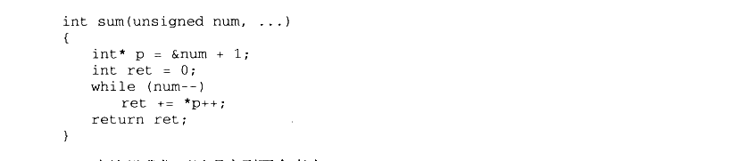

<details markdown="1"><summary>复制校对文字（未运行验证）</summary>

```text
int sum(unsigned num, ...)
{
    int* p = &num + 1;
    int ret = 0;
    while (num--)
        ret += *p++;
    return ret;
}
```

</details>

在这里我们可以观察到两个事实：

（1） sum 函数获取参数的量仅取决于 num 参数的值，因此，如果num 参数的值不等于实际传递的不定参数的数量，那么 sum 函数可能取到错误的或不足的参数。

（2） cdecl 调用惯例保证了参数的正确清除。我们知道有些调用惯例（如 stdcall）是由被调用方负责清除堆栈的参数，然而，被调用方在这里其实根本不知道有多少参数被传递进来，所以没有办法清除堆栈。而cdecl 恰好是调用方负责清除堆栈，因此没有这个问题。

printf 的不定参数比 sum 要复杂得多，因为 printf 的参数不仅数量不定，而且类型也不定。所以 printf 需要在格式字符串中注明参数的类型，例如用%d 表明是一个整数。printf里的格式字符串如果将类型描述错误，因为不同参数的大小不同，不仅可能导致这个参数的输出错误，还有可能导致其后的一系列参数错误。【小实验】

printf 的狂乱输出

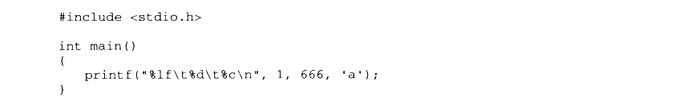

<details markdown="1"><summary>复制校对文字（未运行验证）</summary>

```text
#include <stdio.h>
int main()
{
    printf("%lf\t%d\t%c\n", 1, 666, 'a');
}
```

</details>

在这个程序里，printf 的第一个输出参数是一个 int （4字节），而我们告诉 printf它是一个 double（8字节以上），因此 printf 的输出会错误，由于 printf 在读取 double 的时候实际造成了越界，因此后面几个参数的输出也会失败。该程序的实际输出为（根据实际编译器和环境可能不同）：

0.000000 97

下面让我们来看 va\_list 等宏应该如何实现。

va\_list 实际是一个指针，用来指向各个不定参数。由于类型不明，因此这个 va\_list 以void\*或 char\*为最佳选择。

va\_start 将 va\_list 定义的指针指向函数的最后一个参数后面的位置，这个位置就是第一个不定参数。

va\_arg 获取当前不定参数的值，并根据当前不定参数的大小将指针移向下一个参数。

va\_end 将指针清0。

按照以上思路，va系列宏的一个最简单的实现就可以得到了，如下所示：


<details markdown="1"><summary>复制校对文字（未运行验证）</summary>

```text
#define va_list char*
#define va_start(ap,arg) (ap=(va_list)&arg+sizeof(arg))
#define va_arg(ap,t) (*(t*)((ap+=sizeof(t))-sizeof(t)))
#define va_end(ap) (ap=(va_list)0)
```

</details>

【小提示】

变长参数宏

在很多时候我们希望在定义宏的时候也能够像 printf 一样可以使用变长参数，即宏的参数可以是任意个，这个功能可以由编译器的变长参数宏实现。在 GCC编译器下，变长参数宏可以使用 “\#\#”宏字符串连接操作实现，比如：

```c
#define printf(args...) fprintf(stdout, ##args)
```

那么 `printf("%d %s", 123, "hello")` 就会被展开成：

```c
fprintf(stdout, "%d %s", 123, "hello")
```

而在 MSVC 下，我们可以使用\_VA\_ARGS\_这个编译器内置宏，比如：

```c
#define printf(...) fprintf(stdout, __VA_ARGS__)
```

它的效果与前面的GCC 下使用时的效果一样。

2. 非局部跳转

非局部跳转即使在C 语言里也是一个备受争议的机制。使用非局部跳转，可以实现从一个函数体内向另一个事先登记过的函数体内跳转，而不用担心堆栈混乱。下面让我们来看一个示例：

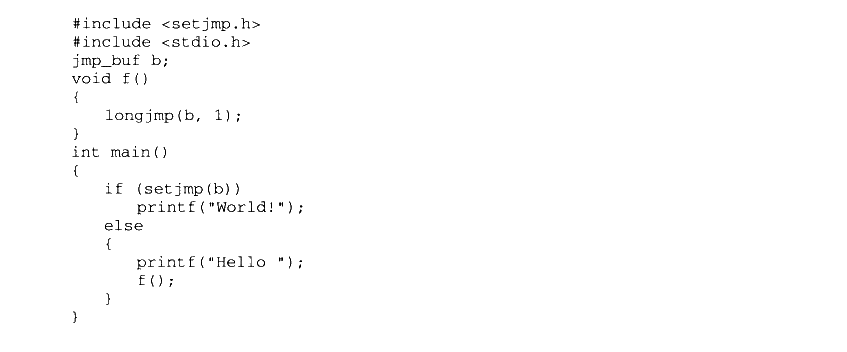

<details markdown="1"><summary>复制校对文字（未运行验证）</summary>

```text
#include <setjmp.h>
#include <stdio.h>
jmp_buf b;
void f()
{
    longjmp(b, 1);
}
int main()
{
    if (setjmp(b))
        printf("World!");
    else
    {
        printf("Hello ");
        f();
    }
}
```

</details>

这段代码按常理不论 setjmp 返回什么，也只会打印出“Hello ”和“World！” 之一，然而事实上的输出是：

Hello World！

实际上，当setjmp 正常返回的时候，会返回0，因此会打印出“Hello”的字样。而 longjmp的作用，就是让程序的执行流回到当初 setjmp 返回的时刻，并且返回由longjmp 指定的返回值 （longjmp 的参数2），也就是1，自然接着会打印出“World！” 并退出。换句话说，longjmp可以让程序“时光倒流”回 setjmp返回的时刻，并改变其行为，以至于改变了未来。

是的，这绝对不是结构化编程。⑨

#### 11.2.3 glibc 与 MSVC CRT

运行库是平台相关的，因为它与操作系统结合得非常紧密。C语言的运行库从某种程度上来讲是C语言的程序和不同操作系统平台之间的抽象层，它将不同的操作系统API 抽象成相同的库函数。比如我们可以在不同的操作系统平台下使用fread 来读取文件，而事实上fread 在不同的操作系统平台下的实现是不同的，但作为运行库的使用者我们不需要关心这一点。虽然各个平台下的C语言运行库提供了很多功能，但很多时候它们毕竟有限，比如用户的权限控制、操作系统线程创建等都不是属于标准的C语言运行库。于是我们不得不通过其他的办法，诸如绕过C语言运行库直接调用操作系统API 或使用其他的库。Linux 和Windows 平台下的两个主要C语言运行库分別为 glibc（GNU C Library）和 MSVCRT（Microsoft Visual C Run-time），我们在下面将会分别介绍它们。

值得注意的是，像线程操作这样的功能并不是标准的C语言运行库的一部分，但是 glibc和 MSVCRT 都包含了线程操作的库函数。比如 glibc 有一个可选的 pthread 库中的pthread\_create（）函数可以用来创建线程：而 MSVCRT 中可以使用\_beginthread（）函数来创建线程。所以 glibc 和 MSVCRT 事实上是标准C语言运行库的超集，它们各自对C标准库进行了一些扩展。

glibc

glibc 即 GNU C Library，是GNU旗下的C标准库。最初由自由软件基金会 FSF （Free Software Foundation）发起开发，目的是为GNU操作系统开发一个C标准库。GNU 操作系统的最初计划的内核是 Hurd，一个微内核的构架系统。Hurd 因为种种原因开发进展缓慢，而 Linux 因为它的实用性而逐渐风靡，最后取代 Hurd 成了 GNU 操作系统的内核。于是glibc从最初开始支持Hurd 到后来渐渐发展成同时支持 Hurd 和 Linux，而且随着 Linux的越来越流行，glibc 也主要关注 Linux 下的开发，成为了 Linux 平台的C标准库。

20世纪90年代初，在glibc成为 Linux 下的C运行库之前，Linux 的开发者们因为开发的需要，从 Linux 内核代码里面分离出了一部分代码，形成了早期Linux 下的C运行库。这个C运行库又被称为 Linux libc。这个版本的C运行库被维护了很多年，从版本2一直开发到版本5。如果你去看早期版本的Linux，会发现/lib 目录下面有libc.so.5这样的文件，这个文件就是第五个版本的 Linux libc。1996年 FSF 发布了 glibc 2.0，这个版本的 glibc 开始支持诸多特性，比如它完全支持POSIX标准、国际化、IPv6、64-位数据访问、多线程及改进了代码的可移植性。在此时 Linux libc 的开发者也认识到单独地维护一份 Linux 下专用的C运行库是没有必要的，于是 Linux 开始采用 glibc 作为默认的C运行库，并且将2.x版本的 glibc看作是 Linux libc 的后继版本。于是我们可以看到，glibc 在/lib 目录下的.so 文件为 libc.so.6，即第六个 libc 版本，而且在各个 Linux 发行版中，glibc 往往被称为 libc6。glibc 在 Linux 平台下占据了主导地位之后，它又被移植到了其他操作系统和其他硬件平台，诸如 FreeBSD、NetBSD 等，而且它支持数十种CPU 及嵌入式平台。目前最新的 glibc 版本号是2.8 （2008年4月）。glibc 的发布版本主要由两部分组成，一部分是头文件，比如 stdio.h、stdlib.h 等，它们往往位于 /usr/include：另外一部分则是库的二进制文件部分。二进制部分主要的就是C语言标准库，它有静态和动态两个版本。动态的标准库我们已在本书的前面章节中碰到过了，它位于/lib/libc.so.6；而静态标准库位于/usr/lib/libc.a。事实上glibc 除了C标准库之外，还有几个辅助程序运行的运行库，这几个文件可以称得上是真正的“运行库”。它们就是/usr/lib/crt1.o、/usr/lib/crti.o 和/usr/lib/crtn.o。是不是对这几个文件还有点印象呢？我们在第2章讲到静态库链接的时候已经碰到过它们了，虽然它们都很小，但这几个文件都是程序运行的最关键的文件。

glibc 启动文件

crt1.o里面包含的就是程序的入口函数\_start，由它负责调用\_\_libc\_start\_main 初始化 libc并且调用 main 函数进入真正的程序主体。实际上最初开始的时候它并不叫做crt1.o，而是叫做 crt.o，包含了基本的启动、退出代码。由于当时有些链接器对链接时目标文件和库的顺序有依赖性，crt.o这个文件必须被放在链接器命令行中的所有输入文件中的第一个，为了强调这一点，crt.o 被更名为 crt0.o，表示它是链接时输入的第一个文件。

后来由于C++的出现和 ELF 文件的改进，出现了必须在main()函数之前执行的全局/静态对象构造和必须在 main()函数之后执行的全局/静态对象析构。为了满足类似的需求，运行库在每个目标文件中引入两个与初始化相关的段“init”和“.fini”。运行库会保证所有位于这两个段中的代码会先于/后于 main()函数执行，所以用它们来实现全局构造和析构就是很自然的事情了。链接器在进行链接时，会把所有输入目标文件中的“.init”和“.fini”按照顺序收集起来，然后将它们合并成输出文件中的“.init” 和“.fini”。但是这两个输出的段中所包含的指令还需要一些辅助的代码来帮助它们启动（比如计算GOT 之类的），于是引入了两个目标文件分别用来帮助实现初始化函数的 crti.o 和 crtn.o。

与此同时，为了支持新的库和可执行文件格式，crt0.o 也进行了升级，变成了crt1.o.crt0.o和 crt1.o之间的区别是 crt0.o为原始的，不支持“init”和“.fini” 的启动代码，而crt1.o是改进过后，支持“.init”和“.fini”的版本。这一点我们从反汇编crt1.o可以看到，它向libc启动函数\_\_libc\_start\_main()传递了两个函数指针“\_\_libc\_csu\_init” 和“\_\_libc\_csu\_fini”，这两个函数负责调用\_init()和\_fini()，我们在后面“C++全局构造和析构”的章节中还会详细分析。

为了方便运行库调用，最终输出文件中的“init” 和“.fini”两个段实际上分别包含的是\_init()和\_fini()这两个函数，我们在关于运行库初始化的部分也会看到这两个函数，并且在C++全局构造和析构的章节中也会分析它们是如何实现全局构造和析构的。crti.o 和 crtn.o这两个目标文件中包含的代码实际上是\_init()函数和\_fini()函数的开始和结尾部分，当这两个文件和其他目标文件按照顺序链接起来以后，刚好形成两个完整的函数\_init（）和\_fini（）。我们用 objdump 可以查看这两个文件的反汇编代码：

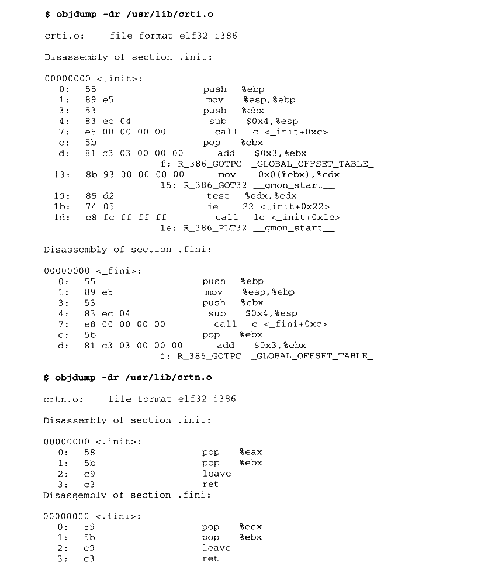

<details markdown="1"><summary>复制校对文字（未运行验证）</summary>

```text
$ objdump -dr /usr/lib/crti.o
crti.o: file format elf32-i386
Disassembly of section .init:
00000000 <_init>:
  0: 55                 push %ebp
  1: 89 e5              mov %esp,%ebp
  3: 53                 push %ebx
  4: 83 ec 04           sub $0x4,%esp
  7: e8 00 00 00 00     call c <_init+0xc>
  c: 5b                 pop %ebx
  d: 81 c3 03 00 00 00  add $0x3,%ebx
      f: R_386_GOTPC _GLOBAL_OFFSET_TABLE_
 13: 8b 93 00 00 00 00  mov 0x0(%ebx),%edx
     15: R_386_GOT32 __gmon_start__
 19: 85 d2              test %edx,%edx
 1b: 74 05              je 22 <_init+0x22>
 1d: e8 fc ff ff ff     call 1e <_init+0x1e>
     1e: R_386_PLT32 __gmon_start__
Disassembly of section .fini:
00000000 <_fini>:
  0: 55                 push %ebp
  1: 89 e5              mov %esp,%ebp
  3: 53                 push %ebx
  4: 83 ec 04           sub $0x4,%esp
  7: e8 00 00 00 00     call c <_fini+0xc>
  c: 5b                 pop %ebx
  d: 81 c3 03 00 00 00  add $0x3,%ebx
      f: R_386_GOTPC _GLOBAL_OFFSET_TABLE_
$ objdump -dr /usr/lib/crtn.o
crtn.o: file format elf32-i386
Disassembly of section .init:
00000000 <.init>:
  0: 58  pop %eax
  1: 5b  pop %ebx
  2: c9  leave
  3: c3  ret
Disassembly of section .fini:
00000000 <.fini>:
  0: 59  pop %ecx
  1: 5b  pop %ebx
  2: c9  leave
  3: c3  ret
```

</details>

于是在最终链接完成之后，输出的目标文件中的“.init”段只包含了一个函数\_init()，这个函数的开始部分来自于 crti.o的“.init”段，结束部分来自于 crtn.o 的“init” 段。为了保证最终输出文件中“.init”和“.fini”的正确性，我们必须保证在链接时，crti.o 必须在用户目标文件和系统库之前，而crtn.o必须在用户目标文件和系统库之后。链接器的输入文件顺序一般是：

```sh
ld crt1.o crti.o [user_objects] [system_libraries] crtn.o
```

由于 crt1.o （crt0.o）不包含“.init”段和 “.fini” 段，所以不会影响最终生成“init”和“.fini”段时的顺序。输出文件中的“init”段看上去应该如图11-8所示（对于“.fini”来说也一样）。


<p class="image-caption">图 11-8 .init 段的组成</p>

<details markdown="1"><summary>查看图中文字（按图分组）</summary>

_init 的开头来自 crti.o（图中为 push %ebx、mov %esp,%ebp），中间来自各个 *.o（…、call XXX、…），结尾来自 crtn.o（pop %eax、pop %ebx、leave、ret）。

</details>

提示：在默认情况下，ld 链接器会将 libc、crt1.o等这些 CRT 和启动文件与程序的模块链接起来，但是有些时候，我们可能不需要这些文件，或者希望使用自己的 libc 和 crt1.o等启动文件，以替代系统默认的文件，这种情况在嵌入式系统或操作系统内核编译的时候很常见。GCC 提供了两个参数“-nostartfiles” 和“-nostdlib"

，分别用来取消默认的启动文件和C语言运行库。

其实 C++全局对象的构造函数和析构函数并不是直接放在.init 和.finir 段里面的，而是把一个执行所有构造/析构的函数的调用放在里面，由这个函数进行真正的构造和析构，我们在后面的章节还会再详细分析 ELF/Glibc 和 PE/MSVC 对全局对象构造和析构的过程。

除了全局对象构造和析构之外，init 和.fini 还有其他的作用。由于它们的特性（在main 之前/后执行），一些用户监控程序性能、调试等工具经常利用它们进行一些初始化和反初始化的工作。当然我们也可以使用 “\_attribute\_\_（（section（"inic"））”将函数放到.init 段里面，但是要注意的是普通函数放在“.init” 是会破坏它们的结构的，因为函数的返回指令使得\_init（）函数会提前返回，必须使用汇编指令，不能让编译器产生 “ret” 指令。GCC 平台相关目标文件

就这样，在第2章中我们在链接时碰到过的诸多输入文件中，已经解决了 crt1.o、crti.o和 crtn.o，剩下的还有几个 crtbeginT.o、libgcc.a、libgcc\_eh.a、crtend.o。严格来讲，这几个文件实际上不属于 glibc，它们是GCC 的一部分，它们都位于GCC 的安装目录下：

- `/usr/lib/gcc/i486-Linux-gnu/4.1.3/crtbeginT.o`
- `/usr/lib/gcc/i486-Linux-gnu/4.1.3/libgcc.a`
- `/usr/lib/gcc/i486-Linux-gnu/4.1.3/libgcc_eh.a`
- `/usr/lib/gcc/i486-Linux-gnu/4.1.3/crtend.o`

首先是 crtbeginT.o及 crtend.o，这两个文件是真正用于实现C++全局构造和析构的目标文件。那么为什么已经有了crti.o 和 crtn.o之后，还需要这两个文件呢？我们知道，C++这样的语言的实现是跟编译器密切相关的，而glibc 只是一个C语言运行库，它对C++的实现并不了解。而GCC是C++的真正实现者，它对C++的全局构造和析构了如指掌。于是它提供了两个目标文件 crtbeginT.o 和 crtend.o来配合 glibc 实现C++的全局构造和析构。事实上是 crti.o和 crtn.o中的“.init”和“.fini” 提供一个在 main()之前和之后运行代码的机制，而真正全局构造和析构则由 crtbeginT.o和 crtend.o来实现。我们在后面的章节还会详细分析它们的实现机制。

由于GCC 支持诸多平台，能够正确处理不同平台之间的差异性也是GCC 的任务之一。比如有些32位平台不支持64位的longlong类型的运算，编译器不能够直接产生相应的CPU指令，而是需要一些辅助的例程来帮助实现计算。libgcc.a 里面包含的就是这种类似的函数，这些函数主要包括整数运算、浮点数运算（不同的CPU 对浮点数的运算方法很不相同）等，而 libgcc\_eh.a 则包含了支持C++的异常处理（Exception Handling）的平台相关函数。另外GCC 的安装目录下往往还有一个动态链接版本的 libgcc.a，为 libgcc\_s.so。

MSVC CRT

相比于相对自由分散的 glibc，一直伴随着不同版本的 Visual C++发布的 MSVC CRT（Microsoft Visual C++ C Runtime）倒看过去更加有序一些。从1992年最初的 Visual C++1.0版开始，一直到现在的 Visual C++9.0（又叫做 Visual C++ 2008），MSVC CRT 也从1.0版发展到了9.0版。

同一个版本的 MSVC CRT 根据不同的属性提供了多种子版本，以供不同需求的开发者使用。按照静态/动态链接，可以分为静态版和动态版：按照单线程/多线程，可以分为单线程版和多线程版：按照调试/发布，可分为调试版和发布版：按照是否支持C++分为纯C运行库版和支持C++版；按照是否支持托管代码分为支持本地代码/托管代码和纯托管代码版。这些属性很多时候是相互正交的，也就是说它们之间可以相互组合。比如可以有静态单线程纯C纯本地代码调试版：也可以有动态的多线程纯C纯本地代码发布版等。但有些组合是没有的，比如动态链接版本的CRT是没有单线程的，所有的动态链接CRT 都是多线程安全的。

这样的不同组合将会出现非常多的子版本，于是微软提供了一套运行库的命名方法。这个命名方法是这样的，静态版和动态版完全不同。静态版的CRT位于 MSVC 安装目录下的lib/，比如 Visual C++ 2008的静态库路径为“Program Files\Microsoft Visual Studio 9.0\VC\lib”，它们的命名规则为：

`libc[p][mt][d].lib`

- P表示 C Plusplus，即 C++标准库。

- mt表示 Multi-Thread，即表示支持多线程。

- d 表示 Debug，即表示调试版本。

比如静态的非C++的多线程版 CRT 的文件名为 libcmtd.lib。动态版的CRT 的每个版本一般有两个相对应的文件，一个用于链接的.lib 文件，一个用于运行时用的.dll 动态链接库。它们的命名方式与静态版的 CRT非常类似，稍微有所不同的是，CRT的动态链接库 DLL 文件名中会包含版本号。比如 Visual C++ 2005 的多线程、动态链接版的 DLL 文件名为msvcr90.dll（Visual C++ 2005 的内部版本号为8.0）表11-1 列举了一些最常见的 MSVC CRT版本（以Visual C++ 2005为例）。

表11-1

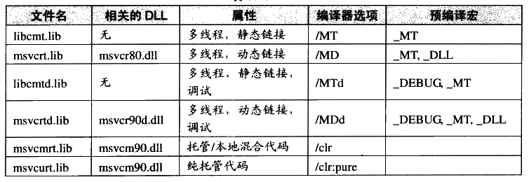

<details markdown="1"><summary>查看校对表格</summary>

| 文件名 | 相关 DLL | 属性 | 编译器选项 | 预编译宏 |
| --- | --- | --- | --- | --- |
| libcmt.lib | 无 | 多线程，静态链接 | /MT | _MT |
| msvcrt.lib | msvcr80.dll | 多线程，动态链接 | /MD | _MT, _DLL |
| libcmtd.lib | 无 | 多线程，静态链接，调试 | /MTd | _DEBUG, _MT |
| msvcrtd.lib | msvcr90d.dll | 多线程，动态链接，调试 | /MDd | _DEBUG, _MT, _DLL |
| msvcmrt.lib | msvcm90.dll | 托管/本地混合代码 | /clr | |
| msvcurt.lib | msvcm90.dll | 纯托管代码 | /clr:pure | |

</details>

自从 Visual C++2005（MSVC 8.0）以后，MSVC不再提供静态链接单线程版的运行库（LIBC.lib、LIBCD.lib），因为据微软声称，经过改进后的新的多线程版的C运行库在单线程的模式下运行速度已经接近单线程版的运行库，于是没有必要再额外提供一个只支持单线程的 CRT 版本。

默认情况下，如果在编译链接时不指定链接哪个 CRT，编译器会默认选择LIBCMT.LIB，即静态多线程 CRT，Visual C++2005之前的版本会选择LIBC.LIB，即静态单线程版本。关于 CRT 的多线程和单线程的问题，我们在后面的章节还会再深入分析。

除了使用编译命令行的选项之外，在 Visual C++ 工程属性中也可以设置相关选项。如图

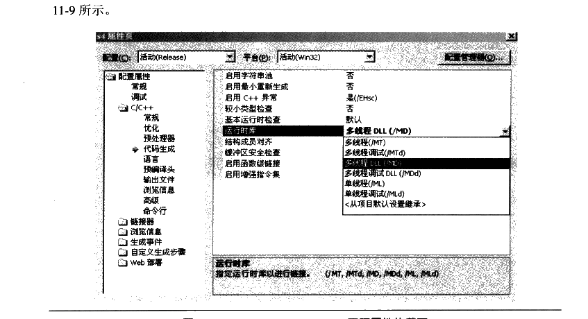

<p class="image-caption">图 11-9 Visual C++ 2003 .NET 工程属性的截图</p>

<details markdown="1"><summary>查看图中文字（按图分组）</summary>

Visual Studio 项目属性：配置属性 → C/C++ → 代码生成 → 运行时库。可选择多线程 /MT、多线程调试 /MTd、多线程 DLL /MD、多线程调试 DLL /MDd 等。

</details>

我们可以从图 11-9 中看到，除了多线程库以外，还有单线程静态/ML、单线程静态调试/MLd 的选项。

C++ CRT

表11-1中的所有CRT 都是指C语言的标准库，MSVC还提供了相应的C++标准库。如果你的程序是使用 C++编写的，那么就需要额外链接相应的 C++标准库。这里“额外”的意思是，如表11-2所列的C++标准库里面包含的仅仅是C++的内容，比如 iostream、string、map 等，不包含C的标准库。

表11-2

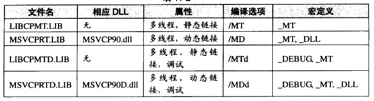

<details markdown="1"><summary>查看校对表格</summary>

| 文件名 | 相应 DLL | 属性 | 编译器选项 | 宏定义 |
| --- | --- | --- | --- | --- |
| LIBCPMT.LIB | 无 | 多线程，静态链接 | /MT | _MT |
| MSVCPRT.LIB | MSVCP90.dll | 多线程，动态链接 | /MD | _MT, _DLL |
| LIBCPMTD.LIB | 无 | 多线程，静态链接，调试 | /MTd | _DEBUG, _MT |
| MSVCPRTD.LIB | MSVCP90D.dll | 多线程，动态链接，调试 | /MDd | _DEBUG, _MT, _DLL |

</details>

当你在程序里包含了某个 C++标准库的头文件时，MSVC编译器就认该源代码文件是一个 C++源代码程序，它会在编译时根据编译选项，在目标文件的“.drectve” 段（还记得第2章中的 DIRECTIVE吧？）相应的C++标准库链接信息。比如我们用C++写一个“Hello World”程序：

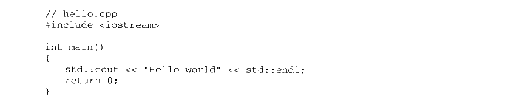

<details markdown="1"><summary>复制校对文字（未运行验证）</summary>

```text
// hello.cpp
#include <iostream>
int main()
{
    std::cout << "Hello world" << std::endl;
    return 0;
}
```

</details>

然后将它编译成目标文件，并查看它的“.drectve”段的信息：

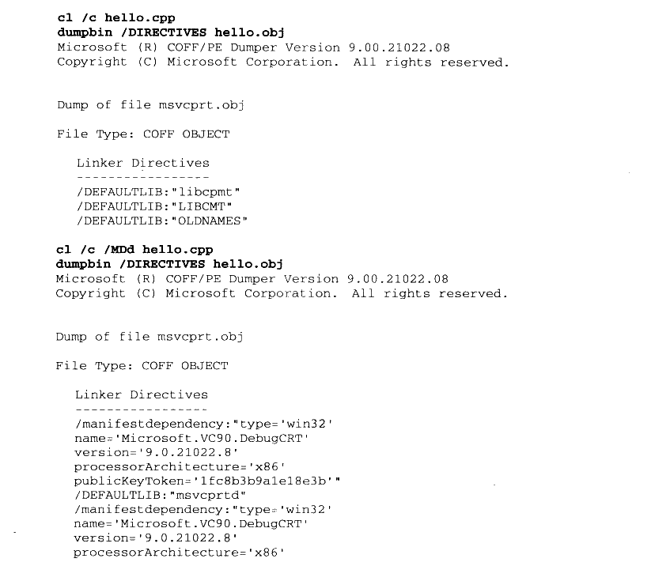

<details markdown="1"><summary>复制校对文字（未运行验证）</summary>

```text
cl /c hello.cpp
dumpbin /DIRECTIVES hello.obj
Microsoft (R) COFF/PE Dumper Version 9.00.21022.08
Copyright (C) Microsoft Corporation. All rights reserved.
Dump of file msvcprt.obj
File Type: COFF OBJECT
Linker Directives
-----------------
/DEFAULTLIB:"libcpmt"
/DEFAULTLIB:"LIBCMT"
/DEFAULTLIB:"OLDNAMES"

cl /c /MDd hello.cpp
dumpbin /DIRECTIVES hello.obj
Microsoft (R) COFF/PE Dumper Version 9.00.21022.08
Copyright (C) Microsoft Corporation. All rights reserved.
Dump of file msvcprt.obj
File Type: COFF OBJECT
Linker Directives
-----------------
/manifestdependency:"type='win32'
name='Microsoft.VC90.DebugCRT'
version='9.0.21022.8'
processorArchitecture='x86'
publicKeyToken='1fc8b3b9a1e18e3b'"
/DEFAULTLIB:"msvcprtd"
/manifestdependency:"type='win32'
name='Microsoft.VC90.DebugCRT'
version='9.0.21022.8'
processorArchitecture='x86'
```

</details>


<details markdown="1"><summary>复制校对文字（未运行验证）</summary>

```text
publicKeyToken='1fc8b3b9a1e18e3b'"
/DEFAULTLIB:"MSVCRTD"
/DEFAULTLIB:"OLDNAMES"
```

</details>

可以看到，hello.obj须要链接 libcpmt.lib、LIBCMT.lib 和 OLDNAMES.lib。当我们使用“/MDd”参数编译时，hello.obj 就需要 msvcprtd.lib、MSVCRTD.lib 和 OLDNAMES.lib，除此之外，编译器还给链接器传递了“/manifestdependency”参数，即 manifest 信息。

#### Q&A

Q：如果一个程序里面的不同obj 文件或 DLL 文件使用了不同的CRT，会不会有问题？

A：这个问题实际上分很多种情况。如果程序没有用到 DLL，完全静态链接，不同的 obj 在编译时用到了不同版本的静态 CRT。由于目前静态链接CRT 只有多线程版，并且如果所有的目标文件都统一使用调试版或发布版，那么这种情况下一般是不会有问题的。因为我们知道，目标文件对静态库引用只是在目标文件的符号表中保留一个记号，并不进行实际的链接，也没有静态库的版本信息。

但是，如果程序涉及动态链接 CRT，这就比较复杂了。因为不同的目标文件如果依赖于不同版本的 msvcrt.lib 和 msvcrt.dll，甚至有些目标文件是依赖于静态 CRT，而有些目标文件依赖于动态 CRT，那么很有可能出现的问题就是无法通过链接。链接器对这种情况的具体反应依赖于输入目标文件的顺序，有些情况下它会报符号重复定义错误：


<details markdown="1"><summary>复制校对文字（未运行验证）</summary>

```text
MSVCRTD.lib(MSVCR80D.dll) : error LNK2005: _printf already defined in LIBCMTD.lib (printf.obj)
```

</details>

但是有些情况下，它会使链接顺利通过，只是给出一个警告：


<details markdown="1"><summary>复制校对文字（未运行验证）</summary>

```text
LINK : warning LNK4098: defaultlib 'LIBCMTD' conflicts with use of other libs; use /NODEFAULTLIB:library
```

</details>

如果碰到上面这种静态/动态 CRT 混合的情况，我们可以使用链接器的/NODEFAULTLIB 来禁止某个或某些版本的 CRT，这样一般就能使链接顺利进行。最麻烦的情况应该属于一个程序所依赖的 DLL 分别使用不同的CRT，这会导致程序在运行时同时有多份CRT的副本。在一般情况下，这个程序应该能正常运行，但是值得注意的是，你不能够在这些 DLL 之间相互传递使用一些资源。比如两个 DLL A 和B分别使用不同的CRT，那么应该注意以下问题：

- 不能在A 中申请内存然后在B 中释放，因为它们分属于不同的CRT，即拥有不同的堆，这包括C++里面所有对象的申请和释放；

- 在A 中打开的文件不能在B 中使用，比如FILE\*之类的，因为它们依赖于CRT的文件操作部分。

还有类似的问题，比如不能相互共享 locale 等。如果不违反上述规则，可能会使程序发生莫名其妙的错误并且很难发现。

防止出现上述问题的最好方法就是保证一个工程里面所有的目标文件和DLL 都使用同一个版本的 CRT。当然有时候事实并不能尽如人意，比如很多时候当我们要用到第三方提供的.lib或 DLL 文件而对方又不提供源代码时，就会比较难办。

Windows 系统的 system32目录下有个叫 msvcrt.dll 的文件，它跟msvcr90.dll 这样的DLL有什么区别？

Q：为什么我用 Visual C++ 2005/2008 编译的程序无法在别人的机器上运行？

A：因为 Visual C++ 2005/2008 编译的程序使用了 manifest 机制，这些程序必须依赖于相对应版本的运行库。一个解决的方法就是使用静态链接，这样就不需要依赖于 CRT 的DLL。另外一个解决的方法就是将相应版本的运行库与程序一起发布给最终用户。


## 11.3 运行库与多线程

#### 11.3.1 CRT 的多线程困扰

线程的访问权限

线程的访问能力非常自由，它可以访问进程内存里的所有数据，甚至包括其他线程的堆栈（如果它知道其他线程的堆栈地址，然而这是很少见的情况），但实际运用中线程也拥有自己的私有存储空间，包括：

- 栈（尽管并非完全无法被其他线程访问，但一般情况下仍然可以认为是私有的数据）。

- 线程局部存储（Thread Local Storage, TLS）。线程局部存储是某些操作系统为线程单独提供的私有空间，但通常只具有很有限的尺寸。

- 寄存器（包括PC寄存器），寄存器是执行流的基本数据，因此为线程私有。

从C程序员的角度来看，数据在线程之间是否私有如表11-3所示。

表11-3

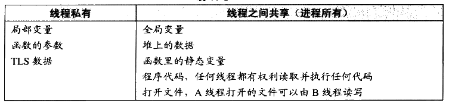

<details markdown="1"><summary>查看校对表格</summary>

| 线程私有 | 线程之间共享（进程所有） |
| --- | --- |
| 局部变量 | 全局变量 |
| 函数的参数 | 堆上的数据 |
| TLS 数据 | 函数里的静态变量 |
| | 程序代码，任何线程都有权利读取并执行任何代码 |
| | 打开文件，A 线程打开的文件可以由 B 线程读写 |

</details>

多线程运行库

现有版本的C/C++标准（特指 C++03、C89、C99）对多线程可以说只字不提，因此相应的C/C++运行库也无法针对线程提供什么帮助，也就是说在运行库里不能找到关于创建、结束、同步线程的函数。对于C/C++标准库来说，线程相关的部分是不属于标准库的内容的，它跟网络、图形图像等一样，属于标准库之外的系统相关库。由于多线程在现代的程序设计中占据非常重要的地位，主流的C运行库在设计时都会考虑到多线程相关的内容。这里我们所说的“多线程相关”主要有两个方面，一方面是提供那些多线程操作的接口，比如创建线程、退出线程、设置线程优先级等函数接口：另外一方面是C运行库本身要能够在多线程的环境下正确运行。

对于第一方面，主流的CRT 都会有相应的功能。比如 Windows 下，MSVC CRT 提供了诸如\_beginthread()、\_endthread()等函数用于线程的创建和退出；而 Linux 下，glibc 也提供了一个可选的线程库 pthread（POSIX Thread），它提供了诸如 pthread\_create（）、pthread\_exit（）等函数用于线程的创建和退出。很明显，这些函数都不属于标准的运行库，它们都是平台相关的。

对于第二个方面，C语言运行库必须支持多线程的环境，这是什么意思呢？实际上，最初CRT 在设计的时候是没有考虑多线程环境的，因为当时根本没有多线程这样的概念。到后来多线程在程序中越来越普及，C/C++运行库在多线程环境下吃了不少苦头。例如：

（1）errno：在C标准库里，大多数错误代码是在函数返回之前赋值在名为 errno 的全局变量里的。多线程并发的时候，有可能A线程的 errno的值在获取之前就被B线程给覆盖掉，从而获得错误的出错信息。

（2） strtok()等函数都会使用函数内部的局部静态变量来存储字符串的位置，不同的线程调用这个函数将会把它内部的局部静态变量弄混乱。

（3） malloc/new 与 free/delete：堆分配/释放函数或关键字在不加锁的情况下是线程不安全的。由于这些函数或关键字的调用十分频繁，因此在保证线程安全的时候显得十分繁琐。

（4）异常处理：在早期的C++运行库里，不同的线程抛出的异常会彼此冲突，从而造成信息丢失的情况。

（5） printf/fprintf 及其他 I/O 函数：流输出函数同样是线程不安全的，因为它们共享了同一个控制台或文件输出。不同的输出并发时，信息会混杂在一起。

（6）其他线程不安全函数：包括与信号相关的一些函数。

通常情况下，C标准库中在不进行线程安全保护的情况下自然地具有线程安全的属性的函数有（不考虑 errno 的因素）：（1） 字符处理（ctype.h），包括 isdigit、toupper 等，这些函数同时还是可重入的。

（2） 字符串处理函数（string.h），包括 strlen、strcmp 等，但其中涉及对参数中的数组进行写入的函数（如 strcpy）仅在参数中的数组各不相同时可以并发。

（3）数学函数（math.h），包括sin、pow 等，这些函数同时还是可重入的。

（4） 字符串转整数/浮点数（stdlib.h），包括 atof、atoi、atol、strtod、strtol、strtoul。

（5）获取环境变量（stdlib.h），包括 getenv，这个函数同时还是可重入的。

（6） 变长数组辅助函数（stdarg.h）。

（7） 非局部跳转函数（setjmp.h），包括 setjmp 和 longjmp，前提是longjmp 仅跳转到本线程设置的jmpbuf上。

为了解决C 标准库在多线程环境下的窘迫处境，许多编译器附带了多线程版本的运行库。在MSVC中，可以用/MT 或/MTd 等参数指定使用多线程运行库。

#### 11.3.2 CRT 改进

使用 TLS

多线程运行库具有什么样的改进呢？首先，errno必须成为各个线程的私有成员。在 glibc中，errno 被定义为一个宏，如下：

```c
#define errno (*__errno_location())
```

函数 __errno_location 在不同的库版本下有不同的定义，在单线程版本中，它仅直接返回了全局变量 errno 的地址。而在多线程版本中，不同线程调用\_\_errno\_location 返回的地址则各不相同。在MSVC中，errno 同样是一个宏，其实现方式和 glibc 类似。

加锁

在多线程版本的运行库中，线程不安全的函数内部都会自动地进行加锁，包括 malloc、printf 等，而异常处理的错误也早早就解决了。因此使用多线程版本的运行库时，即使在malloc/new前后不进行加锁，也不会出现并发冲突。

改进函数调用方式

C 语言的运行库为了支持多线程特性，必须做出一些改进。一种改进的办法就是修改所有的线程不安全的函数的参数列表，改成某种线程安全的版本。比如 MSVC 的 CRT 就提供了线程安全版本的strtok()函数：strtok\_s，它们的原型如下：

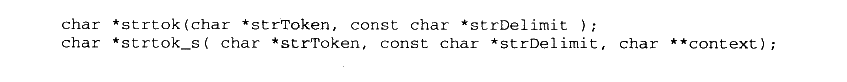

<details markdown="1"><summary>复制校对文字（未运行验证）</summary>

```text
char *strtok(char *strToken, const char *strDelimit);
char *strtok_s(char *strToken, const char *strDelimit, char **context);
```

</details>

改进后的 strtok\_s 增加了一个参数，这个参数 context 是由调用者提供一个 char\*指针，strtok\_s将每次调用后的字符串位置保存在这个指针中。而之前版本的 strtok 函数会将这个位置保存在一个函数内部的静态局部变量中，如果有多个线程同时调用这个函数，有可能出现冲突。与 MSVC CRT 类似，Glibc 也提供了一个线程安全版本的 strtok（）叫做 strtok\_r（）。

但是很多时候改变标准库函数的做法是不可行的。标准库之所以称之为“标准”，就是它具有一定的权威性和稳定性，不能随意更改。如果随意更改，那么所有遵循该标准的程序都需要重新进行修改，这个“标准”是不是值得遵循就有待商榷了。所以更好的做法是不改变任何标准库函数的原型，只是对标准库的实现进行一些改进，使得它能够在多线程的环境下也能够顺利运行，做到向后兼容。

#### 11.3.3 线程局部存储实现

很多时候，开发者在编写多线程程序的时候都希望存储一些线程私有的数据。我们知道，属于每个线程私有的数据包括线程的栈和当前的寄存器，但是这两种存储都是非常不可靠的，栈会在每个函数退出和进入的时候被改变：而寄存器更是少得可怜，我们不可能拿寄存器去存储所需要的数据。假设我们要在线程中使用一个全局变量，但希望这个全局变量是线程私有的，而不是所有线程共享的，该怎么办呢？这时候就须要用到线程局部存储（TLS，Thread Local Storage）这个机制了。TLS 的用法很简单，如果要定义一个全局变量为TLS类型的，只需要在它定义前加上相应的关键字即可。对于 GCC 来说，这个关键字就是\_\_thread，比如我们定义一个 TLS 的全局整型变量：

```c
__thread int number;
```

对于 MSVC 来说，相应的关键字为\_\_declspec（thread）：

```c
__declspec(thread) int number;
```

在 Windows Vista 和2008之前的操作系统，如果TLS 的全局变量被定义在一个 DLL 中，并且该 DLL 是使用 LoadLibrary()显式装载的，那么该全局变量将无法使用，如果访问该全局变量将会导致程序发生保护错误。导致这个情况的主要原因是在 Windows Vista 之前的操作系统下，DLL 在使用LoadLibrary()装载时无法正确初始化由\_\_declspec（thread）定义的变量，具体请参照 MSDN。

一旦一个全局变量被定义成 TLS类型的，那么每个线程都会拥有这个变量的一个副本，任何线程对该变量的修改都不会影响其他线程中该变量的副本。

Windows TLS 的实现

对于 Windows 系统来说，正常情况下一个全局变量或静态变量会被放到“.data”或“.bss”段中，但当我们使用\_\_declspec（thread）定义一个线程私有变量的时候，编译器会把这些变量放到PE文件的“.tls”段中。当系统启动一个新的线程时，它会从进程的堆中分配一块足够大小的空间，然后把“.tls” 段中的内容复制到这块空间中，于是每个线程都有自己独立的一个“.tls”副本。所以对于用\_\_declspec（thread）定义的同一个变量，它们在不同线程中的地址都是不一样的。

我们知道对于一个TLS 变量来说，它有可能是一个 C++的全局对象，那么每个线程在启动时不仅仅是复制“.tls”的内容那么简单，还需要把这些TLS 对象初始化，必须逐个地调用它们的全局构造函数，而且当线程退出时，还要逐个地将它们析构，正如普通的全局对象在进程启动和退出时都要构造、析构一样。

Windows PE 文件的结构中有个叫数据目录的结构，我们在第2部分已经介绍过了。它总共有16 个元素，其中有一元素下标为 IMAGE\_DIRECTORY\_ENTRY\_TLS，这个元素中保存的地址和长度就是 TLS 表（IMAGE\_TLS\_DIRECTORY 结构）的地址和长度。TLS 表中保存了所有 TLS 变量的构造函数和析构函数的地址，Windows 系统就是根据TLS 表中的内容，在每次线程启动或退出时对 TLS 变量进行构造和析构。TLS 表本身往往位于 PE 文件的“.rdata”段中。

另外一个问题是，既然同一个 TLS 变量对于每个线程来说它们的地址都不一样，那么线程是如何访问这些变量的呢？其实对于每个 Windows 线程来说，系统都会建立一个关于线程信息的结构，叫做线程环境块（TEB,Thread Environment Block）。这个结构里面保存的是线程的堆栈地址、线程ID 等相关信息，其中有一个域是一个 TLS 数组，它在 TEB中的偏移是0x2C。对于每个线程来说，x86的FS段寄存器所指的段就是该线程的 TEB，于是要得到一个线程的 TLS数组的地址就可以通过 FS：［0x2C］访问到。

注意：TEB 这个结构不是公开的，它可能随着 Windows 版本的变化而变化，我们这里所说的 TEB 结构都是指在x86版的Windows XP。

这个TLS 数组对于每个线程来说大小是固定的，一般有64 个元素。而TLS 数组的第一个元素就是指向该线程的“.tls”副本的地址。于是要得到一个 TLS 的变量地址的步骤为：首先通过 FS：［0x2C］得到 TLS 数组的地址，然后根据 TLS 数组的地址得到“.tls”副本的地址，然后加上变量在“.tls”段中的偏移即该 TLS 变量在线程中的地址。下面看一个简单的例子：

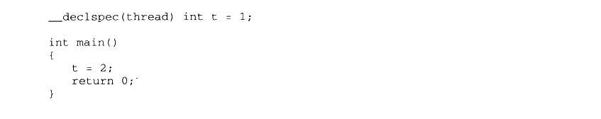

<details markdown="1"><summary>复制校对文字（未运行验证）</summary>

```text
__declspec(thread) int t = 1;
int main()
{
    t = 2;
    return 0;
}
```

</details>

经过编译以后，这段代码的汇编实现如下：

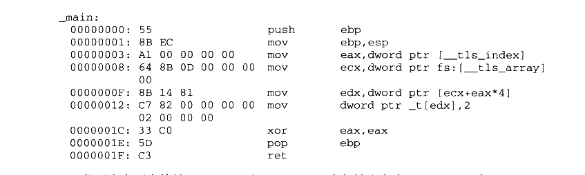

<details markdown="1"><summary>复制校对文字（未运行验证）</summary>

```text
_main:
00000000: 55                push ebp
00000001: 8B EC             mov ebp,esp
00000003: A1 00 00 00 00    mov eax,dword ptr [__tls_index]
00000008: 64 8B 0D 00 00 00 mov ecx,dword ptr fs:[__tls_array]
          00
0000000F: 8B 14 81          mov edx,dword ptr [ecx+eax*4]
00000012: C7 82 00 00 00 00 mov dword ptr [edx],2
          02 00 00 00
0000001C: 33 C0             xor eax,eax
0000001E: 5D                pop ebp
0000001F: C3                ret
```

</details>

代码中有两个符号\_tls\_index 和\_tls\_array，它们被定义在 MSVC CRT 中，对于 MSVC 2008 来说，它们的值分别是0和 0x2C，分别表示TLS数组下的第一个元素和TLS 数组在TEB 中的偏移。由于这两个数值有可能随着Windows 系统的变化而变化，所以它们被保存在 CRT 中，如果程序以 DLL 方式链接，那么在不同版本的 Windows 平台上运行就不会有问题；如果是静态链接，那么当新版的 Windows 更改TEB 结构时而导致 TLS 数组在 TEB中的偏移改变，程序运行就可能出错。当然出于 Windows 多年来的“良好表现”，这种随意更改核心数据结构的事情发生的可能性还是比较小的。

显式 TLS

前面提到的使用\_\_thread或 \_\_declspec（thread）关键字定义全局变量为 TLS 变量的方法往往被称为隐式TLS，即程序员无须关心 TLS 变量的申请、分配赋值和释放，编译器、运行库还有操作系统已经将这一切悄悄处理妥当了。在程序员看来，TLS 全局变量就是线程私有的全局变量。相对于隐式TLS，还有一种叫做显式TLS 的方法，这种方法是程序员须要手工申请 TLS变量，并且每次访问该变量时都要调用相应的函数得到变量的地址，并且在访问完成之后需要释放该变量。在 Windows 平台上，系统提供了 TlsAlloc（）、TlsGetValue（）、TlsSetValue（）和 TlsFree（）这4个API函数用于显式 TLS变量的申请、取值、赋值和释放：Linux下相对应的库函数为 pthread 库中的 pthread\_key\_create（）、pthread\_getspecific（）、pthread\_setspecific（）和 pthread\_key\_delete（）。

显式的TLS 实现其实非常简单，我们前面提到过TEB 结构中有个 TLS数组。实际上显式的TLS 就是使用这个数组保存TLS 数据的。由于 TLS 数组的元素数量固定，一般是64个，于是显式 TLS 在实现时如果发现该数组已经被使用完了，就会额外申请4096个字节作为二级 TLS 数组，使得在 WindowsXP 下最多能拥有 1088 （1024+64）个显式 TLS 变量（当然隐式的 TLS也会占用TLS数组）。相对于隐式的 TLS 变量，显式的TLS 变量的使用十分麻烦，而且有诸多限制，显式TLS的诸多缺点已经使得它越来越不受欢迎了，我们并不推荐使用它。

#### Q&A：CreateThread（）和 beginthread（）有什么不同

我们知道在 Windows 下创建一个线程的方法有两种，一种就是调用 Windows API CreateThread（）来创建线程；另外一种就是调用 MSVC CRT 的函数beginthread（）或\_beginthreadex（）来创建线程。相应的退出线程也有两个函数 Windows API 的 ExitThread（）和CRT的\_endthread()。这两套函数都是用来创建和退出线程的，它们有什么区别呢？

很多开发者不清楚这两者之间的关系，他们随意选一个函数来用，发现也没有什么大问题，于是就忙于解决更为紧迫的任务去了，而没有对它们进行深究。等到有一天忽然发现一个程序运行时间很长的时候会有细微的内存泄露，开发者绝对不会想到是因为这两套函数用混的结果。

根据 Windows API 和MSVC CRT 的关系，可以看出来\_beginthread（）是对 CreateThread（）的包装，它最终还是调用 CreateThread()来创建线程。那么在\_beginthread（）调用CreateThread（）之前做了什么呢？我们可以看一下\_beginthread（）的源代码，它位于CRT 源代码中的thread.c。我们可以发现它在调用CreateThread（）之前申请了一个叫\_tiddata 的结构，然后将这个结构用\_initptd()函数初始化之后传递给\_beginthread（）自己的线程入口函数\_threadstart。\_threadstart 首先把由\_beginthread()传过来的\_tiddata 结构指针保存到线程的显式 TLS 数组，然后它调用用户的线程入口真正开始线程。在用户线程结束之后，\_threadstart（）函数调用\_endthread（）结束线程。并且\_threadstart 还用\_\_try/\_\_except 将用户线程入口函数包起来，用于捕获所有未处理的信号，并且将这些信号交给CRT 处理。

所以除了信号之外，很明显 CRT 包装 Windows API 线程接口的最主要目的就是那个\_tiddata。这个线程私有的结构里面保存的是什么呢？我们可以从 mtdll.h 中找到它的定义，它里面保存的是诸如线程ID、线程句柄、errno、strtok（）的前一次调用位置、rand（）函数的种子、异常处理等与 CRT 有关的而且是线程私有的信息。可见MSVC CRT 并没有使用我们前面所说的\_\_declspec（thread）这种方式来定义线程私有变量，从而防止库函数在多线程下失效，而是采用在堆上申请一个\_tiddata 结构，把线程私有变量放在结构内部，由显式 TLS保存\_tiddata 的指针。

了解了这些信息以后，我们应该会想到一个问题，那就是如果我们用 CreateThread（）创建一个线程然后调用 CRT 的 strtok()函数，按理说应该会出错，因为 strtok()所需要的\_tiddata 并不存在，可是我们好像从来没碰到过这样的问题。查看 strtok（）函数就会发现，当一开始调用\_getptd()去得到线程的\_tiddata 结构时，这个函数如果发现线程没有申请tiddata 结构，它就会申请这个结构并且负责初始化。于是无论我们调用哪个函数创建线程，都可以安全调用所有需要\_tiddata 的函数，因为一旦这个结构不存在，它就会被创建出来。

那么\_tiddata 在什么时候会被释放呢？ExitThread（）肯定不会，因为它根本不知道有\_tiddata 这样一个结构存在，那么很明显是\_endthread()释放的，这也正是CRT的做法。不过我们很多时候会发现，即使使用 CreateThread() 和 ExitThread（）（不调用ExitThread（）直接退出线程函数的效果相同），也不会发现任何内存泄露，这又是为什么呢？经过仔细检查之后，我们发现原来秘密在 CRT DLL 的入口函数DllMain 中。我们知道，当一个进程/线程开始或退出的时候，每个DLL 的DllMain 都会被调用一次，于是动态链接版的 CRT 就有机会在 DllMain 中释放线程的\_tiddata。可是 DllMain 只有当CRT是动态链接版的时候才起作用，静态链接 CRT 是没有 DllMain 的！这就是造成使用CreateThread（）会导致内存泄露的一种情况，在这种情况下，\_tiddata 在线程结束时无法释放，造成了泄露。我们可以用下面这个小程序来测试：

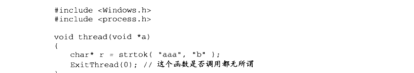

<details markdown="1"><summary>复制校对文字（未运行验证）</summary>

```text
#include <Windows.h>
#include <process.h>
void thread(void *a)
{
    char* r = strtok("aaa", "b");
    ExitThread(0); // 这个函数是否调用都无所谓
}
```

</details>

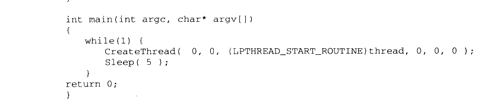

<details markdown="1"><summary>复制校对文字（未运行验证）</summary>

```text
int main(int argc, char* argv[])
{
    while (1) {
        CreateThread(0, 0, (LPTHREAD_START_ROUTINE)thread, 0, 0, 0);
        Sleep(5);
    }
    return 0;
}
```

</details>

如果用动态链接的 CRT （/MD, /MDd）就不会有问题，但是，如果使用静态链接CRT（/MT,/MTd），运行程序后在进程管理器中观察它就会发现内存用量不停地上升，但是如果我们把thread（）函数中的ExitThread（）改成\_endthread（）就不会有问题，因为\_endthread（）会将\_tiddata释放。

这个问题可以总结为：当使用 CRT 时（基本上所有的程序都使用 CRT），请尽量使用\_beginthread（）\_beginthreadex（）/\_endthread()/\_endthreadex（）这组函数来创建线程。在MFC 中，还有一组类似的函数是 AfxBeginThread()和 AfxEndThread()，根据上面的原理类推，它是 MFC 层面的线程包装函数，它们会维护线程与MFC 相关的结构，当我们使用 MFC 类库时，尽量使用它提供的线程包装函数以保证程序运行正确。


## 11.4 C++ 全局构造与析构

在C++的世界里，入口函数还肩负着另一个艰巨的使命，那就是在 main 的前后完成全局变量的构造与析构。本节将介绍在 glibc 和 MSVCRT 的努力下，这件事是如何完成的。

#### 11.4.1 glibc全局构造与析构

在前面介绍 glibc 的启动文件时已经介绍了“.init”和“.fini”段，我们知道这两个段中的代码最终会被拼成两个函数\_init()和\_fini()，这两个函数会先于/后于 main 函数执行。但是它们具体是在什么时候被执行的呢？由谁来负责调用它们呢？它们又是如何进行全局对象的构造和析构的呢？为了解决这些问题，这一节将继续沿着本章第一节从\_start 入口函数开始的那条线进行摸索，顺藤摸瓜地找到这些问题的答案。

为了表述方便，下面使用这样的代码编译出来的可执行文件进行分析：

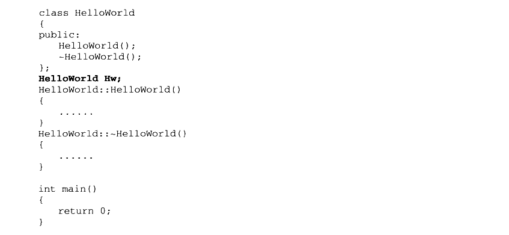

<details markdown="1"><summary>复制校对文字（未运行验证）</summary>

```text
class HelloWorld
{
public:
    HelloWorld();
    ~HelloWorld();
};
HelloWorld Hw;
HelloWorld::HelloWorld()
{
    ......
}
HelloWorld::~HelloWorld()
{
    ......
}
int main()
{
    return 0;
}
```

</details>

为了了解全局对象的构造细节，对程序的启动过程进行更深一步的研究是必须的。在本章的第一节里，由\_start 传递进来的 init函数指针究竟指向什么？通过对地址的跟踪，init实际指向了\_\_libc\_csu\_init 函数。这个函数位于 Glibc 源代码目录的 csu/elf-init.c，让我们来看看这个函数的定义：

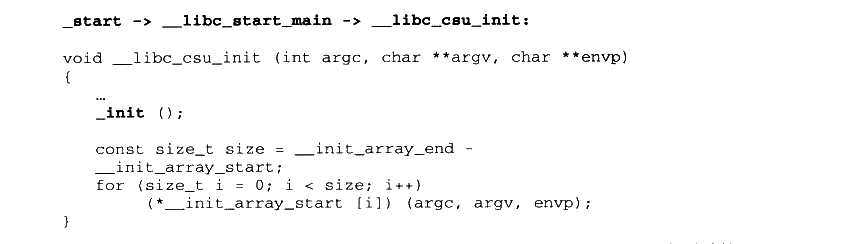

<details markdown="1"><summary>复制校对文字（未运行验证）</summary>

```text
// _start -> __libc_start_main -> __libc_csu_init
void __libc_csu_init(int argc, char **argv, char **envp)
{
    ...
    _init();
    const size_t size = __init_array_end - __init_array_start;
    for (size_t i = 0; i < size; i++)
        (*__init_array_start[i])(argc, argv, envp);
}
```

</details>

这段代码调用了\_init 函数。那么\_init()是什么呢？是不是想起来前面介绍过的定义在crti.o的\_init()函数呢？没错，\_\_libc\_csu\_init 里面调用的正是“.init”段，也就是说，用户所有放在“.init”段的代码就将在这里被执行。

看到这里，似乎我们的线索要断了，因为“\_init”函数的实际内容并不定义在Glibc 里面，它是由各个输入目标文件中的“.init”段拼凑而来的。不过除了分析源代码之外，还有一个终极必杀就是反汇编目标代码，我们随意反汇编一个可执行文件就可以发现\_init()函数的内容：

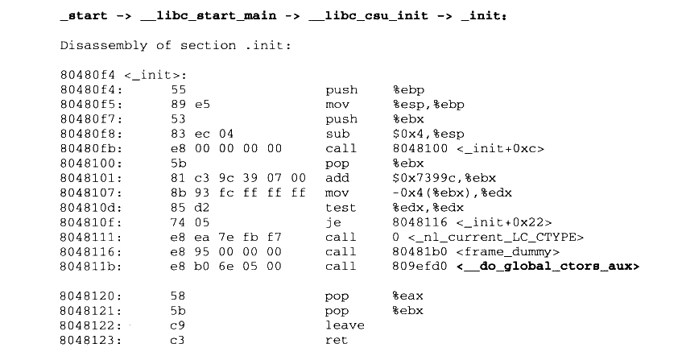

<details markdown="1"><summary>复制校对文字（未运行验证）</summary>

```text
// _start -> __libc_start_main -> __libc_csu_init -> _init
Disassembly of section .init:
80480f4 <_init>:
80480f4: 55                 push %ebp
80480f5: 89 e5              mov %esp,%ebp
80480f7: 53                 push %ebx
80480f8: 83 ec 04           sub $0x4,%esp
80480fb: e8 00 00 00 00     call 8048100 <_init+0xc>
8048100: 5b                 pop %ebx
8048101: 81 c3 9c 39 07 00  add $0x7399c,%ebx
8048107: 8b 93 fc ff ff ff  mov -0x4(%ebx),%edx
804810d: 85 d2              test %edx,%edx
804810f: 74 05              je 8048116 <_init+0x22>
8048111: e8 ea 7e fb f7     call 0 <_nl_current_LC_CTYPE>
8048116: e8 95 00 00 00     call 80481b0 <frame_dummy>
804811b: e8 b0 6e 05 00     call 809efd0 <__do_global_ctors_aux>
8048120: 58                 pop %eax
8048121: 5b                 pop %ebx
8048122: c9                 leave
8048123: c3                 ret
```

</details>

可以看到\_init 调用了一个叫做\_\_do\_global\_ctors\_aux 的函数，如果你在 glibc 源代码里面查找这个函数，是不可能找到它的。因为它并不属于 glibc，而是来自于GCC提供的一个目标文件 crtbegin.o。我们在上一节中也介绍过，链接器在进行最终链接时，有一部分目标文件是来自于GCC，它们是那些与语言密切相关的支持函数。很明显，C++的全局对象构造是与语言密切相关的，相应负责构造的函数来自于GCC 也非常容易理解。

即使它在GCC 的源代码中，我们也把它揪出来。它位于 gcc/crtstuff.c，把它简化以后代码如下：

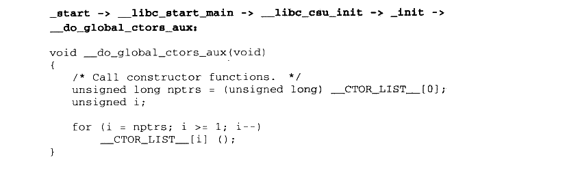

<details markdown="1"><summary>复制校对文字（未运行验证）</summary>

```text
// _start -> __libc_start_main -> __libc_csu_init -> _init -> __do_global_ctors_aux
void __do_global_ctors_aux(void)
{
    /* Call constructor functions. */
    unsigned long nptrs = (unsigned long)__CTOR_LIST__[0];
    unsigned i;
    for (i = nptrs; i >= 1; i--)
        __CTOR_LIST__[i]();
}
```

</details>

上面这段代码首先将\_\_CTOR\_LIST\_\_数组的第一个元素当做数组元素的个数，然后将第一个元素之后的元素都当做是函数指针，并一一调用。这段代码的意图非常明显，我们都可以猜到\_\_CTOR\_LIST\_\_里面存放的是什么，没错，\_\_CTOR\_LIST\_\_里面存放的就是所有全局对象的构造函数的指针。那么接下来的焦点很明显就是\_\_CTOR\_LIST\_\_了，这个数组怎么来的，由谁负责构建这个数组？

**__CTOR_LIST__**

这里不得不暂时放下\_\_CTOR\_LIST\_\_的身世来历，从GCC方面再追究\_\_CTOR\_LIST\_\_未免有些乏味，我们不妨从问题的另一端，也就是从编译器如何生成全局构造函数的角度来看看全局构造函数是怎么实现的。

对于每个编译单元（.cpp），GCC编译器会遍历其中所有的全局对象，生成一个特殊的函数，这个特殊函数的作用就是对本编译单元里的所有全局对象进行初始化。我们可以通过对本节开头的代码进行反汇编得到一些粗略的信息，可以看到GCC 在目标代码中生成了一个名为\_GLOBAL\_\_I\_Hw 的函数，由这个函数负责本编译单元所有的全局\\静态对象的构造和析构，它的代码可以表示为：

```cpp
static void GLOBAL__I_Hw(void)
{
    Hw::Hw(); // 构造对象
    atexit(__tcf_1); // 一个神秘的函数叫做 __tcf_1，被注册到了 exit
}
```

我们暂且不管这里的神秘函数\_\_tcf\_1，它将在本节的最后部分讲到。GLOBAL\_\_I\_Hw作为特殊的函数当然也享受特殊待遇，一旦一个目标文件里有这样的函数，编译器会在这个编译单元产生的目标文件（.o）的“.ctors”段里放置一个指针，这个指针指向的便是GLOBAL\_\_I\_Hw。

那么把每个目标文件的复杂全局/静态对象构造的函数地址放在一个特殊的段里面有什么好处呢？当然不为别的，为的是能够让链接器把这些特殊的段收集起来，收集齐所有的全局构造函数后就可以在初始化的时候进行构造了。

在编译器为每个编译单元生成一份特殊函数之后，链接器在连接这些目标文件时，会将同名的段合并在一起，这样，每个目标文件的.ctors 段将会被合并为一个.ctors 段，其中的内容是各个目标文件的.ctors 段的内存拼接而成。由于每个目标文件的.ctors 段都只存储了一个指针（指向该目标文件的全局构造函数），因此拼接起来的.ctors段就成为了一个函数指针数组，每一个元素都指向一个目标文件的全局构造函数。这个指针数组不正是我们想要的全局构造函数的地址列表吗？如果能得到这个数组的地址，岂不是构造的问题就此解决了？

没错，得到这个数组的地址其实也不难，我们可以效仿前面“.init” 和 “.fini”拼凑的办法，对“.ctor”段也进行拼凑。还记得在链接的时候，各个用户产生的目标文件的前后分别还要链接上一个 crtbegin.o 和 crtend.o吧？这两个 glibc 自身的目标文件同样具有.ctors段，在链接的时候，这两个文件的.ctors段的内容也会被合并到最终的可执行文件中。那么这两个文件的.ctors段里有什么呢？

- crtbegin.o：作为所有.ctors 段的开头部分，crtbegin.o 的.ctor 段里面存储的是一个4字节的-1（0xFFFFFFFF），由链接器负责将这个数字改成全局构造函数的数量。然后这个段还将起始地址定义成符号\_\_CTOR\_LIST\_\_，这样实际上\_\_CTOR\_LIST\_\_所代表的就是所有.ctor段最终合并后的起始地址了。

- crtend.o：这个文件里面的.ctors 内容就更简单了，它的内容就是一个0，然后定义了一个符号\_\_CTOR\_END\_\_，指向.ctor 段的末尾。

在前面的章节中已经介绍过了，链接器在链接用户的目标文件的时候，crtbegin.o 总是处在用户目标文件的前面，而crtend.o则总是处在用户目标文件的后面。例如链接两个用户的目标文件 a.o和b.o 时，实际链接的目标文件将是（按顺序）ld crti.o crtbegin.o a.o b.o crtend.o crtn.o。在这里我们忽略 crti.o 和 crtn.o，因为这两个目标文件和全局构造无关。在合并crtbegin.o、用户目标文件和 crtend.o 时，链接器按顺序拼接这些文件的.ctors段，因此最终形成 .ctors 段的过程将如图11-10所示。

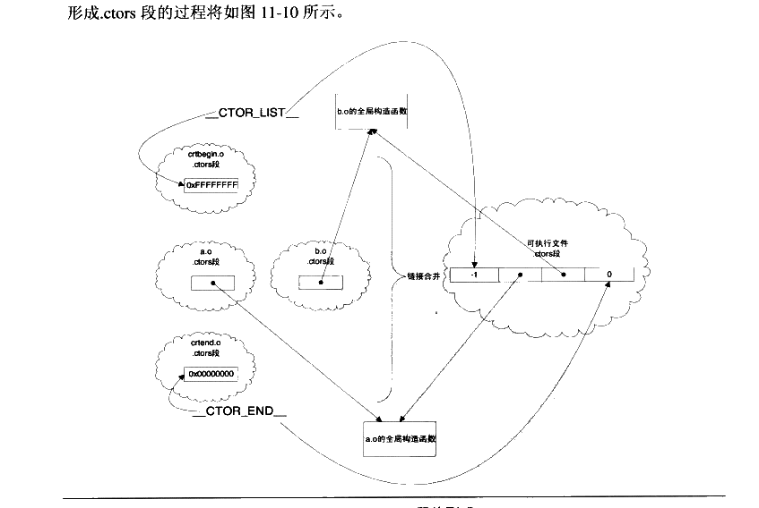

<p class="image-caption">图 11-10 .ctor 段的形成</p>

<details markdown="1"><summary>查看图中文字（按图分组）</summary>

crtbegin.o 的 .ctors 段提供起始值 0xFFFFFFFF（__CTOR_LIST__），各个 a.o、b.o 提供全局构造函数指针，crtend.o 提供结束值 0x00000000（__CTOR_END__）。链接合并后依次为 -1、函数指针、0。

</details>

在了解了可执行文件的.ctors段的结构之后，再回过头来看\_do\_global\_ctor\_aux 的代码就很容易了。 \_do\_global\_ctor\_aux 从\_\_CTOR\_LIST\_\_的下一个位置开始，按顺序执行函数指针，直到遇上NULL（\_\_CTOR\_END\_\_）。如此每个目标文件的全局构造函数都能被调用。

【小实验】

在 main 前调用函数：

glibc的全局构造函数是放置在.ctors段里的，因此如果我们手动在.ctors段里添加一些函数指针，就可以让这些函数在全局构造的时候（main 之前）调用：

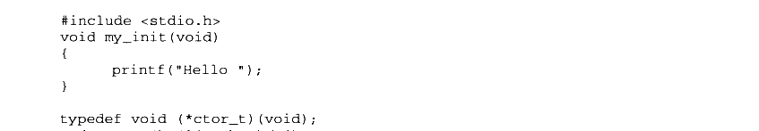

<details markdown="1"><summary>复制校对文字（未运行验证）</summary>

```text
#include <stdio.h>
void my_init(void)
{
    printf("Hello ");
}
typedef void (*ctor_t)(void);
```

</details>

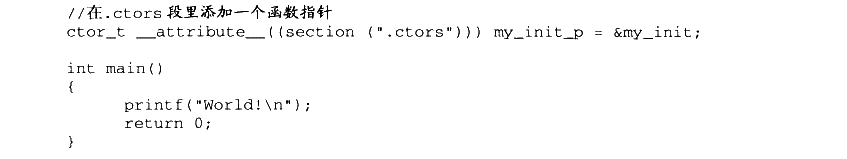

<details markdown="1"><summary>复制校对文字（未运行验证）</summary>

```text
// 在 .ctors 段里添加一个函数指针
ctor_t __attribute__((section(".ctors"))) my_init_p = &my_init;
int main()
{
    printf("World!\n");
    return 0;
}
```

</details>

如果运行此程序，结果将打印出：Hello World！

当然，事实上，gcc 里有更加直接的办法来达到相同的目的，那就是使用`__attribute__((constructor))`

示例如下：

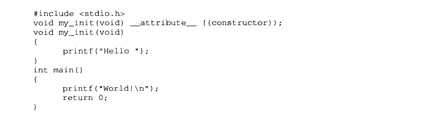

<details markdown="1"><summary>复制校对文字（未运行验证）</summary>

```text
#include <stdio.h>
void my_init(void) __attribute__((constructor));
void my_init(void)
{
    printf("Hello ");
}
int main()
{
    printf("World!\n");
    return 0;
}
```

</details>

析构

对于早期的 glibc 和GCC，在完成了对象的构造之后，在程序结束之前，crt 还要进行对象的析构。实际上正常的全局对象析构与前面介绍的构造在过程上是完全类似的，而且所有的函数、符号名都一一对应，比如“.init”变成了“.fini”、“__do_global_ctor_aux”变成了“__do_global_dtor_aux”、“__CTOR_LIST__”变成了“__DTOR_LIST__”等。在前面介绍入口函数时我们可以看到，\_\_libc\_start\_main 将“\_\_libc\_csu\_fini”通过\_\_cxa\_exit()注册到退出列表中，这样当进程退出前exit（）里面就会调用“\_\_libc\_csu\_fini”。“\_fini”的原理和“\_init”基本是一样的，在这里不再一一赘述了。

不过这样做的好处是为了保证全局对象构造和析构的顺序（即先构造后析构），链接器必须保证所有的“.dtor”段的合并顺序必须是“ctor”的严格反序，这增加了链接器的工作量，于是后来人们放弃了这种做法，采用了一种新的做法，就是通过\_\_cxa\_atexit()在exit（）函数中注册进程退出回调函数来实现析构。

这就要回到我们之前在每个编译单元的全局构造函数 GLOBAL\_\_I\_Hw()中看到的神秘函数。编译器对每个编译单元的全局对象，都会生成一个特殊的函数来调用这个编译单元的所有全局对象的析构函数，它的调用顺序与GLOBAL\_\_I\_Hw()调用构造函数的顺序刚好相反。例如对于前面的例子中的代码，编译器生成的所谓的神秘函数内容大致是：

```cpp
static void __tcf_1(void) // 这个名字由编译器生成
{
    Hw.~HelloWorld();
}
```

此函数负责析构 Hw 对象，由于在GLOBAL\_\_I\_Hw 中我们通过\_\_cxa\_exit()注册了\_tcf\_1，而且通过\_\_cxa\_exit()注册的函数在进程退出时被调用的顺序满足先注册后调用的属性，与构造和析构的顺序完全符合，于是它就很自然被用于析构函数的实现了。

当然在本节中介绍 glibc/GCC 的全局对象构造和析构时，省略了不少我们认为超出了本书所要强调的范围细节，真正的构造和析构过程比上面介绍的要复杂一些，并且在动态链接和静态链接不同的情况下，构造和析构还略有不同。但是不管哪种情况，基本的原理都是相通的，按照上面介绍的步骤和路径，相信读者也能够自己重新根据真实的情况梳理清楚这条调用路线。

由于全局对象的构造和析构都是由运行库完成的，于是在程序或共享库中有全局对象时，记得不能使用 “-nostartfiles”或“-nostdlib”选项，否则，构建与析构函数将不能正常执行（除非你很清楚自己的行为，并且手工构造和析构全局对象）。

#### Collect2

我们在第2章时曾经碰到过 collect2这个程序，在链接时它代替 ld成为了最终链接器，一般情况下就可以简单地将它看成ld。实际上 collect2是ld 的一个包装，它最终还是调用 ld完成所有的链接工作，那么 collect2这个程序的作用是什么呢？

在有些系统上，汇编器和链接器并不支持本节中所介绍的 “.init” “.ctor” 这种机制，于是为了实现在 main 函数前执行代码，必须在链接时进行特殊的处理。Collect2 这个程序就是用来实现这个功能的，它会“收集”（collect）所有输入目标文件中那些命名特殊的符号，这些特殊的符号表明它们是全局构造函数或在 main 前执行，collect2 会生成一个临时的.c文件，将这些符号的地址收集成一个数组，然后放到这个.C文件里面，编译后与其他目标文件一起被链接到最终的输出文件中。

在这些平台上，GCC 编译器也会在 main 函数的开始部分产生一个\_main 函数的调用，这个函数实际上就是负责 collect2 收集来的那些函数。\_main 函数也是 GCC 所提供的目标文件的一部分，如果我们使用‘-nostdlib”编译程序，可能得到\_main 函数未定义的错误，这时候只要加上“-lgcc”把它链接上即可。

#### 11.4.2 MSVC CRT 的全局构造和析构

在了解了 Glibc/GCC 的全局构造析构之后，让我们趁热打铁来看看MSVC 在这方面是如何实现的，有了前面的经验，在介绍MSVCCRT 的全局构造和析构的时候使用相对简洁的方式，因为很多地方它们是相通的。

首先很自然想到在 MSVC 的入口函数 mainCRTStartup 里是否有全局构造的相关内容。我们可以看到它调用了一个函数为：

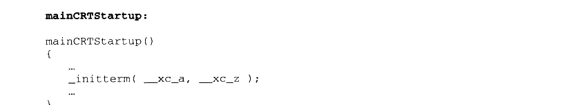

<details markdown="1"><summary>复制校对文字（未运行验证）</summary>

```text
mainCRTStartup()
{
    ...
    _initterm(__xc_a, __xc_z);
    ...
}
```

</details>

其中\_\_xc\_a 和\_\_xc\_z 是两个函数指针，而 initterm 的内容则是：

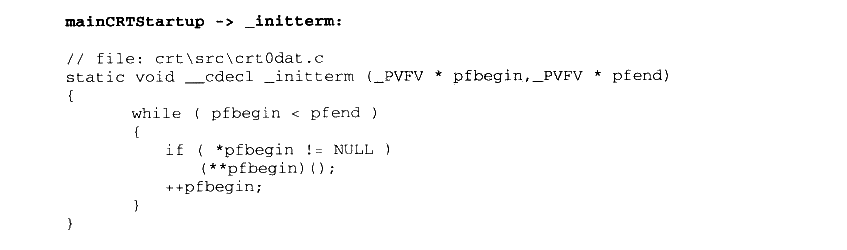

<details markdown="1"><summary>复制校对文字（未运行验证）</summary>

```text
// mainCRTStartup -> _initterm
// file: crt\src\crt0dat.c
static void __cdecl _initterm(_PVFV *pfbegin, _PVFV *pfend)
{
    while (pfbegin < pfend)
    {
        if (*pfbegin != NULL)
            (**pfbegin)();
        ++pfbegin;
    }
}
```

</details>

其中\_PVFV 的定义是：


<details markdown="1"><summary>复制校对文字（未运行验证）</summary>

```text
typedef void (__cdecl *_PVFV)();
```

</details>

从\_PVFV 的定义可以看出，它是一个函数指针类型，\_\_xc\_a 和\_\_xc\_z则都是函数指针的指针。不过第一眼看到\_initterm 这个函数是不是看着很眼熟呢？对照 Glibc/GCC 的实现，\_initterm 长得可谓与\_\_do\_global\_ctors\_aux一模一样，它依次遍历所有的函数指针并且调用它们，\_\_xc\_a 就是这个指针数组的开始地址，相当于\_\_CTOR\_LIST\_\_：而\_\_xc\_z则是结束地址，相当于\_\_CTOR\_END\_\_。

\_\_xc\_a 和\_\_xc\_z 不是 mainCRTStartup 的参数或局部变量，而是两个全局变量，它们的值在 mainCRTStartup 调用之前就已经正确地设置好了。我们知道 mainCRTStartup 作为入口函数是真正第一个执行的函数，那么 MSVC 是如何在此之前就将这两个指针正确设置的呢？让我们来看看\_\_xc\_a 和\_\_xc\_z 的定义：

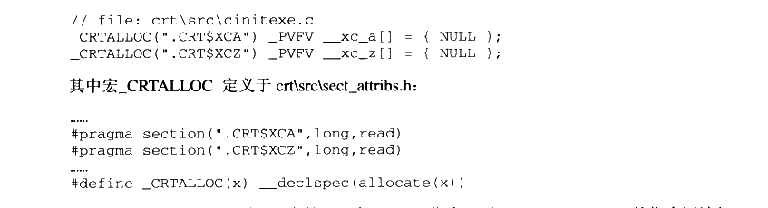

<details markdown="1"><summary>复制校对文字（未运行验证）</summary>

```text
// file: crt\src\cinitexe.c
_CRTALLOC(".CRT$XCA") _PVFV __xc_a[] = { NULL };
_CRTALLOC(".CRT$XCZ") _PVFV __xc_z[] = { NULL };

// 宏 _CRTALLOC 定义于 crt\src\sect_attribs.h
...
#pragma section(".CRT$XCA",long,read)
#pragma section(".CRT$XCZ",long,read)
...
#define _CRTALLOC(x) __declspec(allocate(x))
```

</details>

在这个头文件里，须要注意的是两条 pragma 指令。形如\#pragma section 的指令语法如下：


<details markdown="1"><summary>复制校对文字（未运行验证）</summary>

```text
#pragma section("section-name" [, attributes])
```

</details>

作用是在生成的 obj 文件里创建名为 section-name 的段，并具有 attributes 属性。因此这两条 pragma 指令实际在 obj 文件里生成了名为.CRT$XCA 和.CRT$XCZ 的两个段。下面再来看看\_CRTALLOC 这个宏，该宏的定义为\_\_declspec（allocate（x）），这个指示字表明其后的变量将被分配在段x里。所以\_\_xc\_a被分配在段.CRT$XCA 里，而\_\_xc\_z 被分配在段.CRT$XCZ里。

现在我们知道\_\_xc\_a 和\_\_xc\_z 分别处于两个特殊的段里，那么它是如何形成一个存储了初始化函数的数组呢？当编译的时候，每一个编译单元都会生成名为.CRT$XCU （U是User 的意思）的段，在这个段中编译单元会加入自身的全局初始化函数。当链接的时候，链接器会将所有相同属性的段合并，值得注意的是：在这个合并过程中，所有输入的段在被合并到输出段时，是根据字母表顺序依次排列。于是在本例中，各个段链接之后的状态可能如图11-11所示。

由于.CRT$XT\*这些段的属性都是只读的，且它们的名字很相近，所以它们会被按顺序合并到一起，最后往往被放到只读段中，成为.rdata 段的一部分。这样就自然地形成了存储所有全局初始化函数的数组，以供\_initterm 函数遍历。我们不得不再次惊叹！MSVC CRT的全局构造实现在机制上与Glibc 基本是一样的，只不过它们的名字略有不同，MSVC CRT采用这种段合并的模式与.ctor 的合并及\_\_CTOR\_LIST\_\_和\_\_CTOR\_END\_\_的地址确定何其相似！这再一次证明了虽然各个操作系统、运行库、编译器在细节上大相径庭，但是在基本实现的机制上其实是完全相通的。

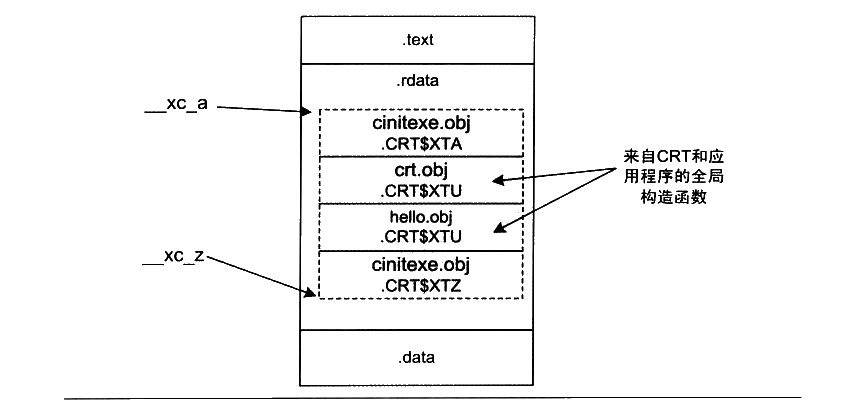

<p class="image-caption">图 11-11 PE 文件的初始化部分</p>

<details markdown="1"><summary>查看图中文字（按图分组）</summary>

全局构造函数指针位于 .rdata 中，__xc_a 和 __xc_z 划定范围。图中依次标出 cinitexe.obj、crt.obj、hello.obj、cinitexe.obj，以及 .CRT$XTA、.CRT$XTU、.CRT$XTU、.CRT$XTZ。

</details>

【小实验】

自己添加初始化函数：

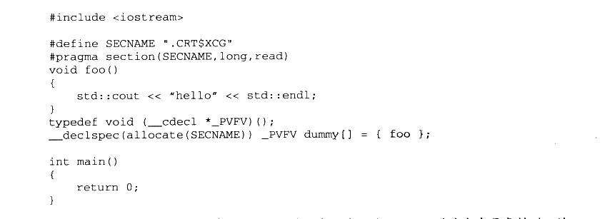

<details markdown="1"><summary>复制校对文字（未运行验证）</summary>

```text
#include <iostream>
#define SECNAME ".CRT$XCG"
#pragma section(SECNAME,long,read)
void foo()
{
    std::cout << "hello" << std::endl;
}
typedef void (__cdecl *_PVFV)();
__declspec(allocate(SECNAME)) _PVFV dummy[] = { foo };
int main()
{
    return 0;
}
```

</details>

运行这个程序，可以得到如 “hello”的输出。为了验证A~Z的这个字母表排列，读者可以修改 SECNAME，使之不处于.CRT$XCA 和.CRT$XCZ之间，理论上不会得到任何输出。而如果将段名改为.CRT$XCV（V的字典序在U之后），那么foo函数将在 main执行之后执行。

##### MSVC CRT 析构

最后来看看MSVC的全局析构的实现，在MSVC 里，只需要在全局变量的定义位置上设置一个断点，就可以看到在.CRT$XC？中定义的全局初始化函数的内容。我们仍然使用本章一开头的HelloWorld 来作为示例：

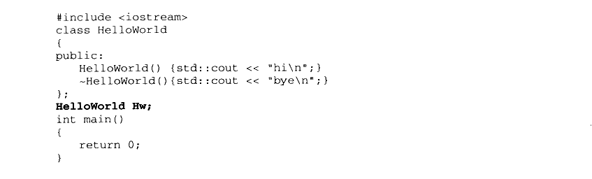

<details markdown="1"><summary>复制校对文字（未运行验证）</summary>

```text
#include <iostream>
class HelloWorld
{
public:
    HelloWorld() { std::cout << "hi\n"; }
    ~HelloWorld() { std::cout << "bye\n"; }
};
HelloWorld Hw;
int main()
{
    return 0;
}
```

</details>

这里在加粗的位置上设置断点。运行程序并中断之后查看反汇编可以得到初始化函数的内容：

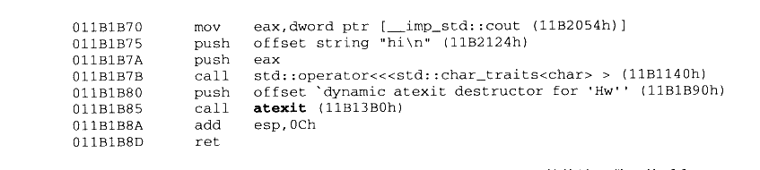

<details markdown="1"><summary>复制校对文字（未运行验证）</summary>

```text
011B1B70 mov eax,dword ptr [__imp_std::cout (11B2054h)]
011B1B75 push offset string "hi\n" (11B2124h)
011B1B7A push eax
011B1B7B call std::operator<<<std::char_traits<char> > (11B1140h)
011B1B80 push offset `dynamic atexit destructor for 'Hw'' (11B1B90h)
011B1B85 call atexit (11B13B0h)
011B1B8A add esp,0Ch
011B1B8D ret
```

</details>

在这里可以看见这段程序首先调用了内联之后的HelloWorld 的构造函数，然后和 g++ 相同，调用 atexit 将一个名为“dynamic atexit destructor for 'Hw'”的函数注册给程序退出时调用。而这个 dynamic atexit destructor for'Hw"函数的定义也能很容易找到：

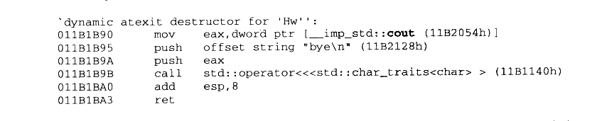

<details markdown="1"><summary>复制校对文字（未运行验证）</summary>

```text
`dynamic atexit destructor for 'Hw'':
011B1B90 mov eax,dword ptr [__imp_std::cout (11B2054h)]
011B1B95 push offset string "bye\n" (11B2128h)
011B1B9A push eax
011B1B9B call std::operator<<<std::char_traits<char> > (11B1140h)
011B1BA0 add esp,8
011B1BA3 ret
```

</details>

可以看出，这个函数的作用就是在对象Hw 调用内联之后进行析构。看到这里，我想各位读者肯定有跟我一样的心情，那就是希望举一反三的愿望并不是不切实际的，它是实实在在存在的。Glibc 下通过 \_\_cxa\_exit()向exit()函数注册全局析构函数：MSVC CRT也通过atexit（）实现全局析构，它们除了函数命名不同之外几乎没有区别。


## 11.5 fread 实现

我们知道C语言的运行库十分庞大，前面介绍的启动部分、多线程、全局构造和析构这些内容其实都不是占 CRT 篇幅最大的部分。与任何系统级别的软件一样，真正复杂的并且有挑战性的往往是软件与外部通信的部分，即IO部分。

前面的章节中对运行库的分析都是比较粗略的，虽然涉及运行库的各个方面，但是在运行库实现的深度上挖掘得不够。我们知道，IO 部分实际上是运行库中最为重要也最为复杂的部分之一，在结束本章之前，最后来仔细了解C语言标准库中一个非常重要的I/O 函数fread的具体实现，我们知道fread 最终是通过 Windows 的系统 API: ReadFile() 来实现对文件的读取的，但是从fread 到 ReadFile 之间究竟发生了什么却是一个未知的谜。我们希望通过对fread（）的挖掘，能够打通从运行库函数 fread 到 Windows 系统 API 的 ReadFile（）函数之间的这条通路，这有助于对运行库和IO 的进一步了解。

首先我们来看 fread 的函数声明：


<details markdown="1"><summary>复制校对文字（未运行验证）</summary>

```text
size_t fread(
    void *buffer,
    size_t elementSize,
    size_t count,
    FILE *stream
)
```

</details>

在这里，size\_t 是表示数据大小的类型，定义为 unsigned int。fread 有4个参数，其功能是尝试从文件流 stream 里读取 count 个大小为 elementSize 个字节的数据，存储在 buffer 里，返回实际读取的字节数。

ReadFile 的函数声明为：


<details markdown="1"><summary>复制校对文字（未运行验证）</summary>

```text
BOOL ReadFile(
    HANDLE hFile,
    LPVOID lpBuffer,
    DWORD nNumberOfBytesToRead,
    LPDWORD lpNumberOfBytesRead,
    LPOVERLAPPED lpOverlapped
);
```

</details>

ReadFile 的第一个参数hFile 为所要读取的文件句柄，我们在本章的第一节就已经介绍了句柄的概念及讨论了为什么要使用句柄的原因，与它对应的应该是 fread里面的 stream 参数：第二个参数lpBuffer 是读取文件内容的缓冲区，相对应的 fread 参数为 buffer；第三个参数 nNumberOfBytesToRead 为要读取多少字节，fread 与它相对应的应该是两个参数的乘积，即 elementSize \* count；第四个参数 lpNumberOfBytesRead 为一个指向DWORD类型的指针，它用于返回读取了多少个字节；最后一个参数是没用的，可以忽略它。

在了解了 fread 函数和 ReadFile 函数之后，可以发现它们在功能上看似完全相同，而且在参数上几乎一一对应，所以如果我们要实现一个最简单的 fread，就是直接调用 ReadFile而不做任何处理：


<details markdown="1"><summary>复制校对文字（未运行验证）</summary>

```text
size_t fread(
    void *buffer,
    size_t elementSize,
    size_t count,
    FILE *stream
) {
    DWORD bytesRead = 0;
    BOOL ret = ReadFile(
        stream->_file, // FILE 结构的文件句柄
        buffer,
        elementSize * count,
        &bytesRead,
        NULL);
    if (ret)
        return bytesRead;
    else
        return -1;
}
```

</details>

可能很多人会觉得很奇怪，既然fread 可以这么简单地实现，为什么 CRT 还要做得这么复杂呢？先别着急，我们接下来就慢慢来看 CRT 是怎么实现 fread 的，为什么它要这么做。

#### 11.5.1 缓冲

对于 glibc,fread 的实现过于复杂，因此我们这里选择 MSVC的fread 实现。但在阅读fread 的代码之前，首先要介绍一下缓冲（Buffer）的概念。

缓冲最为常见于IO 系统中，设想一下，当希望向屏幕输出数据的时候，由于程序逻辑的关系，可能要多次调用 printf 函数，并且每次写入的数据只有几个字符，如果每次写数据都要进行一次系统调用，让内核向屏幕写数据，就明显过于低效了，因为系统调用的开销是很大的，它要进行上下文切换、内核参数检查、复制等，如果频繁进行系统调用，将会严重影响程序和系统的性能。

一个显而易见的可行方案是将对控制台连续的多次写入放在一个数组里，等到数组被填满之后再一次性完成系统调用写入，实际上这就是缓冲最基本的想法。当读文件的时候，缓冲同样存在。我们可以在 CRT 中为文件建立一个缓冲，当要读取数据的时候，首先看看这个文件的缓冲里有没有数据，如果有数据就直接从缓冲中取。如果缓冲是空的，那么 CRT 就通过操作系统一次性读取文件一块较大的内容填充缓冲。这样，如果每次读取文件都是一些尺寸很小的数据，那么这些读取操作大多都直接从缓冲中获得，可以避免大量的实际文件访问。

除了读文件有缓冲以外，写文件也存在着同样的情况，而且写文件比读文件要更加复杂，因为当我们通过 fwrite 向文件写入一段数据时，此时这些数据不一定被真正地写入到文件中，而是有可能还存在于文件的写缓冲里面，那么此时如果系统崩溃或进程意外退出时，有可能导致数据丢失，于是 CRT 还提供了一系列与缓冲相关的操作用于弥补缓冲所带来的问题。C语言标准库提供与缓冲相关的几个基本函数，如表11-4所示。

表11-4


<details markdown="1"><summary>查看校对表格</summary>

| 函数 | 作用 |
| --- | --- |
| `int fflush(FILE *stream)` | flush 指定文件的缓冲；参数为 NULL 时 flush 所有文件的缓冲。 |
| `int setvbuf(FILE *stream, char *buf, int mode, size_t size)` | 设置缓冲：`_IONBF` 无缓冲；`_IOLBF` 行缓冲（文本模式遇换行符时 flush）；`_IOFBF` 全缓冲（缓冲满时 flush）。 |
| `void setbuf(FILE *stream, char *buf)` | 等价于 `(void)setvbuf(stream, buf, _IOFBF, BUFSIZ)`。 |

</details>

所谓 flush 一个缓冲，是指对写缓冲而言，将缓冲内的数据全部写入实际的文件，并将缓冲清空，这样可以保证文件处于最新的状态。之所以需要 flush，是因为写缓冲使得文件处于一种不同步的状态，逻辑上一些数据已经写入了文件，但实际上这些数据仍然在缓冲中，如果此时程序意外地退出（发生异常或断电等），那么缓冲里的数据将没有机会写入文件。flush 可以在一定程度上避免这样的情况发生。

在这个表中我们还能看到C语言支持两种缓冲，即行缓冲（Line Buffer）和全缓冲（Full Buffer）。全缓冲是经典的缓冲形式，除了用户手动调用 flush 外，仅当缓冲满的时候，缓冲才会被自动flush掉。而行缓冲则比较特殊，这种缓冲仅用于文本文件，在输入输出遇到一个换行符时，缓冲就会被自动 flush，因此叫行缓冲。

#### 11.5.2 fread_s

在了解了缓冲的大致内容之后，让我们回到fread 的代码分析。MSVC 的fread 的定义在 crt/fread.c 里，实际内容只有一行：


<details markdown="1"><summary>复制校对文字（未运行验证）</summary>

```text
size_t _fread_nolock(
    void *buffer,
    size_t elementSize,
    size_t count,
    FILE *stream
```

</details>


<details markdown="1"><summary>复制校对文字（未运行验证）</summary>

```text
)
{
    return fread_s(buffer, SIZE_MAX, elementSize, count, stream);
}
```

</details>

可见 fread 将所有的工作都转交给了fread\_s。fread\_s 定义如下：


<details markdown="1"><summary>复制校对文字（未运行验证）</summary>

```text
// fread -> fread_s
size_t __cdecl fread_s(
    void *buffer,
    size_t bufferSize,
    size_t elementSize,
    size_t count,
    FILE *stream)
{
    ...
    _lock_str(stream);
    retval = _fread_nolock_s(buffer, bufferSize, elementSize, count, stream);
    _unlock_str(stream);
    return retval;
}
```

</details>

fread\_s 的参数比 fread 多一个 bufferSize，这个参数用于指定参数 buffer 的大小。在 fread中，这个参数直接被定义为SIZE\_MAX，即 size\_t 的最大值，表明fread 不关心这个参数。而用户在使用 fread\_s 时就可以指定这个参数，以达到防止越界的目的（fread\_s 的s是 safe 的意思）。fread\_s 首先对各个参数检查，然后使用\_lock\_str 对文件进行加锁，以防止多个线程同时读取文件而导致缓冲区不一致。我们可以看到fread\_s 其实又把工作交给了\_fread\_nolock\_s。

#### 11.5.3 fread_nolock_s

fread\_nolock\_s 是进行实际工作的函数，为了便于理解，下面会分段列出fread\_nolock\_s的实现，并且将省去所有的参数检查和错误检查。同样，还将省去64位部分的代码。


<details markdown="1"><summary>复制校对文字（未运行验证）</summary>

```text
// fread -> fread_s -> _fread_nolock_s
size_t __cdecl _fread_nolock_s(
    void *buffer,
    size_t bufferSize,
    size_t elementSize,
    size_t num,
    FILE *stream
)
```

</details>


<details markdown="1"><summary>复制校对文字（未运行验证）</summary>

```text
{
    char *data;
    size_t dataSize;
    size_t total;
    size_t count;
    unsigned streambufsize;
    unsigned nbytes;
    unsigned nread;
    int c;
    data = buffer;
    dataSize = bufferSize;
    count = total = elementSize * num;
```

</details>

这一段是 fread\_nolock\_s 的初始化部分。在它的局部变量中，data 将始终指向 buffer 中尚未被写入的起始部分。在最开始的时候，data 指向 buffer 的开头。dataSize 记录了 buffer中还可以写入的字节数，理论上，data + dataSize = buffer + bufferSize。如图11-12所示。


<p class="image-caption">图 11-12 data、buffer、bufferSize 和 dataSize</p>

<details markdown="1"><summary>查看图中文字（按图分组）</summary>

buffer 指向缓冲区起始位置，bufferSize 是总大小；data 指向当前写入位置，dataSize 是剩余空间大小。

</details>

total 变量记录了总共须要读取的字节数，count则记录在读取过程中尚未读的字节数。streambufsize 记录了文件缓冲的大小。剩下的3个局部变量在代码的分析过程中会一一提到。在这里需要特别提一下缓冲在FILE 结构中的具体实现。

在对缓冲的概念有了一定了解之后，可分析一下文件类型 FILE 结构的定义了。FILE 的定义位于 stdio.h里：


<details markdown="1"><summary>复制校对文字（未运行验证）</summary>

```text
struct _iobuf {
    char *_ptr;
    int _cnt;
    char *_base;
    int _flag;
    int _file;
    int _charbuf;
    int _bufsiz;
    char *_tmpfname;
};
typedef struct _iobuf FILE;
```

</details>

在这里，\_base 字段指向一个字符数组，即这个文件的缓冲，而\_bufsiz 记录着这个缓冲的大小。\_ptr 和 fread\_nolock\_s的局部变量data一样，指向 buffer 中第一个未读的字节，而cnt 记录剩余未读字节的个数。\_flag 记录了 FILE 结构所代表的打开文件的一些属性，目前我们感兴趣的是3个标志：


<details markdown="1"><summary>复制校对文字（未运行验证）</summary>

```text
#define _IOYOURBUF 0x0100
#define _IOMYBUF   0x0008
#define _IONBF     0x0004
```

</details>

在这里，\_IOYOURBUF 代表这个文件使用用户通过 setbuf 提供的 buffer，\_IOMYBUF代表这个文件使用内部的缓冲，而\_IONBF 代表这个文件使用一个单字节的缓冲，即缓冲大小仅为1个字节。这个缓冲就是\_charbuf 变量。此时，\_base 变量的值是无效的。接下来继续看 fread\_nolock\_s 的代码：


<details markdown="1"><summary>复制校对文字（未运行验证）</summary>

```text
if (anybuf(stream))
{
    streambufsize = stream->_bufsiz;
}
else
{
    streambufsize = _INTERNAL_BUFSIZ;
}
```

</details>

anybuf 函数的定义位于 filez.h：


<details markdown="1"><summary>复制校对文字（未运行验证）</summary>

```text
#define anybuf(s) \
    ((s)->_flag & (_IOMYBUF|_IONBF|_IOYOURBUF))
```

</details>

事实上 anybuf 并不是函数，而是一个宏，它仅检查这个 FILE 结构的\_flag 变量里有没有前面提到的3个标志位的任意一个，如果这3个标志位在\_flag 中存在任意一个，就说明这个文件使用了缓冲。

这一段代码对 streambufsize 变量进行了赋值，如果文件自己有 buffer，那么 streambufsize就等于这个 buffer 的大小：如果文件没有使用 buffer，那么 fread\_nolock\_s 就会使用一个内部的 buffer，这个 buffer 的大小固定为\_INTERNAL\_BUFSIZ，即 4096 字节。接下来fread\_nolock\_s 是一个循环：


<details markdown="1"><summary>复制校对文字（未运行验证）</summary>

```text
while (count != 0) {
    read data
    decrease count
}
```

</details>

循环体内的操作用伪代码表示，大致的意思是：每一次循环都从文件中读取一部分数据，并且相应地减少 count（还记得吗，count 代表还没有读取的字节数）。当读取数据时，根据文件是否使用buffer 及读取数据的多少分为3种情况，下面我们一一来看：


<details markdown="1"><summary>复制校对文字（未运行验证）</summary>

```text
if (anybuf(stream) && stream->_cnt != 0)
{
    nbytes = (count < stream->_cnt) ? count : stream->_cnt;
    memcpy_s(data, dataSize, stream->_ptr, nbytes);
    count -= nbytes;
    stream->_cnt -= nbytes;
```

</details>


<details markdown="1"><summary>复制校对文字（未运行验证）</summary>

```text
stream->_ptr += nbytes;
    data += nbytes;
    dataSize -= nbytes;
}
```

</details>

在 if 的判断句中，anybuf 判断文件是否有缓冲，而stream-&gt;\_cnt != 0判断缓冲是否为空。因此当且仅当文件有缓冲且不为空时，这段代码才会执行。

让我们一行一行地来看这段代码的作用。nbytes代表这次要从缓冲中读取多少字节。在这里，nbytes 等于还须要读取的字节数（count）与缓冲剩余的字节数（stream-&gt;\_cnt）中较小的一个。

接下来的一行使用 memcpy\_s将文件 stream 里\_ptr所指向的缓冲内容复制到data 指向的位置，如图11-13所示。


<p class="image-caption">图 11-13 文件缓冲区操作</p>

<details markdown="1"><summary>查看图中文字（按图分组）</summary>

上图：memcpy_s 将 FILE 缓冲区中 _ptr 起的 _cnt 字节复制到目标 data，目标剩余空间为 dataSize。下图：复制结束后 _ptr 前移、_cnt=0，data 前移、dataSize 减少；_base、_bufsiz、buffer、bufferSize 保持不变。

</details>

接下来的5行，皆是按照图11-13修正 FILE 结构和局部变量的各种数据。

memcpy\_s 是 memcpy 的安全版本，相对于原始的memcpy 版本，memcpy\_s 接受一个额外的参数记录输出缓冲区的大小，以防止越界，其余的功能和memcpy 相同。

以上代码处理了文件缓冲不为空的情况，而如果缓冲为空，那么又分为两种情况：

（1） 需要读取的数据大于缓冲的尺寸。

（2） 需要读取的数据不大于缓冲的尺寸。

对于情况（1），fread 将试图一次性读取尽可能多的整数个缓冲的数据直接进入输出的数组中，如果缓冲尺寸为 0，则直接将剩下的数据一次性读取。代码如下：


<details markdown="1"><summary>复制校对文字（未运行验证）</summary>

```text
else if (count >= bufsize) {
    nbytes = (bufsize ? (unsigned)(count - count % bufsize) : (unsigned)count);
    nread = _read(_fileno(stream), data, nbytes);
    if (nread == 0) {
        stream->_flag |= _IOEOF;
        return (total - count) / size;
    }
    else if (nread == (unsigned)-1) {
        stream->_flag |= _IOERR;
        return (total - count) / size;
    }
    count -= nread;
    data += nread;
}
```

</details>

在代码中，read函数用于真正从文件读取数据。在这里我们先不管这个函数，在稍后的内容中会对此函数进行详细的介绍。如果要读取的数据不大于缓冲的尺寸，那么仅需要重新填充缓冲即可：


<details markdown="1"><summary>复制校对文字（未运行验证）</summary>

```text
else {
    if ((c = _filbuf(stream)) == EOF) {
        return (total - count) / size;
    }
    *data++ = (char)c;
    --count;
    bufsize = stream->_bufsiz;
}
```

</details>

\_filbuf 函数负责填充缓冲。该函数的具体实现重要的部分只有一行：

```c
stream->_cnt = _read(_fileno(stream), stream->_base, stream->_bufsiz);
```

可以看见所有的线索都指向了\_read 函数。\_read 函数主要负责两件事：

（1）从文件中读取数据。

（2）对文本模式打开的文件，转换回车符。

#### 11.5.4 _read

\_read 的代码位于 crt/src/read.c。在省略了一部分无关紧要的代码之后，其内容如下：


<details markdown="1"><summary>复制校对文字（未运行验证）</summary>

```text
// fread -> fread_s -> _fread_nolock_s -> _read
int __cdecl _read(int fh, void *buf, unsigned cnt)
{
    int bytes_read;        /* number of bytes read */
    char *buffer;          /* buffer to read to */
    int os_read;           /* bytes read on OS call */
    char *p, *q;           /* pointers into buffer */
    char peekchr;          /* peek-ahead character */
    ULONG filepos;         /* file position after seek */
    ULONG dosretval;       /* o.s. return value */
    bytes_read = 0;        /* nothing read yet */
    buffer = buf;
```

</details>

这部分是\_read 函数的参数、局部变量和初始化部分。下面的代码处理一个单字节缓冲；


<details markdown="1"><summary>复制校对文字（未运行验证）</summary>

```text
if ((_osfile(fh) & (FPIPE|FDEV)) && _pipech(fh) != LF)
{
    *buffer++ = _pipech(fh);
    ++bytes_read;
    --cnt;
    _pipech(fh) = LF;
}
```

</details>

if 中的判断语句使得这段代码仅对设备和管道文件有效。对于设备和管道文件，ioinfo结构提供了一个单字节缓冲 pipech 字段用于处理一些特殊情况。宏\_pipech 返回这一字段：

```c
#define _pipech(i) (_pioinfo(i)->pipech)
```

pipech 字段的值等于LF（即字符 `\n`）的时候表明该缓冲无效，这样设计的原因是 pipech的用途导致它永远不会被赋值为LF。我们将在稍后的部分里详细讨论这一话题。

read 函数在每次读取管道和设备数据的时候必须先检查 pipech，以免漏掉一个字节。在处理完这个单字节缓冲之后，接下来的内容是实际的文件读取部分：


<details markdown="1"><summary>复制校对文字（未运行验证）</summary>

```text
if (!ReadFile((HANDLE)_osfhnd(fh), buffer, cnt, (LPDWORD)&os_read, NULL))
{
    if ((dosretval = GetLastError()) == ERROR_ACCESS_DENIED)
    {
        errno = EBADF;
        _doserrno = dosretval;
        return -1;
    }
    else if (dosretval == ERROR_BROKEN_PIPE)
    {
        return 0;
    }
    else
```

</details>


<details markdown="1"><summary>复制校对文字（未运行验证）</summary>

```text
{
        _dosmaperr(dosretval);
        return -1;
    }
}
```

</details>

ReadFile 是一个 Windows API 函数，由Windows 系统提供，作用和\_read 类似，用于从文件里读取数据。在这里我们可以看到 ReadFile 接管了\_read 的第一个职责。在 ReadFile 返回之后，\_read 要检查其返回值。值得注意的是，Windows 使用的函数返回值系统和 crt 使用的返回值系统是不同的，例如 Windows 使用 ERROR\_INVALID\_PARAMETER（87）表示无效的参数，而 CRT 则用 EBADF（9）表示相同的信息。因此当 ReadFile 返回了错误信息之后，read 要把这个信息翻译为 crt 所使用的版本。\_dosmaperr 就是做这件工作的函数。在这里就不详细说明了。

#### 11.5.5 文本换行

接下来 _read 要为以文本模式打开的文件转换回车符。在 Windows 的文本文件中，回车（换行）的存储方式是 0x0D（用 CR 表示）、0x0A（用 LF 表示）这两个字节，以 C 语言字符串表示则是 `\r\n`。而在其他的一些操作系统中，回车的表示却有区别。例如：

- Linux/Unix：回车用 `\n` 表示。
- Mac OS：回车用 `\r` 表示。
- Windows：回车用 `\r\n` 表示。

而在 C 语言中，回车始终用 `\n` 来表示，因此在以文本模式读取文件的时候，不同的操作系统需要将各自的回车符表示转换为 C 语言的形式。也就是：

- Linux/Unix：不做改变。
- Mac OS：每遇到 `\r` 就将其改为 `\n`。
- Windows：将 `\r\n` 改为 `\n`。

由于我们所阅读的是 Windows 的 CRT 代码，所以 _read 会每遇到一个 `\r\n` 就将其改为 `\n`。由于 _read 处理这一部分的代码很复杂（有近百行），因此这里会提供一个简化的版本来阅读：


<details markdown="1"><summary>复制校对文字（未运行验证）</summary>

```text
if (_osfile(fh) & FTEXT)
{
    if ((os_read != 0) && (*(char *)buf == LF))
        _osfile(fh) |= FCRLF;
    else
        _osfile(fh) &= ~FCRLF;
```

</details>

首先需要检查文件是否是以文本模式打开，如果不是，就什么也不需要处理。\_osfile是一个宏，用于访问一个句柄对应的ioinfo 对象的 osfile 字段（还记得IO初始化时的 osfile吗？）。当本次读文件读到的第一个字符是一个 LF（`\n`）时，需要在该句柄的 osfile 字段中加入 FCRLF 标记，表明一个 `\r\n` 可能跨过了两次读文件。这个标记在一些特殊场合下会有作用（例如 ftell 函数）。

接下来要进行实际的转换，转换需要经历一个循环：


<details markdown="1"><summary>复制校对文字（未运行验证）</summary>

```text
p = q = buf;
while (p < (char *)buf + bytes_read)
{
    处理 p 当前指向的字符
    p 和 q 后移
}
```

</details>

p 和 q 一开始指向读取的数据数组的开头，在每一次循环里，进行如下的判断和操作：

（1）`*p` 是 CTRL-Z：表明文本已经结束，退出循环。

（2）`*p` 是 CR（`\r`）之外的字符：把 p 指向的字符复制到 q 指向的位置，p 和 q 各自后移一个字节（`*q++ = *p++`）。

（3）`*p` 是 CR（`\r`）且 `*(p+1)` 不是 LF（`\n`）：同（2）。

（4）`*p` 是 CR（`\r`）且 `*(p+1)` 是 LF（`\n`）：p 后移 2 个字节，将 q 指向的位置写为 LF（`\n`），q 后移一个字节（`p += 2; *q++ = '\n';`）。

p 和 q 一开始始终指向相同的位置，因此情况（2）里的复制实际没有作用，直到 p 遇到一个 `\r\n`。此时的动作如图11-14所示（以字符串 `a\r\nb` 为例）。


<p class="image-caption">图11-14 换行符转换</p>

<details markdown="1"><summary>查看图中文字（按图分组）</summary>

转换过程：p 遍历原数据 `a\r\nb`，q 写入转换后的 `a\nb`。遇到 CR/LF 时 p 前进两个字符、q 写入一个 LF；其余字符直接复制。

</details>

此时 q-buf 可得到处理过后的读取字符数。

最后还有一个问题：如果在缓冲的末尾发现了一个CR该怎么办？此时我们无法知道下一个字符是否是 LF，所以无法决定是否应该丢弃这个 CR 字符。这时唯一的办法就是再从文件里读取1个字节，检查它是否是 LF：然后再用 fseek 函数（或具有相同功能的其他函数）把文件指针重新向前移动一个字节。这段操作的伪代码如下：

从文件读1个字节，

如果没有读取成功，那么直接存储CR 字符并返回，

如果成功读取了1个字节，那么要考虑下列几种情况：

（1）磁盘文件，且字符不是 LF：直接存储CR 字符，用 seek 函数回退文件指针1个字节；

（2）磁盘文件，且字符是LF：丢弃CR 字符存储LF 字符；

（3）管道或设备文件，且字符是LF： 丢弃CR 字符存储LF 字符；

（4）管道或设备文件，且字符不是LF：存储CR字符，并把LF 字节存储在句柄的管道的单字节缓冲（pipech）里。

可以看到在第4种情况里使用了 pipech。在之前的部分中我们已经知道这是一个为管道和设备提供的单字节缓冲。由于管道和设备文件不能够使用 seek 函数回退文件指针，因此一旦读取了多余的一个字符，就必须使用这样的缓冲。由于此处对 pipech 的赋值将字符LF排除在外，同时此处的赋值是唯一的对 pipech 有意义的赋值，因此 pipech 的值永远不会是LF。那么将LF 赋值为LF 就可以表明该缓冲为空。下面是完整的转换过程代码：


<details markdown="1"><summary>复制校对文字（未运行验证）</summary>

```text
p = q = buf;
while (p < (char *)buf + bytes_read) {
    if (*p == CTRLZ) {
```

</details>


<details markdown="1"><summary>复制校对文字（未运行验证）</summary>

```text
/* 遇到文本结束符，退出 */
    if (!(_osfile(fh) & FDEV))
        _osfile(fh) |= FEOFLAG;
    break;
}
else if (*p != CR) /* 没有遇到 CR，直接复制 */
    *q++ = *p++;
else {
    if (p < (char *)buf + bytes_read - 1) {
```

</details>


<details markdown="1"><summary>复制校对文字（未运行验证）</summary>

```text
if (*(p+1) == LF) {
    p += 2;
    *q++ = LF;
}
```

</details>


<details markdown="1"><summary>复制校对文字（未运行验证）</summary>

```text
else
        *q++ = *p++;
}
else {
```

</details>


<details markdown="1"><summary>复制校对文字（未运行验证）</summary>

```text
++p;
dosretval = 0;
if (!ReadFile((HANDLE)_osfhnd(fh), &peekchr, 1,
              (LPDWORD)&os_read, NULL))
    dosretval = GetLastError();
if (dosretval != 0 || os_read == 0) {
    *q++ = CR;
}
else {
    if (_osfile(fh) & (FDEV|FPIPE)) {
```

</details>


<details markdown="1"><summary>复制校对文字（未运行验证）</summary>

```text
if (peekchr == LF)
    *q++ = LF;
else {
```

</details>


<details markdown="1"><summary>复制校对文字（未运行验证）</summary>

```text
/* 使用 pipech 存储字符 */
        *q++ = CR;
        _pipech(fh) = peekchr;
    }
}
else {
    /* 普通文件 */
```

</details>


<details markdown="1"><summary>复制校对文字（未运行验证）</summary>

```text
if (q == buf && peekchr == LF) {
    *q++ = LF;
}
else {
```

</details>


<details markdown="1"><summary>复制校对文字（未运行验证）</summary>

```text
filepos = _lseek_lk(fh, -1, FILE_CURRENT);
                    if (peekchr != LF)
                        *q++ = CR;
                }
            }
        }
    }
}
}
bytes_read = (int)(q - (char *)buf);
}
```

</details>

#### 11.5.6 fread 回顾

如果读者能够一口气把fread 的实现看完，我们对您表示十分的钦佩，因为它里面涉及诸多的细节让人无法做到一览无余。我们在这里把这些细节略去，在此做个总结性的回顾。当用户调用 CRT 的fread 时，它到 ReadFile 的调用轨迹如图11-15所示。


<p class="image-caption">图 11-15 ReadFile 调用轨迹</p>

<details markdown="1"><summary>查看图中文字（按图分组）</summary>

调用链：fread → fread_s → _fread_nolock_s → _read → ReadFile。fread_s 增加缓冲溢出保护和加锁；_fread_nolock_s 循环读取并管理缓冲；_read 转换换行符；ReadFile 是 Windows 文件读取 API。

</details>

在这个轨迹中，\_fread\_nolock\_s的实现是最复杂的，因为它涉及缓冲区的操作，它也是读取文件的主要部分，如果我们使用fread 读取一小块数据，有可能在\_fread\_nolock\_s 的时候发现所有所需要的数据都在缓冲中，就不需要通过\_read 和 ReadFile 向操作系统读取文件了，而是直接从缓冲区复制数据并返回，这样就减少了系统调用的开销。


## 11.6 本章小结

在这一章中，我们介绍了程序运行库的各个方面，首先详细了解了 Glibc 和 MSVC CRT的程序入口点的实现，并在此基础上着重分析了 MSVC CRT 的初始化过程，尤其是 MSVC的IO 初始化。

接下来，还介绍了C/C++运行库的其他方方面面，包括库函数的实现、运行库的构造、运行库与并发的关系，以及最后C++运行库实现全局构造的方法。在介绍这些内容的过程中，我们一改以往以Glibc 的代码为主要示例的方法，着重以MSVC提供的运行库源代码为例子介绍了 fread 在CRT 中的实现。由于 Glibc 为了支持多平台，它的IO部分的源代码显得十分复杂而难以理解，不便于在本书中讲解，于是改为介绍 MSVC 的fread 实现。
