# 11.1 入口函数和程序初始化

### 11.1.1 程序从 main 开始吗

正如基督徒认为世界的诞生起于7天创世一样，任何一个合格的C/C++程序员都应该知道一个事实：程序从 main 函数开始。但是事情的真相真是如此吗？如果你善于观察，就会发现当程序执行到 main 函数的第一行时，很多事情都已经完成了：

【铁证1】下面是一段C语言代码：

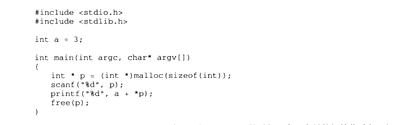

<details markdown="1"><summary>复制校对文字（未运行验证）</summary>

```text
#include <stdio.h>
#include <stdlib.h>
int a = 3;
int main(int argc, char* argv[])
{
    int *p = (int*)malloc(sizeof(int));
    scanf("%d", p);
    printf("%d", a + *p);
    free(p);
}
```

</details>

从代码中我们可以看到，在程序刚刚执行到 main 的时候，全局变量的初始化过程已经结束了（a的值已经确定），main 函数的两个参数（argc 和 argv）也被正确传了进来。此外，在你不知道的时候，堆和栈的初始化悄悄地完成了，一些系统I/O 也被初始化了，因此可以放心地使用 printf 和 malloc。

【铁证2】而在C++里，main 之前能够执行的代码还会更多，例如如下代码：

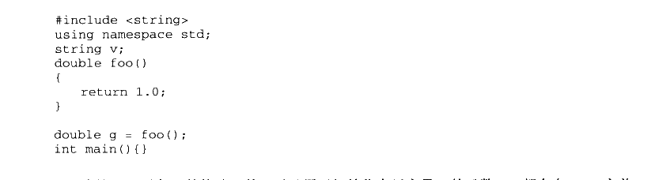

<details markdown="1"><summary>复制校对文字（未运行验证）</summary>

```text
#include <string>
using namespace std;
string v;
double foo()
{
    return 1.0;
}
double g = foo();
int main() {}
```

</details>

在这里，对象v的构造函数，以及用于初始化全局变量g的函数foo都会在 main 之前调用。

【铁证3】 atexit 也是一个特殊的函数。atexit 接受一个函数指针作为参数，并保证在程序正常退出（指从main里返回或调用exit函数）时，这个函数指针指向的函数会被调用。例如：

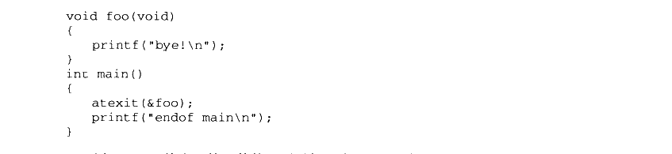

<details markdown="1"><summary>复制校对文字（未运行验证）</summary>

```text
void foo(void)
{
    printf("bye!\n");
}
int main()
{
    atexit(&foo);
    printf("endof main\n");
}
```

</details>

用atexit 函数注册的函数的调用时机是在 main结束之后，因此这段代码的输出是：


<details markdown="1"><summary>复制校对文字（未运行验证）</summary>

```text
endof main
bye!
```

</details>

所有这些事实都在为“main 创论”提供不利的证据：操作系统装载程序之后，首先运行的代码并不是 main 的第一行，而是某些别的代码，这些代码负责准备好 main 函数执行所需要的环境，并且负责调用 main函数，这时候你才可以在 main 函数里放心大胆地写各种代码：申请内存、使用系统调用、触发异常、访问I/O。在main 返回之后，它会记录 main函数的返回值，调用atexit 注册的函数，然后结束进程。

运行这些代码的函数称为入口函数或入口点（Entry Point），视平台的不同而有不同的名字。程序的入口点实际上是一个程序的初始化和结束部分，它往往是运行库的一部分。一个典型的程序运行步骤大致如下：

- 操作系统在创建进程后，把控制权交到了程序的入口，这个入口往往是运行库中的某个入口函数。

- 入口函数对运行库和程序运行环境进行初始化，包括堆、I/O、线程、全局变量构造，等等。

- 入口函数在完成初始化之后，调用 main 函数，正式开始执行程序主体部分。

- main 函数执行完毕以后，返回到入口函数，入口函数进行清理工作，包括全局变量析构、堆销毁、关闭 I/O等，然后进行系统调用结束进程。

### 11.1.2 入口函数如何实现

大部分程序员在平时都接触不到入口函数，为了对入口函数进行详细的了解，本节我们将深入剖析 glibc 和 MSVC的入口函数实现。GLIBC 入口函数

glibc 的启动过程在不同的情况下差别很大，比如静态的 glibc 和动态的 glibc 的差别，glibc 用于可执行文件和用于共享库的差别，这样的差别可以组合出4种情况，这里只选取最简单的静态 glibc 用于可执行文件的时候作为例子，其他情况诸如共享库的全局对象构造和析构跟例子中稍有出入，我们在本书中不一一详述了，有兴趣的读者可以根据这里的介绍自己阅读 glibc 和 gcc 的源代码，相信能起到举一反三的效果。下面所有关于 Glibc 和 MSVC CRT 的相关代码分析在不额外说明的情况下，都默认为静态/可执行文件链接的情况。

读者可以免费下载到Linux 下 glibc 的源代码，在其中的子目录libc/csu 里，有关于程序启动的代码。glibc 的程序入口为\_start（这个入口是由ld 链接器默认的链接脚本所指定的，我们也可以通过相关参数设定自己的入口）。\_start 由汇编实现，并且和平台相关，下面可以单独看i386 的\_start 实现：

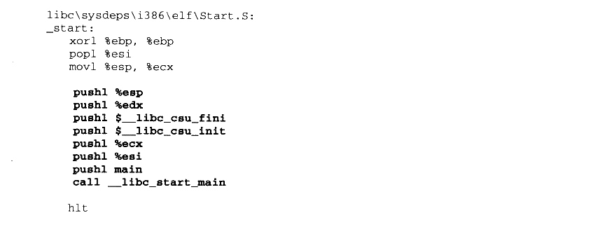

<details markdown="1"><summary>复制校对文字（未运行验证）</summary>

```text
libc\sysdeps\i386\elf\Start.S:
_start:
    xorl %ebp, %ebp
    popl %esi
    movl %esp, %ecx
    pushl %ebp
    pushl %edx
    pushl $__libc_csu_fini
    pushl $__libc_csu_init
    pushl %ecx
    pushl %esi
    pushl main
    call __libc_start_main
    hlt
```

</details>

这里省略了一些不重要的代码，可以看到\_start 函数最终调用了名为\_\_libc\_start\_main 的函数。加粗部分的代码是对该函数的完整调用过程，其中开始的7个压栈指令用于给函数传递参数。在最开始的地方还有3条指令，它们的作用分别为：

- xor %ebp， %ebp：这其实是让ebp 寄存器清零。xor 的用处是把后面的两个操作数异或，结果存储在第一个操作数里。这样做的目的表明当前是程序的最外层函数。

ebp 设为0正好可以体现出这个最外层函数的尊贵地位⑧。

- Pop %esi 及 mov %esp， %ecx：在调用\_start 前，装载器会把用户的参数和环境变量压入栈中，按照其压栈的方法，实际上栈顶的元素是 argc，而接着其下就是 argv 和环境变量的数组。图11-1 为此时的栈布局，其中虚线箭头是执行 pop %esi 之前的栈顶（%esp），而实线箭头是执行之后的栈顶（%esp）。

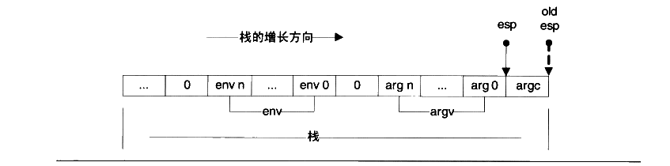

<p class="image-caption">图 11-1 环境变量和参数数组</p>

<details markdown="1"><summary>查看图中文字（按图分组）</summary>

初始栈由 argc、argv（arg 0 … arg n）、0、env（env 0 … env n）、0 等组成。old esp 原先指向 argc，弹出 argc 后 esp 指向 arg 0；图中的栈向右增长。

</details>

pop %esi 将 argc 存入了 esi，而 mov %esp、%ecx 将栈顶地址（此时就是 argv 和环境变量（env）数组的起始地址）传给%ecx。现在%esi 指向 argc，%ecx 指向 argv 及环境变量数组。

综合以上分析，我们可以把\_start 改写为一段更具有可读性的伪代码：

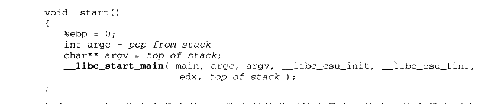

<details markdown="1"><summary>复制校对文字（未运行验证）</summary>

```text
void _start()
{
    %ebp = 0;
    int argc = pop from stack;
    char** argv = top of stack;
    __libc_start_main(main, argc, argv, __libc_csu_init, __libc_csu_fini,
                      edx, top of stack);
}
```

</details>

其中 argv 除了指向参数表外，还隐含紧接着环境变量表。这个环境变量表要在\_\_libc\_start\_main 里从 argv 内提取出来。

环境变量

环境变量是存在于系统中的一些公用数据，任何程序都可以访问。通常来说，环境变量存储的都是一些系统的公共信息，例如系统搜索路径，当前OS版本等。环境变量的格式为key=value 的字符串，C语言里可以使用getenv这个函数来获取环境变量信息。

在 Windows 里，可以直接在控制面板一系统一高级一环境变量查阅当前的环境变量，而在 Linux 下，直接在命令行里输入 export 即可。

实际执行代码的函数是\_\_libc\_start\_main，由于代码很长，下面我们一段一段地看：

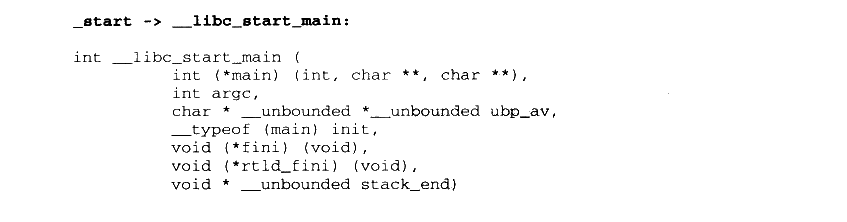

<details markdown="1"><summary>复制校对文字（未运行验证）</summary>

```text
// _start -> __libc_start_main
int __libc_start_main(
    int (*main) (int, char **, char **),
    int argc,
    char *__unbounded *__unbounded ubp_av,
    __typeof (main) init,
    void (*fini) (void),
    void (*rtld_fini) (void),
    void *__unbounded stack_end)
```

</details>

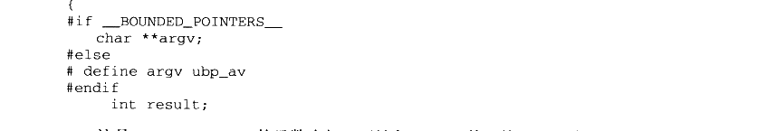

<details markdown="1"><summary>复制校对文字（未运行验证）</summary>

```text
{
#if __BOUNDED_POINTERS__
    char **argv;
#else
# define argv ubp_av
#endif
    int result;
```

</details>

这是\_\_libc\_start\_main 的函数头部，可见和\_start 函数里的调用一致，一共有7个参数，其中 main 由第一个参数传入，紧接着是 argc 和 argv（这里称为ubp\_av，因为其中还包含了环境变量表）。除了 main 的函数指针之外，外部还要传入3个函数指针，分别是：

- init: main 调用前的初始化工作。

- fini: main 结束后的收尾工作。

rtld\_fini： 和动态加载有关的收尾工作，rtld 是 runtime loader 的缩写。

最后的 stack\_end 标明了栈底的地址，即最高的栈地址。

bounded pointer GCC 支持 bounded 类型指针（bounded 指针用\_\_bounded 关键字标出，若默认为bounded 指针，则普通指针用\_\_unbounded 标出），这种指针占用3个指针的空间，在第一个空间里存储原指针的值，第二个空间里存储下限值，第三个空间里存储上限值。\_\_ptrvalue、\_\_ptrlow、\_\_ptrhigh 分别返回这3个值，有了3个值以后，内存越界错误便很容易查出来了。并且要定义\_\_BOUNDED\_POINTERS\_\_这个宏才有作用，否则这3个宏定义是空的。

不过，尽管 bounded 指针看上去似乎很有用，但是这个功能却在2003年被去掉了。因此现在所有关于 bounded 指针的关键字其实都是一个空的宏。鉴于此，我们接下来在讨论 libc代码时都默认不使用bounded 指针即不定义\_BOUNDED\_POINTERS\_。

接下来的代码如下：


<details markdown="1"><summary>复制校对文字（未运行验证）</summary>

```text
char** ubp_ev = &ubp_av[argc + 1];
INIT_ARGV_and_ENVIRON;
__libc_stack_end = stack_end;
```

</details>

INIT_ARGV_and_ENVIRON 这个宏定义于 libc/sysdeps/generic/bp-start.h，展开后本段代码变为：


<p class="image-caption">图 11-2 实际上就是我们根据从_start 源代码分析得到的栈布局，让_environ 指针指向</p>

<details markdown="1"><summary>复制校对文字（未运行验证）</summary>

```text
char** ubp_ev = &ubp_av[argc + 1];
__environ = ubp_ev;
__libc_stack_end = stack_end;
```

</details>

图11-2实际上就是我们根据从 _start 源代码分析得到的栈布局，让 __environ 指针指向原来紧跟在 argv 数组之后的环境变量数组。


<p class="image-caption">图 11-2 环境变量和参数数组（2）</p>

<details markdown="1"><summary>查看图中文字（按图分组）</summary>

ubp_av 指向 arg 0，__environ 指向 env 0；argv 和 env 数组各自以 0 结束，栈增长方向向右。

</details>

图11-2中实线箭头代表 ubp\_av，而虚线箭头代表\_environ。另外这段代码还将栈底地址存储在一个全局变量里，以留作它用。

为什么要分两步赋值给\_environ 呢？这又是为了兼容 bounded 惹的祸。实际上，INIT\_ARGV\_and\_ENVIRON 根据 bounded 支持的情况有多个版本，以上仅仅是假定不支持bounded 的版本。

接下来有另一个宏：

DL\_SYSDEP\_OSCHECK（\_1ibc\_fatal）：

这是用来检查操作系统的版本，宏的具体内容就不列出了。接下来的代码颇为繁杂，我们过滤掉大量信息之后，将一些关键的函数调用列出：

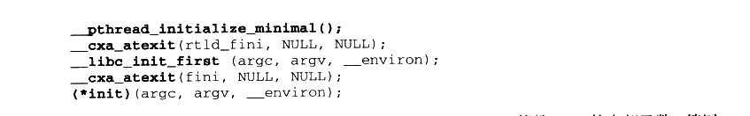

<details markdown="1"><summary>复制校对文字（未运行验证）</summary>

```text
__pthread_initialize_minimal();
__cxa_atexit(rtld_fini, NULL, NULL);
__libc_init_first(argc, argv, __environ);
__cxa_atexit(fini, NULL, NULL);
(*init)(argc, argv, __environ);
```

</details>

这一部分进行了一连串的函数调用，注意到\_\_cxa\_atexit 函数是 glibc 的内部函数，等同于 atexit，用于将参数指定的函数在 main 结束之后调用。所以以参数传入的 fini和rtld\_fini均是用于 main结束之后调用的。在\_\_libc\_start\_main 的末尾，关键的是这两行代码：


<details markdown="1"><summary>复制校对文字（未运行验证）</summary>

```text
result = main(argc, argv, __environ);
    exit(result);
}
```

</details>

在最后，main 函数终于被调用，并退出。然后我们来看看 exit 的实现：

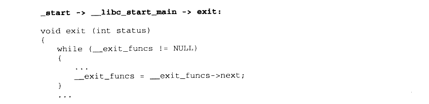

<details markdown="1"><summary>复制校对文字（未运行验证）</summary>

```text
// _start -> __libc_start_main -> exit
void exit(int status)
{
    while (__exit_funcs != NULL)
    {
        ...
        __exit_funcs = __exit_funcs->next;
    }
    ...
```

</details>


<details markdown="1"><summary>复制校对文字（未运行验证）</summary>

```text
_exit(status);
}
```

</details>

其中\_\_exit\_funcs 是存储由\_\_cxa\_atexit 和 atexit 注册的函数的链表，而这里的这个 while 循环则遍历该链表并逐个调用这些注册的函数，由于其中琐碎代码过多，这里就不具体列出了。最后的\_exit 函数由汇编实现，且与平台相关，下面列出i386 的实现：

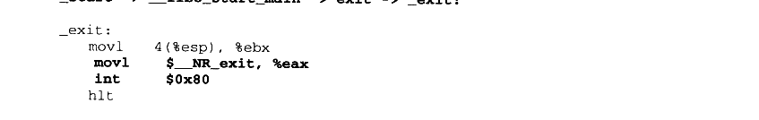

<details markdown="1"><summary>复制校对文字（未运行验证）</summary>

```text
// _start -> __libc_start_main -> exit -> _exit
_exit:
    movl 4(%esp), %ebx
    movl $__NR_exit, %eax
    int $0x80
    hlt
```

</details>

可见\_exit的作用仅仅是调用了 exit 这个系统调用。也就是说，\_exit 调用后，进程就会直接结束。程序正常结束有两种情况，一种是 main 函数的正常返回，一种是程序中用 exit 退出。在libc\_start\_main 里我们可以看到，即使 main返回了，exit 也会被调用。exit 是进程正常退出的必经之路，因此把调用用 atexit 注册的函数的任务交给 exit 来完成可以说万无一失。

我们看到在\_start 和\_exit 的末尾都有一个 hlt指令，这是作什么用的呢？在Linux里，进程必须使用 exit 系统调用结束。一旦 exit 被调用，程序的运行就会终止，因此实际上\_exit末尾的 hlt 不会执行，从而\_\_libc\_start\_main 永远不会返回，以至\_start 末尾的 hlt 指令也不会执行。\_exit 里的 hlt 指令是为了检测exit 系统调用是否成功。如果失败，程序就不会终止，hlt指令就可以发挥作用强行把程序给停下来。而\_start 里的 hlt 的用处也是如此，但是为了预防某种没有调用exit（这里指的不是 exit 系统调用）就回到\_start 的情况（例如有人误删了\_\_libc\_start\_main 末尾的 exit ）。

MSVC CRT 入口函数

相信读者对 glibc 的入口函数已经有了一些了解。但可惜的是 glibc 的入口函数书写得不是非常直观。事实上，我们也没从 glibc 的入口函数了解到多少内容。为了从另一面看世界，我们再来看看 Windows 下的运行库的实现细节。下面是 Microsoft Visual Studio 2003 里 crt0.c（位于 VC 安装目录的 crt/src）的一部分。这里也删除了一些条件编译的代码，留下了比较重要的部分。MSVC 的 CRT 默认的入口函数名为 mainCRTStartup：

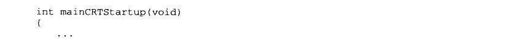

<details markdown="1"><summary>复制校对文字（未运行验证）</summary>

```text
int mainCRTStartup(void)
{
    ...
```

</details>

这是入口函数的头部。下面的代码出现于该函数的开头，显得杂乱无章。不过其中关键的内容是给一系列变量赋值：


<details markdown="1"><summary>复制校对文字（未运行验证）</summary>

```text
posvi = (OSVERSIONINFOA *)_alloca(sizeof(OSVERSIONINFOA));
posvi->dwOSVersionInfoSize = sizeof(OSVERSIONINFOA);
GetVersionExA(posvi);
```

</details>

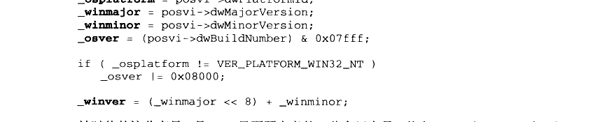

<details markdown="1"><summary>复制校对文字（未运行验证）</summary>

```text
_osplatform = posvi->dwPlatformId;
_winmajor = posvi->dwMajorVersion;
_winminor = posvi->dwMinorVersion;
_osver = (posvi->dwBuildNumber) & 0x07fff;
if (_osplatform != VER_PLATFORM_WIN32_NT)
    _osver |= 0x08000;
_winver = (_winmajor << 8) + _winminor;
```

</details>

被赋值的这些变量，是VC7里面预定义的一些全局变量，其中\_osver 和\_winver 表示操作系统的版本，\_winmajor 是主版本号，更具体的可以查阅 MSDN。这段代码通过调用GetVersionExA（这是一个 Windows API）来获得当前的操作系统版本信息，并且赋值给各个全局变量。

为什么这里为 posvi分配内存不使用malloc而使用alloca呢？是因为在程序的一开始堆还没有被初始化，而 alloca 是唯一可以不使用堆的动态分配机制。alloca 可以在栈上分配任意大小的空间（只要栈的大小允许），并且在函数返回的时候会自动释放，就好像局部变量一样。

由于没有初始化堆，所以很多事情没法做，当务之急是赶紧把堆先初始化了：


<details markdown="1"><summary>复制校对文字（未运行验证）</summary>

```text
if (!_heap_init(0))
    fast_error_exit(_RT_HEAPINIT);
```

</details>

这里使用\_heap\_init函数对堆（heap）进行了初始化，如果堆初始化失败，那么程序就直接退出了。

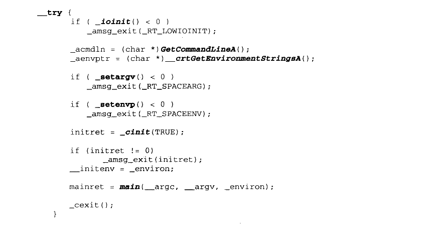

<details markdown="1"><summary>复制校对文字（未运行验证）</summary>

```text
__try {
    if (_ioinit() < 0)
        _amsg_exit(_RT_LOWIOINIT);
    _acmdln = (char*)GetCommandLineA();
    _aenvptr = (char*)__crtGetEnvironmentStringsA();
    if (_setargv() < 0)
        _amsg_exit(_RT_SPACEARG);
    if (_setenvp() < 0)
        _amsg_exit(_RT_SPACEENV);
    initret = _cinit(TRUE);
    if (initret != 0)
        _amsg_exit(initret);
    __initenv = _environ;
    mainret = main(__argc, __argv, _environ);
    _cexit();
}
```

</details>

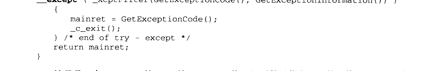

<details markdown="1"><summary>复制校对文字（未运行验证）</summary>

```text
__except (_XcptFilter(GetExceptionCode(), GetExceptionInformation()))
    {
        mainret = GetExceptionCode();
        _c_exit();
    } /* end of try - except */
    return mainret;
}
```

</details>

这里是一个 Windows 的SEH 的 try-except 块，里面做了什么呢？首先使用\_ioinit 函数初始化了 I/O，接下来这段代码调用了一系列函数进行各种初始化，包括：

- \_setargv：初始化 main 函数的 argv 参数。

- _setenvp：设置环境变量。

- _cinit：其他的C库设置。

在最后，可以看到函数调用了 main 函数并获得了其返回值。try-except 块的 except 部分是最后的清理阶段，如果 try 块里的代码发生异常，则在这里进行错误处理。最后退出并返回 main 的返回值。

try-except 块

try-except 块是 Windows 结构化异常处理机制 SEH的一部分。try-except 块的使用方法如下：

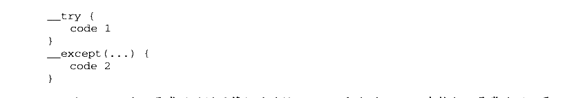

<details markdown="1"><summary>复制校对文字（未运行验证）</summary>

```text
__try {
    code 1
}
__except (...) {
    code 2
}
```

</details>

当 code 1 出现异常（段错误等）的时候，except 部分的code 2会执行以异常处理。更为详细的信息请查阅 MSDN.

总结一下，这个 mainCRTStartup 的总体流程就是：

（1）初始化和 OS版本有关的全局变量。

（2） 初始化堆。

（3）初始化I/O。

（4）获取命令行参数和环境变量。

（5）初始化C库的一些数据。

（6）调用main 并记录返回值。

（7） 检查错误并将 main 的返回值返回。事实上还是 MSVC 的入口函数的思路较为清晰。在第13 章里，我们将仿照 VC入口函数的思路实现一个 Linux 下的简易入口函数。

Q&amp;A

Q:msvc 的入口函数使用了alloca，它是如何实现的。

A:alloca函数的特点是它能够动态地在栈上分配内存，在函数退出时如同局部变量一样自动释放。结合之前我们介绍的函数标准进入和退出指令序列就知道，函数退出时的退栈操作是直接将ESP 的值赋为EBP 的值。因此不管在函数的执行过程中ESP 减少了多少，最后也能够成功地将函数执行时分配的所有栈空间回收。在这个基础上，alloca的实现就非常简单，仅仅是将ESP 减少一定数值而已。

Q：为什么MSVC 的 Win32 程序的入口使用的是 WinMain？

A:WinMain 和main一样，都不是程序的实际入口。MSVC 的程序入口是同一段代码，但根据不同的编译参数被编译成了不同的版本。不同版本的入口函数在其中会调用不同名字的函数，包括 main/wmain/WinMain/wWinMain 等。

### 11.1.3 运行库与 I/O

在了解了 glibc 和 MSVC的入口函数的基本思路之后，让我们来深入了解各个初始化部分的具体实现。但在具体了解初始化之前，我们要先了解一个重要的概念：I/O。

IO（或 I/O）的全称是Input/Output，即输入和输出。对于计算机来说，IO 代表了计算机与外界的交互，交互的对象可以是人或其他设备（如图11-3所示）。


<p class="image-caption">图11-3 计算机的 I/O设备</p>

而对于程序来说，I/O 涵盖的范围还要宽广一些。一个程序的 I/O 指代了程序与外界的交互，包括文件、管道、网络、命令行、信号等。更广义地讲，I/O指代任何操作系统理解为“文件”的事务。许多操作系统，包括Linux 和Windows，都将各种具有输入和输出概念的实体——包括设备、磁盘文件、命令行等—统称为文件，因此这里所说的文件是一个广义的概念。

对于一个任意类型的文件，操作系统会提供一组操作函数，这包括打开文件、读文件、写文件、移动文件指针等，相信有编程经验的读者对此都不会陌生。有过C编程经验的读者应该知道，C语言文件操作是通过一个 FILE 结构的指针来进行的。fopen 函数返回一个FILE 结构的指针，而其他的函数如fwrite 使用这个指针操作文件。使用文件的最简单代码如下：

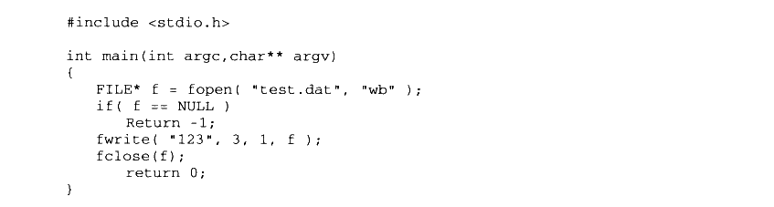

<details markdown="1"><summary>复制校对文字（未运行验证）</summary>

```text
#include <stdio.h>
int main(int argc, char** argv)
{
    FILE* f = fopen("test.dat", "wb");
    if (f == NULL)
        return -1;
    fwrite("123", 3, 1, f);
    fclose(f);
    return 0;
}
```

</details>

在操作系统层面上，文件操作也有类似于 FILE 的一个概念，在 Linux 里，这叫做文件描述符（File Descriptor），而在 Windows 里，叫做句柄（Handle）（以下在没有歧义的时候统称为句柄）。用户通过某个函数打开文件以获得句柄，此后用户操纵文件皆通过该句柄进行。

设计这么一个句柄的原因在于句柄可以防止用户随意读写操作系统内核的文件对象。无论是 Linux 还是 Windows，文件句柄总是和内核的文件对象相关联的，但如何关联细节用户并不可见。内核可以通过句柄来计算出内核里文件对象的地址，但此能力并不对用户开放。

下面举一个实际的例子，在 Linux 中，值为0、1、2的fd 分别代表标准输入、标准输出和标准错误输出。在程序中打开文件得到的fd 从3开始增长。fd 具体是什么呢？在内核中，每一个进程都有一个私有的“打开文件表”，这个表是一个指针数组，每一个元素都指向一个内核的打开文件对象。而 fd，就是这个表的下标。当用户打开一个文件时，内核会在内部生成一个打开文件对象，并在这个表里找到一个空项，让这一项指向生成的打开文件对象，并返回这一项的下标作为 fd。由于这个表处于内核，并且用户无法访问到，因此用户即使拥有 fd，也无法得到打开文件对象的地址，只能够通过系统提供的函数来操作。

在C语言里，操纵文件的渠道则是 FILE 结构，不难想象，C语言中的 FILE 结构必定和 fd 有一对一的关系，每个 FILE 结构都会记录自己唯一对应的 fd。

FILE、fd、打开文件表和打开文件对象的关系如图11-4所示。

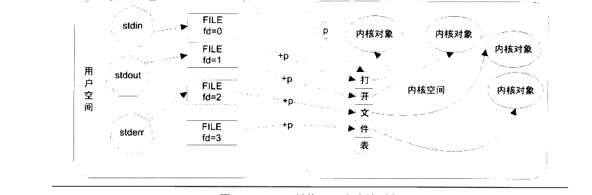

<p class="image-caption">图 11-4 FILE 结构、fd 和内核对象</p>

<details markdown="1"><summary>查看图中文字（按图分组）</summary>

用户空间的 stdin、stdout、stderr 分别使用 FILE 中的 fd=0、fd=1、fd=2。文件描述符索引内核中的打开文件表，表项指向内核对象；另有 fd=3 的 FILE 实例。

</details>

图11-4中，内核指针P指向该进程的打开文件表，所以只要有 fd，就可以用fd+p 来得到打开文件表的某一项地址。stdin、stdout、stderr 均是 FILE 结构的指针。

对于 Windows 中的句柄，与 Linux 中的fd 大同小异，不过 Windows 的句柄并不是打开文件表的下标，而是其下标经过某种线性变换之后的结果。

在大致了解了I/O 为何物之后，我们就能知道I/O 初始化的职责是什么了。首先I/O初始化函数需要在用户空间中建立stdin、stdout、stderr 及其对应的FILE 结构，使得程序进入main 之后可以直接使用printf、scanf 等函数。

### 11.1.4 MSVC CRT 的入口函数初始化

系统堆初始化

MSVC 的入口函数初始化主要包含两个部分，堆初始化和I/O 初始化。MSVC的堆初始化由函数\_heap\_init完成，这个函数的定义位于 heapinit.c，大致的代码如下（删去了64位系统的条件编译部分）：

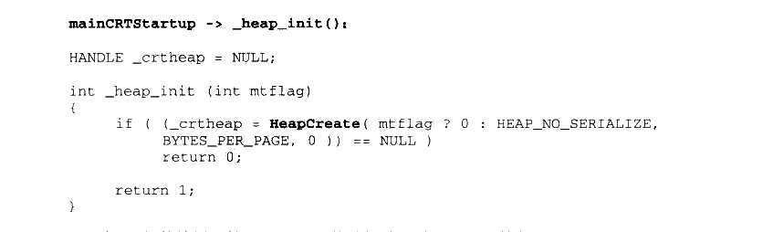

<details markdown="1"><summary>复制校对文字（未运行验证）</summary>

```text
// mainCRTStartup -> _heap_init()
HANDLE _crtheap = NULL;
int _heap_init(int mtflag)
{
    if ((_crtheap = HeapCreate(mtflag ? 0 : HEAP_NO_SERIALIZE,
            BYTES_PER_PAGE, 0)) == NULL)
        return 0;
    return 1;
}
```

</details>

在32位的编译环境下，MSVC 的堆初始化过程出奇地简单，它仅仅调用了 HeapCreate这个 API 创建了一个系统堆。因此不难想象，MSVC 的 malloc 函数必然是调用了 HeapAlloc这个 API，将堆管理的过程直接交给了操作系统。

I/O 初始化

I/O 初始化相对于堆的初始化则要复杂很多。首先让我们来看看 MSVC 中，FILE 结构的定义（FILE结构实际定义在C语言标准中并未指出，因此不同的版本可能有不同的实现）：

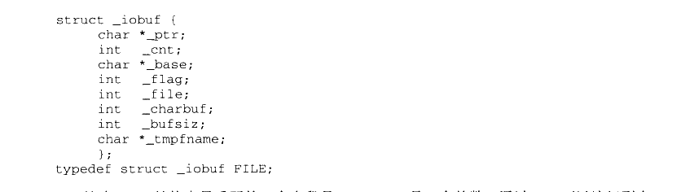

<details markdown="1"><summary>复制校对文字（未运行验证）</summary>

```text
struct _iobuf {
    char *_ptr;
    int _cnt;
    char *_base;
    int _flag;
    int _file;
    int _charbuf;
    int _bufsiz;
    char *_tmpfname;
};
typedef struct _iobuf FILE;
```

</details>

这个 FILE 结构中最重要的一个字段是\_file，\_file 是一个整数，通过\_file 可以访问到内部文件句柄表中的某一项。在Windows 中，用户态使用句柄（Handle）来访问内核文件对象，句柄本身是一个32位的数据类型，在有些场合使用int 来储存，有些场合使用指针来表示。

在MSVC 的CRT 中，已经打开的文件句柄的信息使用数据结构 ioinfo 来表示：

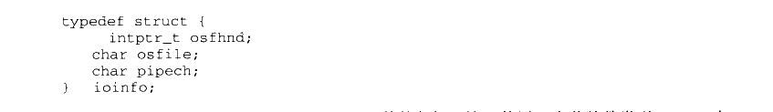

<details markdown="1"><summary>复制校对文字（未运行验证）</summary>

```text
typedef struct {
    intptr_t osfhnd;
    char osfile;
    char pipech;
} ioinfo;
```

</details>

在这个结构中，osfhnd 字段即为打开文件的句柄，这里使用8字节整数类型 intptr\_t 来存储。另外 osfile 的意义为文件的打开属性。而 pipech 字段则为用于管道的单字符缓冲，这里可以先忽略。osfile 的值可由一系列值用按位或的方式得出：

- FOPEN（0x01）句柄被打开。

- FEOFLAG（0x02）已到达文件末尾。

- FCRLF（0x04）在文本模式中，行缓冲已遇到回车符（见第11.2.2节）。

- FPIPE（0x08）管道文件。

- FNOINHERIT（0x10）句柄打开时具有属性\_O\_NOINHERIT（不遗传给子进程）。

- FAPPEND（0x20）句柄打开时具有属性O\_APPEND（在文件末尾追加数据）。

- FDEV（0x40）设备文件。

- FTEXT（0x80）文件以文本模式打开。

在 crt/src/ioinit.c 中，有一个数组：


<details markdown="1"><summary>复制校对文字（未运行验证）</summary>

```text
int _nhandle;
ioinfo *__pioinfo[64]; // 等效于 ioinfo __pioinfo[64][32];
```

</details>

这就是用户态的打开文件表。这个表实际是一个二维数组，第二维的大小为32个 ioinfo结构，因此该表总共可以容纳的元素总量为64\*32=2048个句柄。此外\_nhandle 记录该表的实际元素个数。之所以使用指针数组而不是一维数组的原因是使用指针数组更加节省空间，而如果使用二维数组，则不论程序里打开了几个文件都必须始终消耗 2048 个 ioinfo 的空间。

FILE 结构中的\_file 的值，和此表的两个下标直接相关联。当我们要访问文件时，必须从 FILE 结构转换到操作系统的句柄。从一个 FILE\*结构得到文件句柄可以通过一个叫做 _osfhnd 的宏，当然这个宏是CRT 内部使用的，并不推荐用户使用。\_osfhnd 的定义为：

```c
#define _osfhnd(i) (_pioinfo(i)->osfhnd)
```

其中宏函数\_pioinfo 的定义是：

```c
#define _pioinfo(i) (__pioinfo[(i) >> 5] + ((i) & ((1 << 5) - 1)))
```

FILE 结构的\_file 字段的意义可以从\_pioinfo 的定义里看出，通过\_file 得到打开文件表的下标变换为：

FILE：\_file 的第5位到第10位是第一维坐标（共6位），\_file 的第0位到第4位是第二维坐标（共5位）。

这样就可以通过简单的位运算来从 FILE 结构得到内部句柄。通过这我们可以看出，MSVC 的I/O 内部结构和之前介绍的Linux 的结构有些不同，如图11-5所示。


<details markdown="1"><summary>查看图中文字（按图分组）</summary>

图 11-4 上半部分：用户空间的 FILE 通过 _file 索引运行库的打开文件表，再关联到内核对象。

</details>

空 FILE 内核空间 

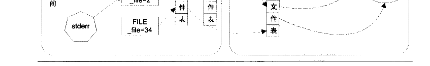

<p class="image-caption">图 11-5 Windows 的FILE、句柄和内核对象</p>

<details markdown="1"><summary>查看图中文字（按图分组）</summary>

图 11-4 下半部分：stdin、stdout、stderr 对应 _file=0、1、2；图中还举出 _file=34。运行库表项连接内核打开文件表中的相应项。

</details>

MSVC的I/O 初始化就是要构造这个二维的打开文件表。MSVC的I/O初始化函数\_ioinit定义于 crt/src/ioinit.c 中。首先，\_ioinit 函数初始化了\_\_pioinfo 数组的第一个二级数组：

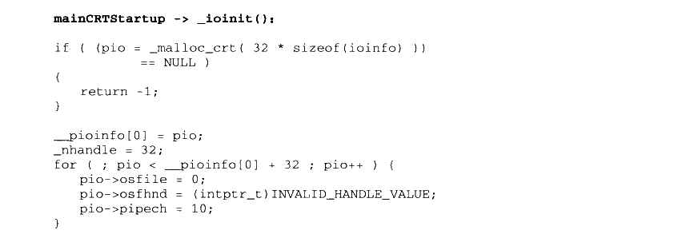

<details markdown="1"><summary>复制校对文字（未运行验证）</summary>

```text
// mainCRTStartup -> _ioinit()
if ((pio = _malloc_crt(32 * sizeof(ioinfo))) == NULL)
{
    return -1;
}
__pioinfo[0] = pio;
_nhandle = 32;
for (; pio < __pioinfo[0] + 32; pio++) {
    pio->osfile = 0;
    pio->osfhnd = (intptr_t)INVALID_HANDLE_VALUE;
    pio->pipech = 10;
}
```

</details>

在这里\_ioinit 初始化了的\_\_pioinfo[0] 里的每一个元素为无效值，其中 INVALID\_HANDLE\_VALUE 是Windows 句柄的无效值，值为-1。接下来，\_ioinit 的工作是将一些预定义的打开文件给初始化，这包括两部分：

（1）从父进程继承的打开文件句柄，当一个进程调用 API 创建新进程的时候，可以选择继承自己的打开文件句柄，如果继承，子进程可以直接使用父进程的打开文件句柄。

（2） 操作系统提供的标准输入输出。

应用程序可以使用 API GetStartupInfo 来获取继承的打开文件，GetStartupInfo 的参数如下：

void GetStartupInfo（STARTUPINFO\* lpStartupInfo）；

STARTUPINFO 是一个结构，调用 GetStartupInfo 之后，该结构就会被写入各种进程启动相关的数据。在该结构中，有两个保留字段为：

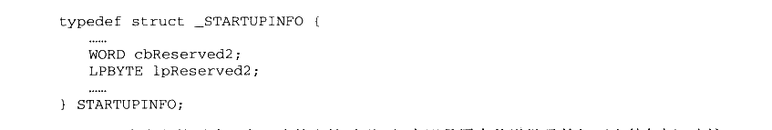

<details markdown="1"><summary>复制校对文字（未运行验证）</summary>

```text
typedef struct _STARTUPINFO {
    ...
    WORD cbReserved2;
    LPBYTE lpReserved2;
    ...
} STARTUPINFO;
```

</details>

这两个字段的用途没有正式的文档说明，但实际是用来传递继承的打开文件句柄。当这两个字段的值都不为0时，说明父进程遗传了一些打开文件句柄。操作系统是如何使用这两个字段传递句柄的呢？首先 lpReserved2 字段实际是一个指针，指向一块内存，这块内存的结构如下：

- 字节［0.3］：传递句柄的数量n。

- 字节［4，3+m］：每一个句柄的属性（各1字节，表明句柄的属性，同 ioinfo 结构的\_osfile字段）。

- 字节［4+n之后）：每一个句柄的值（n 个 intptr\_t 类型数据，同 ioinfo 结构的\_osfhnd 字段）。

\_ioinit 函数使用如下代码获取各个句柄的数据：

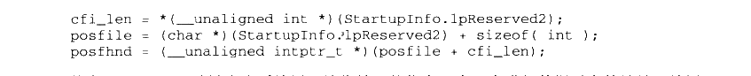

<details markdown="1"><summary>复制校对文字（未运行验证）</summary>

```text
cfi_len = *(__unaligned int *)(StartupInfo.lpReserved2);
posfile = (char *)(StartupInfo.lpReserved2) + sizeof(int);
posfhnd = (__unaligned intptr_t *)(posfile + cfi_len);
```

</details>

其中\_unaligned 关键字告诉编译器该指针可能指向一个没有进行数据对齐的地址，编译器会插入一些代码来避免发生数据未对齐而产生的错误。这段代码执行之后，lpReserved2 指向的数据结构会被两个指针分别指向其中的两个数组，如图11-6所示。


<p class="image-caption">图 11-6 句柄属性数组和句柄数组</p>

<details markdown="1"><summary>查看图中文字（按图分组）</summary>

继承句柄数据布局：n（cfi_len）、句柄属性数组、句柄数组。posfile 指向句柄属性数组，posfhnd 指向句柄数组。

</details>

接下来\_ioinit 就要将这些数据填入自己的打开文件表中。当然，首先要判断自己的打开文件表是否足以容纳所有的句柄：

cfi\_len= \_min（ cfi\_len, 32 \*64 ）；

然后要给打开文件表分配足够的空间以容纳所有的句柄：

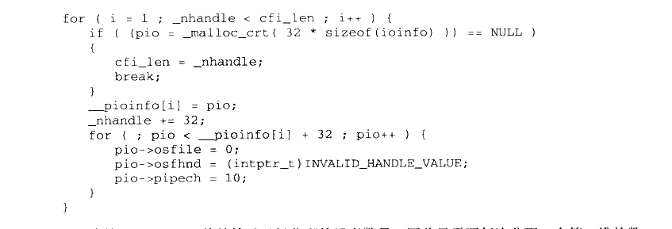

<details markdown="1"><summary>复制校对文字（未运行验证）</summary>

```text
for (i = 1; _nhandle < cfi_len; i++) {
    if ((pio = _malloc_crt(32 * sizeof(ioinfo))) == NULL) {
        cfi_len = _nhandle;
        break;
    }
    __pioinfo[i] = pio;
    _nhandle += 32;
    for (; pio < __pioinfo[i] + 32; pio++) {
        pio->osfile = 0;
        pio->osfhnd = (intptr_t)INVALID_HANDLE_VALUE;
        pio->pipech = 10;
    }
}
```

</details>

在这里，nhandle 总是等于已经分配的元素数量，因此只需要每次分配一个第二维的数组，直到 nhandle 大于cfi\_len即可。由于 \_\_pioinfo［0］已经预先分配了，因此直接从\_\_pioinfo[1]开始分配即可。分配了空间之后，将数据填入就很容易了：

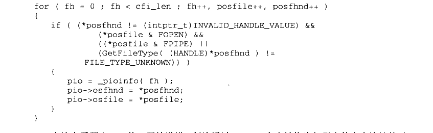

<details markdown="1"><summary>复制校对文字（未运行验证）</summary>

```text
for (fh = 0; fh < cfi_len; fh++, posfile++, posfhnd++)
{
    if ((*posfhnd != (intptr_t)INVALID_HANDLE_VALUE) &&
        (*posfile & FOPEN) &&
        ((*posfile & FPIPE) ||
         (GetFileType((HANDLE)*posfhnd) != FILE_TYPE_UNKNOWN)))
    {
        pio = _pioinfo(fh);
        pio->osfhnd = *posfhnd;
        pio->osfile = *posfile;
    }
}
```

</details>

在这个循环中，fh 从0开始递增，每次通过\_pioinfo 宏来转换为打开文件表中连续的对应元素，而posfile 和 posfhnd 则依次递增以遍历每一个句柄的数据。在复制的过程中，一些不符合条件的句柄会被过滤掉，例如无效的句柄，或者不属于打开文件及管道的句柄，或者未知类型的句柄。

这段代码执行完成之后，继承来的句柄就全部复制完毕。接下来还须要初始化标准输入输出。当继承句柄的时候，有可能标准输入输出（fh=0，1,2）已经被继承了，因此在初始化前首先要先检验这一点，代码如下：

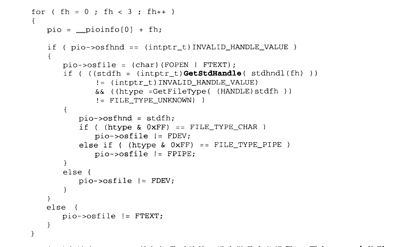

<details markdown="1"><summary>复制校对文字（未运行验证）</summary>

```text
for (fh = 0; fh < 3; fh++)
{
    pio = __pioinfo[0] + fh;
    if (pio->osfhnd == (intptr_t)INVALID_HANDLE_VALUE)
    {
        pio->osfile = (char)(FOPEN | FTEXT);
        if (((stdfh = (intptr_t)GetStdHandle(stdhndl(fh)))
              != (intptr_t)INVALID_HANDLE_VALUE)
            && ((htype = GetFileType((HANDLE)stdfh)) != FILE_TYPE_UNKNOWN))
        {
            pio->osfhnd = stdfh;
            if ((htype & 0xFF) == FILE_TYPE_CHAR)
                pio->osfile |= FDEV;
            else if ((htype & 0xFF) == FILE_TYPE_PIPE)
                pio->osfile |= FPIPE;
        }
        else {
            pio->osfile |= FDEV;
        }
    }
    else {
        pio->osfile |= FTEXT;
    }
}
```

</details>

如果序号为 0、1、2的句柄是无效的（没有继承自父进程），那么\_ioinit 会使用GetStdHandle 函数获取默认的标准输入输出句柄。此外，\_ioinit 还会使用 GetFileType 来获取该默认句柄的类型，给\_osfile 设置对应的值。

在处理完标准输入输出的句柄之后，IO 初始化工作就完成了。我们可以看到，MSVC的I/O 初始化主要进行了如下几个工作：

- 建立打开文件表。

- 如果能够继承自父进程，那么从父进程获取继承的句柄。

- 初始化标准输入输出。

在I/O初始化完成之后，所有的 I/O 函数就都可以自由使用了。在本节中，我们介绍了入口函数最重要的两个部分，堆初始化和I/O 初始化，相信读者对程序的启动部分已经有了较深的理解。不过，入口函数只是冰山一角，它隶属的是一个庞大的代码集合。这个代码集合叫做运行库。
