# 11.5 fread 实现

我们知道C语言的运行库十分庞大，前面介绍的启动部分、多线程、全局构造和析构这些内容其实都不是占 CRT 篇幅最大的部分。与任何系统级别的软件一样，真正复杂的并且有挑战性的往往是软件与外部通信的部分，即IO部分。

前面的章节中对运行库的分析都是比较粗略的，虽然涉及运行库的各个方面，但是在运行库实现的深度上挖掘得不够。我们知道，IO 部分实际上是运行库中最为重要也最为复杂的部分之一，在结束本章之前，最后来仔细了解C语言标准库中一个非常重要的I/O 函数fread的具体实现，我们知道fread 最终是通过 Windows 的系统 API: ReadFile() 来实现对文件的读取的，但是从fread 到 ReadFile 之间究竟发生了什么却是一个未知的谜。我们希望通过对fread（）的挖掘，能够打通从运行库函数 fread 到 Windows 系统 API 的 ReadFile（）函数之间的这条通路，这有助于对运行库和IO 的进一步了解。

首先我们来看 fread 的函数声明：

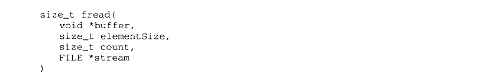

<details markdown="1"><summary>复制校对文字（未运行验证）</summary>

```text
size_t fread(
    void *buffer,
    size_t elementSize,
    size_t count,
    FILE *stream
)
```

</details>

在这里，size\_t 是表示数据大小的类型，定义为 unsigned int。fread 有4个参数，其功能是尝试从文件流 stream 里读取 count 个大小为 elementSize 个字节的数据，存储在 buffer 里，返回实际读取的字节数。

ReadFile 的函数声明为：

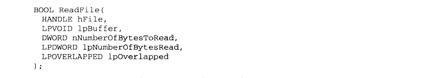

<details markdown="1"><summary>复制校对文字（未运行验证）</summary>

```text
BOOL ReadFile(
    HANDLE hFile,
    LPVOID lpBuffer,
    DWORD nNumberOfBytesToRead,
    LPDWORD lpNumberOfBytesRead,
    LPOVERLAPPED lpOverlapped
);
```

</details>

ReadFile 的第一个参数hFile 为所要读取的文件句柄，我们在本章的第一节就已经介绍了句柄的概念及讨论了为什么要使用句柄的原因，与它对应的应该是 fread里面的 stream 参数：第二个参数lpBuffer 是读取文件内容的缓冲区，相对应的 fread 参数为 buffer；第三个参数 nNumberOfBytesToRead 为要读取多少字节，fread 与它相对应的应该是两个参数的乘积，即 elementSize \* count；第四个参数 lpNumberOfBytesRead 为一个指向DWORD类型的指针，它用于返回读取了多少个字节；最后一个参数是没用的，可以忽略它。

在了解了 fread 函数和 ReadFile 函数之后，可以发现它们在功能上看似完全相同，而且在参数上几乎一一对应，所以如果我们要实现一个最简单的 fread，就是直接调用 ReadFile而不做任何处理：

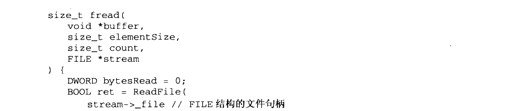

<details markdown="1"><summary>复制校对文字（未运行验证）</summary>

```text
size_t fread(
    void *buffer,
    size_t elementSize,
    size_t count,
    FILE *stream
) {
    DWORD bytesRead = 0;
    BOOL ret = ReadFile(
        stream->_file, // FILE 结构的文件句柄
        buffer,
        elementSize * count,
        &bytesRead,
        NULL);
    if (ret)
        return bytesRead;
    else
        return -1;
}
```

</details>

可能很多人会觉得很奇怪，既然fread 可以这么简单地实现，为什么 CRT 还要做得这么复杂呢？先别着急，我们接下来就慢慢来看 CRT 是怎么实现 fread 的，为什么它要这么做。

### 11.5.1 缓冲

对于 glibc,fread 的实现过于复杂，因此我们这里选择 MSVC的fread 实现。但在阅读fread 的代码之前，首先要介绍一下缓冲（Buffer）的概念。

缓冲最为常见于IO 系统中，设想一下，当希望向屏幕输出数据的时候，由于程序逻辑的关系，可能要多次调用 printf 函数，并且每次写入的数据只有几个字符，如果每次写数据都要进行一次系统调用，让内核向屏幕写数据，就明显过于低效了，因为系统调用的开销是很大的，它要进行上下文切换、内核参数检查、复制等，如果频繁进行系统调用，将会严重影响程序和系统的性能。

一个显而易见的可行方案是将对控制台连续的多次写入放在一个数组里，等到数组被填满之后再一次性完成系统调用写入，实际上这就是缓冲最基本的想法。当读文件的时候，缓冲同样存在。我们可以在 CRT 中为文件建立一个缓冲，当要读取数据的时候，首先看看这个文件的缓冲里有没有数据，如果有数据就直接从缓冲中取。如果缓冲是空的，那么 CRT 就通过操作系统一次性读取文件一块较大的内容填充缓冲。这样，如果每次读取文件都是一些尺寸很小的数据，那么这些读取操作大多都直接从缓冲中获得，可以避免大量的实际文件访问。

除了读文件有缓冲以外，写文件也存在着同样的情况，而且写文件比读文件要更加复杂，因为当我们通过 fwrite 向文件写入一段数据时，此时这些数据不一定被真正地写入到文件中，而是有可能还存在于文件的写缓冲里面，那么此时如果系统崩溃或进程意外退出时，有可能导致数据丢失，于是 CRT 还提供了一系列与缓冲相关的操作用于弥补缓冲所带来的问题。C语言标准库提供与缓冲相关的几个基本函数，如表11-4所示。

表11-4

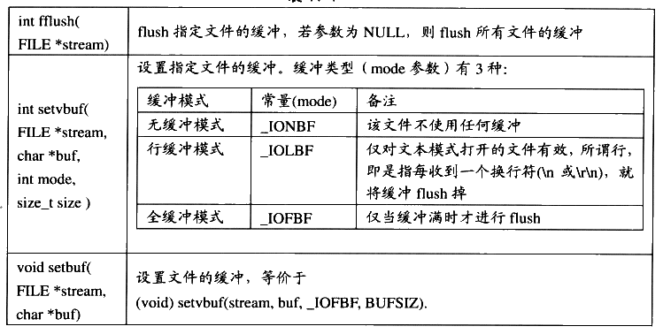

<details markdown="1"><summary>查看校对表格</summary>

| 函数 | 作用 |
| --- | --- |
| `int fflush(FILE *stream)` | flush 指定文件的缓冲；参数为 NULL 时 flush 所有文件的缓冲。 |
| `int setvbuf(FILE *stream, char *buf, int mode, size_t size)` | 设置缓冲：`_IONBF` 无缓冲；`_IOLBF` 行缓冲（文本模式遇换行符时 flush）；`_IOFBF` 全缓冲（缓冲满时 flush）。 |
| `void setbuf(FILE *stream, char *buf)` | 等价于 `(void)setvbuf(stream, buf, _IOFBF, BUFSIZ)`。 |

</details>

所谓 flush 一个缓冲，是指对写缓冲而言，将缓冲内的数据全部写入实际的文件，并将缓冲清空，这样可以保证文件处于最新的状态。之所以需要 flush，是因为写缓冲使得文件处于一种不同步的状态，逻辑上一些数据已经写入了文件，但实际上这些数据仍然在缓冲中，如果此时程序意外地退出（发生异常或断电等），那么缓冲里的数据将没有机会写入文件。flush 可以在一定程度上避免这样的情况发生。

在这个表中我们还能看到C语言支持两种缓冲，即行缓冲（Line Buffer）和全缓冲（Full Buffer）。全缓冲是经典的缓冲形式，除了用户手动调用 flush 外，仅当缓冲满的时候，缓冲才会被自动flush掉。而行缓冲则比较特殊，这种缓冲仅用于文本文件，在输入输出遇到一个换行符时，缓冲就会被自动 flush，因此叫行缓冲。

### 11.5.2 fread_s

在了解了缓冲的大致内容之后，让我们回到fread 的代码分析。MSVC 的fread 的定义在 crt/fread.c 里，实际内容只有一行：

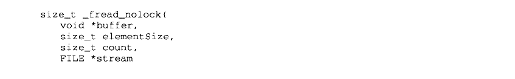

<details markdown="1"><summary>复制校对文字（未运行验证）</summary>

```text
size_t _fread_nolock(
    void *buffer,
    size_t elementSize,
    size_t count,
    FILE *stream
```

</details>

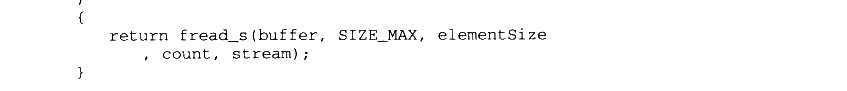

<details markdown="1"><summary>复制校对文字（未运行验证）</summary>

```text
)
{
    return fread_s(buffer, SIZE_MAX, elementSize, count, stream);
}
```

</details>

可见 fread 将所有的工作都转交给了fread\_s。fread\_s 定义如下：

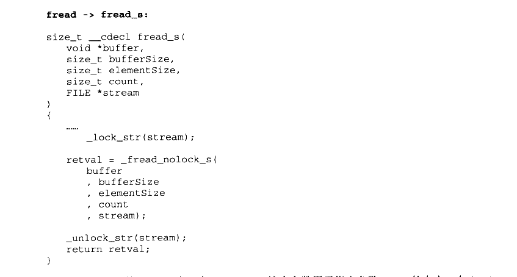

<details markdown="1"><summary>复制校对文字（未运行验证）</summary>

```text
// fread -> fread_s
size_t __cdecl fread_s(
    void *buffer,
    size_t bufferSize,
    size_t elementSize,
    size_t count,
    FILE *stream)
{
    ...
    _lock_str(stream);
    retval = _fread_nolock_s(buffer, bufferSize, elementSize, count, stream);
    _unlock_str(stream);
    return retval;
}
```

</details>

fread\_s 的参数比 fread 多一个 bufferSize，这个参数用于指定参数 buffer 的大小。在 fread中，这个参数直接被定义为SIZE\_MAX，即 size\_t 的最大值，表明fread 不关心这个参数。而用户在使用 fread\_s 时就可以指定这个参数，以达到防止越界的目的（fread\_s 的s是 safe 的意思）。fread\_s 首先对各个参数检查，然后使用\_lock\_str 对文件进行加锁，以防止多个线程同时读取文件而导致缓冲区不一致。我们可以看到fread\_s 其实又把工作交给了\_fread\_nolock\_s。

### 11.5.3 fread_nolock_s

fread\_nolock\_s 是进行实际工作的函数，为了便于理解，下面会分段列出fread\_nolock\_s的实现，并且将省去所有的参数检查和错误检查。同样，还将省去64位部分的代码。

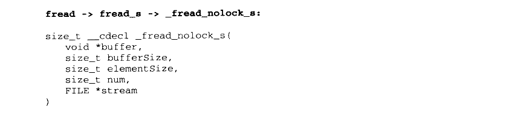

<details markdown="1"><summary>复制校对文字（未运行验证）</summary>

```text
// fread -> fread_s -> _fread_nolock_s
size_t __cdecl _fread_nolock_s(
    void *buffer,
    size_t bufferSize,
    size_t elementSize,
    size_t num,
    FILE *stream
)
```

</details>

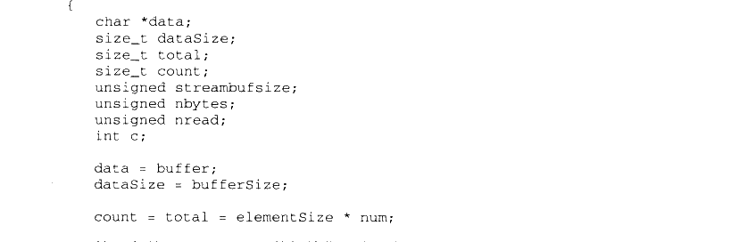

<details markdown="1"><summary>复制校对文字（未运行验证）</summary>

```text
{
    char *data;
    size_t dataSize;
    size_t total;
    size_t count;
    unsigned streambufsize;
    unsigned nbytes;
    unsigned nread;
    int c;
    data = buffer;
    dataSize = bufferSize;
    count = total = elementSize * num;
```

</details>

这一段是 fread\_nolock\_s 的初始化部分。在它的局部变量中，data 将始终指向 buffer 中尚未被写入的起始部分。在最开始的时候，data 指向 buffer 的开头。dataSize 记录了 buffer中还可以写入的字节数，理论上，data + dataSize = buffer + bufferSize。如图11-12所示。

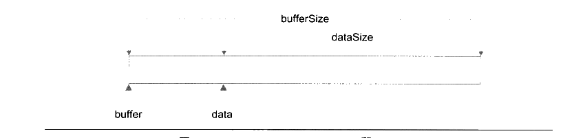

<p class="image-caption">图 11-12 data、buffer、bufferSize 和 dataSize</p>

<details markdown="1"><summary>查看图中文字（按图分组）</summary>

buffer 指向缓冲区起始位置，bufferSize 是总大小；data 指向当前写入位置，dataSize 是剩余空间大小。

</details>

total 变量记录了总共须要读取的字节数，count则记录在读取过程中尚未读的字节数。streambufsize 记录了文件缓冲的大小。剩下的3个局部变量在代码的分析过程中会一一提到。在这里需要特别提一下缓冲在FILE 结构中的具体实现。

在对缓冲的概念有了一定了解之后，可分析一下文件类型 FILE 结构的定义了。FILE 的定义位于 stdio.h里：

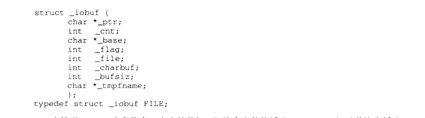

<details markdown="1"><summary>复制校对文字（未运行验证）</summary>

```text
struct _iobuf {
    char *_ptr;
    int _cnt;
    char *_base;
    int _flag;
    int _file;
    int _charbuf;
    int _bufsiz;
    char *_tmpfname;
};
typedef struct _iobuf FILE;
```

</details>

在这里，\_base 字段指向一个字符数组，即这个文件的缓冲，而\_bufsiz 记录着这个缓冲的大小。\_ptr 和 fread\_nolock\_s的局部变量data一样，指向 buffer 中第一个未读的字节，而cnt 记录剩余未读字节的个数。\_flag 记录了 FILE 结构所代表的打开文件的一些属性，目前我们感兴趣的是3个标志：


<details markdown="1"><summary>复制校对文字（未运行验证）</summary>

```text
#define _IOYOURBUF 0x0100
#define _IOMYBUF   0x0008
#define _IONBF     0x0004
```

</details>

在这里，\_IOYOURBUF 代表这个文件使用用户通过 setbuf 提供的 buffer，\_IOMYBUF代表这个文件使用内部的缓冲，而\_IONBF 代表这个文件使用一个单字节的缓冲，即缓冲大小仅为1个字节。这个缓冲就是\_charbuf 变量。此时，\_base 变量的值是无效的。接下来继续看 fread\_nolock\_s 的代码：

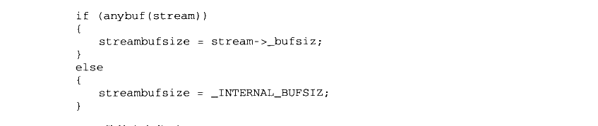

<details markdown="1"><summary>复制校对文字（未运行验证）</summary>

```text
if (anybuf(stream))
{
    streambufsize = stream->_bufsiz;
}
else
{
    streambufsize = _INTERNAL_BUFSIZ;
}
```

</details>

anybuf 函数的定义位于 filez.h：


<details markdown="1"><summary>复制校对文字（未运行验证）</summary>

```text
#define anybuf(s) \
    ((s)->_flag & (_IOMYBUF|_IONBF|_IOYOURBUF))
```

</details>

事实上 anybuf 并不是函数，而是一个宏，它仅检查这个 FILE 结构的\_flag 变量里有没有前面提到的3个标志位的任意一个，如果这3个标志位在\_flag 中存在任意一个，就说明这个文件使用了缓冲。

这一段代码对 streambufsize 变量进行了赋值，如果文件自己有 buffer，那么 streambufsize就等于这个 buffer 的大小：如果文件没有使用 buffer，那么 fread\_nolock\_s 就会使用一个内部的 buffer，这个 buffer 的大小固定为\_INTERNAL\_BUFSIZ，即 4096 字节。接下来fread\_nolock\_s 是一个循环：

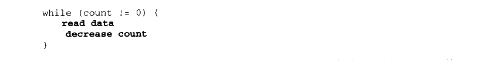

<details markdown="1"><summary>复制校对文字（未运行验证）</summary>

```text
while (count != 0) {
    read data
    decrease count
}
```

</details>

循环体内的操作用伪代码表示，大致的意思是：每一次循环都从文件中读取一部分数据，并且相应地减少 count（还记得吗，count 代表还没有读取的字节数）。当读取数据时，根据文件是否使用buffer 及读取数据的多少分为3种情况，下面我们一一来看：

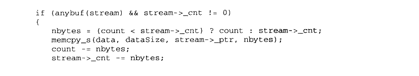

<details markdown="1"><summary>复制校对文字（未运行验证）</summary>

```text
if (anybuf(stream) && stream->_cnt != 0)
{
    nbytes = (count < stream->_cnt) ? count : stream->_cnt;
    memcpy_s(data, dataSize, stream->_ptr, nbytes);
    count -= nbytes;
    stream->_cnt -= nbytes;
```

</details>


<details markdown="1"><summary>复制校对文字（未运行验证）</summary>

```text
stream->_ptr += nbytes;
    data += nbytes;
    dataSize -= nbytes;
}
```

</details>

在 if 的判断句中，anybuf 判断文件是否有缓冲，而stream-&gt;\_cnt != 0判断缓冲是否为空。因此当且仅当文件有缓冲且不为空时，这段代码才会执行。

让我们一行一行地来看这段代码的作用。nbytes代表这次要从缓冲中读取多少字节。在这里，nbytes 等于还须要读取的字节数（count）与缓冲剩余的字节数（stream-&gt;\_cnt）中较小的一个。

接下来的一行使用 memcpy\_s将文件 stream 里\_ptr所指向的缓冲内容复制到data 指向的位置，如图11-13所示。

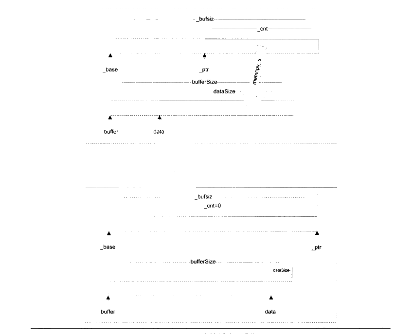

<p class="image-caption">图 11-13 文件缓冲区操作</p>

<details markdown="1"><summary>查看图中文字（按图分组）</summary>

上图：memcpy_s 将 FILE 缓冲区中 _ptr 起的 _cnt 字节复制到目标 data，目标剩余空间为 dataSize。下图：复制结束后 _ptr 前移、_cnt=0，data 前移、dataSize 减少；_base、_bufsiz、buffer、bufferSize 保持不变。

</details>

接下来的5行，皆是按照图11-13修正 FILE 结构和局部变量的各种数据。

memcpy\_s 是 memcpy 的安全版本，相对于原始的memcpy 版本，memcpy\_s 接受一个额外的参数记录输出缓冲区的大小，以防止越界，其余的功能和memcpy 相同。

以上代码处理了文件缓冲不为空的情况，而如果缓冲为空，那么又分为两种情况：

（1） 需要读取的数据大于缓冲的尺寸。

（2） 需要读取的数据不大于缓冲的尺寸。

对于情况（1），fread 将试图一次性读取尽可能多的整数个缓冲的数据直接进入输出的数组中，如果缓冲尺寸为 0，则直接将剩下的数据一次性读取。代码如下：

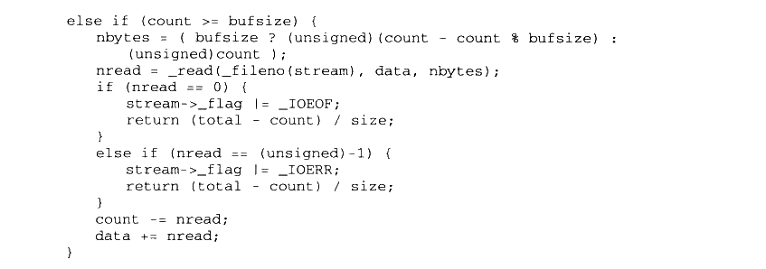

<details markdown="1"><summary>复制校对文字（未运行验证）</summary>

```text
else if (count >= bufsize) {
    nbytes = (bufsize ? (unsigned)(count - count % bufsize) : (unsigned)count);
    nread = _read(_fileno(stream), data, nbytes);
    if (nread == 0) {
        stream->_flag |= _IOEOF;
        return (total - count) / size;
    }
    else if (nread == (unsigned)-1) {
        stream->_flag |= _IOERR;
        return (total - count) / size;
    }
    count -= nread;
    data += nread;
}
```

</details>

在代码中，read函数用于真正从文件读取数据。在这里我们先不管这个函数，在稍后的内容中会对此函数进行详细的介绍。如果要读取的数据不大于缓冲的尺寸，那么仅需要重新填充缓冲即可：

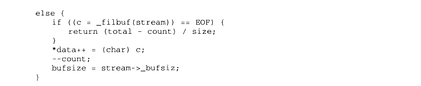

<details markdown="1"><summary>复制校对文字（未运行验证）</summary>

```text
else {
    if ((c = _filbuf(stream)) == EOF) {
        return (total - count) / size;
    }
    *data++ = (char)c;
    --count;
    bufsize = stream->_bufsiz;
}
```

</details>

\_filbuf 函数负责填充缓冲。该函数的具体实现重要的部分只有一行：

```c
stream->_cnt = _read(_fileno(stream), stream->_base, stream->_bufsiz);
```

可以看见所有的线索都指向了\_read 函数。\_read 函数主要负责两件事：

（1）从文件中读取数据。

（2）对文本模式打开的文件，转换回车符。

### 11.5.4 _read

\_read 的代码位于 crt/src/read.c。在省略了一部分无关紧要的代码之后，其内容如下：

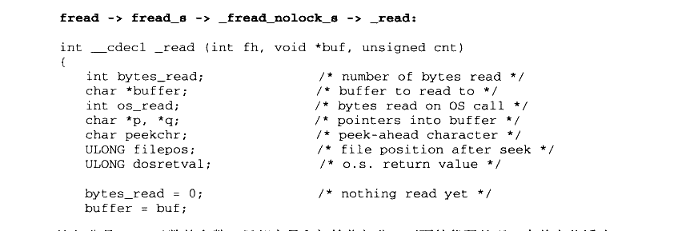

<details markdown="1"><summary>复制校对文字（未运行验证）</summary>

```text
// fread -> fread_s -> _fread_nolock_s -> _read
int __cdecl _read(int fh, void *buf, unsigned cnt)
{
    int bytes_read;        /* number of bytes read */
    char *buffer;          /* buffer to read to */
    int os_read;           /* bytes read on OS call */
    char *p, *q;           /* pointers into buffer */
    char peekchr;          /* peek-ahead character */
    ULONG filepos;         /* file position after seek */
    ULONG dosretval;       /* o.s. return value */
    bytes_read = 0;        /* nothing read yet */
    buffer = buf;
```

</details>

这部分是\_read 函数的参数、局部变量和初始化部分。下面的代码处理一个单字节缓冲；

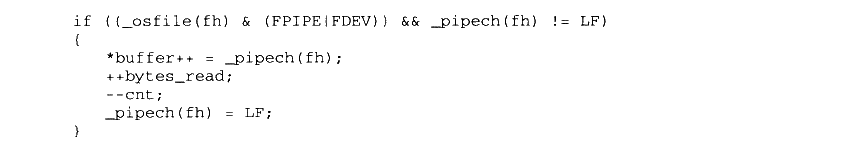

<details markdown="1"><summary>复制校对文字（未运行验证）</summary>

```text
if ((_osfile(fh) & (FPIPE|FDEV)) && _pipech(fh) != LF)
{
    *buffer++ = _pipech(fh);
    ++bytes_read;
    --cnt;
    _pipech(fh) = LF;
}
```

</details>

if 中的判断语句使得这段代码仅对设备和管道文件有效。对于设备和管道文件，ioinfo结构提供了一个单字节缓冲 pipech 字段用于处理一些特殊情况。宏\_pipech 返回这一字段：

```c
#define _pipech(i) (_pioinfo(i)->pipech)
```

pipech 字段的值等于LF（即字符 `\n`）的时候表明该缓冲无效，这样设计的原因是 pipech的用途导致它永远不会被赋值为LF。我们将在稍后的部分里详细讨论这一话题。

read 函数在每次读取管道和设备数据的时候必须先检查 pipech，以免漏掉一个字节。在处理完这个单字节缓冲之后，接下来的内容是实际的文件读取部分：

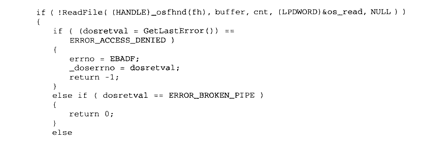

<details markdown="1"><summary>复制校对文字（未运行验证）</summary>

```text
if (!ReadFile((HANDLE)_osfhnd(fh), buffer, cnt, (LPDWORD)&os_read, NULL))
{
    if ((dosretval = GetLastError()) == ERROR_ACCESS_DENIED)
    {
        errno = EBADF;
        _doserrno = dosretval;
        return -1;
    }
    else if (dosretval == ERROR_BROKEN_PIPE)
    {
        return 0;
    }
    else
```

</details>

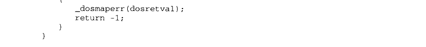

<details markdown="1"><summary>复制校对文字（未运行验证）</summary>

```text
{
        _dosmaperr(dosretval);
        return -1;
    }
}
```

</details>

ReadFile 是一个 Windows API 函数，由Windows 系统提供，作用和\_read 类似，用于从文件里读取数据。在这里我们可以看到 ReadFile 接管了\_read 的第一个职责。在 ReadFile 返回之后，\_read 要检查其返回值。值得注意的是，Windows 使用的函数返回值系统和 crt 使用的返回值系统是不同的，例如 Windows 使用 ERROR\_INVALID\_PARAMETER（87）表示无效的参数，而 CRT 则用 EBADF（9）表示相同的信息。因此当 ReadFile 返回了错误信息之后，read 要把这个信息翻译为 crt 所使用的版本。\_dosmaperr 就是做这件工作的函数。在这里就不详细说明了。

### 11.5.5 文本换行

接下来 _read 要为以文本模式打开的文件转换回车符。在 Windows 的文本文件中，回车（换行）的存储方式是 0x0D（用 CR 表示）、0x0A（用 LF 表示）这两个字节，以 C 语言字符串表示则是 `\r\n`。而在其他的一些操作系统中，回车的表示却有区别。例如：

- Linux/Unix：回车用 `\n` 表示。
- Mac OS：回车用 `\r` 表示。
- Windows：回车用 `\r\n` 表示。

而在 C 语言中，回车始终用 `\n` 来表示，因此在以文本模式读取文件的时候，不同的操作系统需要将各自的回车符表示转换为 C 语言的形式。也就是：

- Linux/Unix：不做改变。
- Mac OS：每遇到 `\r` 就将其改为 `\n`。
- Windows：将 `\r\n` 改为 `\n`。

由于我们所阅读的是 Windows 的 CRT 代码，所以 _read 会每遇到一个 `\r\n` 就将其改为 `\n`。由于 _read 处理这一部分的代码很复杂（有近百行），因此这里会提供一个简化的版本来阅读：

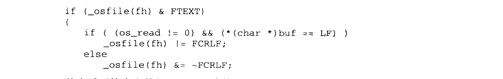

<details markdown="1"><summary>复制校对文字（未运行验证）</summary>

```text
if (_osfile(fh) & FTEXT)
{
    if ((os_read != 0) && (*(char *)buf == LF))
        _osfile(fh) |= FCRLF;
    else
        _osfile(fh) &= ~FCRLF;
```

</details>

首先需要检查文件是否是以文本模式打开，如果不是，就什么也不需要处理。\_osfile是一个宏，用于访问一个句柄对应的ioinfo 对象的 osfile 字段（还记得IO初始化时的 osfile吗？）。当本次读文件读到的第一个字符是一个 LF（`\n`）时，需要在该句柄的 osfile 字段中加入 FCRLF 标记，表明一个 `\r\n` 可能跨过了两次读文件。这个标记在一些特殊场合下会有作用（例如 ftell 函数）。

接下来要进行实际的转换，转换需要经历一个循环：


<details markdown="1"><summary>复制校对文字（未运行验证）</summary>

```text
p = q = buf;
while (p < (char *)buf + bytes_read)
{
    处理 p 当前指向的字符
    p 和 q 后移
}
```

</details>

p 和 q 一开始指向读取的数据数组的开头，在每一次循环里，进行如下的判断和操作：

（1）`*p` 是 CTRL-Z：表明文本已经结束，退出循环。

（2）`*p` 是 CR（`\r`）之外的字符：把 p 指向的字符复制到 q 指向的位置，p 和 q 各自后移一个字节（`*q++ = *p++`）。

（3）`*p` 是 CR（`\r`）且 `*(p+1)` 不是 LF（`\n`）：同（2）。

（4）`*p` 是 CR（`\r`）且 `*(p+1)` 是 LF（`\n`）：p 后移 2 个字节，将 q 指向的位置写为 LF（`\n`），q 后移一个字节（`p += 2; *q++ = '\n';`）。

p 和 q 一开始始终指向相同的位置，因此情况（2）里的复制实际没有作用，直到 p 遇到一个 `\r\n`。此时的动作如图11-14所示（以字符串 `a\r\nb` 为例）。

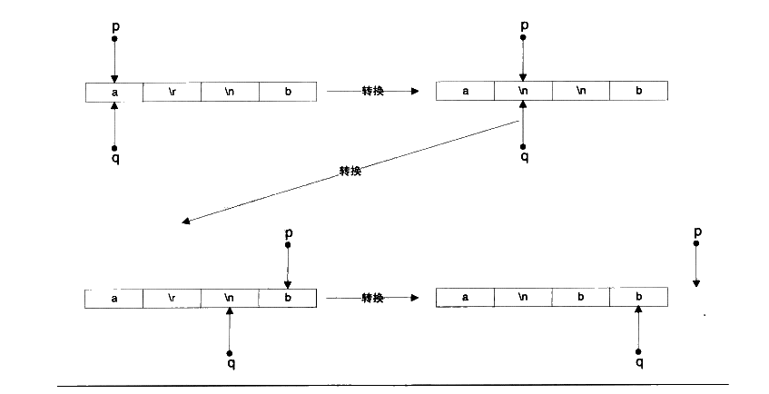

<p class="image-caption">图11-14 换行符转换</p>

<details markdown="1"><summary>查看图中文字（按图分组）</summary>

转换过程：p 遍历原数据 `a\r\nb`，q 写入转换后的 `a\nb`。遇到 CR/LF 时 p 前进两个字符、q 写入一个 LF；其余字符直接复制。

</details>

此时 q-buf 可得到处理过后的读取字符数。

最后还有一个问题：如果在缓冲的末尾发现了一个CR该怎么办？此时我们无法知道下一个字符是否是 LF，所以无法决定是否应该丢弃这个 CR 字符。这时唯一的办法就是再从文件里读取1个字节，检查它是否是 LF：然后再用 fseek 函数（或具有相同功能的其他函数）把文件指针重新向前移动一个字节。这段操作的伪代码如下：

从文件读1个字节，

如果没有读取成功，那么直接存储CR 字符并返回，

如果成功读取了1个字节，那么要考虑下列几种情况：

（1）磁盘文件，且字符不是 LF：直接存储CR 字符，用 seek 函数回退文件指针1个字节；

（2）磁盘文件，且字符是LF：丢弃CR 字符存储LF 字符；

（3）管道或设备文件，且字符是LF： 丢弃CR 字符存储LF 字符；

（4）管道或设备文件，且字符不是LF：存储CR字符，并把LF 字节存储在句柄的管道的单字节缓冲（pipech）里。

可以看到在第4种情况里使用了 pipech。在之前的部分中我们已经知道这是一个为管道和设备提供的单字节缓冲。由于管道和设备文件不能够使用 seek 函数回退文件指针，因此一旦读取了多余的一个字符，就必须使用这样的缓冲。由于此处对 pipech 的赋值将字符LF排除在外，同时此处的赋值是唯一的对 pipech 有意义的赋值，因此 pipech 的值永远不会是LF。那么将LF 赋值为LF 就可以表明该缓冲为空。下面是完整的转换过程代码：


<details markdown="1"><summary>复制校对文字（未运行验证）</summary>

```text
p = q = buf;
while (p < (char *)buf + bytes_read) {
    if (*p == CTRLZ) {
```

</details>


<details markdown="1"><summary>复制校对文字（未运行验证）</summary>

```text
/* 遇到文本结束符，退出 */
    if (!(_osfile(fh) & FDEV))
        _osfile(fh) |= FEOFLAG;
    break;
}
else if (*p != CR) /* 没有遇到 CR，直接复制 */
    *q++ = *p++;
else {
    if (p < (char *)buf + bytes_read - 1) {
```

</details>


<details markdown="1"><summary>复制校对文字（未运行验证）</summary>

```text
if (*(p+1) == LF) {
    p += 2;
    *q++ = LF;
}
```

</details>


<details markdown="1"><summary>复制校对文字（未运行验证）</summary>

```text
else
        *q++ = *p++;
}
else {
```

</details>

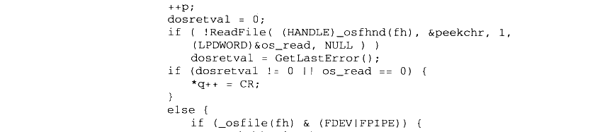

<details markdown="1"><summary>复制校对文字（未运行验证）</summary>

```text
++p;
dosretval = 0;
if (!ReadFile((HANDLE)_osfhnd(fh), &peekchr, 1,
              (LPDWORD)&os_read, NULL))
    dosretval = GetLastError();
if (dosretval != 0 || os_read == 0) {
    *q++ = CR;
}
else {
    if (_osfile(fh) & (FDEV|FPIPE)) {
```

</details>


<details markdown="1"><summary>复制校对文字（未运行验证）</summary>

```text
if (peekchr == LF)
    *q++ = LF;
else {
```

</details>


<details markdown="1"><summary>复制校对文字（未运行验证）</summary>

```text
/* 使用 pipech 存储字符 */
        *q++ = CR;
        _pipech(fh) = peekchr;
    }
}
else {
    /* 普通文件 */
```

</details>


<details markdown="1"><summary>复制校对文字（未运行验证）</summary>

```text
if (q == buf && peekchr == LF) {
    *q++ = LF;
}
else {
```

</details>

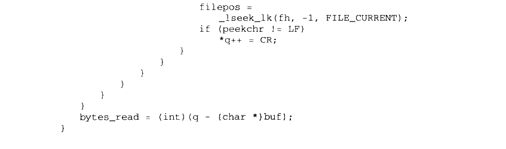

<details markdown="1"><summary>复制校对文字（未运行验证）</summary>

```text
filepos = _lseek_lk(fh, -1, FILE_CURRENT);
                    if (peekchr != LF)
                        *q++ = CR;
                }
            }
        }
    }
}
}
bytes_read = (int)(q - (char *)buf);
}
```

</details>

### 11.5.6 fread 回顾

如果读者能够一口气把fread 的实现看完，我们对您表示十分的钦佩，因为它里面涉及诸多的细节让人无法做到一览无余。我们在这里把这些细节略去，在此做个总结性的回顾。当用户调用 CRT 的fread 时，它到 ReadFile 的调用轨迹如图11-15所示。

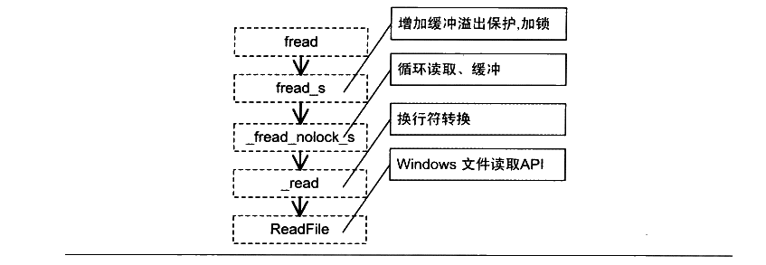

<p class="image-caption">图 11-15 ReadFile 调用轨迹</p>

<details markdown="1"><summary>查看图中文字（按图分组）</summary>

调用链：fread → fread_s → _fread_nolock_s → _read → ReadFile。fread_s 增加缓冲溢出保护和加锁；_fread_nolock_s 循环读取并管理缓冲；_read 转换换行符；ReadFile 是 Windows 文件读取 API。

</details>

在这个轨迹中，\_fread\_nolock\_s的实现是最复杂的，因为它涉及缓冲区的操作，它也是读取文件的主要部分，如果我们使用fread 读取一小块数据，有可能在\_fread\_nolock\_s 的时候发现所有所需要的数据都在缓冲中，就不需要通过\_read 和 ReadFile 向操作系统读取文件了，而是直接从缓冲区复制数据并返回，这样就减少了系统调用的开销。
