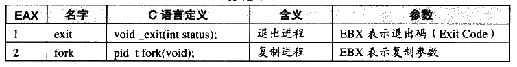
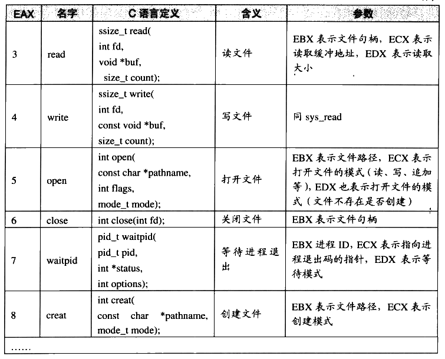
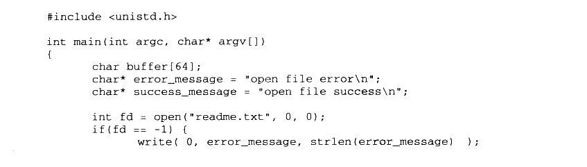
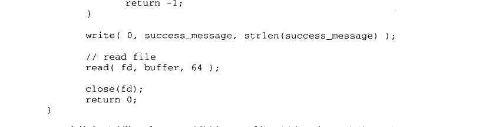

# 12.1 系统调用介绍

### 12.1.1 什么是系统调用

在现代的操作系统里，程序运行的时候，本身是没有权利访问多少系统资源的。由于系统有限的资源有可能被多个不同的应用程序同时访问，因此，如果不加以保护，那么各个应用程序难免产生冲突。所以现代操作系统都将可能产生冲突的系统资源给保护起来，阻止应用程序直接访问。这些系统资源包括文件、网络、IO、各种设备等。举个例子，无论在 Windows下还是 Linux 下，程序员都没有机会擅自去访问硬盘的某扇区上面的数据，而必须通过文件系统；也不能擅自修改任意文件，所有的这些操作都必须经由操作系统所规定的方式来进行，比如我们使用fopen 去打开一个没有权限的文件就会发生失败。

此外，有一些行为，应用程序不借助操作系统是无法办到或不能有效地办到的。例如，如果我们要让程序等待一段时间，不借助操作系统的唯一办法就是使用这样的代码：


<details markdown="1"><summary>复制校对文字（未运行验证）</summary>

```text
int i;
for (i = 0; i < 1000000; ++i);
```

</details>

这样实现等待的确可以勉强达到目的，但是在等待的时候会白白地消耗CPU时间，造成系统资源的浪费，最大的问题是，它将随着计算机性能的变化而耗费不同的时间，比如在100MHz的CPU中，这段代码需要耗费1秒，而在1000MHz的CPU中，可能只需要0.1秒，因此用这段代码来实现定时并不是好办法。使用操作系统提供的定时器将会更加方便并且有效，因为在任何硬件上，代码执行的效果是一样的。

用现代的机器玩某些古老 DOS 游戏的时候是否会觉得游戏进行得太快？©可见，没有操作系统的帮助，应用程序的执行可谓寸步难行。为了让应用程序有能力访问系统资源，也为了让程序借助操作系统做一些必须由操作系统支持的行为，每个操作系统都会提供一套接口，以供应用程序使用。这些接口往往通过中断来实现，比如 Linux 使用0x80号中断作为系统调用的入口，Windows 采用0x2E 号中断作为系统调用入口。

系统调用涵盖的功能很广，有程序运行所必需的支持，例如创建/退出进程和线程、进程内存管理，也有对系统资源的访问，例如文件、网络、进程间通信、硬件设备的访问，也可能有对图形界面的操作支持，例如 Windows 下的GUI 机制。

系统调用既然作为一个接口，而且是非常重要的接口，它的定义将十分重要。因为所有的应用程序都依赖于系统调用，那么，首先系统调用必须有明确的定义，即每个调用的含义、参数、行为都需要有严格而清晰的定义，这样应用程序（运行库）才可以正确地使用它：其次它必须保持稳定和向后兼容，如果某次系统更新导致系统调用接口发生改变，新的系统调用接口与之前版本完全不同，这是无法想象的，因为所有之前能正常运行的程序都将无法使用。所以操作系统的系统调用往往从一开始定义后就基本不做改变，而仅仅是增加新的调用接口，以保持向后兼容。

不过对于 Windows 来讲，系统调用实际上不是它与应用程序的最终接口，而是 API，所以上面这段对系统调用的描述同样适用于 Windows API，我们也暂时可以把API 与系统调用等同起来。事实上 Windows 系统从 Windows 1.0以来到最新的 Windows Vista，这数十年间API 的数量从最初1.0时的450个增加到了现在的数千个，但是很少对已有的API进行改变。因为 API一旦改变，很多应用程序将无法正常运行。

### 12.1.2 Linux 系统调用

下面让我们来看看Linux 系统调用的定义，以有一个比较直观的概念。在x86下，系统调用由0x80中断完成，各个通用寄存器用于传递参数，EAX 寄存器用于表示系统调用的接口号，比如 EAX=1表示退出进程（exit）：EAX=2表示创建进程（fork）；EAX=3表示读取文件或 I/O （read）：EAX =4表示写文件或 I/O（write）等，每个系统调用都对应于内核源代码中的一个函数，它们都是以 “sys\_”开头的，比如 exit 调用对应内核中的sys\_exit 函数。

当系统调用返回时，EAX 又作为调用结果的返回值。

Linux 内核版本2.6.19总共提供了319个系统调用，我们将其中一部分列在表12-1中。

表12-1



<details markdown="1"><summary>查看校对表格</summary>

| EAX | 名字 | C 语言定义 | 含义 | 参数 |
| --- | --- | --- | --- | --- |
| 1 | exit | `void _exit(int status);` | 退出进程 | EBX 表示退出码（Exit Code） |
| 2 | fork | `pid_t fork(void);` | 复制进程 | EBX 表示复制参数 |

</details>

续表



<details markdown="1"><summary>查看校对表格</summary>

| EAX | 名字 | C 语言定义 | 含义 | 参数 |
| --- | --- | --- | --- | --- |
| 3 | read | `ssize_t read(int fd, void *buf, size_t count);` | 读文件 | EBX：文件句柄；ECX：读取缓冲地址；EDX：读取大小 |
| 4 | write | `ssize_t write(int fd, const void *buf, size_t count);` | 写文件 | 同 sys_read |
| 5 | open | `int open(const char *pathname, int flags, mode_t mode);` | 打开文件 | EBX：路径；ECX：读、写、追加等模式；EDX：文件创建模式 |
| 6 | close | `int close(int fd);` | 关闭文件 | EBX：文件句柄 |
| 7 | waitpid | `pid_t waitpid(pid_t pid, int *status, int options);` | 等待进程退出 | EBX：进程 ID；ECX：退出码指针；EDX：等待模式 |
| 8 | creat | `int creat(const char *pathname, mode_t mode);` | 创建文件 | EBX：路径；ECX：创建模式 |

</details>

我们没有必要一一列举这个 Linux 版本的300 多个系统调用，未列举的包括权限管理（sys\_setuid 等）、定时器（sys\_timer\_create）、信号（sys\_sigaction）、网络（sys\_epoll）等。这些系统调用都可以在程序里直接使用，它的C语言形式被定义在“/usr/include/unistd.h”中，比如我们完全可以绕过 glibc 的 fopen、fread、fclose 打开读取和关闭文件，而直接使用open（、read（）和 close()来实现文件的读取，使用 write 向屏幕输出字符串（标准输出的文件旬柄为0）：



<details markdown="1"><summary>复制校对文字（未运行验证）</summary>

```text
#include <unistd.h>
int main(int argc, char* argv[])
{
    char buffer[64];
    char* error_message = "open file error\n";
    char* success_message = "open file success\n";
    int fd = open("readme.txt", 0, 0);
    if (fd == -1) {
        write(0, error_message, strlen(error_message));
```

</details>



<details markdown="1"><summary>复制校对文字（未运行验证）</summary>

```text
return -1;
    }
    write(0, success_message, strlen(success_message));
    // read file
    read(fd, buffer, 64);
    close(fd);
    return 0;
}
```

</details>

当然也可以举一反三，可以使用 read 系统调用实现读取用户输入（标准输入的文件句柄为1）。不过由于绕过了 glibc 的文件读取机制，所以所有位于 glibc 中的缓冲、按行读取文本文件等这些机制都没有了，读取的就是文件的原始数据。当然很多时候我们希望获得更高的文件读写性能，直接绕过 glibc 使用系统调用也是一个比较好的办法。

我们也可以使用 Linux 的 man 命令察看每个系统调用的详细说明，比如察看 read （man参数2表示系统调用手册）：

```sh
$ man 2 read
```

### 12.1.3 系统调用的弊端

系统调用完成了应用程序和内核交流的工作，因此理论上只需要系统调用就可以完成一些程序，但是：

理论上，理论总是成立的。

事实上，包括Linux，大部分操作系统的系统调用都有两个特点：

- 使用不便。操作系统提供的系统调用接口往往过于原始，程序员须要了解很多与操作系统相关的细节。如果没有进行很好的包装，使用起来不方便。

- 各个操作系统之间系统调用不兼容。首先 Windows 系统和 Linux 系统之间的系统调用就基本上完全不同，虽然它们的内容很多都一样，但是定义和实现大不一样。即使是同系列的操作系统的系统调用都不一样，比如 Linux和 UNIX就不相同。

为了解决这个问题，第1章中的“万能法则”又可以发挥它的作用了。“解决计算机的问题可以通过增加层来实现”，于是运行库挺身而出，它作为系统调用与程序之间的一个抽象层可以保持着这样的特点：

- 使用简便。因为运行库本身就是语言级别的，它一般都设计相对比较友好。

- 形式统一。运行库有它的标准，叫做标准库，凡是所有遵循这个标准的运行库理论上都是相互兼容的，不会随着操作系统或编译器的变化而变化。

这样，当我们使用运行库提供的接口写程序时，就不会面临这些问题，至少是可以很大程度上掩盖直接使用系统调用的弊端。

例如C语言里的fread，用于读取文件，在Windows 下这个函数的实现可能是调用ReadFile 这个 API，而如果在Linux 下，则很可能调用了 read 这个系统调用。但不管在哪个平台，我们都可以使用C语言运行库的fread 来读文件。

运行时库将不同的操作系统的系统调用包装为统一固定的接口，使得同样的代码，在不同的操作系统下都可以直接编译，并产生一致的效果。这就是源代码级上的可移植性。

但是运行库也有运行库的缺陷，比如C 语言的运行库为了保证多个平台之间能够相互通用，于是它只能取各个平台之间功能的交集。比如 Windows 和 Linux 都支持文件读写，那么运行库就可以有文件读写的功能；但是Windows 原生支持图形和用户交互系统，而Linux却不是原生支持的（通过XWindows），那么CRT 就只能把这部分功能省去。因此，一旦程序用到了那些 CRT 之外的接口，程序就很难保持各个平台之间的兼容性了。
