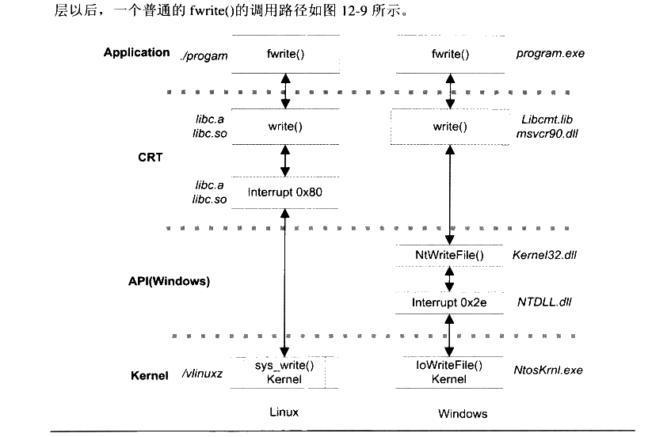
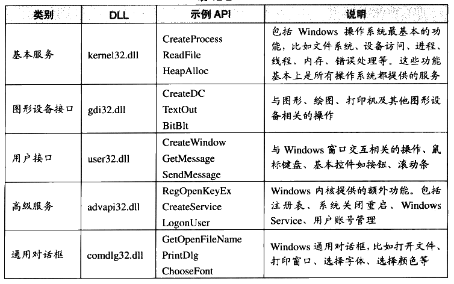
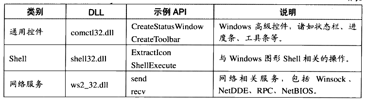
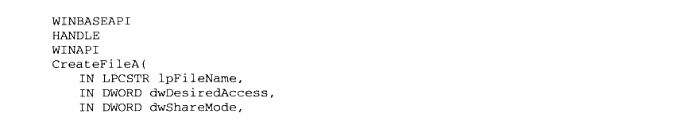
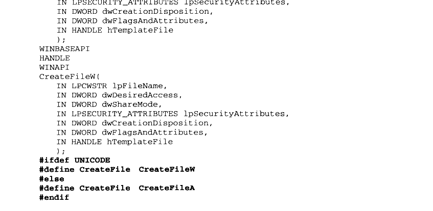
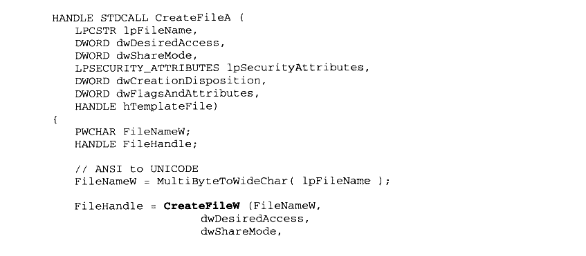
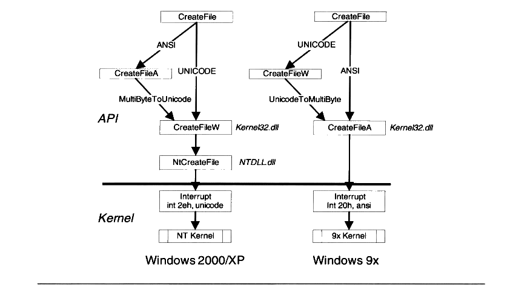

# 12.3 Windows API

API 的全称为 Application Programming Interface，即应用程序编程接口。因此 API 不是一个专门的事物，而是一系列事物的总称。但是我们通常在Windows 下提到API 时，一般就是指 Windows 系统提供给应用程序的接口，即 Windows API。

Windows API 是指 Windows 操作系统提供给应用程序开发者的最底层的、最直接与Windows 打交道的接口。在Windows 操作系统下，CRT 是建立在 Windows API 之上的。另外还有很多对 Windows API 的各种包装库，MFC就是很著名的一种以 C++形式封装的库。

很多操作系统是以系统调用作为应用程序最底层的，而 Windows 的最底层接口是Windows API。Windows API 是 Windows 编程的基础，尽管 Windows 的内核提供了数百个系统调用（Windows 又把系统调用称作系统服务（System Service）），但是出于种种原因，微软并没有将这些系统调用公开，而在这些系统调用之上，建立了这样一个 API 层，让程序员只能调用 API 层的函数，而不是如 Linux一般直接使用系统调用。Windows 在加入 API 层以后，一个普通的 fwrite() 的调用路径如图12-9所示。



<p class="image-caption">图 12-9 Linux 和 Windows 的 fwrite 路径</p>

<details markdown="1"><summary>查看图中文字（按图分组）</summary>

Linux：应用 fwrite() → CRT write() → Interrupt 0x80 → 内核 sys_write()。Windows：应用 fwrite() → CRT write() → Windows API 层 → 内核。图中 Windows 一侧标有 Libcmt.lib/msvcr90.dll、Kernel32.dll、NTDLL.dll、Interrupt 0x2e、IoWriteFile()、NtosKrnl.exe。

</details>

### 12.3.1 Windows API 概览

Windows API 是以DLL 导出函数的形式暴露给应用程序开发者的。它被包含在诸多的系统 DLL 内，规模上非常庞大，所有的导出函数大约有数千个（以Windows XP 为例）。微软把这些 Windows API DLL 导出函数的声明的头文件、导出库、相关文件和工具一起提供给开发者，并让它们成为 Software Development Kit （SDK）。

SDK 可以单独地在微软的官方网站下载，也可能被集成到 Visual Studio 这样的开发工具中。当我们安装了 Visual Studio 后，可以在SDK 的安装目录下找到所有的 Windows API函数声明。其中有一个头文件“Windows.h” 包含了 Windows API 的核心部分，只要我们在程序里面包含了它，就可以使用 Windows API 的核心部分了。

Windows API 版本

Windows API 随着Windows 版本的升级也经历了好几个版本，每次 Windows 进行大升级的时候，也会引入新版本的API。最早期的Windows API 是 Win16，即16位Windows（Windows 3.x 系列）所提供的 API, Win16 的核心部分是由3个16位DLL提供的：kernel.exe（或 kernel286.exe 或 kernel386.exe ）、user.exe 和 gdi.exe（虽然扩展名是 exe，但实际上它们有导出函数，再说 DLL 和 EXE 其实就是一回事嘛）。

伴随32位 Windows 的API是Win32，它主要有3个核心 DLL:kernel32.dll、user32.dll和 gdi32.dll。 Windows 3.x为了支持一部分 Win32 程序，还提供了一个 Win32的子集叫做 Win32s（s为 Subset，即子集）。

64位的 Windows 提供了兼容 Win32 的 API，被称为 Win64。Win64 与 Win32 没有增加接口的数量，只是所有的指针类型都改成了64位。

因为 Win32 是使用最广泛也是最成熟的 Windows API 版本，下文中如果我们不额外注明，则默认为Win32。

Windows API 现在的数量已经十分庞大，它们按照功能被划分成了几大类别，如表12-2所示。

表 12-2



<details markdown="1"><summary>查看校对表格</summary>

| 类别 | DLL | 示例 API | 说明 |
| --- | --- | --- | --- |
| 基本服务 | kernel32.dll | CreateProcess、ReadFile、HeapAlloc | 文件系统、设备访问、进程、线程、内存、错误处理等基本功能 |
| 图形设备接口 | gdi32.dll | CreateDC、TextOut、BitBlt | 图形、绘图、打印机及其他图形设备操作 |
| 用户接口 | user32.dll | CreateWindow、GetMessage、SendMessage | 窗口交互、鼠标键盘、按钮和滚动条等控件 |
| 高级服务 | advapi32.dll | RegOpenKeyEx、CreateService、LogonUser | 注册表、系统关闭重启、Windows Service、用户账号管理 |
| 通用对话框 | comdlg32.dll | GetOpenFileName、PrintDlg、ChooseFont | 打开文件、打印窗口、选择字体及颜色等对话框 |

</details>

续表



<details markdown="1"><summary>查看校对表格</summary>

| 类别 | DLL | 示例 API | 说明 |
| --- | --- | --- | --- |
| 通用控件 | comctl32.dll | CreateStatusWindow、CreateToolbar | 状态栏、进度条、工具条等高级控件 |
| Shell | shell32.dll | ExtractIcon、ShellExecute | Windows 图形 Shell 操作 |
| 网络服务 | ws2_32.dll | send、recv | Winsock、NetDDE、RPC、NetBIOS 等网络服务 |

</details>

我们可以在 MSDN 里找到每一个 API 的文档，很多 API 还可以找到使用示例，因此MSDN 是学习 Win32 API 极佳的工具。

表12-2 中所列的 Kernel32.dll 和 User32.dll 等 DLL 在不同的 Windows 平台上的实现都不一样，虽然它们暴露给应用程序的接口是一样的。在 Windows NT 系列的平台上，这些DLL 在实现上都会依赖于一个更为底层的 DLL 叫做 NTDLL.DLL，然后由 NTDLL.DLL 进行系统调用。NTDLL.DLL 把 Windows NT 内核的系统调用包装了起来，它实际上是 Windows系统用户层面的最底层，所有的 DLL 都是通过调用 NTDLL.DLL，由它进行系统调用的。NTDLL.DLL 的导出函数对于应用程序开发者是不公开的，原则上应用程序不应该直接使用NTDLL.DLL 中的任何导出函数。我们可以根据 dumpbin 等工具来察看它的导出函数，比如Windows XP 的NTDLL.dll大约有1300个导出函数。它所导出的函数大多都以“Nt”开头，并提供给那些 API DLL 使用以实现系统功能，比如创建进程的函数叫做 NtCreateProcess，位于 Kernel32.dll 的 CreateProcess 这个 API 就是通过 NtCreateProcess 实现的。

由于 Windows API 所提供的接口还是相对比较原始的，比如它所提供的网络相关的接口仅仅是socket级别的操作，如果用户要通过API 访问HTTP 资源，还需要自己实现HTTP协议，所以直接使用 API进行程序开发往往效率较低。Windows 系统在API 之上建立了很多应用模块，这些应用模块是对 Windows API 的功能的扩展，比如对 HTTP/FTP 等协议进行包装的 Internet 模块（wininet.dll）对 WinSocketAPI进行了扩展，这样程序开发者就可以通过Internet 模块直接访问 HTTP/FTP 资源，而不需要自己实现一套HTTP/FTP 协议。除了wininet.dll 之外，Windows 还有许多类似的对 Windows API 的包装模块，比如 OPENGL模块、ODBC（统一的数据库接口）、WIA（数字图像设备接口）等。

### 12.3.2 为什么要使用 Windows API

能省一事则省一事，微软为什么放着好好的系统调用不用，又要在 CRT 和系统调用之间增加一层 Windows API 层呢？

微软不公开系统调用而决定使用 Windows API 作程序接口的原因也很简单，其实还是第1章里的“要解决问题就加层的万能法则”。Windows 作为一个成功的商业操作系统，它对应用程序的向后兼容性可以说是非常好，这一点从 Windows XP 等这种较新的Windows版本还仍然支持20多年前的 DOS 程序/Windows 3.1/Windows 95 的程序可以看出来。虽然它没有完全做到向后兼容，但是我们看得出 Windows 系统为向后兼容所付出的努力及Windows 系统为此所背负的历史包袱。

系统调用实际上是非常依赖于硬件结构的一种接口，它受到硬件的严格限制，比如寄存器的数量、调用时的参数传递、中断号、堆栈切换等，都与硬件密切相关。如果硬件结构稍微发生改变，大量的应用程序可能就会出现问题（特别是那些与CRT静态链接在一起的）。那么直接使用系统调用作为程序接口的系统，它的应用程序在不同硬件平台间的兼容性也是存在较大问题的。

硬件结构发生改变虽然较少见，可能几年甚至十几年才会发生一次，比如16位 CPU升级至32位，32位升级至 64位，或者由 Sysenter/Sysexit 代替中断等，但是一旦发生改变，所付出的代价无疑是惊人的。

为了尽量隔离硬件结构的不同而导致的程序兼容性问题，Windows 系统把系统调用包装了起来，使用 DLL 导出函数作为应用程序的唯一可用的接口暴露给用户。这样可以让内核随版本自由地改变系统调用接口，只要让 API 层不改变，用户程序就可以完全无碍地运行在新的系统上。

除了隔离硬件结构不同之外，Windows 本身也有可能使用不同版本的内核，比如微软在Windows 2000之前要同时维护两条Windows 产品线：Windows 9x和 Windows NT 系列。它们使用的是完全不同的 Windows 内核，所以系统调用的接口自然也是不一样的。如果应用程序都是直接使用系统调用，那么后来 Windows 9x 和 Windows NT 这两条产品线合并成Windows 2000 的时候估计不会像现在这么顺利。

Windows API 以 DLL 导出函数的形式存在也自然是水到渠成，我们知道 DLL 作为Windows 系统的最基本的模块组织形式，它有着良好的接口定义和灵活的组合方式。DLL基本上是 Windows 系统上很多高级接口和程序设计方法的基石，包括内核与驱动程序、COM、OLE、Activex 等都是基于 DLL 技术的。

银弹

很多时候人们把这种通过在软件体系结构中增加层以解决兼容性问题的做法又叫做“银弹”。古老相传，只有银弹（silver bullet）才能杀死巫师、巨人、有魔力的动物，譬如狼人。在现代软件工程的巨著《人月神话》中，作者把规模越来越大的软件开发项目比作无法控制的怪物，希望有一样技术，能够像银弹彻底杀死狼人那样，彻底解决这个问题。因而现在计算机界中的银弹，指的就是能够迅速解决各种问题的“万灵药”。当某个软件某个层面要发生变化，却要保持与之相关联的另一方面不变时，加一个中间层即可。Windows API 层就是这样的一个“银弹”。

Windows API 的实例

我们知道 Windows NT 系列与 Windows 9x 系列是两个内核完全不同的操作系统，它们分别属于两个不同的 Windows 产品线，前者的目的主要为商业应用，它的内核以稳定高效著称：而后者是以家庭和多媒体应用为目标，注重体系应用程序的兼容性（支持 DOS 程序）和多媒体功能。

当 Windows 版本升级至2000时，微软计划停止 Windows 9x 系列产品，而将 Windows统一建立在较可靠的 NT 内核之上。这时候两条产品线将合并成同一个 Windows 版本，即Windows 2000。Windows 2000就必须承担起能够同时兼容 Windows 9x 和之前 Windows NT的应用程序的任务。由于 Windows 2000使用的是 NT 的内核（内核版本5.0），所以要做到兼容之前的 Windows NT （NT 4.0 及之前）的应用程序应该不是很成问题的。但是要兼容Windows 9x则不是一件容易的事，因它的内核与 NT 完全不同，它们各自使用的中断号都不一样，NT 内核使用的是INT 0x2E，而9x内核则使用 INT 0x20，所以，如果某个9x的应用程序一旦使用了任何系统调用，那么它就无法在 Windows 2000 下运行。

除了它们的内核中断号不同以外，即使同一个接口，有可能参数也不同。

Windows 9x 系统的内核是并不原生支持 unicode 的，因此它的系统调用涉及的字符串都是ANSI 字符串，即参数都是使用char\*作为类型，比如与 CreateFile 这个 API 相对应的系统调用要传入一个文件名，那么这个字符串在最终传递给内核时应该是一个 ANSI 字符串。而 Windows NT 内核是原生支持 unicode 的，所有的系统调用涉及的字符串相关的参数都是unicode 字符串，即参数是wchar\_t\*类型的（wchar\_t是一种双字节的字符类型）。那么同样的系统调用，所需要的字符串类型却不一样，这也会造成程序兼容性的问题。

幸运的是，Windows API 层阻止了这样的事情发生。大家如果留意的话，会注意到Windows 下所有有字符串作为参数的API都会有两个版本，一个是 ANSI 字符串版本，另外一个是 unicode 字符串版本。例如，与 Windows API 的 CreateFile 相对应的两个版本分别为 CreateFileA 和 CreateFileW， “A” 表示 ANSI版，“W”表示宽字符（Wide character），即unicode 版，kernel32.dll 实际上导出了这两个函数，而 CreateFile 仅仅是一个宏定义。下面的代码摘自 Windows SDK 的“winbase.h”：



<details markdown="1"><summary>复制校对文字（未运行验证）</summary>

```text
WINBASEAPI
HANDLE
WINAPI
CreateFileA(
    IN LPCSTR lpFileName,
    IN DWORD dwDesiredAccess,
    IN DWORD dwShareMode,
```

</details>



<details markdown="1"><summary>复制校对文字（未运行验证）</summary>

```text
IN LPSECURITY_ATTRIBUTES lpSecurityAttributes,
    IN DWORD dwCreationDisposition,
    IN DWORD dwFlagsAndAttributes,
    IN HANDLE hTemplateFile
);
WINBASEAPI
HANDLE
WINAPI
CreateFileW(
    IN LPCWSTR lpFileName,
    IN DWORD dwDesiredAccess,
    IN DWORD dwShareMode,
    IN LPSECURITY_ATTRIBUTES lpSecurityAttributes,
    IN DWORD dwCreationDisposition,
    IN DWORD dwFlagsAndAttributes,
    IN HANDLE hTemplateFile
);
#ifdef UNICODE
#define CreateFile CreateFileW
#else
#define CreateFile CreateFileA
#endif
```

</details>

可见根据编译的时候是否定义 UNICODE这个宏，CreateFile 会被展开为 CreateFileW 或CreateFileA，而这两个函数唯一的区别就是第一个参数 lpFileName 的类型不同，分别为LPCWSTR 和 LPCSTR，即 const wchar\_t\*和const char\*。CreateFileA/CreateFileW 这个 API才是真正的 Windows API 导出函数，它们在不同的操作系统版本上实现会有所不同。

例如在 Windows 2000 下，由于 NT 内核只支持 unicode 版的系统调用，所以 CreateFileW的实现是最直接的，它只要直接调用内核即可。而 CreateFileA 则在实现上需要把第一个参数从 ANSI 字符串转换成 unicode 字符串（Windows 提供了 MultiByteToWideChar 这样的 API用于转换不同编码的字符串），然后再调用 CreateFileW。Windows 2000的 kernel32.dll 中的CreateFileA 的实现大概如下面的代码所示：



<details markdown="1"><summary>复制校对文字（未运行验证）</summary>

```text
HANDLE STDCALL CreateFileA(
    LPCSTR lpFileName,
    DWORD dwDesiredAccess,
    DWORD dwShareMode,
    LPSECURITY_ATTRIBUTES lpSecurityAttributes,
    DWORD dwCreationDisposition,
    DWORD dwFlagsAndAttributes,
    HANDLE hTemplateFile)
{
    PWCHAR FileNameW;
    HANDLE FileHandle;
    // ANSI to UNICODE
    FileNameW = MultiByteToWideChar(lpFileName);
    FileHandle = CreateFileW(FileNameW,
        dwDesiredAccess,
        dwShareMode,
```

</details>


<details markdown="1"><summary>复制校对文字（未运行验证）</summary>

```text
lpSecurityAttributes,
        dwCreationDisposition,
        dwFlagsAndAttributes,
        hTemplateFile);
    return FileHandle;
}
```

</details>

对上面的代码我们进行了简化，但是它表达的思想与实际的实现是一致的。可以想象，在 Windows 9x的kernel32.dll 所进行的恰恰是相反的步骤，CreateFileW 函数中的宽字符串通过 WideCharToMultiByte（）被转换成了 ANSI 字符串，然后调用 CreateFileA。API 层在这一过程中所扮演的角色可以如图12-10所示。



<p class="image-caption">图 12-10 Windows NT 和Windows 9x的API 层次结构对比</p>

<details markdown="1"><summary>查看图中文字（按图分组）</summary>

Windows 2000/XP：CreateFileA 将 ANSI 转为 Unicode 后调用 CreateFileW，再经 NtCreateFile、NTDLL.dll、int 2eh 进入 NT Kernel。Windows 9x：CreateFileW 将 Unicode 转为 ANSI 后调用 CreateFileA，再经 int 20h 进入 9x Kernel。

</details>

所以不管内核如何改变接口，只要维持 API层面的接口不变，理论上所有的应用程序都不用重新编译就可以正常运行，这也是 Windows API 存在的主要原因。

### 12.3.3 API 与子系统

作为一个商业操作系统，应用程序兼容性是评价操作系统是否有竞争力最重要的指标之一。一方面从用户的角度看，如果一个商业操作系统只能运行数量很少的应用程序，是不会有人使用的：从应用程序的开发者角度看，他们投入了巨大的精力在应用程序上，如果操作系统不支持这些应用程序，无疑会使开发者的努力白费。微软最初在开发 Windows NT 的时候除了考虑向后兼容性之外（兼容其他版本 Windows），它还考虑到了兼容 Windows 之外的操作系统。

为了操作系统的兼容性，微软试图让 Windows NT 能够支持其他操作系统上的应用程序。在设计 Windows NT 的时候，与它同一时期的操作系统有各种 UNIX（posix 标准）、IBM的OS/2、微软自家的 DOS 和Windows 3.x 等。于是 Windows NT 提出子系统（Subsystem）的概念，希望提供各种操作系统的执行环境，以兼容它们的应用程序。

子系统又称为 Windows 环境子系统（Environment Subsystem），简称子系统（Subsystem）。我们知道，原生的 Windows 程序是通过 CreateProcess 这个 API 来创建进程的，而UNIX 的程序则是通过fork()来创建的，子系统就是这样一个中间层，它使用 Windows的API 来模拟 fork()这样的系统调用，使得应用程序看起来与 UNIX没有区别。

子系统实际上又是 Windows 架设在 API 和应用程序之间的另一个中间层。前面讲到 API这个中间层是为了防止内核系统调用层发生变化导致用户程序也必须随之变化而增加的，而子系统则是用来为各种不同平台的应用程序创建与它们兼容的运行环境。

当然，子系统要实现二进制级别的兼容性是十分困难的，于是它的目标就是源代码级别的兼容。也就是说每个子系统必须实现目标操作系统的所有接口，比如 Windows NT 要创建一个能够运行 UNIX 应用程序的子系统，它必须实现 UNIX 的所有系统调用在C语言源代码层面的接口。

在 Windows 里，最开始支持3种子系统：Win32 子系统、POSIX 子系统和 OS/2子系统，而 OS/2 子系统在 Windows 2000里已经被去除。DOS 程序和16位 Windows 程序也是通过类似于子系统的模式实现在32位Windows 下运行的。16 位的 Windows 程序运行在32位Windows 下被称为 WoW （Windows On Windows），这使我们联想到现在32位 Windows程序运行于64位的 Windows 操作系统，也是通过WoW 技术实现的。

和内核直接打交道的只有 Win32 子系统，其他的子系统如 Posix 子系统和 OS/2子系统都是直接将请求发送给 Win32 子系统处理。Win32 子系统在系统运行的时候始终是运行的，而其他的子系统则是在需要的时候才启动。

后来随着 Windows 的市场地位逐渐巩固，它对于兼容其他操作系统和早期的DOS/Windows 3.1及 Windows 9x的应用程序的需求已经极大地减弱，现在运行于 Windows系统上的应用软件基本上都是使用 Win32 子系统的程序，所以子系统的概念已经逐渐地被弱化，除了 Win32 子系统之外，其他的子系统基本上形同虚设。我们在本书中提及子系统这一概念，也仅仅是为了帮助读者了解一些背景，以便于在 Windows 系统下碰到相关内容时不至于困惑，但并不打算深入介绍它，因为 Windows 子系统在实际上已经被抛弃了。
