# 第 13 章 运行库实现

## 13.1 C 语言运行库

在开始实现 Mini CRT之前，首先要对它进行基本的规划。“麻雀虽小五脏俱全”，虽然Mini CRT很小，但它应该具备CRT的基本功能以及遵循几个基本设计原则，这些我们归结为如下几个方面：

- 首先 Mini CRT 应该以 ANSI C 的标准库为目标，尽量做到与其接口相一致。

- 具有自己的入口函数（mini\_crt\_entry）。

- 基本的进程相关操作（exit）。

- 支持堆操作（malloc、free）。

- 支持基本的文件操作（fopen、fread、fwrite、fclose、fseek）。

- 支持基本的字符串操作（strcpy、strlen、strcmp）。

- 支持格式化字符串和输出操作（printf、sprintf）。

- 支持 atexit() 函数。

最后，Mini CRT应该是跨平台的。我们计划让Mini CRT能够同时支持Windows 和Linux两个操作系统。

- Mini CRT 的实现应该尽量简单，以展示 CRT 的实现为目的，并不追求功能和性能，基本上是“点到为止”。

为了使CRT能够同时支持 Linux 和Windows 两个平台，必须针对这两个操作系统环境的不同进行条件编译。在Mini CRT 中，我们使用宏 WIN32 为标准来决定是 Windows 还是Linux。因此实际的代码常常呈现这样的结构：

```c
#ifdef WIN32
// Windows 部分实现代码
#else
// Linux 部分实现代码
#endif
```

在本章中，\#ifdef-\#else-\#endif 这个条件编译指令会加粗显示，以方便读者区分Windows 和 Linux 的代码。

通常我们会把CRT 的各个函数的声明放在不同的头文件中，比如 I/O 相关的位于stdio.h：字符串和堆相关的放在 stdlib.h中。为了简单起见，将 Mini CRT 中所有函数的声明都放在minicrt.h中。

#### 13.1.1 开始

那么 Mini CRT 首先该从哪儿入手呢？诚然，从入口函数开始入手应该是个不错的选择。在本书的第10章中，已对Glibc 和MSVC CRT 的入口函数进行了分析，下面我们再对入口函数相关的内容进行概括。

- 程序运行的最初入口点不是 main 函数，而是由运行库为其提供的入口函数。它主要负责三部分工作：准备好程序运行环境及初始化运行库，调用 main 函数执行程序主体，清理程序运行后的各种资源。

- 运行库为所有程序提供的入口函数应该相同，在链接程序时须要指定该入口函数名。

在本章节里，将为 Mini CRT编写自己的入口函数。为了保证运行库的兼容性，CRT 入口函数同样必须具有以上特性。

入口函数

首先，须要确定入口函数的函数原型，包括函数名、输入参数及返回值。在这里，入口函数命名为 mini\_crt\_entry。为了简单起见，它没有输入参数，同时没有返回值。其实mini\_crt\_entry的返回值没有意义，因为它永远不会返回，在它返回之前就会调用进程退出函数结束进程。这样，入口函数具有如下形式：

```c
void mini_crt_entry(void)
```

参照上面所描述的入口函数的三部分工作，以下代码为一个基本框架。


<details markdown="1"><summary>复制校对文字（未运行验证）</summary>

```text
void mini_crt_entry(void)
{
    // 初始化部分
    int ret = main();
    // 结束部分
```

</details>


<details markdown="1"><summary>复制校对文字（未运行验证）</summary>

```text
exit(ret);
}
```

</details>

这里的初始化主要负责准备好程序运行的环境，包括准备 main 函数的参数、初始化运行库，包括堆、I/O 等，结束部分主要负责清理程序运行资源。在以下内容中，围绕这个基本框架，我们将逐步扩展补充入口函数。

##### main 参数

我们知道 main 函数的原型为：

```c
int main(int argc, char* argv[]);
```

其中 argc和 argv 分别是 main函数的两个参数，它们分别表示运行程序时的参数个数和指向参数的字符串指针数组。在第6章中已经介绍过在 Linux 系统下，当进程被初始化时，它的堆栈结构中就保存着环境变量和传递给 main 函数的参数，我们可以通过ESP 寄存器获得这两个参数。但是一旦进入 mini\_crt\_entry 之后，ESP寄存器会随着函数的执行而被改变，通过第9章中关于函数对于堆栈帧的知识，可以知道EBP 的内容就是进入函数后ESP+4（4是因为函数第一条指令是push ebp）。那么可以推断出EBP-4所指向的内容应该就是 argc，而 EBP-8则就是 argv。整个堆栈的分布可以如图13-1 所示。


<p class="image-caption">图13-1 main 函数参数</p>

<details markdown="1"><summary>查看图中文字（按图分组）</summary>

进程栈从高地址到低地址为：0、argv[1]（0xBF801FDE）、argv[0]（0xBF801FD8）、argc（2）、保存的 EBP。进入 mini_crt_entry 前的 ESP 指向 argc。

</details>

对于Windows 系统来说，它提供了相应的 API 用于取得进程的命令行参数，这个API叫做 GetCommandLine，它会返回整个命令行参数字符串。由于 main 函数所需要的参数是命令行参数列表，所以我们将整个命令行字符串分割成若干个参数，以符合 argc 和 argv 的格式。在这里暂时不列出实现的代码，在章节的最后将列出这一节所实现的 Mini CRT 源代码。以后所有与 Mini CRT 实现相关的章节都遵循这一规则。

CRT 初始化

完成了获取 main 函数参数的代码后，还应该在入口函数里对 CRT 进行初始化。由于Mini CRT所实现的功能较少，所以初始化部分十分简单。需要初始化的主要是堆和 I/O 部分。在堆被初始化之前，malloc/free 函数是没有办法使用的。我们定义堆的初始化函数为mini\_crt\_heap\_init()： I/O 部分的初始化函数为 mini\_crt\_io\_init()。这两个函数的返回值都是整数类型的，返回非0即表示初始化成功，否则表示失败。这两个函数的实现将在后面介绍堆实现和IO实现时详细介绍。

结束部分

Mini CRT 结束部分很简单，它要完成两项任务：一个就是调用由 atexit（）注册的退出回调函数：另外一个就是实现结束进程。这两项任务都由exit()函数完成，这个函数在Linux 的实现已经在第4章中碰到过了，它调用 Linux的1号系统调用实现进程结束，ebx 表示进程退出码：而Windows 则提供了一个叫做 ExitProcess 的API，直接调用该 API即可结束进程。

不过在进行系统调用或 API 之前，exit()还有一个任务就是调用由atexit()注册的退出回调函数，这个任务通过调用 mini\_crt\_exit\_routine()实现。我们在第10 章中已经了解到，atexit（）注册回调函数的机制主要是用来实现全局对象的析构的，在这一节中暂时不打算让Mini CRT 支持C++，所以暂时将调用 mini\_crt\_exit\_routine（）这个函数的那行代码去掉。

最终 Mini CRT 的入口函数 mini\_crt\_entry 的代码如清单13-1所示。


<details markdown="1"><summary>复制校对文字（未运行验证）</summary>

```text
// entry.c
#include "minicrt.h"
#ifdef WIN32
#include <Windows.h>
#endif
extern int main(int argc, char* argv[]);
void exit(int);
static void crt_fatal_error(const char* msg)
{
    // printf("fatal error: %s", msg);
    exit(1);
}
void mini_crt_entry(void)
```

</details>


<details markdown="1"><summary>复制校对文字（未运行验证）</summary>

```text
{
    int ret;
#ifdef WIN32
    int flag = 0;
    int argc = 0;
    char* argv[16];
    char* cl = GetCommandLineA();
```

</details>


<details markdown="1"><summary>复制校对文字（未运行验证）</summary>

```text
argv[0] = cl;
    argc++;
    while (*cl) {
        if (*cl == '\"')
            if (flag == 0) flag = 1;
            else flag = 0;
        else if (*cl == ' ' && flag == 0) {
            if (*(cl+1)) {
                argv[argc] = cl + 1;
                argc++;
            }
            *cl = '\0';
        }
        cl++;
    }
#else
    int argc;
    char** argv;
    char* ebp_reg = 0;
    // ebp_reg = %ebp
    asm("movl %%ebp,%0 \n":"=r"(ebp_reg));
    argc = *(int*)(ebp_reg + 4);
    argv = (char**)(ebp_reg + 8);
#endif
    if (!mini_crt_heap_init())
        crt_fatal_error("heap initialize failed");
    if (!mini_crt_io_init())
        crt_fatal_error("IO initialize failed");
    ret = main(argc,argv);
    exit(ret);
}
void exit(int exitCode)
{
    //mini_crt_call_exit_routine();
#ifdef WIN32
    ExitProcess(exitCode);
#else
    asm("movl %0,%%ebx \n\t"
```

</details>


<details markdown="1"><summary>复制校对文字（未运行验证）</summary>

```text
"movl $1,%%eax \n\t"
        "int $0x80     \n\t"
        "hlt           \n\t"::"m"(exitCode));
#endif
}
```

</details>

在上面这个实现中，Mini CRT 的入口函数基本完成所需要的功能。它的 Windows 版对命令行参数进行了分割，这个分割算法实际上还是有问题的，比如两个参数之间隔多个空格就会发生问题。当然这些问题不影响我们理解 Mini CRT 的入口函数的主干部分。

#### 13.1.2 堆的实现

有了 CRT 的入口函数、exit()函数之后，下一步的目标就是实现堆的操作，即 malloc（）函数和 free（）函数。当然堆的实现方法有很多，在不同的操作系统平台上也有很多可以选择的方案，在遵循 Mini CRT 的原则下，我们将 Mini CRT堆的实现归纳为下面几条。

- 实现一个以空闲链表算法为基础的堆空间分配算法。

- 为了简单起见，堆空间大小固定为32MB，初始化之后空间不再扩展或缩小。

- 在Windows 平台下不使用 HeapAlloc 等堆分配算法，采用 VirtualAlloc 向系统直接申请32MB 空间，由我们自己的堆分配算法实现 malloc。

- 在Linux 平台下，使用brk 将数据段结束地址向后调整32MB，将这块空间作为堆空间。

brk 系统调用可以设置进程的数据段边界，而sbrk 可以移动进程的数据段边界。显然，如果将数据段边界后移，就相当于分配了一定量的内存。

由 brk/sbrk 分配的内存和VirtualAlloc分配的一样，它们仅仅是分配了虚拟空间，这些空间一开始是不会提交的（即不分配物理页面），当进程试图访问某一个地址的时候，操作系统会检测到访问异常，并且为被访问的地址所在的页分配物理页面。

在某些人的“黑话”里，践踏（trample）一块内存指的是去读写这块内存的每一个字节。brk 所分配的虚地址就是需要在践踏之后才会被操作系统自动地分配实际页面。所以很多时候按页需求分配（Page Demand Allocation）又被称为按践踏分配（Alloc On Trample, AOT）④.

我们在第9章时已经介绍过堆分配算法的原理，在实现上也基本一致。整个堆空间按照是否被占用而被分割成了若干个空闲（Free）块和占用（Used）块，它们之间由双向链表链接起来。

当用户要申请一块内存时，堆分配算法将遍历整个链表，直到找到一块足够大的空闲块，如果这个空闲块大小刚好等于所申请的大小，那么直接将这个空闲块标记为占用块，然后将它的地址返回给用户；如果空闲块大小大于所申请的大小，那么这个空闲块将被分割成两块，其中一块大小为申请的大小，标记为占用，另外一块为空闲块。

当用户释放某一块空间时，堆分配算法会判别被释放块前后两个块是否为空闲块，如果是，则将它们合并成一个大的空闲块。

整个堆分配算法从实现上看十分简单，仅仅只有100行左右，而且还包含了 Linux 的brk 系统调用的实现。Mini CRT 的堆分配算法源代码如清单 13-2所示。


<details markdown="1"><summary>复制校对文字（未运行验证）</summary>

```text
// malloc.c
#include "minicrt.h"
typedef struct _heap_header
{
    enum {
        HEAP_BLOCK_FREE = 0xABABABAB, // magic number of free block
        HEAP_BLOCK_USED = 0xCDCDCDCD, // magic number of used block
    } type;                         // block type FREE/USED
    unsigned size;                  // block size including header
    struct _heap_header* next;
    struct _heap_header* prev;
} heap_header;
#define ADDR_ADD(a,o) (((char*)(a)) + o)
#define HEADER_SIZE (sizeof(heap_header))
static heap_header* list_head = NULL;
void free(void* ptr)
{
    heap_header* header = (heap_header*)ADDR_ADD(ptr, -HEADER_SIZE);
    if (header->type != HEAP_BLOCK_USED)
        return;
    header->type = HEAP_BLOCK_FREE;
    if (header->prev != NULL && header->prev->type == HEAP_BLOCK_FREE) {
        // merge
        header->prev->next = header->next;
        if (header->next != NULL)
            header->next->prev = header->prev;
        header->prev->size += header->size;
        header = header->prev;
    }
    if (header->next != NULL && header->next->type == HEAP_BLOCK_FREE) {
        // merge
        header->size += header->next->size;
        header->next = header->next->next;
    }
}
```

</details>


<details markdown="1"><summary>复制校对文字（未运行验证）</summary>

```text
void* malloc(unsigned size)
{
    heap_header *header;
    if (size == 0)
        return NULL;
    header = list_head;
    while (header != 0) {
        if (header->type == HEAP_BLOCK_USED) {
            header = header->next;
            continue;
        }
        if (header->size > size + HEADER_SIZE &&
            header->size <= size + HEADER_SIZE * 2) {
            header->type = HEAP_BLOCK_USED;
        }
        if (header->size > size + HEADER_SIZE * 2) {
            // split
            heap_header* next = (heap_header*)ADDR_ADD(header,size + HEADER_SIZE);
            next->prev = header;
            next->next = header->next;
            next->type = HEAP_BLOCK_FREE;
            next->size = header->size - (size - HEADER_SIZE);
            header->next = next;
            header->size = size + HEADER_SIZE;
            header->type = HEAP_BLOCK_USED;
            return ADDR_ADD(header,HEADER_SIZE);
        }
        header = header->next;
    }
    return NULL;
}
#ifndef WIN32
// Linux brk system call
static int brk(void* end_data_segment) {
    int ret = 0;
    // brk system call number: 45
    // in /usr/include/asm-i386/unistd.h:
    // #define __NR_brk 45
    asm("movl $45, %%eax \n\t"
        "movl %1, %%ebx  \n\t"
        "int $0x80       \n\t"
        "movl %%eax, %0  \n\t"
        : "=r"(ret): "m"(end_data_segment));
}
#endif
#ifdef WIN32
#include <Windows.h>
#endif
```

</details>


<details markdown="1"><summary>复制校对文字（未运行验证）</summary>

```text
int mini_crt_heap_init()
{
    void* base = NULL;
    heap_header *header = NULL;
    // 32 MB heap size
    unsigned heap_size = 1024 * 1024 * 32;
#ifdef WIN32
    base = VirtualAlloc(0,heap_size,MEM_COMMIT | MEM_RESERVE,PAGE_READWRITE);
    if (base == NULL)
        return 0;
#else
    base = (void*)brk(0);
    void* end = ADDR_ADD(base, heap_size);
    end = (void*)brk(end);
    if (!end)
        return 0;
#endif
    header = (heap_header*)base;
    header->size = heap_size;
    header->type = HEAP_BLOCK_FREE;
    header->next = NULL;
    header->prev = NULL;
    list_head = header;
    return 1;
}
```

</details>

我们在 malloc.c中实现了3个对外的接口函数，分别是：mini\_crt\_heap\_init、malloc 和free。不过这个堆的实现还比较简陋：它的搜索算法是O（n）的（n是堆中分配的块的数量）：堆的空间固定为32MB，没有办法扩张：它没有实现 realloc、calloc 函数：它没有很好的堆溢出防范机制：它不支持多线程同时访问等等。

虽然它很简陋，但是它体现出了堆分配算法的最本质的几个特征，其他的诸如改进搜索速度、扩展堆空间、多线程支持等都可以在此基础上进行改进，由于篇幅有限，我们也不打算一一实现它们，读者如果有兴趣，可以自己考虑动手改进 Mini CRT，为它增加上述特性。

#### 13.1.3 IO 与文件操作

在为 Mini CRT 添加了 malloc 和 free 之后，接着将为它们实现IO操作。I/O 部分在任何软件中都是最为复杂的，在CRT 中也不例外。在传统的C语言和UNIX里面，I/O 和文件是同一个概念，所有的 I/O都是通过对文件的操作来实现的。因此，只要实现了文件的基本操作（fopen、fread、fwrite、fclose 和 fseek），即使完成了 Mini CRT 的IO部分。与堆的实现一样，我们需要为 Mini CRT 的IO 部分设计一些实现的基本原则：

- 仅实现基本的文件操作，包括 fopen、fread、fwrite、fclose 及 fseek。

- 为了简单起见，不实现缓冲（Buffer）机制。

- 不对Windows 下的换行机制进行转换，即`\r\n` 与 `\n`之间不进行转换。

- 支持三个标准的输入输出 stdin、stdout 和 stderr。

- 在 Windows 下，文件基本操作可以使用 API：CreateFile、ReadFile、WriteFile、CloseHandle 和 SetFilePointer 实现。

- Linux 不像 Windows 那样有 API 接口，我们必须使用内嵌汇编实现 open、read、write、close 和 seek 这几个系统调用。

- fopen 时仅区分“r”、“w”和“+”这几种模式及它们的组合，不对文本模式和二进制模式进行区分，不支持追加模式（“a”）。

Mini CRT 的IO部分实现源代码如清单13-3所示。


<details markdown="1"><summary>复制校对文字（未运行验证）</summary>

```text
// stdio.c
#include "minicrt.h"
int mini_crt_io_init()
{
    return 1;
}
#ifdef WIN32
#include <Windows.h>
FILE* fopen(const char *filename, const char *mode)
{
    HANDLE hFile = 0;
    int access = 0;
    int creation = 0;
    if (strcmp(mode, "w") == 0) {
        access |= GENERIC_WRITE;
        creation |= CREATE_ALWAYS;
    }
    if (strcmp(mode, "w+") == 0) {
        access |= GENERIC_WRITE | GENERIC_READ;
        creation |= CREATE_ALWAYS;
    }
    if (strcmp(mode, "r") == 0) {
        access |= GENERIC_READ;
        creation += OPEN_EXISTING;
    }
    if (strcmp(mode, "r+") == 0) {
        access |= GENERIC_WRITE | GENERIC_READ;
```

</details>


<details markdown="1"><summary>复制校对文字（未运行验证）</summary>

```text
creation = TRUNCATE_EXISTING;
    }
    hFile = CreateFileA(filename, access, 0, 0, creation, 0, 0);
    if (hFile == INVALID_HANDLE_VALUE)
        return 0;
    return (FILE*)hFile;
}
int fread(void* buffer, int size, int count, FILE *stream)
{
    int read = 0;
    if (!ReadFile((HANDLE)stream, buffer, size * count, &read, 0))
        return 0;
    return read;
}
int fwrite(const void* buffer, int size, int count, FILE *stream)
{
    int written = 0;
    if (!WriteFile((HANDLE)stream, buffer, size * count, &written, 0))
        return 0;
    return written;
}
int fclose(FILE* fp)
{
    return CloseHandle((HANDLE)fp);
}
int fseek(FILE* fp, int offset, int set)
{
    return SetFilePointer((HANDLE)fp, offset, 0, set);
}
#else // #ifdef WIN32
static int open(const char *pathname, int flags, int mode)
{
    int fd = 0;
    asm("movl $5,%%eax  \n\t"
        "movl %1,%%ebx \n\t"
        "movl %2,%%ecx \n\t"
        "movl %3,%%edx \n\t"
        "int $0x80     \n\t"
        "movl %%eax,%0 \n\t":
        "=m"(fd):"m"(pathname),"m"(flags),"m"(mode));
}
static int read(int fd, void* buffer, unsigned size)
{
    int ret = 0;
    asm("movl $3,%%eax  \n\t"
        "movl %1,%%ebx \n\t"
```

</details>


<details markdown="1"><summary>复制校对文字（未运行验证）</summary>

```text
"movl %2,%%ecx \n\t"
        "movl %3,%%edx \n\t"
        "int $0x80     \n\t"
        "movl %%eax,%0 \n\t":
        "=m"(ret):"m"(fd),"m"(buffer),"m"(size));
    return ret;
}
static int write(int fd, const void* buffer, unsigned size)
{
    int ret = 0;
    asm("movl $4,%%eax  \n\t"
        "movl %1,%%ebx \n\t"
        "movl %2,%%ecx \n\t"
        "movl %3,%%edx \n\t"
        "int $0x80     \n\t"
        "movl %%eax,%0 \n\t":
        "=m"(ret):"m"(fd),"m"(buffer),"m"(size));
    return ret;
}
static int close(int fd)
{
    int ret = 0;
    asm("movl $6,%%eax  \n\t"
        "movl %1,%%ebx \n\t"
        "int $0x80     \n\t"
        "movl %%eax,%0 \n\t":
        "=m"(ret):"m"(fd));
    return ret;
}
static int seek(int fd, int offset, int mode)
{
    int ret = 0;
    asm("movl $19,%%eax \n\t"
        "movl %1,%%ebx \n\t"
        "movl %2,%%ecx \n\t"
        "movl %3,%%edx \n\t"
        "int $0x80     \n\t"
        "movl %%eax,%0 \n\t":
        "=m"(ret):"m"(fd),"m"(offset),"m"(mode));
    return ret;
}
FILE *fopen(const char *filename, const char *mode)
{
    int fd = -1;
    int flags = 0;
    int access = 00700; // 创建文件的权限
```

</details>


<details markdown="1"><summary>复制校对文字（未运行验证）</summary>

```text
// 注意：以 0 开始的数字是八进制的
#define O_RDONLY 00
#define O_WRONLY 01
#define O_RDWR   02
```

</details>


<details markdown="1"><summary>复制校对文字（未运行验证）</summary>

```text
#define O_CREAT  0100
#define O_TRUNC  01000
#define O_APPEND 02000
    if (strcmp(mode, "w") == 0)
        flags |= O_WRONLY | O_CREAT | O_TRUNC;
    if (strcmp(mode, "w+") == 0)
        flags |= O_RDWR | O_CREAT | O_TRUNC;
    if (strcmp(mode, "r") == 0)
        flags |= O_RDONLY;
    if (strcmp(mode, "r+") == 0)
        flags |= O_RDWR | O_CREAT;
    fd = open(filename, flags, access);
    return (FILE*)fd;
}
int fread(void* buffer, int size, int count, FILE* stream)
{
    return read((int)stream, buffer, size * count);
}
int fwrite(const void* buffer, int size, int count, FILE* stream)
{
    return write((int)stream, buffer, size * count);
}
int fclose(FILE* fp)
{
    return close((int)fp);
}
int fseek(FILE* fp, int offset, int set)
{
    return seek((int)fp, offset, set);
}
#endif
```

</details>

另外还有一段与文件操作相关的声明须放在 minicrt.h 里面：


<details markdown="1"><summary>复制校对文字（未运行验证）</summary>

```text
typedef int FILE;
#define EOF (-1)
#ifdef WIN32
#define stdin  ((FILE*)(GetStdHandle(STD_INPUT_HANDLE)))
#define stdout ((FILE*)(GetStdHandle(STD_OUTPUT_HANDLE)))
#define stderr ((FILE*)(GetStdHandle(STD_ERROR_HANDLE)))
#else
#define stdin  ((FILE*)0)
#define stdout ((FILE*)1)
#define stderr ((FILE*)2)
#endif
```

</details>

在上面的Mini CRT I/O 与文件操作的实现中，我们省略了现实CRT中很多内容，包括换行符转换、文件缓冲等。由于省略了这些内容，那么 Mini CRT 相当于仅仅是对系统调用或 Windows API 的一个简单包装，而 FILE 结构也可以被省略，它在 Mini CRT 中是被忽略的，FILE\*这个类型在 Windows 下实际上是内核句柄，而在Linux 下则是文件描述符，它并不是指向 FILE 结构的地址。

值得一提的是，在Windows 下，标准输入输出并不是文件描述符0、1和2，而是要通过一个叫做 GetStdHandle 的 API 获得。

由于省略了诸多实现内容，所以 CRT IO 部分甚至可以不要做任何初始化，于是 I/O 的初始化函数 mini\_crt\_init\_io 也形同虚设，仅仅是一个空函数而已。

#### 13.1.4 字符串相关操作

字符串相关的操作也是 CRT 的一部分，包括计算字符串长度、比较两个字符串、整数与字符串之间的转换等。由于这部分功能无须涉及任何与内核交互，是纯粹的用户态的计算，所以它们的实现相对比较简单。我们在 Mini CRT 中将实现如清单13-4所示的几个字符串相关的操作。


<details markdown="1"><summary>复制校对文字（未运行验证）</summary>

```text
char* itoa(int n, char* str, int radix)
{
    char digit[] = "0123456789ABCDEFGHIJKLMNOPQRSTUVWXYZ";
    char* p = str;
    char* head = str;
    if (!p || radix < 2 || radix > 36)
        return p;
    if (radix != 10 && n < 0)
        return p;
    if (n == 0)
    {
        *p++ = '0';
        *p = 0;
        return p;
    }
    if (radix == 10 && n < 0)
    {
        *p++ = '-';
        n = -n;
    }
    while (n)
    {
        *p++ = digit[n % radix];
        n /= radix;
    }
    *p = 0;
```

</details>


<details markdown="1"><summary>复制校对文字（未运行验证）</summary>

```text
for (--p; head < p; ++head, --p)
    {
        char temp = *head;
        *head = *p;
        *p = temp;
    }
    return str;
}
int strcmp(const char *src, const char *dst)
{
    int ret = 0;
    unsigned char* p1 = (unsigned char*)src;
    unsigned char* p2 = (unsigned char*)dst;
    while (!(ret = *p1 - *p2) && *p2)
        ++p1, ++p2;
    if (ret < 0)
        ret = -1;
    else if (ret > 0)
        ret = 1;
    return ret;
}
char *strcpy(char *dest, const char *src)
{
    char* ret = dest;
    while (*src)
        *dest++ = *src++;
    *dest = '\0';
    return ret;
}
unsigned strlen(const char *str)
{
    int cnt = 0;
    if (!str)
        return 0;
    for (; *str != '\0'; ++str)
        ++cnt;
    return cnt;
}
```

</details>

#### 13.1.5 格式化字符串

现在的 Mini CRT已经初具雏形了，它拥有了堆管理、文件操作、基本字符串操作。接下来将要实现的是 CRT 中一个如雷贯耳的函数，那就是 printf。printf 是一个典型的变长参数函数，即参数数量不确定，如何使用和实现变长参数的函数在第10章中已介绍过。与前面一样，我们将这一节要实现的相关内容列举如下。

- printf 实现仅支持%d、%s，且不支持格式控制（比如%08d）。

- 实现 fprintf 和 vfprintf，实际上printf是fprintf 的特殊形式，即目标文件标准输出的 fprintf。

- 实现与文件字符串操作相关的几个函数，fputc 和 fputs。

printf 相关的实现代码如清单 13-5所示。


<details markdown="1"><summary>复制校对文字（未运行验证）</summary>

```text
#include "minicrt.h"
int fputc(int c, FILE *stream)
{
    if (fwrite(&c, 1, 1, stream) != 1)
        return EOF;
    else
        return c;
}
int fputs(const char *str, FILE *stream)
{
    int len = strlen(str);
    if (fwrite(str, 1, len, stream) != len)
        return EOF;
    else
        return len;
}
#ifndef WIN32
#define va_list char*
#define va_start(ap,arg) (ap=(va_list)&arg+sizeof(arg))
#define va_arg(ap,t) (*(t*)((ap+=sizeof(t))-sizeof(t)))
#define va_end(ap) (ap=(va_list)0)
#else
#include <Windows.h>
#endif
int vfprintf(FILE *stream, const char *format, va_list arglist)
{
    int translating = 0;
    int ret = 0;
    const char* p = 0;
    for (p = format; *p != '\0'; ++p)
    {
        switch (*p)
        {
        case '%':
            if (!translating)
                translating = 1;
            else
            {
                if (fputc('%', stream) < 0)
                    return EOF;
                ++ret;
                translating = 0;
            }
            break;
        case 'd':
            if (translating) // %d
            {
```

</details>


<details markdown="1"><summary>复制校对文字（未运行验证）</summary>

```text
char buf[16];
                translating = 0;
                itoa(va_arg(arglist, int), buf, 10);
                if (fputs(buf, stream) < 0)
                    return EOF;
                ret += strlen(buf);
            }
            else if (fputc('d', stream) < 0)
                return EOF;
            else
                ++ret;
            break;
        case 's':
            if (translating) // %s
            {
                const char* str = va_arg(arglist, const char*);
                translating = 0;
                if (fputs(str, stream) < 0)
                    return EOF;
                ret += strlen(str);
            }
            else if (fputc('s', stream) < 0)
                return EOF;
            else
                ++ret;
            break;
        default:
            if (translating)
                translating = 0;
            if (fputc(*p, stream) < 0)
                return EOF;
            else
                ++ret;
            break;
        }
    }
    return ret;
}
int printf(const char *format, ...)
{
    va_list(arglist);
    va_start(arglist, format);
    return vfprintf(stdout, format, arglist);
}
int fprintf(FILE *stream, const char *format, ...)
{
    va_list(arglist);
    va_start(arglist, format);
    return vfprintf(stream, format, arglist);
}
```

</details>

可以看到vfprintf 是这些函数中真正实现字符串格式化的函数，实现它的主要复杂性来源于对格式化字符串的分析。在这里使用了一种简单的算法：（1）定义模式：翻译模式/普通模式。

（2） 循环整个格式字符串。

a） 如果遇到%。

i． 普通模式：进入翻译模式；

i. 翻译模式：输出%，退出翻译模式。

b） 如果遇到%后面允许出现的特殊字符（如d和s）。

i. 翻译模式：从不定参数中取出一个参数输出，退出翻译模式；

ii. 普通模式：直接输出该字符。

c） 如果遇到其他字符：无条件退出翻译模式并输出字符。

在 Mini CRT 的vfprintf实现中，并不支持特殊的格式控制符，例如位数、精度控制等，仅支持%d与%s这样的简单转换。真正的vfprintf 格式化字符串实现比较复杂，因为它支持诸如“%f”、“%x”以及各种格式、位数、精度控制等，在这里并没有将它们一一实现，也没有这个必要，Mini CRT 的 printf 已经能够充分展示 printf的实现原理和它的关键技巧，读者也可以根据 Mini CRT printf 的实现去更加深入地分析 Glibc 或MSVC CRT 的相关代码。


## 13.2 如何使用 Mini CRT

通过上面的章节，我们已经基本实现了一个可以使用的 Mini CRT，它虽然小但是却能支持大部分常用的CRT 函数，使得程序可以脱离Glibc 和 MSVC CRT，仅依赖于 Mini CRT 就可以运行。而且Mini CRT还有一个惊人的特性那就是它是跨平台的，它可以运行在两个操作系统下面。有了上面章节中的实现原理及源代码之后，在这一节中将介绍如何使用 Mini CRT。

一般一个 CRT 提供给最终用户时往往有两部分，一部分是CRT 的库文件部分，用于与用户程序进行链接，如Glibc 提供了两个版本的库文件：静态 Glibc 库libc.a 和动态 Glibc 库libc.so:MSVC CRT 也提供了静态和动态版本，libcmt.lib 与 msvcrt90.dll。CRT 的另外一部分就是它的头文件，包含了使用该CRT 所需要的所有常数定义、宏定义及函数声明，通常CRT 都会有很多个头文件。

Mini CRT 也将以库文件和头文件的形式提供给用户。首先我们建立一个 minicrt.h 的头文件，然后将所有相关的常数定义，宏定义，以及 Mini CRT所实现的函数声明等放在该头文件里。当用户程序使用 Mini CRT 时，仅需要\#include “minicrt.h”即可，而无须像标准的CRT一样，需要独立的包含相关文件，比如“stdio.h”、“stdlib.h” 等。minicrt.h 的内容如清单13-6所示。

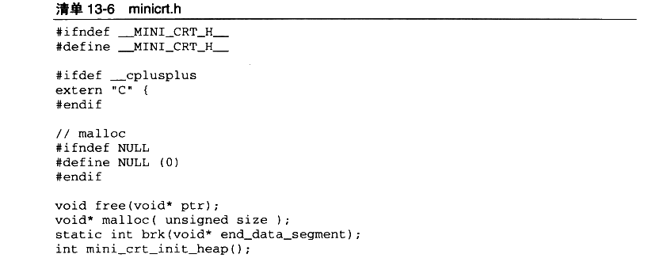

<details markdown="1"><summary>复制校对文字（未运行验证）</summary>

```text
#ifndef __MINI_CRT_H__
#define __MINI_CRT_H__
#ifdef __cplusplus
extern "C" {
#endif
// malloc
#ifndef NULL
#define NULL (0)
#endif
void free(void* ptr);
void* malloc(unsigned size);
static int brk(void* end_data_segment);
int mini_crt_init_heap();
```

</details>

字符串：

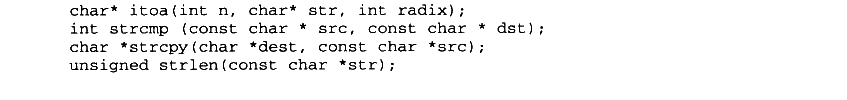

<details markdown="1"><summary>复制校对文字（未运行验证）</summary>

```text
char* itoa(int n, char* str, int radix);
int strcmp(const char *src, const char *dst);
char *strcpy(char *dest, const char *src);
unsigned strlen(const char *str);
```

</details>

文件与 I/O：

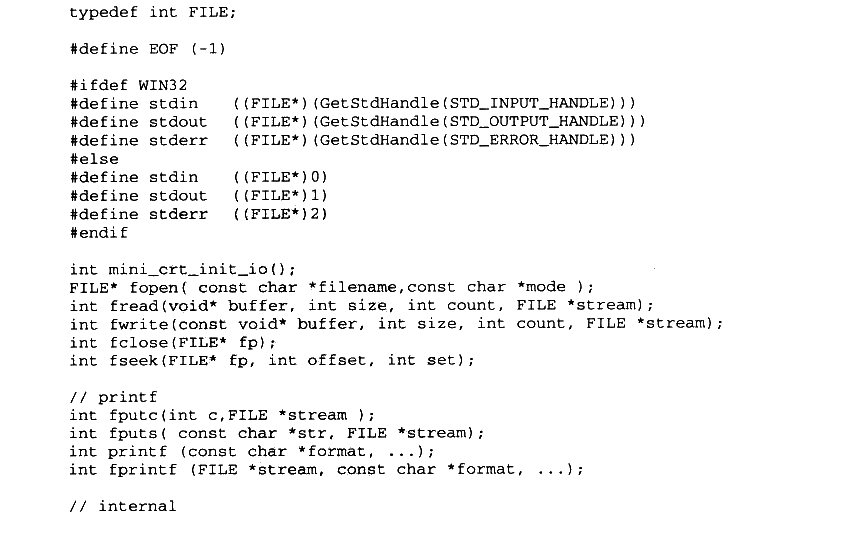

<details markdown="1"><summary>复制校对文字（未运行验证）</summary>

```text
typedef int FILE;
#define EOF (-1)
#ifdef WIN32
#define stdin  ((FILE*)(GetStdHandle(STD_INPUT_HANDLE)))
#define stdout ((FILE*)(GetStdHandle(STD_OUTPUT_HANDLE)))
#define stderr ((FILE*)(GetStdHandle(STD_ERROR_HANDLE)))
#else
#define stdin  ((FILE*)0)
#define stdout ((FILE*)1)
#define stderr ((FILE*)2)
#endif

int mini_crt_init_io();
FILE* fopen(const char *filename, const char *mode);
int fread(void* buffer, int size, int count, FILE* stream);
int fwrite(const void* buffer, int size, int count, FILE *stream);
int fclose(FILE* fp);
int fseek(FILE* fp, int offset, int set);
// printf
int fputc(int c, FILE *stream);
int fputs(const char *str, FILE *stream);
int printf(const char *format, ...);
int fprintf(FILE *stream, const char *format, ...);
// internal
```

</details>

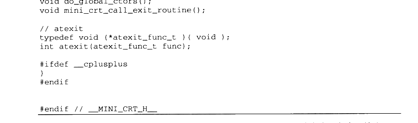

<details markdown="1"><summary>复制校对文字（未运行验证）</summary>

```text
void do_global_ctors();
void mini_crt_call_exit_routine();
// atexit
typedef void (*atexit_func_t)(void);
int atexit(atexit_func_t func);
#ifdef __cplusplus
}
#endif
#endif // __MINI_CRT_H__
```

</details>

接下来的问题是如何编译得到库文件了。由于动态库的实现比静态库要复杂，所以Mini CRT 仅仅以静态库的形式提供给最终用户，在Windows 下它是 minicrt.lib：在 Linux 下它是minicrt.a。在不同平台下编译和制作库文件的步骤如下所示，Linux 下的命令行为：

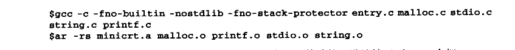

<details markdown="1"><summary>复制校对文字（未运行验证）</summary>

```text
$ gcc -c -fno-builtin -nostdlib -fno-stack-protector entry.c malloc.c stdio.c string.c printf.c
$ ar -rs minicrt.a malloc.o printf.o stdio.o string.o
```

</details>

- 这里的-fno-builtin 参数是指关闭GCC 的内置函数功能，默认情况下 GCC 会把 strlen、strcmp 等这些常用函数展开成它内部的实现。

- -nostdlib 表示不使用任何来自Glibc、GCC 的库文件和启动文件，它包含了-nostartfiles这个参数。

- -fno-stack-protector 是指关闭堆栈保护功能，最近版本的GCC会在 vfprintf 这样的变长参数函数中插入堆栈保护函数，如果不关闭，我们在使用 Mini CRT 时会发生“\_stack\_chk\_fail”函数未定义的错误。

在 Windows 下，Mini CRT 的编译方法如下：


<details markdown="1"><summary>复制校对文字（未运行验证）</summary>

```text
> cl /c /DWIN32 /GS- entry.c malloc.c printf.c stdio.c string.c
> lib entry.obj malloc.obj printf.obj stdio.obj string.obj /OUT:minicrt.lib
```

</details>

- /DWIN32表示定义 WIN32这个宏，这也正是在代码中用于区分平台的宏。

- /GS- 表示关闭堆栈保护功能，MSVC 和GCC一样也会在不定参数中插入堆栈保护功能。不关闭这个功能会在最后链接时发生“\_security\_cookie” 和“ __security_check_cookie” 符号未定义错误。

为了测试 Mini CRT是否能够正常运行，我们专门编写了一段测试代码，用于测试Mini CRT 的功能，如清单13-7所示。

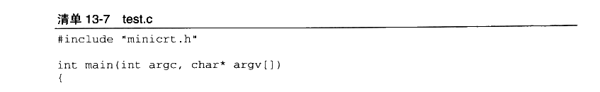

<details markdown="1"><summary>复制校对文字（未运行验证）</summary>

```text
#include "minicrt.h"
int main(int argc, char* argv[])
{
```

</details>

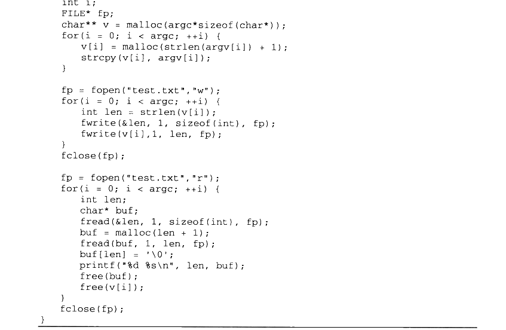

<details markdown="1"><summary>复制校对文字（未运行验证）</summary>

```text
int i;
    FILE* fp;
    char** v = malloc(argc*sizeof(char*));
    for (i = 0; i < argc; ++i) {
        v[i] = malloc(strlen(argv[i]) + 1);
        strcpy(v[i], argv[i]);
    }
    fp = fopen("test.txt", "w");
    for (i = 0; i < argc; ++i) {
        int len = strlen(v[i]);
        fwrite(&len, 1, sizeof(int), fp);
        fwrite(v[i], 1, len, fp);
    }
    fclose(fp);
    fp = fopen("test.txt", "r");
    for (i = 0; i < argc; ++i) {
        int len;
        char* buf;
        fread(&len, 1, sizeof(int), fp);
        buf = malloc(len + 1);
        fread(buf, 1, len, fp);
        buf[len] = '\0';
        printf("%d %s\n", len, buf);
        free(buf);
        free(v[i]);
    }
    fclose(fp);
}
```

</details>

这段代码用到了 Mini CRT 中绝大部分函数，包括 malloc、free、fopen、fclose、fread、fwrite、printf，并且测试了 main 参数。它的作用就是将 main 的参数字符串都保存到文件中，然后再读取出来，由printf显示出来。在 Linux 下，可以用下面的方法编译和运行 test.c：

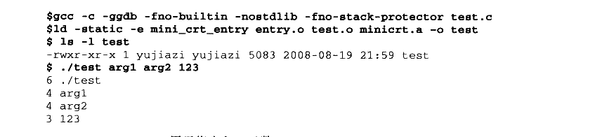

<details markdown="1"><summary>复制校对文字（未运行验证）</summary>

```text
$ gcc -c -ggdb -fno-builtin -nostdlib -fno-stack-protector test.c
$ ld -static -e mini_crt_entry entry.o test.o minicrt.a -o test
$ ls -l test
-rwxr-xr-x 1 yujiazi yujiazi 5083 2008-08-19 21:59 test
$ ./test arg1 arg2 123
6 ./test
4 arg1
4 arg2
3 123
```

</details>

- -e mini\_crt\_entry 用于指定入口函数。

可以看到静态链接 Mini CRT 最后输出的可执行文件只有5083个字节，这正体现出了Mini CRT 的“迷你”之处，而如果静态链接Glibc 时，最后可执行文件则约为538KB。在Windows 下，编译和运行 test.c 的步骤如下：

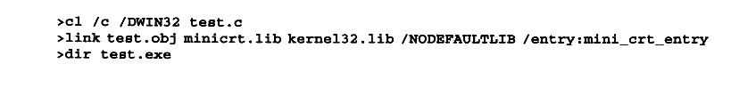

<details markdown="1"><summary>复制校对文字（未运行验证）</summary>

```text
> cl /c /DWIN32 test.c
> link test.obj minicrt.lib kernel32.lib /NODEFAULTLIB /entry:mini_crt_entry
> dir test.exe
```

</details>

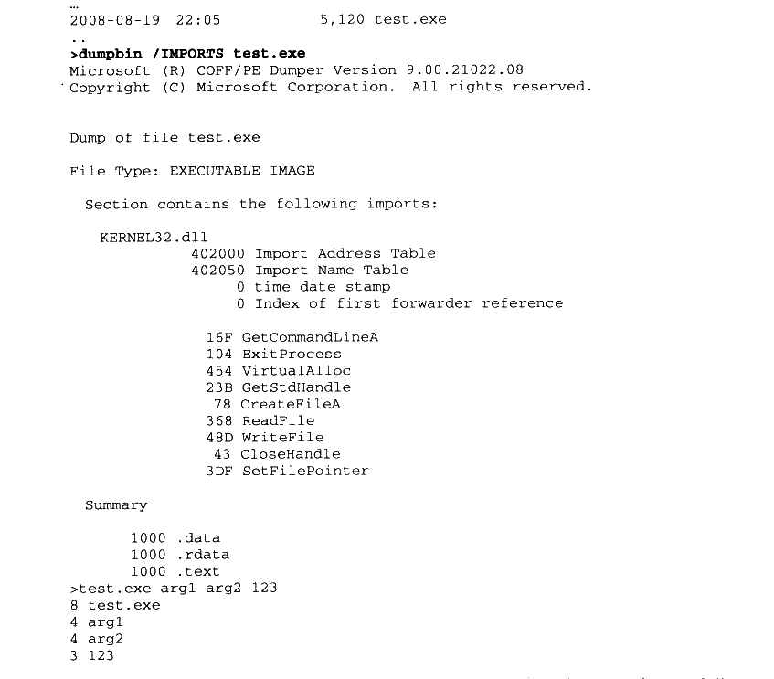

<details markdown="1"><summary>复制校对文字（未运行验证）</summary>

```text
...
2008-08-19 22:05 5,120 test.exe
..
> dumpbin /IMPORTS test.exe
Microsoft (R) COFF/PE Dumper Version 9.00.21022.08
Copyright (C) Microsoft Corporation. All rights reserved.
Dump of file test.exe
File Type: EXECUTABLE IMAGE
Section contains the following imports:
KERNEL32.dll
  402000 Import Address Table
  402050 Import Name Table
       0 time date stamp
       0 Index of first forwarder reference
  16F GetCommandLineA
  104 ExitProcess
  454 VirtualAlloc
  23B GetStdHandle
   78 CreateFileA
  368 ReadFile
  48D WriteFile
   43 CloseHandle
  3DF SetFilePointer
Summary
  1000 .data
  1000 .rdata
  1000 .text
> test.exe arg1 arg2 123
8 test.exe
4 arg1
4 arg2
3 123
```

</details>

与Linux类似，Windows 下使用 Mini CRT 链接的可执行文件也非常小，只有5120字节。如果我们使用 dumpbin 查看它的导入函数可以发现，它仅依赖于 Kernel32.DLL，也就是说它的确是绕过了 MSVC CRT 的运行库 msvcr90.dll（或 msvcr90d.dll）。


## 13.3 C++ 运行库实现

现在 Mini CRT 已经能够支持最基本的C语言程序运行了。C++作为兼容C语言的扩展语言，它的运行库的实现其实并不复杂，在这一章中将介绍如何为 Mini CRT 添加对C++语言的一些常用的操作支持。通常 C++的运行库都是独立于 C语言运行库的，比如 Linux 下C语言运行库为libc.so/libc.a，而 C++运行库为（libstdc++.so/libstdc++.a）；Windows 的 C语言运行库为libcmt.lib/msvcr90.dll，而C++运行库 libcpmt.lib/msvcp90.dll。一般这些C++的运行库都是依赖于C运行库的，它们仅包含对C++的一些特性的支持，比如 new/delete、STL、异常处理、流（stream）等。但是它们并不包含诸如入口函数、堆管理、基本文件操作等这些特性，而这些也是C++运行库所必需的，比如C++的流和文件操作依赖于C运行库的基本文件操作，所以它必须依赖于C运行库。

本节中我们将在 Mini CRT 的基础上实现一个支持C++的运行库，当然出于简单起见，将这个C++运行库的实现与 Mini CRT 合并到一起，而不是单独成为一个库文件，也就是说经过这一节对 Mini CRT 的功能改进，最终编译出来的 minicrt.a/minicrt.lib 将支持C++的诸多特性。

当然，要完整实现一个 C++的运行库是很费事的一件事，C++标准模板库 STL包含了诸如流、容器、算法、字符串等，规模较为庞大。出于演示的目的，我们将对C++的标准库进行简化，最终目标是实现一个能够成功运行如下 C++程序代码的运行库：

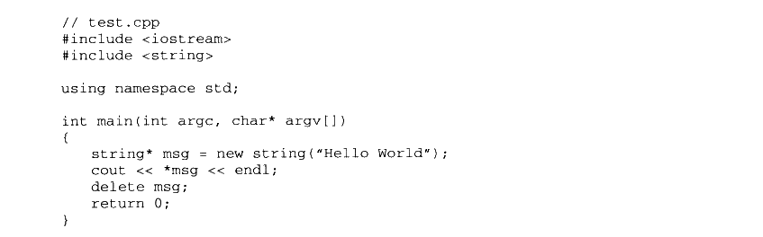

<details markdown="1"><summary>复制校对文字（未运行验证）</summary>

```text
// test.cpp
#include <iostream>
#include <string>
using namespace std;
int main(int argc, char* argv[])
{
    string* msg = new string("Hello World");
    cout << *msg << endl;
    delete msg;
    return 0;
}
```

</details>

上面这段程序看似简单，实际上它用到了C++运行库的诸多功能，我们将所用到的特性列举如下：

- string 类的实现。

- stream 类的实现，包括操纵符（Manipulator）（endl）。

- 全局对象构造和析构（cout）。

- new/delete。

在开始本节之前，还是按照前面 Mini CRT 实现时的做法：在进入具体主题之前先列举一些实现的原则。在实现 Mini CRT 对C++的支持时，我们遵循如下原则：

- HelloWorld 程序无须用到的功能就不实现，比如异常。

- 尽量简化设计，尽量符合C++标准库的规范。

- 对于可以直接在头文件实现的模块尽量在头文件中实现，以免诸多的类、函数的声明和定义造成代码量膨胀，不便于演示。

- 与前面的Mini CRT 实现一样，运行库代码要做到可以在 Windows 和 Linux 上同时运行，因此对于平台相关部分要使用条件编译分别实现。虽然 C++运行库几乎没有与系统相关的部分（全局构造和析构除外），C运行库已经将大部分系统相关部分封装成C标准库接口，C++运行库只须要调用这些接口即可。

另外值得一提的是，模板是不需要运行库支持的，它的实现依赖于编译器和链接器，对运行库基本上没有要求。

#### 13.3.1 new 与 delete

首先从比较简单的模块入手，全局 new/delete 操作的实现应该是最简单的部分。我们知道，new 操作的功能是从堆上分配一块对象大小的空间，然后运行对象的初始化函数将这个空间地址返回：而delete 则是与new 相反的操作，它首先运行对象的析构函数，然后释放堆空间。

那么new 和delete 究竟在C++中是一个什么样的地位呢？它们是编译器内置的操作吗？它们跟运行库有什么关系呢？为了解释这些问题，首先来看一小段代码：

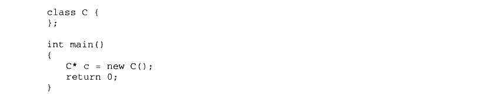

<details markdown="1"><summary>复制校对文字（未运行验证）</summary>

```text
class C {
};
int main()
{
    C* c = new C();
    return 0;
}
```

</details>

假如用GCC编译这段代码并且反汇编，将会看到 new 操作的实现：

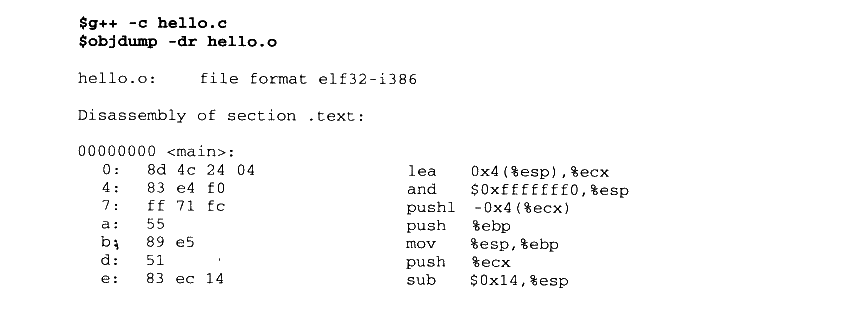

<details markdown="1"><summary>复制校对文字（未运行验证）</summary>

```text
$ g++ -c hello.c
$ objdump -dr hello.o
hello.o: file format elf32-i386
Disassembly of section .text:
00000000 <main>:
 0: 8d 4c 24 04  lea 0x4(%esp),%ecx
 4: 83 e4 f0     and $0xfffffff0,%esp
 7: ff 71 fc     pushl -0x4(%ecx)
 a: 55           push %ebp
 b: 89 e5        mov %esp,%ebp
 d: 51           push %ecx
 e: 83 ec 14     sub $0x14,%esp
```

</details>

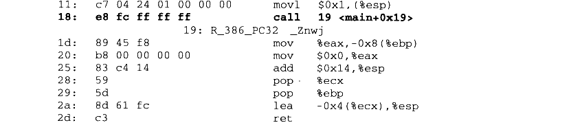

<details markdown="1"><summary>复制校对文字（未运行验证）</summary>

```text
11: c7 04 24 01 00 00 00 movl $0x1,(%esp)
18: e8 fc ff ff ff       call 19 <main+0x19>
    19: R_386_PC32 _Znwj
1d: 89 45 f8             mov %eax,-0x8(%ebp)
20: b8 00 00 00 00       mov $0x0,%eax
25: 83 c4 14             add $0x14,%esp
28: 59                   pop %ecx
29: 5d                   pop %ebp
2a: 8d 61 fc             lea -0x4(%ecx),%esp
2d: c3                   ret
```

</details>

可以看到，new 操作的实现实际上是调用了一个叫做\_Znwj 的函数，如果用 c++filt 将这个符号反修饰（Demangle），可以看到它的真面目：


<details markdown="1"><summary>复制校对文字（未运行验证）</summary>

```text
$ c++filt _Znwj
operator new(unsigned int)
```

</details>

可以看到\_Znwj 实际上是一个叫做 operator new 的函数，这也是我们在C++中熟悉的操作符函数。在C++中，操作符实际上是一种特殊的函数，叫做操作符函数，一般 new 操作符函数被定义为：

```cpp
void* operator new(unsigned int size);
```

除了 new、delete 这样的操作符以外，+、-、*、%等都可以被认为是操作符，这些操作符都有相对应的操作符函数。对于 operator new 函数来说，它的参数 size 是指须要申请的空间大小，一般是指 new 对象的大小，而返回值是申请的堆地址。delete 操作符函数的参数是对象的地址，它没有返回值。

既然 new/delete 的实现是相应的操作符函数，那么，如果要实现 new/delete，就只须要实现这两个函数就可以了。而这两个函数的主要功能是申请和释放堆空间，这再容易不过了，因为在 Mini CRT 中已经实现了堆空间的申请和释放函数：malloc 和 free。于是 new/delete的实现变得尤为简单，它们的实现源代码如清单 13-8所示。

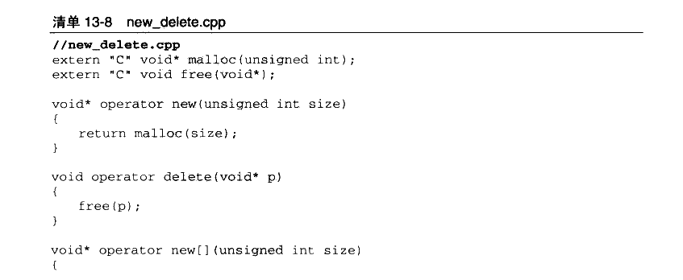

<details markdown="1"><summary>复制校对文字（未运行验证）</summary>

```text
// new_delete.cpp
extern "C" void* malloc(unsigned int);
extern "C" void free(void*);
void* operator new(unsigned int size)
{
    return malloc(size);
}
void operator delete(void* p)
{
    free(p);
}
void* operator new[](unsigned int size)
{
```

</details>

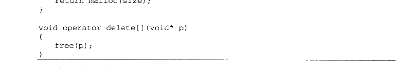

<details markdown="1"><summary>复制校对文字（未运行验证）</summary>

```text
return malloc(size);
}
void operator delete[](void* p)
{
    free(p);
}
```

</details>

在上面代码中除了 new/delete 之外，我们还看到了 new[] 和 delete[]，它们分别是用来申请和释放对象数组的，在这里一并予以实现。另外除了申请和释放堆空间之外，没有看到任何对象构造和析构的调用，其实对象的构造和析构是在 new/delete 之前/之后由编译器负责产生相应的代码进行调用的，new/delete 仅仅负责堆空间的申请和释放，不负责构造和析构。

在真实的 C++运行库中，new/delete 的实现要比上面的复杂一些，它们除了使用malloc/free 申请释放空间之外，还支持 new\_handler 在申请失败时给予程序进行补救的机会、还可能会抛出bad\_alloc 异常等，由于 Mini CRT 并不支持异常，所以就省略了这些内容。

另外值得一提的是，在使用真实的 C++运行库时，也可以使用上面这段代码自己实现new/delete，这样就会将原先C++运行库的 new/delete 覆盖，使得有机会在 new/delete 时记录对象的空间分配和释放，可以实现一些特殊的功能，比如检查程序是否有内存泄露。这种做法往往被称为全局 new/delete 操作符重载（Global new/delete operator overloading）。除了重载全局 new/delete 操作符之外，也可以重载某个类的 new/delete，这样可以实现一些特殊的需求，比如指定对象申请地址（Replacement new），或者使用自己实现的堆算法对某个对象的申请/释放进行优化，从而提高程序的性能等，这方面的讨论在C++领域已经非常深入了，在此我们不一一展开了。

#### 13.3.2 C++ 全局构造与析构

C++全局构造与析构的实现是有些特殊的，它与编译器、链接器的关系比较紧密。正如已经在第10章中所描述的一样，它们的实现是依赖于编译器、链接器和运行库三者共同的支持和协作的。Mini CRT 对于全局对象构造与析构的实现也是基于第10章中描述的Glibc和MSVCCRT 的，本质上没有多大的区别，仅仅是将它们简化到最简程度，保留本质而去除了一些繁琐的细节。

通过第10章的分析我们可以得知，C++全局构造和析构的实现在 Glibc 和 MSVC CRT中的原理十分相似，构造函数主要实现的是依靠特殊的段合并后形成构造函数数组，而析构则依赖于 atexit（）函数。这一节中将主要关注全局构造的实现，而把 atexit（）的实现留到下一节中。

全局构造对于 MSVC 来说，主要实现两个段“.CRT$XCA”和 “.CRT$XCZ”，然后定义两个函数指针分别指向它们：而对于 GCC来说，须要定义“ctor”段的起始部分和结束部分，然后定义两个函数指针分别指向它们。真正的构造部分则只要由一个循环将这两个函数指针指向的所有函数都调用一遍即可。

MSVC CRT 与 Glibc 在实现上稍有不同的是，MSVC CRT 只需要一个目标文件就可以实现全局构造，编译器会按照段名将所有的输入段排序：而Glibc 需要两个文件：crtbegin.o和 crtend.o，这两个文件在编译时必须位于输入文件的开始和结尾部分，所有在这两个文件之外的输入文件中的“.ctor”段就不会被正确地合并。全局构造和析构的实现代码如清单13-9所示。

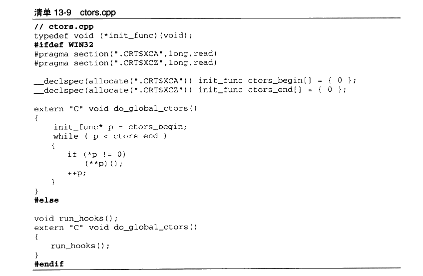

<details markdown="1"><summary>复制校对文字（未运行验证）</summary>

```text
// ctors.cpp
typedef void (*init_func)(void);
#ifdef WIN32
#pragma section(".CRT$XCA",long,read)
#pragma section(".CRT$XCZ",long,read)
__declspec(allocate(".CRT$XCA")) init_func ctors_begin[] = { 0 };
__declspec(allocate(".CRT$XCZ")) init_func ctors_end[] = { 0 };
extern "C" void do_global_ctors()
{
    init_func* p = ctors_begin;
    while (p < ctors_end)
    {
        if (*p != 0)
            (**p)();
        ++p;
    }
}
#else
void run_hooks();
extern "C" void do_global_ctors()
{
    run_hooks();
}
#endif
```

</details>

在 ctors.cpp 中包含了 Windows 的全局构造的所有实现代码，但Linux 的全局构造还需要 crtbegin和 crtend两个部分。这两个文件内容如清单13-10、清单13-11 所示。

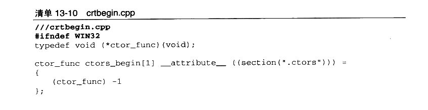

<details markdown="1"><summary>复制校对文字（未运行验证）</summary>

```text
// crtbegin.cpp
#ifndef WIN32
typedef void (*ctor_func)(void);
ctor_func ctors_begin[1] __attribute__((section(".ctors"))) =
{
    (ctor_func)-1
};
```

</details>

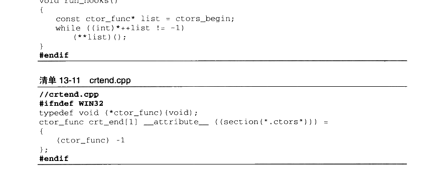

<details markdown="1"><summary>复制校对文字（未运行验证）</summary>

```text
void run_hooks()
{
    const ctor_func* list = ctors_begin;
    while ((int)*++list != -1)
        (**list)();
}
#endif

// crtend.cpp
#ifndef WIN32
typedef void (*ctor_func)(void);
ctor_func crt_end[1] __attribute__((section(".ctors"))) =
{
    (ctor_func)-1
};
#endif
```

</details>

#### 13.3.3 atexit 实现

atexit() 的用法十分简单，即由它注册的函数会在进程退出前，在exit（）函数中被调用。atexit()和 exit()函数实际上并不属于 C++运行库的一部分，它们是C语言运行库的一部分。在前面实现 Mini CRT 时我们在exit（）函数的实现中预留了对 atexit（）的支持。

本来可以不实现 atexit（）的，毕竟它不是非常重要的CRT 函数，但是在这里不得不实现atexit 的原因是：所有全局对象的析构函数—不管是 Linux 还是 Windows——都是通过atexit 或其类似函数来注册的，以达到在程序退出时执行的目的。

实现它的基本思路也很简单，就是使用一个链表把所有注册的函数存储起来，到exit（）时将链表遍历一遍，执行其中所有的回调函数，Windows 版的 atexit 的确可以按照这个思路实现。

Linux版的 atexit 要复杂一些，导致这个的问题的原因是GCC 实现全局对象的析构不是调用的 atexit，而是调用的\_\_cxa\_atexit。这个函数在前面的全局构造和析构中也碰到过，它不是C语言标准库函数，它是 GCC实现的一部分。为了兼容GCC,Mini CRT 不得不实现它。它的定义与 atexit()有所不同的是，\_\_cxa\_atexit 所接受的参数类型和 atexit 不同：

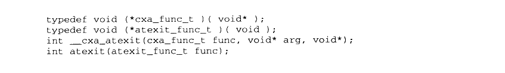

<details markdown="1"><summary>复制校对文字（未运行验证）</summary>

```text
typedef void (*cxa_func_t)(void*);
typedef void (*atexit_func_t)(void);
int __cxa_atexit(cxa_func_t func, void* arg, void*);
int atexit(atexit_func_t func);
```

</details>

\_\_cxa\_atexit 所接受的函数指针必须有一个 void\*型指针作为参数，并且调用\_\_cxa\_atexit的时候，这个参数（void\* arg）也要随着记录下来，等到要执行的时候再传递进去。也就是说，\_cxa\_atexit()注册的回调函数是带一个参数的，我们必须把这个参数也记下来。

**\_\_cxa\_atexit 的最后一个参数可以忽略，在这里不会用到。**

于是在设计链表时要考虑到这一点，链表的节点必须能够区分是否是 atexit() 或 \_\_cxa\_atexit()注册的函数，如果是\_\_cxa\_atexit()注册的函数，还要把回调函数的参数保存下来。我们定义链表节点的结构如下：

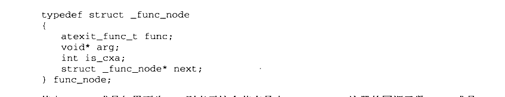

<details markdown="1"><summary>复制校对文字（未运行验证）</summary>

```text
typedef struct _func_node
{
    atexit_func_t func;
    void* arg;
    int is_cxa;
    struct _func_node* next;
} func_node;
```

</details>

其中 is\_cxa 成员如果不为 0，则表示这个节点是由\_cxa\_atexit()注册的回调函数，arg 成员表示相应的参数。atexit 的实现代码如清单13-12所示。

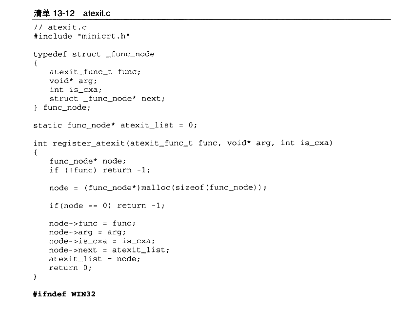

<details markdown="1"><summary>复制校对文字（未运行验证）</summary>

```text
// atexit.c
#include "minicrt.h"
typedef struct _func_node
{
    atexit_func_t func;
    void* arg;
    int is_cxa;
    struct _func_node* next;
} func_node;

static func_node* atexit_list = 0;
int register_atexit(atexit_func_t func, void* arg, int is_cxa)
{
    func_node* node;
    if (!func) return -1;
    node = (func_node*)malloc(sizeof(func_node));
    if (node == 0) return -1;
    node->func = func;
    node->arg = arg;
    node->is_cxa = is_cxa;
    node->next = atexit_list;
    atexit_list = node;
    return 0;
}
#ifndef WIN32
```

</details>

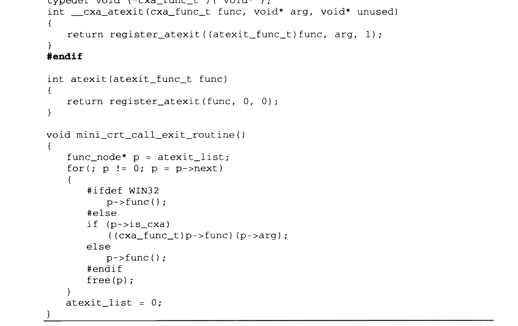

<details markdown="1"><summary>复制校对文字（未运行验证）</summary>

```text
typedef void (*cxa_func_t)(void*);
int __cxa_atexit(cxa_func_t func, void* arg, void* unused)
{
    return register_atexit((atexit_func_t)func, arg, 1);
}
#endif
int atexit(atexit_func_t func)
{
    return register_atexit(func, 0, 0);
}
void mini_crt_call_exit_routine()
{
    func_node* p = atexit_list;
    for (; p != 0; p = p->next)
    {
#ifdef WIN32
        p->func();
#else
        if (p->is_cxa)
            ((cxa_func_t)p->func)(p->arg);
        else
            p->func();
#endif
        free(p);
    }
    atexit_list = 0;
}
```

</details>

值得一提的是，在注册函数时，被注册的函数是插入到列表头部的，而最后mini\_crt\_call\_exit\_routine()是从头部开始遍历的，于是由 atexit()或\_\_cxa\_atexit()注册的函数是按照先注册后调用的顺序，这符合析构函数的规则，因为先构造的全局对象应该后析构。

#### 13.3.4 入口函数修改

由于增加了全局构造和析构的支持，那么需要对 Mini CRT 的入口函数和 exit()函数进行修改，把对 do\_global\_ctors()和 mini\_crt\_call\_exit\_routine()的调用加入到 entry() 和 exit()函数中去。修改后的 entry.c 如下（省略一部分未修改的内容）：

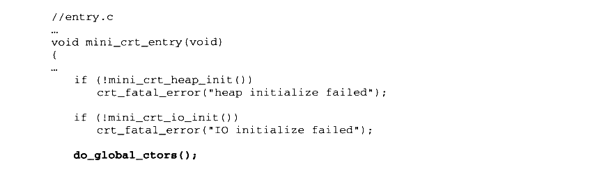

<details markdown="1"><summary>复制校对文字（未运行验证）</summary>

```text
// entry.c
...
void mini_crt_entry(void)
{
    ...
    if (!mini_crt_heap_init())
        crt_fatal_error("heap initialize failed");
    if (!mini_crt_io_init())
        crt_fatal_error("IO initialize failed");
    do_global_ctors();
```

</details>

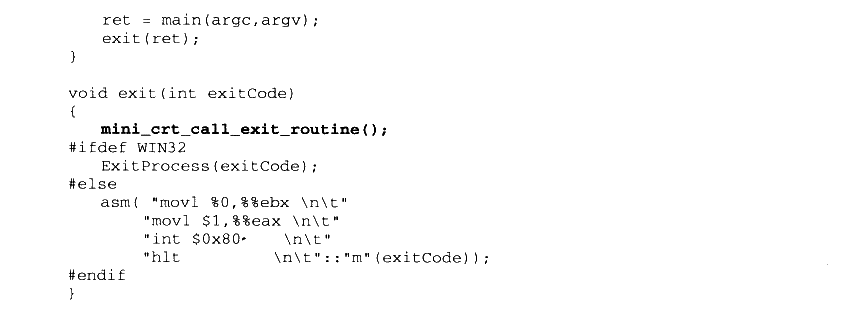

<details markdown="1"><summary>复制校对文字（未运行验证）</summary>

```text
ret = main(argc,argv);
    exit(ret);
}
void exit(int exitCode)
{
    mini_crt_call_exit_routine();
#ifdef WIN32
    ExitProcess(exitCode);
#else
    asm("movl %0,%%ebx \n\t"
        "movl $1,%%eax \n\t"
        "int $0x80     \n\t"
        "hlt           \n\t"::"m"(exitCode));
#endif
}
```

</details>

#### 13.3.5 stream 与 string

C++的Hello World 里面一般都会用到 cout 和 string，以展示C++的特性。流和字符串是C++ STL 的最基本的两个部分，我们在这一节中为 Mini CRT 增加 string 和 stream 的实现，在有了流和字符串之后，Mini CRT 将最终宣告完成，可以考虑将它重命名为 Mini CRT++ ©。

当然，在真正的STL 实现中，string 和stream 的实现十分复杂，不仅有强大的模板定制功能、缓冲，庞大的继承体系及一系列辅助类。我们在实现时还是以展示和剖析为最基本的目的，简化一切能够简化的内容。string 和 stream 的实现将遵循下列原则。

- 不支持模板定制，即这两个类仅支持 char 字符串类型，不支持自定义分配器等，没有basic\_string 模板类。

- 流对象仅实现 ofstream，且没有继承体系，即没有 ios\_base、stream、ostream、fstream等类似的相关类。

- 流对象没有内置的缓冲功能，即没有stream\_buffer类支持。

- cout 作为 ofstream的一个实例，它的输出文件是标准输出。

stream 和 string类的实现用到了不少C++语言的特性，已经一定程度上偏离了本书所要描述的主题，因此在此仅将它们的实现源代码列出，而不做更多的详细分析。有兴趣的读者可以参考C++STL 的相关实现的资料，如果对C++语言本身不熟悉，也可以跳过这一节，这并不影响对 Mini CRT 整体实现的理解。string 和 iostream 的实现如清单 13-13、清单13-14、清单13-15所示。

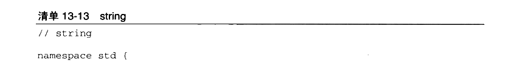

<details markdown="1"><summary>复制校对文字（未运行验证）</summary>

```text
// string
namespace std {
```

</details>

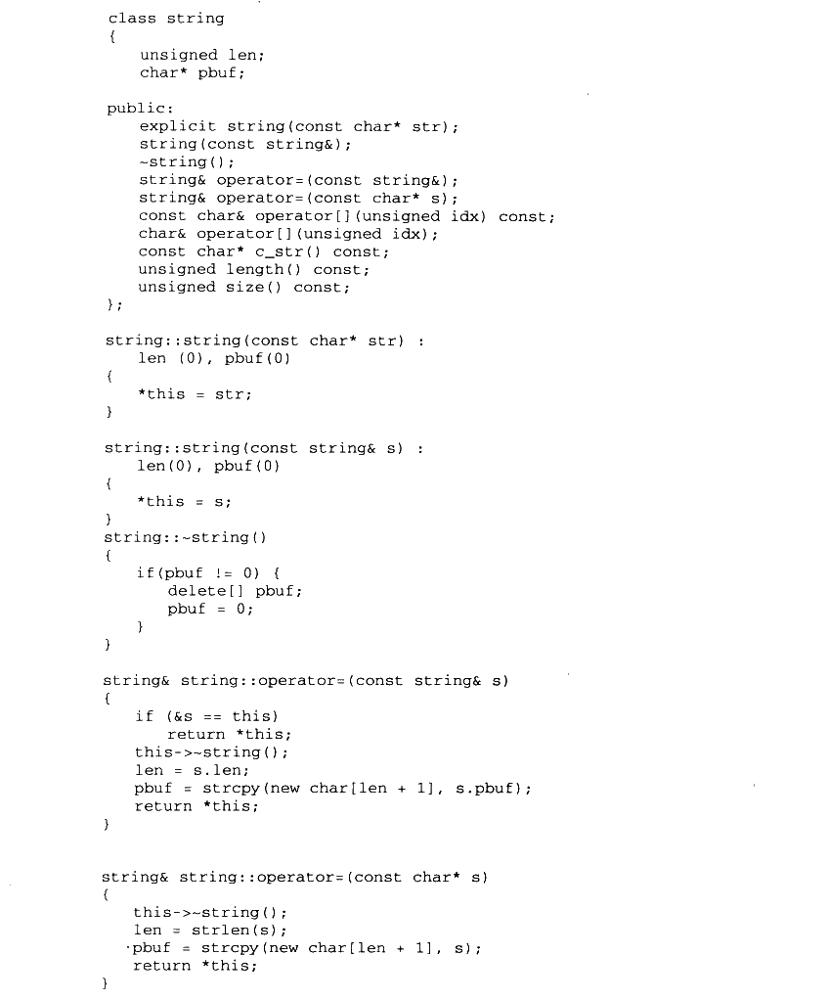

<details markdown="1"><summary>复制校对文字（未运行验证）</summary>

```text
class string
{
    unsigned len;
    char* pbuf;
public:
    explicit string(const char* str);
    string(const string&);
    ~string();
    string& operator=(const string&);
    string& operator=(const char* s);
    const char& operator[](unsigned idx) const;
    char& operator[](unsigned idx);
    const char* c_str() const;
    unsigned length() const;
    unsigned size() const;
};
string::string(const char* str) : len(0), pbuf(0)
{
    *this = str;
}
string::string(const string& s) : len(0), pbuf(0)
{
    *this = s;
}
string::~string()
{
    if (pbuf != 0) {
        delete[] pbuf;
        pbuf = 0;
    }
}
string& string::operator=(const string& s)
{
    if (&s == this)
        return *this;
    this->~string();
    len = s.len;
    pbuf = strcpy(new char[len + 1], s.pbuf);
    return *this;
}
string& string::operator=(const char* s)
{
    this->~string();
    len = strlen(s);
    pbuf = strcpy(new char[len + 1], s);
    return *this;
}
```

</details>

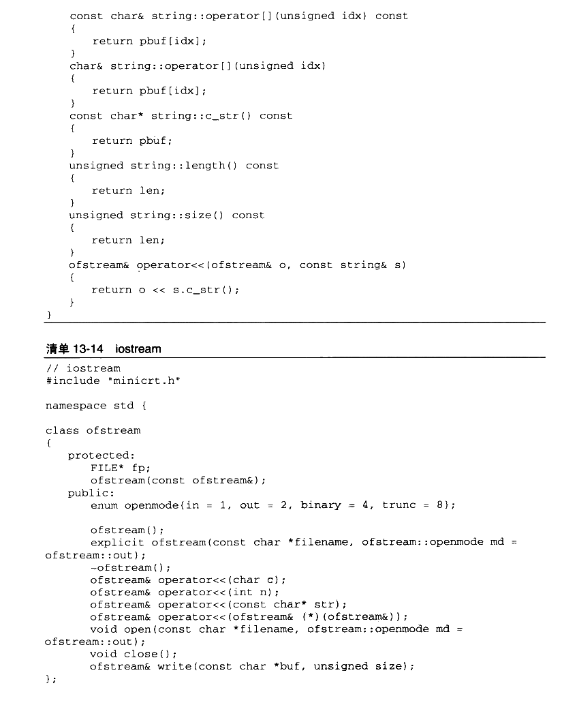

<details markdown="1"><summary>复制校对文字（未运行验证）</summary>

```text
const char& string::operator[](unsigned idx) const
{
    return pbuf[idx];
}
char& string::operator[](unsigned idx)
{
    return pbuf[idx];
}
const char* string::c_str() const
{
    return pbuf;
}
unsigned string::length() const
{
    return len;
}
unsigned string::size() const
{
    return len;
}
ofstream& operator<<(ofstream& o, const string& s)
{
    return o << s.c_str();
}
}

// iostream
#include "minicrt.h"
namespace std {
class ofstream
{
protected:
    FILE* fp;
    ofstream(const ofstream&);
public:
    enum openmode { in = 1, out = 2, binary = 4, trunc = 8 };
    ofstream();
    explicit ofstream(const char *filename, ofstream::openmode md = ofstream::out);
    ~ofstream();
    ofstream& operator<<(char c);
    ofstream& operator<<(int n);
    ofstream& operator<<(const char* str);
    ofstream& operator<<(ofstream& (*)(ofstream&));
    void open(const char *filename, ofstream::openmode md = ofstream::out);
    void close();
    ofstream& write(const char *buf, unsigned size);
};
```

</details>

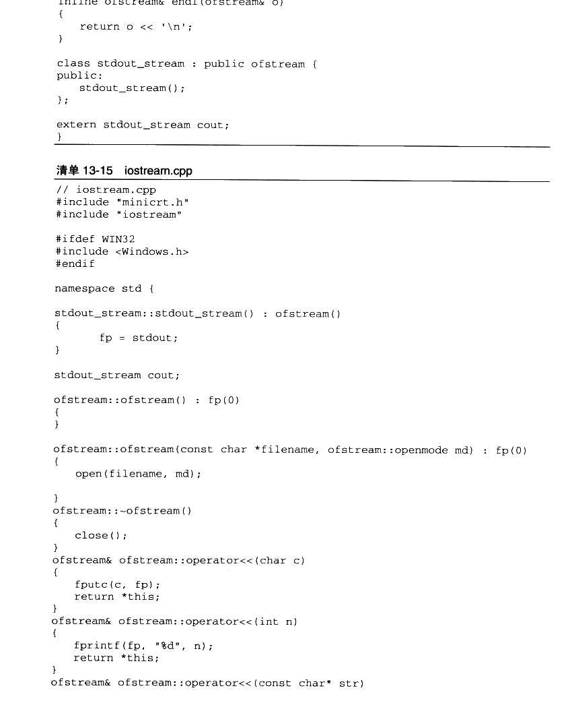

<details markdown="1"><summary>复制校对文字（未运行验证）</summary>

```text
inline ofstream& endl(ofstream& o)
{
    return o << '\n';
}
class stdout_stream : public ofstream {
public:
    stdout_stream();
};
extern stdout_stream cout;
}

// iostream.cpp
#include "minicrt.h"
#include "iostream"
#ifdef WIN32
#include <Windows.h>
#endif
namespace std {
stdout_stream::stdout_stream() : ofstream()
{
    fp = stdout;
}
stdout_stream cout;
ofstream::ofstream() : fp(0)
{
}
ofstream::ofstream(const char *filename, ofstream::openmode md) : fp(0)
{
    open(filename, md);
}
ofstream::~ofstream()
{
    close();
}
ofstream& ofstream::operator<<(char c)
{
    fputc(c, fp);
    return *this;
}
ofstream& ofstream::operator<<(int n)
{
    fprintf(fp, "%d", n);
    return *this;
}
ofstream& ofstream::operator<<(const char* str)
```

</details>

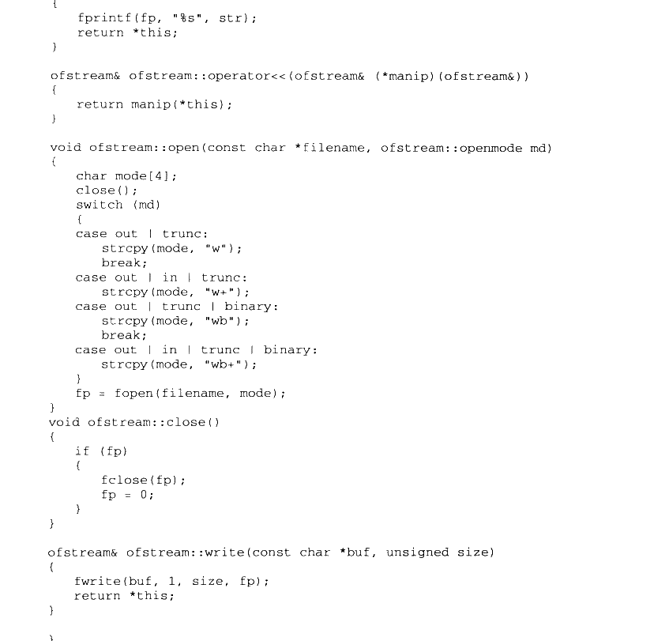

<details markdown="1"><summary>复制校对文字（未运行验证）</summary>

```text
{
    fprintf(fp, "%s", str);
    return *this;
}
ofstream& ofstream::operator<<(ofstream& (*manip)(ofstream&))
{
    return manip(*this);
}
void ofstream::open(const char *filename, ofstream::openmode md)
{
    char mode[4];
    close();
    switch (md)
    {
    case out | trunc:
        strcpy(mode, "w");
        break;
    case out | in | trunc:
        strcpy(mode, "w+");
    case out | trunc | binary:
        strcpy(mode, "wb");
        break;
    case out | in | trunc | binary:
        strcpy(mode, "wb+");
    }
    fp = fopen(filename, mode);
}
void ofstream::close()
{
    if (fp)
    {
        fclose(fp);
        fp = 0;
    }
}
ofstream& ofstream::write(const char *buf, unsigned size)
{
    fwrite(buf, 1, size, fp);
    return *this;
}
}
```

</details>


## 13.4 如何使用 Mini CRT++

我们的 Mini CRT终于完成了对C++的支持，同时它也升级为了 Mini CRT++。与13.2节一样，在这一节中将介绍如何编译并且在自己的程序中使用它。首先展示在Windows 下编译的方法：


<details markdown="1"><summary>复制校对文字（未运行验证）</summary>

```text
$ cl /c /DWIN32 /GS- entry.c malloc.c printf.c stdio.c string.c atexit.c
$ cl /c /DWIN32 /GS- /GR- crtbegin.cpp crtend.cpp ctor.cpp new_delete.cpp iostream.cpp
$ lib entry.obj malloc.obj printf.obj stdio.obj string.obj ctor.obj new_delete.obj atexit.obj iostream.obj /OUT:minicrt.lib
```

</details>

这里新增的一个编译参数为/GR-，它的意思是关闭 RTTI功能，否则编译器会为有虚函数的类产生 RTTI 相关代码，在最终链接时会看到 “const type\_info：：vftable”符号未定义的错误。

而 Mini CRT++为了能够在 Linux 下正常运行，还须要建立一个新的源代码文件叫做sysdep.cpp，用于定义 Linux 平台相关的一个函数：


<details markdown="1"><summary>复制校对文字（未运行验证）</summary>

```text
extern "C" {
    void* __dso_handle = 0;
}
```

</details>

这个函数是用于处理共享库的全局对象构造与析构的。我们知道共享库也可以拥有全局对象，这些对象在共享库被装载和卸载时必须被正确地构造和析构。而共享库有可能在进程退出之前被卸载，比如使用 dlopen/dlclose 就可能导致这种情况。那么一个问题就产生了，如何使得属于某个共享库的全局对象析构函数在共享库被卸载时运行呢？GCC的做法是向\_\_cxa\_atexit（）传递一个参数，这个参数用于标示这个析构函数属于哪个共享对象。我们在前面实现\_\_cxa\_atexit 时忽略了第三个参数，实际上这第三个参数就是用于标示共享对象的，它就是\_\_dso\_handle 这个符号。由于在 Mini CRT++中并不考虑对共享库的支持，于是我们就仅仅定义这个符号为 0，以防止链接时出现符号未定义错误。

Mini CRT++在 Linux 平台下编译的方法如下：


<details markdown="1"><summary>复制校对文字（未运行验证）</summary>

```text
$ gcc -c -fno-builtin -nostdlib -fno-stack-protector entry.c malloc.c stdio.c string.c printf.c atexit.c
$ g++ -c -nostdinc++ -fno-rtti -fno-exceptions -fno-builtin -nostdlib -fno-stack-protector crtbegin.cpp crtend.cpp ctor.cpp new_delete.cpp sysdep.cpp iostream.cpp sysdep.cpp
$ ar -rs minicrt.a malloc.o printf.o stdio.o string.o ctor.o atexit.o iostream.o new_delete.o sysdep.o
```

</details>

-fno-rtti 的作用与cl 的/GR-作用一样，用于关闭 RTTI。

-fno-exceptions 的作用用于关闭异常支持，否则GCC会产生异常支持代码，可能导致链接错误。

在 Windows 下使用 Mini CRT++的方法如下：


<details markdown="1"><summary>复制校对文字（未运行验证）</summary>

```text
$ cl /c /DWIN32 /GR- test.cpp
$ link test.obj minicrt.lib kernel32.lib /NODEFAULTLIB /entry:mini_crt_entry
```

</details>

在 Linux 下使用 Mini CRT++的方法如下：


<details markdown="1"><summary>复制校对文字（未运行验证）</summary>

```text
$ g++ -c -nostdinc++ -fno-rtti -fno-exceptions -fno-builtin -nostdlib -fno-stack-protector test.cpp
$ ld -static -e mini_crt_entry entry.o crtbegin.o test.o minicrt.a crtend.o -o test
```

</details>

注 crtbegin.o 和 crtend.o在ld 链接时位于用户目标文件的最开始和最后端，以保证链接的正确性。


## 13.5 本章小结

在这一章中，我们首先尝试实现了一个支持C运行的简易 CRT:Mini CRT。接着又为它加上了一些C++语言特性的支持，并且将它称为 Mini CRT++。在实现C语言运行库的时候，介绍了入口函数 entry、堆分配算法 malloc/free、IO 和文件操作 fopen/fread/fwrite/fclose、字符串函数 strlen/strcmp/atoi 和格式化字符串 printf/fprintf。在实现C++运行库时，着眼于实现C++的几个特性：new/delete、全局构造和析构、stream 和 string类。

因此在实现 Mini CRT++的过程中，我们得以详细了解并且亲自动手实现运行库的各个细节，得到一个可编译运行的瘦身运行库版本。当然，Mini CRT++所包含的仅仅是真正的运行库的一个很小子集，它并不追求完整，也不在运行性能上做优化，它仅仅是一个 CRT的雏形，虽说很小，但能够通过 Mini CRT++窥视真正的CRT 和C++运行库的全貌，抛砖引玉、举一反三正是Mini CRT++的目的。
