# 13.1 C 语言运行库

在开始实现 Mini CRT之前，首先要对它进行基本的规划。“麻雀虽小五脏俱全”，虽然Mini CRT很小，但它应该具备CRT的基本功能以及遵循几个基本设计原则，这些我们归结为如下几个方面：

- 首先 Mini CRT 应该以 ANSI C 的标准库为目标，尽量做到与其接口相一致。

- 具有自己的入口函数（mini\_crt\_entry）。

- 基本的进程相关操作（exit）。

- 支持堆操作（malloc、free）。

- 支持基本的文件操作（fopen、fread、fwrite、fclose、fseek）。

- 支持基本的字符串操作（strcpy、strlen、strcmp）。

- 支持格式化字符串和输出操作（printf、sprintf）。

- 支持 atexit() 函数。

最后，Mini CRT应该是跨平台的。我们计划让Mini CRT能够同时支持Windows 和Linux两个操作系统。

- Mini CRT 的实现应该尽量简单，以展示 CRT 的实现为目的，并不追求功能和性能，基本上是“点到为止”。

为了使CRT能够同时支持 Linux 和Windows 两个平台，必须针对这两个操作系统环境的不同进行条件编译。在Mini CRT 中，我们使用宏 WIN32 为标准来决定是 Windows 还是Linux。因此实际的代码常常呈现这样的结构：

```c
#ifdef WIN32
// Windows 部分实现代码
#else
// Linux 部分实现代码
#endif
```

在本章中，\#ifdef-\#else-\#endif 这个条件编译指令会加粗显示，以方便读者区分Windows 和 Linux 的代码。

通常我们会把CRT 的各个函数的声明放在不同的头文件中，比如 I/O 相关的位于stdio.h：字符串和堆相关的放在 stdlib.h中。为了简单起见，将 Mini CRT 中所有函数的声明都放在minicrt.h中。

### 13.1.1 开始

那么 Mini CRT 首先该从哪儿入手呢？诚然，从入口函数开始入手应该是个不错的选择。在本书的第10章中，已对Glibc 和MSVC CRT 的入口函数进行了分析，下面我们再对入口函数相关的内容进行概括。

- 程序运行的最初入口点不是 main 函数，而是由运行库为其提供的入口函数。它主要负责三部分工作：准备好程序运行环境及初始化运行库，调用 main 函数执行程序主体，清理程序运行后的各种资源。

- 运行库为所有程序提供的入口函数应该相同，在链接程序时须要指定该入口函数名。

在本章节里，将为 Mini CRT编写自己的入口函数。为了保证运行库的兼容性，CRT 入口函数同样必须具有以上特性。

入口函数

首先，须要确定入口函数的函数原型，包括函数名、输入参数及返回值。在这里，入口函数命名为 mini\_crt\_entry。为了简单起见，它没有输入参数，同时没有返回值。其实mini\_crt\_entry的返回值没有意义，因为它永远不会返回，在它返回之前就会调用进程退出函数结束进程。这样，入口函数具有如下形式：

```c
void mini_crt_entry(void)
```

参照上面所描述的入口函数的三部分工作，以下代码为一个基本框架。


<details markdown="1"><summary>复制校对文字（未运行验证）</summary>

```text
void mini_crt_entry(void)
{
    // 初始化部分
    int ret = main();
    // 结束部分
```

</details>


<details markdown="1"><summary>复制校对文字（未运行验证）</summary>

```text
exit(ret);
}
```

</details>

这里的初始化主要负责准备好程序运行的环境，包括准备 main 函数的参数、初始化运行库，包括堆、I/O 等，结束部分主要负责清理程序运行资源。在以下内容中，围绕这个基本框架，我们将逐步扩展补充入口函数。

#### main 参数

我们知道 main 函数的原型为：

```c
int main(int argc, char* argv[]);
```

其中 argc和 argv 分别是 main函数的两个参数，它们分别表示运行程序时的参数个数和指向参数的字符串指针数组。在第6章中已经介绍过在 Linux 系统下，当进程被初始化时，它的堆栈结构中就保存着环境变量和传递给 main 函数的参数，我们可以通过ESP 寄存器获得这两个参数。但是一旦进入 mini\_crt\_entry 之后，ESP寄存器会随着函数的执行而被改变，通过第9章中关于函数对于堆栈帧的知识，可以知道EBP 的内容就是进入函数后ESP+4（4是因为函数第一条指令是push ebp）。那么可以推断出EBP-4所指向的内容应该就是 argc，而 EBP-8则就是 argv。整个堆栈的分布可以如图13-1 所示。

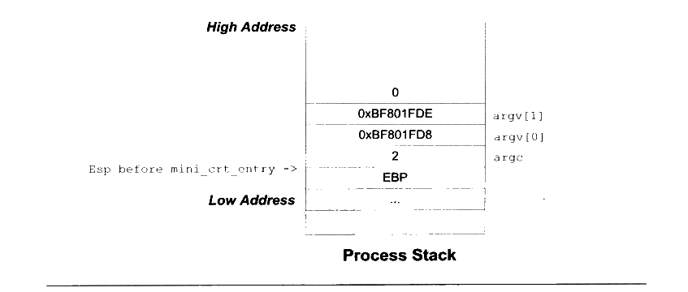

<p class="image-caption">图13-1 main 函数参数</p>

<details markdown="1"><summary>查看图中文字（按图分组）</summary>

进程栈从高地址到低地址为：0、argv[1]（0xBF801FDE）、argv[0]（0xBF801FD8）、argc（2）、保存的 EBP。进入 mini_crt_entry 前的 ESP 指向 argc。

</details>

对于Windows 系统来说，它提供了相应的 API 用于取得进程的命令行参数，这个API叫做 GetCommandLine，它会返回整个命令行参数字符串。由于 main 函数所需要的参数是命令行参数列表，所以我们将整个命令行字符串分割成若干个参数，以符合 argc 和 argv 的格式。在这里暂时不列出实现的代码，在章节的最后将列出这一节所实现的 Mini CRT 源代码。以后所有与 Mini CRT 实现相关的章节都遵循这一规则。

CRT 初始化

完成了获取 main 函数参数的代码后，还应该在入口函数里对 CRT 进行初始化。由于Mini CRT所实现的功能较少，所以初始化部分十分简单。需要初始化的主要是堆和 I/O 部分。在堆被初始化之前，malloc/free 函数是没有办法使用的。我们定义堆的初始化函数为mini\_crt\_heap\_init()： I/O 部分的初始化函数为 mini\_crt\_io\_init()。这两个函数的返回值都是整数类型的，返回非0即表示初始化成功，否则表示失败。这两个函数的实现将在后面介绍堆实现和IO实现时详细介绍。

结束部分

Mini CRT 结束部分很简单，它要完成两项任务：一个就是调用由 atexit（）注册的退出回调函数：另外一个就是实现结束进程。这两项任务都由exit()函数完成，这个函数在Linux 的实现已经在第4章中碰到过了，它调用 Linux的1号系统调用实现进程结束，ebx 表示进程退出码：而Windows 则提供了一个叫做 ExitProcess 的API，直接调用该 API即可结束进程。

不过在进行系统调用或 API 之前，exit()还有一个任务就是调用由atexit()注册的退出回调函数，这个任务通过调用 mini\_crt\_exit\_routine()实现。我们在第10 章中已经了解到，atexit（）注册回调函数的机制主要是用来实现全局对象的析构的，在这一节中暂时不打算让Mini CRT 支持C++，所以暂时将调用 mini\_crt\_exit\_routine（）这个函数的那行代码去掉。

最终 Mini CRT 的入口函数 mini\_crt\_entry 的代码如清单13-1所示。

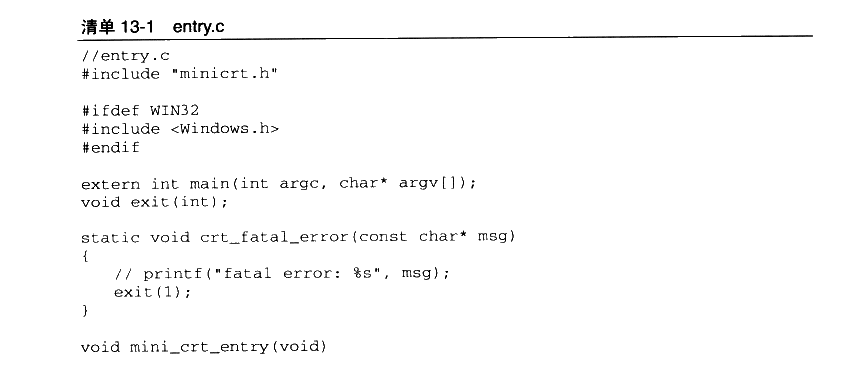

<details markdown="1"><summary>复制校对文字（未运行验证）</summary>

```text
// entry.c
#include "minicrt.h"
#ifdef WIN32
#include <Windows.h>
#endif
extern int main(int argc, char* argv[]);
void exit(int);
static void crt_fatal_error(const char* msg)
{
    // printf("fatal error: %s", msg);
    exit(1);
}
void mini_crt_entry(void)
```

</details>

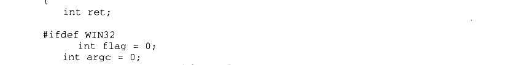

<details markdown="1"><summary>复制校对文字（未运行验证）</summary>

```text
{
    int ret;
#ifdef WIN32
    int flag = 0;
    int argc = 0;
    char* argv[16];
    char* cl = GetCommandLineA();
```

</details>

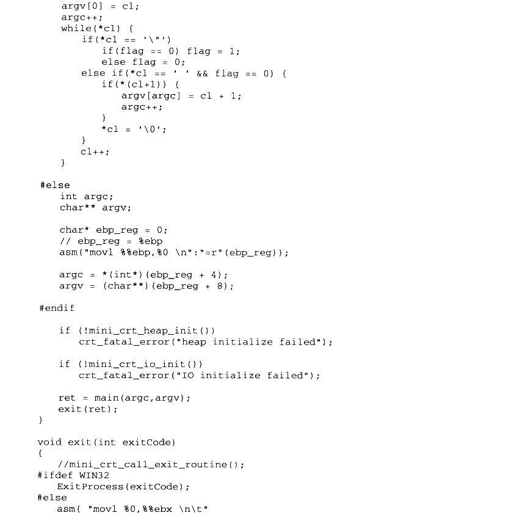

<details markdown="1"><summary>复制校对文字（未运行验证）</summary>

```text
argv[0] = cl;
    argc++;
    while (*cl) {
        if (*cl == '\"')
            if (flag == 0) flag = 1;
            else flag = 0;
        else if (*cl == ' ' && flag == 0) {
            if (*(cl+1)) {
                argv[argc] = cl + 1;
                argc++;
            }
            *cl = '\0';
        }
        cl++;
    }
#else
    int argc;
    char** argv;
    char* ebp_reg = 0;
    // ebp_reg = %ebp
    asm("movl %%ebp,%0 \n":"=r"(ebp_reg));
    argc = *(int*)(ebp_reg + 4);
    argv = (char**)(ebp_reg + 8);
#endif
    if (!mini_crt_heap_init())
        crt_fatal_error("heap initialize failed");
    if (!mini_crt_io_init())
        crt_fatal_error("IO initialize failed");
    ret = main(argc,argv);
    exit(ret);
}
void exit(int exitCode)
{
    //mini_crt_call_exit_routine();
#ifdef WIN32
    ExitProcess(exitCode);
#else
    asm("movl %0,%%ebx \n\t"
```

</details>

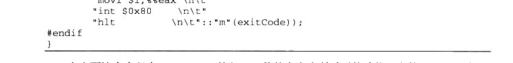

<details markdown="1"><summary>复制校对文字（未运行验证）</summary>

```text
"movl $1,%%eax \n\t"
        "int $0x80     \n\t"
        "hlt           \n\t"::"m"(exitCode));
#endif
}
```

</details>

在上面这个实现中，Mini CRT 的入口函数基本完成所需要的功能。它的 Windows 版对命令行参数进行了分割，这个分割算法实际上还是有问题的，比如两个参数之间隔多个空格就会发生问题。当然这些问题不影响我们理解 Mini CRT 的入口函数的主干部分。

### 13.1.2 堆的实现

有了 CRT 的入口函数、exit()函数之后，下一步的目标就是实现堆的操作，即 malloc（）函数和 free（）函数。当然堆的实现方法有很多，在不同的操作系统平台上也有很多可以选择的方案，在遵循 Mini CRT 的原则下，我们将 Mini CRT堆的实现归纳为下面几条。

- 实现一个以空闲链表算法为基础的堆空间分配算法。

- 为了简单起见，堆空间大小固定为32MB，初始化之后空间不再扩展或缩小。

- 在Windows 平台下不使用 HeapAlloc 等堆分配算法，采用 VirtualAlloc 向系统直接申请32MB 空间，由我们自己的堆分配算法实现 malloc。

- 在Linux 平台下，使用brk 将数据段结束地址向后调整32MB，将这块空间作为堆空间。

brk 系统调用可以设置进程的数据段边界，而sbrk 可以移动进程的数据段边界。显然，如果将数据段边界后移，就相当于分配了一定量的内存。

由 brk/sbrk 分配的内存和VirtualAlloc分配的一样，它们仅仅是分配了虚拟空间，这些空间一开始是不会提交的（即不分配物理页面），当进程试图访问某一个地址的时候，操作系统会检测到访问异常，并且为被访问的地址所在的页分配物理页面。

在某些人的“黑话”里，践踏（trample）一块内存指的是去读写这块内存的每一个字节。brk 所分配的虚地址就是需要在践踏之后才会被操作系统自动地分配实际页面。所以很多时候按页需求分配（Page Demand Allocation）又被称为按践踏分配（Alloc On Trample, AOT）④.

我们在第9章时已经介绍过堆分配算法的原理，在实现上也基本一致。整个堆空间按照是否被占用而被分割成了若干个空闲（Free）块和占用（Used）块，它们之间由双向链表链接起来。

当用户要申请一块内存时，堆分配算法将遍历整个链表，直到找到一块足够大的空闲块，如果这个空闲块大小刚好等于所申请的大小，那么直接将这个空闲块标记为占用块，然后将它的地址返回给用户；如果空闲块大小大于所申请的大小，那么这个空闲块将被分割成两块，其中一块大小为申请的大小，标记为占用，另外一块为空闲块。

当用户释放某一块空间时，堆分配算法会判别被释放块前后两个块是否为空闲块，如果是，则将它们合并成一个大的空闲块。

整个堆分配算法从实现上看十分简单，仅仅只有100行左右，而且还包含了 Linux 的brk 系统调用的实现。Mini CRT 的堆分配算法源代码如清单 13-2所示。

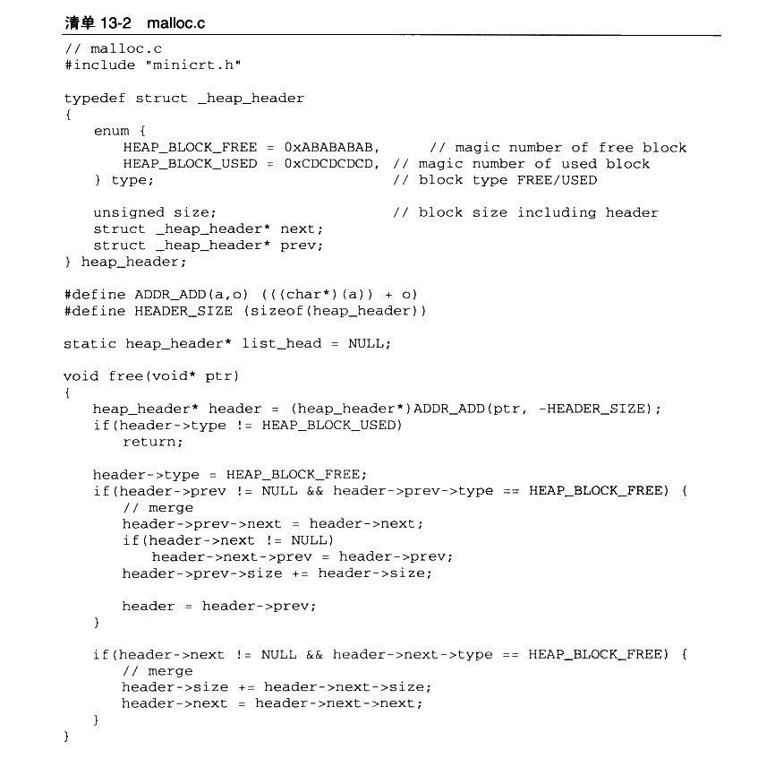

<details markdown="1"><summary>复制校对文字（未运行验证）</summary>

```text
// malloc.c
#include "minicrt.h"
typedef struct _heap_header
{
    enum {
        HEAP_BLOCK_FREE = 0xABABABAB, // magic number of free block
        HEAP_BLOCK_USED = 0xCDCDCDCD, // magic number of used block
    } type;                         // block type FREE/USED
    unsigned size;                  // block size including header
    struct _heap_header* next;
    struct _heap_header* prev;
} heap_header;
#define ADDR_ADD(a,o) (((char*)(a)) + o)
#define HEADER_SIZE (sizeof(heap_header))
static heap_header* list_head = NULL;
void free(void* ptr)
{
    heap_header* header = (heap_header*)ADDR_ADD(ptr, -HEADER_SIZE);
    if (header->type != HEAP_BLOCK_USED)
        return;
    header->type = HEAP_BLOCK_FREE;
    if (header->prev != NULL && header->prev->type == HEAP_BLOCK_FREE) {
        // merge
        header->prev->next = header->next;
        if (header->next != NULL)
            header->next->prev = header->prev;
        header->prev->size += header->size;
        header = header->prev;
    }
    if (header->next != NULL && header->next->type == HEAP_BLOCK_FREE) {
        // merge
        header->size += header->next->size;
        header->next = header->next->next;
    }
}
```

</details>

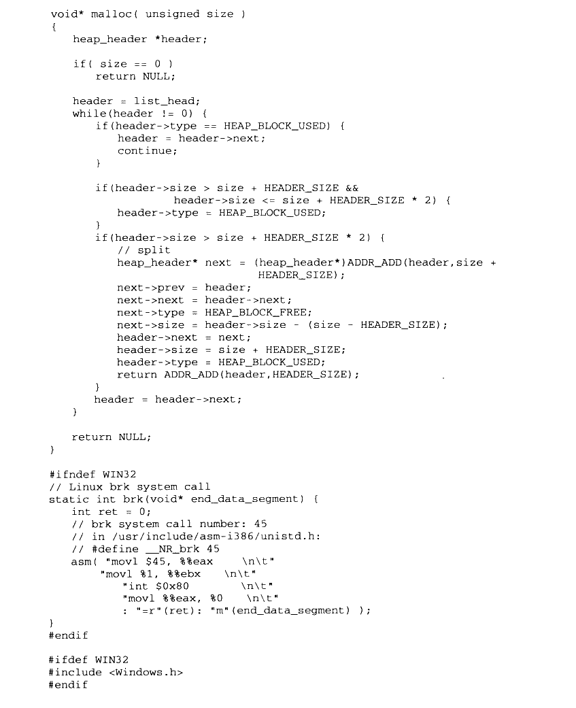

<details markdown="1"><summary>复制校对文字（未运行验证）</summary>

```text
void* malloc(unsigned size)
{
    heap_header *header;
    if (size == 0)
        return NULL;
    header = list_head;
    while (header != 0) {
        if (header->type == HEAP_BLOCK_USED) {
            header = header->next;
            continue;
        }
        if (header->size > size + HEADER_SIZE &&
            header->size <= size + HEADER_SIZE * 2) {
            header->type = HEAP_BLOCK_USED;
        }
        if (header->size > size + HEADER_SIZE * 2) {
            // split
            heap_header* next = (heap_header*)ADDR_ADD(header,size + HEADER_SIZE);
            next->prev = header;
            next->next = header->next;
            next->type = HEAP_BLOCK_FREE;
            next->size = header->size - (size - HEADER_SIZE);
            header->next = next;
            header->size = size + HEADER_SIZE;
            header->type = HEAP_BLOCK_USED;
            return ADDR_ADD(header,HEADER_SIZE);
        }
        header = header->next;
    }
    return NULL;
}
#ifndef WIN32
// Linux brk system call
static int brk(void* end_data_segment) {
    int ret = 0;
    // brk system call number: 45
    // in /usr/include/asm-i386/unistd.h:
    // #define __NR_brk 45
    asm("movl $45, %%eax \n\t"
        "movl %1, %%ebx  \n\t"
        "int $0x80       \n\t"
        "movl %%eax, %0  \n\t"
        : "=r"(ret): "m"(end_data_segment));
}
#endif
#ifdef WIN32
#include <Windows.h>
#endif
```

</details>

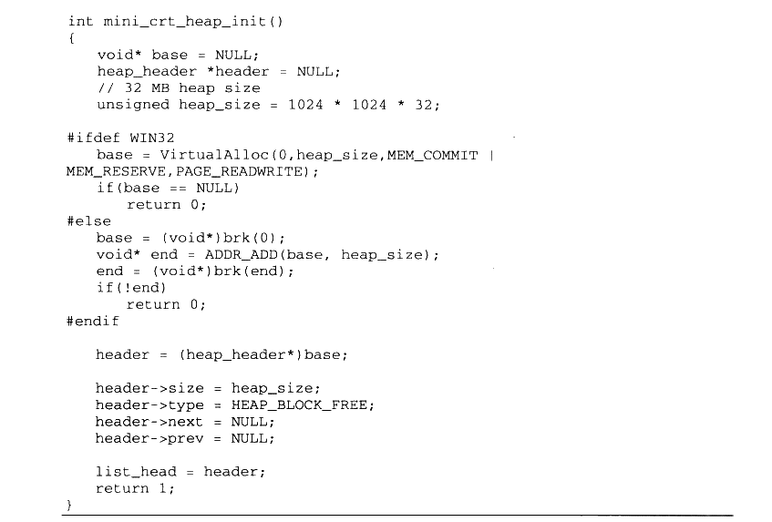

<details markdown="1"><summary>复制校对文字（未运行验证）</summary>

```text
int mini_crt_heap_init()
{
    void* base = NULL;
    heap_header *header = NULL;
    // 32 MB heap size
    unsigned heap_size = 1024 * 1024 * 32;
#ifdef WIN32
    base = VirtualAlloc(0,heap_size,MEM_COMMIT | MEM_RESERVE,PAGE_READWRITE);
    if (base == NULL)
        return 0;
#else
    base = (void*)brk(0);
    void* end = ADDR_ADD(base, heap_size);
    end = (void*)brk(end);
    if (!end)
        return 0;
#endif
    header = (heap_header*)base;
    header->size = heap_size;
    header->type = HEAP_BLOCK_FREE;
    header->next = NULL;
    header->prev = NULL;
    list_head = header;
    return 1;
}
```

</details>

我们在 malloc.c中实现了3个对外的接口函数，分别是：mini\_crt\_heap\_init、malloc 和free。不过这个堆的实现还比较简陋：它的搜索算法是O（n）的（n是堆中分配的块的数量）：堆的空间固定为32MB，没有办法扩张：它没有实现 realloc、calloc 函数：它没有很好的堆溢出防范机制：它不支持多线程同时访问等等。

虽然它很简陋，但是它体现出了堆分配算法的最本质的几个特征，其他的诸如改进搜索速度、扩展堆空间、多线程支持等都可以在此基础上进行改进，由于篇幅有限，我们也不打算一一实现它们，读者如果有兴趣，可以自己考虑动手改进 Mini CRT，为它增加上述特性。

### 13.1.3 IO 与文件操作

在为 Mini CRT 添加了 malloc 和 free 之后，接着将为它们实现IO操作。I/O 部分在任何软件中都是最为复杂的，在CRT 中也不例外。在传统的C语言和UNIX里面，I/O 和文件是同一个概念，所有的 I/O都是通过对文件的操作来实现的。因此，只要实现了文件的基本操作（fopen、fread、fwrite、fclose 和 fseek），即使完成了 Mini CRT 的IO部分。与堆的实现一样，我们需要为 Mini CRT 的IO 部分设计一些实现的基本原则：

- 仅实现基本的文件操作，包括 fopen、fread、fwrite、fclose 及 fseek。

- 为了简单起见，不实现缓冲（Buffer）机制。

- 不对Windows 下的换行机制进行转换，即`\r\n` 与 `\n`之间不进行转换。

- 支持三个标准的输入输出 stdin、stdout 和 stderr。

- 在 Windows 下，文件基本操作可以使用 API：CreateFile、ReadFile、WriteFile、CloseHandle 和 SetFilePointer 实现。

- Linux 不像 Windows 那样有 API 接口，我们必须使用内嵌汇编实现 open、read、write、close 和 seek 这几个系统调用。

- fopen 时仅区分“r”、“w”和“+”这几种模式及它们的组合，不对文本模式和二进制模式进行区分，不支持追加模式（“a”）。

Mini CRT 的IO部分实现源代码如清单13-3所示。

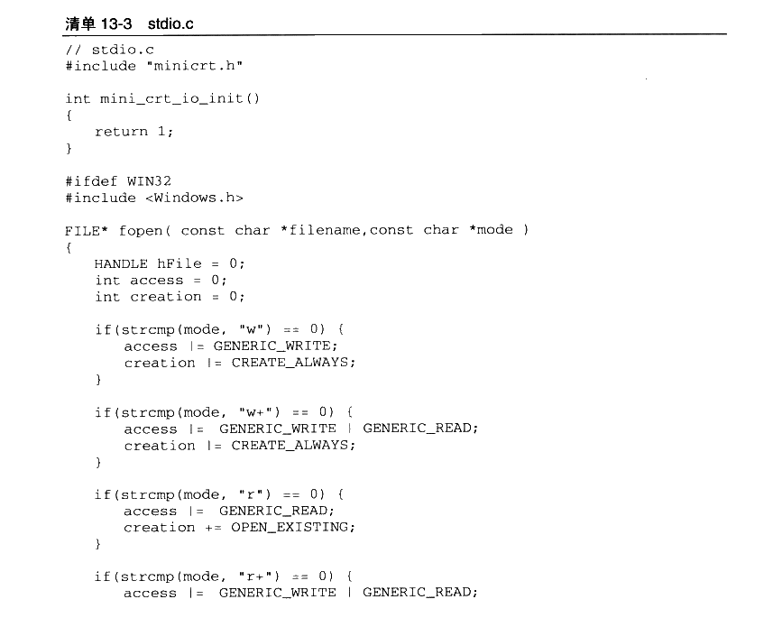

<details markdown="1"><summary>复制校对文字（未运行验证）</summary>

```text
// stdio.c
#include "minicrt.h"
int mini_crt_io_init()
{
    return 1;
}
#ifdef WIN32
#include <Windows.h>
FILE* fopen(const char *filename, const char *mode)
{
    HANDLE hFile = 0;
    int access = 0;
    int creation = 0;
    if (strcmp(mode, "w") == 0) {
        access |= GENERIC_WRITE;
        creation |= CREATE_ALWAYS;
    }
    if (strcmp(mode, "w+") == 0) {
        access |= GENERIC_WRITE | GENERIC_READ;
        creation |= CREATE_ALWAYS;
    }
    if (strcmp(mode, "r") == 0) {
        access |= GENERIC_READ;
        creation += OPEN_EXISTING;
    }
    if (strcmp(mode, "r+") == 0) {
        access |= GENERIC_WRITE | GENERIC_READ;
```

</details>

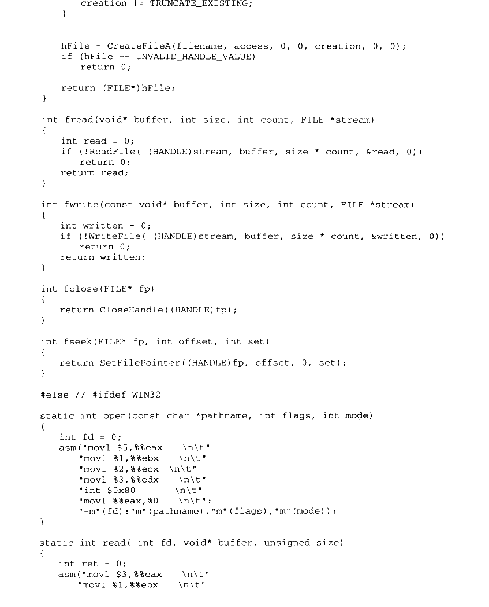

<details markdown="1"><summary>复制校对文字（未运行验证）</summary>

```text
creation = TRUNCATE_EXISTING;
    }
    hFile = CreateFileA(filename, access, 0, 0, creation, 0, 0);
    if (hFile == INVALID_HANDLE_VALUE)
        return 0;
    return (FILE*)hFile;
}
int fread(void* buffer, int size, int count, FILE *stream)
{
    int read = 0;
    if (!ReadFile((HANDLE)stream, buffer, size * count, &read, 0))
        return 0;
    return read;
}
int fwrite(const void* buffer, int size, int count, FILE *stream)
{
    int written = 0;
    if (!WriteFile((HANDLE)stream, buffer, size * count, &written, 0))
        return 0;
    return written;
}
int fclose(FILE* fp)
{
    return CloseHandle((HANDLE)fp);
}
int fseek(FILE* fp, int offset, int set)
{
    return SetFilePointer((HANDLE)fp, offset, 0, set);
}
#else // #ifdef WIN32
static int open(const char *pathname, int flags, int mode)
{
    int fd = 0;
    asm("movl $5,%%eax  \n\t"
        "movl %1,%%ebx \n\t"
        "movl %2,%%ecx \n\t"
        "movl %3,%%edx \n\t"
        "int $0x80     \n\t"
        "movl %%eax,%0 \n\t":
        "=m"(fd):"m"(pathname),"m"(flags),"m"(mode));
}
static int read(int fd, void* buffer, unsigned size)
{
    int ret = 0;
    asm("movl $3,%%eax  \n\t"
        "movl %1,%%ebx \n\t"
```

</details>

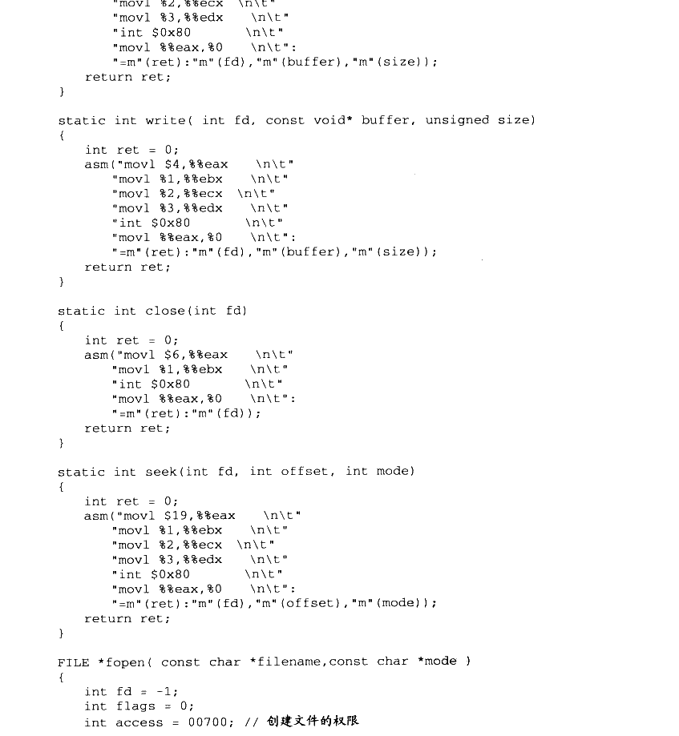

<details markdown="1"><summary>复制校对文字（未运行验证）</summary>

```text
"movl %2,%%ecx \n\t"
        "movl %3,%%edx \n\t"
        "int $0x80     \n\t"
        "movl %%eax,%0 \n\t":
        "=m"(ret):"m"(fd),"m"(buffer),"m"(size));
    return ret;
}
static int write(int fd, const void* buffer, unsigned size)
{
    int ret = 0;
    asm("movl $4,%%eax  \n\t"
        "movl %1,%%ebx \n\t"
        "movl %2,%%ecx \n\t"
        "movl %3,%%edx \n\t"
        "int $0x80     \n\t"
        "movl %%eax,%0 \n\t":
        "=m"(ret):"m"(fd),"m"(buffer),"m"(size));
    return ret;
}
static int close(int fd)
{
    int ret = 0;
    asm("movl $6,%%eax  \n\t"
        "movl %1,%%ebx \n\t"
        "int $0x80     \n\t"
        "movl %%eax,%0 \n\t":
        "=m"(ret):"m"(fd));
    return ret;
}
static int seek(int fd, int offset, int mode)
{
    int ret = 0;
    asm("movl $19,%%eax \n\t"
        "movl %1,%%ebx \n\t"
        "movl %2,%%ecx \n\t"
        "movl %3,%%edx \n\t"
        "int $0x80     \n\t"
        "movl %%eax,%0 \n\t":
        "=m"(ret):"m"(fd),"m"(offset),"m"(mode));
    return ret;
}
FILE *fopen(const char *filename, const char *mode)
{
    int fd = -1;
    int flags = 0;
    int access = 00700; // 创建文件的权限
```

</details>

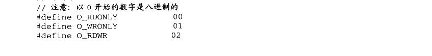

<details markdown="1"><summary>复制校对文字（未运行验证）</summary>

```text
// 注意：以 0 开始的数字是八进制的
#define O_RDONLY 00
#define O_WRONLY 01
#define O_RDWR   02
```

</details>

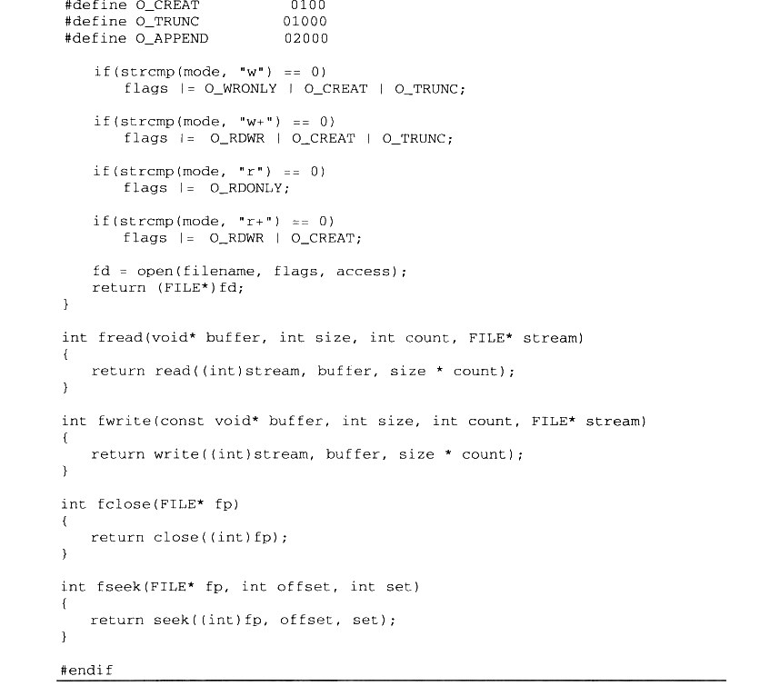

<details markdown="1"><summary>复制校对文字（未运行验证）</summary>

```text
#define O_CREAT  0100
#define O_TRUNC  01000
#define O_APPEND 02000
    if (strcmp(mode, "w") == 0)
        flags |= O_WRONLY | O_CREAT | O_TRUNC;
    if (strcmp(mode, "w+") == 0)
        flags |= O_RDWR | O_CREAT | O_TRUNC;
    if (strcmp(mode, "r") == 0)
        flags |= O_RDONLY;
    if (strcmp(mode, "r+") == 0)
        flags |= O_RDWR | O_CREAT;
    fd = open(filename, flags, access);
    return (FILE*)fd;
}
int fread(void* buffer, int size, int count, FILE* stream)
{
    return read((int)stream, buffer, size * count);
}
int fwrite(const void* buffer, int size, int count, FILE* stream)
{
    return write((int)stream, buffer, size * count);
}
int fclose(FILE* fp)
{
    return close((int)fp);
}
int fseek(FILE* fp, int offset, int set)
{
    return seek((int)fp, offset, set);
}
#endif
```

</details>

另外还有一段与文件操作相关的声明须放在 minicrt.h 里面：

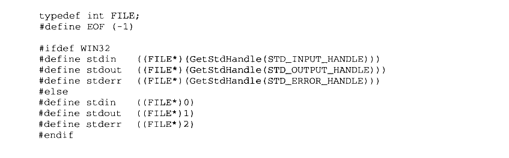

<details markdown="1"><summary>复制校对文字（未运行验证）</summary>

```text
typedef int FILE;
#define EOF (-1)
#ifdef WIN32
#define stdin  ((FILE*)(GetStdHandle(STD_INPUT_HANDLE)))
#define stdout ((FILE*)(GetStdHandle(STD_OUTPUT_HANDLE)))
#define stderr ((FILE*)(GetStdHandle(STD_ERROR_HANDLE)))
#else
#define stdin  ((FILE*)0)
#define stdout ((FILE*)1)
#define stderr ((FILE*)2)
#endif
```

</details>

在上面的Mini CRT I/O 与文件操作的实现中，我们省略了现实CRT中很多内容，包括换行符转换、文件缓冲等。由于省略了这些内容，那么 Mini CRT 相当于仅仅是对系统调用或 Windows API 的一个简单包装，而 FILE 结构也可以被省略，它在 Mini CRT 中是被忽略的，FILE\*这个类型在 Windows 下实际上是内核句柄，而在Linux 下则是文件描述符，它并不是指向 FILE 结构的地址。

值得一提的是，在Windows 下，标准输入输出并不是文件描述符0、1和2，而是要通过一个叫做 GetStdHandle 的 API 获得。

由于省略了诸多实现内容，所以 CRT IO 部分甚至可以不要做任何初始化，于是 I/O 的初始化函数 mini\_crt\_init\_io 也形同虚设，仅仅是一个空函数而已。

### 13.1.4 字符串相关操作

字符串相关的操作也是 CRT 的一部分，包括计算字符串长度、比较两个字符串、整数与字符串之间的转换等。由于这部分功能无须涉及任何与内核交互，是纯粹的用户态的计算，所以它们的实现相对比较简单。我们在 Mini CRT 中将实现如清单13-4所示的几个字符串相关的操作。

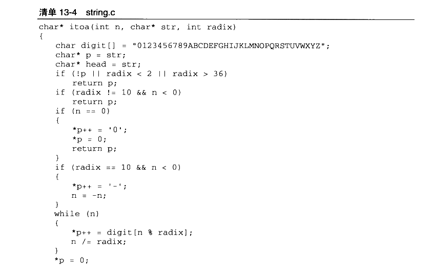

<details markdown="1"><summary>复制校对文字（未运行验证）</summary>

```text
char* itoa(int n, char* str, int radix)
{
    char digit[] = "0123456789ABCDEFGHIJKLMNOPQRSTUVWXYZ";
    char* p = str;
    char* head = str;
    if (!p || radix < 2 || radix > 36)
        return p;
    if (radix != 10 && n < 0)
        return p;
    if (n == 0)
    {
        *p++ = '0';
        *p = 0;
        return p;
    }
    if (radix == 10 && n < 0)
    {
        *p++ = '-';
        n = -n;
    }
    while (n)
    {
        *p++ = digit[n % radix];
        n /= radix;
    }
    *p = 0;
```

</details>

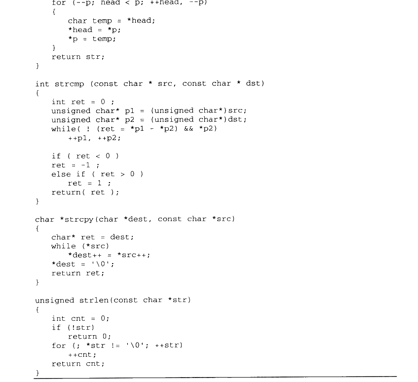

<details markdown="1"><summary>复制校对文字（未运行验证）</summary>

```text
for (--p; head < p; ++head, --p)
    {
        char temp = *head;
        *head = *p;
        *p = temp;
    }
    return str;
}
int strcmp(const char *src, const char *dst)
{
    int ret = 0;
    unsigned char* p1 = (unsigned char*)src;
    unsigned char* p2 = (unsigned char*)dst;
    while (!(ret = *p1 - *p2) && *p2)
        ++p1, ++p2;
    if (ret < 0)
        ret = -1;
    else if (ret > 0)
        ret = 1;
    return ret;
}
char *strcpy(char *dest, const char *src)
{
    char* ret = dest;
    while (*src)
        *dest++ = *src++;
    *dest = '\0';
    return ret;
}
unsigned strlen(const char *str)
{
    int cnt = 0;
    if (!str)
        return 0;
    for (; *str != '\0'; ++str)
        ++cnt;
    return cnt;
}
```

</details>

### 13.1.5 格式化字符串

现在的 Mini CRT已经初具雏形了，它拥有了堆管理、文件操作、基本字符串操作。接下来将要实现的是 CRT 中一个如雷贯耳的函数，那就是 printf。printf 是一个典型的变长参数函数，即参数数量不确定，如何使用和实现变长参数的函数在第10章中已介绍过。与前面一样，我们将这一节要实现的相关内容列举如下。

- printf 实现仅支持%d、%s，且不支持格式控制（比如%08d）。

- 实现 fprintf 和 vfprintf，实际上printf是fprintf 的特殊形式，即目标文件标准输出的 fprintf。

- 实现与文件字符串操作相关的几个函数，fputc 和 fputs。

printf 相关的实现代码如清单 13-5所示。

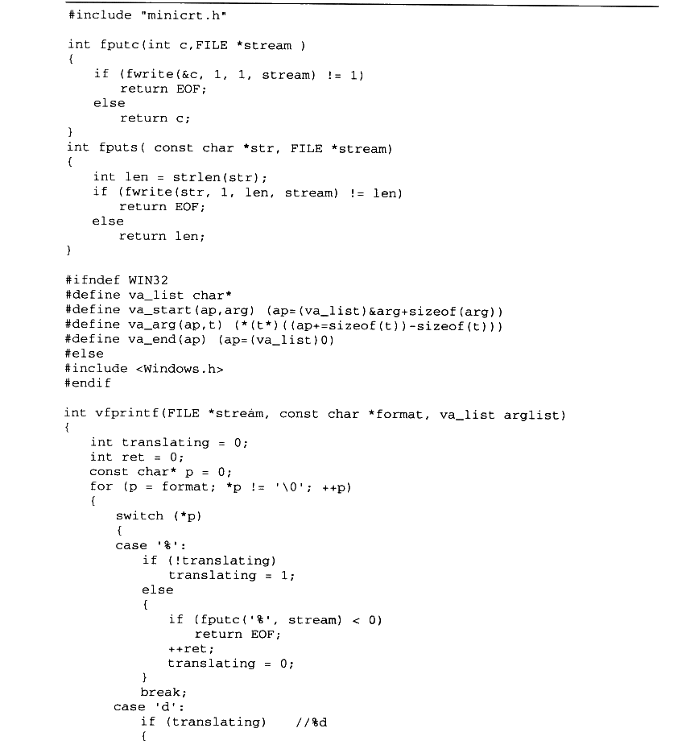

<details markdown="1"><summary>复制校对文字（未运行验证）</summary>

```text
#include "minicrt.h"
int fputc(int c, FILE *stream)
{
    if (fwrite(&c, 1, 1, stream) != 1)
        return EOF;
    else
        return c;
}
int fputs(const char *str, FILE *stream)
{
    int len = strlen(str);
    if (fwrite(str, 1, len, stream) != len)
        return EOF;
    else
        return len;
}
#ifndef WIN32
#define va_list char*
#define va_start(ap,arg) (ap=(va_list)&arg+sizeof(arg))
#define va_arg(ap,t) (*(t*)((ap+=sizeof(t))-sizeof(t)))
#define va_end(ap) (ap=(va_list)0)
#else
#include <Windows.h>
#endif
int vfprintf(FILE *stream, const char *format, va_list arglist)
{
    int translating = 0;
    int ret = 0;
    const char* p = 0;
    for (p = format; *p != '\0'; ++p)
    {
        switch (*p)
        {
        case '%':
            if (!translating)
                translating = 1;
            else
            {
                if (fputc('%', stream) < 0)
                    return EOF;
                ++ret;
                translating = 0;
            }
            break;
        case 'd':
            if (translating) // %d
            {
```

</details>


<details markdown="1"><summary>复制校对文字（未运行验证）</summary>

```text
char buf[16];
                translating = 0;
                itoa(va_arg(arglist, int), buf, 10);
                if (fputs(buf, stream) < 0)
                    return EOF;
                ret += strlen(buf);
            }
            else if (fputc('d', stream) < 0)
                return EOF;
            else
                ++ret;
            break;
        case 's':
            if (translating) // %s
            {
                const char* str = va_arg(arglist, const char*);
                translating = 0;
                if (fputs(str, stream) < 0)
                    return EOF;
                ret += strlen(str);
            }
            else if (fputc('s', stream) < 0)
                return EOF;
            else
                ++ret;
            break;
        default:
            if (translating)
                translating = 0;
            if (fputc(*p, stream) < 0)
                return EOF;
            else
                ++ret;
            break;
        }
    }
    return ret;
}
int printf(const char *format, ...)
{
    va_list(arglist);
    va_start(arglist, format);
    return vfprintf(stdout, format, arglist);
}
int fprintf(FILE *stream, const char *format, ...)
{
    va_list(arglist);
    va_start(arglist, format);
    return vfprintf(stream, format, arglist);
}
```

</details>

可以看到vfprintf 是这些函数中真正实现字符串格式化的函数，实现它的主要复杂性来源于对格式化字符串的分析。在这里使用了一种简单的算法：（1）定义模式：翻译模式/普通模式。

（2） 循环整个格式字符串。

a） 如果遇到%。

i． 普通模式：进入翻译模式；

i. 翻译模式：输出%，退出翻译模式。

b） 如果遇到%后面允许出现的特殊字符（如d和s）。

i. 翻译模式：从不定参数中取出一个参数输出，退出翻译模式；

ii. 普通模式：直接输出该字符。

c） 如果遇到其他字符：无条件退出翻译模式并输出字符。

在 Mini CRT 的vfprintf实现中，并不支持特殊的格式控制符，例如位数、精度控制等，仅支持%d与%s这样的简单转换。真正的vfprintf 格式化字符串实现比较复杂，因为它支持诸如“%f”、“%x”以及各种格式、位数、精度控制等，在这里并没有将它们一一实现，也没有这个必要，Mini CRT 的 printf 已经能够充分展示 printf的实现原理和它的关键技巧，读者也可以根据 Mini CRT printf 的实现去更加深入地分析 Glibc 或MSVC CRT 的相关代码。
