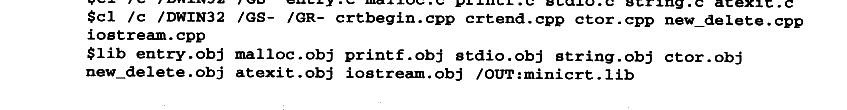
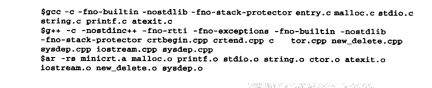
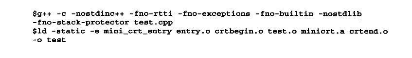

# 13.4 如何使用 Mini CRT++

我们的 Mini CRT终于完成了对C++的支持，同时它也升级为了 Mini CRT++。与13.2节一样，在这一节中将介绍如何编译并且在自己的程序中使用它。首先展示在Windows 下编译的方法：



<details markdown="1"><summary>复制校对文字（未运行验证）</summary>

```text
$ cl /c /DWIN32 /GS- entry.c malloc.c printf.c stdio.c string.c atexit.c
$ cl /c /DWIN32 /GS- /GR- crtbegin.cpp crtend.cpp ctor.cpp new_delete.cpp iostream.cpp
$ lib entry.obj malloc.obj printf.obj stdio.obj string.obj ctor.obj new_delete.obj atexit.obj iostream.obj /OUT:minicrt.lib
```

</details>

这里新增的一个编译参数为/GR-，它的意思是关闭 RTTI功能，否则编译器会为有虚函数的类产生 RTTI 相关代码，在最终链接时会看到 “const type\_info：：vftable”符号未定义的错误。

而 Mini CRT++为了能够在 Linux 下正常运行，还须要建立一个新的源代码文件叫做sysdep.cpp，用于定义 Linux 平台相关的一个函数：


<details markdown="1"><summary>复制校对文字（未运行验证）</summary>

```text
extern "C" {
    void* __dso_handle = 0;
}
```

</details>

这个函数是用于处理共享库的全局对象构造与析构的。我们知道共享库也可以拥有全局对象，这些对象在共享库被装载和卸载时必须被正确地构造和析构。而共享库有可能在进程退出之前被卸载，比如使用 dlopen/dlclose 就可能导致这种情况。那么一个问题就产生了，如何使得属于某个共享库的全局对象析构函数在共享库被卸载时运行呢？GCC的做法是向\_\_cxa\_atexit（）传递一个参数，这个参数用于标示这个析构函数属于哪个共享对象。我们在前面实现\_\_cxa\_atexit 时忽略了第三个参数，实际上这第三个参数就是用于标示共享对象的，它就是\_\_dso\_handle 这个符号。由于在 Mini CRT++中并不考虑对共享库的支持，于是我们就仅仅定义这个符号为 0，以防止链接时出现符号未定义错误。

Mini CRT++在 Linux 平台下编译的方法如下：



<details markdown="1"><summary>复制校对文字（未运行验证）</summary>

```text
$ gcc -c -fno-builtin -nostdlib -fno-stack-protector entry.c malloc.c stdio.c string.c printf.c atexit.c
$ g++ -c -nostdinc++ -fno-rtti -fno-exceptions -fno-builtin -nostdlib -fno-stack-protector crtbegin.cpp crtend.cpp ctor.cpp new_delete.cpp sysdep.cpp iostream.cpp sysdep.cpp
$ ar -rs minicrt.a malloc.o printf.o stdio.o string.o ctor.o atexit.o iostream.o new_delete.o sysdep.o
```

</details>

-fno-rtti 的作用与cl 的/GR-作用一样，用于关闭 RTTI。

-fno-exceptions 的作用用于关闭异常支持，否则GCC会产生异常支持代码，可能导致链接错误。

在 Windows 下使用 Mini CRT++的方法如下：


<details markdown="1"><summary>复制校对文字（未运行验证）</summary>

```text
$ cl /c /DWIN32 /GR- test.cpp
$ link test.obj minicrt.lib kernel32.lib /NODEFAULTLIB /entry:mini_crt_entry
```

</details>

在 Linux 下使用 Mini CRT++的方法如下：



<details markdown="1"><summary>复制校对文字（未运行验证）</summary>

```text
$ g++ -c -nostdinc++ -fno-rtti -fno-exceptions -fno-builtin -nostdlib -fno-stack-protector test.cpp
$ ld -static -e mini_crt_entry entry.o crtbegin.o test.o minicrt.a crtend.o -o test
```

</details>

注 crtbegin.o 和 crtend.o在ld 链接时位于用户目标文件的最开始和最后端，以保证链接的正确性。
