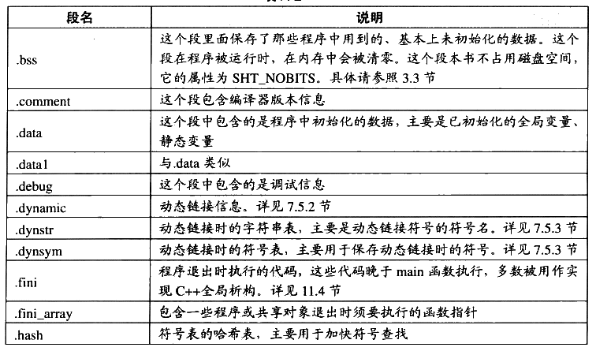

# 附录 A

## A.1 字节序（Byte Order）

“endian”这个词出自 Jonathan Swift 在1726年写的讽刺小说《格列佛游记》（Gulliver's Travels）。小人国的内战就源于吃水煮鸡蛋时究竟是从大头（Big-Endian）敲开还是从小头（Little-Endian）敲开，由此曾发生过6次叛乱，其中一个皇帝送了命，另一个丢了王位。

在不同的计算机体系结构中，对于数据（比特、字节、字）等的存储和传输机制有所不同，因而引发了计算机领域中一个潜在但是又很重要的问题，即通信双方交流的信息单元应该以什么样的顺序进行传送。如果达不成一致的规则，计算机的通信与存储将会无法进行。目前在各种体系的计算机中通常采用的字节存储机制主要有两种：大端（Big-endian）和小端（Little-endian）。

首先让我们来定义两个概念：

MSB 是 Most Significant Bit/Byte 的首字母缩写，通常译为最重要的位或最重要的字节。它通常用来表明在一个 bit 序列（如一个 byte 是8个 bit 组成的一个序列）或一个 byte 序列（如word 是两个 byte 组成的一个序列）中对整个序列取值影响最大的那个 bit/byte。

LSB 是Least Significant Bit/Byte 的首字母缩写，通常译为最不重要的位或最不重要的字节。它通常用来表明在一个 bit序列（如一个 byte 是8个bit 组成的一个序列）或一个 byte序列（如word 是两个 byte 组成的一个序列）中对整个序列取值影响最小的那个 bit/byte。

比如一个十六进制的整数0x12345678里面：

```text
0x12  0x34  0x56  0x78
```

0x12 就是 MSB（Most Significant Byte），0x78 就是 LSB（Least Significant Byte）。而对于 0x78 这个字节而言，它的二进制是 01111000，那么最左边的那个0就是 MSB（Most Significant Bit），最右边的那个0就是 LSB（Least Significant）。

Big-endian 和 little-endian 的区别就是 big-endian 规定MSB在存储时放在低地址，在传输时 MSB放在流的开始：LSB 存储时放在高地址，在传输时放在流的末尾。little-endian 则相反。例如：0x12345678h 这个数据在不同机器中的存储是不同，如表A-1所示。

表A-1


<details markdown="1"><summary>查看校对表格</summary>

| 字节 | Big-Endian | Little-Endian |
| --- | --- | --- |
| 0 字节 | 0x12 | 0x78 |
| 1 字节 | 0x34 | 0x56 |

</details>

续表


<details markdown="1"><summary>查看校对表格</summary>

| 字节 | Big-Endian | Little-Endian |
| --- | --- | --- |
| 2 字节 | 0x56 | 0x34 |
| 3 字节 | 0x78 | 0x21 |

</details>

Little-Endian 主要用于我们现在的PC 的CPU 中，即 Intel 的x86 系列兼容机：Big-Endian则主要应用在目前的 Mac 机器中，一般指 PowerPC 系列处理器。另外值得一提的是，目前的 TCP/IP 网络及 Java 虚拟机的字节序都是 Big-endian 的。这意味着如果通过网络传输0x12345678这个整型变量，首先被发送的应该是0x12，接着是0x34，然后是 0x56，最后是0x78。所以我们的程序在处理网络流的时候，必须注意字节序的问题。

big-endian 和 little-endian 的争论由来已久，计算机界对两种方式的优劣进行了长期的争论，争论双方相互不妥协（至今仍未完全妥协）。Danny Cohen 于1980年写的一篇名叫“On Holy Wars and a Plea for Peace”著名的论文形象地将双方比喻成《格列佛游记》小人国里征战的双方。从此以后这两个术语开始流行并且一直沿用至今。


## A.2 ELF 常见段

ELF 常见段名如表A-2所示。

表A-2



<details markdown="1"><summary>查看校对表格</summary>

| 段名 | 说明 |
| --- | --- |
| .bss | 保存程序中用到的、基本上未初始化的数据；运行时在内存中清零，不占用磁盘空间，属性为 SHT_NOBITS。详见 3.3 节。 |
| .comment | 编译器版本信息。 |
| .data | 已初始化的全局变量、静态变量。 |
| .data1 | 与 .data 类似。 |
| .debug | 调试信息。 |
| .dynamic | 动态链接信息。详见 7.5.2 节。 |
| .dynstr | 动态链接时的字符串表，主要是动态链接符号的符号名。详见 7.5.3 节。 |
| .dynsym | 动态链接时的符号表。详见 7.5.3 节。 |
| .fini | 程序退出时执行的代码，多数被用作实现 C++ 全局析构。详见 11.4 节。 |
| .fini_array | 程序或共享对象退出时须执行的函数指针。 |
| .hash | 符号表的哈希表，用于加快符号查找。 |

</details>

续表


<details markdown="1"><summary>查看校对表格</summary>

| 段名 | 说明 |
| --- | --- |
| .init | 早于 main 执行的初始化代码，多数用于实现 C++ 全局构造。详见 11.4 节。 |
| .init_array | 程序或共享对象刚开始初始化时须执行的函数指针。 |
| .interp | 动态链接器路径。详见 7.5.1 节。 |
| .line | 调试行号信息，表示机器代码与源代码行号的对应关系。 |
| .note | 编译器、链接器或操作系统厂商保存的额外信息，与平台相关。 |
| .preinit_array | 早于初始化阶段执行的函数指针数组，在 .init_array 之前执行。 |
| .rodata | 只读数据段。 |
| .rodata1 | 同 .rodata。 |
| .shstrtab | 段名字符串表。 |
| .strtab | 字符串表，通常保存符号表中的符号名。 |
| .symtab | 链接时所需的符号信息。详见 3.5 节。 |
| .tbss | 线程局部存储的未初始化数据；启动新线程时产生副本并清零。 |
| .tdata | 线程局部存储的初始化数据；启动新线程时产生副本。 |
| .text | 程序的可执行代码。详见 3.3.1 节。 |
| .ctors | 全局构造函数指针。详见 11.4 节。 |
| .data.rel.ro | 程序的只读数据，重定位时改写，之后设为只读。 |
| .dtors | 全局析构函数指针。详见 11.4 节。 |
| .eh_frame | C++ 异常处理相关内容。 |
| .eh_frame_hdr | C++ 异常处理相关内容。 |
| .gcc_except_table | 语言相关数据。 |
| .gnu.version | 符号版本相关。详见 8.2 节。 |
| .gnu.version_d | 符号版本相关。详见 8.2 节。 |
| .gnu.version_r | 符号版本相关。详见 8.2 节。 |
| .got.plt | PLT 信息。详见 7.4 节。 |
| .jcr | Java 程序相关。 |
| .note.ABI-tag | 指定程序的 ABI。 |
| .stab | 调试信息。 |
| .stabstr | .stab 中用到的字符串。 |

</details>


## A.3 常用开发工具命令行参考

#### A.3.1 gcc，GCC 编译器

- `-E`：只进行预处理并把预处理结果输出。

- `-c`：只编译不链接。

- `-o <filename>`：指定输出文件名。

- `-S`：输出编译后的汇编代码文件。

- `-I`：指定头文件路径。

- `-e name`：指定 name 为程序入口地址。

- `-ffreestanding`：编译独立的程序，不会自动链接C运行库、启动文件等。

- `-finline-functions，-fno-inline-functions`：启用/关闭内联函数。

- `-g`：在编译结果中加入调试信息，-ggdb 就是加入 GDB 调试器能够识别的格式。

- `-L<directory>`：指定链接时查找路径，多个路径之间用冒号隔开。

- `-nostartfiles`： 不要链接启动文件，比如 crtbegin.o、crtend.o。

- `-nostdlib`：不要链接标准库文件，主要是C运行库。

- `-O0`：关闭所有优化选项。

- `-shared`：产生共享对象文件。

- `-static`：使用静态链接。

- `-Wall`：对源代码中的多数编译警告进行启用。

- `-fPIC`：使用地址无关代码模式进行编译。

- `-fPIE`：使用地址无关代码模式编译可执行文件。

- `-XLinker <option>`：把 option 传递给链接器。

- `-Wl <option>`：把 option 传递给链接器，与上面的选项类似。

- `-fomit-frame-pointer`：禁止使用 EBP 作为函数帧指针。

- `-fno-builtin`：禁止GCC编译器内置函数。

- `-fno-stack-protector`：是指关闭堆栈保护功能。

- `-ffunction-sections`：将每个函数编译到独立的代码段。

- `-fdata-sections`： 将全局/静态变量编译到独立的数据段。

#### A.3.2 ld，GNU 链接器

- `-static`：静态链接。

- `-l<libname>`：指定链接某个库。

- `-e name`：指定 name 为程序入口。

- `-r`：合并目标文件，不进行最终链接。

- `-L <directory>`：指定链接时查找路径，多个路径之间用冒号隔开。

- `-M`：将链接时的符号和地址输出成一个映射文件。

- `-o`：指定输出文件名。

- `-s`：清除输出文件中的符号信息。

- `-S`：清除输出文件中的调试信息。

- `-T<scriptfile>`：指定链接脚本文件。

- `-version-script <file>`：指定符号版本脚本文件。

- `-soname <name>`：指定输出共享库的 SONAME。

- `-export-dynamic`：将全局符号全部导出。

- `-verbose`：链接时输出详细信息。

- `-rpath <path>`：指定链接时库查找路径。

#### A.3.3 objdump，GNU 目标文件可执行文件查看器

- `-a`：列举.a文件中所有的目标文件。

- `-b bfdname`：指定BFD名。

- `-C`：对于C++符号名进行反修饰（Demangle）。

- `-g`：显示调试信息。

- `-d`：对包含机器指令的段进行反汇编。

- `-D`：对所有的段进行反汇编。

- `-f`：显示目标文件文件头。

- `-h`：显示段表。

- `-l`：显示行号信息。

- `-p`：显示专有头部信息，具体内容取决于文件格式。

- `-r`：显示重定位信息。

- `-R`：显示动态链接重定位信息。

- `-s`：显示文件所有内容。

- `-S`：显示源代码和反汇编代码（包含-d参数）。

- `-W`：显示文件中包含有 DWARF 调试信息格式的段。

- `-t`：显示文件中的符号表。

- `-T`：显示动态链接符号表。

- `-x`：显示文件的所有文件头。

#### A.3.4 cl，MSVC 编译器

- `/c`：只编译不链接。

- `/Za`：禁止语言扩展。

- `/link`：链接指定的模块或给链接器传递参数。

- `/Od`：禁止优化。

- `/O2`：以运行速度最快为目标优化。

- `/O1`：以最节省空间为目标优化。

- `/GR 或 /GR-`：开启或关闭RTTI。

- `/Gy`： 开启函数级别链接。

- `/GS 或 /GS-`：开启或关闭。

- `/Fa[file]`：输出汇编文件。

- `/E`：只进行预处理并且把结果输出。

- `/I`：指定头文件包含目录。

- `/Zi`：启用调试信息。

- `/LD`：编译产生 DLL 文件。

- `/LDd`：编译产生 DLL 文件（调试版）。

- `/MD`：与动态多线程版本运行库 MSVCRT.LIB 链接。

- `/MDd`：与调试版动态多线程版本运行库MSVCRTD.LIB 链接。

- `/MT`： 与静态多线程版本运行库 LIBCMT.LIB 链接。

- `/MTd`：与调试版静态多线程版本运行库 LIBCMTD.LIB 链接。

#### A.3.5 link，MSVC 链接器

- `/BASE:address`：指定输出文件的基地址。

- `/DEBUG`：输出调试模式版本。

- `/DEF:filename`：指定模块定义文件.DEF。

- `/DEFAULTLIB:library`： 指定默认运行库。

- `/DLL`： 产生 DLL。

- `/ENTRY:symbol`：指定程序入口。

- `/EXPORT:symbol`：指定某个符号为导出符号。

- `/HEAP`：指定默认堆大小。

- `/LIBPATH:dir`： 指定链接时库搜索路径。

- `/MAP[:filename]`：产生链接 MAP 文件。

- `/NODEFAULTLIB[:library]`：禁止默认运行库。

- `/OUT:filename`：指定输出文件名。

- `/RELEASE`：以发布版本产生输出文件。

- `/STACK`：指定默认栈大小。

- `/SUBSYSTEM`：指定子系统。

#### A.3.6 dumpbin，MSVC 的 COFF/PE 文件查看器

- `/ALL`：显示所有信息。

- `/ARCHIVEMEMBERS`：显示.LIB 文件中所有目标文件列表。

- `/DEPENDENTS`：显示文件的动态链接依赖关系。

- `/DIRECTIVES`：显示链接器指示。

- `/DISASM`：显示反汇编。

- `/EXPORTS`：显示导出函数表。

- `/HEADERS`：显示文件头。

- `/IMPORTS`： 显示导入函数表。

- `/LINENUMBERS`：显示行号信息。

- `/RELOCATIONS`：显示重定位信息。

- `/SECTION:name`：显示某个段。

- `/SECTION`：显示文件概要信息。

- `/SYMBOLS`：显示文件符号表。

- `/TLS`： 显示线程局部存储TLS 信息。
