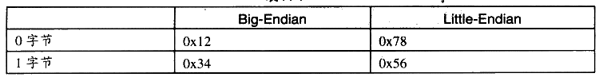
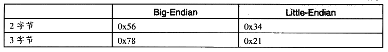

# A.1 字节序（Byte Order）

“endian”这个词出自 Jonathan Swift 在1726年写的讽刺小说《格列佛游记》（Gulliver's Travels）。小人国的内战就源于吃水煮鸡蛋时究竟是从大头（Big-Endian）敲开还是从小头（Little-Endian）敲开，由此曾发生过6次叛乱，其中一个皇帝送了命，另一个丢了王位。

在不同的计算机体系结构中，对于数据（比特、字节、字）等的存储和传输机制有所不同，因而引发了计算机领域中一个潜在但是又很重要的问题，即通信双方交流的信息单元应该以什么样的顺序进行传送。如果达不成一致的规则，计算机的通信与存储将会无法进行。目前在各种体系的计算机中通常采用的字节存储机制主要有两种：大端（Big-endian）和小端（Little-endian）。

首先让我们来定义两个概念：

MSB 是 Most Significant Bit/Byte 的首字母缩写，通常译为最重要的位或最重要的字节。它通常用来表明在一个 bit 序列（如一个 byte 是8个 bit 组成的一个序列）或一个 byte 序列（如word 是两个 byte 组成的一个序列）中对整个序列取值影响最大的那个 bit/byte。

LSB 是Least Significant Bit/Byte 的首字母缩写，通常译为最不重要的位或最不重要的字节。它通常用来表明在一个 bit序列（如一个 byte 是8个bit 组成的一个序列）或一个 byte序列（如word 是两个 byte 组成的一个序列）中对整个序列取值影响最小的那个 bit/byte。

比如一个十六进制的整数0x12345678里面：

```text
0x12  0x34  0x56  0x78
```

0x12 就是 MSB（Most Significant Byte），0x78 就是 LSB（Least Significant Byte）。而对于 0x78 这个字节而言，它的二进制是 01111000，那么最左边的那个0就是 MSB（Most Significant Bit），最右边的那个0就是 LSB（Least Significant）。

Big-endian 和 little-endian 的区别就是 big-endian 规定MSB在存储时放在低地址，在传输时 MSB放在流的开始：LSB 存储时放在高地址，在传输时放在流的末尾。little-endian 则相反。例如：0x12345678h 这个数据在不同机器中的存储是不同，如表A-1所示。

表A-1



<details markdown="1"><summary>查看校对表格</summary>

| 字节 | Big-Endian | Little-Endian |
| --- | --- | --- |
| 0 字节 | 0x12 | 0x78 |
| 1 字节 | 0x34 | 0x56 |

</details>

续表



<details markdown="1"><summary>查看校对表格</summary>

| 字节 | Big-Endian | Little-Endian |
| --- | --- | --- |
| 2 字节 | 0x56 | 0x34 |
| 3 字节 | 0x78 | 0x21 |

</details>

Little-Endian 主要用于我们现在的PC 的CPU 中，即 Intel 的x86 系列兼容机：Big-Endian则主要应用在目前的 Mac 机器中，一般指 PowerPC 系列处理器。另外值得一提的是，目前的 TCP/IP 网络及 Java 虚拟机的字节序都是 Big-endian 的。这意味着如果通过网络传输0x12345678这个整型变量，首先被发送的应该是0x12，接着是0x34，然后是 0x56，最后是0x78。所以我们的程序在处理网络流的时候，必须注意字节序的问题。

big-endian 和 little-endian 的争论由来已久，计算机界对两种方式的优劣进行了长期的争论，争论双方相互不妥协（至今仍未完全妥协）。Danny Cohen 于1980年写的一篇名叫“On Holy Wars and a Plea for Peace”著名的论文形象地将双方比喻成《格列佛游记》小人国里征战的双方。从此以后这两个术语开始流行并且一直沿用至今。
